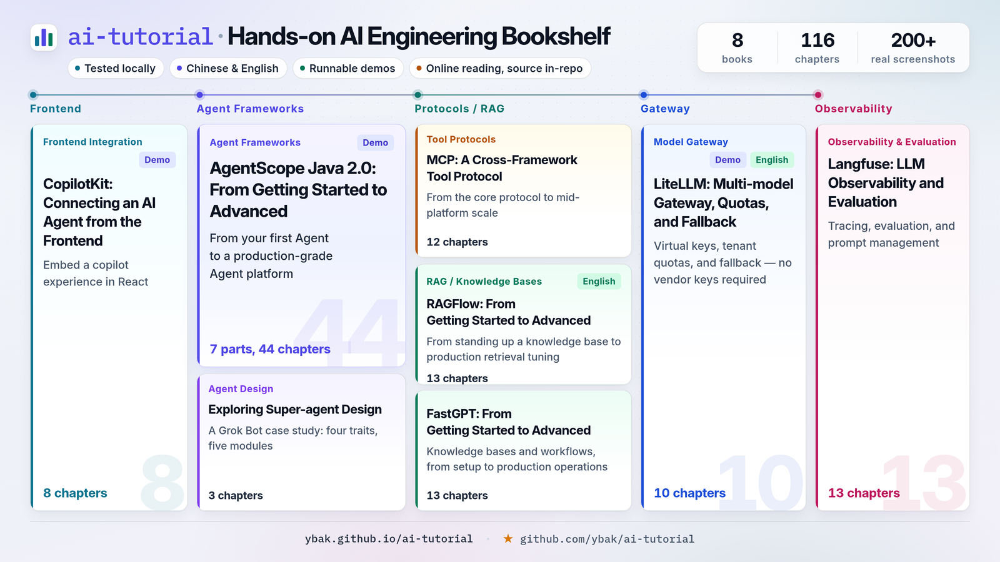

[中文](README.md) | English

# ai-tutorial — a hands-on AI tutorial shelf

Hands-on, Chinese-first AI application tutorials. Books cover MCP, RAG, RAGFlow, FastGPT, Langfuse, LiteLLM, CopilotKit, AgentScope Java, and LangChain / LangGraph. What each book actually ran is in that book's README. The LangChain book has no vendor key: a fake chat model plus a deterministic graph.

The Chinese shelf is the source of record. This page is the English entry. Most books are Chinese only today. LiteLLM, RAGFlow, FastGPT, MCP, Langfuse, CopilotKit, Super-agent, and LangChain have English editions.

**[Chinese docs](https://ybak.github.io/ai-tutorial/)** · **[English docs](https://ybak.github.io/ai-tutorial/en/)** · [Chinese README](README.md)

  

## Books

| Book | What it covers | Chapters | Docs | Language |
| --- | --- | --- | --- | --- |
| AgentScope Java 2.0: From First Steps to Production | Seven parts, from the first agent to a production-grade agent platform | 44 | [agentscope-java](https://ybak.github.io/ai-tutorial/agentscope-java/) | Chinese only |
| MCP: A Cross-Framework Tool Protocol | Four parts, from the core protocol to platform-scale tool access. The English edition keeps the commands, config, and captured output of the Chinese chapters | 12 | [/en/mcp/](https://ybak.github.io/ai-tutorial/en/mcp/) · [中文](https://ybak.github.io/ai-tutorial/mcp/) | English edition available |
| RAGFlow: From First Steps to Production | Four parts, from standing up a knowledge base to production retrieval tuning. The English edition keeps the commands, config, captured output, and the 30 local screenshots of the Chinese chapters | 13 | [/en/ragflow/](https://ybak.github.io/ai-tutorial/en/ragflow/) · [中文](https://ybak.github.io/ai-tutorial/ragflow/) | English edition available |
| CopilotKit: Bringing an AI Agent into the Frontend | Four parts on a copilot inside a React app, from components to an autonomous agent, with a runnable demo and screenshots from local runs. The English edition keeps the commands, config, and the local screenshots of the Chinese chapters | 8 | [/en/copilotkit/](https://ybak.github.io/ai-tutorial/en/copilotkit/) · [中文](https://ybak.github.io/ai-tutorial/copilotkit/) | English edition available |
| FastGPT: From First Steps to Production | Four parts on knowledge bases and workflows, from setup to production operations. The English edition keeps the commands, config, captured output, and the 15 local screenshots of the Chinese chapters | 13 | [/en/fastgpt/](https://ybak.github.io/ai-tutorial/en/fastgpt/) · [中文](https://ybak.github.io/ai-tutorial/fastgpt/) | English edition available |
| Super-agent Design, Explored through Grok Bot | The four traits and five modules, with Grok Bot as the comparison for a continuous, efficient, proactive, persistent assistant. The English edition keeps the visible-behavior comparison, the Inferred markings, and the 8 local screenshots of the Chinese chapters | 3 | [/en/super-agent/](https://ybak.github.io/ai-tutorial/en/super-agent/) · [中文](https://ybak.github.io/ai-tutorial/super-agent/) | English edition available |
| Langfuse: LLM Observability and Evaluation | Four parts on tracing, evaluation, and prompt management, from self-hosting to quality engineering. The English edition keeps the commands, config, captured output, and the local screenshots of the Chinese chapters | 13 | [/en/langfuse/](https://ybak.github.io/ai-tutorial/en/langfuse/) · [中文](https://ybak.github.io/ai-tutorial/langfuse/) | English edition available |
| LiteLLM: Multi-Model Gateway, Quotas, and Fallback | Virtual keys, tenant quotas, and fallback. Puts AgentScope, Spring AI, and Langfuse behind one open-source gateway. Runs with docker compose (official image, Postgres 16, mock upstreams, no vendor keys) and includes 13 Admin UI screenshots | 10 | [/en/litellm/](https://ybak.github.io/ai-tutorial/en/litellm/) · [中文](https://ybak.github.io/ai-tutorial/litellm/) | English edition available |
| LangChain and LangGraph: From One Chain to a Support Graph | One call as a chain; lookup, cycles, and human approval as a resumable graph. No vendor key: a fake chat model plus a deterministic graph. The English edition keeps the commands and the captured `run_all.py` lines of the Chinese chapters | 8 | [/en/langchain/](https://ybak.github.io/ai-tutorial/en/langchain/) · [中文](https://ybak.github.io/ai-tutorial/langchain/) | English edition available |

The Chinese shelf, including books that are not in the table above because they are still only planned, is at [ybak.github.io/ai-tutorial](https://ybak.github.io/ai-tutorial/).

## Quick start

1. Read on the docs site: [ybak.github.io/ai-tutorial](https://ybak.github.io/ai-tutorial/). Each published book is a subdirectory, for example `/agentscope-java/` and `/litellm/`.
2. For an English book, open [/en/litellm/](https://ybak.github.io/ai-tutorial/en/litellm/), [/en/ragflow/](https://ybak.github.io/ai-tutorial/en/ragflow/), [/en/fastgpt/](https://ybak.github.io/ai-tutorial/en/fastgpt/), [/en/mcp/](https://ybak.github.io/ai-tutorial/en/mcp/), [/en/langfuse/](https://ybak.github.io/ai-tutorial/en/langfuse/), [/en/copilotkit/](https://ybak.github.io/ai-tutorial/en/copilotkit/), [/en/super-agent/](https://ybak.github.io/ai-tutorial/en/super-agent/), or [/en/langchain/](https://ybak.github.io/ai-tutorial/en/langchain/) and read the chapters in order. The header switches between 中文 and English on the same chapter. Commands, config, captured output, and the screenshots match the Chinese chapters.
3. In this repository, each book is self-contained under `books/<bookId>/` (`chapters/`, `assets/`, and that book's demo). LiteLLM's local demo is [books/litellm/demo/](books/litellm/demo/README.md). Quick demo: `cd books/litellm/demo && docker compose up`, then open http://127.0.0.1:4000/ui/ and log in with `admin` / `StarsailDemo#2026` (`UI_USERNAME` / `UI_PASSWORD`). The master key `sk-starsail-master` is for API calls and `seed.sh` only; it does not go in the login form. After the proxy is up, run `LITELLM_MASTER_KEY=sk-starsail-master ./seed.sh` once to create the teams and keys shown in the screenshots. The English chapter files are `books/litellm/en/chapters/`. Fixed names for the English edition are in [books/litellm/en/README.md](books/litellm/en/README.md).
4. To build the static site locally, follow [build/README.md](build/README.md). From `build/`: `npm install`, then `npm run site`. Output lands in `output/site/`, including `output/site/en/litellm/`, `output/site/en/ragflow/`, `output/site/en/fastgpt/`, `output/site/en/mcp/`, `output/site/en/langfuse/`, `output/site/en/copilotkit/`, `output/site/en/super-agent/`, and `output/site/en/langchain/`. The English RAGFlow chapter files are `books/ragflow/en/chapters/`. Fixed names for that edition are in [books/ragflow/en/README.md](books/ragflow/en/README.md). The English MCP chapter files are `books/mcp/en/chapters/`. Fixed names for that edition are in [books/mcp/en/README.md](books/mcp/en/README.md). The English Langfuse chapter files are `books/langfuse/en/chapters/`. Fixed names for that edition are in [books/langfuse/en/README.md](books/langfuse/en/README.md). The English Super-agent chapter files are `books/super-agent/en/chapters/`. Fixed names for that edition are in [books/super-agent/en/README.md](books/super-agent/en/README.md). The English LangChain chapter files are `books/langchain/en/chapters/`. Fixed names for that edition are in [books/langchain/en/README.md](books/langchain/en/README.md). Building the site also writes `output/site/en/langchain/`.

## How to read

The shelf is not one long course. Pick the book that matches the gap you are filling. The Chinese README groups them by role; the same map is:

| Role | Start here |
| --- | --- |
| Development | **agentscope-java** for the main line. Python chains and graphs in **langchain**. RAG knowledge bases in **ragflow**. Knowledge-base Q&A and low-code workflows in **fastgpt**. Frontend AI in **copilotkit**. Cross-framework tools in **mcp**. LLM tracing in **langfuse**. Multi-model gateway, virtual keys, and fallback in **litellm**. |
| Testing | **agentscope-java** chapter 39 (trace evaluation), then datasets, scoring, prompt regression, and hallucination checks in **langfuse** (chapters 7–9 and 12). |
| Operations | **langfuse**: trace and cost (chapters 4–5), local deploy and troubleshooting (chapter 2), prompt versions and A/B (chapters 6 and 8). |
| Knowledge-base and prompt operations | Chunk and update practice in **ragflow**. Conversation review in **fastgpt**. Prompt versions and A/B in **langfuse** chapters 6 and 8. |

Cross-links inside a chapter point at another book on this shelf. Those targets are still Chinese, except LiteLLM, RAGFlow, FastGPT, MCP, Langfuse, CopilotKit, Super-agent, and LangChain, which have both languages.

A few topics are named in the Chinese README as not written yet: **ai-platform** (the gateway slice of auth, quotas, and model fallback is the LiteLLM book; isolation policy, billing product, and the merchant console are not), **spring-ai** (LiteLLM chapter 8 only points a Spring AI OpenAI client at the gateway; the Python LangChain / LangGraph book does not cover LangChain4j), **dify**, and **vercel-ai-sdk**.

## Build and license

Site and PDF build instructions are in [build/README.md](build/README.md). Source, license, and use of each book are in [NOTICE.md](NOTICE.md). The shelf is for learning and technical sharing, not for commercial use.

Author and community notes are in the [Chinese README](README.md).

## FastGPT English edition

FastGPT has an English edition at [/en/fastgpt/](https://ybak.github.io/ai-tutorial/en/fastgpt/). Read the thirteen chapters in order. The header switches between 中文 and English on the same chapter. Commands, config, captured output, and the 15 screenshots match the Chinese chapters. The English chapter files are `books/fastgpt/en/chapters/`. Names that stay fixed are in [books/fastgpt/en/README.md](books/fastgpt/en/README.md). Building the site also writes `output/site/en/fastgpt/`.

## MCP English edition

MCP has an English edition at [/en/mcp/](https://ybak.github.io/ai-tutorial/en/mcp/). Read the twelve chapters in order. The header switches between 中文 and English on the same chapter. Commands, config, and captured output match the Chinese chapters. The Chinese chapters do not include local screenshots, and this edition does not add any. The English chapter files are `books/mcp/en/chapters/`. Names that stay fixed are in [books/mcp/en/README.md](books/mcp/en/README.md). Building the site also writes `output/site/en/mcp/`.

## Langfuse English edition

Langfuse has an English edition at [/en/langfuse/](https://ybak.github.io/ai-tutorial/en/langfuse/). Read the thirteen chapters in order. The header switches between 中文 and English on the same chapter. Commands, config, captured output, and the local screenshots match the Chinese chapters. The English chapter files are `books/langfuse/en/chapters/`. Names that stay fixed are in [books/langfuse/en/README.md](books/langfuse/en/README.md). Building the site also writes `output/site/en/langfuse/`.

## CopilotKit English edition

CopilotKit has an English edition at [/en/copilotkit/](https://ybak.github.io/ai-tutorial/en/copilotkit/). Read the eight chapters in order. The header switches between 中文 and English on the same chapter. Commands, config, and the local screenshots match the Chinese chapters. The English chapter files are `books/copilotkit/en/chapters/`. Names that stay fixed are in [books/copilotkit/en/README.md](books/copilotkit/en/README.md). Building the site also writes `output/site/en/copilotkit/`.

## Super-agent English edition

Super-agent has an English edition at [/en/super-agent/](https://ybak.github.io/ai-tutorial/en/super-agent/). Read the three chapters in order. The header switches between 中文 and English on the same chapter. The visible-behavior comparison, the Inferred markings, and the 8 local screenshots match the Chinese chapters. The English chapter files are `books/super-agent/en/chapters/`. Names that stay fixed are in [books/super-agent/en/README.md](books/super-agent/en/README.md). Lin Zhou (林舟) is a fictional character. Building the site also writes `output/site/en/super-agent/`.

## LangChain English edition

LangChain has an English edition at [/en/langchain/](https://ybak.github.io/ai-tutorial/en/langchain/). Read the eight chapters in order. The header switches between 中文 and English on the same chapter. Commands and the captured `run_all.py` lines match the Chinese chapters. There are no screenshots. The English chapter files are `books/langchain/en/chapters/`. Names that stay fixed are in [books/langchain/en/README.md](books/langchain/en/README.md). Lin Zhou (林舟) is a fictional character. The local demo is [books/langchain/demo/](books/langchain/demo/README.md). Building the site also writes `output/site/en/langchain/`.
