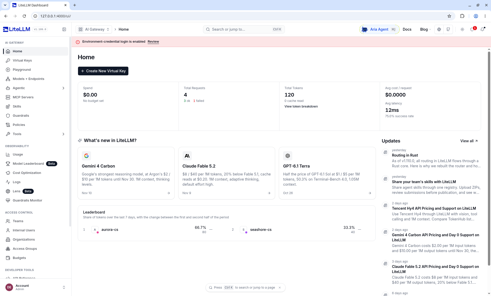

[中文](README.md) | English

# ai-tutorial — a hands-on AI tutorial shelf

Hands-on, Chinese-first AI application tutorials. Every book is tested locally, covering MCP, RAG, RAGFlow, FastGPT, Langfuse, LiteLLM, CopilotKit, and AgentScope Java.

The Chinese shelf is the source of record. This page is the English entry. Most books are Chinese only today. LiteLLM has an English edition.

**[Chinese docs](https://ybak.github.io/ai-tutorial/)** · **[English docs](https://ybak.github.io/ai-tutorial/en/)** · [Chinese README](README.md)

  

## Books

| Book | What it covers | Chapters | Docs | Language |
| --- | --- | --- | --- | --- |
| AgentScope Java 2.0: From First Steps to Production | Seven parts, from the first agent to a production-grade agent platform | 44 | [agentscope-java](https://ybak.github.io/ai-tutorial/agentscope-java/) | Chinese only |
| MCP: A Cross-Framework Tool Protocol | Four parts, from the core protocol to platform-scale tool access | 12 | [mcp](https://ybak.github.io/ai-tutorial/mcp/) | Chinese only |
| RAGFlow: From First Steps to Production | Four parts, from standing up a knowledge base to production retrieval tuning | 13 | [ragflow](https://ybak.github.io/ai-tutorial/ragflow/) | Chinese only |
| FastGPT: From First Steps to Production | Four parts on knowledge bases and workflows, from setup to production operations | 13 | [fastgpt](https://ybak.github.io/ai-tutorial/fastgpt/) | Chinese only |
| CopilotKit: Bringing an AI Agent into the Frontend | Four parts on a copilot inside a React app, from components to an autonomous agent, with a runnable demo and screenshots from local runs | 8 | [copilotkit](https://ybak.github.io/ai-tutorial/copilotkit/) | Chinese only |
| Langfuse: LLM Observability and Evaluation | Four parts on tracing, evaluation, and prompt management, from self-hosting to quality engineering, with screenshots from a local run | 13 | [langfuse](https://ybak.github.io/ai-tutorial/langfuse/) | Chinese only |
| Super-agent Design, Explored through Grok Bot | The four traits and five modules, with Grok Bot as the comparison for a continuous, efficient, proactive, persistent assistant | 3 | [super-agent](https://ybak.github.io/ai-tutorial/super-agent/) | Chinese only |
| LiteLLM: Multi-Model Gateway, Quotas, and Fallback | Four parts on virtual keys, tenant quotas, and fallback. AgentScope, Spring AI, and Langfuse on one open-source gateway, tested against a mock upstream with no vendor keys | 10 | [/en/litellm/](https://ybak.github.io/ai-tutorial/en/litellm/) · [中文](https://ybak.github.io/ai-tutorial/litellm/) | English edition available |

Most books are currently available only in Chinese. LiteLLM has an English edition at [/en/litellm/](https://ybak.github.io/ai-tutorial/en/litellm/).

The Chinese shelf, including books that are not in the table above because they are still only planned, is at [ybak.github.io/ai-tutorial](https://ybak.github.io/ai-tutorial/).

## Quick start

1. Read on the docs site: [ybak.github.io/ai-tutorial](https://ybak.github.io/ai-tutorial/). Each published book is a subdirectory, for example `/agentscope-java/` and `/litellm/`.
2. For the English LiteLLM book, open [/en/litellm/](https://ybak.github.io/ai-tutorial/en/litellm/) and read the ten chapters in order. The header switches between 中文 and English on the same chapter. Commands, config, and captured output match the Chinese chapters. Screenshots, where a chapter has them, are the original files.
3. In this repository, each book is self-contained under `books/<bookId>/` (`chapters/`, `assets/`, and that book's demo). LiteLLM's local demo is [books/litellm/demo/](books/litellm/demo/README.md). The English chapter files are `books/litellm/en/chapters/`.
4. To build the static site locally, follow [build/README.md](build/README.md). From `build/`: `npm install`, then `npm run site`. Output lands in `output/site/`, including `output/site/en/litellm/`.

## How to read

The shelf is not one long course. Pick the book that matches the gap you are filling. The Chinese README groups them by role; the same map, without adding books, is:

| Role | Start here |
| --- | --- |
| Development | **agentscope-java** for the main line. RAG knowledge bases in **ragflow**. Knowledge-base Q&A and low-code workflows in **fastgpt**. Frontend AI in **copilotkit**. Cross-framework tools in **mcp**. LLM tracing in **langfuse**. Multi-model gateway, virtual keys, and fallback in **litellm**. |
| Testing | **agentscope-java** chapter 39 (trace evaluation), then datasets, scoring, prompt regression, and hallucination checks in **langfuse** (chapters 7–9 and 12). |
| Operations | **langfuse**: trace and cost (chapters 4–5), local deploy and troubleshooting (chapter 2), prompt versions and A/B (chapters 6 and 8). |
| Knowledge-base and prompt operations | Chunk and update practice in **ragflow**. Conversation review in **fastgpt**. Prompt versions and A/B in **langfuse** chapters 6 and 8. |

Cross-links inside a chapter point at another book on this shelf. Those targets are still Chinese, except LiteLLM, which has both languages.

A few topics are named in the Chinese README as not written yet: **ai-platform** (the gateway slice of auth, quotas, and model fallback is the LiteLLM book; isolation policy, billing product, and the merchant console are not), **spring-ai** (LiteLLM chapter 8 only points a Spring AI OpenAI client at the gateway), **dify**, and **vercel-ai-sdk**.

## Build and license

Site and PDF build instructions are in [build/README.md](build/README.md). Source, license, and use of each book are in [NOTICE.md](NOTICE.md). The shelf is for learning and technical sharing, not for commercial use.

Author and community notes are in the [Chinese README](README.md).
