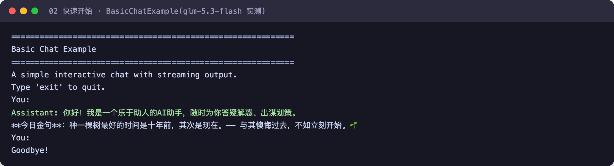

# 第 2 章 快速开始

> 本章导读：当你想在 Java 工程里真正跑起第一个 AgentScope 应用——而不只是记住概念——本章带你从零完成：安装依赖、创建一个能记住对话的智能体，并分别用同步和流式两种方式与它对话。这个应用就是贯穿全书的星帆出海客服 Agent「小帆」的雏形——第 4 章起它会逐步长出工具、权限和平台形态。读完本章，你将获得一个能跨实例恢复会话的最小示例，并且知道什么时候需要引入 `AgentSession`。


## 你什么时候需要它

本章要跑起来的，就是第 1 章所说的 Harness 能力的最小闭环：把一个 `HarnessAgent` 嵌入你自己的应用并完成对话。三个常见的出发点：

- **给现有 Java 或 Spring Boot 服务加一个能干活的助手**。例如用户在问“我的订单到哪了”，后端不只想返回一段话，还想让 Agent 调用订单接口、必要时向你确认后继续。这对应第 1 章的问答与助理场景。
- **想让模型的处理过程边执行边可见**。命令行里看进度、网页上逐字显示回答，都需要流式输出，而不是等最终结果一次返回。
- **预感任务会变长、会中断**。用户关掉页面后任务还得继续——这需要提前了解会话持久化与 `AgentSession`，本章靠后的小节会讲到。

如果只是想先验证这套框架灵不灵，本章也是一个最小验证：一个 Maven 依赖、一个类，就能完成两轮带记忆的问答。

与已学内容的关系：第 1 章从场景层面给出了三个维度，本章你会在最小示例里摸到其中两块地基——给每次调用传递会话身份，以及自动保存的状态快照；受控执行涉及的权限与沙箱本章不配置，留到第 7、10、18 章。

## 安装

先准备环境。AgentScope Java 需要 JDK 17 及以上版本，构建工具推荐 Maven 3.9+。

### Maven 依赖

`HarnessAgent` 是推荐的入口，把工作区、长期记忆、会话持久化、子 agent、沙箱等工程能力打包在一个 builder 里；依赖 `agentscope-harness` 会自动把核心 `agentscope-core` 一并拉进来：

```xml
<dependency>
    <groupId>io.agentscope</groupId>
    <artifactId>agentscope-harness</artifactId>
    <version>${agentscope.version}</version>
</dependency>
```

> **注意**：把 `${agentscope.version}` 替换为最新版本号即可，最新版本请参考附录 A（Release Notes）。

如果只需要 `ReActAgent` 的推理、工具和上下文 API，并自行组合应用所需能力，`agentscope-core` 足够提供 agent 本身。具体模型提供商是独立的：特定模型提供商的 Chat Model 与 formatter（把对话消息转换成特定模型请求格式的组件）位于独立的 `agentscope-extensions-model-*` 模型扩展模块中。`ReActAgent` 与 `HarnessAgent` 的区别详见第 3 章与第 11 章。

下面的 quickstart 通过 `.model("dashscope:qwen-plus")` 使用 DashScope，因此还需要引入对应模型扩展：

```xml
<dependency>
    <groupId>io.agentscope</groupId>
    <artifactId>agentscope-extensions-model-dashscope</artifactId>
    <version>${agentscope.version}</version>
</dependency>
```

MCP 集成需要官方 MCP SDK，参考 `agentscope-examples/documentation/pom.xml`。

## 第一个智能体

推荐在应用启动时定义共享 Builder，每次请求用 `builder.build()` 创建新的 Agent，执行完成后关闭。Builder 保存通用配置，请求身份放在独立的 `RuntimeContext`（一次调用携带的用户与会话身份）中；新建实例不会改变会话身份。换句话说，会话记忆不属于某个 Agent 实例，而是挂在 `userId` 与 `sessionId` 这对身份上：实例用完即弃，对话凭身份找回。下面用两个实例完成同一会话的两轮问答。运行前设置模型凭据：

```bash
export DASHSCOPE_API_KEY=your_api_key
```

```java
import io.agentscope.core.agent.RuntimeContext;
import io.agentscope.core.message.Msg;
import io.agentscope.core.message.UserMessage;
import io.agentscope.harness.agent.HarnessAgent;
import java.nio.file.Path;

public class FirstAgent {
    // 应用启动时配置一次，之后只调用 build()。
    private static final HarnessAgent.Builder AGENT_BUILDER = HarnessAgent.builder()
            .name("xingfan-support")
            .agentId("xingfan-support")
            .sysPrompt("你是星帆出海的客服小帆，语气友好，只基于事实回答。")
            .model("dashscope:qwen-plus")
            .workspace(Path.of(".agentscope/workspace"));

    public static void main(String[] args) {
        try (HarnessAgent agent = AGENT_BUILDER.build()) {
            RuntimeContext ctx = RuntimeContext.builder()
                    .userId("alice").sessionId("demo-session").build();
            agent.call(new UserMessage("我叫天宇，订单 OD-2049 三天了还没到，想问问情况。"), ctx).block();
        }

        // 下一次请求使用新实例；相同会话身份从持久日志恢复上下文。
        try (HarnessAgent agent = AGENT_BUILDER.build()) {
            RuntimeContext ctx = RuntimeContext.builder()
                    .userId("alice").sessionId("demo-session").build();
            Msg reply = agent.call(new UserMessage("我叫什么？我的订单出了什么问题？"), ctx).block();
            System.out.println(reply.getTextContent());
        }
    }
}
```

`call` 返回 `Mono<Msg>`——Reactor 的响应式类型，代表“订阅后才会执行、最终产出一条回复”的异步计算；这里用 `block()` 启动执行并等待回复，适合命令行示例。一次调用可以多次推理和执行工具。相同 `userId`、`sessionId` 的下一次调用会使用同一段会话的上下文。

第二个例子能答出“我叫天宇”，靠的不是实例还记得，而是持久化的会话日志。默认情况下，Harness 会自动保存执行日志和用于继续对话的状态快照（checkpoint）。重启时保留相同的 `agentId`、用户、会话身份和存储配置，即可继续对话；这不需要额外创建 `AgentSession`。

这个本地示例的原生日志位于 Workspace Filesystem（工作区文件系统，Agent 读写文件都经过的可插拔抽象层，可指向本机目录、共享存储或沙箱）为当前身份解析的根目录下 `.agentscope-runtime/`。配置隔离目录或分布式 Filesystem 后，实际位置跟随对应根目录或 namespace。需要查看记录、更换后端时，再查阅第 19 章的“存储位置与后端配置”一节。

### 流式查看推理与工具调用

需要边生成边显示时，用 `streamEvents` 发起这次请求。把下面的 import 加到文件顶部，在 `main` 中为这次请求创建新实例：

```java
import io.agentscope.core.event.AgentEventType;
import io.agentscope.core.event.TextBlockDeltaEvent;
import io.agentscope.core.event.ToolCallStartEvent;

try (HarnessAgent agent = AGENT_BUILDER.build()) {
    RuntimeContext ctx = RuntimeContext.builder()
            .userId("alice").sessionId("demo-session").build();
    agent.streamEvents(new UserMessage("帮我把催问订单前需要确认的信息列成三条。"), ctx)
            .doOnNext(event -> {
                if (event.getType() == AgentEventType.TEXT_BLOCK_DELTA) {
                    System.out.print(((TextBlockDeltaEvent) event).getDelta());
                } else if (event.getType() == AgentEventType.TOOL_CALL_START) {
                    System.out.println("\n[tool] " + ((ToolCallStartEvent) event).getToolCallName());
                }
            })
            .blockLast();
}
```

`streamEvents` 返回 `Flux<AgentEvent>`——Reactor 的事件流类型，订阅后陆续产出事件；`blockLast()` 在这里等待流结束。它与 `call` 使用相同的 Agent 能力和持久化配置。

同一个请求按输出需求选择 `call` 或 `streamEvents`。如果先 `call`，再用相同输入调用 `streamEvents`，会再次执行该请求。

上面的事件分发逻辑跑在真实对话里，是下面这个样子。这张截图来自 2026-10-31 实测于 agentscope-examples documentation 模块的 BasicChatExample，模型 glm-5.3-flash，经 OpenAI 兼容网关接入：



Assistant 的自我介绍与「今日金句」都是边生成边上屏——`streamEvents` 陆续产出的文本增量，落到终端就是这段连续出现的文字；输入 `exit` 后程序正常退出。

### 在 Web 请求中使用

命令行示例里实例随用随建；放进 Web 服务后，实例的生命周期要跟一次请求对齐。WebFlux 中使用 `Mono.using` 管理实例：订阅时从共享 Builder 构建 Agent，执行完成、报错或取消时关闭。不要在 `try` 块中返回尚未订阅的 `Mono`，否则 Agent 会提前关闭。下面是 handler 中的调用表达式：

```java
import reactor.core.publisher.Mono;

RuntimeContext ctx = RuntimeContext.builder()
        .userId(userId).sessionId(sessionId).build();
return Mono.using(
        AGENT_BUILDER::build,
        agent -> agent.call(new UserMessage(userInput), ctx),
        HarnessAgent::close);
```

`userId` 应来自已认证身份，`sessionId` 应经过访问权限检查。Builder 配置完成后不要在请求中调用 setter；共享的模型、工具和中间件仍须支持并发使用。不同会话可以并行；同一会话跨实例的请求应由应用按顺序调度，日志写入隔离不等于自动排队。生命周期与并发规则见第 4 章“实例生命周期”一节。

### 什么时候使用 AgentSession

日常问答、工作流节点以及随当前请求完成的流式界面，可以继续使用 `call` / `streamEvents`。直接把执行流作为 HTTP 响应时，客户端断连可能取消该次执行。

当产品需要“关闭页面后继续运行”“忙时接收并保存下一项任务”“运行中补充要求”或“中断后继续原任务”时，使用 `agent.session(ctx)` 提供的 `AgentSession`。它负责接收任务和安排后台执行，前端独立读取快照与持久事件。

后台任务的 Agent 由应用的会话管理器或任务 worker 持有，在任务停止或应用退出后再关闭；不要在提交任务的 HTTP 请求返回时关闭它。这里的生命周期覆盖整个后台执行，不只覆盖一次提交请求。

下一步阅读第 19 章（会话日志与恢复），或参考第 40 章的可恢复聊天示例。通过 HTTP 使用托管 Agent 的应用，直接阅读第 31 章。

## 接下来

到这里，你已经跑通了一个最小但完整的 HarnessAgent：依赖安装、共享 Builder、`call` 与 `streamEvents`，以及跨实例的会话恢复。下一章（第 3 章）会给出全书的核心概念地图，说明 ReActAgent、HarnessAgent 与 Service Managed Agent 三层能力的叠加关系，帮助你在进入细节前建立全局视图；随后第 4 章深入 Agent 本身，讲解实例生命周期、并发规则、结构化输出与人工介入。工作区（第 12 章）、上下文管理与长期记忆（第 13、14 章）等主题，可在需要时按目录选读。
