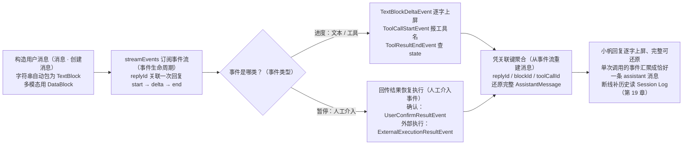
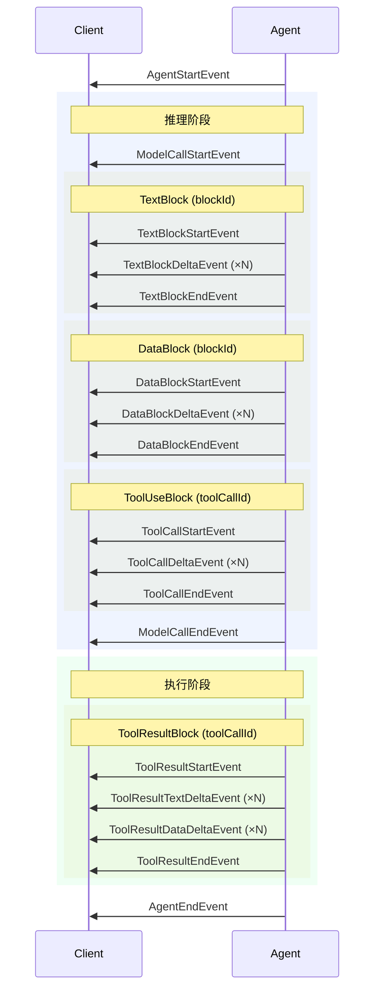

# 第 5 章 消息与事件

> 本章导读：当小帆的回答要逐字显示到客服界面、提示“正在调用哪个工具”，或者要在 Agent 暂停等待确认时把选择权交给用户——总之，当你需要过程的实时反馈而不只是一个最终结果时，依赖的就是本章的事件流。本章讲解智能体内的两种基础数据结构——代表完整对话轮次的 `Msg` 与代表增量进度的 `AgentEvent`，覆盖内容块类型、事件的生命周期（start → delta → end）、全部事件类型的字段参考，以及从事件流重建消息的方法。读完本章，你可以正确解析与聚合 Agent 的输出，构建流式界面。



*本章操作流程图*

## 你什么时候需要它

先分清两个词：消息是通信与持久化的基本单元，每个 `Msg` 是一个完整的对话轮次；事件是执行过程中陆续发出的增量片段。三个典型处境：

- **界面要边生成边显示。** 等 `call` 返回再一次性渲染，用户要盯着空白页面等十几秒；改用第 4 章的 `streamEvents` 后，文本 token、工具调用进度以事件形式陆续到达，界面可以逐字刷新——事件正是“前端交互与流式传输的基本单元”。
- **要在人工介入点接管流程。** Agent 暂停等待确认时，发出的是 `RequireUserConfirmEvent` 这样的事件，界面据此向用户展示待确认的操作；用户的决定也以事件形式回传，恢复执行。
- **要搭自己的输出管道。** 无论界面、审计还是转发给上游系统，都从事件流聚合出完整结果——单次调用的事件序列恰好汇聚成一条 assistant 消息，凭 `replyId` / `blockId` / `toolCallId` 就能还原。

与已学内容的关系：第 4 章的 `call` / `streamEvents` 决定“要不要事件”，本章决定“拿到事件之后怎么用”。消息侧的 `Msg` 存进上下文（第 8 章）；第 19 章的持久会话日志是另一套体系，与本章的实时事件不是一回事，本章末尾有两者的辨析。

消息（Message）与事件（Event）是 AgentScope 中两种基础数据结构。

- **消息** — 智能体间通信与持久化的基本单元。每个 `Msg` 代表一个完整的对话轮次，存储在上下文中并在智能体之间传递。
- **事件** — 前端交互与流式传输的基本单元。事件携带增量进度更新（文本 token、工具调用片段、权限请求等），驱动实时界面和人工介入工作流。

单次 `call` 调用产生的事件序列最终汇聚成恰好一条 assistant `Msg`，这保证了完整的消息状态始终可以从事件流中还原。

## 消息

`Msg`（位于 `io.agentscope.core.message`）代表对话中的一个轮次——用户输入、智能体回复或系统指令，内容以有序的类型化块（`ContentBlock`）列表表示。

> **提示**：一条 assistant 消息对应智能体一次完整的 `call` 周期（反复推理和执行，直到产出最终回复）。

### 结构

`Msg` 类的核心字段（getter）如下：

| 方法 | 类型 | 说明 |
|------|------|------|
| `getId()` | `String` | 唯一消息标识符 |
| `getName()` | `String` | 发送方名称（可空） |
| `getRole()` | `MsgRole` | `USER` / `ASSISTANT` / `SYSTEM` / `TOOL` |
| `getContent()` | `List<ContentBlock>` | 有序内容块列表（不可变） |
| `getMetadata()` | `Map<String, Object>` | 任意键值元数据 |
| `getTimestamp()` | `String` | 创建时间（`yyyy-MM-dd HH:mm:ss.SSS`） |
| `getUsage()` | `ChatUsage` | Token 用量（仅 assistant 消息） |
| `getGenerateReason()` | `GenerateReason` | 退出原因：`MODEL_STOP` / `TOOL_SUSPENDED` / `REASONING_STOP_REQUESTED` / `ACTING_STOP_REQUESTED` / `ALL_TOOLS_DENIED` / `INTERRUPTED` / `MAX_ITERATIONS` |

### 内容块

消息内容由类型化的块组成，每种块代表一类独立信息。块类位于 `io.agentscope.core.message`：

| 块类型 | 说明 | 允许出现在 |
|--------|------|-----------|
| `TextBlock` | 纯文本内容 | USER、ASSISTANT、SYSTEM |
| `DataBlock` | 二进制数据（图片、音频、视频），通过 base64 或 URL；统一替代旧的 ImageBlock/AudioBlock/VideoBlock | USER、ASSISTANT |
| `ImageBlock` / `AudioBlock` / `VideoBlock` | 旧版具体多媒体块（仍兼容，新代码建议用 `DataBlock`） | USER |
| `ThinkingBlock` | 模型推理过程（思维链） | ASSISTANT |
| `ToolUseBlock` | 工具调用，包含 `id` / `name` / `input` / `state`（`ToolCallState`） | ASSISTANT |
| `ToolResultBlock` | 工具执行结果，包含 `state`（`ToolResultState`） | ASSISTANT |
| `HintBlock` | 以用户上下文形式注入循环的指令 | ASSISTANT |

> **注意**：角色约束在构造时强制执行：`USER` 消息只能包含 text/data/image/audio/video 块；`SYSTEM` 消息只能包含 `TextBlock`；`ASSISTANT` 消息可包含所有块类型。

### 创建消息

按 role 固定的子类提供便捷构造（`io.agentscope.core.message.UserMessage` / `AssistantMessage` / `SystemMessage` / `ToolResultMessage`）。当 content 是普通字符串时，会自动包装为 `TextBlock`。

```java
import io.agentscope.core.message.AssistantMessage;
import io.agentscope.core.message.Base64Source;
import io.agentscope.core.message.DataBlock;
import io.agentscope.core.message.SystemMessage;
import io.agentscope.core.message.TextBlock;
import io.agentscope.core.message.UserMessage;

// 用户消息 —— 文本
UserMessage userText = new UserMessage("user", "这张图片里有什么？");

// 多模态用户消息
UserMessage userMulti =
        new UserMessage(
                "user",
                TextBlock.builder().text("描述这张图片：").build(),
                DataBlock.builder()
                        .source(Base64Source.builder()
                                .data("...")
                                .mediaType("image/png")
                                .build())
                        .build());

// 系统消息 —— 仅文本
SystemMessage systemMsg = new SystemMessage("system", "你是一个有用的助手。");

// 助手消息 —— 允许所有块类型
AssistantMessage assistantMsg = new AssistantMessage("agent", "结果如下...");
```

需要更多可选字段（`metadata`、`timestamp`、`usage`、`generateReason`）时使用各子类的 `builder()`：

```java
UserMessage msg =
        UserMessage.builder()
                .name("user")
                .textContent("Hello")
                .build();
```

### 访问内容

`Msg` 提供了一组辅助方法用于提取特定块类型：

| 方法 | 返回值 |
|------|--------|
| `getTextContent()` | 所有 `TextBlock` 的拼接文本（按 `\n` 连接），无文本块时返回空字符串 |
| `getContentBlocks(Class<T>)` | 按类型过滤后的块列表 |
| `getFirstContentBlock(Class<T>)` | 首个匹配类型的块，无则返回 null |
| `hasContentBlocks(Class<T>)` | 若存在指定类型的块则返回 `true` |

```java
import io.agentscope.core.message.ToolUseBlock;
import io.agentscope.core.message.ToolResultBlock;

// 获取所有文本内容
String text = msg.getTextContent();

// 获取所有工具调用
List<ToolUseBlock> toolCalls = msg.getContentBlocks(ToolUseBlock.class);

// 检查消息是否包含工具结果
if (msg.hasContentBlocks(ToolResultBlock.class)) {
    // ...
}
```

## 事件

事件是消息的流式对应物。智能体执行过程中会持续产出一系列 `AgentEvent` 对象（位于 `io.agentscope.core.event`），表示增量进度——文本 token 到达、工具调用逐步构建、结果流式返回。每个事件都是轻量且自包含的。

### 事件生命周期

每个事件都携带 `getReplyId()`，将其关联到正在构建的消息。在一次回复中，`getBlockId()` 或 `getToolCallId()` 用作事件关联键，表示事件属于同一个内容块生命周期。事件遵循 **start → delta → end** 模式：



同一次回复中的所有事件共享相同的 `replyId`。在回复内部，用 `blockId` 关联文本/思考/数据块事件，用 `toolCallId` 关联工具调用和工具结果事件。`blockId` 是 `replyId` 作用域内的关联键，不要求是全局唯一的随机 ID；当某类内容块在一次回复中最多出现一个生命周期时，实现可以使用稳定的类型标识（如文本块的固定标识）作为 `blockId`。

### 事件类型

所有事件继承自 `AgentEvent`（位于 `io.agentscope.core.event`），提供以下公共方法：

| 方法 | 类型 | 说明 |
|------|------|------|
| `getId()` | `String` | 唯一事件标识符 |
| `getCreatedAt()` | `String` | ISO 8601 时间戳 |
| `getType()` | `AgentEventType` | 事件类型枚举 |
| `getSource()` | `String` | 事件来源路径。顶层 Agent 为 `null`；子 Agent 事件为斜杠分隔的路径（如 `"main/researcher"`），用于区分父子 Agent 事件 |
| `getMetadata()` | `Map<String, Object>` | 可选键值元数据。远程子 agent 转发时会写入 `taskId`（`AgentEvent.METADATA_TASK_ID`，对应 harness / Agent Protocol 任务 id）与 `parentSessionId`（`AgentEvent.METADATA_PARENT_SESSION_ID`，对应父 session） |

事件按类别分组如下。除特别说明外，每个事件还携带 `getReplyId()`，关联到正在构建的消息；各事件的完整方法与类型表，统一收在本章末的参考速查。

#### 生命周期事件

**AgentStartEvent** — 智能体开始新的回复：`getReplyId()` 是回复消息 ID，`getSessionId()` 与 `getName()` 分别给出会话 ID 与智能体名称，`getRole()` 是智能体角色（默认 `"assistant"`）。

**AgentEndEvent** — 智能体完成回复，携带 `getReplyId()`。

**ExceedMaxItersEvent** — 智能体达到最大推理-执行迭代次数，携带 `getReplyId()`。

**RequestStopEvent** — 中间件或工具发起的提前停止请求。

#### 文本流式事件

**TextBlockStartEvent** — 新的文本块开始；**TextBlockEndEvent** — 文本块完成。两者都携带 `getReplyId()` 与 `getBlockId()`（文本块在当前回复中的关联键）。**TextBlockDeltaEvent** — 增量文本内容到达，在此之上多一个 `getDelta()`，返回增量文本内容。

#### 思考流式事件

**ThinkingBlockStartEvent / ThinkingBlockDeltaEvent / ThinkingBlockEndEvent** —— 与文本流式事件结构对应，仅用于模型的思维链内容；`blockId` 同样表示当前回复中的关联键。

#### 数据流式事件

**DataBlockStartEvent / DataBlockDeltaEvent / DataBlockEndEvent** —— 与文本流式事件结构对应，承载图片 / 音频 / 视频等二进制数据：

- `DataBlockStartEvent`：`getMediaType()` 返回 MIME 类型（如 `"image/png"`）。
- `DataBlockDeltaEvent`：`getData()` 返回增量 base64 编码数据。

#### 工具调用流式事件

**ToolCallStartEvent** — 智能体开始一次工具调用，携带 `getReplyId()`、`getToolCallId()`（工具调用唯一标识符）与 `getToolCallName()`（被调用的工具名称）。

**ToolCallDeltaEvent** — 增量工具调用参数到达；`getDelta()` 返回 JSON 参数片段。

**ToolCallEndEvent** — 工具调用参数完成。

#### 工具结果流式事件

**ToolResultStartEvent** — 工具开始执行（带 `toolCallId`、`toolCallName`）。

**ToolResultTextDeltaEvent** — 工具的增量文本输出；`getDelta()` 返回文本片段。

**ToolResultDataDeltaEvent** — 工具的二进制数据输出；与 `DataBlockDeltaEvent` 类似，包含 `mediaType` / `data` / `url` 字段。

**ToolResultEndEvent** — 工具执行完成，携带 `getReplyId()`、`getToolCallId()`（对应工具调用的 ID）与 `getState()`（最终状态，类型为 `ToolResultState`：`SUCCESS`、`ERROR`、`INTERRUPTED`、`DENIED`、`RUNNING`、`SUSPENDED`）。

#### 模型调用事件

**ModelCallStartEvent** — 模型 API 调用开始（带 `modelName`）。

**ModelCallEndEvent** — 模型 API 调用完成（带 `inputTokens` / `outputTokens`）。

#### 人工介入事件

**RequireUserConfirmEvent** — 智能体暂停等待用户确认，携带 `getReplyId()` 与 `getToolCalls()`（待用户确认的工具调用列表，类型为 `List<ToolUseBlock>`）。

**RequireExternalExecutionEvent** — 智能体暂停等待外部执行。挂起的工具调用不会产生 `ToolResult*` 事件：工具尚未执行，真实结果由调用方回传后通过 `ExternalExecutionResultEvent` 表达。事件携带 `getReplyId()` 与 `getToolCalls()`（待外部执行的工具调用列表）。

**UserConfirmResultEvent** — 用户提供确认结果。携带 `List<ConfirmResult>`，`replyId` 与最初暂停智能体的 `RequireUserConfirmEvent` 相同；`getConfirmResults()` 返回本次恢复接受的确认结果。

**ExternalExecutionResultEvent** — 后续 `call()` 恢复外部执行暂停时发出。携带一个或多个 `ToolResultBlock`，且 `replyId` 与之前的 `RequireExternalExecutionEvent` 相同；`getToolResults()` 返回本次恢复接受的外部执行结果。

**AllToolsDeniedEvent** — 用户通过 HITL 确认拒绝了最近一轮推理产出的全部工具调用。该事件通过 `onActing` middleware 链发出，middleware 可据此发出 `RequestStopEvent` 停止 agent。若无 middleware 处理，agent 默认继续下一轮推理（向后兼容）。`getDeniedToolCalls()` 返回被拒绝的工具调用列表。

#### 子 Agent 事件

**SubagentExposedEvent** — 通过 `agent_spawn(expose_to_users=true)` 生成的子 Agent 被暴露为用户可寻址的入口点。SSE（Server-Sent Events，服务器向浏览器单向持续推送事件流的 HTTP 方式）/ 流式消费端可据此在 UI 上渲染新的会话入口。事件携带 `getSubagentId()`（子 Agent 的唯一标识）、`getAgentId()`（子 Agent 的 agent 类型 ID）、`getSessionId()`（子 Agent 的会话 ID），以及可选的 `getLabel()`（用户可见的标签名）。

## 从事件流重建消息

事件与消息并非相互独立，而是同一数据的两种视图。`streamEvents` 产出的事件流可以按 `replyId` / `blockId` / `toolCallId` 聚合还原成完整的 `AssistantMessage`。这保证了最终消息状态可以仅凭事件流完整还原。

可以参考 `agentscope-core` 中的 `agent/StreamingHook.java` 与 `agentscope-examples/documentation/.../streaming/AgentEventStreamExample.java`，它们演示了用 Reactor 算子按 block 分组并累积内容的标准做法。

```java
import io.agentscope.core.event.AgentEvent;
import io.agentscope.core.event.AgentStartEvent;
import io.agentscope.core.event.AgentEndEvent;
import io.agentscope.core.event.TextBlockDeltaEvent;
import io.agentscope.core.event.ToolCallStartEvent;
import io.agentscope.core.event.ToolResultEndEvent;

StringBuilder accumulated = new StringBuilder();

agent.streamEvents(userMsg)
        .doOnNext(event -> {
            if (event instanceof AgentStartEvent start) {
                System.out.println("[start replyId=" + start.getReplyId() + "]");
            } else if (event instanceof TextBlockDeltaEvent delta) {
                accumulated.append(delta.getDelta());
            } else if (event instanceof ToolCallStartEvent tc) {
                System.out.println("[tool] " + tc.getToolCallName());
            } else if (event instanceof ToolResultEndEvent end) {
                System.out.println("[tool result state=" + end.getState() + "]");
            } else if (event instanceof AgentEndEvent end) {
                System.out.println("\n[end] full text:\n" + accumulated);
            }
        })
        .blockLast();
```

> **提示**：当前请求的流式界面可以将 AgentEvent 映射为 SSE。`streamEvents()` 用于启动执行，本身没有持久游标，不应用它重新执行请求来补齐断线期间的内容。Harness 默认也会保存直接调用的日志；读取历史，以及需要后台任务时如何引入 `AgentSession`，见第 19 章（会话日志与恢复）。托管前端直接使用 Agent API 的 snapshot + SSE（见第 31 章）。

### 示例：流式界面

构建流式界面的典型模式（Spring WebFlux SSE 形态可参考 `streaming/StreamingWebExample.java`）：

```java
import io.agentscope.core.event.AgentEndEvent;
import io.agentscope.core.event.AgentStartEvent;
import io.agentscope.core.event.TextBlockDeltaEvent;
import io.agentscope.core.event.ToolCallStartEvent;
import io.agentscope.core.event.ToolResultEndEvent;
import io.agentscope.core.message.UserMessage;

agent.streamEvents(new UserMessage("user", "帮我查一下订单 OD-2049 的物流状态"))
        .doOnNext(event -> {
            if (event instanceof AgentStartEvent start) {
                System.out.println("[start replyId=" + start.getReplyId() + "]");
            } else if (event instanceof TextBlockDeltaEvent delta) {
                System.out.print(delta.getDelta());
            } else if (event instanceof ToolCallStartEvent tc) {
                System.out.println("\n[正在调用 " + tc.getToolCallName() + "...]");
            } else if (event instanceof ToolResultEndEvent end) {
                System.out.println("[工具执行完成：" + end.getState() + "]");
            } else if (event instanceof AgentEndEvent end) {
                System.out.println("\n[完成]");
            }
        })
        .blockLast();
```

## AgentEvent 与持久 SessionEvent

本章的 `AgentEvent` 是实时强类型事件，`SessionEvent` 是不可变的持久执行事实，两者不是一一对应的两个副本。原生日志记录已提交模型请求、工具边界和 checkpoint，Service 再投影为面向用户的 turn/item/action 事件；三者格式和游标独立。标准运行时通过 `event.getExecution()` 暴露 agentId/sessionId/turnId/runId；其中 runId 对应原生日志的 executionRunId。子事件保留子执行身份。event.id、native seq 和公共 SSE cursor 仍独立，实时事件到达不代表已提交。

逻辑 turn 可以包含多个恢复执行；`AgentEndEvent` 只说明本次调用结束。完整生命周期及用法见第 19 章（会话日志与恢复）。

## 本章小结

这一章从界面与管道的典型处境出发，讲清了 Agent 输出的两套数据结构：

1. **消息是完整轮次**：`Msg` 按 role 组织，内容是类型化的 `ContentBlock` 列表；文本、多模态数据、思维链、工具调用与结果各有对应块，角色约束在构造时强制执行；
2. **事件是增量片段**：智能体执行时持续产出 `AgentEvent`，遵循 start → delta → end 生命周期；`replyId` 关联一次回复，`blockId` / `toolCallId` 关联块与工具调用的生命周期；
3. **事件分类别**：生命周期、文本 / 思考 / 数据流式、工具调用与结果、模型调用、人工介入、子 Agent 事件各有分工；确认与外部执行事件是第 4 章人机交互暂停与恢复机制的数据载体；
4. **事件可还原消息**：单次 `call` 的事件序列汇聚成恰好一条 assistant `Msg`，凭 `replyId` / `blockId` / `toolCallId` 聚合即可重建完整结果；
5. **实时不等于持久**：`AgentEvent` 是实时通知，`SessionEvent` 是持久执行事实，需要可靠重放时以 Session Log 的已提交内容为准（第 19 章）。

**验收清单**——读到这里，你应该能：

- ☐ 说出 `Msg` 与 `AgentEvent` 各自的定位，以及单次 `call` 的事件序列与 assistant 消息的对应关系；
- ☐ 按 role 判断一条消息允许包含哪些内容块；
- ☐ 用 `getTextContent()` 与 `getContentBlocks(Class)` 从 `Msg` 中提取所需数据；
- ☐ 解释事件生命周期中 `replyId`、`blockId`、`toolCallId` 三个关联键的作用；
- ☐ 在 `streamEvents` 的事件流里区分文本增量、工具调用开始与工具结果结束，并聚合出完整回复；
- ☐ 说出 `RequireUserConfirmEvent` 与 `RequireExternalExecutionEvent` 暂停后如何恢复；
- ☐ 解释 `AgentEvent` 与持久 `SessionEvent` 的区别，知道断线补齐历史该读哪一套。

## 参考速查

本节收拢本章各事件的完整方法表，供解析与聚合事件流时查阅；正文按类别讲解了每类事件的用途与关键字段，理解主线不依赖本节。思考流式、数据流式与模型调用事件没有独立字段表，已完整出现在正文。

### 生命周期事件

**AgentStartEvent** — 智能体开始新的回复。

| 方法 | 类型 | 说明 |
|------|------|------|
| `getReplyId()` | `String` | 回复消息 ID |
| `getSessionId()` | `String` | 会话 ID |
| `getName()` | `String` | 智能体名称 |
| `getRole()` | `String` | 智能体角色（默认 `"assistant"`） |

**AgentEndEvent** — 智能体完成回复。

| 方法 | 类型 | 说明 |
|------|------|------|
| `getReplyId()` | `String` | 回复消息 ID |

**ExceedMaxItersEvent** — 智能体达到最大推理-执行迭代次数。

| 方法 | 类型 | 说明 |
|------|------|------|
| `getReplyId()` | `String` | 回复消息 ID |

**RequestStopEvent** — 中间件或工具发起的提前停止请求。

### 文本流式事件

**TextBlockStartEvent** — 新的文本块开始。

| 方法 | 类型 | 说明 |
|------|------|------|
| `getReplyId()` | `String` | 回复消息 ID |
| `getBlockId()` | `String` | 文本块在当前回复中的关联键 |

**TextBlockDeltaEvent** — 增量文本内容到达。

| 方法 | 类型 | 说明 |
|------|------|------|
| `getReplyId()` | `String` | 回复消息 ID |
| `getBlockId()` | `String` | 文本块在当前回复中的关联键 |
| `getDelta()` | `String` | 增量文本内容 |

**TextBlockEndEvent** — 文本块完成。

| 方法 | 类型 | 说明 |
|------|------|------|
| `getReplyId()` | `String` | 回复消息 ID |
| `getBlockId()` | `String` | 文本块在当前回复中的关联键 |

### 工具调用流式事件

**ToolCallStartEvent** — 智能体开始一次工具调用。

| 方法 | 类型 | 说明 |
|------|------|------|
| `getReplyId()` | `String` | 回复消息 ID |
| `getToolCallId()` | `String` | 工具调用唯一标识符 |
| `getToolCallName()` | `String` | 被调用的工具名称 |

### 工具结果流式事件

**ToolResultEndEvent** — 工具执行完成。

| 方法 | 类型 | 说明 |
|------|------|------|
| `getReplyId()` | `String` | 回复消息 ID |
| `getToolCallId()` | `String` | 对应工具调用的 ID |
| `getState()` | `ToolResultState` | 最终状态：`SUCCESS`、`ERROR`、`INTERRUPTED`、`DENIED`、`RUNNING`、`SUSPENDED` |

### 人工介入事件

**RequireUserConfirmEvent** — 智能体暂停等待用户确认。

| 方法 | 类型 | 说明 |
|------|------|------|
| `getReplyId()` | `String` | 回复消息 ID |
| `getToolCalls()` | `List<ToolUseBlock>` | 待用户确认的工具调用列表 |

**RequireExternalExecutionEvent** — 智能体暂停等待外部执行。挂起的工具调用不会产生 `ToolResult*` 事件：工具尚未执行，真实结果由调用方回传后通过 `ExternalExecutionResultEvent` 表达。

| 方法 | 类型 | 描述 |
|------|------|------|
| `getReplyId()` | `String` | 回复消息 ID |
| `getToolCalls()` | `List<ToolUseBlock>` | 待外部执行的工具调用列表 |

**UserConfirmResultEvent** — 用户提供确认结果。携带 `List<ConfirmResult>`，`replyId` 与最初暂停智能体的 `RequireUserConfirmEvent` 相同。

| 方法 | 类型 | 描述 |
|------|------|------|
| `getReplyId()` | `String` | 关联的 `RequireUserConfirmEvent` 的回复 ID |
| `getConfirmResults()` | `List<ConfirmResult>` | 本次恢复接受的确认结果 |

**ExternalExecutionResultEvent** — 后续 `call()` 恢复外部执行暂停时发出。携带一个或多个 `ToolResultBlock`，且 `replyId` 与之前的 `RequireExternalExecutionEvent` 相同。

| 方法 | 类型 | 说明 |
|------|------|------|
| `getReplyId()` | `String` | 关联的 `RequireExternalExecutionEvent` 的回复 ID |
| `getToolResults()` | `List<ToolResultBlock>` | 本次恢复接受的外部执行结果 |

**AllToolsDeniedEvent** — 用户通过 HITL 确认拒绝了最近一轮推理产出的全部工具调用。该事件通过 `onActing` middleware 链发出，middleware 可据此发出 `RequestStopEvent` 停止 agent。若无 middleware 处理，agent 默认继续下一轮推理（向后兼容）。

| 方法 | 类型 | 说明 |
|------|------|------|
| `getDeniedToolCalls()` | `List<ToolUseBlock>` | 被拒绝的工具调用列表 |

### 子 Agent 事件

**SubagentExposedEvent** — 通过 `agent_spawn(expose_to_users=true)` 生成的子 Agent 被暴露为用户可寻址的入口点。SSE（Server-Sent Events，服务器向浏览器单向持续推送事件流的 HTTP 方式）/ 流式消费端可据此在 UI 上渲染新的会话入口。

| 方法 | 类型 | 说明 |
|------|------|------|
| `getSubagentId()` | `String` | 子 Agent 的唯一标识 |
| `getAgentId()` | `String` | 子 Agent 的 agent 类型 ID |
| `getSessionId()` | `String` | 子 Agent 的会话 ID |
| `getLabel()` | `String` | 用户可见的标签名（可选） |

## 延伸阅读

- **智能体（见第 4 章）**——智能体如何在 ReAct 循环中产出事件和消息。
- **上下文（见第 8 章）**——消息如何存储与持久化。
