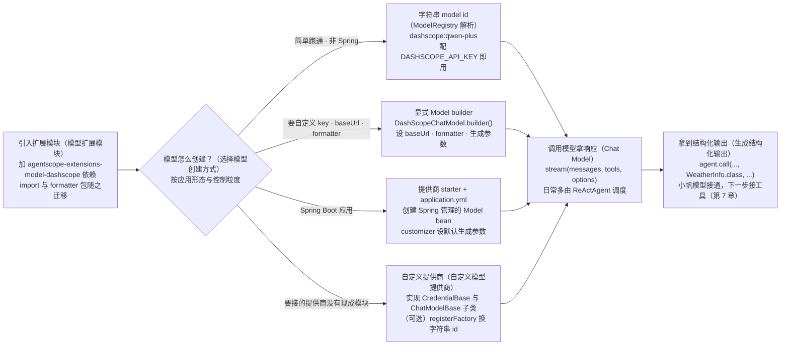

# 第 6 章 模型接入

> 本章导读：当你要把 Agent 接到公司实际在用的模型上——也许是通义千问或 OpenAI，也许是内网 Ollama、OpenAI 兼容的自建网关，而且以后还可能切换供应商——本章就是动手的地方。本章先讲模型层的两层结构（鉴权凭证与模型实现分离）和各提供商扩展模块，再讲字符串 model id 与显式 builder 两种创建方式、`ModelRegistry` 的解析与缓存策略、Formatter、结构化输出的路径选择，最后走一遍自定义模型提供商的步骤。读完本章，你可以把主流 LLM 接入 Agent，并按需深度定制。各 starter 的 customizer 类型与各提供商的 formatter 类名等查阅内容，收拢在章末参考速查。



*本章操作流程图*

## 你什么时候需要它

- **接一个新供应商，先走最小路径。** 引入对应扩展模块、设置该提供商的标准环境变量，把 `dashscope:qwen-plus` 这样的字符串 id 交给第 4 章的 `.model(...)` 就能跑通。Spring Boot 应用则优先使用对应提供商的 starter，用 `application.yml` 完成配置。
- **默认配置不够用时，显式构造模型。** 需要自定义 API key、base URL、formatter、transport、timeout、生成参数等提供商专属配置时——例如走公司统一的 OpenAI 兼容网关、调低 temperature、给 Claude 开 prompt 缓存——推荐显式构造 `Model` 实例再传给 agent。
- **为换供应商或多家兜底留后路。** 业务侧面向的是统一的 `Model` 接口（`stream(messages, tools, options)`），底层换实现不改调用代码；第 4 章的主备容错（`fallbackModel`）也是给 Agent 配置两个模型实现。

与已学内容的关系：第 4 章配置 Agent 时 `.model(...)` 的两种写法（字符串 id 与显式 builder）正对应本章的两条主线；模型是 ReAct 循环“推理”一端的引擎，工具（第 7 章）是另一端。边界：实际开发中通常不需要直接调模型，而是通过 `ReActAgent` 调度——直接调用模型只用于轻量场景。

## 概述

模型层把共享契约和具体模型提供商实现分开。`agentscope-core` 只保留通用 API（`Model`、`ChatModelBase`、`Formatter`、`ModelRegistry` 和 `ModelProvider` SPI）；OpenAI、DashScope、Gemini、Anthropic、Ollama 的具体实现分别位于各自的模型扩展模块中。

运行时模型层采用两层结构：上层是 **Credential**（基于 `io.agentscope.core.credential` 中的通用基类），承载某个提供商的 API 鉴权字段；下层是 **Chat Model**，即在该凭证基础上对接的具体推理模型实现。

```text
CredentialBase/
└── ChatModelBase/
    ├── OpenAIChatModel
    ├── AnthropicChatModel
    ├── DashScopeChatModel
    ├── GeminiChatModel
    └── OllamaChatModel
```

**Credential** 承载某个提供商的 API 认证字段（`apiKey`、`baseUrl` 等）。从一个凭证出发，可以通过 `listModels()` 获取该提供商支持的模型列表（`List<ModelCard>`）。

这种分层与前端的自然交互流程一致 —— 先注册凭证，再从凭证下挑选模型 —— 让界面只需鉴权一次，就能展示该提供商支持的所有模型。

## 模型扩展模块

通用 API 留在 core，具体提供商的实现进了独立模块——先看这些模块怎么引入。

特定模型提供商的实现已经从 `agentscope-core` 迁移到独立扩展模块中。每个模型适配模块自己维护 chat model、credential、formatter、DTO、异常、SDK/API client 等。

| 提供商 | Maven artifact | 主要包名 |
|--------|----------------|----------|
| OpenAI | `agentscope-extensions-model-openai` | `io.agentscope.extensions.model.openai` |
| OpenAI Official | `agentscope-extensions-model-openai-official` | `io.agentscope.extensions.model.openaiofficial` |
| DashScope | `agentscope-extensions-model-dashscope` | `io.agentscope.extensions.model.dashscope` |
| Gemini | `agentscope-extensions-model-gemini` | `io.agentscope.extensions.model.gemini` |
| Anthropic | `agentscope-extensions-model-anthropic` | `io.agentscope.extensions.model.anthropic` |
| Ollama | `agentscope-extensions-model-ollama` | `io.agentscope.extensions.model.ollama` |

### 迁移步骤

1. 增加对应模型提供商扩展模块依赖。以 DashScope 为例：

```xml
<dependency>
    <groupId>io.agentscope</groupId>
    <artifactId>agentscope-extensions-model-dashscope</artifactId>
</dependency>
```

其他模型扩展 artifact 遵循同样模式：`agentscope-extensions-model-openai`、`agentscope-extensions-model-openai-official`、`agentscope-extensions-model-gemini`、`agentscope-extensions-model-anthropic`、`agentscope-extensions-model-ollama`。

2. 将模型提供商实现的 import 从 `io.agentscope.core.model.*` 改为 `io.agentscope.extensions.model.<provider>.*`。
3. 将模型提供商 formatter import 从 `io.agentscope.core.formatter.<provider>.*` 改为 `io.agentscope.extensions.model.<provider>.formatter.*`。
4. Spring Boot 应用中，改用对应提供商 starter 和 `agentscope.<provider>.*` 配置：

```xml
<dependency>
    <groupId>io.agentscope</groupId>
    <artifactId>agentscope-dashscope-spring-boot-starter</artifactId>
</dependency>
```

## 选择模型创建方式

### 字符串 model id

简单的非 Spring 应用可以使用 `dashscope:qwen-plus`、`openai:gpt-4.1-mini`、`deepseek:deepseek-v4-flash` 这样的字符串 id。引入对应模型扩展模块，设置模型提供商的标准环境变量，例如 `DASHSCOPE_API_KEY`、`OPENAI_API_KEY` 或 `DEEPSEEK_API_KEY`，然后直接把 id 传给 agent：

```java
ReActAgent agent =
        ReActAgent.builder()
                .name("assistant")
                .model("dashscope:qwen-plus") // 底层由 ModelRegistry.resolve(modelId) 解析
                .build();
```

扩展模块会通过 Java SPI（JDK 的服务提供者发现机制，按约定目录自动加载实现类）被自动发现。模型提供商会读取自己的标准环境变量，例如 `DASHSCOPE_API_KEY`、`OPENAI_API_KEY`、`GLM_API_KEY`、`DEEPSEEK_API_KEY`、`ANTHROPIC_API_KEY`、`GEMINI_API_KEY`。Ollama 会在存在时读取 `OLLAMA_BASE_URL`，否则默认使用本地 Ollama endpoint。

### 显式 Model builder

需要自定义 API key、base URL、formatter、transport、timeout、生成参数或其他提供商专属配置时，推荐显式构造模型，再把 `Model` 实例传给 agent：

```java
import io.agentscope.extensions.model.dashscope.DashScopeChatModel;
import io.agentscope.extensions.model.dashscope.formatter.DashScopeChatFormatter;

DashScopeChatModel model =
        DashScopeChatModel.builder()
                .apiKey(System.getenv("DASHSCOPE_API_KEY"))
                .modelName("qwen-plus")
                .stream(true)
                .formatter(new DashScopeChatFormatter())
                .build();

ReActAgent agent =
        ReActAgent.builder()
                .name("assistant")
                .model(model)
                .build();
```

### Spring Boot 应用

Spring Boot 场景下，优先使用特定模型提供商的 starter，例如 `agentscope-openai-spring-boot-starter`、`agentscope-openai-official-spring-boot-starter`、`agentscope-dashscope-spring-boot-starter`、`agentscope-gemini-spring-boot-starter`、`agentscope-anthropic-spring-boot-starter`、`agentscope-ollama-spring-boot-starter`。这些 starter 直接依赖对应模型扩展模块，创建 Spring 管理的 `Model` bean，通用的 `agentscope-spring-boot-starter` 继续负责 AgentScope 的公共基础设施。它们不会通过静态 `ModelRegistry` 创建模型；高级用户始终可以自定义 `Model` bean。

OpenAI 示例：

```yaml
agentscope:
  model:
    provider: openai
  openai:
    api-key: ${OPENAI_API_KEY}
    model-name: gpt-4.1-mini
    stream: true
```

#### Builder customizer

各模型提供商的 Spring Boot starter 还提供了有序的 builder customizer bean。它适合用于 `application.yml` 已覆盖常见配置、但仍需要设置 builder 专属能力的场景，例如自定义 formatter、默认生成参数、代理/client 配置，或其他提供商专属开关。每个 starter 对应的 customizer 类型，见本章末参考速查。

这些 customizer 会在 starter 属性绑定之后、调用 `builder.build()` 之前执行。可以注册多个 customizer，并通过 Spring 的 `@Order` 或 `Ordered` 控制执行顺序。

```java
import io.agentscope.core.model.GenerateOptions;
import io.agentscope.spring.boot.openai.OpenAIChatModelBuilderCustomizer;
import org.springframework.context.annotation.Bean;
import org.springframework.context.annotation.Configuration;
import org.springframework.core.annotation.Order;

@Configuration(proxyBeanMethods = false)
class ModelCustomizerConfiguration {

    @Bean
    @Order(0)
    OpenAIChatModelBuilderCustomizer openAIModelDefaults() {
        return builder ->
                builder.defaultOptions(
                        GenerateOptions.builder()
                                .temperature(0.2)
                                .parallelToolCalls(false)
                                .build());
    }
}
```

## ModelRegistry 与 ModelCreationContext

`ModelRegistry` 是一个用于模型实例创建与查找的全局注册中心，支持多种解析策略。解析时按优先级依次尝试：通过 `ModelRegistry.register(name, model)` 直接注册的命名模型实例、通过 `registerFactory(regex, factory)` 注册的自定义工厂，以及通过 Java SPI 机制自动发现的扩展模块提供的 `ModelProvider` 实现。

简单场景推荐使用 `provider:model` 格式的 id 和模型提供商的标准环境变量；需要精细控制时，优先使用显式的模型 Builder。`ModelCreationContext` 主要面向需要动态解析模型的集成层代码。

### 高级集成上下文

`ModelCreationContext` 面向需要动态创建模型、但不方便直接依赖具体提供商 builder 的集成层代码，例如多租户网关、插件系统或框架适配层。它可以把 API key、base URL、endpoint path、stream 模式，以及扩展模块定义的 options/components 传给 SPI 提供商实现：

```java
import io.agentscope.core.model.GenerateOptions;
import io.agentscope.core.model.Model;
import io.agentscope.core.model.ModelCreationContext;
import io.agentscope.core.model.ModelRegistry;

ModelCreationContext context =
        ModelCreationContext.builder()
                .apiKey(tenantApiKey)
                .baseUrl(tenantBaseUrl)
                .stream(false)
                // 扩展模块定义的标量配置，key 由具体模型提供商文档约定。
                .option("contextWindowSize", 128000)
                // 以类型为 key 的组件对象，用于传入更复杂的提供商配置、transport 或 formatter。
                .component(
                        GenerateOptions.class,
                        GenerateOptions.builder()
                                .parallelToolCalls(false)
                                .build())
                .build();

Model model = ModelRegistry.resolve("openai:gpt-4.1-mini", context);
```

### 缓存策略

`ModelRegistry` 会缓存简单`provider:model`解析出的模型。带 context（`ModelCreationContext`）解析出的模型默认不缓存，避免不同租户的 API key、base URL 或 stream 配置复用到同一个模型实例。

| 策略 | 行为 |
|------|------|
| `DEFAULT` | `resolve(String)` 保持按 model id 缓存的旧行为；`resolve(String, nonEmptyContext)` 默认不缓存。 |
| `DISABLED` | 永不缓存，每次解析都会创建新的模型实例。 |
| `ENABLED` | 显式开启缓存。建议用 `cacheId(...)` 表达租户或配置维度的身份。 |

如果 `CachePolicy.ENABLED` 搭配 `option(...)` 或 `component(...)` 使用，用户必须提供 `cacheId`。

### ModelProvider SPI

模型提供商扩展模块通过 Java SPI 暴露 `META-INF/services/io.agentscope.core.model.spi.ModelProvider`，由 `ModelRegistry` 自动发现。新的模型提供商可以实现 `supports(String, ModelCreationContext)` 和 `create(String, ModelCreationContext)` 来消费 context。简单模型提供商仍可只实现原有的 `supports(String)` 和 `create(String)`，因为 context-aware 方法提供了兼容默认实现。

## Chat Model

**Chat Model** 是驱动 agent 对话与工具调用的 LLM，输入输出可以是文本之外的多模态内容。AgentScope Java 当前提供以下 Chat Model 类：

| 提供商 | 模型类 | 说明 |
|--------|--------|------|
| OpenAI | `OpenAIChatModel` | Chat Completions API，兼容 vLLM 与 OpenAI 兼容端点（含 DeepSeek、Kimi 等） |
| OpenAI Official | `OpenAIResponsesChatModel` | Responses API（官方 SDK）；推理、结构化输出 |
| Anthropic | `AnthropicChatModel` | Claude 模型，支持 prompt 缓存与 thinking |
| DashScope | `DashScopeChatModel` | Qwen 模型，多模态（视觉/音频/视频）、推理 |
| Gemini | `GeminiChatModel` | Google Gemini 模型，支持多模态 |
| Ollama | `OllamaChatModel` | 本地 LLM 托管，凭证可选 |

模型提供商凭证类随对应模型扩展模块提供，例如 `OpenAICredential`、`OpenAIOfficialCredential`、`AnthropicCredential`、`DashScopeCredential`、`GeminiCredential`、`OllamaCredential`。OpenAI 兼容提供商的 `DeepSeekCredential`、`KimiCredential`、`XAICredential` 仍在 core 模块中可用。

### 创建 Chat Model

每个 Chat Model 通过 builder 构造，最常见的字段是 `apiKey`、`modelName`、`stream`、`formatter`、`defaultOptions`。下面三个小节分别展示流式、工具调用与推理三种典型初始化场景：

**Streaming**

```java
import io.agentscope.extensions.model.dashscope.formatter.DashScopeChatFormatter;
import io.agentscope.extensions.model.dashscope.DashScopeChatModel;

DashScopeChatModel model =
        DashScopeChatModel.builder()
                .apiKey(System.getenv("DASHSCOPE_API_KEY"))
                .modelName("qwen-plus")
                .stream(true)
                .formatter(new DashScopeChatFormatter())
                .build();
```

**Tools**

```java
import io.agentscope.extensions.model.dashscope.formatter.DashScopeChatFormatter;
import io.agentscope.extensions.model.dashscope.DashScopeChatModel;
import io.agentscope.core.model.GenerateOptions;

DashScopeChatModel model =
        DashScopeChatModel.builder()
                .apiKey(System.getenv("DASHSCOPE_API_KEY"))
                .modelName("qwen-plus")
                .stream(false)
                .formatter(new DashScopeChatFormatter())
                .defaultOptions(
                        GenerateOptions.builder()
                                .parallelToolCalls(false)
                                .build())
                .build();
```

**Reasoning**

```java
import io.agentscope.extensions.model.dashscope.formatter.DashScopeChatFormatter;
import io.agentscope.extensions.model.dashscope.DashScopeChatModel;
import io.agentscope.core.model.GenerateOptions;

DashScopeChatModel model =
        DashScopeChatModel.builder()
                .apiKey(System.getenv("DASHSCOPE_API_KEY"))
                .modelName("qwen3-235b-a22b-thinking-2507")
                .stream(true)
                .enableThinking(true)
                .formatter(new DashScopeChatFormatter())
                .defaultOptions(
                        GenerateOptions.builder()
                                .thinkingBudget(2048)
                                .build())
                .build();
```

各 Chat Model 的 builder 共享的字段大致相同：

| 字段 | 类型 | 说明 |
|------|------|------|
| `apiKey` | `String` | API key（部分提供商也支持 `credential(...)` 方式注入） |
| `modelName` | `String` | 模型标识符（如 `"qwen-plus"`） |
| `stream` | `boolean` | 是否流式输出 |
| `defaultOptions` | `GenerateOptions` | 提供商专属生成参数（`temperature`、`maxTokens`、`thinkingBudget`、`parallelToolCalls` 等） |
| `formatter` | `Formatter` | 覆盖默认的消息 formatter |
| `baseUrl` | `String` | 自定义服务端点（如 OpenAI 兼容的反代） |

### 调用 Chat Model

`Model` 接口暴露统一的 `stream(messages, tools, options)`，返回 `Flux<ChatResponse>`：

```java
import io.agentscope.core.message.UserMessage;
import io.agentscope.core.model.ChatResponse;
import io.agentscope.extensions.model.dashscope.DashScopeChatModel;
import io.agentscope.core.model.GenerateOptions;
import io.agentscope.extensions.model.dashscope.formatter.DashScopeChatFormatter;
import java.util.List;

DashScopeChatModel model =
        DashScopeChatModel.builder()
                .apiKey(System.getenv("DASHSCOPE_API_KEY"))
                .modelName("qwen-plus")
                .stream(true)
                .formatter(new DashScopeChatFormatter())
                .build();

model.stream(
                List.of(new UserMessage("Count from 1 to 5.")),
                /* tools = */ List.of(),
                GenerateOptions.builder().build())
        .doOnNext(chunk -> System.out.println("Chunk: " + chunk.getContent()))
        .doOnComplete(() -> System.out.println("Stream completed"))
        .blockLast();
```

`ChatResponse` 包含若干 content block（`TextBlock`、`ThinkingBlock`、`ToolUseBlock`、`DataBlock`）以及记录 token 数与耗时的 `ChatUsage`。

实际开发中通常不需要直接调模型，而是通过 `ReActAgent` 调度；要直连模型做轻量调用时，推荐参考 `agentscope-examples/documentation/.../model/ModelRegistryExample.java`。

### 生成结构化输出

Agent 层提供把模型输出绑定到 Java POJO 的便捷重载，由 `ReActAgent.call(msgs, structuredOutputClass, runtimeContext)` 暴露：

```java
import io.agentscope.core.ReActAgent;
import io.agentscope.core.agent.RuntimeContext;
import io.agentscope.core.message.Msg;
import io.agentscope.core.message.UserMessage;
import java.util.List;

public class WeatherInfo {
    public String city;
    public double temperature;
    public String unit;
}

Msg msg =
        agent.call(
                        List.of(new UserMessage("What's the weather in Shanghai?")),
                        WeatherInfo.class,
                        RuntimeContext.empty())
                .block();

WeatherInfo info = msg.getStructuredData(WeatherInfo.class);
```

实现细节：框架会基于目标 Class 生成输出 schema，按下文规则选择 Native 或 fallback 路径，解析 native JSON 响应或按 schema 校验 fallback 工具入参，并把结果挂到 `Msg.metadata` 的 `_structured_output` 字段，供 `getStructuredData(Class)` 直接反序列化。完整示例：`agentscope-examples/documentation/.../structuredoutput/StructuredOutputExample.java`。

#### 结构化输出路径选择

框架提供两条结构化输出路径：

| 路径 | 条件 | 机制 |
|------|------|------|
| **Native** | `supportsNativeStructuredOutput() = true` | 通过 `response_format` + `json_schema` 让模型直接输出合规 JSON |
| **Fallback**（默认） | `supportsNativeStructuredOutput() = false` | 注入 `generate_response` 合成工具，模型通过 tool call 返回结构化数据 |

当 native 路径失败（如模型返回 400），框架会**自动降级**到 fallback 路径，无需用户干预。

Native structured output 默认不会强制 schema 进入 strict 模式。OpenAI 与 OpenAI Official
厂商可以通过 `strictJsonSchema(true)` 显式开启；schema 内的 `strict` 值优先。

在 fallback 路径上，AgentScope 会基于输出 schema 创建一个只属于本次调用的 `generate_response` 工具。该工具不会注册到共享 toolkit，因此并发结构化输出调用不会互相干扰。
同时，每个 fallback 请求都会追加一条只传给模型的 transient `<system-reminder>`：
如果请求的最后一条消息是 user message，就把 reminder 作为额外 TextBlock 追加到这条消息的请求内副本末尾；否则追加一条新的 user message。hook、middleware、`state.contextMutable()`、
session 持久化以及后续调用都只会看到调用方真实写入的消息。

第一次 fallback 请求不会设置 named `tool_choice`。如果模型在没有调用 `generate_response` 的情况下直接结束，AgentScope 最多会再触发 3 次 reasoning 重试。在重试中，声明
`supportsToolChoiceSpecific() = true` 的模型会收到 `tool_choice: generate_response`；
其他模型继续依赖 reminder。如果工具仍未被调用，Agent 会返回不带结构化数据的响应，而不是无限循环。

#### 各模型提供商默认行为

| 模型提供商                           | `supportsNativeStructuredOutput` | `supportsNativeStructuredOutputWithTools` | 说明                                                         |
|---------------------------------|----------------------------------|------------------------------------------|------------------------------------------------------------|
| OpenAI (Chat Completions API)   | `true` | `true` | 原生支持 `json_schema`，与工具调用兼容                                 |
| OpenAI Official (Responses API) | `true` | `true` | 原生支持 `json_schema`，与工具调用兼容                                 |
| Kimi formatter                  | `true` | `false` | 原生支持 `json_schema`；`response_format` 会压制工具调用，带工具时走 fallback |
| DeepSeek/GLM/MiniMax formatter  | `false` | `false` | —                                                          |
| DashScope                       | `false` | `false` | 部分模型不支持 `json_schema`                                      |
| Anthropic                       | `false` | `false` | —                                                          |
| Gemini                          | `false` | `false` | —                                                          |

> **注意（DashScope 用户）**：DashScope 部分模型思考模式（`enableThinking(true)`）不支持结构化输出，框架会强制走 fallback 路径。

#### 显式配置

如果确认你的模型/端点支持 `json_schema`，可以通过 builder 开启 native 路径：

```java
DashScopeChatModel model = DashScopeChatModel.builder()
        .apiKey(System.getenv("DASHSCOPE_API_KEY"))
        .modelName("qwen-plus")
        .nativeStructuredOutput(true)  // 显式开启 native json_schema 路径
        .build();
```

#### 结构化输出与工具调用共存

当 Agent 同时注册了工具并请求结构化输出时，部分 OpenAI 兼容 API（如 Kimi 等）会优先遵循 `response_format` 约束而跳过工具调用。设置 `nativeStructuredOutputWithTools(false)` 可解决此问题：

```java
OpenAIChatModel model = OpenAIChatModel.builder()
        .apiKey("...")
        .baseUrl("https://api.moonshot.cn/v1")
        .modelName("moonshot-v1-8k")
        .nativeStructuredOutputWithTools(false)
        .build();
```

`DashScopeChatModel` 同样支持此配置。对于 OpenAI 原生模型（GPT-4o 等）无需设置。

#### 指定 `tool_choice` 支持

结构化输出降级路径因模型跳过 `generate_response` 而需要重试时，支持指定具体函数名 `tool_choice` 的端点可以收到硬约束。该能力通过 `supportsToolChoiceSpecific` 选项声明。未知模型和自定义模型默认为 `false`，不会收到 named `tool_choice` 请求，因此不会被网关要求一个可能不支持的约束。OpenAI、DeepSeek、Anthropic、Gemini、DashScope、Ollama 官方端点会声明支持；GLM、MiniMax 以及启用 thinking 的 Kimi 模型不支持。如果连接一个已知支持指定 tool_choice 的自定义 OpenAI 兼容端点，需要显式开启：

```java
OpenAIChatModel model = OpenAIChatModel.builder()
        .apiKey("...")
        .baseUrl("https://your-gateway.example.com/v1")
        .modelName("your-model")
        .supportsToolChoiceSpecific(true)
        .build();
```

### Formatter

**Formatter** 负责把 AgentScope 的 `Msg` 对象转换为各提供商 API 期望的请求载荷。它通过 Chat Model builder 的 `formatter(...)` 字段配置。每个提供商内置两种 formatter：

| 类型 | 适用场景 |
|------|----------|
| **ChatFormatter**（默认） | 标准的单 agent 对话。每条 `Msg` 1:1 映射为一条 API 消息，保留原始角色（`USER`、`ASSISTANT`、`SYSTEM`）。 |
| **MultiAgentFormatter** | 多 agent 场景，例如辩论、moderator。连续的 agent 消息会被聚合，并标注发送者名字。 |

切换到多 agent 模式只需传入 MultiAgent 变体，无需修改 agent 代码：

```java
import io.agentscope.extensions.model.dashscope.formatter.DashScopeMultiAgentFormatter;
import io.agentscope.extensions.model.dashscope.DashScopeChatModel;

DashScopeChatModel model =
        DashScopeChatModel.builder()
                .apiKey(System.getenv("DASHSCOPE_API_KEY"))
                .modelName("qwen-plus")
                .stream(true)
                .formatter(new DashScopeMultiAgentFormatter())
                .build();
```

各模型提供商的 formatter 类现在随对应模型扩展模块一起提供，每个提供商都有 Chat 与 MultiAgent 两个变体（OpenAI Official 例外，只有 MultiAgent 变体 `ResponsesMultiAgentFormatter`）。完整的类名对照表见本章末参考速查。

如果提供商的载荷格式不属于以上几种，开发者可以实现 `Formatter<TReq, TResp, TParams>` 接口（位于 `io.agentscope.core.formatter`），并通过同一个 `formatter(...)` 字段传入。

### 自定义模型提供商

接入自定义模型提供商的最小路径是：实现一个 `CredentialBase` 子类与一个 `ChatModelBase` 子类。

#### 步骤 1：定义 Credential

继承 `CredentialBase`，实现 `getChatModelClass()`：

```java
import io.agentscope.core.credential.CredentialBase;
import io.agentscope.core.model.ChatModelBase;

public class MyProviderCredential extends CredentialBase {

    private final String apiKey;
    private final String baseUrl;

    public MyProviderCredential(String apiKey, String baseUrl) {
        super("my_provider:" + apiKey.substring(0, Math.min(4, apiKey.length())));
        this.apiKey = apiKey;
        this.baseUrl = baseUrl == null ? "https://api.myprovider.com/v1" : baseUrl;
    }

    public String getApiKey() {
        return apiKey;
    }

    public String getBaseUrl() {
        return baseUrl;
    }

    @Override
    public Class<? extends ChatModelBase> getChatModelClass() {
        return MyProviderChatModel.class;
    }
}
```

#### 步骤 2：实现 Chat Model

继承 `ChatModelBase`，实现 `doStream`：

```java
import io.agentscope.core.message.Msg;
import io.agentscope.core.model.ChatModelBase;
import io.agentscope.core.model.ChatResponse;
import io.agentscope.core.model.GenerateOptions;
import io.agentscope.core.model.ToolSchema;
import java.util.List;
import reactor.core.publisher.Flux;

public class MyProviderChatModel extends ChatModelBase {

    private final MyProviderCredential credential;
    private final String modelName;

    public MyProviderChatModel(MyProviderCredential credential, String modelName) {
        this.credential = credential;
        this.modelName = modelName;
    }

    @Override
    protected Flux<ChatResponse> doStream(
            List<Msg> messages, List<ToolSchema> tools, GenerateOptions options) {
        // 调用提供商 API、把响应封装为 ChatResponse 流
        return Flux.empty();
    }
}
```

#### 步骤 3：注册到 ModelRegistry（可选）

`ModelRegistry` 可以让 `ReActAgent.builder().model("provider:model-name")` 字符串化解析模型：

```java
import io.agentscope.core.model.ModelRegistry;

ModelRegistry.registerFactory(
        "myprov:.*",
        modelId -> new MyProviderChatModel(
                new MyProviderCredential(System.getenv("MYPROV_API_KEY"), null),
                modelId.substring("myprov:".length())));

// 之后即可：
// ReActAgent.builder().model("myprov:my-model-v1")...
```

## 前端集成

模型层还内置了面向前端的模型发现能力。

### 什么是 ModelCard

`ModelCard`（`credential/ModelCard.java`）是对模型能力与约束的声明式描述，用于驱动前端 —— 模型选择器、参数表单、能力开关都可以基于它动态渲染，无需在前端硬编码任何提供商相关的逻辑。

当前 `ModelCard` 是一个最小化的 record，包含：

| 字段 | 类型 | 说明 |
|------|------|------|
| `modelName()` | `String` | 模型标识符（例如 `"claude-sonnet-4-6"`） |
| `displayName()` | `String` | 用于展示的可读名称（例如 `"Claude Sonnet 4.6"`） |
| `contextSize()` | `Integer` | 最大上下文窗口（token 数） |

> **注意**：ModelCard 字段当前最小化；能力标记（输入/输出 MIME 类型）与参数 schema 将随模型发现基础设施完善而扩展。

### 获取 ModelCard

通过 `CredentialBase#listModels()` 获取 Model Card，返回 `Mono<List<ModelCard>>`：

```java
import io.agentscope.core.credential.ModelCard;
import io.agentscope.extensions.model.anthropic.credential.AnthropicCredential;
import java.util.List;

AnthropicCredential cred = new AnthropicCredential(System.getenv("ANTHROPIC_API_KEY"));
List<ModelCard> cards = cred.listModels().block();

for (ModelCard card : cards) {
    System.out.println(
            card.modelName() + ": context=" + card.contextSize());
}
```

`getChatModelClass()` 返回对应的 `ChatModelBase` 子类，可用于反向构造默认 model：

```java
Class<? extends io.agentscope.core.model.ChatModelBase> modelCls = cred.getChatModelClass();
```

这种设计让前端只需一个 credential，就能发现该模型提供商下的可用模型 —— 无需任何硬编码的提供商逻辑。

各提供商的具体依赖与环境变量见第 21 章。

## 本章小结

这一章把 Agent 的推理引擎接到了真实世界的模型服务上，走过了这样一条路线：

1. **两层结构**：Credential 承载提供商的 API 鉴权字段，Chat Model 是在其上对接具体推理模型的实现；共享契约留在 `agentscope-core`，各提供商实现拆进独立扩展模块；
2. **引入方式**：加一个 `agentscope-extensions-model-<provider>` 依赖（Spring Boot 则换用对应 starter），import 路径随之迁移；
3. **创建方式**：简单场景用 `provider:model` 字符串 id 交给 `ModelRegistry` 解析（SPI 自动发现 + 标准环境变量）；需要精细控制时显式构造 `Model` 实例；`ModelCreationContext` 服务多租户等动态解析场景；
4. **Registry 行为**：解析按命名实例、自定义工厂、SPI 提供商的优先级依次尝试；简单 id 默认缓存，带 context 的解析默认不缓存，`CachePolicy` 可显式开关；
5. **调用与输出**：统一的 `stream(messages, tools, options)` 返回 `Flux<ChatResponse>`；结构化输出有 Native 与 Fallback 两条路径，native 失败自动降级，是否可用由各提供商的 `supportsNativeStructuredOutput` 行为决定；
6. **Formatter**：ChatFormatter 保持消息 1:1 映射，MultiAgentFormatter 聚合多 agent 消息，都通过 `formatter(...)` 字段替换，也可实现 `Formatter` 接口完全自定义；
7. **扩展与发现**：自定义提供商只需 `CredentialBase` + `ChatModelBase` 两个子类（可选注册 factory 换来字符串 id 解析）；`ModelCard` 让前端从一个凭证发现该提供商的全部模型。

模型接通后，Agent 还缺另一半：操作真实系统的能力——工具是 ReAct 循环的另一端，下一章展开。

**验收清单**——读到这里，你应该能：

- ☐ 引入一个提供商扩展模块，用 `dashscope:qwen-plus` 这样的字符串 id 跑通一次对话；
- ☐ 用显式 builder 构造模型，自定义 base URL、formatter 或默认生成参数；
- ☐ 说出 `ModelRegistry` 的三种解析来源，以及哪类解析结果默认不缓存；
- ☐ 在 Spring Boot 应用中换用提供商 starter，并用 customizer 设置默认生成参数；
- ☐ 用 `agent.call(..., WeatherInfo.class, ...)` 拿到结构化输出，并解释 Native 与 Fallback 两条路径如何选择；
- ☐ 对照默认行为表判断你的模型在带工具调用时会走哪条结构化输出路径；
- ☐ （选做）实现 `CredentialBase` + `ChatModelBase` 接入一个自定义提供商，或用 `listModels()` 拉取 ModelCard 列表。

## 参考速查

本节收拢正文主线引用过的类名对照表，供实施时查阅；主线讲解不依赖本节。

### Spring Boot starter 的 Builder customizer 类型

| Starter | Customizer 类型 |
|---------|-----------------|
| `agentscope-openai-spring-boot-starter` | `OpenAIChatModelBuilderCustomizer` |
| `agentscope-openai-official-spring-boot-starter` | `OpenAIResponsesChatModelBuilderCustomizer` |
| `agentscope-dashscope-spring-boot-starter` | `DashScopeChatModelBuilderCustomizer` |
| `agentscope-gemini-spring-boot-starter` | `GeminiChatModelBuilderCustomizer` |
| `agentscope-anthropic-spring-boot-starter` | `AnthropicChatModelBuilderCustomizer` |
| `agentscope-ollama-spring-boot-starter` | `OllamaChatModelBuilderCustomizer` |

customizer 的执行时机（starter 属性绑定之后、`builder.build()` 之前）与 `@Order` 排序见正文"选择模型创建方式"一节。

### 各提供商 formatter 类名

formatter 类位于对应扩展模块的 formatter 包（`io.agentscope.extensions.model.<provider>.formatter`）：

| 模型提供商 | Chat | MultiAgent |
|---|---|---|
| DashScope | `DashScopeChatFormatter` | `DashScopeMultiAgentFormatter` |
| OpenAI | `OpenAIChatFormatter` | `OpenAIMultiAgentFormatter` |
| OpenAI Official | — | `ResponsesMultiAgentFormatter` |
| Anthropic | `AnthropicChatFormatter` | `AnthropicMultiAgentFormatter` |
| Gemini | `GeminiChatFormatter` | `GeminiMultiAgentFormatter` |
| Ollama | `OllamaChatFormatter` | `OllamaMultiAgentFormatter` |
