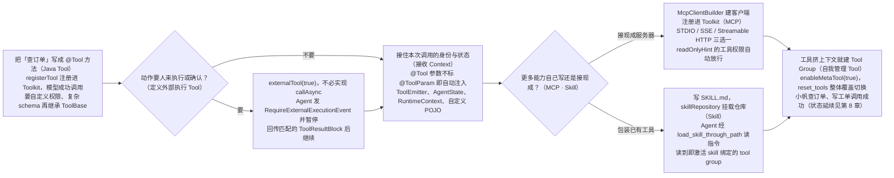

# 第 7 章 工具

> 本章导读：第 4 章的小帆还只能凭提示词回答；当你的 Agent 不再只是聊天——要查订单、写工单、跑脚本、读文件，也就是要操作真实业务系统时，给它的每一项能力都要在本章登记。本章讲解工具体系的三个概念——Tool（单个能力）、Toolkit（注册并分发工具的容器）与 Tool Group（成组启停的工具集合）；三者的完整定义见下一节。本章覆盖 `@Tool` 注解（把一个 Java 方法声明为模型可调用的工具）与 `ToolBase`（显式建模工具的抽象基类）两种自定义方式、外部执行工具（由人工或外部系统代为执行）、Context 注入、MCP 接入、Skill 热加载与 meta tool 自我管理。读完本章，你可以系统地为 Agent 扩展安全、可控的行动能力。`ToolBase` 的完整方法表与 `@Tool` 的完整属性表收拢在章末参考速查。



*本章操作流程图*

## 你什么时候需要它

- **让 Agent 摸到你的业务系统。** 订单查询、工单更新、调用内部 API——写成一个 `@Tool` 方法注册进 Toolkit，模型就能在推理中决定何时调用。第 4 章循环里“执行工具”的那一步，落到的就是本章的构件。
- **现成的工具生态，不想自己写代码。** 地图、文件系统、搜索这类能力，很多已经以 MCP 服务器的形式存在；注册一个 MCP 客户端，整组工具即可接入。
- **动作敏感，需要人来执行或确认。** 把工具标记为外部执行，Agent 会在调用点暂停，等人工或外部系统回传结果后再继续推理。
- **工具太多，上下文装不下。** 用 Tool Group 把工具成组启停，只让当前任务相关的工具暴露给模型。

与已学内容的关系和边界：工具让 Agent “能做”，第 10 章的权限系统管“准不准做”——每个工具执行前都会先过权限检查；工具在执行中拿到的本次调用身份与状态来自 `RuntimeContext`（第 4 章），本章“接收 Context”一节展开。

## 概述

Tool 是 agent 与外部世界交互的方式 —— 执行业务操作、调用 API、读写数据等。每个 tool 通过 JSON Schema（描述参数名、类型与是否必填的 JSON 规范）暴露给 LLM，agent 通过统一接口完成调用。

把这个交互动作落到框架里，AgentScope 用三个概念依次回答三个递进的问题：一个能力怎么声明、一批能力放在哪里管理、能力多到上下文装不下时怎么办。

**第一个问题：一个能力怎么声明。** Tool 是任意实现 `AgentTool` 接口（通常通过继承 `ToolBase`）或在普通类的方法上标注 `@Tool` 注解的对象；Java 端把后者称为 *reflective function tool*，由 `Toolkit#registerTool(Object)` 自动反射注册。一个 tool 就是一项可被模型调用的能力——查一次订单、写一张工单。

**第二个问题：一批能力放在哪里管理。** 工具是一个个写出来的，但注册、暴露与分发不该散落在业务代码里。Toolkit 是容器，负责注册 tool、MCP 客户端与 skill，向模型暴露它们的 JSON schema，并把每次工具调用分发到对应的 tool 对象。

**第三个问题：能力多到上下文装不下怎么办。** 工具继续增多，全部 schema 一起暴露会挤占上下文。Tool Group 是一组带名称的 tool / MCP / skill 集合，可以作为整体激活或停用——Agent 在运行时通过内置 meta tool 切换 group，让上下文保持聚焦。

```java
import io.agentscope.core.tool.Toolkit;
import io.agentscope.core.tool.builtin.TodoTools;

Toolkit toolkit = new Toolkit();
toolkit.registerTool(new TodoTools());
toolkit.registerTool(new MyCustomTools());
```

只调用 `registerTool(Object)` 时，被注册对象上所有 `@Tool` 方法都进入特殊的 `"basic"` 组 —— 该组始终激活。追加 MCP 客户端、tool group 或 skill 即可拓展 agent 的能力 —— 见下文各节。

## Java Tool

Java tool 是任意满足 `AgentTool` 契约的对象。AgentScope 同时提供了一个 `ToolBase` 抽象基类用于显式建模带参数 schema 的 tool，以及一个反射适配器用于把普通方法包装成 tool。

### AgentTool / ToolBase 接口

`ToolBase` 是 `AgentTool` 的抽象实现。每个 tool 都要向 agent 与运行时回答两类问题。

一类是**描述自己**：名称、面向 agent 的功能描述、参数的 JSON Schema，外加一组行为标记——是否可并发调用（`isConcurrencySafe()`）、是否只读（`isReadOnly()`）、是否外部执行（`isExternalTool()`，见本章「定义外部执行 Tool」一节）、是否注入 `AgentState`（`isStateInjected()`）、是否来自 MCP 服务（`isMcp()`）等。这些属性决定工具如何暴露给模型、如何被权限系统与调度对待。

另一类是**接入执行流程与权限系统**：`checkPermissions(toolInput, context)` 是每个工具执行前的运行时权限检查，返回 `Mono<PermissionDecision>`——第 10 章的权限判定正是构建在它之上；`callAsync(param)` 承载执行逻辑、返回 `Mono<ToolResultBlock>`；`matchRule` 与 `generateSuggestions` 两个可选方法分别服务权限规则的自定义匹配与建议生成。完整的方法与属性表见本章末参考速查。

### 使用内置 Tool

AgentScope 当前提供以下内置 tool：

| Tool | 说明 | 只读 |
|------|------|------|
| `TodoTools.todoWrite` | 维护当前会话的结构化任务列表（全列表替换语义） | 否 |

使用方式：

```java
Toolkit toolkit = new Toolkit();
toolkit.registerTool(new io.agentscope.core.tool.builtin.TodoTools());
```

> **注意**：Toolkit 在出现额外 tool group 或 skill 时会自动注册 `reset_tools` meta tool 与 skill 查看器工具 `load_skill_through_path`，开发者无需手动实例化。详见本章“自我管理 Tool”与“Skill”两节。

### 自定义 Tool（注解式）

最轻量的写法：在普通类的方法上标注 `@Tool` 与 `@ToolParam`，然后通过 `Toolkit#registerTool(Object)` 反射注册。框架自动从 Java 类型推导 JSON schema，从 `description` 取面向 agent 的说明。

```java
import io.agentscope.core.tool.Tool;
import io.agentscope.core.tool.ToolParam;
import io.agentscope.core.tool.Toolkit;
import java.time.LocalDateTime;
import java.time.ZoneId;
import java.time.format.DateTimeFormatter;

public class SimpleTools {

    @Tool(
            name = "get_current_time",
            description = "Returns the current time in a given IANA timezone.",
            readOnly = true,
            concurrencySafe = true)
    public String getCurrentTime(
            @ToolParam(name = "timezone", description = "IANA timezone, e.g. Asia/Shanghai")
                    String timezone) {
        return LocalDateTime.now(ZoneId.of(timezone))
                .format(DateTimeFormatter.ISO_LOCAL_DATE_TIME);
    }
}

Toolkit toolkit = new Toolkit();
toolkit.registerTool(new SimpleTools());
```

`@Tool` 还有几个常用属性：`readOnly` 标记只读（默认 `false`）；`concurrencySafe` 声明可并发调用（默认 `true`）；`stateInjected` 让框架在调用时注入 `AgentState`；`converter` 指定自定义返回值到 `ToolResultBlock` 的转换器；`dangerousFiles` / `dangerousDirectories` 追加自定义危险路径列表。完整属性表见本章末参考速查。

#### 显式返回执行状态

工具调用成功时返回 `ToolResultBlock.success(text)`，失败时返回 `ToolResultBlock.error(message)`；两者既可直接返回，也可包装在 `Mono<ToolResultBlock>` 中。不要通过文本前缀判断失败。`ToolResultBlock.text(text)` 默认是 `RUNNING`；如需保留既有 JSON 或多行输出，请用 `withState(...)` 明确终态。

内置工具已改为结构化结果。直接调用时用 `getState()` 判断状态，用 `getOutput()` 读取文本；`Toolkit` 注册方式不变。

### 自定义 Tool（继承 `ToolBase`）

需要自定义权限策略、外部执行或更复杂的 schema 时，继承 `ToolBase`：

```java
import io.agentscope.core.message.TextBlock;
import io.agentscope.core.message.ToolResultBlock;
import io.agentscope.core.permission.PermissionBehavior;
import io.agentscope.core.permission.PermissionContextState;
import io.agentscope.core.permission.PermissionDecision;
import io.agentscope.core.tool.ToolBase;
import io.agentscope.core.tool.ToolCallParam;
import java.util.List;
import java.util.Map;
import reactor.core.publisher.Mono;

public class WebSearchTool extends ToolBase {

    public WebSearchTool() {
        super(
                ToolBase.builder()
                        .name("WebSearch")
                        .description("Search the web for information on a given query.")
                        .inputSchema(Map.of(
                                "type", "object",
                                "properties", Map.of(
                                        "query", Map.of(
                                                "type", "string",
                                                "description", "The search query.")),
                                "required", List.of("query")))
                        .readOnly(true)
                        .concurrencySafe(true));
    }

    @Override
    public Mono<PermissionDecision> checkPermissions(
            Map<String, Object> toolInput, PermissionContextState context) {
        return Mono.just(PermissionDecision.allow("Web search is read-only."));
    }

    @Override
    public Mono<ToolResultBlock> callAsync(ToolCallParam param) {
        String query = (String) param.getInput().get("query");
        return doSearchAsync(query)
                .map(text ->
                        ToolResultBlock.builder()
                                .id(param.getId())
                                .name(getName())
                                .output(List.of(TextBlock.builder().text(text).build()))
                                .build());
    }
}
```

### 定义外部执行 Tool

外部执行 tool 把实际执行委派给 agent 运行时之外 —— 通常是人工操作员或外部系统。Agent 调用此类 tool 时会发出 `RequireExternalExecutionEvent` 并暂停。下一次调用回传匹配的 `ToolResultBlock` 后，agent 会发出带有相同 `replyId` 的 `ExternalExecutionResultEvent`，然后继续执行。

这种模式是 human-in-the-loop 工作流的基础（见第 4 章“人机交互”一节）—— 某些动作需要人工确认或人工执行。

创建外部执行 tool 只需把 `externalTool` 设为 `true`，不必实现 `callAsync`：

```java
import io.agentscope.core.permission.PermissionContextState;
import io.agentscope.core.permission.PermissionDecision;
import io.agentscope.core.tool.ToolBase;
import java.util.List;
import java.util.Map;
import reactor.core.publisher.Mono;

public class HumanApprovalTool extends ToolBase {

    public HumanApprovalTool() {
        super(
                ToolBase.builder()
                        .name("HumanApproval")
                        .description("Request human approval for a sensitive operation.")
                        .inputSchema(Map.of(
                                "type", "object",
                                "properties", Map.of(
                                        "action", Map.of("type", "string"),
                                        "reason", Map.of("type", "string")),
                                "required", List.of("action", "reason")))
                        .readOnly(false)
                        .concurrencySafe(true)
                        .externalTool(true));
    }

    @Override
    public Mono<PermissionDecision> checkPermissions(
            Map<String, Object> toolInput, PermissionContextState context) {
        return Mono.just(PermissionDecision.allow("External tool dispatch is always allowed."));
    }
}
```

完整可运行示例：`agentscope-examples/documentation/.../tool/ToolBaseExample.java`、`tool/ToolExecutionContextExample.java`。

## 接收 Context

每次 `agent.call(msgs, runtimeContext)` 传入的 `RuntimeContext`（见第 4 章“RuntimeContext”一节）会自动透传到所在 reply 内每一次工具调用。Tool 可以用两种方式拿到它：注解式 tool 走自动注入，`ToolBase.callAsync` 走 `ToolCallParam`。

### 自动注入（`@Tool` 方法）

`@Tool` 方法签名里，**没有标注 `@ToolParam`** 的参数会被框架视为「需要从框架注入」，并按下表的优先级解析：

| 参数类型 | 注入来源 |
|---------|---------|
| `ToolEmitter` | 流式中间产物 emitter 和工具调用上下文（无配置时为 no-op） |
| `Agent` | 当前 agent 实例 |
| `AgentState` | 当前 call 的 per-session 状态（通过 `RuntimeContext.getAgentState()` 获取） |
| `RuntimeContext` | 当前 per-call 上下文 |
| `ToolExecutionContext` | `runtimeContext.asToolExecutionContext()`（兼容层，已 deprecated） |
| 其它用户自定义 POJO 类型 | `runtimeContext.get(ParamType.class)` —— 即调用方在 `RuntimeContext.builder().put(ParamType.class, value)` 注册的对象 |

注入的 `ToolEmitter`（工具向外部发送流式进度的出口）会提供当前工具调用 ID，可用于把进度与前端状态或其它共享存储关联起来：

```java
@Tool(name = "run_task", description = "Run a long-running task")
public String runTask(ToolEmitter emitter) {
    String toolCallId = emitter.getToolCallId();
    if (toolCallId != null) {
        progressByToolCall.put(toolCallId, "running");
    }
    return "done";
}
```

当 emitter 没有工具调用上下文时（例如 no-op 或自定义 emitter），`getToolCallId()` 返回 `null`。

「用户自定义 POJO」的判定：参数没有 `@ToolParam`、不是基本类型、不是 `ContentBlock` / `Msg`、不在 `java.*` / `javax.*` 包下。其余参数（带 `@ToolParam` 或属于上述兜底类型）从 LLM 提供的 JSON 输入按名称取值。

```java
import io.agentscope.core.tool.Tool;
import io.agentscope.core.tool.ToolParam;

public record UserContext(String username, String locale) {}

public class PersonalizedTools {

    @Tool(name = "greet", description = "Greet the user with a custom greeting")
    public String greet(
            @ToolParam(name = "greeting", description = "Greeting word, e.g. 'Hello'")
                    String greeting,                  // ← 由模型提供
            UserContext userCtx) {                    // ← 由框架自动注入
        return greeting + ", " + (userCtx == null ? "unknown" : userCtx.username()) + "!";
    }
}
```

调用方按类型注册同款 POJO 后，每次 `call` 就会自动把对应实例分发到所有需要它的 tool：

```java
RuntimeContext ctx =
        RuntimeContext.builder()
                .put(UserContext.class, new UserContext("alice", "en"))
                .userId("alice")
                .build();

agent.call(List.of(new UserMessage("Greet me.")), ctx).block();
```

模型不需要把 `userCtx` 写进 JSON 参数——schema 里也不会出现它。完整示例：`agentscope-examples/documentation/.../tool/ToolExecutionContextExample.java`。

### `ToolBase.callAsync` 中访问

继承 `ToolBase` 的 tool 通过 `ToolCallParam` 取 context：

```java
import io.agentscope.core.agent.RuntimeContext;
import io.agentscope.core.tool.ToolBase;
import io.agentscope.core.tool.ToolCallParam;
import reactor.core.publisher.Mono;

public class TenantAwareTool extends ToolBase {

    public TenantAwareTool() {
        super(/* builder ... */);
    }

    @Override
    public Mono<io.agentscope.core.message.ToolResultBlock> callAsync(ToolCallParam param) {
        RuntimeContext rc = param.getRuntimeContext();
        String tenantId = rc != null ? rc.getUserId() : null;
        TenantConfig cfg = rc != null ? rc.get(TenantConfig.class) : null;
        // ... 用 tenantId / cfg 执行业务 ...
    }
}
```

`ToolCallParam` 同时暴露 `getAgent()`、`getInput()`、`getEmitter()`、`getToolUseBlock()` 以及（已 deprecated 的）`getContext()`。新代码使用 `getRuntimeContext()`。

### 协调 hook 与 tool

`RuntimeContext` 的 string 层（`put(String, Object)` / `get(String)`）是同一次 `call` 内 middleware 与 tool 之间的临时通信通道——middleware 在 `onActing`/`onReasoning` 等位置写入，tool 通过注入 `RuntimeContext` 参数读取；调用结束后该实例与 hook 一并解绑。

## MCP

自己的工具自己写之外，现成的工具生态可以用 MCP 直接接入。

AgentScope 集成 [Model Context Protocol (MCP)](https://modelcontextprotocol.io/)，让 agent 可以接入任意 MCP 兼容的工具提供方。框架自动处理协议协商、工具发现与结果转换。

支持三种连接方式：

- **STDIO** —— 本地进程 stdin/stdout 通信
- **SSE / Streamable HTTP** —— 远程 HTTP 长连接

MCP tool 在 toolkit 中以 `mcp__{server_name}__{tool_name}` 命名，避免冲突；标注了 `readOnlyHint` 的 tool 会被权限系统自动放行。

### 注册 MCP Tool

通过 `McpClientBuilder` 构建 `McpClientWrapper`，再注册到 `Toolkit`：

**STDIO**

```java
import io.agentscope.core.tool.Toolkit;
import io.agentscope.core.tool.mcp.McpClientBuilder;
import io.agentscope.core.tool.mcp.McpClientWrapper;

McpClientWrapper filesystem =
        McpClientBuilder.create("filesystem")
                .stdioTransport("mcp-server-filesystem", "--root", "/my/project")
                .buildAsync()
                .block();

Toolkit toolkit = new Toolkit();
toolkit.registerMcpClient(filesystem).block();
```

**Streamable HTTP**

```java
import io.agentscope.core.tool.Toolkit;
import io.agentscope.core.tool.mcp.McpClientBuilder;
import io.agentscope.core.tool.mcp.McpClientWrapper;

McpClientWrapper weather =
        McpClientBuilder.create("weather")
                .streamableHttpTransport("https://api.weather.com/mcp")
                .header("Authorization", "Bearer xxx")
                .buildAsync()
                .block();

Toolkit toolkit = new Toolkit();
toolkit.registerMcpClient(weather).block();
```

**SSE**

```java
import io.agentscope.core.tool.mcp.McpClientBuilder;
import io.agentscope.core.tool.mcp.McpClientWrapper;

McpClientWrapper search =
        McpClientBuilder.create("search")
                .sseTransport("https://api.search.com/mcp/sse")
                .buildAsync()
                .block();

Toolkit toolkit = new Toolkit();
toolkit.registerMcpClient(search).block();
```

完整运行示例：`agentscope-examples/documentation/.../mcp/McpStdioExample.java`、`mcp/McpSseExample.java`、`mcp/McpStreamableHttpExample.java`。

## Skill

还有一类扩展连工具代码都不用写：用 Markdown 指令包装 Agent 已有的工具。

Skill 是基于 markdown 的指令集，无需写新工具代码即可拓展 agent 能力。每个 skill 是一个目录，包含一个带 frontmatter（文件开头用 `---` 包住的元数据区块）元数据与详细指令的 `SKILL.md` 文件。

与 tool 不同，skill 不能被直接调用。Agent 通过自动注册的查看器工具 `load_skill_through_path` 读取 skill 指令，再用现有的 tool 按指令执行。

### 注册 Skill

通过 `ReActAgent.builder().skillRepository(...)` 直接挂载一个或多个 `AgentSkillRepository`。Builder 在 `build()` 时自动装配 `DynamicSkillMiddleware`，每次 `call()` 都会按 skill 来源刷新 skill prompt 与 tool group：

```java
import io.agentscope.core.ReActAgent;
import io.agentscope.core.skill.repository.FileSystemSkillRepository;
import java.nio.file.Paths;

ReActAgent agent =
        ReActAgent.builder()
                .name("SkillCreator")
                .sysPrompt("...")
                .model(model)
                .skillRepository(new FileSystemSkillRepository(Paths.get("/path/to/skills"), false))
                .build();
```

多次调用 `skillRepository(...)` 按调用顺序追加（低 → 高优先级），同名 skill 后者覆盖前者；如需替换整批，调用 `skillRepositories(List<AgentSkillRepository>)`。

参考实现：`agentscope-examples/documentation/.../skill/AgentSkillExample.java`、`skill/SkillWithToolGroupExample.java`。

### Skill 的工作方式

`Toolkit` 在含 skill 时，注册与查看分两阶段进行。

初始化阶段：

- Toolkit 扫描所有注册的 skill 来源，收集每个 skill 的名称、描述与目录。
- 自动把内置查看器工具 `load_skill_through_path`（实现位于 `io.agentscope.core.skill.SkillToolFactory`）作为无分组、始终可见的工具注册。
- 组装一段 system prompt 片段，列出可用 skill（仅名称与描述），并指示 agent 通过 `load_skill_through_path` 读取完整内容。

运行时阶段，agent 用两个必填参数调用查看器：

| 参数 | 类型 | 说明 |
| --- | --- | --- |
| `skillId` | `string`（枚举：已注册的 skill ID） | 要加载的 skill。 |
| `path` | `string` | 传 `"SKILL.md"` 取该 skill 的 markdown 指令；或传 skill 声明过的精确资源路径，例如 `"references/guide.md"`、`"scripts/run.py"`。不要传 `"."`、`"./"`、目录或绝对路径。 |

调用示例：

```json
{
  "name": "load_skill_through_path",
  "input": { "skillId": "pdf-extractor", "path": "SKILL.md" }
}
```

每次成功调用产生两件事：

1. 返回请求的内容（`SKILL.md` markdown，或指定的资源文件）。
2. **激活该 skill** —— Toolkit 中与之绑定的 tool group 被启用，本轮对话余下时段都可调用 skill 自带的工具。如果 `path` 不存在，查看器会返回错误并列出可用资源路径（`SKILL.md` 始终排在第一位），便于 agent 重试。

> **注意**：Skill 不是 tool —— agent 不能直接调用 skill。它必须先用 `load_skill_through_path` 读取指令，再用其他 tool 按描述的步骤执行。

### Skill 执行脚本：配置 Shell 工具

Skill 只提供指令，真正的执行依赖 agent 已有的 tool。如果 skill 指令涉及脚本执行（例如 `scripts/run.py`），agent 需要拥有 shell 执行能力：

- **`ReActAgent`** —— 注册 `ShellCommandTool` 到 toolkit：

```java
import io.agentscope.core.tool.Toolkit;
import io.agentscope.core.tool.coding.ShellCommandTool;
import io.agentscope.core.tool.file.ReadFileTool;
import io.agentscope.core.tool.file.WriteFileTool;

Toolkit toolkit = new Toolkit();
toolkit.registerTool(new ShellCommandTool());
toolkit.registerTool(new ReadFileTool("/path/to/base/dir"));
toolkit.registerTool(new WriteFileTool("/path/to/base/dir"));

ReActAgent agent =
        ReActAgent.builder()
                .name("SkillAgent")
                .sysPrompt("...")
                .model(model)
                .toolkit(toolkit)
                .skillRepository(skillRepo)
                .build();
```

- **`HarnessAgent`** —— harness 模块自带 workspace 感知的 shell 与文件工具（`execute`、`read_file`、`write_file` 等），无需额外注册。

### Skill + ToolGroup：按需披露工具

`SkillToolGroup` 把一组 tool 绑定到某个 skill name —— agent 加载该 skill 时 tool group 自动激活，未加载时 tool 不出现在模型 schema 中，减少上下文噪音。

```java
import io.agentscope.core.ReActAgent;
import io.agentscope.core.tool.Toolkit;

Toolkit toolkit = new Toolkit();

// 1. 创建与 skill 绑定的 tool group（初始不激活）
toolkit.createSkillToolGroup(
        "analysis-tools",                // group 名
        "Data analysis tools",           // 描述
        false,                           // 初始不激活
        "data-analysis");                // 绑定的 skill name

// 2. 把 tool 注册到该 group
toolkit.registration()
        .tool(new AnalysisTools())
        .group("analysis-tools")
        .apply();

// 3. 构建 agent，启用 meta tool 支持模型主动切换 group
ReActAgent agent =
        ReActAgent.builder()
                .name("AnalysisAgent")
                .sysPrompt("...")
                .model(model)
                .toolkit(toolkit)
                .skillRepository(skillRepo)
                .enableMetaTool(true)
                .build();
```

当 agent 通过 `load_skill_through_path` 加载名为 `data-analysis` 的 skill 时，`analysis-tools` group 自动激活，其中的 tool 立即可用。配合 `enableMetaTool(true)`，模型还可以通过 `reset_tools` 主动管理 tool group 的激活状态。

参考实现：`agentscope-examples/documentation/.../skill/SkillWithToolGroupExample.java`。

## 自我管理 Tool

工具越注册越多，新的问题是上下文噪音——把工具组的启停交给 Agent 自己管理。

内置 **meta tool**（`reset_tools`）让 agent 在运行时自我管理哪些 tool group 处于激活状态，从而保持上下文聚焦 —— 只有与当前任务相关的 tool 暴露给模型。

### 定义 Tool Group

`ToolGroup` 是带名称的 tool / MCP / skill 集合。把 group 注册到 `Toolkit` 后再用 builder 启用 meta tool：

```java
import io.agentscope.core.ReActAgent;
import io.agentscope.core.tool.Toolkit;
import io.agentscope.core.tool.ToolGroup;
import io.agentscope.core.tool.ToolGroupScope;

Toolkit toolkit = new Toolkit();
toolkit.registerTool(new BasicTools());

ToolGroup database =
        ToolGroup.builder()
                .name("database")
                .description("Tools for database operations.")
                .scope(ToolGroupScope.SESSION)
                .active(false)
                .build();
database.addTool("db_query");
database.addTool("db_migrate");
toolkit.registerTool(new DatabaseTools());
toolkit.registerToolGroup(database);

ToolGroup deployment =
        ToolGroup.builder()
                .name("deployment")
                .description("Tools for deploying services.")
                .scope(ToolGroupScope.SESSION)
                .active(false)
                .build();
deployment.addTool("deploy");
deployment.addTool("rollback");
toolkit.registerTool(new DeploymentTools());
toolkit.registerToolGroup(deployment);

ReActAgent agent =
        ReActAgent.builder()
                .name("router")
                .toolkit(toolkit)
                .enableMetaTool(true)
                .build();
```

`ToolGroup` 接收名称、描述、作用域（`ToolGroupScope`）以及初始激活态。保留名 `"basic"` 由 `Toolkit#registerTool(Object)` 自动构成，且始终激活。

### 使用 Meta Tool

只要存在至少一个非 basic 的 tool group，并通过 `enableMetaTool(true)` 打开开关，`Toolkit` 就会自动注册 `reset_tools` 并把其 schema 暴露给 agent。每个非 basic group 在 schema 中表示为一个布尔字段，agent 调用 meta tool 时声明期望的最终状态。

运行时行为：

- `"basic"` 组中的 tool 始终暴露，meta tool 不会影响它们。
- 每次调用 `reset_tools` 都会**整体覆盖**激活集合 —— 任何未显式置为 `true` 的非 basic group 都会被停用，无论之前的状态。
- 对每个本次切换为激活的 group，其 description 与（若提供的）使用说明会被拼接进 meta tool 的返回值，告诉 agent 如何正确使用该组。
- 未激活 group 中的 tool 不会出现在 agent 的工具 schema 中，从而把上下文留给当前激活的工具集。

> **警告**：Meta tool 的输入表示所有 group 的**最终状态**而非增量。任何未显式置为 `true` 的 group 都会被停用，无论之前的状态如何。

## 请求级工具视图与会话隔离

前面的注册与激活都是 Agent 级的；单次请求还可以有更细的工具视图。

先看 Agent 级的隔离语义：Agent 构建时复制工具注册表和注册元数据；已有工具实例仍按引用共享，因此自定义工具需要自行保证并发安全。构建某个 Agent 时添加的 Hook、知识库等工具不会覆盖其他 Agent 的注册。

正因为注册表是构建时复制的，调用期间不要通过修改共享 Toolkit 注入外部工具或切换会话的工具组——需要为某次请求调整工具面时，使用 `io.agentscope.core.tool.ToolRequestConfig` 描述本次请求的工具视图：

```java
ToolRequestConfig tools = new ToolRequestConfig(
        Map.of(schema.getName(), new SchemaOnlyTool(schema)),
        ToolMergeMode.MERGE_EXTERNAL_PRIORITY);
RuntimeContext ctx = RuntimeContext.builder()
        .userId(userId).sessionId(sessionId)
        .toolRequestConfig(tools).build();
agent.streamEvents(messages, ctx).subscribe(this::handleEvent);
```

外部工具只包含 schema，执行时返回 suspended，由调用方执行后提交结果。同名外部工具覆盖后端工具；`EXTERNAL_ONLY` 隐藏全部后端工具，即使外部列表为空或 Toolkit 禁止删除工具也一样，因为请求视图不会删除注册。`AGENT_ONLY` 不允许同时配置外部工具。

### 会话中的工具状态与动态 Skill 仓库

`Toolkit.callTool` 和 `callTools` 同样读取显式传入的 RuntimeContext。无配置的 `getTool(name)` 查看原始注册表；需要请求视图时使用 `getTool(name, config)`。工具组激活状态保存在会话的 `ToolContextState`，流式工具回调绑定本次调用。

需要按用户或会话加载技能的仓库实现 Core 中的 `io.agentscope.core.skill.repository.RuntimeContextSkillRepository`。Core 和 Harness 都将当前上下文传给仓库。动态 Skill 视图按内容签名缓存，并发缓存未命中共享一次完整的资源物化；淘汰后重建视图使用新目录，保留运行中执行所引用的文件。缓存淘汰只限制保留的 SkillBox 数量，不限制磁盘占用：自动生成的目录保留到 JVM 退出时清理。调用方指定的工作目录由调用方负责清理；不要在仍有执行引用资源时删除它。

## 本章小结

这一章给 Agent 装上了操作真实系统的手，走过的路线是：

1. **三个概念**：Tool 声明单个能力（`@Tool` 注解或继承 `ToolBase`）；Toolkit 负责注册、向模型暴露 JSON schema 并分发调用；Tool Group 把工具成组启停，保住上下文聚焦；
2. **两种自定义方式**：注解式最轻量，框架自动推导 schema；需要自定义权限策略、外部执行或复杂 schema 时继承 `ToolBase`，实现 `checkPermissions` 与 `callAsync`；
3. **执行结果**：用 `ToolResultBlock.success` / `error` 显式表达成败与终态，不要靠文本前缀判断；
4. **Context 注入**：`@Tool` 方法里没有 `@ToolParam` 的参数按类型自动注入（`ToolEmitter`、`AgentState`、`RuntimeContext`、自定义 POJO 等），`ToolBase.callAsync` 通过 `ToolCallParam` 取用；
5. **工具生态**：MCP 以 STDIO、SSE、Streamable HTTP 三种连接方式把现成服务器整组接入；Skill 用 Markdown 指令包装已有工具，agent 经 `load_skill_through_path` 读取即激活；
6. **自我管理与请求级视图**：`reset_tools` meta tool 让 Agent 运行时切换 Tool Group（整体覆盖语义）；单次请求可用 `ToolRequestConfig` 定制工具视图，激活状态保存在会话的 `ToolContextState`。

工具让 Agent 能做，准不准做由权限系统判定（第 10 章）。而工具执行中产生的状态、工具组的激活状态都挂在会话与上下文上——下一章就看这些状态放在哪里、如何在实例与机器之间延续。

**验收清单**——读到这里，你应该能：

- ☐ 写一个 `@Tool` 注解式工具注册进 Toolkit，并让模型成功调用它；
- ☐ 继承 `ToolBase` 实现自定义 `checkPermissions` 的工具；
- ☐ 定义一个外部执行工具，并描述 `RequireExternalExecutionEvent` 暂停与回传的流程；
- ☐ 通过 `RuntimeContext` 把调用方自定义 POJO 注入 `@Tool` 方法；
- ☐ 注册一个 MCP 客户端（STDIO 或 HTTP/SSE），整组接入现成工具；
- ☐ 挂载 skill 仓库，并解释 `load_skill_through_path` 初始化与运行两阶段的工作方式；
- ☐ 创建 Tool Group 并用 `reset_tools` 让 Agent 自管激活状态，说出整体覆盖语义的坑；
- ☐ （选做）用 `ToolRequestConfig` 为单次请求定制工具视图。

## 延伸阅读

- **Agent（见第 4 章）**——Agent 如何在 ReAct 循环中编排 tool 调用。
- **权限系统（见第 10 章）**——精细控制哪个 tool 可以执行、何时执行。
- **中间件（见第 9 章）**——用洋葱式 middleware 拦截并改写 tool 调用。
- **Human-in-the-Loop（见第 4 章）**——外部执行 tool 与人工审批工作流。

## 参考速查

本节收拢正文引用过的方法与属性全表，供实施时查阅；主线讲解不依赖本节。

### ToolBase 属性与方法

向 agent 与运行时描述 tool 的属性：

| 方法 | 类型 | 说明 |
|---|---|---|
| `getName()` | `String` | 暴露给 agent 的 tool 名称 |
| `getDescription()` | `String` | 面向 agent 的功能描述 |
| `getParameters()` | `Map<String, Object>` | 定义参数的 JSON Schema |
| `isConcurrencySafe()` | `boolean` | 是否可并发调用 |
| `isReadOnly()` | `boolean` | 是否只读、不产生副作用 |
| `isExternalTool()` | `boolean` | 为 `true` 时执行委派给外部（见本章“定义外部执行 Tool”一节） |
| `isStateInjected()` | `boolean` | 为 `true` 时框架注入 `AgentState` 参数 |
| `isMcp()` | `boolean` | 是否来自 MCP 服务 |
| `getMcpName()` | `String` | `isMcp()` 为 `true` 时所属 MCP 服务名 |

接入执行流程与权限系统的方法：

| 方法 | 必需 | 说明 |
|---|---|---|
| `checkPermissions(toolInput, context)` | 是 | 执行前的运行时权限检查；返回 `Mono<PermissionDecision>` |
| `matchRule(ruleContent, toolInput)` | 可选 | 权限系统中的自定义规则匹配；返回 `boolean` |
| `generateSuggestions(toolInput)` | 可选 | 基于本次工具调用生成建议规则；返回 `List<PermissionRule>` |
| `callAsync(param)` | 可选 | tool 的执行逻辑；返回 `Mono<ToolResultBlock>`。外部执行 tool 不需要实现。 |

### @Tool 注解属性

| 属性 | 类型 | 说明 |
|------|------|------|
| `name` | `String` | tool 名（默认取方法名） |
| `description` | `String` | 面向 agent 的描述 |
| `readOnly` | `boolean` | 是否只读（默认 `false`） |
| `concurrencySafe` | `boolean` | 是否可并发调用（默认 `true`） |
| `stateInjected` | `boolean` | 是否在调用时注入 `AgentState` 作为额外参数（默认 `false`） |
| `dangerousFiles` / `dangerousDirectories` | `String[]` | 追加自定义危险路径列表 |
| `converter` | `Class<? extends ToolResultConverter>` | 自定义返回值到 `ToolResultBlock` 的转换器 |
