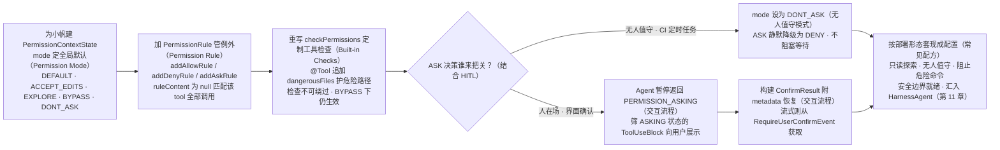
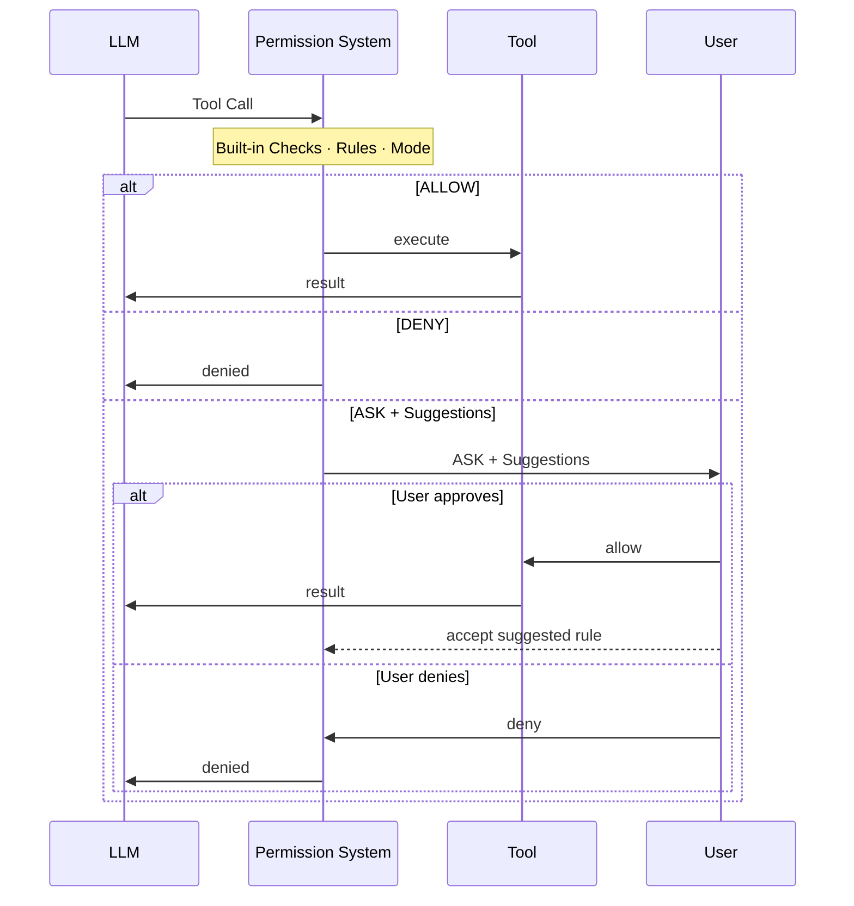
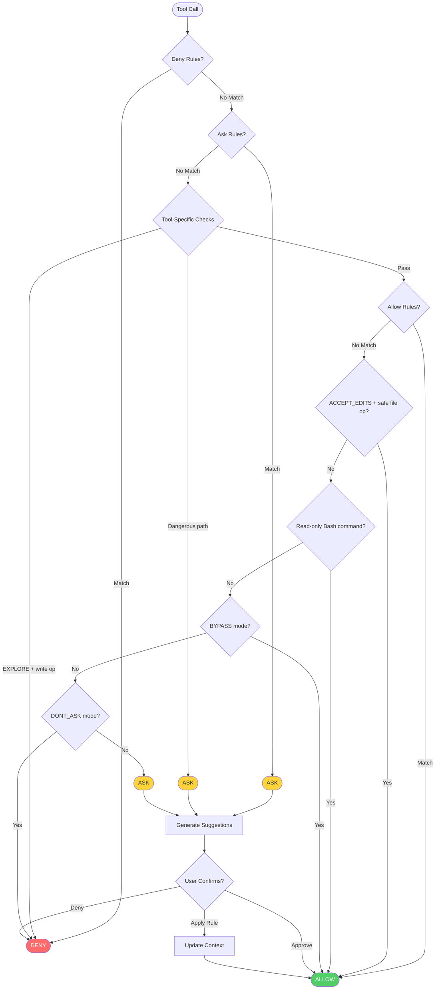

# 第 10 章 权限系统与人工介入

> 本章导读：当你的 Agent 要执行有真实后果的操作——删文件、跑命令、发线上请求——就需要一道闸门来回答“这个操作准不准做”。本章讲解做这道判定的权限系统：拦截每一次工具调用，按 Rules（针对具体工具的显式规则）、Mode（全局默认策略）与 Built-in Checks（工具自带的运行时检查）三层决策给出结论；再讲五种 PermissionMode 的适用场景、建议规则与危险路径保护，以及结合 HITL 的确认恢复流程和常见部署配方。读完本章，你可以为 Agent 划定安全、可控的行动边界。



*本章操作流程图*

## 你什么时候需要它

只要 Agent 的工具会产生真实副作用，这层闸门就值得配。几个典型处境：

- **人在场的产品形态。** 写工作目录内的文件可以自动放行，敏感操作必须问一句——`DEFAULT` / `ACCEPT_EDITS` 两种模式加上若干规则就能表达“哪些操作要人审批”。
- **只读调研。** 让 Agent 只查不改：`EXPLORE` 模式放行读、拒绝一切写与命令，适合代码探索与规划。
- **无人值守。** CI、定时任务里没人点确认：`DONT_ASK` 把所有询问静默降级为拒绝，不会阻塞等待。
- **完全可信的沙箱。** `BYPASS` 放行一切——但即使在这里，也有一道绕不过去的底线，下文会看到它在哪里。

与已学内容的关系和边界：第 7 章定义了工具“能做什么”，本章决定“准不准做”——第 7 章每个工具自带的 `checkPermissions` 就是本章的第三层检查。人工审批的界面交互（暂停、恢复）在第 4 章“人机交互”一节演示过，本章补上判定侧的完整规则；第 9 章的 middleware 可以观察“全部工具被拒绝”事件来决定是否停止 Agent，但判定本身不归它管。

## 概述

Permission system（`io.agentscope.core.permission`）拦截 agent 的每一次工具调用，给出三种决策之一：**允许（ALLOW）** 执行、**拒绝（DENY）** 执行，或者**询问用户（ASK）** 确认。

它把静态配置与动态运行时分析组合起来。三个组件各自回答一个不同的问题，共同决定结果：

- **Rules** —— 有没有明文规定？针对每个 tool 与命令的显式 allow / deny / ask 模式，最高优先级。规则有两种来源：在 `PermissionContextState` 中静态预配置，或在 ASK 提示中由用户接受**建议规则**而动态加入。建议规则由本次工具调用自动生成 —— 一旦接受，将来相同的调用便会被自动处理，不再询问。
- **Mode** —— 没规定时按什么默认办？配置阶段设定的全局静态策略；决定所有不命中任何规则的调用的默认行为（例如 `EXPLORE` 让 agent 进入只读；`DONT_ASK` 静默拒绝未命中的调用）。
- **Built-in Checks** —— 工具自己怎么看？由 tool 自身在运行时基于真实输入做的动态分析（在 `ToolBase#checkPermissions` 中实现）。这些是运行时检查而非预配置模式，因此**不可绕过**，不受 mode 或 rules 覆盖。



### 详细决策流程



> **注意**：Deny 规则与危险路径检查是**不可绕过的** —— 即使在 `BYPASS` 模式下也照常生效。

## Permission Mode

三层决策先从最上层配起：Mode 决定所有未命中规则的调用的默认行为。

`PermissionMode` 枚举（`io.agentscope.core.permission.PermissionMode`）支持以下模式，分别适配不同的部署场景：

| Mode | 行为 | 适用场景 |
|------|------|----------|
| `DEFAULT` | 所有操作都需要显式规则或用户确认 | 最安全，推荐默认值 |
| `ACCEPT_EDITS` | 自动放行工作目录内的文件操作 | 用户在场的活跃开发 |
| `EXPLORE` | 只读：放行读、拒绝所有写与命令 | 代码探索、规划 |
| `BYPASS` | 放行一切（deny / ask 规则仍生效） | 完全可信的沙箱 |
| `DONT_ASK` | 把所有 ASK 转为 DENY | 无人值守 / 计划任务 |

可以在创建 agent 时通过 `permissionContext(...)` 设置 mode：

**初始化时配置**

```java
import io.agentscope.core.ReActAgent;
import io.agentscope.core.permission.PermissionContextState;
import io.agentscope.core.permission.PermissionMode;

PermissionContextState permCtx =
        PermissionContextState.builder()
                .mode(PermissionMode.DEFAULT)
                .build();

ReActAgent agent =
        ReActAgent.builder()
                .name("xingfan-support")
                .sysPrompt("...")
                .model(model)
                .permissionContext(permCtx)
                .build();
```

**ACCEPT_EDITS 配合工作目录**

```java
import io.agentscope.core.permission.AdditionalWorkingDirectory;
import io.agentscope.core.permission.PermissionContextState;
import io.agentscope.core.permission.PermissionMode;

PermissionContextState permCtx =
        PermissionContextState.builder()
                .mode(PermissionMode.ACCEPT_EDITS)
                .addWorkingDirectory(
                        "/my/project",
                        new AdditionalWorkingDirectory("/my/project", "userSettings"))
                .build();
```

## Permission Rule

Mode 管默认值，规则管例外。

`PermissionRule`（record）把某个 tool 与具体的调用模式映射到三种行为之一：`ALLOW`、`DENY`、`ASK`。

当权限引擎评估一条规则时，它会用 `ruleContent` 与实际调用入参调用该 tool 的 `matchRule()` 方法，判断规则是否命中。每条规则由工具名、匹配模式、行为、来源四个字段组成，字段全表见本章末参考速查一节；其中 `ruleContent` 为 `null` 表示对该 tool 的所有调用均匹配。

### 配置规则

**初始化时** —— 通过 `PermissionContextState.builder()` 把规则传入：

```java
import io.agentscope.core.permission.PermissionBehavior;
import io.agentscope.core.permission.PermissionContextState;
import io.agentscope.core.permission.PermissionMode;
import io.agentscope.core.permission.PermissionRule;

PermissionContextState permCtx =
        PermissionContextState.builder()
                .mode(PermissionMode.DEFAULT)
                .addAllowRule(
                        "safe_read",
                        new PermissionRule(
                                "safe_read", null, PermissionBehavior.ALLOW, "userSettings"))
                .addAskRule(
                        "dangerous_delete",
                        new PermissionRule(
                                "dangerous_delete",
                                null,
                                PermissionBehavior.ASK,
                                "userSettings"))
                .addDenyRule(
                        "drop_table",
                        new PermissionRule(
                                "drop_table", null, PermissionBehavior.DENY, "userSettings"))
                .build();
```

**运行时通过建议规则** —— 当权限系统返回 ASK 时，会基于本次调用自动生成建议规则。把已接受的规则附在 `ConfirmResult.acceptedRules` 中回传，agent 会自动写入引擎：

```java
import io.agentscope.core.event.ConfirmResult;

// ASK 决策会把建议规则挂在 PermissionDecision 上（权限钩子可见），而不是 ToolUseBlock 上。
// 恢复层可以直接放行，也可以显式传入规则，让今后相同的调用自动放行：
ConfirmResult result =
        new ConfirmResult(
                /* confirmed = */ true,
                /* toolCall  = */ toolCall);
```

完整可运行示例：`agentscope-examples/documentation/.../tool/PermissionContextExample.java`、`hitl/PermissionHITLExample.java`。

## Built-in Checks

前两层来自配置，第三层长在工具自己身上。

每个 tool 都实现了一个 `checkPermissions(toolInput, context)` 方法（位于 `ToolBase`），在运行时基于真实调用入参执行检查，返回 `Mono<PermissionDecision>`。这些检查不可绕过 —— 无论 mode 或 rules 是什么，它们都生效。

`PermissionDecision` 提供四个静态构造方法：`allow(message)` / `deny(message)` / `ask(message)` / `passthrough(message)`。返回 `PASSTHROUGH` 表示「我不强加判断，交给引擎按 rules / mode 评估」。

自定义 tool 可以重写 `checkPermissions()` 实现自己的检查逻辑：

```java
import io.agentscope.core.permission.PermissionDecision;
import io.agentscope.core.tool.ToolBase;
import io.agentscope.core.tool.ToolExecutionContext;
import java.util.Map;
import reactor.core.publisher.Mono;

public class MyTool extends ToolBase {

    public MyTool() {
        super(
                ToolBase.builder()
                        .name("MyTool")
                        .description("...")
                        .readOnly(false));
    }

    @Override
    public Mono<PermissionDecision> checkPermissions(
            Map<String, Object> toolInput, ToolExecutionContext context) {
        Object target = toolInput.get("target");

        // 自定义安全检查：阻止操作生产资源
        if (target instanceof String s && s.startsWith("prod-")) {
            return Mono.just(
                    PermissionDecision.ask("Operation targets production resource: " + s));
        }

        // 返回 PASSTHROUGH 让引擎继续按 rules / mode 评估
        return Mono.just(PermissionDecision.passthrough("default"));
    }
}
```

### 危险路径保护

`ToolBase` 内置的危险路径列表通过 `ToolDangerousPathConstants` 维护，自定义 tool 可以在 `@Tool` 注解上追加 `dangerousFiles` / `dangerousDirectories` 把额外路径并入受保护集合。命中后即使在 `BYPASS` 模式下也会强制 ASK。

| 类别 | 默认受保护示例 |
|------|----------------|
| Shell 配置 | `.bashrc`、`.zshrc`、`.bash_profile`、`.profile` |
| Git 配置 | `.gitconfig`、`.gitmodules` |
| SSH | `.ssh/config`、`.ssh/authorized_keys`、`id_rsa`、`id_ed25519` |
| 凭证 | `.env`、`.env.local`、`.npmrc`、`.pypirc`、`.aws/credentials` |
| 目录 | `.git/`、`.ssh/`、`.aws/`、`.kube/` |

## 结合 HITL

判定给出 ASK 之后，接下来是人与 Agent 之间的交互流程。

当权限引擎对某个工具调用返回 ASK 决策时，agent 不会直接执行，而是暂停并返回一个 `GenerateReason.PERMISSION_ASKING` 的响应。返回的 `Msg` 中包含处于 `ASKING` 状态的 `ToolUseBlock`，调用方据此向用户展示待确认的操作，收集决策后通过 `ConfirmResult` 恢复 agent。

### 交互流程

1. 配置 ASK 规则，标记需要人工确认的工具
2. Agent 遇到 ASK 工具时暂停，返回 `PERMISSION_ASKING`
3. 从返回的 `Msg` 中提取 `ToolUseBlock`（状态为 `ASKING`），向用户展示
4. 构建 `ConfirmResult`，附在新消息的 metadata 中恢复 agent

```java
import io.agentscope.core.event.ConfirmResult;
import io.agentscope.core.message.GenerateReason;
import io.agentscope.core.message.Msg;
import io.agentscope.core.message.MsgRole;
import io.agentscope.core.message.ToolCallState;
import io.agentscope.core.message.ToolUseBlock;
import io.agentscope.core.message.UserMessage;
import io.agentscope.core.permission.PermissionBehavior;
import io.agentscope.core.permission.PermissionContextState;
import io.agentscope.core.permission.PermissionMode;
import io.agentscope.core.permission.PermissionRule;
import java.util.HashMap;
import java.util.List;
import java.util.Map;

// 1. 配置权限：safe_read 自动放行，dangerous_delete 需要确认
PermissionContextState permCtx =
        PermissionContextState.builder()
                .mode(PermissionMode.DEFAULT)
                .addAllowRule(
                        "safe_read",
                        new PermissionRule(
                                "safe_read", null, PermissionBehavior.ALLOW, "policy"))
                .addAskRule(
                        "dangerous_delete",
                        new PermissionRule(
                                "dangerous_delete", null, PermissionBehavior.ASK, "policy"))
                .build();

ReActAgent agent =
        ReActAgent.builder()
                .name("GuardedAgent")
                .sysPrompt("...")
                .model(model)
                .toolkit(toolkit)
                .permissionContext(permCtx)
                .build();

// 2. 调用 agent
Msg result = agent.call(new UserMessage("Delete /tmp/important.txt")).block();

// 3. 检查是否需要用户确认
if (result != null && result.getGenerateReason() == GenerateReason.PERMISSION_ASKING) {
    // 从返回的 Msg 中提取待确认的 ToolUseBlock
    List<ToolUseBlock> askingTools =
            result.getContent().stream()
                    .filter(b -> b instanceof ToolUseBlock)
                    .map(ToolUseBlock.class::cast)
                    .filter(t -> t.getState() == ToolCallState.ASKING)
                    .toList();

    // 向用户展示
    askingTools.forEach(t -> System.out.println("Pending: " + t.getName() + " " + t.getInput()));

    // 4. 收集用户决策，构建 ConfirmResult 恢复 agent
    boolean approved = askUser();
    List<ConfirmResult> confirmResults =
            askingTools.stream()
                    .map(t -> new ConfirmResult(approved, t))
                    .toList();

    Map<String, Object> meta = new HashMap<>();
    meta.put(Msg.METADATA_CONFIRM_RESULTS, confirmResults);
    Msg resumeMsg =
            Msg.builder()
                    .name("user")
                    .role(MsgRole.USER)
                    .textContent(approved ? "approved" : "denied")
                    .metadata(meta)
                    .build();

    Msg finalResult = agent.call(List.of(resumeMsg)).block();
}
```

### 全部工具被拒绝

当用户在确认界面拒绝了本轮推理产出的**全部**工具调用时，agent 默认会继续下一轮推理 —— 此时模型只能看到 "Permission denied by user" 的工具结果，容易产生无效推理。

如果需要在这种场景下停止 agent，可以装备一个 `onActing` middleware 观察 `AllToolsDeniedEvent` 并发出 `RequestStopEvent`。停止后 `Msg.getGenerateReason()` 返回 `ALL_TOOLS_DENIED`。

具体实现见第 9 章（中间件）“全部工具被拒绝时停止 agent”一节。

### Streaming 模式

使用 `streamEvents()` 时，不需要从返回的 `Msg` 提取 `ToolUseBlock` —— 通过事件流直接获得 `RequireUserConfirmEvent`，它携带了待确认的工具调用列表：

```java
import io.agentscope.core.event.AgentEvent;
import io.agentscope.core.event.ConfirmResult;
import io.agentscope.core.event.RequireUserConfirmEvent;
import io.agentscope.core.message.Msg;
import io.agentscope.core.message.MsgRole;
import io.agentscope.core.message.ToolUseBlock;
import java.util.HashMap;
import java.util.List;
import java.util.Map;

// 订阅事件流
agent.streamEvents(List.of(new UserMessage("Delete /tmp/important.txt")))
        .doOnNext(event -> {
            if (event instanceof RequireUserConfirmEvent confirmEvent) {
                // 直接从事件中获取待确认的 ToolUseBlocks
                List<ToolUseBlock> pending = confirmEvent.getToolCalls();
                pending.forEach(t ->
                        System.out.println("Pending: " + t.getName() + " " + t.getInput()));

                // 收集用户决策后，在下一次 call 时恢复
                // （存储 pending 列表，在后续 call 时使用）
            }
        })
        .blockLast();

// 恢复方式与 blocking API 相同：构建 ConfirmResult 附在 metadata 中
List<ConfirmResult> confirmResults =
        pendingTools.stream()
                .map(t -> new ConfirmResult(true, t))
                .toList();
Map<String, Object> meta = new HashMap<>();
meta.put(Msg.METADATA_CONFIRM_RESULTS, confirmResults);
Msg resumeMsg =
        Msg.builder()
                .name("user")
                .role(MsgRole.USER)
                .textContent("approved")
                .metadata(meta)
                .build();
agent.call(List.of(resumeMsg)).block();
```

如果使用 `streamEvents(List.of(resumeMsg))` 发起恢复，事件流会在恢复执行工具之前包含
`UserConfirmResultEvent`。使用它的 `replyId` 将本次接受的确认结果关联到之前的
`RequireUserConfirmEvent`；该事件只包含本次恢复消息携带的确认结果。

两种模式的区别：

| | Blocking `call()` | Streaming `streamEvents()` |
|---|---|---|
| 获取待确认工具 | 从返回的 `Msg.getContent()` 中筛选 `ToolUseBlock`（状态为 `ASKING`） | 从 `RequireUserConfirmEvent.getToolCalls()` 直接获取 |
| 恢复方式 | 相同：构建 `ConfirmResult` 附在 metadata 中发起新的 `call()` | 相同 |
| 适用场景 | REST API、简单同步服务 | WebSocket、SSE、实时 UI |

### 无人值守模式

在 CI 或定时任务等无人值守场景下，把 mode 设为 `DONT_ASK`，所有 ASK 决策会自动降级为 DENY：

```java
PermissionContextState headless =
        PermissionContextState.builder()
                .mode(PermissionMode.DONT_ASK)
                .addAllowRule(
                        "safe_read",
                        new PermissionRule(
                                "safe_read", null, PermissionBehavior.ALLOW, "policy"))
                .build();
// ASK 规则命中时自动拒绝，不会阻塞等待
```

完整可运行示例：`agentscope-examples/documentation/.../hitl/PermissionHITLExample.java`。

## 常见配方

最后把前面的组件拼成常见部署形态的现成配置。

下面的示例展示了如何为常见部署场景配置 `permissionContext`。每个配方把一种 mode 与一组规则结合，匹配特定的使用场景。

**只读探索**

```java
// EXPLORE 模式：agent 可以自由调用只读工具，所有写工具会被自动拒绝。
PermissionContextState explore =
        PermissionContextState.builder()
                .mode(PermissionMode.EXPLORE)
                .build();

ReActAgent explorer =
        ReActAgent.builder()
                .name("explorer")
                .sysPrompt("...")
                .model(model)
                .permissionContext(explore)
                .build();
```

**无人值守自动化**

```java
import io.agentscope.core.permission.PermissionBehavior;
import io.agentscope.core.permission.PermissionRule;

PermissionContextState ci =
        PermissionContextState.builder()
                .mode(PermissionMode.DONT_ASK)
                .addAllowRule(
                        "deploy",
                        new PermissionRule(
                                "deploy", "staging", PermissionBehavior.ALLOW, "project"))
                .addAllowRule(
                        "git_commit",
                        new PermissionRule(
                                "git_commit", null, PermissionBehavior.ALLOW, "project"))
                .build();

ReActAgent ciAgent =
        ReActAgent.builder()
                .name("ci_agent")
                .sysPrompt("...")
                .model(model)
                .permissionContext(ci)
                .build();
// 只有显式放行的命令会执行；其余调用被静默拒绝
```

**阻止危险命令**

```java
PermissionContextState bypassWithDeny =
        PermissionContextState.builder()
                .mode(PermissionMode.BYPASS)
                .addDenyRule(
                        "drop_table",
                        new PermissionRule(
                                "drop_table", null, PermissionBehavior.DENY, "userSettings"))
                .addDenyRule(
                        "force_push",
                        new PermissionRule(
                                "force_push", null, PermissionBehavior.DENY, "userSettings"))
                .build();
// 除显式拒绝的工具外，其余均放行（deny 规则不可绕过）
```

## 本章小结

这一章给 Agent 装上了一道闸门，路线回顾：

1. **三层决策**：Built-in Checks（工具自带的运行时检查，不可绕过）、Rules（显式规则，最高优先级）、Mode（未命中规则时的全局默认）共同给出 ALLOW / DENY / ASK 三种结论；
2. **五种模式**：`DEFAULT` 最稳、`ACCEPT_EDITS` 服务于用户在场的开发、`EXPLORE` 只读、`BYPASS` 供可信沙箱全放行、`DONT_ASK` 面向无人值守；
3. **规则与建议**：`PermissionRule` 把工具名与匹配模式映射到行为；ASK 时自动生成的建议规则一经接受，相同的调用今后自动放行；
4. **底线**：deny 规则与危险路径检查即使在 `BYPASS` 模式下也照常生效；
5. **HITL**：ASK 让 agent 暂停并返回 `PERMISSION_ASKING`，调用方收集决策后用 `ConfirmResult` 恢复；流式场景经 `RequireUserConfirmEvent` 获取待确认工具，恢复方式相同。

到这里，第二篇的核心构建块就拆完了：第 4 章的 Agent 与 ReAct 循环，加上消息与事件、模型接入、工具、上下文、中间件和本章的权限。它们如何组合成面向生产的 `HarnessAgent`——一次执行怎么读写状态、十余项能力挂在时序的哪个位置——是第 11 章（Harness 架构深入）的主题。

**验收清单**——读到这里，你应该能：

- ☐ 说出三层决策各自回答什么问题、以什么优先级组合出 ALLOW / DENY / ASK；
- ☐ 为人在场开发、只读调研、无人值守、可信沙箱四种场景各选一个 `PermissionMode` 并说明理由；
- ☐ 写出一条 allow / deny / ask 规则，并解释 `ruleContent` 为 `null` 时的匹配范围；
- ☐ 解释为什么 `BYPASS` 模式下 deny 规则与危险路径检查仍然生效；
- ☐ 完成 ASK 暂停 → 展示待确认工具 → `ConfirmResult` 恢复的完整人工介入流程；
- ☐ 区分 blocking 与 streaming 两种模式下获取待确认工具的途径。

## 参考速查

本节收拢 `PermissionRule` 的字段定义，供配置规则时查阅；正文主线不依赖本节。

### PermissionRule 字段

- **`toolName` · `String` · *required*** — 规则适用的 tool 名：内置 `todo_write`，或任意自定义 tool 名。

- **`ruleContent` · `String | null` · *optional*** — 匹配模式 —— 语义随 `toolName` 变化，由该 tool 的 `matchRule()` 方法解释。`null` 表示对该 tool 的所有调用均匹配。

- **`behavior` · `PermissionBehavior` · *required*** — `ALLOW`、`DENY`、`ASK` 或 `PASSTHROUGH`

- **`source` · `String` · *required*** — 规则来源：`"userSettings"`、`"projectSettings"`、`"session"`、`"suggested"` 等。
