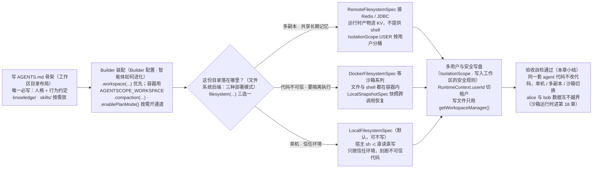
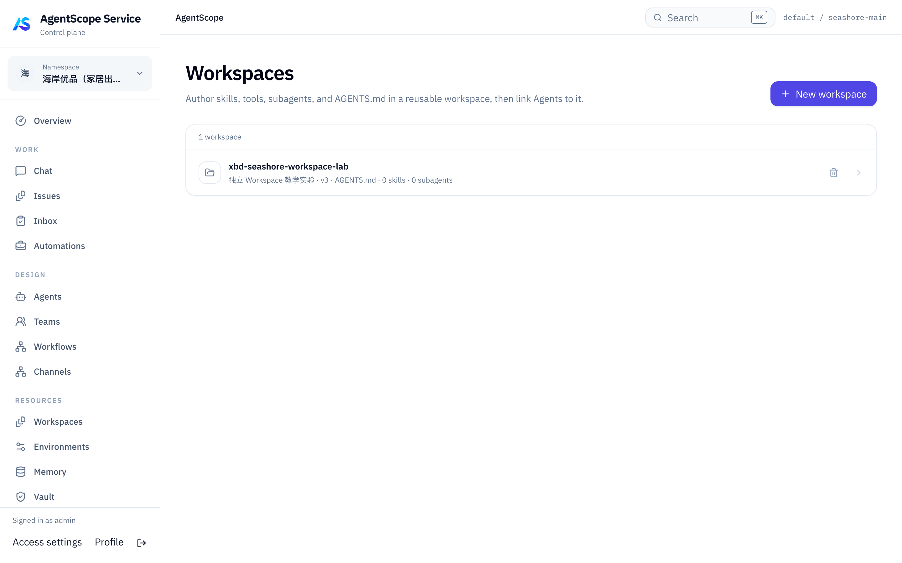

# 第 12 章 工作区与文件系统

> 本章导读：当你的 Agent 需要读取项目规范、团队约定这些"材料"，又要让多个用户的数据互不越界时，工作区与文件系统就是为此准备的。工作区（workspace）是一个目录：智能体的定义（它是谁、有哪些能力）与进化（它运行中学到了什么）都落在这一份目录数据上——这就是下文所说的 source of truth（唯一可信来源）。本章讲解工作区目录布局、材料如何分层进入请求、"先问文件系统后端、没有再退本地模板"的两层读与按用户覆盖的多租户机制、智能体进化的五条通道，以及承载这一切的文件系统后端：本机 + shell、共享存储、沙箱三种部署模式，与多用户、多副本之间如何划分数据归属。读完本章，你可以让同一套 agent 代码在单机、多副本与隔离执行之间不改代码切换，并为多用户划定数据边界。



*本章操作流程图*

## 你什么时候需要工作区

三个典型场景：

- **让 Agent 读到项目规范与材料。** 团队的编码规范、领域文档不该每次调用都手工塞进提示词：把行为约定写进 `AGENTS.md`，把领域文档放进 `knowledge/`，框架按"指令 / 参考资料"分层加载；知识目录只加载入口和索引，其余文件由 Agent 按需读取（见"工作区内容如何被加载"一节）。
- **团队共享一套约定与技能。** `AGENTS.md`、`knowledge/`、共享 `skills/` 可以用 git 同步到所有副本的本地磁盘，作为全员可见的模板；运行时产物（记忆、会话、任务）交给共享存储自己长（见"三种文件系统模式下的加载行为"一节）。
- **多用户、多副本下划清数据边界。** 同一套 Agent 逻辑要服务不同用户：alice 定制的人格与技能、bob 累积的记忆互不可见——这靠"用户级覆盖目录 + 隔离范围"实现，不需要代码分支、不需要多套部署（见"多用户同一工作区时的覆盖优先级"一节）。

与已学组件的分工：

| 组件 | 管什么 | 详见 |
|------|--------|------|
| 工作区（本章） | Agent 能看见与复用什么：指令、知识、技能、记忆文件的存放 | —— |
| 记忆 | 跨会话记住什么：从对话中提取事实并维护（文件就放在工作区里） | 第 14 章（记忆） |
| 上下文管理 | 单轮给模型看什么：材料如何按预算组织进每轮请求 | 第 13 章（上下文管理） |
| 沙箱 | 在哪里执行：文件与命令是否隔离进容器 | 第 18 章（沙箱执行） |
| 会话日志 | 发生过什么：完整执行事实、checkpoint 与断点续做 | 第 19 章（会话日志与恢复） |

一句话：工作区是这些能力的公共落点；其余组件分别决定数据怎么产生、怎么进入模型、在哪里执行、如何回溯。

## 设计理念

工作区（workspace）是 `HarnessAgent` **智能体定义与进化的 source of truth（唯一可信来源：定义与"学到的东西"都以这一份目录数据为准）**。智能体"是什么"以及"在运行中学到了什么"，全部以一个目录 + 普通 Markdown / JSON 文件来组织——不散落在代码里，不绑死在某个数据库表上。

它的设计有四条线索。

### 1. 智能体定义与进化的 source of truth

智能体的*定义*（它是谁、怎么行事）可以完全在工作区中声明：

| 要定义的内容 | 文件 |
|------------|------|
| 人格、行为约定、系统指令 | `AGENTS.md` |
| 领域知识 | `knowledge/KNOWLEDGE.md` + 参考文件 |
| 技能（可复用能力包） | `skills/<skill-name>/SKILL.md` |
| 子 agent 声明 | `subagents/<agent-id>.md` |
| 工具白名单 + MCP server | `tools.json` |

> **注意**：以上全部可选。每个工作区文件都有完全对等的 API 配置方式：你可以通过 builder 方法（`.sysPrompt(...)`、`.skill(SkillDeclaration...)`、`.subagent(SubagentDeclaration...)`、`.toolsConfig(...)` 等）传入同等配置。工作区与 API 始终等价——用哪种完全取决于你。
>
> 那为什么还要用工作区？因为把"定义"表达成文件（而不是代码），正是让一个 agent 天然多租户的关键：*同一套* agent 逻辑，可以为*不同用户*携带不同的人格、知识库、技能集——只需放一个用户级覆盖目录，无需代码分支、无需多套部署。详见下文"同一套 agent 逻辑，按用户定制"。

智能体的*进化*（跨会话累积学到的一切）由框架自动写入工作区，无需手动管理生命周期：

- **长期记忆**（`MEMORY.md` + `memory/`）—— 从对话中提取的事实，由后台任务维护与压缩，每次 call 加载为参考上下文。
- **自学习技能**（`skills/`）—— agent 从成功模式中起草新技能；经过可选的审批闸门后成为可复用能力，再由后台 curator 把长期未用的老化、归档。
- **计划文件**（`plans/`）—— Plan Mode 中写下的计划会持久化、跨调用保留，让"想清楚"与"做出来"解耦。
- **工具结果落盘**（compaction）—— 超大工具输出写到磁盘，上下文里只留 head/tail 预览 + `read_file` 指针，agent 之后可按需重读而不撑爆 prompt。
- **会话日志** —— 原生 Session Log 保存完整执行事实和 checkpoint；`agents/<agentId>/sessions/` 的 JSONL 保留为兼容消息视图。

这些进化数据默认长期有效：记忆无限累积，会话日志只追加不自动清除。每条通道如何产生与维护，详见下文"智能体如何进化"。

`AgentState` 描述当前工作状态；默认 EVENT_LOG 模式将它保存为原生日志中的 checkpoint。旧 AgentStateStore 仍用于 legacy 和显式迁移，详见第 19 章（会话日志与恢复）。

### 2. 内容按生命周期分三类，互不混淆

| 类型 | 谁写 | 谁读 | 例子 |
|------|------|------|------|
| **静态资产**（工程师编辑） | 你 / 团队 | 框架按指令/参考资料分层加载，或按需读取 | `AGENTS.md`、`knowledge/`、`skills/`、`subagents/`、`tools.json` |
| **运行时文件**（每次 call 写回） | 框架 / agent | 框架下次 call 时还原 | `agents/<agentId>/sessions/`、`agents/<agentId>/tasks/`、`plans/` |
| **长期记忆**（跨会话累积） | agent + 后台任务 | 框架每次 call 加载为参考上下文 + agent 用工具查询 | `MEMORY.md`、`memory/YYYY-MM-DD.md` |

混在一棵树里只是为了部署方便（一个目录拷贝走就是完整 agent），框架内部走不同的读写路径。

> **注意**：区分文件产物和恢复状态。计划、技能和记忆是 Workspace 文件；AgentState 是结构化运行状态。默认 EVENT_LOG 模式将状态 checkpoint 放进原生 Session Log，日志复用 Filesystem 的保留分区或自定义后端。LEGACY 才以独立 AgentStateStore 为恢复来源。

### 3. 原生多租户隔离

工作区数据（记忆、会话、任务、技能、沙箱状态）由单一的 `IsolationScope`（隔离范围：决定谁和谁共用同一份数据）分桶——无需应用层手写任何分区逻辑。Scope 决定谁和谁共享一个桶，取值有 `SESSION`（每个 `sessionId` 完全隔离，适合一次性沙箱）、`USER`（默认，同一 `userId` 的所有会话共享长期记忆 / 技能，`userId` 缺失时降级为 `SESSION`）、`AGENT`（该 agent 的所有用户与会话共享，适合共享知识库型 agent）与 `GLOBAL`（整个 store 实例共用一个桶，慎用）。完整语义、命名空间键、降级规则与并发说明见本章"IsolationScope——多用户与多副本怎么分桶"一节。

> `IsolationScope` 决定 Filesystem 分桶。原生日志在桶内继续以 `(userId, stableAgentId, sessionId)` 隔离；旧 AgentStateStore 以 `(userId, sessionId)` 寻址。改变 scope 或日志后端前应迁移数据。

多用户应用推荐共享 Builder、每请求创建 Agent；用户和会话身份、隔离范围与访问权限由应用明确配置，见第 4 章"实例生命周期"一节。

### 4. 工作区与 filesystem 解耦

同一份目录布局可以落在三种地方：本机磁盘、共享 KV 存储（Redis / JDBC）、沙箱容器。这是 `HarnessAgent` 能"代码不动、部署形态切换"的根因。详细见本章"文件系统后端"一节的三种模式。

## 工作区目录布局

四条设计线索落到磁盘上，就是下面这棵目录树。

```
.agentscope/workspace/
├── AGENTS.md                    ← 静态：人格 + 行为约定
├── MEMORY.md                    ← 长期记忆：策划后的长期事实
├── tools.json                   ← 静态：MCP server + 工具白名单（可选）
├── memory/                      ← 长期记忆：每天追加的事实流水账
│   └── YYYY-MM-DD.md
├── knowledge/                   ← 静态：领域知识入口 + 任意参考文件
│   ├── KNOWLEDGE.md
│   └── ...
├── skills/                      ← 静态：技能目录，每个子目录一份 SKILL.md
│   └── <skill-name>/SKILL.md
├── subagents/                   ← 静态：子 agent 声明（文件名即 agent_id）
│   └── <agent-id>.md
├── plans/                       ← 运行时：Plan Mode 写下的计划文件
│   └── PLAN.md
└── agents/<agentId>/            ← 运行时：每个 agent 自己的运行时根
    └── tasks/                   ← 运行时：子 agent 后台任务记录
        └── <sessionId>.json
```

> **注意**：这棵树是*逻辑*布局，不是固定的磁盘路径。它画成 `.agentscope/workspace/...`，但那只是默认的本机落点。同一份布局可以物理上落在**本机磁盘**、落在**远端分布式存储**（Redis / JDBC / OSS，通过 `RemoteFilesystemSpec`），或**映射进沙箱容器**（`SandboxFilesystemSpec`）——下面这些相对路径在三种模式下完全一致，变的只是后端存储，你的 agent 代码不用动。用本章"文件系统后端"一节选后端；本章其余内容都是按这套逻辑布局来写的。

**唯一你真正需要写的是 `AGENTS.md`**（不写也能跑，只是少一段人格注入）。其他目录在你启用对应能力时自动出现：

- 启用记忆压缩（`.compaction(...)`）→ `memory/` + `MEMORY.md`
- 放子 agent spec → `subagents/`
- 装技能 → `skills/`
- 启用 Plan Mode → `plans/`
- 任何 `call()` 跑过一次 → `agents/<agentId>/`

## Builder 配置

```java
HarnessAgent agent = HarnessAgent.builder()
    .name("MyAgent")
    .model(model)
    .workspace(Paths.get(".agentscope/workspace"))   // 不传则走下面的默认解析顺序
    .additionalContextFile("SOUL.md")                // 任意 workspace 相对路径，全文注入
    .additionalContextFile("PREFERENCES.md")
    .maxContextTokens(8000)                          // MEMORY 注入预算
    .build();
```

### workspace 的解析顺序

不显式调用 `workspace(...)` 时，`build()` 按以下优先级（从高到低）确定工作区目录：

| 优先级 | 来源 | 说明 |
|-------|------|------|
| 1 | `workspace(Path)` / `workspace(String)` | Builder 显式设置，覆盖一切 |
| 2 | `agentscope.workspace` 系统属性 | `-Dagentscope.workspace=/data/workspace` |
| 3 | `AGENTSCOPE_WORKSPACE` 环境变量 | `export AGENTSCOPE_WORKSPACE=/data/workspace` |
| 4 | 默认值 | `${user.dir}/.agentscope/workspace` |

系统属性和环境变量主要服务于**镜像打包 / 容器部署**：应用代码里不写死路径，构建镜像或启动容器时通过环境变量灵活注入。例如：

```dockerfile
ENV AGENTSCOPE_WORKSPACE=/data/agent-workspace
```

```yaml
# k8s / docker-compose
env:
  - name: AGENTSCOPE_WORKSPACE
    value: /data/agent-workspace
```

> **注意**：空白值（如 `"   "`）视为未设置，会继续往下一级回退。

`AGENTS.md` 至少写一份骨架：

```markdown
# MyAgent

你是 XX 助手，遵循以下行为约定。

## 行为
- ...
- ...
```

可关掉的子系统（生产很少用，调试或自管时有用）：

| 方法 | 关掉的是 |
|------|---------|
| `disableWorkspaceContext()` | 工作区指令和参考材料加载（`AGENTS.md` / `MEMORY.md` / `knowledge/`） |
| `disableMemoryHooks()` | 记忆 flush + 后台维护；同时去掉 Persistence 段里「对话结束自动抽取」的文案。与 `disableMemoryTools()` 一起用时，也不再注入 `HARNESS_CONTEXT` 中的 memory 材料（`MEMORY.md`） |
| `disableMemoryTools()` | `memory_search` / `memory_get` / `memory_save` / `session_search` 工具；同时去掉 Memory Recall 与依赖这些工具的 Persistence 引导 |
| `disableSubagents()` | 整个子 agent 子系统 |
| `disableDynamicSkills()` | 每轮重新合并技能；改成 build 时一次 |
| `disableToolsConfig()` | 不读 `tools.json` |
| `disableSessionPersistence()` | 兼容 no-op；不能用它关闭原生 Session Log，模式选择见第 19 章（会话日志与恢复） |

## 工作区内容如何被加载

因为工作区是逻辑布局（见上方提示框），"加载"从不假设它是一个普通本机目录——每次读取都经过配置的 `AbstractFilesystem`，所以无论文件落在本机磁盘、远端存储还是沙箱里，同一套逻辑都成立。下面的两层读正是把这种"与后端无关"落到实处的机制；各模式如何在物理上解析路径，见本章"文件系统后端"一节。

### 工作区材料如何进入请求

工作区材料每次 Agent call 读取一次，再由最终 Context 构建器分层组织，不直接把全部文件追加进 System。

| 材料 | 模型中的位置 | 预算行为 |
| --- | --- | --- |
| AGENTS.md | System / `project_rules` | 不直接淘汰，计入最终预算 |
| 工作原则、环境信息 | System / `working_principles`、`environment` | 计入最终预算 |
| MEMORY.md | USER 参考消息 / `HARNESS_CONTEXT`，kind=memory | 准备时可截断，最终预算不足时可省略 |
| knowledge 入口及路径索引 | USER 参考消息 / `HARNESS_CONTEXT`，kind=knowledge | 可因最终预算省略 |
| additionalContextFile | USER 参考消息 / `HARNESS_CONTEXT`，kind=additional | 必需材料，不能任意淘汰 |

`maxContextTokens` 默认 8000，用于工作区材料准备，不代表最终模型输入上限。
最终预算还包括 System、历史、状态和工具 Schema；仍超限则拒绝请求。
MEMORY.md 在记忆工具和 Hooks 都关闭时不加载。
知识目录只加载入口和索引，其余文件由模型按需读取。

AGENTS.md 不需要 XML 标签。同一次 call 内文件变化不自动刷新；
下一次 call 重新加载。消息示例、动态业务来源及预算设置见第 13 章（上下文管理）。

### 两层读架构（filesystem-first + 本地兜底）

对所有"被注入到 prompt 的关键文件"（`AGENTS.md` / `MEMORY.md` / `knowledge/KNOWLEDGE.md` / `additionalContextFile`），`WorkspaceManager.readWithOverride()` 都走**两层读**：

```
1. 问当前配置的 AbstractFilesystem：有没有这个 relative path？
   ├─ 有 → 返回该内容（"覆盖"层）
   └─ 没有 → 走第 2 步
2. 读本地磁盘 workspace.resolve(relativePath)
```

写入永远走第 1 层（filesystem 后端），从不直接落到本地磁盘。

这套两层读的价值在**共享存储模式**最明显：第一个副本启动时本地磁盘上有团队 git 同步过来的 `AGENTS.md` 模板，立刻可用；之后任何节点对 `AGENTS.md` 的覆盖（例如管理台编辑）会写到共享 KV，所有副本下一次 `call()` 就读到最新版本。模板是 fallback，远端覆盖是事实。

### 多用户同一工作区时的覆盖优先级

`RuntimeContext.userId` 用于标识当前用户；共享 Builder 构建的各请求实例通过它选择对应的工作区数据。

对**运行时数据**（sessions / tasks / memory），框架按 `NamespaceFactory` 配的命名空间给路径加前缀（本机模式是路径前缀、远端模式是 KV 命名空间、沙箱模式是状态 slot），详见本章"多用户隔离怎么实现"一节。

对**静态资产**（特别是 `skills/` 和 `subagents/`），用户级目录可以**覆盖**工作区共用版：

```
workspace/
├── skills/code-reviewer/SKILL.md     ← 共用版（所有人可见）
├── subagents/researcher.md           ← 共用版
└── alice/
    ├── skills/
    │   └── code-reviewer/
    │       └── SKILL.md              ← 只对 alice 生效，覆盖共用版
    └── subagents/
        └── researcher.md             ← 只对 alice 生效
```

调用时只要 `RuntimeContext.userId="alice"`，框架就会先看 `alice/skills/code-reviewer/`，没有再退到 `skills/code-reviewer/`。下层独有的 skill 仍然可见，只在重名时被上层挡住。完整优先级表参考第 15 章（技能）"同名冲突谁说了算"一节。

#### 同一套 agent 逻辑，按用户定制

同一份 Agent 定义可以服务多个租户：共享 Builder 构建请求实例后，工作区按用户身份加载对应配置。你只需维护一份二进制和公共定义，每个用户可以在此基础上定制自己的内容：

| 用户级层 | 定制什么 | 解析方式 |
|---------|---------|---------|
| `<userId>/AGENTS.md`（通过覆盖） | 该用户的人格 / 行为 | 两层读的上层（共享 `AGENTS.md` 作兜底） |
| `<userId>/knowledge/` | 该用户可见的领域知识 | 用户级目录，共享 `knowledge/` 作基线 |
| `<userId>/skills/` | 只对该用户解锁的能力 | 覆盖同名共享技能，独有的叠加可见 |
| `<userId>/subagents/` | 只有该用户能 spawn 的子 agent | 覆盖同名共享声明 |
| 运行时数据（记忆 / 会话 / 任务） | 该用户累积的进化数据 | 按 `userId` 进命名空间（路径前缀 / KV 命名空间 / 沙箱 slot） |

效果是**两层多租户同时生效**：*定义*按用户不同（靠覆盖目录），*进化*按用户隔离（靠命名空间）。共享底座对所有人通用，而每个用户的定制与学到的状态都不会跨租户泄漏——全部出自同一个 agent 进程。这正是前面强调的、把定义当数据带来的红利：因为定义就是数据，按用户定制只是多一个文件，而不是多一条代码分支。

### 三种文件系统模式下的加载行为

工作区只是"逻辑布局"，物理落点由文件系统配置选择（见本章"文件系统后端"一节）。同一份目录在不同模式下被加载的方式不一样，这里分别说明（配置代码统一见后文）。

**模式 1 · 共享存储（`RemoteFilesystemSpec`）—— 模板 + 远端覆盖**

- **如何加载**：每次推理时，`AGENTS.md` / `MEMORY.md` / `tools.json` 会被框架以"远端为上层、本机模板为下层"的 overlay（叠加层：读取时上层优先、下层兜底）读出来。本地磁盘上的 `<workspace>/AGENTS.md` 是**只读模板**——是初始或多副本同步的种子；远端 KV 里如果存在该用户的同名 key，就以远端为准。
- **路由规则**：`memory/` / `skills/` / `subagents/` / `knowledge/` / `agents/<id>/sessions/` / `agents/<id>/tasks/` 都自动按 `IsolationScope` 进命名空间（默认 USER，每个 `userId` 一个命名空间；详见本章"IsolationScope——多用户与多副本怎么分桶"一节）。
- **最佳实践**：把团队约定的 `AGENTS.md` / `knowledge/` / 共享 `skills/` 用 git 同步到所有副本的本地磁盘作为模板；运行时产物（`MEMORY.md`、`memory/`、`agents/<id>/...`）让 KV 自己长。

**模式 2 · 沙箱（`DockerFilesystemSpec` / K8s / E2B / AgentRun）—— Projection + Hydrate**

- **如何加载**：沙箱启动时，框架把工作区里的"静态资产"（`AGENTS.md` / `skills/` / `subagents/` / `knowledge/` 等 projection roots）打包成 tar，hydrate 进沙箱的 `/workspace`。`AGENTS.md` 等还是按两层读走（先沙箱内、后宿主模板）。
- **去重 & 增量**：projection 按内容 hash 比对，没变就跳过 hydrate；变了的文件按 SHA-256 增量重写。
- **运行时产物**：`MEMORY.md`、`memory/`、`agents/<id>/...` 都落在沙箱内，沙箱快照会一起保留——下一次 `call()` 用同 `sessionId` 时连同 `node_modules`、`pip install` 一并恢复。
- **最佳实践**：把代码执行 / shell 命令都隔离在沙箱里，宿主只保留工作区"种子"（团队 git 同步过来的人格 + 共享技能 + 知识库）。这也是生产部署不可信代码的首选模式。

**模式 3 · 本机 + shell（默认 `LocalFilesystemSpec` 或不配 filesystem）—— 直读直写**

- **如何加载**：所有文件直接从 `<workspace>/` 下读，没有 overlay。`<userId>/skills/` 这种用户覆盖按目录前缀切。
- **路径安全**：默认 `ROOTED` 模式，绝对路径只允许 `workspace` 和 `project`（shell cwd）这两个根之下；`..` 路径会被路径策略拦掉。
- **最佳实践**：单进程 / 本机开发 / 单元测试 / 信任环境。生产不要直接用这个模式跑不可信代码——`execute` 是宿主 `sh -c`。

## 运行时数据与 Memory 怎么存

到目前为止讲的都是读；下面换一个方向，看运行时数据写进哪里、如何恢复。

默认 EVENT_LOG 下，AgentState 的 checkpoint 与完整执行事实保存在原生 Session Log 中；文件产物和长期记忆仍各有生命周期。

| 数据 | 存储与恢复 |
| --- | --- |
| 原生执行历史、AgentState checkpoint | Filesystem 的 `.agentscope-runtime/` / 远端保留分区，或显式 SessionLogStore；通过 API 读取 |
| AgentStateStore | LEGACY 恢复来源和显式迁移来源；默认本地根 `~/.agentscope/state/<agentId>/`，可用 stateStore 替换 |
| 任务、计划、记忆和工作文件 | Workspace / TaskRepository / sandbox 等对应后端；日志 checkpoint 不复制它们的全部内容 |

### Agent 状态与原生日志

每次调用沿用相同身份和后端即可自动恢复已提交 checkpoint 及后续可应用事实。共享 Workspace Filesystem 可以同时提供分布式日志存储；它需要真实原子 CAS 能力。Sandbox 或不具备该能力的后端应显式提供日志 store。完整配置和恢复检查见第 19 章（会话日志与恢复）。

### Memory（长期记忆）

两层结构：

```
workspace/
├── MEMORY.md                  ← 策划后的长期记忆，每次 call 加载为参考上下文
└── memory/
    └── YYYY-MM-DD.md          ← 每天追加的事实流水账（未去重）
```

写入路径：

- 对话压缩前，`MemoryFlushMiddleware` 把对话前缀里的新事实抽到 `memory/YYYY-MM-DD.md`（追加）；
- 后台节流任务定期把 `memory/` 合并去重，重写 `MEMORY.md`；
- `MEMORY.md` 每次 call 加载，并以受预算控制的方式进入参考消息。

读取路径：

- 框架自动读 `MEMORY.md`（两层读，filesystem 优先）；
- agent 可主动调 `memory_search` / `memory_get` 找老内容（详见第 14 章"记忆"）。

## 智能体如何进化

除了静态定义，工作区还是智能体*累积经验*的落点。五条通道自动累积——打开对应能力，数据就开始在工作区里堆积，并和其它内容一样按租户隔离。每条都有自己的深入章节，这张表是索引：

| 通道 | 落在哪 | 怎么开 | 怎么累积 | 深入文档 |
|------|--------|--------|---------|---------|
| **长期记忆** | `MEMORY.md` + `memory/YYYY-MM-DD.md` | `.compaction(...)` | 压缩前 `MemoryFlushMiddleware` 从对话前缀抽取事实；后台节流任务合并去重写回 `MEMORY.md`，下一次 call 重新加载 | 第 14 章 |
| **自学习技能** | `skills/`、`skills/_drafts/`、`skills/.archive/` | `.enableSkillManageTool(...)` | agent 调 `propose_skill` 从有效模式起草技能 → 可选审批闸门放行 → 后台 curator 把长期未用的标记为 stale（30 天）并归档（90 天） | 第 15 章"自学习闭环"一节 |
| **计划文件** | `plans/PLAN.md` | `.enablePlanMode()` | 只读规划阶段用 `plan_write` 写计划；跨调用保留并驱动执行阶段，让意图与动作解耦 | 第 17 章 |
| **工具结果落盘** | 工作区下的 eviction 目录 | `.toolResultEviction(...)` | 单个工具结果超阈值（默认 80K 字符）时，完整输出写盘，上下文消息替换为 head/tail 预览 + `read_file` 指针 | 第 13 章 |
| **会话日志** | Filesystem 保留分区 / 自定义 SessionLogStore，另有兼容 JSONL | 默认 EVENT_LOG | 保存执行事实；工具可读原生消息历史，旧索引用于发现 | 第 19 章 |

记忆、技能、计划和卸载结果沿用 Workspace 的租户隔离与 Filesystem 路由。原生日志另需原子存储能力，并通过保留分区保护提交结构；兼容 JSONL 不能替代完整执行记录。

## 重点目录深入

最后把工作区里几个关键目录单独拆开看。

### `skills/`

技能是"写好的能力包"——一份目录里放 `SKILL.md`（说明 + 给 agent 看的指令），可以附带参考文档、脚本。

```
skills/code-reviewer/
├── SKILL.md               ← YAML frontmatter (name + description) + 指令
├── references/style-guide.md   ← 可选，agent 按需 read_file
└── scripts/run-checks.sh       ← 可选，agent 通过 execute 调
```

注册路径有四层（低 → 高优先级）：

1. `projectGlobalSkillsDir(Path)` —— 项目全局，例如 `~/.agentscope/skills/`
2. `skillRepository(...)` —— 市场后端（Git / Nacos / MySQL / classpath）
3. `workspace/skills/` —— 工作区共用
4. `<userId>/skills/` —— 用户隔离（覆盖以上所有）

下层独有的 skill 都保留，重名时上层覆盖。每轮推理前 `DynamicSkillMiddleware` 重新合成 → 在 system prompt 里渲染成 `<available_skills>` 块（只列 name + description），agent 看到觉得相关才会 `load_skill_through_path` 拉详情。完整工作机制见第 15 章（技能）。

### `subagents/`

每个 `<agent-id>.md` 是一份子 agent 声明（文件名即 `agent_id`），YAML frontmatter 描述身份、模型、工具白名单、工作区策略等，正文是子 agent 的系统提示。

```markdown
---
description: 代码评审专家。当用户需要 review PR、找代码风格问题时使用。
workspace:
  mode: isolated         # isolated（默认） | shared
model: qwen3-max         # 可选；默认继承父
tools: [read_file, grep_files]   # 可选；继承工具的白名单
---

你是一个专注代码评审的子 agent…
```

加载：`AgentSpecLoader` 在构建期**非递归**地扫 `workspace/subagents/*.md`，再合并你通过 `.subagent(SubagentDeclaration...)` 编程注册的声明。主 agent 通过 `agent_spawn agent_id="reviewer" task="..."` 调用。
完整细节（同步 / 后台、远程子 agent、流式转发、任务存储）见第 16 章（子 Agent 协作）。

### `tools.json`

工作区根目录下的 JSON，框架在 `build()` 时一次性读完：

```jsonc
{
  // 白名单：非空时只允许列出的工具
  "allow": ["read_file", "grep_files", "execute"],
  // 黑名单：列出的工具一律不暴露（优先级高于 allow）
  "deny":  ["write_file"],
  // MCP server，键是名字，值是连接配置
  "mcpServers": {
    "amap": {
      "transport": "streamableHttp",
      "url": "https://mcp.amap.com/mcp?key=${AMAP_API_KEY}"
    },
    "local-py": {
      "transport": "stdio",
      "command": "python",
      "args": ["mcp_servers/my_server.py"],
      "env": {"PYTHONUNBUFFERED": "1"}
    }
  }
}
```

行为细节：

- **MCP server 在构建期一次性注册到 toolkit**，agent 看到的就是这些 server 暴露的工具。
- **`allow` / `deny` 在所有工具注册完之后才应用**——所以也会过滤掉 Harness 的内置工具（`read_file` / `memory_search` / `agent_spawn` 等）。**用 `allow` 列白名单时务必把要保留的内置工具一并列出**，否则会一起被砍掉。
- `${ENV_VAR}` 语法做环境变量替换；未设置时给 warning 并替换成空字符串。
- 不想用文件？直接 `builder.toolsConfig(ToolsConfig.builder()...)` 编程注入；要完全关掉读取用 `disableToolsConfig()`。
- 在共享存储模式下，`tools.json` 走前面说的"远端为上层、本机模板为下层"的 overlay。

### `plans/`

Plan Mode 写下的计划文件落在这里。默认 `plans/PLAN.md`，可用 `.planFileDirectory("design-docs")` 改路径。

```
plans/
└── PLAN.md           ← plan_write 写入的当前计划
```

`PlanModeContext`（阶段和计划路径）属于 AgentState，默认随原生日志 checkpoint 恢复；legacy 使用 AgentStateStore。`plans/` 保存 Markdown 文件本身，文件内容仍需独立持久保存。详见第 17 章（计划模式）。

### `agents/<agentId>/`

这是**运行时根**，框架自己写，你一般不动它：

```
agents/<agentId>/
└── tasks/
    └── <sessionId>.json       ← 子 agent 后台任务记录（taskId → TaskRecord）
```

> **注意**：上图仅展示任务记录。原生 Session Log 位于 Filesystem 保留分区：本地为 `.agentscope-runtime/`，远端为 `__agentscope_session_log_v1__`。通过 `sessionTranscript()`、`session_history` 和 `session_list` 读取历史；不再写旧 JSONL、sessions.json 或分段 transcript。

跨节点恢复时，原生日志、任务/文件产物、sandbox 元数据等都应使用适合的共享后端；仅配置共享 AgentStateStore 不会自动共享本地 Session Log。见第 19 章（会话日志与恢复）与本章"文件系统后端"一节。

### `knowledge/`

```
knowledge/
├── KNOWLEDGE.md         ← 入口/概览，作为参考材料加载
├── api-reference.md
├── domain-terms.md
└── ...
```

加载时：

- `KNOWLEDGE.md` 全文进 `<domain_knowledge_context>`；
- 同目录下其它文件（任意深度）只列**路径清单**进 prompt，让 agent 用 `read_file` / `grep_files` / `glob_files` 按需读取。

这种"目录里全是细节，prompt 里只放索引"的模式，避免把整个知识库塞进 token 预算。

## 写入工作区的安全规则

目录拆完了；往工作区写文件，还有一条绕不开的安全规则。

`additionalContextFile`、`writeUtf8WorkspaceRelative`、`memory_get` 这些接口接受**工作区相对路径**。框架做基本的 path-traversal 校验（拒绝 `../../etc/passwd` 这种逃出工作区的写法）。

需要写文件时，**通过 `HarnessAgent#getWorkspaceManager()` 而不是 `java.nio.Files`**——后者在沙箱或共享存储模式下会写到错的地方（写到了宿主磁盘而不是沙箱里 / KV 里）。例外：builder 装配时的初始化脚本（例如 `initWorkspaceIfAbsent` 这种生成 `AGENTS.md` 种子），那时还没有运行时上下文，用 `java.nio.Files` 是 OK 的——它本来就是要落本地模板。

## 文件系统后端：三种部署模式

工作区回答了"数据是什么、组织成哪份目录"；接下来的问题是：这份目录物理上落在哪里、文件工具与 shell 在哪里执行——这就是文件系统后端的职责。

### 统一抽象与作用

`HarnessAgent` 把 agent 对**工作区**的访问从"一定是本机磁盘"抽象成统一接口。所有文件工具（`read_file` / `write_file` / `edit_file` / `grep_files` / `glob_files` / `list_files`）和可选的 `execute`（shell）都从这个抽象走。

这样做让你能在三种部署模式之间切换，而**不改 agent 代码**：

- 本机 + shell —— 单进程、本地、信任环境；
- 共享存储 —— 多副本 / 多 pod 共享同一份长期记忆；
- 沙箱 —— 文件与命令都在隔离容器里执行，跨调用恢复同一份工作区。

沙箱模式的运行时细节（容器生命周期、快照恢复链路、镜像约束）见第 18 章（沙箱执行）。

### 三种声明式模式

在 `HarnessAgent.Builder` 上用 `filesystem(...)` 三选一（不调就是默认模式 3）：

| 模式 | 配置 | 提供 shell？ | 适用场景 |
|------|------|-------------|---------|
| **1 · 共享存储** | `filesystem(new RemoteFilesystemSpec(store))` | 不提供 | 多副本要共享 `MEMORY.md` / 对话日志 / 子任务到 KV；**不希望在宿主上跑 shell** |
| **2 · 沙箱** | `filesystem(new DockerFilesystemSpec()...)` 或 K8s / Daytona / E2B / AgentRun | 提供（在沙箱内） | 隔离执行、跨调用恢复同一份工作区、可选快照 + 分布式 |
| **3 · 本机 + shell**（默认） | `filesystem(new LocalFilesystemSpec()...)` 或**不写** | 提供（宿主 `sh -c`） | 单进程 / 本机 / 信任环境 / 简单脚本与测试 |

> **注意**：`filesystem(...)` 与 `abstractFilesystem(...)` 互斥；后者是给完全自管文件系统的逃生口，正常用法不需要。

### 模式 1：共享存储（`RemoteFilesystemSpec`）

适合"多副本，但用户的长期记忆要一致"。把一个 `BaseStore` 实现（Redis / JDBC / 内存）传进去，框架自动按路径前缀把工作区文件路由到这个 KV 存储：

```java
// 最小配置（推荐通过 DistributedStore 一键配置）
DistributedStore store = RedisDistributedStore.fromJedis(jedis);

HarnessAgent agent = HarnessAgent.builder()
    .name("store-agent")
    .model(model)
    .workspace(workspace)
    .distributedStore(store)
    .filesystem(new RemoteFilesystemSpec()   // baseStore 由 store 自动注入
        .isolationScope(IsolationScope.USER))
    .build();
```

`RemoteFilesystemSpec` 的全部配置项与默认值见本章末参考速查。

#### 内置路由规则

框架自动把以下路径路由到共享 KV，每个路径段各自独立命名空间，不会互相污染：

| 路径 | KV 命名空间段 |
|------|-------------|
| `AGENTS.md`、`MEMORY.md`、`tools.json` | `root` |
| `memory/` | `memory` |
| `skills/` | `skills` |
| `subagents/` | `subagents` |
| `knowledge/` | `knowledge` |
| `agents/<agentId>/sessions/` | `sessions` |
| `agents/<agentId>/tasks/` | `tasks` |

其余不在上表的路径落到本地 `LocalFilesystem`（无 shell）。

#### 示例场景：多副本客服 agent

三个 pod 各跑一个 `HarnessAgent`，用同一个 Redis 做 `BaseStore`：

```java
DistributedStore store = RedisDistributedStore.fromJedis(
        new JedisPooled("redis://shared-redis:6379"));

HarnessAgent agent = HarnessAgent.builder()
    .name("customer-service")
    .model(model)
    .workspace(Paths.get("/opt/agent/workspace"))
    .distributedStore(store)                  // stateStore + baseStore 一键配置
    .filesystem(new RemoteFilesystemSpec()
        .isolationScope(IsolationScope.USER)      // 每个用户独立命名空间
        .anonymousUserId("anonymous"))            // 未登录用户的兜底
    .build();
```

- 三个 pod 上本地磁盘的 `AGENTS.md` / `knowledge/` / `skills/` 作为只读模板（git 同步）；
- 运行时产物（`MEMORY.md`、`memory/`、对话日志）自动存到 Redis，任意 pod 都能读到最新状态；
- 用户 alice 的记忆在 KV 键 `agents/customer-service/users/alice/memory/...` 下。

这种模式**不提供 shell**——故意的：要 shell 请用模式 2（沙箱）或 3（本机）。

#### `BaseStore` 可用实现

| 实现 | 说明 | 所在模块 |
|------|------|---------|
| `RedisStore` | 基于 Jedis，适合低延迟高并发 | `agentscope-extensions-redis` |
| `JdbcStore` | 基于 JDBC，适合 MySQL / PostgreSQL / H2 / SQLite | `agentscope-extensions-jdbc` |
| `InMemoryStore` | 内存实现，适合测试 | `agentscope-harness` |

### 模式 2：沙箱（`SandboxFilesystemSpec` 系列）

适合"代码会执行不可信操作、或要隔离生产环境"。所有文件操作和 shell 命令都发到沙箱里执行，宿主完全不受影响。

#### Docker 沙箱

```java
HarnessAgent agent = HarnessAgent.builder()
    .name("sandbox-agent")
    .model(model)
    .workspace(workspace)
    .filesystem(new DockerFilesystemSpec()
        .image("ubuntu:24.04")
        .isolationScope(IsolationScope.SESSION)
        .memorySizeBytes(512 * 1024 * 1024L)   // 512 MB 内存限制
        .cpuCount(2L)
        .network("host")
        .exposedPorts(8080, 3000)
        .environment(Map.of("NODE_ENV", "development"))
        .snapshotSpec(new LocalSnapshotSpec("/data/snapshots")))
    .build();
```

`DockerFilesystemSpec` 的全部配置项与默认值见本章末参考速查。

#### Kubernetes 沙箱（agent-sandbox）

Kubernetes 后端完全基于 [agent-sandbox](https://github.com/kubernetes-sigs/agent-sandbox)：沙箱 pod 由集群里的 agent-sandbox 控制器管理，镜像、资源、PVC 都声明在集群侧的 `SandboxTemplate` / `SandboxWarmPool` 里（不在 Java 侧配置），Java 侧通过 `SandboxClaim` 从预热池领取实例。使用前需要先安装 agent-sandbox 控制器并创建好模板和预热池。

```java
HarnessAgent agent = HarnessAgent.builder()
    .name("k8s-agent")
    .model(model)
    .workspace(workspace)
    .filesystem(new KubernetesFilesystemSpec()
        .namespace("agents")
        .warmPoolName("agent-pool")        // SandboxWarmPool 名称
        .isolationScope(IsolationScope.USER))
    .build();
```

`KubernetesFilesystemSpec` 的主要配置项与默认值见本章末参考速查；其中 `workspaceRoot` 必须落在模板声明的 PVC 挂载点上。

`apiUrl` / `gateway*` 都不配时，默认用 `kubectl port-forward` 方式建立本地隧道（适合开发环境）。运行时镜像必须满足运行时镜像约束（见第 18 章"运行时镜像约束"一节）；**工作区持久化依赖模板里的 PVC 配置**，详见第 18 章"Kubernetes 后端的状态保存：PVC 是第一层"一节。

#### E2B 沙箱

```java
HarnessAgent agent = HarnessAgent.builder()
    .name("e2b-agent")
    .model(model)
    .workspace(workspace)
    .filesystem(new E2bFilesystemSpec()
        .apiKey("${E2B_API_KEY}")
        .templateId("my-template")
        .sandboxTimeoutSeconds(300)
        .isolationScope(IsolationScope.SESSION))
    .build();
```

#### Daytona 沙箱

```java
HarnessAgent agent = HarnessAgent.builder()
    .name("daytona-agent")
    .model(model)
    .workspace(workspace)
    .filesystem(new DaytonaFilesystemSpec()
        .apiKey("${DAYTONA_API_KEY}")
        .controlPlaneBaseUrl("https://api.daytona.io")
        .image("python:3.12-slim")
        .cpu(2)
        .memory(4)        // GiB
        .disk(10)         // GiB
        .isolationScope(IsolationScope.USER))
    .build();
```

#### AgentRun 沙箱（阿里云）

```java
HarnessAgent agent = HarnessAgent.builder()
    .name("agentrun-agent")
    .model(model)
    .workspace(workspace)
    .filesystem(new AgentRunFilesystemSpec()
        .apiKey("${AGENTRUN_API_KEY}")
        .accountId("your-account-id")
        .region("cn-hangzhou")
        .templateName("python3.12")
        .sandboxIdleTimeoutSeconds(600)
        .isolationScope(IsolationScope.USER))
    .build();
```

所有沙箱后端继承自 `SandboxFilesystemSpec` 的公共配置（隔离维度、快照策略、并发守卫、工作区投影开关）见本章末参考速查。

#### 快照策略

沙箱可以做快照，使下一次 `call()` 恢复之前的环境状态（安装的依赖、生成的文件等）；快照实现的完整对照表见本章末参考速查。

#### 示例场景：编程助手（Docker + 本地快照）

```java
HarnessAgent codingAgent = HarnessAgent.builder()
    .name("coder")
    .model(model)
    .workspace(Paths.get(".agentscope/workspace"))
    .filesystem(new DockerFilesystemSpec()
        .image("node:20-slim")
        .isolationScope(IsolationScope.USER)
        .memorySizeBytes(1024 * 1024 * 1024L)
        .snapshotSpec(new LocalSnapshotSpec("/data/sandbox-snapshots")))
    .distributedStore(store)
    .build();

// alice 第一次调用：沙箱里 npm install，装好后快照保存
RuntimeContext rc = RuntimeContext.builder()
    .userId("alice")
    .sessionId("dev-session-1")
    .build();
agent.call(Msg.user("npm install && npm test"), rc).block();

// alice 第二次调用：恢复快照，node_modules 还在，无需重新安装
agent.call(Msg.user("npm run build"), rc).block();
```

#### 工作区投影（Workspace Projection）

沙箱启动时，框架自动把宿主工作区里的"静态资产"打成 tar，注入（hydrate）到沙箱的 `/workspace`。这些静态资产包括：

- `AGENTS.md`（人格文件）
- `skills/`（技能目录）
- `subagents/`（子 agent 声明）
- `knowledge/`（知识库）
- `.skills-cache/`（技能缓存）

投影按内容 SHA-256 做增量比对，没变的文件跳过 hydrate。可通过 `workspaceProjectionRoots(List)` 自定义包含哪些路径，或用 `workspaceProjectionEnabled(false)` 完全关闭。

### 模式 3：本机 + shell（默认）

什么都不写就是这个：工作区落到 `${cwd}/.agentscope/workspace/`，shell 在宿主上跑：

```java
HarnessAgent agent = HarnessAgent.builder()
    .name("local-agent")
    .model(model)
    .workspace(workspace)
    // .filesystem(...) 不写 = 本机 + shell
    .build();
```

#### 所有配置项

```java
.filesystem(new LocalFilesystemSpec()
    .executeTimeoutSeconds(120)       // shell 命令超时
    .maxOutputBytes(100_000)          // 单条命令最大输出字节
    .env("MY_VAR", "value")          // 额外环境变量
    .inheritEnv(true)                // 是否继承父进程环境
    .mode(LocalFsMode.ROOTED)        // 路径策略
    .project(Paths.get("/my/project")) // 项目根（shell 的 cwd + overlay 下层）
    .addRoot(Paths.get("/extra/dir"))) // 额外可访问目录
```

每一项的精确默认值见本章末参考速查。

#### 路径解析策略（`LocalFsMode`）

| 模式 | 行为 |
|------|------|
| `ROOTED`（默认） | 绝对路径只允许 `workspace` + `project` + `additionalRoots` 范围内；`..` 穿越被拒绝 |
| `SANDBOXED` | 所有路径强制锚定到 workspace 根，绝对路径和 `..` 全部拒绝 |
| `UNRESTRICTED` | 绝对路径原样透传，不做限制。仅用于测试或完全信任的环境 |

#### Overlay 文件系统

本机模式实际产出的是一个 `OverlayFilesystem`：

- **上层**（读写）：`LocalFilesystemWithShell`，根在 `workspace`，提供 shell；
- **下层**（只读）：`LocalFilesystem`，根在 `project`。

读取时先看 workspace，没有再退到 project（copy-on-write 语义）。shell 的 `pwd` 是 project 目录，所以 agent 执行 `ls` 看到的是项目文件。

#### 项目可写模式（`projectWritable`）

默认情况下，所有写入都落到 workspace——这对阅读/分析类场景足够，但如果 agent 的核心任务是**生成代码**（如写一个微服务），你会发现文件全写到了 `.agentscope/workspace/` 而不是项目目录。

开启 `projectWritable(true)` 后，框架会根据路径自动路由写入目标：

| 路径类型 | 写入位置 | 示例 |
|----------|---------|------|
| 工作区元数据 | workspace | `MEMORY.md`、`memory/`、`agents/`、`skills/`、`knowledge/`、`plans/`、`subagents/`、`rules/`、`tools.json` |
| 其他所有文件 | 项目目录 | `src/main/java/App.java`、`pom.xml`、`README.md`、`docker-compose.yml` |

```java
.filesystem(new LocalFilesystemSpec()
    .projectWritable(true)      // 代码文件写到项目目录
    .inheritEnv(true))
```

读取行为不变——仍然是 workspace 优先、project 兜底。

#### 示例场景：本地开发助手

```java
HarnessAgent devHelper = HarnessAgent.builder()
    .name("dev-helper")
    .model(model)
    .workspace(Paths.get(".agentscope/workspace"))
    .filesystem(new LocalFilesystemSpec()
        .project(Paths.get("/Users/alice/my-project"))
        .addRoot(Paths.get("/Users/alice/.config"))
        .mode(LocalFsMode.ROOTED)
        .inheritEnv(true)
        .executeTimeoutSeconds(300))
    .build();
```

agent 可以读写 `/Users/alice/my-project` 和 `/Users/alice/.config` 下的文件，在 `/Users/alice/my-project` 下执行 shell 命令，但无法访问其他宿主目录。

### IsolationScope —— 多用户与多副本怎么分桶

模式 1（共享存储）和模式 2（沙箱）都用同一个 `IsolationScope` 概念，决定**谁和谁共享同一份状态**：

| Scope | 含义 | 命名空间键 | 典型场景 |
|-------|------|-----------|---------|
| `SESSION` | 每个 sessionId 独立 | `agents/<agentId>/sessions/<sessionId>/...` | 多用户 SaaS，每段对话完全隔离 |
| `USER`（默认） | 同一 `userId` 跨会话共享 | `agents/<agentId>/users/<userId>/...` | 同一用户的多个会话共享长期记忆 |
| `AGENT` | 该 agent 的所有用户/会话共享 | `agents/<agentId>/shared/...` | 公共知识库型 agent |
| `GLOBAL` | 全局共享一份 | `global/...` | 谨慎使用 |

#### 各 Scope 的降级规则

- `USER` scope 下，如果 `RuntimeContext.userId` 为空，降级为 `SESSION`（按 sessionId 隔离）。
- `SESSION` scope 下，如果 `RuntimeContext.sessionId` 为空，跳过状态查找，创建全新环境。
- `AGENT` scope 的命名空间键由 agent name（build 时固定）决定，不会因缺少上下文字段而降级。

#### 沙箱模式下的并发行为

`IsolationScope` 在沙箱模式下是**顺序复用**的共享，不是实时的实例共享。同一 scope key 的并发调用各自启动独立容器；每次调用结束时，最后写入的快照胜出。对 `AGENT` / `GLOBAL` 这种多用户共享 scope，如果需要串行化，使用 `executionGuard(SandboxExecutionGuard)` 做并发守卫。

#### 示例：用 Scope 组合实现不同业务需求

**场景 1：每个用户独立的编程沙箱，跨会话保留安装的依赖**

```java
.filesystem(new DockerFilesystemSpec()
    .image("python:3.12")
    .isolationScope(IsolationScope.USER)       // alice 的所有会话共享同一沙箱快照
    .snapshotSpec(new LocalSnapshotSpec("/snapshots")))
```

**场景 2：每个对话独立的一次性沙箱**

```java
.filesystem(new DockerFilesystemSpec()
    .image("ubuntu:24.04")
    .isolationScope(IsolationScope.SESSION))   // 每个 sessionId 独立，互不影响
```

**场景 3：共享知识库的客服 agent（共享存储）**

```java
.distributedStore(store)
    .filesystem(new RemoteFilesystemSpec()
    .isolationScope(IsolationScope.AGENT))     // 所有用户和会话共享同一份 memory / skills
```

### 多用户隔离怎么实现

`RuntimeContext.userId` 是切多用户的钥匙：

| 模式 | userId 的作用 | 物理表现 |
|------|-------------|---------|
| 本机 | 用户级文件落在 `workspace/<userId>/...`，例如 `workspace/alice/skills/code-reviewer/SKILL.md` 只对 alice 生效 | 路径前缀 |
| 共享存储 | 作为 KV 命名空间前缀 `agents/<agentId>/users/<userId>/...` | KV 键前缀 |
| 沙箱 | 作为沙箱快照 slot key（搭配 `IsolationScope.USER`） | 沙箱实例隔离 |

`userId` 不传的情况下走单租户默认，所有人共享一个根。

#### 运行时数据 vs 静态资产

**运行时数据**（对话日志、tasks、memory）跟着 `IsolationScope` / `userId` 走，自动隔离。

**静态资产**（`AGENTS.md`、`tools.json`、`knowledge/`）对所有用户共享，**不**按 userId 自动分区。差异化只能通过「用户覆盖目录」（`<userId>/skills/...`、`<userId>/subagents/...`）实现，机制见本章"多用户同一工作区时的覆盖优先级"一节。

### 技能和工具在各模式下的行为

#### 技能（Skills）

`DynamicSkillMiddleware` 在每轮推理前从技能仓库列表合并技能，渲染到 system prompt 里。技能文件的加载走 `AbstractFilesystem` 接口，所以在三种模式下透明工作：

| 模式 | 技能加载方式 |
|------|------------|
| 本机 | 从 `workspace/skills/` 直接读本地磁盘；`<userId>/skills/` 做用户覆盖 |
| 共享存储 | `skills/` 路由到 KV，先查远端再退回本地模板。管理台编辑技能后所有副本下次推理生效 |
| 沙箱 | 宿主 `skills/` 在启动时通过 workspace projection 注入沙箱的 `/workspace/skills/` |

四层优先级不变（低 → 高）：`projectGlobalSkillsDir` → `skillRepository` → `workspace/skills/` → `<userId>/skills/`。

#### 文件工具（read_file / write_file / edit_file / ...）

所有文件工具都通过 `AbstractFilesystem` 接口调用，每次操作传入当前 `RuntimeContext`，由文件系统后端决定实际读写位置。agent 代码完全感知不到模式差异。

| 模式 | 读写行为 |
|------|---------|
| 本机 | `OverlayFilesystem`：写落 workspace（上层），读先 workspace 后 project（下层）。开启 `projectWritable(true)` 后，非元数据写入路由到项目目录 |
| 共享存储 | `CompositeFilesystem`：命中路由的路径走 KV overlay（远端上层 + 本地模板下层），其余走本地 |
| 沙箱 | 所有文件操作转发到沙箱容器内 |

#### Shell 执行（execute）

| 模式 | Shell 可用？ | 执行位置 |
|------|------------|---------|
| 本机 | 可用 | 宿主 `sh -c`，cwd 为 `project` 目录 |
| 共享存储 | 不可用 | 不提供 shell |
| 沙箱 | 可用 | 沙箱容器内 |

#### tools.json / MCP 服务器

`tools.json` 在 `build()` 时一次性从工作区读取（走 `WorkspaceManager`，支持两层读），注册 MCP server 和 allow/deny 过滤。**三种模式下行为一致**——都是在 build 时读取配置，不受运行时 filesystem 模式影响。

在共享存储模式下，`tools.json` 也走"远端为上层、本地模板为下层"的 overlay：通过管理台修改 `tools.json` 后，**需要重新 build agent 才能生效**（MCP server 注册是一次性的）。

### 完全自管：`abstractFilesystem(...)`

如果三种模式都不合适，可以传一个完全自己实现的文件系统：

```java
HarnessAgent.builder()
    ...
    .abstractFilesystem(myCustomFilesystem)   // 与上面的 filesystem(...) 互斥
    .build();
```

通常不需要——三种模式覆盖了 95% 的场景。

## 本章小结

这一章沿着数据是什么、怎么被读、怎么隔离、落在哪里四步走完了一条主线：

1. **工作区是什么**：智能体定义与进化的 source of truth，内容按生命周期分为静态资产、运行时文件、长期记忆三类；你真正需要写的只有 `AGENTS.md`，其余目录随能力启用自动出现；
2. **怎么被读**：材料按指令 / 参考资料分层进入每轮请求；关键文件走两层读——filesystem 后端优先、本地模板兜底，写入永远走后端层；
3. **怎么隔离**：`IsolationScope` 把记忆、会话、任务、技能按 SESSION / USER / AGENT / GLOBAL 分桶，USER 缺 `userId` 时降级为 SESSION；静态资产靠 `<userId>/` 覆盖目录实现按用户定制，定义与进化两层多租户同时生效；
4. **落在哪里**：本机 + shell、共享存储、沙箱三种文件系统模式不改代码切换——共享存储不提供 shell、沙箱隔离执行并支持快照恢复、本机模式直读直写但别用来跑不可信代码。

按部署形态往下读：多副本共享记忆先看模式 1 与 IsolationScope 一节；要隔离执行不可信代码，直接进第 18 章的沙箱运行时细节。

**验收清单**——读到这里，你应该能：

- ☐ 画出工作区的逻辑目录树，并把每个目录归入静态资产、运行时文件、长期记忆三类之一；
- ☐ 说出 `workspace` 目录的四层解析顺序，并用环境变量在容器部署中重定向工作区；
- ☐ 解释两层读架构：读取时哪层优先、写入落到哪层、共享存储模式下模板与远端覆盖各扮演什么角色；
- ☐ 用 `<userId>/skills/` 为单个用户覆盖共享技能，并说出重名与独有时各自的可见性；
- ☐ 按部署形态在三种文件系统模式中做出选择，说出每种模式是否提供 shell、在哪里执行；
- ☐ 为多副本共享记忆选出正确的 `IsolationScope`，说出 USER scope 在 `userId` 缺失时的降级行为；
- ☐ 解释为什么沙箱或共享存储模式下必须通过 `getWorkspaceManager()` 读写文件，而不是 `java.nio.Files`。

## 参考速查

本节收拢本章各文件系统后端的配置项全表与快照策略，供实施时查阅；正文主线中的机制讲解与最小示例不依赖本节。

### `RemoteFilesystemSpec` 配置项（模式 1 · 共享存储）

| 方法 | 说明 | 默认值 |
|------|------|-------|
| `isolationScope(IsolationScope)` | 命名空间隔离维度（详见 IsolationScope 一节） | `USER` |
| `anonymousUserId(String)` | `userId` 为空时使用的兜底标识 | `"_default"` |
| `addSharedPrefix(String)` | 额外的工作区相对路径前缀也路由到 KV（例如 `"prompts/"` / `"configs/"`） | 无 |
| `workspaceIndex(WorkspaceIndex)` | 加速远端 ls/glob/grep 的 SQLite 索引 | 不加索引，走全量扫描 |

### `DockerFilesystemSpec` 配置项（模式 2 · Docker 沙箱）

| 方法 | 说明 | 默认值 |
|------|------|-------|
| `image(String)` | Docker 镜像 | 必填 |
| `isolationScope(IsolationScope)` | 隔离维度 | `USER` |
| `memorySizeBytes(Long)` | 容器内存限制 | Docker 默认 |
| `cpuCount(Long)` | CPU 限制 | Docker 默认 |
| `network(String)` | Docker network | Docker 默认 |
| `exposedPorts(int...)` | 暴露端口 | 无 |
| `environment(Map)` | 容器环境变量 | 无 |
| `workspaceRoot(String)` | 容器内工作区挂载点 | `/workspace` |
| `additionalRunArgs(String...)` | 额外的 `docker run` 参数 | 无 |
| `snapshotSpec(SandboxSnapshotSpec)` | 快照策略 | `NoopSnapshotSpec`（不快照） |
| `workspaceSpec(WorkspaceSpec)` | 工作区挂载规则 | 默认 |
| `executionGuard(SandboxExecutionGuard)` | 并发执行守卫（用于 AGENT / GLOBAL scope） | 无 |
| `workspaceProjectionEnabled(boolean)` | 是否启用宿主→沙箱的静态资产投影 | `true` |
| `workspaceProjectionRoots(List)` | 投影包含的根路径列表 | `AGENTS.md`, `skills`, `subagents`, `knowledge`, `.skills-cache` |

### `KubernetesFilesystemSpec` 主要配置项（模式 2 · K8s 沙箱）

| 方法 | 说明 | 默认值 |
|------|------|-------|
| `namespace(String)` | SandboxClaim 所在 namespace | `default` |
| `warmPoolName(String)` | `SandboxWarmPool` 名称 | 必填 |
| `workspaceRoot(String)` | 沙箱内工作区根目录，**必须落在模板声明的 PVC 挂载点上** | `/workspace` |
| `fileApiBaseDir(String)` | 运行时文件 API 根目录，须与 `workspaceRoot` 一致；置空则退回 base64-over-exec 传输 | `/workspace` |
| `apiUrl(String)` | 直连运行时 API 的 URL（配置后优先生效） | 无 |
| `gatewayName(String)` / `gatewayNamespace(String)` / `gatewayScheme(String)` | 经 Gateway API 访问沙箱 | 无 |
| `serverPort(int)` | 运行时 HTTP API 端口 | `8888` |
| `kubernetesClient(KubernetesClient)` | 自定义 fabric8 客户端 | 自动加载 kubeconfig |
| `snapshotSpec(SandboxSnapshotSpec)` | 快照策略（与 PVC 的取舍见第 18 章） | `NoopSnapshotSpec` |

### 沙箱后端的公共配置（继承自 `SandboxFilesystemSpec`）

| 方法 | 说明 | 默认值 |
|------|------|-------|
| `isolationScope(IsolationScope)` | 隔离维度 | 后端默认（默认 `USER`） |
| `snapshotSpec(SandboxSnapshotSpec)` | 快照策略 | `NoopSnapshotSpec` |
| `executionGuard(SandboxExecutionGuard)` | AGENT/GLOBAL scope 下的并发串行化守卫 | 无 |
| `workspaceProjectionEnabled(boolean)` | 是否从宿主投影静态资产到沙箱 | `true` |
| `workspaceProjectionRoots(List)` | 投影的根路径列表 | `AGENTS.md`, `skills`, `subagents`, `knowledge`, `.skills-cache` |

### `LocalFilesystemSpec` 配置项（模式 3 · 本机 + shell）

| 方法 | 说明 | 默认值 |
|------|------|-------|
| `executeTimeoutSeconds(int)` | 单条 shell 命令超时（秒） | 120 |
| `maxOutputBytes(int)` | 单条命令最大捕获输出字节数 | 100,000 |
| `env(String, String)` | 添加 shell 环境变量 | 无 |
| `inheritEnv(boolean)` | 是否继承父进程环境 | `false` |
| `mode(LocalFsMode)` | 路径解析策略 | `ROOTED` |
| `project(Path)` | 项目根目录（overlay 下层 + shell cwd） | `System.getProperty("user.dir")` |
| `addRoot(Path)` | 额外允许访问的宿主目录 | 无 |
| `additionalRoots(Collection)` | 批量设置额外目录 | 无 |
| `projectWritable(boolean)` | 文件工具写项目文件时直接落到项目目录，而非 workspace | `false` |

### 快照策略

| 实现 | 说明 |
|------|------|
| `NoopSnapshotSpec` | 不快照（默认） |
| `LocalSnapshotSpec(Path)` | 快照存宿主本地磁盘 |
| `RedisSnapshotSpec` | 快照存 Redis |
| `OssSnapshotSpec` | 快照存对象存储（阿里云 OSS） |
| `RemoteSnapshotSpec` | 快照存 `BaseStore` |

## 相关文档

- 第 11 章（Harness 架构深入）—— system prompt 是怎么拼出来的，能力之间如何协作
- 第 18 章（沙箱执行）—— 模式 2 的运行时细节：容器生命周期、快照恢复链路、运行时镜像约束
- 第 8 章（上下文）—— `AgentState` 与 `AgentStateStore` 的持久化、跨节点恢复
- 第 7 章（工具）—— `read_file` / `write_file` / `execute` 等工具的参数
- 第 14 章（记忆）—— `MEMORY.md` / `memory/` 的生成与维护、压缩、卸载
- 第 15 章（技能）—— 四层合成、自学习闭环、`<available_skills>` 块
- 第 16 章（子 Agent 协作）—— `subagents/` 声明文件、同步/后台、流式转发
- 第 17 章（计划模式）—— `plans/` 计划文件、只读阶段、HITL 退出

## 配套动手实验

跨境电商 Demo 的 [Step 11：Workspace 文件与版本绑定](../demo/cross-border-commerce/steps/step-11-workspace.md) 提供当前本地 Service 源码对应的教程与脚本。配置层与运行层分开验收，实际验证范围见该节末尾。

Step 11 的操作会落到控制台的 Workspaces 资源页。这张截图出自 2026-10-31 的本地实测——agentscope-service 全栈（aistio 0.2.0）跑在本机，模型走 glm-5.3-flash 的自有通道：



列表里的 `xbd-seashore-workspace-lab` 就是 Step 11 创建的实验工作区——已发布到 v3，携带 AGENTS.md。页面把工作区说成「写好技能、工具、子代理与 AGENTS.md，再链接给 Agent」的可复用容器，与本章把静态资产收进工作区目录的思路一致。
