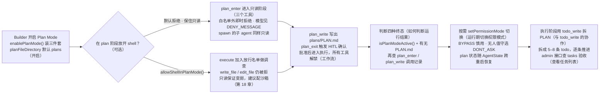
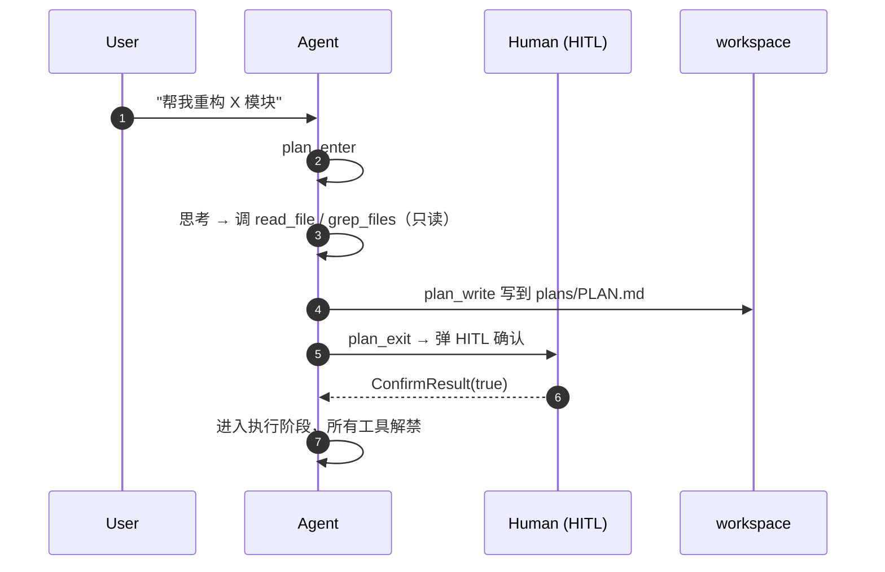

# 第 17 章 计划模式

> 本章导读：长任务最怕的不是做不完，而是边想边改、改坏一片——动手之前缺一个把意图想清楚并写下来的环节。本章讲解 Plan Mode——动手前先"把意图想清楚 + 写下来"的只读阶段：九个白名单工具、`plan_enter` / `plan_write` / `plan_exit` 三件套、HITL 确认退出、四种运行终态的判断、按需放开 shell 的取舍、运行期权限模式切换与跨重启的状态持久化。读完本章，你可以把"设计 → 写计划 → 人确认 → 执行"固化进长任务流程，降低"边想边改"的风险。



*本章操作流程图*

## 作用

Plan Mode 让 agent 在动手前先"把意图想清楚 + 写下来"再执行。开启后 agent 进入一个**只读阶段**：

- 只能调用**只读工具**和 9 个白名单工具：`plan_enter` / `plan_write` / `plan_exit` / `todo_write` / `agent_spawn` / `agent_send` / `agent_list` / `task_output` / `task_list`（shell 可按需放开，见下文"在 plan 阶段放开 shell（可选）"一节）；
- 其它工具调用一律被拒绝（agent 看到一条"plan 阶段拒绝"提示）；
- 退出 Plan Mode 走 HITL 确认（复用权限系统的 ASK），避免模型一意孤行直接进入执行。

这条流程明确把"设计 → 写计划 → 人确认 → 执行"四步固化下来，配合 `todo_write` 与子 agent，能在长任务里有效降低"边想边改、改坏一片"的概率。

## 开启

```java
HarnessAgent agent = HarnessAgent.builder()
    .name("planner")
    .model(model)
    .workspace(workspace)
    .enablePlanMode()                          // 装 PlanMode 三件套
    .planFileDirectory("plans")                // 可选；默认 "plans"
    .build();
```

Builder 选项：

| 方法 | 默认 | 说明 |
|------|------|------|
| `enablePlanMode()` / `enablePlanMode(boolean)` | `false` | 是否开启 |
| `planFileDirectory(String)` | `"plans"` | 计划文件根目录（workspace 相对） |
| `allowShellInPlanMode()` / `allowShellInPlanMode(boolean)` | `false` | 按需放开 plan 阶段的 shell（`execute`）——见下文"在 plan 阶段放开 shell（可选）"一节 |

也可以同时打开 `enableTaskList()`，让 plan 阶段里写的 todos 在每次推理前以小提示形式给 agent 看一遍。

## 三个工具

| 工具 | 作用 | 参数 |
|------|------|------|
| `plan_enter` | 进入 Plan Mode | 无 |
| `plan_write` | 把计划写到当前计划文件（默认 `plans/PLAN.md`） | `content` |
| `plan_exit` | 退出 Plan Mode → 执行阶段；HITL 确认 | `rationale`（可选） |

`plan_write` 是**专门为 Plan Mode 设计的写入入口**——避开了把通用 `write_file` 加入白名单的安全风险（后者会让模型在 plan 阶段写任意文件）。

## 工作流



中间任意时刻调用非白名单工具（比如 `write_file`；`execute` 默认也被拒，除非你按需放开）都会被即时拒绝。模型看到的工具结果就是 `PlanModeMiddleware.DENY_MESSAGE` 常量的原文：

```text
Blocked: you are in PLAN mode (read-only). You may investigate and run read-only tools, record your plan with plan_write, and call plan_exit when ready to execute. Do not modify files or run mutating commands until the plan is approved.
```

模型看到拒绝信息会自然地切回"先写计划"。

## 如何判断运行结果

是否进入 plan mode 由模型自主决定，所以一次运行可能落到四种终态。**只看 `isPlanModeActive() == false` 是有歧义的**——别在没确认"是否真的规划过"之前就当成成功：

| 终态 | 含义 |
|------|------|
| 从未进入 plan mode | 模型选择直接在 build 模式工作——合法决定，常因任务与 workspace 不匹配 |
| 进入 → `plan_exit` | 成功：规划完、获批，已进入 build 模式 |
| 仍在 plan mode + 有 `PLAN.md` | 起草了计划但没退出；在同一 session 发后续消息批准继续 |
| 仍在 plan mode + 无 `PLAN.md` | "只说不做"：最终文本看着像计划但没真正写出——补更具体的输入或换匹配的 codebase |

要在代码里区分这几种，可在监听最终 `isPlanModeActive()` 和计划文件是否存在的同时，记录是否调用过 `plan_enter` / `plan_write`（例如从 `ToolCallStartEvent` 捕获）。

## 在 plan 阶段放开 shell（可选）

默认情况下，shell 工具（`execute`）在 plan 阶段是**被拒绝**的。shell 是*双用途*工具：同一次调用既可能是读（`cat` / `ls` / `grep` / `git log`），也可能是写（`rm` / `>` / `git commit` / `npm install`），而 Plan Mode 完全靠**工具名**判定是否放行——无法区分这一次是读还是写。默认禁掉 shell，是为了保住"只读"这条保证。

但通过 shell 读取各种内容，往往是调查代码库、产出一个*切实可行*计划的最灵活方式。如果你愿意承担这个取舍，可以按需放开：

```java
HarnessAgent agent = HarnessAgent.builder()
    .name("planner")
    .model(model)
    .workspace(workspace)
    .enablePlanMode()
    .allowShellInPlanMode()   // 让模型在 plan 阶段以只读方式跑 shell
    .build();
```

开启后：

- `execute` 被加入 plan 阶段放行名单，模型可以用 shell 做调查；
- plan banner 会追加一条提示，要求模型把 shell 用法限制在**只读**（`cat` / `ls` / `grep` / `git log/diff/show/status`），在计划获批前**不要**跑 mutating 命令；
- 专用的文件编辑工具（`write_file` / `edit_file`）**仍然被拒**——它们是主要的改动入口，所以对文件写入的只读意图依然被强制保证。

这与 OpenCode 处理其 plan agent 的方式一致：放开 shell 用于调查、硬禁 edit/write 工具、靠提示词把 shell 约束为只读。因此这条保证比默认情况**更弱**（模型仍可能通过 shell 改东西），建议配合**沙箱文件系统**（见第 18 章）一起开，把爆炸半径关进沙箱。

## 运行期切换权限模式（"危险开关"逃生口）

Plan Mode 只是一个具体的阶段开关。在它之下，每个 session 都带着一个 `PermissionMode`，由权限引擎在评估时使用（`PermissionMode` 的五种取值见第 10 章"Permission Mode"一节）。你可以在运行期翻转这个 mode——比如提供一个由用户显式触发的"跳过所有权限确认"开关（类似其它编码工具里的 YOLO / dangerous-skip 开关）：

```java
RuntimeContext ctx = RuntimeContext.builder().sessionId("my-session").build();

agent.setPermissionMode(ctx, PermissionMode.BYPASS);    // 全部放开、不再弹确认
// ... 跑需要完整权限的操作 ...
agent.setPermissionMode(ctx, PermissionMode.DEFAULT);   // 恢复正常管控

PermissionMode current = agent.getPermissionMode(userId, sessionId);
```

`setPermissionMode(...)` 会保留该 session 已配置的 allow/deny/ask 规则与工作目录——只改 mode——并重建该 session 缓存的权限引擎，使切换在**下一次** call 生效；正在进行中的 call 仍沿用它启动时的引擎。

> **警告**：`BYPASS` 会关闭所有规则评估，因此应当作为显式的、按 session 的主动操作，并建议配合沙箱使用。如果想要**无人值守且不弹确认、但仍保留管控**，请改用 `PermissionMode.DONT_ASK`（ASK 决策会变成 DENY，而不是被自动放行）。

## Plan 阶段的状态会被持久化

Plan Mode 是**运行时状态**，会随 `AgentState` 自动持久化——进程重启、节点切换、跨副本恢复后，**plan 阶段会一起恢复**。计划文件本身写到工作区的 `plans/` 下，跟着你选的文件系统模式（本机 / 沙箱 / 远端 KV）走，分布式可用。

## 程序化进出 Plan Mode

需要在业务代码里主动控制（例如管理台按钮）：

```java
RuntimeContext ctx = RuntimeContext.builder().sessionId("my-session").build();
agent.enterPlanMode(ctx);    // 等价于 LLM 调 plan_enter
agent.exitPlanMode(ctx);     // 等价于 plan_exit；程序入口不会触发 HITL
agent.isPlanModeActive(ctx);
```

如果用了 `agentscope-admin-spring-boot-starter`，还可以通过 admin HTTP 接口操作（`POST /v1/admin/sessions/{id}:enter-plan-mode` / `:exit-plan-mode` / `GET /v1/admin/sessions/{id}/plan`）。

## 与子 agent 的关系

Plan Mode 期间通过 `agent_spawn` 启动的子 agent **会自动继承只读限制**：父 agent 的 plan-mode 上下文会在 spawn 时传播给子 agent，子 agent 同样处于只读阶段，直到计划被批准。

如需进一步收紧，仍可在子 agent 的声明里把 `tools` 过滤到只读集合。

## 与 `todo_write` 的协作

Plan Mode 与 `todo_write`（core 提供）是两个**独立但常常一起用**的概念：

- **Plan Mode** —— 阶段开关 + 计划文件 + HITL 退出
- **`todo_write`** —— 在执行阶段维护"当前要做什么"的结构化清单（全量替换，必须恰好一个 `in_progress`）

典型工作流：plan 阶段写完 `PLAN.md` → `plan_exit` → 执行阶段用 `todo_write` 把 PLAN 拆成 5–8 条 todo → 逐条推进。Agent 每轮推理前能看到 todos 的小提示，帮助保持聚焦。

> **警告**：不要和子 agent 的**后台任务**（`task_output` / `task_cancel` / `task_list`）混淆——那是另一回事，详见第 16 章（子 Agent 协作）。

## 查看任务列表

任务列表保存在 `AgentState.tasksContext` 中，每次 `call()` 后自动持久化。在业务代码中读取：

```java
List<Task> tasks = agent.getAgentState(userId, sessionId)
        .getTasksContext()
        .getTasks();

for (Task t : tasks) {
    System.out.printf("[%s] %s%n", t.getState(), t.getSubject());
    // state: PENDING / IN_PROGRESS / COMPLETED
}
```

如果用了 `agentscope-admin-spring-boot-starter`，可以直接调 admin REST 接口：

```
GET /v1/admin/sessions/{sessionId}/tasks
```

返回每个任务的 subject、state、owner 和依赖关系（`blocks` / `blockedBy`）。

如果需要通过事件流实时感知任务变更，可以在 `streamEvents()` 中监听 `todo_write` 工具调用：

```java
agent.streamEvents(message)
    .filter(e -> e.getType() == AgentEventType.TOOL_RESULT_END)
    .filter(e -> "todo_write".equals(((ToolResultEndEvent) e).getToolCallName()))
    .doOnNext(e -> {
        // 从 state 中读取最新任务列表
        var tasks = agent.getAgentState(userId, sessionId)
                .getTasksContext().getTasks();
        updateUI(tasks);
    })
    .subscribe();
```

## 本章小结

这一章把一条四步流程固化进 agent 的运行：设计 → 写计划 → 人确认 → 执行。

1. **只读阶段**：`.enablePlanMode()` 开启后，agent 只能调只读工具与九个白名单工具，其余调用即时拒绝，模型看到的是 `PlanModeMiddleware.DENY_MESSAGE` 原文；
2. **三件套**：`plan_enter` 进入、`plan_write` 写计划文件（避开把通用 `write_file` 放进白名单的风险）、`plan_exit` 退出并走 HITL 确认（程序入口不触发）；
3. **判断终态**：从未进入、进入并退出、仍在 plan mode 且有 `PLAN.md`、仍在 plan mode 且无 `PLAN.md`——不能只看 `isPlanModeActive()`；
4. **shell 取舍**：`allowShellInPlanMode()` 放开调查用的 shell，但只读保证变弱，建议配合沙箱；
5. **权限与持久化**：`setPermissionMode` 运行期切 mode（`BYPASS` 慎用，无人值守用 `DONT_ASK`）；plan 阶段状态随 `AgentState` 持久化，计划文件在工作区 `plans/` 下；
6. **协作**：plan 期间 spawn 的子 agent 自动继承只读限制；执行阶段用 `todo_write` 把 PLAN 拆成清单逐条推进。

**验收清单**——读到这里，你应该能：

- ☐ 说出 plan 阶段的九个白名单工具，并解释为什么需要专门的 `plan_write`；
- ☐ 跑通一次完整流程：`plan_write` 写出计划、`plan_exit` 经 HITL 批准后进入执行；
- ☐ 区分一次运行的四种终态，并知道如何借助 `plan_enter` / `plan_write` 的调用记录消除歧义；
- ☐ 解释默认拒绝 shell 的原因，以及放开后只读保证弱在哪里；
- ☐ 在运行期切换 `PermissionMode`，并说出 `BYPASS` 与 `DONT_ASK` 的差别；
- ☐ 解释进程重启后 plan 阶段与 `plans/PLAN.md` 各自如何恢复；
- ☐ （选做）通过 admin HTTP 接口读取某 session 的计划与任务列表。

## 相关文档

- 第 12 章（工作区与文件系统）—— `plans/` 目录的位置
- 第 16 章（子 Agent 协作）—— `todo_write` ≠ subagent task，不要混淆
- 第 10 章（权限系统与人工介入）—— `PermissionMode` 的五种取值与 BYPASS 的边界
- 第 11 章（Harness 架构深入）—— Plan Mode 在 call() 时序中的位置
