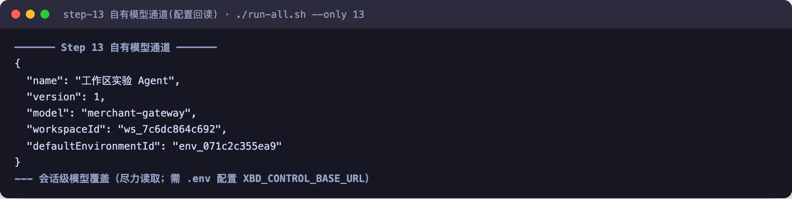

# 第 21 章 模型提供商：一张地图接入十家

> 本章导读：第 6 章讲清了 `.model("provider:model")` 背后的接入机制；本章回答选型问题——十家官方支持的提供商各是什么、怎么选、接入路径有什么共性。本章是**决策地图**：读完你能选定提供商并知道接入路径的每一步；每家的逐步配置（凭据获取入口、专属环境变量、Spring Boot starter、formatter 与 credential 高级项）属于易变的操作细节，统一指向在线文档，不占正文。

## 提供商总表

| 提供商 | Maven artifact | `ModelRegistry` id | 标准环境变量 |
|--------|----------------|--------------------|--------------|
| OpenAI | `agentscope-extensions-model-openai` | `openai:<model>` | `OPENAI_API_KEY` |
| OpenAI Official | `agentscope-extensions-model-openai-official` | `openai-official:<model>` | `OPENAI_API_KEY` |
| DeepSeek | `agentscope-extensions-model-openai` | `deepseek:<model>` | `DEEPSEEK_API_KEY` |
| GLM | `agentscope-extensions-model-openai` | `glm:<model>` | `ZAI_API_KEY` / `GLM_API_KEY` / `ZHIPUAI_API_KEY` |
| Kimi | `agentscope-extensions-model-openai` | `kimi:<model>` | `MOONSHOT_API_KEY` / `KIMI_API_KEY` |
| MiniMax | `agentscope-extensions-model-openai` | `minimax:<model>` | `MINIMAX_API_KEY` |
| DashScope | `agentscope-extensions-model-dashscope` | `dashscope:<model>` / `qwen*` | `DASHSCOPE_API_KEY` |
| Gemini | `agentscope-extensions-model-gemini` | `gemini:<model>` | `GEMINI_API_KEY` |
| Anthropic | `agentscope-extensions-model-anthropic` | `anthropic:<model>` | `ANTHROPIC_API_KEY` |
| Ollama | `agentscope-extensions-model-ollama` | `ollama:<model>` | `OLLAMA_BASE_URL`（可选） |

> **注意**：`agentscope-extensions-model-e2e-tests` 是仓库测试模块，不是面向用户的模型集成依赖。

## 怎么选：一分钟导航

- 接 **OpenAI 或任何遵循 OpenAI 载荷格式的兼容服务**（DeepSeek、GLM、Kimi、MiniMax）→ 都用 OpenAI 扩展。这四家由同一模块提供一等支持：独立的 provider 前缀、默认 endpoint 与专属 formatter，只是凭据和 endpoint 不同；
- 要用 **OpenAI 官方 Responses API** 与其服务端内置工具（`web_search`、`code_interpreter` 等）→ OpenAI Official（注意：暂只支持 Responses API，不支持 Chat Completions）；
- **阿里云 Qwen** → DashScope（支持 `qwen*` 短名）；
- **Google 模型** → Gemini（Gemini API 与 Vertex AI 路径均可）；
- **Claude 及需要 Bearer Token 的兼容网关** → Anthropic；
- **本地开发、私有化部署、离线模型服务** → Ollama。

换个角度读这张表还能看到一个架构事实：十家提供商只对应**六个扩展模块**——OpenAI 兼容栈五家共享一个模块。这就是第 6 章 `ModelRegistry` 设计的收益：新兼容厂商的接入成本接近于"加一个前缀 + formatter"。

## 通用接入流程

所有提供商的接入路径完全一致：

1. 引入对应扩展模块的 Maven 依赖；
2. 设置该提供商的环境变量（API Key 等）；
3. 在 builder 里用 `provider:<model>` 字符串 id 选择模型——底层由 `ModelRegistry.resolve(modelId)` 解析，对应扩展模块在 classpath 中时即可识别；
4. 需要自定义 endpoint、formatter、transport 或生成参数时，改用该扩展的显式 builder；Spring Boot 应用可直接引入对应的 `agentscope-*-spring-boot-starter`，用 `agentscope.model.provider` 一行选择提供商。

以 OpenAI 为例走一遍（其余提供商四步相同，只换依赖、环境变量与 id 前缀）：

```java
ReActAgent agent = ReActAgent.builder()
    .name("assistant")
    .model("openai:gpt-4.1-mini") // 底层由 ModelRegistry.resolve(modelId) 解析
    .build();
```

需要自定义配置时，使用显式 builder：

```java
import io.agentscope.extensions.model.openai.OpenAIChatModel;

OpenAIChatModel model = OpenAIChatModel.builder()
    .apiKey(System.getenv("OPENAI_API_KEY"))
    .modelName("gpt-4.1-mini")
    .stream(true)
    .build();
```

OpenAI 兼容端点（DeepSeek、GLM、Kimi、MiniMax 等）也使用这个模块，各自使用独立 provider 前缀、默认 endpoint 与专属 formatter——你自己的兼容网关同样可以走这条路（formatter 与 transport 的定制点见第 6 章）。

“自己的网关”走通之后是什么形态？跨境电商 Demo 的 Step 13 给了一个实测样本：把一个 Chat Completions 兼容的自有网关注册为 Dataplane 内的平台别名，再把别名写进 Agent definition 的 model 字段。配置回读如下——



`model` 的值不再是 `provider:<model>` 形式的模型 id，而是 Dataplane 里注册的别名 `merchant-gateway`——对 Agent 侧而言，换模型通道只是换这个字符串，workspace 与 environment 的绑定一并构成运行配置。2026-10-31 实测于本地 agentscope-service 栈，该别名指向 glm-5.3-flash 的自有通道，文本与工具调用均真实走通。

完整 builder 选项、formatter、credential 和 registry context 细节、模型创建方式与高级 registry 行为见第 6 章；各提供商的逐步配置见在线文档 `docs/integration/model/` 对应小节（每家固定四段：依赖 / 获取凭据 / 配置示例 / 专属说明）。

## 本章小结

1. 十家提供商、六个扩展模块：选型的第一刀是"OpenAI 兼容栈还是原生协议"；
2. 接入四步对所有提供商一致：依赖 → 环境变量 → `provider:<model>` 字符串 → 需要定制再上 builder；
3. 本章刻意不收录逐家配置——凭据入口、专属参数这类内容在线上更新，书上只留决策地图。

**留给你的问题**：你的组织里哪些模型服务已经在用？它们的 API 兼容 OpenAI 载荷格式吗——如果是，接入成本可能比想象中低得多。
