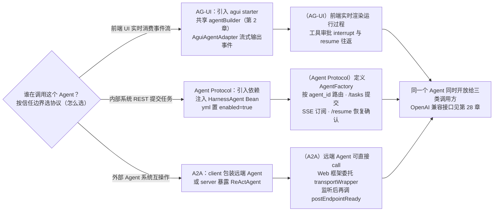
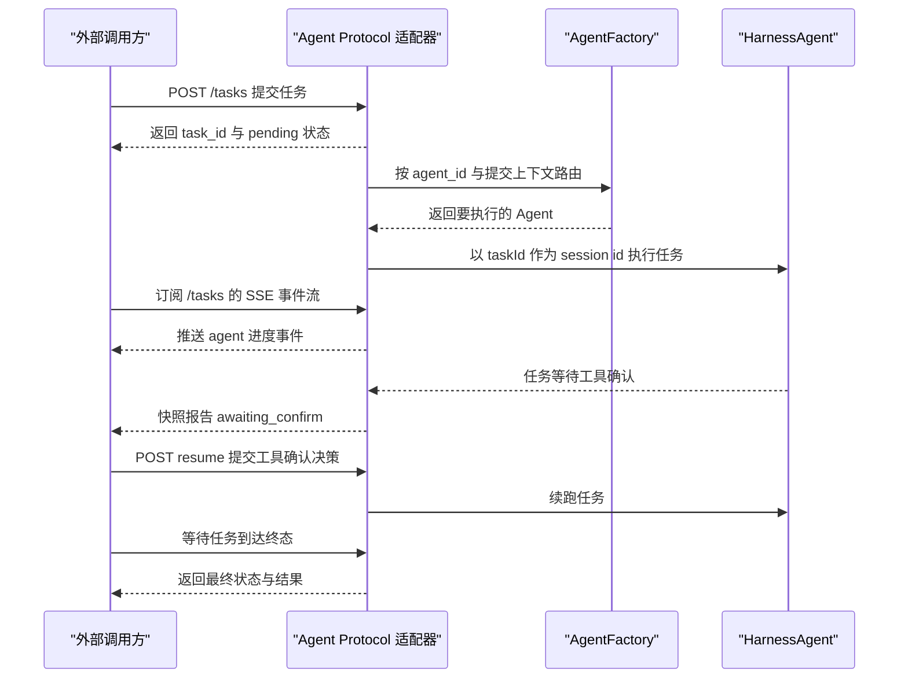

# 第 26 章 Agent 协议

> 本章导读：讲解 AgentScope Java 侧三种"让 Agent 与外部以标准协议交互"的适配器——A2A（把远端 A2A Agent 包装成本地 Agent、把本地 ReActAgent 暴露成 A2A Server）、Agent Protocol（把 Harness Agent 暴露成 `/tasks` 标准 HTTP 接口，支持 SSE 事件流、并发控制、Agent 路由与 HITL 恢复）、AG-UI（把 `AgentEvent` 流转换为前端可实时渲染的 AG-UI 事件，含推理内容、token usage、子 agent 事件与工具审批 interrupt）。读完本章，你可以把同一个 Agent 同时开放给其他 Agent 系统、内部任务调度方和浏览器前端。



*本章操作流程图*

AgentScope 在 Java 侧提供了多种"让 Agent 与外部交互"的协议适配器。它们各自解决一个不同的问题：

| 扩展 | 协议 | 解决的问题 |
| --- | --- | --- |
| A2A | [Agent-to-Agent](https://a2aproject.github.io/A2A/) | Agent 之间互相调用、组成工作流 |
| AG-UI | [AG-UI Protocol](https://github.com/ag-ui-protocol/ag-ui) | 把 Agent 的事件流标准化输出给前端 UI |
| Agent Protocol | [Agent Protocol](https://agentprotocol.ai/) | HTTP 标准接口，方便其他系统提交"任务"给 Agent |

表中各协议适配器的接入细节见本章后续各节。

> 还有 Chat Completions Web（见第 28 章）：把 Agent 包装成 OpenAI Chat Completions 兼容接口，让现有客户端可以直接接入。

## 怎么选

- **想被前端 UI 实时消费 Agent 事件流（含 ThinkingBlock）** → AG-UI
- **想让其他业务系统通过 REST 调度 Agent / 托管远程子 agent** → Agent Protocol
- **想让多个 Agent / Agent 与外部 Agent 系统互相调用** → A2A

> 分层：AG-UI 面向用户；Agent Protocol 是内部远程子 agent / 任务 HTTP 面；A2A 用于外部互操作。

AgentScope 用不同协议覆盖不同信任边界 / 交互面：

| 层级 | 角色 |
| --- | --- |
| **AG-UI** | 面向用户的聊天 UI 事件流（浏览器 ↔ 应用） |
| **Agent Protocol** | 内部远程子 agent / 任务 HTTP API（父 harness ↔ 远程 agent 服务） |
| **A2A** | 外部 agent 间互操作（独立扩展；不属于本次远程子 agent 流式 / HITL 改动） |

## A2A

A2A 解决的是 Agent 之间互相调用、组成工作流的问题：当你需要调用别的系统暴露的 A2A Agent，或者要把自己的 Agent 能力以 A2A 协议开放给其他 Agent 系统消费时，使用这个适配器。

`agentscope-extensions-a2a` 实现了 [A2A 协议](https://a2aproject.github.io/A2A/)，包含两个子模块：

- `agentscope-extensions-a2a-client`：把一个远端 A2A Agent 包装成本地 `Agent`，可以直接 `agent.call(...)`。
- `agentscope-extensions-a2a-server`：把本地 `ReActAgent` 暴露成 A2A Server。

两个模块完全独立，可以单用其一。

### 客户端：调用远端 A2A Agent

#### 添加依赖

```xml
<dependency>
    <groupId>io.agentscope</groupId>
    <artifactId>agentscope-extensions-a2a-client</artifactId>
    <version>${agentscope.version}</version>
</dependency>
```

#### 直接传入 AgentCard

```java
import io.a2a.spec.AgentCard;
import io.agentscope.core.a2a.agent.A2aAgent;

AgentCard card = AgentCard.builder()
    .name("remote-translator")
    .url("http://other-service:8080")
    // ...
    .build();

A2aAgent remote = A2aAgent.builder()
    .name("remote-translator")
    .agentCard(card)
    .build();

Msg result = remote.call(new UserMessage("Translate to English: 你好")).block();
```

#### 用 well-known 自动获取 AgentCard

```java
import io.agentscope.core.a2a.agent.card.WellKnownAgentCardResolver;

WellKnownAgentCardResolver resolver = new WellKnownAgentCardResolver(
    "http://127.0.0.1:8080",
    "/.well-known/agent-card.json",
    Map.of()
);

A2aAgent remote = A2aAgent.builder()
    .name("remote")
    .agentCardResolver(resolver)
    .build();
```

`A2aAgent` 是 `AgentBase` 的子类，可以像普通 Agent 一样组合到 Pipeline、MsgHub、Subagent 中。

### 服务端：把 ReActAgent 暴露成 A2A Server

#### 添加依赖

```xml
<dependency>
    <groupId>io.agentscope</groupId>
    <artifactId>agentscope-extensions-a2a-server</artifactId>
    <version>${agentscope.version}</version>
</dependency>
```

#### 构建 server

```java
import io.agentscope.core.a2a.server.AgentScopeA2aServer;
import io.agentscope.core.a2a.server.transport.jsonrpc.JsonRpcTransportProperties;

ReActAgent.Builder agentBuilder = ReActAgent.builder()
    .name("backend-agent")
    .model(model);

AgentScopeA2aServer server = AgentScopeA2aServer.builder()
    .agentBuilder(agentBuilder)
    .transportProperties(new JsonRpcTransportProperties())
    // .agentCard(customCard)
    // .agentRegistry(myRegistry)
    .build();

// 在你的 Web 框架里把请求委托给 transportWrapper
TransportWrapper wrapper = server.getTransportWrapper("JSONRPC");
// ... Spring/Quarkus controller 转发到 wrapper.handle(...)

server.postEndpointReady();   // Web 服务监听端口后再调用，触发注册等动作
```

`AgentScopeA2aServer` 本身不监听端口、不暴露 endpoint，只负责构建组件、组装请求处理链；具体监听由你的 Web 框架完成。这样可以无缝接入 Spring Boot、Quarkus、Vert.x 等。

#### 可选组件

- `TaskStore` / `QueueManager`：任务和事件队列存储，默认是内存实现，生产可换成持久化版本。
- `PushNotificationConfigStore` / `PushNotificationSender`：推送通知。
- `AgentRegistry`：把 `AgentCard` 注册到外部注册中心（如 Nacos，见第 28 章）。

### Spring Boot Starter

如果你使用 Spring Boot，建议直接引入 `agentscope-spring-boot-starter-a2a-server`，自动装配上述 server 和控制器，详见第 2 章（快速开始）。

## Agent Protocol

`agentscope-extensions-agent-protocol` 把 AgentScope 的 Harness Agent（见第 11 章）暴露为 [Agent Protocol](https://agentprotocol.ai/) 标准 HTTP 接口，让外部系统（CI、其他 Agent 平台、自动化任务）可以用统一的方式提交"任务"，无需关心你的 Agent 实现细节。

### 何时使用

- 想让 Agent 像云函数一样被远程调度。
- 已有团队在用 Agent Protocol 客户端，想直接接进去。
- 把 AgentScope Harness Agent 嵌进 Spring Boot 服务，自动暴露 `/tasks` REST 端点。
- 作为远程子 agent（见第 16 章）的托管端，供另一个 Harness 父代理通过 HTTP 调用。

从提交任务到 HITL 恢复与终态的完整时序如图 26-1 所示。



*图 26-1：Agent Protocol 的任务提交与恢复时序*

三种协议的信任边界与交互面分层见章首怎么选一节。

### 添加依赖

```xml
<dependency>
    <groupId>io.agentscope</groupId>
    <artifactId>agentscope-extensions-agent-protocol</artifactId>
    <version>${agentscope.version}</version>
</dependency>
```

### 启用方式

模块以 Spring Boot 自动配置形式提供，所以仅需在 Spring Boot 应用里：

1. 注入一个 `HarnessAgent` Bean（或自定义 `AgentFactory`）。
2. 在 `application.yml` 里启用：

```yaml
agentscope:
  agent-protocol:
    enabled: true
    # 可选 —— 协议控制面 TaskRecord 目录（不是执行 Agent 的 workspace）
    # task-store-path: ${user.dir}/.agentscope/agent-protocol
```

随后会自动注册 `/tasks` 系列 REST 接口。全部配置项、默认值与完整配置示例收拢在章末参考速查。

#### 控制面 vs 执行 workspace

`AgentProtocolTaskStore` 通过独立的 `ProtocolTaskRepository` 持久化协议任务元数据（submit / resume / snapshot 用的 `TaskRecord`）。默认根目录为 `agentscope.agent-protocol.task-store-path`（`${user.dir}/.agentscope/agent-protocol`），落在合成桶 `agents/_agentscope_protocol/tasks/` 下。

该路径与每个 `HarnessAgent` 自己的 `WorkspaceManager`（MEMORY、sessions、skills）**相互独立**。多 agent 的 `AgentFactory` 可以为每个 agent 配置不同的 `.workspace(...)`；协议侧按 `task_id` 查找始终走控制面仓库。

也可以自行提供 `ProtocolTaskRepository` Bean 覆盖默认实现。`AgentProtocolTaskStore` 只接受 `ProtocolTaskRepository`，不要传入执行 Agent 的 `WorkspaceManager`。

### 并发执行

此适配器默认由 Spring 持有 `HarnessAgent` Bean，生命周期覆盖协议任务执行和恢复，在应用退出时关闭。每个任务通过 `RuntimeContext` 传入用户和会话身份。普通 Web 请求采用共享 Builder、每请求创建实例的方式，见第 4 章（实例生命周期）；不要在协议任务刚提交时关闭适配器持有的 Agent：

```java
@Bean
public HarnessAgent harnessAgent() {
    return HarnessAgent.builder()
            .name("protocol-agent")
            .model("dashscope:qwen-plus")
            .build();
}
```

同一 session 的并发请求会自动串行化；不同 session 完全并行。

### Agent 选择（`AgentFactory`）

由哪个 agent 执行任务，交给 `AgentFactory` bean 决定。不定义时，默认工厂对所有任务返回唯一的 `HarnessAgent` bean。

自定义 bean 即可按 `agent_id`、租户或任意自定义提交上下文字段路由：

```java
@Bean
AgentFactory agentFactory(Map<String, HarnessAgent> agentsByName) {
    return request -> {
        String tenant = request.contextString("tenant");
        log.info("task {} agent_id={} tenant={} resume={}",
                request.taskId(), request.agentId(), tenant, request.resume());
        return agentsByName.getOrDefault(request.agentId(), agentsByName.get("default"));
    };
}
```

`AgentRequest` 各字段的完整说明表收拢在章末参考速查。工厂每次运行调用一次——提交时一次，之后每次 `/resume` 再调用一次，且拿到的仍是最初的提交上下文，因此 HITL 暂停前后的路由结果保持一致。

任务并发执行时请每次返回独立实例（例如 prototype 作用域 bean）。返回 `null` 会让任务以错误状态结束。

### 上下文属性（`context.attributes`）

调用方的自定义数据放在 `context.attributes` 里，单独嵌一层，不与协议自身的上下文字段混在一起。除了 `AgentFactory` 能读到之外，这些属性还会随 `RuntimeContext` 进入实际执行的 agent。

它们**整体挂在一个带命名空间的键下**——`AgentProtocolConstants.RUNTIME_CONTEXT_ATTRIBUTES_KEY`（`agentprotocol.context.attributes`）：

```java
Map<String, Object> attributes = ctx.get(AgentProtocolConstants.RUNTIME_CONTEXT_ATTRIBUTES_KEY);
String tenant = attributes != null ? (String) attributes.get("tenant") : null;
```

之所以命名空间化而不是平铺成顶层键，是因为框架自身会读少量约定键：`agentId` 决定异步工具的唤醒路由，`outboundAddress` 携带网关回推地址。调用方一旦把属性命名成这些词，就会改变 agent 的行为。属性不会写进系统提示词，因此不影响模型看到的内容。

#### 把属性提升为独立键

当某个工具期望直接读 `ctx.get("tenant")`，或需要把属性转成类型化对象时，注册 `RuntimeContextCustomizer` bean。`RuntimeContextCustomizer.flatten` 按显式白名单拷贝，并自动跳过框架保留键：

```java
@Bean
RuntimeContextCustomizer promoteTenantKeys() {
    return RuntimeContextCustomizer.flatten("tenant", "ticket_id");
}

@Bean
RuntimeContextCustomizer tenantContext(TenantService tenants) {
    return (request, builder) -> {
        String tenant = request.attributeString("tenant");
        if (tenant != null) {
            builder.put(TenantInfo.class, tenants.load(tenant));
        }
    };
}
```

所有 customizer bean 都会按 `@Order` 应用到每次运行，且在命名空间注入之后执行——后者覆盖前者。手写 customizer 属于可信扩展，可以写任意键，包括保留键。

#### 从父 agent 发送属性

父 agent 调用远程子 agent 时有两个来源，二者合并且按调用传入的优先：

```java
// 静态：按子 agent 声明
SubagentDeclaration.builder()
        .name("researcher")
        .description("远程研究员")
        .url("http://remote:8080")
        .remoteContextAttributes(Map.of("region", "cn"))
        .build();

// 动态：按本次调用，挂在父 agent 的 RuntimeContext 上
RuntimeContext.builder()
        .sessionId("sess-1")
        .put(AgentSpawnTool.CTX_REMOTE_CONTEXT_ATTRIBUTES, Map.of("tenant", "acme"))
        .build();
```

值必须可 JSON 序列化。

### 端点

#### 提交任务

`POST /tasks`

```json
{
  "task_id": "task_123",
  "agent_id": "researcher",
  "input": "Summarize the latest release notes",
  "context": {
    "user_id": "u-1",
    "parent_session_id": "sess-parent",
    "stream": true,
    "detail": "full",
    "deny_rules": [
      {
        "tool_name": "bash",
        "behavior": "DENY",
        "source": "parent"
      }
    ],
    "attributes": {
      "tenant": "acme",
      "ticket_id": "INC-1001"
    }
  }
}
```

可选 `context` 字段：

| 字段 | 说明 |
| --- | --- |
| `user_id` | 写入远程 agent 的 `RuntimeContext` |
| `parent_session_id` | 父 session 标识（用于关联 / 追踪） |
| `stream` | 调用方是否打算消费 SSE 事件 |
| `detail` | `status`（默认）、`full` 或 `verbose`——见后文"事件流详细度"小节 |
| `deny_rules` | 父侧 DENY 权限规则，供远程侧执行 |
| `attributes` | 调用方自定义键值，用于路由以及本次运行的 `RuntimeContext`；见本节"上下文属性（`context.attributes`）" |

成功响应：`{ "task_id", "status": "pending" }`。

任务提交后，轮询快照、阻塞等待终态与请求取消三个端点收拢在章末参考速查。

#### 事件流（SSE）

`GET /tasks/{taskId}/events`

以 Server-Sent Events 推送 agent 进度。需要 `agentscope.agent-protocol.streaming-enabled=true`（默认开启）。

断线重连 / 续订：

- 查询参数 `from_seq` —— 从该序号之后开始
- 请求头 `Last-Event-ID` —— 未传 `from_seq` 时使用（含义相同）

每条 SSE 消息以事件序号为 `id`、远程事件类型为 `event`、JSON 正文为 `data`。

提交时的 `context.detail` 决定订阅方能收到多少事件，每一档都是前一档的超集；三档（`status` / `full` / `verbose`）的完整对照，以及每个事件正文都携带的 `eventType` / `payload` 两个增量字段，收拢在章末参考速查。

#### HITL 恢复

`POST /tasks/{taskId}/resume`

```json
{
  "decisions": [
    { "toolCallId": "call-1", "approved": true },
    { "toolCallId": "call-2", "approved": false, "reason": "not allowed in production" }
  ]
}
```

`tool_call_id` 也可作为 `toolCallId` 的别名。需要 `agentscope.agent-protocol.hitl-enabled=true`（默认开启）。成功响应：`{ "task_id", "status": "running" }`。

与调用方父 harness 的 HITL 交互见第 16 章（远程授权）。

### 与 Workspace 配合

每个 task 都会拿到 `WorkspaceManager` 分配的隔离工作目录；任务结束后，工作区里的产物（文件、日志）会通过 Agent Protocol 的标准接口暴露出来，外部客户端可以直接拉取。

## AG-UI

### 何时使用

- 需要把 AgentScope agent 接入 AG-UI 兼容前端或自研 Chat UI。
- 需要以 SSE 流式输出 `RUN_*`、`TEXT_MESSAGE_*`、`TOOL_CALL_*`、`CUSTOM` 等 AG-UI 事件。
- 需要前端工具、用户审批中断、运行上下文或自定义事件转换扩展。

### 兼容性说明

`agentscope-extensions-agui` 把 AgentScope v2 的 `AgentEvent` 流转换为 [AG-UI Protocol](https://github.com/ag-ui-protocol/ag-ui) 事件，让前端 UI 可以实时渲染 agent 的运行过程，包括文本、推理内容、工具调用、状态、自定义事件、token usage 和 HITL interrupt。

`RUN_ERROR` 和 `RUN_FINISHED` 是互斥终态事件。只有还需要旧版 `RUN_ERROR` + `RUN_FINISHED` 序列时，才开启 `emitRunFinishedAfterError=true`。

`AguiMessage.content` 现在使用类型化消息内容表示。仅处理纯文本时，请使用 `getTextContent()`。

多模态输入支持 text、image、audio 和 video。暂不支持 document 输入：adapter 会通过 `RUN_ERROR` 拒绝请求，错误码为 `INVALID_INPUT_ERROR`，错误信息不包含文档来源或 metadata。

这一保护仅针对 `RUN_ERROR` 的错误消息，不针对整个事件流。此前的 `RUN_STARTED.input` 保留原始请求，包括被拒绝的文档内容。记录日志或转发事件的使用方需要自行对敏感输入脱敏。

`AguiMessageConverter.toAguiMessage()` 目前只保留文本和工具调用字段；image、audio、video、document 内容块不会被序列化回 AG-UI message content。

### 添加依赖

手动使用协议适配器时添加：

```xml
<dependency>
    <groupId>io.agentscope</groupId>
    <artifactId>agentscope-extensions-agui</artifactId>
    <version>${agentscope.version}</version>
</dependency>
```

Spring Boot 应用直接使用 starter：

```xml
<dependency>
    <groupId>io.agentscope</groupId>
    <artifactId>agentscope-agui-spring-boot-starter</artifactId>
    <version>${agentscope.version}</version>
</dependency>
```

### 快速上手

先按第 2 章（快速开始）配置共享的 `HarnessAgent.Builder agentBuilder`。每次请求创建一个 Agent，SSE 流结束或取消时关闭：

```java
import io.agentscope.core.agui.adapter.AguiAdapterConfig;
import io.agentscope.core.agui.adapter.AguiAgentAdapter;
import io.agentscope.core.agui.event.AguiEvent;
import io.agentscope.core.agui.model.RunAgentInput;
import io.agentscope.harness.agent.HarnessAgent;
import java.time.Duration;
import reactor.core.publisher.Flux;

AguiAdapterConfig config = AguiAdapterConfig.builder()
    .enableReasoning(true)
    .emitTokenUsage(true)
    .runTimeout(Duration.ofMinutes(5))
    .build();

Flux<AguiEvent> events = Flux.using(
    agentBuilder::build,
    agent -> new AguiAgentAdapter(agent, config).run(runAgentInput),
    HarnessAgent::close);
```

`RunAgentInput` 由前端传入，包含 `threadId`、`runId`、`messages`、`tools`、`state`等。适配器内部完成消息转换、调用 Agent 流式 API，再把事件映射到 AG-UI。

### 事件映射

v2 正常链路以 `AgentEvent` 为输入，内置 converter 负责语义映射，未映射事件会回退为官方 `RAW` 事件。

| AgentScope 事件 / 内容 | AG-UI 事件 |
| --- | --- |
| `AgentStartEvent` | `RUN_STARTED` |
| `AgentEndEvent` | `RUN_FINISHED` |
| 文本 | `TEXT_MESSAGE_START` / `TEXT_MESSAGE_CONTENT` / `TEXT_MESSAGE_END` |
| 推理（`enableReasoning=true`） | `REASONING_MESSAGE_START` / `REASONING_MESSAGE_CONTENT` / `REASONING_MESSAGE_END` |
| 工具调用与参数增量 | `TOOL_CALL_START` / `TOOL_CALL_ARGS` / `TOOL_CALL_END` |
| 工具结果 | `TOOL_CALL_RESULT` |
| `CustomEvent` | `CUSTOM` |
| token usage（`emitTokenUsage=true`） | `CUSTOM`，`name=token_usage` |
| 未映射 `AgentEvent` | `RAW`，包含官方 `event` 和 `source` 字段 |

正常运行的 `RUN_STARTED` 和 `RUN_FINISHED` 由上游 `AgentStartEvent` / `AgentEndEvent` 决定。正常流结束但上游没有发 `AgentEndEvent` 时，adapter 不会额外补 `RUN_FINISHED`。异常路径会输出带 `timestamp` 的 `RUN_ERROR`。 `RUN_ERROR` 和 `RUN_FINISHED` 是互斥终态事件。只有旧客户端仍依赖错误后补发完成事件时，才设置 `emitRunFinishedAfterError=true`（Spring Boot 配置为 `agentscope.agui.emit-run-finished-after-error=true`）。

### 子 agent 事件

默认（`emitSubagentEventsAsNative=false`）下，带非空 `source` 的 AgentEvent（子 / 远程子 agent 事件）**不会**映射为原生的 `TEXT_MESSAGE_*` / `RUN_*` / 工具调用事件，而是变成 `subagent.*` 命名空间下的 AG-UI `CUSTOM` 事件，避免污染父 run 的生命周期与文本流：

| CUSTOM `name` | 典型 AgentEvent |
| --- | --- |
| `subagent.lifecycle` | `AgentStartEvent` / `AgentEndEvent` |
| `subagent.text` | `TextBlockDeltaEvent` |
| `subagent.thinking` | `ThinkingBlockDeltaEvent` |
| `subagent.tool_call` | `ToolCallStartEvent` / `ToolCallEndEvent` |
| `subagent.tool_result` | `ToolResultEndEvent` |
| `subagent.require_confirm` | `RequireUserConfirmEvent` |

payload 至少包含 `source` 与 `type`（以及 `delta`、`toolCallId` 等类型相关字段）。

若要恢复子事件与父事件使用同一套原生 converter 的旧行为：

```java
AguiAdapterConfig config = AguiAdapterConfig.builder()
    .emitSubagentEventsAsNative(true)
    .build();
```

### AG-UI Base Event Properties

所有 `AguiEvent` 都支持官方 base event properties：可选 `timestamp` 和 `rawEvent`。

默认配置不会启用 `BaseEventPropertiesEnricher`，因此框架不会默认给所有事件补 `timestamp`，也不会默认暴露内部 `AgentEvent` 作为 `rawEvent`。如需给事件补时间戳，可以显式开启默认 enricher：

```java
AguiAdapterConfig config = AguiAdapterConfig.builder()
    .baseEventPropertiesEnricherEnabled(true)
    .build();
```

`BaseEventPropertiesEnricher` 只会填充缺失的 `timestamp`，不写入 `rawEvent`。如果要暴露 `rawEvent`，请注册自定义 `AguiEventEnricher`。

Spring Boot starter 不会隐式启用默认 base properties enricher。需要该行为时，可以声明一个 `BaseEventPropertiesEnricher` bean，或声明自己的 `AguiEventEnricher` bean。

### 自定义 Converter 与 Enricher

`AgentEventConverter` 用于扩展或覆盖语义映射。同一个 `AgentEvent` 类型上，用户 converter 会覆盖内置 converter。

```java
@Bean
AgentEventConverter customEventConverter() {
    return new AgentEventConverter() {
        @Override
        public Set<Class<? extends AgentEvent>> eventTypes() {
            return Set.of(CustomEvent.class);
        }

        @Override
        public void convert(AgentEvent event, AguiStreamContext context) {
            CustomEvent customEvent = (CustomEvent) event;
            context.emit(new AguiEvent.Custom(
                context.getThreadId(),
                context.getRunId(),
                customEvent.getName(),
                customEvent.getValue()));
        }
    };
}
```

`AguiEventEnricher` 在 converter 之后执行，适合处理 `timestamp`、`rawEvent`、追踪字段等横切属性，也可以修改、追加或过滤 converter 输出的事件。

```java
@Bean
AguiEventEnricher timestampEnricher() {
    return (source, events, context) -> events.stream()
        .map(event -> AguiEvents.withBaseProperties(
            event,
            event.timestamp() != null ? event.timestamp() : System.currentTimeMillis(),
            event.rawEvent()))
        .toList();
}
```

Spring Boot starter 会自动收集 `AgentEventConverter` 和 `AguiEventEnricher` bean，并使用 `orderedStream()` 保留 `@Order` / `Ordered` 顺序。

### Token Usage

Token usage 默认不发送。手动配置：

```java
AguiAdapterConfig config = AguiAdapterConfig.builder()
    .emitTokenUsage(true)
    .build();
```

Spring Boot 配置：

```yaml
agentscope:
  agui:
    emit-token-usage: true
```

开启后，每个携带 usage 的 `ModelCallEndEvent` 会输出一个 `CUSTOM` 事件：`delta` 表示当前模型调用消耗，`cumulative` 表示本次 AG-UI run 内累计消耗。

### RuntimeContext

`AguiAgentAdapter.run(input, runtimeContext)` 支持调用方传入自定义 `RuntimeContext`。适配器会先复制调用方 context，再覆盖 AG-UI 协议元数据，确保默认元数据不会因为自定义 context 丢失。

适配器注入的 RuntimeContext 内容对照表收拢在章末参考速查。

`sessionId` 来自 `threadId`。沿用相同的用户、thread 和持久存储配置，新实例可以继续原会话；不同 thread 使用各自的会话身份。

### Spring Boot 集成

starter 会自动注册 MVC 或 WebFlux 入口。常用配置如下：

```yaml
agentscope:
  agui:
    path-prefix: /agui
    cors-enabled: true
    run-timeout: 10m
    default-agent-id: default
    enable-path-routing: true
    agent-id-header: X-Agent-Id
    emit-state-events: true
    emit-tool-call-args: true
    emit-token-usage: false
    enable-reasoning: false
    emit-run-finished-after-error: false
    server-side-memory: false
    interrupt-on-disconnect: true
```

`interrupt-on-disconnect` 用于控制 MVC/WebFlux 的 SSE 连接关闭、超时或发送事件失败时是否中断 Agent run。默认值为 `true`，用于保持现有行为兼容。设置为 `false` 后，客户端断开时 Agent 会继续执行；连接关闭期间产生的事件不会由 starter 重放。

可以通过 bean 扩展默认链路：

- `AgentEventConverter`：注册自定义事件语义映射。
- `AguiEventEnricher`：注册事件横切增强。
- `AguiRuntimeContextResolver`：为每次 Web 请求注入自定义 `RuntimeContext`。
- `AguiAgentAdapterFactory`：替换默认 `AguiAgentAdapter` 构造逻辑。

`AguiRuntimeContextResolver` 可以读取 transport、path agentId、header agentId、headers、query params 和原生 Web request。

```java
@Bean
AguiRuntimeContextResolver runtimeContextResolver() {
    return request -> RuntimeContext.builder()
        .put("tenantId", request.firstHeader("X-Tenant-Id"))
        .put("traceId", request.firstHeader("X-Trace-Id"))
        .build();
}
```

`forwardedProps` 来自客户端请求体，适合传递 UI 选项或前端上下文。不要把它当作可信身份来源；服务端用户身份应由认证链路或服务端 resolver 注入。

### Frontend Tools 与合并模式

AG-UI 前端可以在 `RunAgentInput.tools` 中传入工具 schema。adapter 将它们转换成单次 run 的 `ToolRequestConfig` 并放入 RuntimeContext，不修改 agent toolkit，因此结束或取消时无需恢复注册表。

| `ToolMergeMode` | 行为 |
| --- | --- |
| `EXTERNAL_ONLY` | 只使用前端传入工具，临时隐藏 agent 原有工具 |
| `AGENT_ONLY` | 忽略前端传入工具，只使用 agent toolkit |
| `MERGE_EXTERNAL_PRIORITY` | 合并两侧工具；同名时前端工具优先 |

默认值是 `MERGE_EXTERNAL_PRIORITY`。枚举位于 `io.agentscope.core.tool.ToolMergeMode`。`EXTERNAL_ONLY` 在外部工具为空时不暴露任何工具，且不受 Toolkit 的删除开关影响；它只控制请求可见性。

### HITL Interrupt

当一次 run 因工具决策暂停时，AG-UI adapter 会在 `RUN_FINISHED` 上输出官方 interrupt outcome。AgentScope Java 内置了两类 tool-call interrupt 路径：

- **工具挂起 / 外部执行**：挂起的 `ToolResultBlock` 会转换成 `tool_call` interrupt，恢复时桥接回 `ToolResultBlock`。
- **权限确认**：`RequireUserConfirmEvent` 会转换成带 AgentScope metadata 的 `tool_call` interrupt，恢复时桥接为 `ConfirmResult`。

这两类场景都使用官方 AG-UI `reason: "tool_call"`，因为 interrupt 绑定到具体 `toolCallId`。不要把这类工具审批写成 `reason: "confirmation"`。

```json
{
  "type": "RUN_FINISHED",
  "outcome": {
    "type": "interrupt",
    "interrupts": [
      {
        "id": "reply-1:call-1",
        "reason": "tool_call",
        "toolCallId": "call-1",
        "message": "Need approval before running this tool",
        "responseSchema": {
          "type": "object",
          "properties": {
            "approved": { "type": "boolean" },
            "editedArgs": {
              "type": "object",
              "description": "Full replacement of the tool args. Not merged."
            },
            "reason": {
              "type": "string",
              "description": "拒绝该工具调用时可选的说明。"
            }
          },
          "required": ["approved"]
        },
        "metadata": {
          "agentscope.interruptKind": "permission_confirm",
          "toolName": "request_approval",
          "toolInput": { "path": "/tmp/report.txt" },
          "toolContent": "{\"path\":\"/tmp/report.txt\"}",
          "replyId": "reply-1"
        }
      }
    ]
  }
}
```

前端拿到 interrupt 后可以弹出审批或外部执行 UI。用户完成操作后，在同一个 `threadId` 的下一次 `runAgent` 请求中带回官方 `resume[]`：

```json
{
  "threadId": "thread-1",
  "runId": "run-2",
  "messages": [],
  "resume": [
    {
      "interruptId": "reply-1:call-1",
      "status": "resolved",
      "payload": {
        "approved": true,
        "editedArgs": {
          "path": "/tmp/reviewed-report.txt"
        }
      }
    }
  ]
}
```

`status` 支持官方的 `resolved` 和 `cancelled`。对于用户拒绝某个工具请求的常见审批场景，建议仍使用 `resolved`，并在 `payload` 中表达业务决策，例如 `{ "approved": false }`；`cancelled` 更适合表示该 interrupt 本身被取消。

对于权限确认，只有 `payload.approved` 是布尔值 `true` 时才会批准工具；缺失、非布尔值或 `false` 都会视为拒绝。`payload.editedArgs` 如果存在，必须是 JSON object，并且是对原始工具参数的**完整替换**，不是局部 merge。AgentScope Java 会根据 `editedArgs` 同时重建 `ToolUseBlock.input` 和原始 JSON `ToolUseBlock.content`，因此被批准的工具会使用修改后的参数执行。

`payload.reason` 是可选字符串。拒绝时会写入 `ConfirmResult.reason`，并作为 DENIED tool-result 文本返回给模型；缺失或为空白时，AgentScope 保持默认的 `Permission denied by user` 文案。

前端不需要在 `resume[]` 中回传 `metadata`；只需要发送 `interruptId`、`status` 和 `payload`。通过 Spring `AguiRequestProcessor` 入口时，AgentScope Java 会在服务端记录最近一次 `RUN_FINISHED.outcome.interrupts[]`，校验下一次 `resume[]` 是否覆盖所有 open interrupts，并把原始 interrupt 传给 adapter 做恢复转换。

### 示例项目

完整示例见 [agentscope-examples/documentation](https://github.com/agentscope-ai/agentscope-java/tree/main/agentscope-examples/documentation)：

```bash
export DASHSCOPE_API_KEY=your-key
cd agentscope-examples/documentation
mvn spring-boot:run -Dspring-boot.run.mainClass=io.agentscope.examples.documentation2.agui.AguiExampleApplication
```

启动后访问 http://localhost:8080 查看默认前端示例。该示例展示了多 agent 路由、自定义 converter、自定义 enricher、token usage 和 HITL interrupt。

## 本章小结

这一章把同一个 Agent 通过三种协议开放给三类调用方：

1. **怎么选**：三种协议覆盖不同信任边界——AG-UI 面向用户的聊天 UI 事件流，Agent Protocol 是内部远程子 agent / 任务 HTTP 面，A2A 用于外部 agent 间互操作；另有 Chat Completions Web（第 28 章）提供 OpenAI 兼容接口；
2. **A2A**：client 子模块把远端 A2A Agent 包装成本地 `Agent`（可直接组合进 Pipeline、MsgHub、Subagent），server 子模块把本地 `ReActAgent` 暴露成 A2A Server——server 本身不监听端口，由你的 Web 框架完成监听；
3. **Agent Protocol**：Spring Boot 自动配置暴露 `/tasks` REST 端点，`AgentFactory` 按 `agent_id` 与提交上下文路由，自定义数据走 `context.attributes` 命名空间键，SSE 事件流可断线续订，工具确认通过 `/resume` 恢复；
4. **AG-UI**：`AguiAgentAdapter` 把 `AgentEvent` 流映射为 AG-UI 事件，子 agent 事件默认收进 `subagent.*` 命名空间，工具审批以官方 interrupt outcome 输出、用 `resume[]` 恢复。

所有端点、配置项与字段对照表收拢在章末参考速查。

**验收清单**——读到这里，你应该能：

- ☐ 按调用方类型（前端 UI / 内部任务调度 / 外部 Agent 系统）为场景选对协议；
- ☐ 用 `A2aAgent` 调用远端 A2A Agent，并说出 server 为什么要配合自己的 Web 框架使用；
- ☐ 在 Spring Boot 里启用 Agent Protocol，写出按 `agent_id` 路由的 `AgentFactory`；
- ☐ 解释 `context.attributes` 为什么挂在命名空间键下，以及哪些保留键不能占用；
- ☐ 说出 AG-UI 事件映射中子 agent 事件的默认行为，以及 `RUN_ERROR` 与 `RUN_FINISHED` 的互斥关系；
- ☐ 描述一次工具审批从 `RUN_FINISHED` interrupt 到 `resume[]` 恢复的完整往返。

## 参考速查

本节收拢本章各节引用过的端点、配置项与字段对照表，供实施时查阅；正文主线中的最小路径不依赖本节。

### Agent Protocol 配置项

| `application.yml` 键 | 类型 | 默认 | 说明 |
| --- | --- | --- | --- |
| `agentscope.agent-protocol.enabled` | boolean | `false` | 是否注册 `/tasks` REST 端点 |
| `agentscope.agent-protocol.streaming-enabled` | boolean | `true` | 是否暴露 SSE `GET /tasks/{id}/events` |
| `agentscope.agent-protocol.hitl-enabled` | boolean | `true` | 是否因工具确认暂停任务并接受 `/resume` |
| `agentscope.agent-protocol.sse-replay-buffer-size` | int | `256` | 每个任务的 SSE 回放缓冲区大小 |
| `agentscope.agent-protocol.sse-timeout-ms` | long | `10800000` | SSE 订阅最长持续时间（毫秒） |

示例：

```yaml
agentscope:
  agent-protocol:
    enabled: true
    streaming-enabled: true
    hitl-enabled: true
    sse-replay-buffer-size: 256
    sse-timeout-ms: 10800000
```

> 关闭 `enabled` 时（默认）即使引入依赖也不会暴露任何 REST 接口，可放心打包。

### Agent Protocol 轮询 / 等待 / 取消

| 方法 | 路径 | 说明 |
| --- | --- | --- |
| `GET` | `/tasks/{taskId}` | 快照（`status`、结果、错误、待确认项） |
| `GET` | `/tasks/{taskId}/wait?timeout_seconds=7200` | 阻塞直到终态（或 `awaiting_confirm`） |
| `POST` | `/tasks/{taskId}/cancel` | 请求取消 |

远程 agent 等待工具确认时，快照会报告 `status: awaiting_confirm`，但存储的 `TaskStatus` 仍为 `RUNNING`，因此父侧 barrier 会继续等待。

### Agent Protocol 事件流详细度

提交时的 `context.detail` 决定订阅方能收到多少事件，每一档都是前一档的超集：

| `detail` | 事件流中的类型 |
|----------|----------------|
| `status`（默认） | `RUN_STARTED`、`RUN_FINISHED`、`RUN_ERROR`、`TOOL_CALL_START`、`TOOL_CALL_END`、`TOOL_RESULT`、`REQUIRE_CONFIRM`、`STATUS` |
| `full` | 再加 `TEXT_DELTA`、`THINKING_DELTA` |
| `verbose` | 再加 `AGENT_EVENT`——其余所有 agent 事件，包括块边界、工具入参与工具输出增量、带 token usage 的模型调用、agent 结果、自定义事件 |

只有 `verbose` 能完整复现 agent 自身的事件流。无法识别的取值按 `status` 处理。

除各类型专属字段外，每个事件正文还带两个字段：

| 字段 | 含义 |
|------|------|
| `eventType` | 源 `AgentEventType` 的名字，如 `MODEL_CALL_END`。客户端可据此过滤或打日志，无需解析 `payload` |
| `payload` | 源 `AgentEvent` 的完整序列化。可还原出原始事件，id、时间戳与 metadata 都保留；也是 `AGENT_EVENT` 的唯一表示形式 |

两者都是增量字段：忽略它们的客户端照旧读扁平字段（`text`、`toolCallId`、`status` 等），早于 `AGENT_EVENT` 的客户端则直接跳过这类消息。

### AgentRequest 字段

| 字段 | 说明 |
| --- | --- |
| `taskId()` | 任务标识，同时作为 agent 的 session id |
| `agentId()` | 提交时请求的 `agent_id` |
| `input()` | 用户输入；resume 运行时为空 |
| `userId()` / `parentSessionId()` | 解析自 `context.user_id` / `context.parent_session_id` |
| `resume()` | 为 `true` 表示这是等待工具确认后的续跑 |
| `context()` | 原样保留的提交 `context` map（含自定义键）；可用 `contextValue(key)` / `contextString(key)` 取值 |
| `attributes()` | 仅 `context.attributes` 这层 map；可用 `attributeString(key)` 取值 |

### AG-UI RuntimeContext 注入内容

| RuntimeContext 内容 | 来源 |
| --- | --- |
| `sessionId` | `RunAgentInput.threadId` |
| `RunAgentInput.class` | 完整 `RunAgentInput` |
| `agui.threadId` | `RunAgentInput.threadId` |
| `agui.runId` | `RunAgentInput.runId` |
| `agui.messages` | `RunAgentInput.messages` |
| `agui.tools` | `RunAgentInput.tools` |
| `agui.context` | `RunAgentInput.context` |
| `agui.state` | `RunAgentInput.state` |
| `agui.forwardedProps` | `RunAgentInput.forwardedProps` |
| `agui.resume` | `RunAgentInput.resume` |
