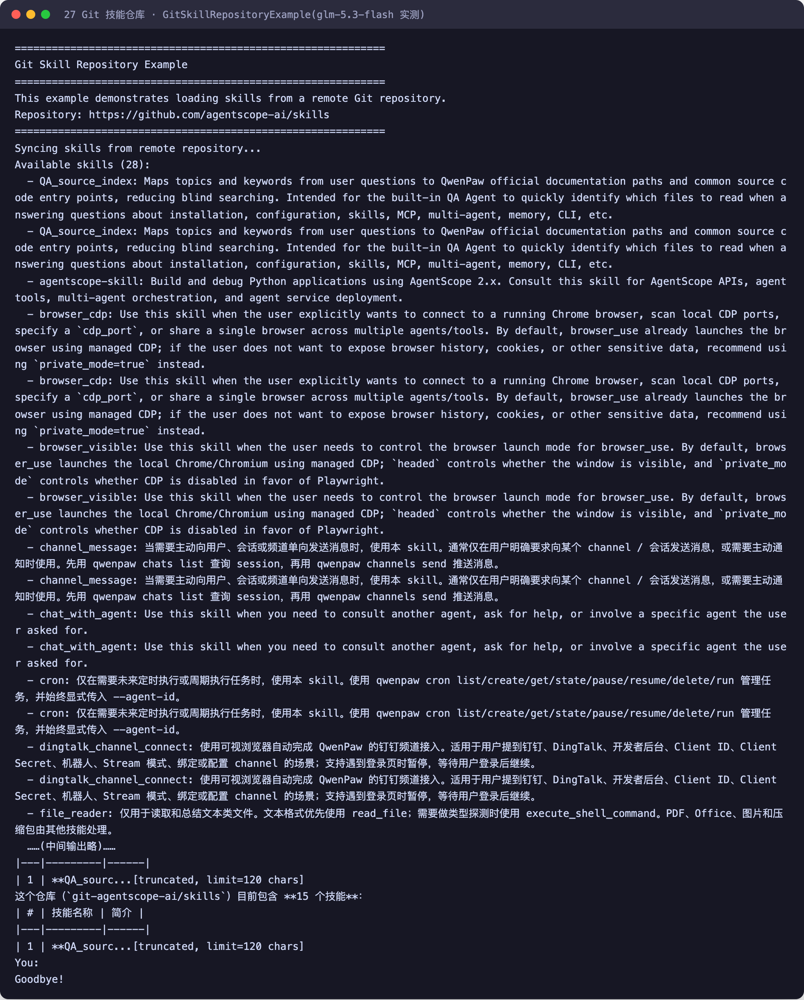

# 第 27 章 Skill 仓库集成

> 本章导读：第 15 章讲清了 Skill 是什么（Markdown + 资源文件描述的可复用技能）；本章回答它放在哪里——`AgentSkillRepository` 接口的三种官方存储实现怎么选，以及两条比选型更重要的使用契约：作用域隔离与实例复用。各实现的逐步配置见在线文档。

## 三种存储怎么选

`AgentSkillRepository` 负责把 `AgentSkill` 从外部存储加载进来，交给 `Toolkit` / `ReActAgent` 使用：

| 扩展 | 后端 | 适合场景 |
| --- | --- | --- |
| Git Repository | 远程 Git 仓库 | 用 Git PR 流程管控技能版本，可 review、可回滚 |
| MySQL Repository | MySQL 数据库 | 控制台 / 业务系统在线编辑、动态发布（已标记废弃，建议迁移到第 24 章统一 JDBC 模块） |
| PostgreSQL Repository | PostgreSQL 数据库 | 同上，PostgreSQL 环境 |

Nacos 也提供一种实现（见第 28 章）。选型一句话：**技能像代码一样需要 review 和版本 → Git；技能像配置一样需要运营随时改 → 数据库系**。

## 接入方式

```java
AgentSkillRepository repo = ...;        // 任选一种实现
List<AgentSkill> skills = repo.getAllSkills();

Toolkit toolkit = new Toolkit();
skills.forEach(toolkit::registerSkill);

ReActAgent agent = ReActAgent.builder()
    .name("Assistant")
    .model(model)
    .toolkit(toolkit)
    .build();
```

多种来源可以混用——实现 `AgentSkillRepository` 自己组合，或多个 repo 都注册到 toolkit。

Git 后端真实跑起来是什么样子？2026-10-31 实测 agentscope-examples documentation 模块（glm-5.3-flash，OpenAI 兼容网关），GitSkillRepositoryExample 同步了官方技能仓库，再让 agent 盘点家底：



截图里，示例从 `https://github.com/agentscope-ai/skills` 同步技能、逐条打印 Available skills 清单，agent 再把它们归纳成一张"15 个技能"的简介表——技能像代码一样躺在 Git 仓库里，clone 下来即可用，版本、review 与回滚沿同一条路走。

## 两条比选型更重要的契约

**作用域隔离。** 技能名是人起的（`code-review`、`git-helper`），不同团队重名是常态。接口契约要求**每个仓储实例只服务一个作用域**：同名技能跨作用域共存，读写、覆盖（含 `force`）、删除都只发生在实例绑定的作用域内；实例够不着的作用域显式拒绝，而不是静默落到别处。各来源用后端原生维度表达作用域——Git 用仓库/分支/`skillsRoot`，数据库用 `namespace` 列，Nacos 用原生 `namespaceId`，构造时传入即可。

违反这条契约的典型事故：两个团队各建一个"指向同一仓库同一目录"的仓储实例，一边删技能另一边的 Agent 突然找不到——因为它们其实是同一个作用域。

**实例复用。** 同一来源共享仓储实例，不要为每个 Agent 重建——仓储实例背后可能有远程仓库连接或数据库连接池，重建既是浪费，也会让作用域边界变得混乱。

## 本章小结

1. Git 管 review 流程、数据库管在线编辑，选型看技能的"变更方式"更像哪种；
2. 每个仓储实例一个作用域是接口契约：同名技能跨作用域共存，绝不静默跨界；
3. 同来源共享实例；MySQL/PostgreSQL 实现已废弃，新项目用第 24 章统一 JDBC 模块。

各实现的依赖、构造参数与逐步配置见在线文档 `docs/integration/skill/`；Service 平台上的 Workspace 技能（不走本接口）见第 30 章。
