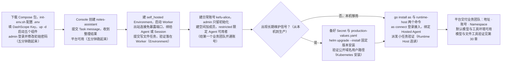
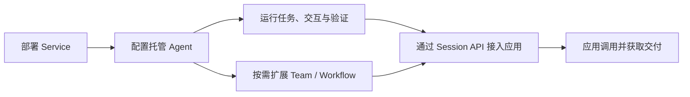
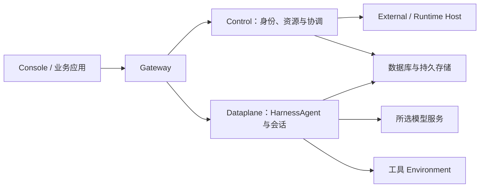

# 第 29 章 Service 概览与部署

> 本章导读：前四篇里，Agent 一直运行在你自己的应用进程内。本章处理一个新的现实问题：当第二个、第三个业务应用也想用同样的 Agent 能力时，你不会希望每个应用都重复搭建一遍运行时。答案是 AgentScope Service——一个可自托管的 Agent 运行平台。本章不先堆概念，而是直接动手：用 Docker Compose 把平台跑起来，在浏览器里创建第一个 Agent 并收到回答；然后回头解释刚才那次调用经过了哪些组件，Agent、Session、Turn 各对应你刚做过的哪个动作。接着按平台成长中依次遇到的三件事展开：让工具在正确的地方执行（Environment）、给业务团队开通账号（Namespace 与权限）、把本机环境升级为生产安装（Kubernetes）。最后是一节选读内容：用 Runtime Host 把已有的 Coding Agent 接入平台。读完后，你应当拥有一个可用的 Service，并为后续章节准备好转接的模型、工具执行与账号环境。

> **注意**：本章命令基于当前发布版本 `2.1.0-BETA1`（预发布版本），用于生产前请验证实际部署。其中 Environments 与权限相关接口属于预览文档，正式版本可能调整。



*本章操作流程图*

## 为什么需要一个共享的 Agent 平台

假设你跟着前四篇，用 Harness SDK 给工单系统内嵌了一个 Agent：它读上下文、调工具、需要时向人确认，运行得不错。接下来你会遇到一组熟悉的要求——

- 客服团队想把同样的能力放进自己的工作台；
- 数据团队想在报表流程里调用它；
- 每个接入方都要重新回答一遍：模型凭据放在哪、工具怎么接、执行记录存在哪、出了问题谁来运维。

这就是"每个应用内嵌一个运行时"的代价：运行服务重复建设，模型凭据与工具配置散落在各个应用里，跨应用的任务记录无从统一。

Service 的回答，是把 Agent 的运行管理从各个应用中抽出来，变成一个共享平台。**AgentScope Service 是面向业务应用、可自托管的 Agent as a Service 平台**，平台上的托管 Agent（Managed Agent）与 Harness SDK 共用同一个 HarnessAgent 内核。你在平台上定义 Agent 要完成的工作，并为它配置合适的模型和工具；应用提交任务后，由 Service 运行 Agent 并保存执行过程，使应用能够跟踪进展、参与必要的交互，直到获得结果——业务团队不必再为每个 Agent 应用分别建设和维护运行服务。

**自托管是目前主要推荐的部署方式**：团队先在自己的基础设施上部署 Service，再让多个业务应用共享它提供的 Agent 服务。这里的"托管"是指平台替应用管理 Agent 运行时；平台管理员可以根据实际部署接入模型、工具和业务数据，为这些应用提供共用的执行环境。

### 与 Harness SDK 的分工：两种使用方式

两种方式用同一个内核，区别在于谁来管理运行：

| 方式 | 你如何开发 | 谁管理运行 |
| --- | --- | --- |
| Harness SDK | 将 HarnessAgent 嵌入 Java / Spring Boot 应用，用代码组合业务逻辑 | 应用团队负责应用进程、部署与运维 |
| Service 托管 Agent | 在平台配置基于 HarnessAgent 内核的 Agent，通过 Console 或 API 使用 | Service 管理 Agent 执行与会话；平台团队统一维护基础设施 |

需要把 Agent 深度嵌入自己的 Java 应用、在代码中控制运行逻辑，就选 SDK（从第 2 章的快速开始入手）；希望把运行管理交给共享平台、专注业务接入，就选 Service——而且不必先开发一个 SDK 应用。已经用 SDK 开发好的 Agent 也有接入路径：可以作为 External Agent 纳入平台，保留原有部署和运行方式，同时接受平台分派的任务（见第 30 章"注册 External Agent"）；已有的 Coding Agent 则可以通过 Runtime Host 连接为 Hosted Agent（本章最后一节）。

### 从部署到业务交付

使用 Service 从准备一个可运行的平台开始，路径如下：



完成部署并接通模型和工具执行环境后，你就可以创建 Managed Agent，通过会话验证它是否理解任务、能否正确使用工具、交付是否符合预期；随着任务要求逐渐清晰，再为它补充所需的专业知识和能力，让配置的调整有实际执行结果作为依据。验证完成后，业务应用通过 Session API 使用同一个 Agent；之后即使需要增加 Team 或 Workflow，应用仍然用同一套 Session 和 Turn 跟踪工作，只需在创建 Session 时换一个执行目标。

多条任务如何拆分给多个 Agent、推进顺序如何约束，属于多 Agent 编排的话题，第 32 章专门展开；本章先专注把平台立起来。

> **延伸阅读**：本章覆盖部署、执行环境、账号权限与生产安装。把 Agent 用起来是第 30 章的主题；Session API 接入见第 31 章；Console 页面操作见第 33 章。

## 五分钟跑起来：Docker Compose 部署

概念到此为止——我们先让平台跑起来。本节用 Docker Compose 在本机启动完整的 Service，然后在浏览器中创建第一个 Agent 并收到它的回答。

准备：Docker Engine 或 Docker Desktop（含 Compose v2）、Bash、curl、OpenSSL，以及一个 DashScope API Key。如果团队已有 Service，可直接使用管理员提供的地址和账号，跳到第 4 步。

### 第 1 步：下载并配置

下载 Compose 安装包，解压后生成配置文件：

```bash
curl -fLO https://github.com/agentscope-ai/agentscope-java/releases/download/v2.1.0-BETA1/agentscope-service-2.1.0-BETA1-compose.tar.gz
tar -xzf agentscope-service-2.1.0-BETA1-compose.tar.gz
cd agentscope-service
./init-env.sh 2.1.0-BETA1 sca-registry.cn-hangzhou.cr.aliyuncs.com/agentscope
```

编辑生成的 `.env`，填入自己的 DashScope API Key，并为本地体验启用工具执行：

```dotenv
DASHSCOPE_API_KEY=YOUR_DASHSCOPE_API_KEY
BUILDER_ALLOW_LOCAL_ENVIRONMENT=true
```

Local 工具在 Dataplane 容器内执行——这句注释先记住，本章 29.4 节会让它变得重要。其他模型和执行环境的配置见第 30 章"配置 Agent 与模型"。

### 第 2 步：启动服务

```bash
docker compose up -d --wait --wait-timeout 600
```

Compose 会自动拉取镜像并启动数据库和全部 Service 组件。命令成功结束后，打开 [http://localhost:18080](http://localhost:18080)。

> **排障**：启动失败时，先运行 `docker compose ps -a` 查看各容器状态，再用 `docker compose logs --tail=100` 查看错误日志。

### 第 3 步：登录

首次部署使用用户名 **`admin`**，密码是 `.env` 中 **`CONTROL_PLANE_BOOTSTRAP_PASSWORD`** 的值。登录后在 **Profile** 中修改密码——这是平台第一个、也应该是短命的系统账号，下一节讲权限时你会明白为什么日常要用独立账号。

### 第 4 步：创建第一个 Agent 并对话

打开 **Design → Agents → New agent**，填写名称（例如 `notes-assistant`）和 **Instructions**，将 **Runtime** 选择为 **AgentScope Managed**，然后点击 **Create & open agent**。**Model** 留空即可使用刚才配置的默认模型。

在 Agent 详情页进入 **Connections → Session API**，填写 **Task message**（例如"把这段会议记录整理成待办：小李周五完成安装说明，下周一评审"），点击 **Create Session and submit**。首次体验可将 **Application API key** 留空，使用当前登录身份。等待一会儿，你会看到 Agent 的回复出现——模型调用成功，平台可用了。

> **✅ 验收点**：你能在浏览器里看到 `notes-assistant` 对那条会议记录的整理结果。完整的 Console 页面导览见第 33 章"可视化 Console"。

## 刚才发生了什么：一次调用背后的组件与概念

上一节你完成了四步操作，细节先放着，这一节回头看清楚刚才那次调用到底经过了什么——先看组件，再看概念。

### 五个组件

刚才的 `docker compose up` 启动了五个组件。你在浏览器里的每次点击都从 Gateway 进出：

| 组件 | 端口 | 暴露方式 | 职责 |
| --- | --- | --- | --- |
| Gateway | 8080 | 宿主机 `127.0.0.1:18080` | 唯一入口，转发用户请求 |
| Control | 8081 | 内部网络 | 身份、资源管理与工作协调 |
| Dataplane | 8082 | 内部网络 | 运行 HarnessAgent 与会话 |
| Scheduler | 8083 | 内部网络 | 调度相关工作 |
| PostgreSQL | 5432 | 内部网络 | 保存平台运行数据 |



记住一个关键事实：**即使将来把工具执行放到别的机器上（29.4 节），Managed Agent 的模型调用和推理仍由 Dataplane 承担**。Dataplane 是平台里真正"跑 Agent"的地方。

### 三个词对应你的三个动作

现在把 Agent、Session、Turn 这三个贯穿全书的词，对齐到你刚做过的三个动作上：

- **Agent** 对应你在 Design → Agents 里创建的 `notes-assistant`。它描述一项可以反复使用的能力：指令、模型、工具以及运行所需的配置。
- **Session** 对应你点击 **Create Session and submit** 时创建的那条记录。Session 代表应用围绕一项工作建立的交互记录；创建时 Service 会保存当时使用的 Agent 配置，使后续工作有明确的执行依据。
- **Turn** 对应你填写的那条 Task message。应用在 Session 中提交的每一轮任务称为一个 Turn；Service 接收输入后在后台执行，应用可以读取这一轮的状态与结果，也可以通过 Session 的快照和事件流恢复完整交互。

Managed Agent 会在同一个 Session 内保留对话上下文；Team 和 Workflow 的 Turn 则分别启动协作任务或流程执行——它们共用调用方式，但内部如何延续上下文、支持哪些中途操作，取决于执行目标的能力。

平台还会用 Issue、Run、Task 和 Attempt 保存协作目标、执行图、成员任务和具体尝试。这些记录主要服务于定位问题和运营平台；应用接入时先围绕 Session、Turn 和 Events 完成提交、观察、交互与交付，需要诊断时再进入执行详情（第 33 章）。

### 责任边界：Service 管什么，应用管什么

Service 将 Agent 的运行管理作为多个业务应用共用的基础能力：协调执行、保留记录、通过 API 暴露进展。业务应用则决定 Agent 要完成什么、结果如何被使用——它需要把用户需求转化为合适的任务输入，并通过业务工具或数据接口，让 Agent 在当前用户获准的范围内开展工作。

有一条边界值得现在就记住：**调用 Service 的凭据只控制 Agent 服务的访问，业务数据本身的授权仍应落实在相应的业务系统中**。Agent 完成执行后，应用还要依据业务标准判断结果是否可以采用、如何进入后续流程。这也是应用团队定义 Agent 能力时需要一起考虑的部分。

在自托管模式下，这种分工延伸到运维：平台团队集中维护 Service 及其依赖的运行资源，业务团队在这一环境中配置和改进自己的 Agent，再接入产品。

## 让工具在正确的地方执行：Environment

现在做一个实验。给你的 Agent 提交一个写文件的任务（比如"创建 environment-check.txt 并写入当前时间"），任务完成后，回到终端执行 `ls`——**文件不在**。它去哪了？

答案藏在 29.2 节那张组件表里：Local 工具在 Dataplane 容器内执行，文件写进了容器内部的工作目录，既不在你运行命令的终端里，容器删除后也会一并消失。本机体验无所谓，但如果任务是"改完这个文件交回给团队"，你就需要回答一个新问题：**工具到底应该在哪里执行？**

这就是 Environment 要回答的问题。

### Environment 是什么

Environment 为 Managed Agent 选择文件、Shell 等工具的执行后端。它和 Workspace（见第 30 章）一起参与执行，但分工不同：**Workspace 提供指令、Skills 和工具定义；Environment 决定文件和命令实际在哪里执行**。工具是否启用、是否需要确认，仍由权限系统决定（第 31 章）。

四种类型：

| 类型 | 适用方式 |
| --- | --- |
| local | 在 Dataplane 所在环境执行；管理员必须启用 Local |
| sandbox | 使用 E2B 云沙箱隔离 Shell/文件执行 |
| remote | 共享 BaseStore 文件系统，不提供 Shell |
| self_hosted | 通过自行运行的 Worker 提供执行能力 |

Docker 部署下，Local 指 Dataplane 容器内部，并不是宿主机的任意目录；生产环境按工具隔离和网络需求选择后端。

Environment 有两种绑定方式：把它的 ID 保存到 Agent 定义的 `defaultEnvironmentId`（该 Agent 之后的新会话默认使用），或在创建 Session 时通过 `environmentId` 指定（只影响这一次会话）。后者适合验证一个新环境，或让同一个 Agent 在不同环境中处理各自的任务。

### 实操：创建 self_hosted Environment 并启动 Worker

接下来我们把工具执行从 Dataplane 容器里搬出来，放到一个自己运行的 Worker 上。下面的 API 操作需要平台身份变量，先准备：

```bash
export BASE_URL="http://localhost:18080"
read -r -s -p "Password: " LOGIN_PASSWORD
TOKEN=$(curl -sS --fail-with-body "$BASE_URL/api/auth/login" \
  -H 'Content-Type: application/json' \
  --data "$(jq -n --arg u admin --arg p "$LOGIN_PASSWORD" '{username:$u,password:$p}')" \
  | jq -er '.token')
unset LOGIN_PASSWORD
TENANT="default"; NAMESPACE="default"
```

（第 30 章会复用并展开这套身份变量，包括从 `/me/namespaces` 查询可用空间。）

创建一个 `self_hosted` Environment。注意响应里的 `apiKey` **只显示这一次**：

```bash
ENVIRONMENT_JSON=$(curl --fail-with-body -sS "$BASE_URL/api/environments" \
  -H "Authorization: Bearer $TOKEN" -H 'Content-Type: application/json' \
  -H "X-AgentScope-Tenant: $TENANT" -H "X-AgentScope-Namespace: $NAMESPACE" \
  --data '{"name":"Report worker","type":"self_hosted","config":{}}')
ENVIRONMENT_ID=$(printf '%s' "$ENVIRONMENT_JSON" | jq -er '.id')
ENVIRONMENT_KEY=$(printf '%s' "$ENVIRONMENT_JSON" | jq -er '.apiKey')
```

这里的两个值用途不同，别混：`ENVIRONMENT_ID` 用于 Agent 或 Session 选择资源；`ENVIRONMENT_KEY` 用于 Worker 连接平台。它们与刚才请求头里的用户 `TOKEN`（平台身份）是三类不同的凭据。

然后从发布镜像启动 Worker。把 `SCHEDULER_IMAGE` 设为发布清单中的 scheduler 镜像全名：

```bash
docker run --rm \
  --name agentscope-hands \
  -v agentscope-hands:/data \
  --entrypoint java "$SCHEDULER_IMAGE" \
  -Dloader.main=io.agentscope.builder.worker.HandsWorkerMain \
  -cp /app.jar org.springframework.boot.loader.launch.PropertiesLauncher \
  --base-url "$BASE_URL" \
  --environment-id "$ENVIRONMENT_ID" \
  --environment-key "$ENVIRONMENT_KEY" \
  --hands-root /data/hands \
  --worker-id hands-1
```

这个进程只向 Gateway 发起出站请求，**不需要暴露任何端口**——这是 self_hosted 模式对网络友好的地方。正式运行时，由你的进程或容器管理器负责重启；多个 Worker 使用不同的 worker ID。停止 Worker 前先检查它已领取的工作，别把"停了进程"当成"取消了任务"。

如果选择其他类型，就要按该类型准备执行后端：Local 需要管理员允许本地执行，sandbox 需要可用的 E2B 配置（参数见本章末"参考速查"）。只修改创建请求 JSON 里的 `type` 不会替你完成这些准备。

### 把环境绑给 Agent 或 Session

Worker 就绪后，两种绑法。

**只为一个 Session 指定**（不动 Agent 默认值，适合验证新环境）：

```bash
SESSION_JSON=$(curl --fail-with-body -sS "$BASE_URL/api/v1/agent-sessions" \
  -H "Authorization: Bearer $TOKEN" -H 'Content-Type: application/json' \
  -H "X-AgentScope-Tenant: $TENANT" -H "X-AgentScope-Namespace: $NAMESPACE" \
  --data "$(jq -n --arg agent "$AGENT_ID" --arg env "$ENVIRONMENT_ID" \
    '{target:{type:"agent",id:$agent},environmentId:$env}')")
```

**设为 Agent 的默认环境**：把 `{"defaultEnvironmentId":"..."}` 写入 `resource-defaults.json`，再按第 30 章"设置 Agent 的默认资源"的完整 GET/PATCH 步骤保存——那套步骤会保留 Agent 的工具、指令等其他绑定并携带版本号，避免只改环境时清空其他配置。

绑定行为有几个容易踩的坑：

- 保存默认值后，新 Session 省略 `environmentId` 就用默认值；显式传其他 ID 只覆盖本次会话。
- **修改默认值不会移动已有 Session**；已有 Session 可通过自身 PATCH 接口调整，建议在当前任务结束后操作并验证后续任务。
- 切换绑定**不会自动复制原环境中的工作文件**。

### 验证：文件这次去哪了

绑定完成后，提交一个"写入 `environment-check.txt` 并读回"的任务，然后核对三点：回复正常；快照和事件里能看到工具记录；**文件位于所选后端的工作目录——而不是你运行命令的终端目录**。对 Worker 而言，还应核对它领取和回传工具任务的记录。

这一步需要一个已启用文件读写工具的 Agent。第 30 章"运行第一个托管 Agent"会创建这样的 Agent 并给出完整 curl 流程；跑通后回到本节验证 Environment 是否真正生效。

如果 Agent 可以回复但文件操作失败，按顺序排查：先看 Session 返回的 `environmentId` 对不对，再检查对应 Worker 或沙箱的连接、目录挂载、程序依赖和权限。**更换 Agent 指令不能修复后端缺失的文件或程序**；所需工具没有启用时，按第 31 章修改 Agent 定义并创建新 Session 验证。排查时先区分两类错误：资源关联错误（Agent 默认值、Session 显式选择、账号资源权限）和后端执行错误（Worker 在线状态、沙箱凭据、目标目录及依赖）。

### Console 里怎么核对

*当前控制台截图，使用固定演示数据。*


在 **Resources → Environments** 创建和维护执行环境，然后在 Managed Agent 的 **Runtime configuration → Session defaults → Default environment** 选择它。资源页面和 Agent 页面分别负责维护后端与选择默认值，所以**只完成资源创建还不能确认目标 Agent 正在使用它**——保存后创建新会话，核对环境选择再提交任务。

### 改配置的正确姿势

Environment 的 `config` 是资源级配置，PATCH 会**替换整个对象**，更新前先读取并保留其他字段。它没有 Workspace 那样的发布版本机制；不要把"Session 固定了 Agent 版本"理解为后端配置也被隔离了。验证配置变更时优先使用新 Session；轮换 Worker key 后要同步更新所有连接者。归档、删除或配置更新可能影响其他引用者，维护前先检查使用情况——它们都不能替代 Turn 的取消接口。

一个已知的当前限制：`config.memoryAccess` 接受按 Store ID 配置的 `read_only` 或 `read_write`，但当前 Managed HarnessAgent 运行路径对共享知识统一使用只读挂载——设置 `read_write` 不会让该路径获得共享知识写入能力，也不会自动绑定 Store（见第 31 章"读取与写入权限"）。

E2B sandbox 的创建前提（管理员先在部署配置中提供 `BUILDER_E2B_API_KEY`）与 Config 示例：

```json
{
  "templateId": "base",
  "isolationScope": "SESSION",
  "sandboxTimeoutSeconds": 300
}
```

需要额外程序时选择包含这些依赖的自定义 E2B template；在 Config 里填写 `packages`、Docker 镜像或网络参数**不会**自动安装依赖或落实网络限制。remote 类型只有文件系统能力，不能作为远程 Shell Worker 使用。sandbox 参数全表见本章末"参考速查"。

Environment 的管理 API（列表、创建、详情、更新、归档、轮换 key、删除）也统一移到了"参考速查"一节。

## 给第一个业务团队开通账号

平台现在跑在你机器上，用 `admin` 登录。假设客服团队说："我们也想用 notes-assistant。"你不会把 admin 密码给他们——这一节处理账号与权限。

Service 的权限分四层：**账号身份、Namespace 成员角色、资源操作权限、工作可见性**。贯穿其中的一个原则：业务应用要分别检查"用户能否调用这个 Agent"和"用户能否查看这项工作"——Agent 可见，不代表其他用户的私人会话和文件也可见。

### 第 1 步：建日常账号

部署时配置的 bootstrap 管理员（`admin`）只用于初始化，首次登录后就应改密。平台管理员通过账号 API 建立日常账号，业务调用一律使用日常账号或应用凭据：

```bash
curl -sS --fail-with-body "$BASE_URL/api/admin/users" \
  -H "Authorization: Bearer $TOKEN" -H 'Content-Type: application/json' \
  --data '{"username":"kefu-alice","initialPassword":"CHANGE_ME","roles":["..."]}'
```

创建时可传 `initialPassword`，省略则自动生成并随响应返回 `generatedPassword`。账号引用一律使用返回的稳定 ID，不要用可修改的显示名称。**平台角色与 Namespace 角色是两组权限**，不要混淆。完整的账号管理 API（登录、改密、重置密码、修改角色）见本章末"参考速查"。

### 第 2 步：建空间、加成员

**Namespace 是资源与授权边界**；Workspace 是 Agent 读写文件的环境。两者职责不同，别混为一谈。账号可同时属于多个空间，请求通过空间 header 选择操作范围。

先定义一个请求函数并读取当前可用空间——不要假设安装里一定存在某个共享空间：

```bash
api() {
  curl --fail-with-body --silent --show-error \
    -H "Authorization: Bearer $TOKEN" \
    -H "X-AgentScope-Tenant: $TENANT" \
    -H "X-AgentScope-Namespace: $NAMESPACE" \
    -H 'Content-Type: application/json' "$@"
}
api "$BASE_URL/api/v1/me/namespaces"
api "$BASE_URL/api/v1/me/scope"
```

`/me/namespaces` 返回 `items`，每项含 `tenant`、`name`、`kind`、`roles`、`owner`、`accessVersion`；`/me/scope` 返回当前默认范围及可选空间。后续请求的 header、query 和 JSON 中的 tenant/namespace 要保持一致。

平台管理员创建共享空间（`OWNER_ID` 填空间所有者的账号 ID）：

```bash
api "$BASE_URL/api/v1/namespaces" --data "$(jq -n --arg owner "$OWNER_ID" \
  '{name:"engineering",displayName:"研发空间",owner:$owner,members:{}}')"
```

`name` 使用小写字母、数字和连字符，以字母或数字开头，最长 63 字符，不能使用保留的 `personal-` 前缀。owner 省略时使用当前管理员；tenant 由当前安装决定。个人空间和全局空间由平台管理，不能按普通共享空间修改成员和生命周期。

然后加入客服团队的成员。`members` 是**完整替换**——先保留原成员再加入新同事：

```bash
current=$(api "$BASE_URL/api/v1/namespaces/$NAMESPACE")
api "$BASE_URL/api/v1/namespaces/$NAMESPACE" -X PUT \
  --data "$(jq --arg user "$COLLEAGUE_ID" \
    '{version:.namespace.version,members:(.namespace.members + {($user):["member"]})}' \
    <<<"$current")"
```

五种空间角色，按权限从低到高：

| Namespace 角色 | 主要用途 |
| --- | --- |
| `viewer` | 发现和读取授权资源 |
| `member` | 使用资源、发起与跟进工作 |
| `developer` | 配置 Agent 等资源，同时可使用资源 |
| `operator` | 执行运维操作 |
| `admin` | 管理成员、资源配置与操作权限 |

另有 `auditor`（显式的工作审计能力，不因 admin 身份自动获得）——授予或移除它只能由空间所有者或平台管理员完成。一个成员可拥有多个角色。PUT 提交 `version` 做并发保护：遇到 409 版本冲突就重新读取，**不要用旧成员列表覆盖别人的更改**。

### 第 3 步：把 Agent 限定给这个团队

空间角色决定了"能在空间里做什么"，还可以进一步控制"具体某个资源谁能用"。先读取 Agent 的当前权限：

```bash
permission=$(api "$BASE_URL/api/v1/namespaces/$NAMESPACE/resources/agent/$AGENT_ID/access")
printf '%s\n' "$permission" | jq .
```

响应含当前用户的 `decisions`、配置版本，有管理权限时还有 `policy`。将其限制为指定同事可发现、可使用：

```bash
api "$BASE_URL/api/v1/namespaces/$NAMESPACE/resources/agent/$AGENT_ID/access" -X PUT \
  --data "$(jq -n --arg user "$COLLEAGUE_ID" \
    --argjson version "$(jq '.version' <<<"$permission")" \
    '{version:$version,policy:{mode:"restricted",users:{($user):["discover","use"]}}}')"
```

`mode:"inherit"` 表示继承空间角色，`restricted` 表示按资源授权。可授予的动作是 `discover`、`use`、`inspect`、`edit`、`publish`、`manage`；受权用户必须已是空间成员。policy 的完整字段（`groups`、`consumers`、`exportTo`）见"参考速查"。**PUT 会替换整个资源策略**，记得保留仍需使用的其他用户、用户组与依赖授权。

一个容易漏掉的检查：资源有依赖。Team 依赖成员 Agent，Managed Agent 还可能依赖 Memory、Vault 和 Environment——检查依赖授权后，再让普通成员试用，不能只检查 Team 本身的 `use`。

### 工作本身的共享范围

前三层权限管资源，第四层管"这项工作谁能看"。Issue 创建时的 `access` 支持 `private`、`namespace` 或 `shared`；shared 的 `members` 将账号 ID 映射为 `reader` 或 `contributor`。只有根 Issue 创建者可通过 `PUT /api/v1/issues/{issueId}/access` 修改共享。**工作共享不会授权使用新的 Agent，也不会绕过 Namespace 成员检查**；平台管理员不是所有私人工作的默认读者，审计应通过 auditor 授权进行。

### 排查访问失败与申请授权

排查顺序：先确认身份和空间，再读取资源的 `decisions` 与依赖错误，最后检查 Issue 共享。资源不可见时可能返回 404，已可见但操作不被允许时可能返回 403；用正确账号和返回的原因排查，**不要替换成内部服务令牌**。

普通成员可通过 `POST /api/v1/namespaces/{name}/requests` 提交 `version`、`resource`（`kind:id`）、`action`、`reason` 申请授权；管理员向 `/requests/{requestId}/review` 提交 `{version,approve}` 决策。

最后给一个验收方法：用两个日常账号跑一遍第 34 章"在 CRM 中生成客户方案"案例——一个负责配置资源，另一个只负责调用并查看自己的工作。应用凭据按目标资源授权和 scope 检查访问，但不能替代对用户 Namespace 权限的验证。控制台对应入口见第 33 章。

## 从本机到生产：Kubernetes 安装

Compose 部署的是完整 Service，本机体验和集成验证完全够用。但出现以下信号时，就该考虑迁移到 Kubernetes：

- 服务将由平台团队长期维护，而不是跑在某个人的笔记本上；
- 多个业务团队接入，需要正式的域名、TLS 与访问策略；
- 数据开始有备份、恢复与升级窗口的正式要求。

本节介绍面向生产的 Kubernetes 与 Helm 安装。正式 Service Chart 安装 Gateway、Control、Dataplane 和 Scheduler；PostgreSQL、持久存储、入口域名和 TLS 由你管理。应用每组件默认单副本并采用 Recreate 更新，**部署和升级需要维护窗口**。

### 第 1 步：准备依赖

准备 Kubernetes、Helm、可达的 PostgreSQL，以及 Workspace 所需的 RWX StorageClass 或已有共享 PVC。Artifact 默认使用 RWO。工作目录会被多个组件挂载；只在单节点可用的 RWO 卷不能替代跨节点共享存储。

直接从公开 Helm 仓库安装 Chart，无需下载源码。先下载与版本配套的配置模板和初始化 SQL：

```bash
curl -fLO https://chickenlj.github.io/helm-charts/examples/2.1.0-BETA1/kubernetes.env.example
curl -fLO https://chickenlj.github.io/helm-charts/examples/2.1.0-BETA1/postgres-init.sql
```

用应用数据库所有者在目标数据库执行 SQL，创建 `cp`、`rt`、`dp` 三个 schema，并为数据库、文件和密钥建立备份策略。如需离线安装，从 [GitHub Release](https://github.com/agentscope-ai/agentscope-java/releases/tag/v2.1.0-BETA1) 下载 `agentscope-service-2.1.0-BETA1-kubernetes.tar.gz` 和 `SHA256SUMS`，核对校验和后解压；包中包含 Chart 和相同的配置文件。

### 第 2 步：创建 Secret

复制 `kubernetes.env.example` 到私有文件并替换全部占位值：数据库连接、随机 JWT/internal/Vault 密钥、初始管理员密码及需要的模型凭据。URI 中的密码做 URL 编码，JDBC 密码单独提供原值；根据数据库证书设置 TLS。

```bash
kubectl create namespace agentscope
kubectl -n agentscope create secret generic agentscope-service --from-env-file=/private/path/service.env
```

Secret 是运行配置；**不要把明文文件或含 Secret 的渲染结果提交到仓库**。

### 第 3 步：准备 values

以下是 `production-values.yaml` 起点，替换域名、StorageClass、Ingress class 和 TLS Secret（TLS Secret 必须预先存在或由你的证书控制器创建）：

```yaml
existingSecret: agentscope-service
allowLocalEnvironment: false
publicURL: https://agentscope.example.com
persistence:
  workspaces:
    storageClass: shared-rwx
    size: 20Gi
  artifacts:
    storageClass: standard
    size: 20Gi
ingress:
  enabled: true
  className: nginx
  host: agentscope.example.com
  tls:
    - hosts: [agentscope.example.com]
      secretName: agentscope-service-tls
```

已有 PVC 时设置对应 `existingClaim`；私有镜像配置 `imagePullSecrets`；Ingress annotations 按实际控制器设置 SSE 超时和缓冲行为。资源 requests/limits 分别通过 `control`、`dataplane`、`scheduler`、`gateway` 调整，按实际任务负载压测定容。

### 第 4 步：安装指定版本

```bash
helm repo add agentscope https://chickenlj.github.io/helm-charts
helm repo update agentscope
helm search repo agentscope/agentscope-service --versions --devel

helm upgrade --install service agentscope/agentscope-service \
  --version 2.1.0-BETA1 \
  --namespace agentscope \
  --set imageRepository=sca-registry.cn-hangzhou.cr.aliyuncs.com/agentscope \
  -f production-values.yaml \
  --wait --timeout 10m
```

使用 `--version 2.1.0-BETA1` 固定版本；查询命令的 `--devel` 才会包含预发布版本。Chart 通过 `appVersion` 使用配套镜像版本，保持 Chart 与组件镜像版本配套。离线安装时，把仓库引用替换为下载的 `./agentscope-service-2.1.0-BETA1.tgz`。注意：**Chart 会在你的集群创建工作负载；发布 Helm 仓库本身不会部署运行中的 Service**。

### 第 5 步：验证用户路径

```bash
kubectl -n agentscope get pods,pvc,svc,ingress
kubectl -n agentscope port-forward service/service-agentscope-gateway 18080:8080
```

确认 PVC Bound、Pod Ready 后，使用初始管理员登录公开域名并修改密码。依次验证：模型连接、执行 Environment、第一次 Chat、Issue 交付和长连接。**port-forward 用于排障，不替代公开回调地址验证。**

### 升级、卸载与运行模式

Secret 更新后重启相关 Deployment；升级前按第 33 章"运维、恢复与排障"备份，并保留原 Chart、values 和镜像版本。Chart 保留 PVC；重新安装时显式指定保留的 existingClaim。

有一个容易混淆的点：当前 Chart 提供**完整 Service 的 standalone 部署**；Kubernetes-native ControlPlane/ASDP 是**另外一种部署模式**，应按 SDK 网络契约规划，不要把两个 Chart 直接叠装为同一服务。当前 Chart 的单副本安装不提供无停机迁移或多副本 HA 保证。

### 三条部署路径怎么选

| 路径 | 当前用途 | 需要准备 |
| --- | --- | --- |
| Docker Compose | 本机体验、开发与集成验证 | 发布包、Docker、模型凭据、持久磁盘 |
| Kubernetes / Helm | 由平台团队管理的安装 | PostgreSQL、共享 Workspace 存储、Artifact 存储、Secret、域名与 TLS |
| 已有团队平台 | 应用开发者直接使用 | 服务地址、账号、授权空间、可用模型与 Environment |

平台交付给业务团队时，管理员需要提供：可访问的 Service 地址和账号、该账号可用的 Namespace、默认模型是否可用、应选择哪个工具环境，以及业务资料放在哪里、如何获得访问权限。有了这些信息，业务团队就能按第 30 章完成模型与文件工具验证，再通过第 31 章检查业务应用的调用过程。

### 入口、网络与远程访问

Compose 默认只将 Gateway 暴露在宿主机的 `127.0.0.1:18080`（组件端口表见 29.2 节），其余组件走内部网络。反向代理的部署位置决定配置方式：代理与 Service 同宿主机时，将请求转发到 `127.0.0.1:18080` 即可；代理本身也是容器时，它看到的 `localhost` 指向代理容器自身，需要配置共享网络或使用该容器可达的宿主地址。对外入口始终指向 Gateway，内部组件和数据库通过私网提供服务。

需要从其他设备访问，或联调 OAuth、Channel 的公网回调时，为 Gateway 配置 HTTPS 入口：准备域名和 TLS 证书，让反向代理转发到 Gateway，然后在 `.env` 中把 `BUILDER_OAUTH_PUBLIC_URL` 设为实际外部地址（如 `https://agentscope.example.com`）；需要调整 Gateway 监听地址或端口时修改 `BIND_ADDRESS` 和 `GATEWAY_PORT`，重建容器生效。

执行进度通过 SSE 长连接传输，代理需要及时转发事件、**关闭事件流缓存**、允许足够长的读取超时。配置完成后，除了确认能登录，还应运行一次持续生成内容的任务，检查事件是否陆续到达、刷新后能否重新连接、业务所需的回调是否正常。

### 上生产前的验证清单

进入生产使用前，进一步确认：用户能否持续接收执行事件；刷新页面后能否恢复已有内容；交付文件能否按权限下载；业务依赖的 Webhook 接收端能否收到通知。数据库和文件备份要配合恢复演练，并覆盖"未完成工作如何继续处理"。这样才能确认平台在实际使用和故障恢复时都能按预期工作。

自托管 Service 仍然可以调用远程模型，工具也可能通过 MCP 或其他接口访问外部系统。规划网络时，结合所选模型、工具和存储逐一确认数据流向，并为需要从外部到达平台的 OAuth 等回调准备入口。

## 进阶（选读）：用 Runtime Host 接入已有的 Coding Agent

> 本节是选读内容。适用场景：你希望平台分派的任务由已有的 Coding Agent（如 Claude Code 类 CLI 工具）执行。没有这个需求可直接跳到本章小结；平台托管 Agent 的工具执行环境见 29.4 节的 Environment，两者是不同的机制。

Runtime Host 运行在安装 Coding Agent 的电脑或服务器上：控制面负责派发和记录工作，Host 使用本地 provider 执行。本节讲解安装、连接与日常运维；主机接入的管理 API 与 daemon 协议接口属于深度集成内容，统一放在本章末"参考速查"。

### 安装

在目标 Linux 或 macOS 主机安装 [Go](https://go.dev/doc/install) 1.26 或更新版本，从已发布版本安装两个命令，无需下载仓库源码或在该主机部署 Service：

```bash
go install github.com/agentscope-ai/agentscope-java/agentscope-service/service-controlplane/v2/cmd/as@v2.1.0-BETA1
go install github.com/agentscope-ai/agentscope-java/agentscope-service/service-controlplane/v2/cmd/agentscope-runtime-host@v2.1.0-BETA1
```

将安装目录加入 PATH 并检查：

```bash
AS_CLI_BIN_DIR="$(go env GOBIN)"
if [ -z "$AS_CLI_BIN_DIR" ]; then
  AS_CLI_BIN_DIR="$(go env GOPATH)/bin"
fi
export PATH="$AS_CLI_BIN_DIR:$PATH"
as version
agentscope-runtime-host -help
```

把 PATH 写入 shell 配置文件以便新终端使用。`as version` 应显示 `2.1.0-BETA1`。另外在这台主机安装、登录所需的 Coding Agent provider，并确认它能完成一次请求。CLI 和 Runtime Host 连接已有 Service，**不负责部署平台**。升级时先停止 Runtime Host，将两个 `go install` 命令中的版本一起更新，安装后重启，并保留原状态目录。

### 连接与日常操作

```bash
as connect https://agentscope.example.com
as runtime status
as runtime probe
```

按 CLI 提示完成登录或 enrollment。连接会保存本机配置并启动守护进程，用户正常使用无需反复传递共享内部令牌。日常操作：

```bash
as runtime logs      # 跟踪日志（-f 持续跟踪）
as runtime stop      # 停止
as runtime start     # 启动
```

| 命令 | 用途 |
| --- | --- |
| `as connect URL` | 登录/注册本机，保存配置并启动 daemon |
| `as runtime status` | 查看运行状态 |
| `as runtime probe` | 检查 provider 可用性 |
| `as runtime logs -f` | 跟踪日志 |
| `as runtime restart` | 重启 daemon |
| `as runtime stop` / `start` | 停止或启动 |
| `as connect --help` | 查看该版本提供的高级参数 |

配置与状态默认在 `~/.agentscope/runtime-host/`：`config.json` 含连接身份，`state/host.id` 保存稳定 Host ID，`daemon.log` 用于排障，`workspaces/` 保存任务工作目录。**保留这些文件**，避免把已有主机错误地注册为新实例；这个目录是本机身份状态，不是公开的配置样例。

连接成功后，通过管理 API 检查 Host 在线、provider 可用，再绑定 Hosted Agent 并派发一项小任务；失败时同时查看 Task Attempt 和 Host 日志。

### 无交互服务器连接

由有权限的操作者生成短期 enrollment token，交给待连接主机使用：

```bash
as runtime enrollment-token create
```

在目标主机将该值放入 `AGENTSCOPE_ENROLLMENT_TOKEN` 环境变量再执行 connect，服务会交换出绑定 Host 身份和范围的凭据。**不要把 enrollment token 或 `config.json` 放进共享脚本。**

### 它是怎么工作的

理解 Runtime Host 的运行机制，四个要点：

**注册与领取**。连接时 Host 注册稳定身份、范围、池、provider 描述与容量；调度结合 Agent 绑定、能力要求和运行策略产生 Attempt，Host 领取符合条件的工作并维持租约。Host 在线、provider 能 probe、Agent 可派发是三个不同的检查点。Runtime Profile 决定 provider 参数，Pool 提供可选执行主机；并发受 Host capacity 和上层调度策略共同约束。

**准备与执行**。Host 为任务准备工作目录，把平台支持的指令和能力文件映射到 provider 格式，再用该目录启动 provider。它**不会默认切换到用户正在编辑的本地仓库**——仓库、输入资料与分支需要在任务准备中明确。任务范围凭据和工作上下文通过环境及 MCP/CLI 提供给执行者；把文件留在 Host 磁盘上并不等于其他协作者可以访问，应使用 Artifact 交付需要共享的结果。

**事件、确认与恢复**。适配器将 provider 事件转换为平台执行记录。支持的平台确认由 Host 转发工具请求并等待决定；不支持的平台确认按 provider 自身的权限方式处理。Host 保留日志、provider 会话标识和 checkpoint 用于支持的恢复路径；重启时保留状态目录与 Host 身份。**只声明 Resume 支持不能保证任意中断都能恢复**——目标 provider 的会话仍需存在且可访问（OpenClaw 当前适配器不提供 Session resume）。

**重试与取消**。取消会向执行链路传播，检查 Attempt 终态以及 provider 进程是否结束。重试是新的 Attempt；只有符合恢复条件时才使用原 provider 会话；跨后端 fresh fallback 依赖持久 Issue、评论和 Artifact 重建上下文，不能搬迁进程内记忆。诊断用 `as runtime logs -f` 配合 Task/Attempt：无任务可领时检查范围、池、绑定、容量与所需能力；领取后失败时检查 provider 登录、参数、工作目录和工具依赖。

业务调用者通过 Issue 或 Session API 分派任务、跟踪和控制工作（接口见"参考速查"），无需接触 Host 凭据或 provider 进程。两个实用提醒：显示交互操作前，先读取 `/api/v1/agent-sessions/{sessionId}/turns/{turnId}/capabilities` 的 `available_commands`——Hosted 会话支持取消，但补充输入、审批与 resume 不能套用 Managed 的能力承诺；SSE 断线续传只恢复已记录的输出，不重新执行工具，也不等于恢复 Host 进程，需要保留的交付物应上传为 Artifact。

## 本章小结

这一章走完了一条从问题到生产的路线：

1. **为什么**：多个应用需要同一份 Agent 能力时，把运行管理抽成共享平台，而不是每个应用内嵌一个运行时；
2. **跑起来**：Docker Compose 五个组件，浏览器里创建第一个 Agent 并收到回答；
3. **看懂它**：Gateway 是入口、Control 管身份与协调、Dataplane 跑 Agent、Scheduler 调度；Agent/Session/Turn 分别对应"定义能力、建立交互、提交一轮任务"；
4. **执行位置**：工具默认在 Dataplane 容器里执行，Environment 决定真实执行位置，self_hosted Worker 用出站连接接入；
5. **多人使用**：账号、Namespace 角色、资源权限、工作可见性四层边界，按"建账号 → 建空间加成员 → 限定资源"三步开通一个团队；
6. **上生产**：出现长期维护信号时迁移到 Kubernetes/Helm，记住单副本 + Recreate 意味着维护窗口；
7. **接入 Coding Agent**（选读）：Runtime Host 把已有 Coding Agent 连接为 Hosted Agent。

下一步自然是用 API 把 Console 里的操作脚本化——第 30 章"创建并运行托管 Agent"会建立全书复用的 API 身份变量，跑通从创建 Agent 到验证文件工具的完整流程。

**验收清单**——读到这里，你应该能：

- ☐ 用 Docker Compose 本机跑起 Service，登录并修改初始密码；
- ☐ 在 Console 创建一个 Agent，提交任务并收到回答；
- ☐ 说出 Gateway / Control / Dataplane / Scheduler 各自的职责；
- ☐ 解释一次写文件任务的文件去了哪里；
- ☐ 创建 self_hosted Environment 并让工具在 Worker 上执行成功；
- ☐ 为一个新团队完成"建账号、建空间、加成员、限定资源"四步；
- ☐ （选做）完成 Kubernetes 生产安装，或接入一个 Runtime Host。

## 参考速查

本节收拢本章各节引用过的 API 全表，供实施时查阅；正文主线中的最小路径不依赖本节。

### Environment 管理 API

使用平台用户 Bearer token 和 `X-AgentScope-Tenant`、`X-AgentScope-Namespace` 请求头（变量准备见 29.4 节）。列表按当前身份可检查的资源过滤；读取需要 inspect，修改需要 edit，创建需要空间资源创建权限。

| 操作 | API | 参数与响应 |
| --- | --- | --- |
| 列表 | `GET /api/environments` | 返回数组；可用 `limit`（1–500）、`offset`（非负，须同时提供 limit）；总数在 `X-Total-Count` |
| 创建 | `POST /api/environments` | `name`、`type`、可选 `config`；返回 Environment 和只显示一次的 `apiKey` |
| 详情 | `GET /api/environments/{id}` | `id`、`name`、`type`、`config`、`ownerId`、`archivedAt`、时间戳；不返回 key |
| 更新 | `PATCH /api/environments/{id}` | 可选 `name`、`config`；config 整体替换，type 不可变 |
| 归档 | `POST /api/environments/{id}/archive` | 返回带 `archivedAt` 的 Environment；不再出现在活动列表 |
| 轮换 key | `POST /api/environments/{id}/rotate-key` | 返回新的 `apiKey`，旧 key 随即失效 |
| 删除 | `DELETE /api/environments/{id}` | 返回 204 |

注意事项：这些接口没有版本条件参数，更新 config 前先读取并保留其他设置；归档后的资源不能继续 PATCH；删除或归档前检查 Agent 与 Session 的使用情况——资源维护接口不是取消正在运行任务的接口。

### E2B sandbox 参数

下列字段填写在 Environment 的 Config 中；未填写的 E2B 连接项沿用管理员的部署配置。

| 字段 | 含义与缺省行为 |
| --- | --- |
| `templateId` | E2B 模板；没有部署覆盖时使用 `base` |
| `workspaceRoot` | 沙箱工作路径；没有部署覆盖时使用 `/home/user` |
| `sandboxTimeoutSeconds` | 沙箱存活超时秒数；没有部署覆盖时使用 300 |
| `isolationScope` | Harness 文件系统隔离范围，默认 `SESSION` |
| `persistenceMode` | `TAR` 或 `NATIVE_SNAPSHOT`；默认 TAR，可由部署覆盖，按模板与后端能力验证保存和恢复 |
| `apiBaseUrl` / `domain` | 自定义 E2B 接入地址；通常沿用部署配置 |
| `apiKey` | 按环境覆盖 E2B 认证；通常由管理员统一配置 |

这些 sandbox 参数不用于配置 local 或 self_hosted 的容器。

### 账号管理 API

| 操作 | API | 关键参数 / 返回 |
| --- | --- | --- |
| 登录 | `POST /api/auth/login` | `username`、`password`；返回 `token` |
| 当前身份 | `GET /api/auth/me` | 当前账号与角色 |
| 修改自己的密码 | `POST /api/user/change-password` | `currentPassword`、`newPassword` |
| 列出 / 创建账号 | `GET/POST /api/admin/users` | 创建传 `username`、可选 `initialPassword`、`roles`；返回 `user`，自动生成密码时另返回 `generatedPassword` |
| 管理员重置密码 | `PATCH /api/admin/users/{id}/password` | `newPassword` |
| 管理员修改平台角色 | `PATCH /api/admin/users/{id}/roles` | `roles`、当前账号 `version` |

管理员重置密码后，原登录凭据可能失效，应重新登录获取 token。

### 资源权限 policy 字段

| policy 字段 | 用途 |
| --- | --- |
| `users` | 账号 ID 到动作列表 |
| `groups` | 本空间用户组 ID 到动作列表 |
| `consumers` | 允许使用该依赖的资源，格式为 `kind:id`，必须存在真实依赖关系 |
| `exportTo` | Workflow 模板可导入的目标空间，不授予跨空间执行权限 |

用户组通过 `GET/PUT /api/v1/namespaces/{name}/groups` 管理，PUT 使用 `{version,groups}`；每组包含 `name`、账号 ID 列表 `members`、`roles`。用户组管理人的授权与 Team 编排 Agent 是两个概念。

### Runtime Host 管理 API

CLI 使用同一套 Host API。平台账户凭据用于授权接入和管理主机；enrollment token 用于首次交换；`runtimeToken` 只供对应 Host 的运行协议使用。

| 方法与路径 | 请求字段/查询参数 | 响应 |
| --- | --- | --- |
| `POST /api/v1/runtime-host-enrollment-tokens` | 平台 Bearer；JSON `tenant`、`namespace` | 201；`enrollmentToken`、scope、`expiresAt` |
| `POST /api/v1/runtime-host-enrollments/exchange` | enrollment Bearer；JSON `hostKey`，最长 200 字符 | 201；`runtimeToken`、`hostKey`、scope、`expiresAt`；范围来自 token |
| `POST /api/v1/runtime-host-enrollments` | 平台 Bearer；JSON `hostKey`、`tenant`、`namespace` | 直接签发对应 Host 的 `runtimeToken` |
| `GET /api/v1/runtime-hosts` | 平台 Bearer；查询 `tenant`、`namespace`，可选 `poolName`、`state` | `items`；包含 `id`、`hostKey`、`state`、`capacity`、`active`、`lastSeenAt`、`capabilities` |
| `GET /api/v1/runtime-hosts/{hostId}` | 平台 Bearer；Host UUID | `host` |
| `PATCH /api/v1/runtime-hosts/{hostId}/capacity` | 平台 Bearer；`capacity` 为 1–50，`expectedCapacity` 为当前值 | 更新后的 `host`；并发修改冲突时重新读取 |
| `POST /api/v1/runtime-hosts/{hostId}/drain` | 平台 Bearer | `host`；停止领取新工作 |
| `POST /api/v1/runtime-hosts/{hostId}/resume` | 平台 Bearer | `host`；恢复可调度状态 |

单 scope 部署使用服务配置的固定 scope；多 scope 部署创建 enrollment token 时必须指定 `tenant`、`namespace`，交换请求不能更改 token 中的范围。drain 用于维护前停止接收新任务；取消正在执行的任务仍使用第 33 章"工作分派、审批与验收"的 AgentTask API。生成接入凭据的示例：

```bash
curl -sS "$BASE_URL/api/v1/runtime-host-enrollment-tokens" \
  -H "Authorization: Bearer $TOKEN" \
  -H 'Content-Type: application/json' \
  -d '{"tenant":"default","namespace":"default"}'
```

把响应的 `enrollmentToken` 安全地传到目标主机，再运行 `as connect`——业务应用无需手动调用 Host register、heartbeat 或 claim。

### Runtime Host 协议接口（自定义 Host 开发者参考）

> 本小节仅在实现自定义 Host daemon 时需要；业务任务分派应调用 Issue 或 Session API。

以下接口由 daemon 使用 Host 范围的 Bearer 凭据调用：

| POST 路径 | 关键请求字段 | 行为 |
| --- | --- | --- |
| `/api/v1/runtime-hosts/register` | `hostKey`、`poolName`、scope、`capacity`，可选 `daemonVersion`、`os`、`arch`、`labels`、`capabilities` | 返回 `host` 与 `heartbeatIntervalSeconds`，保存 `host.id` 与 `host.leaseGeneration` |
| `/api/v1/runtime-hosts/{hostId}/heartbeat` | `generation`、`active`、可选 `capabilities` | 更新存活与能力，返回 `host` |
| `/api/v1/runtime-hosts/{hostId}/state` | `generation`、`state` | 更新状态，返回 `host` |
| `/api/v1/runtime-hosts/{hostId}/execution-attempts/claim` | `tenant`、`namespace`、`runtimePoolName`、`generation`、`leaseOwner`、`leaseToken`，可选 `leaseSeconds` | 无任务返回 204；成功返回 `task`、`context`、`attempt`、`taskToken`、`attemptToken`、`runtimeProfile`、`executionOverrides`、`definition` |

领取后，以下相对路径均位于 `/api/v1/runtime-hosts/{hostId}/execution-attempts/{attemptId}` 下。除 Host Bearer 外，必须在 `X-Execution-Attempt-Token` Header 传入 claim 返回的 `attemptToken`；请求 JSON 至少携带本次 `leaseToken`、`fencingToken`，daemon 同时传入 `generation`、`leaseOwner`——不能使用另一次执行的值。

| POST 相对路径 | 额外字段 | 用途 |
| --- | --- | --- |
| `/renew` | 可选 `leaseSeconds`，默认 30 秒 | 续租，读取服务端取消/终态 |
| `/preparing` | 无 | 报告正在准备 |
| `/running` | 可选 `providerSessionId`、`workspaceKey` | 报告已开始 provider 执行 |
| `/checkpoint` | `checkpoint`、可选 `providerSessionId` | 记录 provider 恢复信息 |
| `/events` | 正整数 `ordinal`、`provider`、`eventType`、可选 `providerSessionId`、`raw` | 提交执行事件；`raw` 最大 256 KiB |
| `/complete` | 可选 `result`、`checkpoint` | 报告完成 |
| `/fail` | `failureCode`、`failureMessage`、可选 `checkpoint` | 报告失败 |
| `/cancelled` | 无 | 确认执行已取消 |

普通状态方法返回 `attempt`；事件接收响应按 `accepted` 判断，Attempt 已封存时停止继续提交。Host checkpoint 是 provider 恢复材料，不是统一 Agent API 已支持的 checkpoint 恢复入口——统一 invocation 的 `checkpoint_restore` 当前为 false。

### 用 API 跟踪和控制 Hosted 工作

| 场景 | API 与参数 | 响应/用途 |
| --- | --- | --- |
| 读取 AgentTask | `GET /api/v1/agent-tasks/{taskId}` | 当前任务状态与执行关联 |
| 查询物理尝试 | `GET /api/v1/execution-attempts?tenant=...&namespace=...&taskId=...`，可选 `state`、`limit` | `attempts`，每次重试有独立记录 |
| 读取单个 Attempt | `GET /api/v1/execution-attempts/{attemptId}` | `attempt`，包含 backend、Host、租约、失败与恢复信息 |
| 请求任务取消或重试 | `POST /api/v1/agent-tasks/{taskId}/cancel`、`/retry` | 按 Issue API（见第 33 章）提交版本等参数；随后读取最终状态 |
| 查看 Workflow 运行过程 | `GET /api/v1/orchestration-runs/{runId}/graph`、`/events` | 节点图和运行事件，反映 Host 的执行结果 |
| 恢复应用画面 | `GET /api/v1/agent-sessions/{sessionId}/turns/{turnId}/snapshot`，再连接 `/events/stream` | 按 snapshot 游标接续 SSE；使用对应业务调用凭据 |

## 配套动手实验

跨境电商 Demo 的 [Step 12：Service 执行环境与沙箱](../demo/cross-border-commerce/steps/step-12-sandbox.md) 提供当前本地 Service 源码对应的教程与脚本。配置层与运行层分开验收，实际验证范围见该节末尾。
