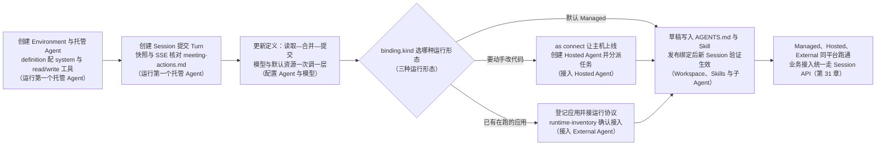
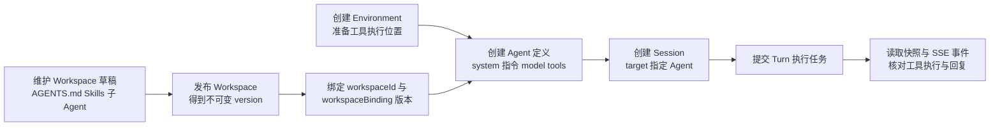

# 第 30 章 创建并运行托管 Agent

> 本章导读：第 29 章你在浏览器里创建了第一个 Agent 并收到回答，但应用没法复现浏览器里的点击。本章改用 curl 把"创建托管 Agent、启动会话、提交任务、核对文件工具的执行结果"完整做一遍，并建立全书后续章节复用的 API 身份变量。跑通主线后按配置纵深展开：先用 Agent 定义与模型配置完善这个 Agent，再用 Workspace 把可共享的指令、Skills 与子 Agent 以版本化方式接入定义；然后处理另外两类运行类型——把电脑或服务器上的 Coding Agent 连接为 Hosted Agent，把已经运行中的应用注册为 External Agent 并接入运行协议。读完本章，你可以让一个 Managed Agent 真正跑起来，并把已有应用（External）或 Coding Agent（Hosted）接入同一平台。API 全表与参数明细集中在章末"参考速查"，正文只保留最小可运行路径。

> **注意**：本章命令基于 `2.1.0-BETA1` 预发布版本，用于生产前请验证实际部署。其中 Hosted Agent、External Agent 与 Workspace 相关内容属于预览文档，正式版本尚未发布，可能调整。



*本章操作流程图*

## 运行第一个托管 Agent

上一章你已经用 Console 完成过一次"创建 Agent—提交任务—收到回答"。本节用 curl 重做一遍，并多走一步：让 Agent 把整理结果写入文件、再读回来核对——工具是否真正执行，要以文件内容为准。用 curl 创建的是一个基于 HarnessAgent 的托管 Agent，让它整理会议记录、写入文件并读取核对。Service 负责运行 Agent，你只需配置它并通过 Session API 提交任务。

从创建配置到提交任务的整体流程如图 30-1 所示。



*图 30-1：托管 Agent 从配置到使用的流程*

### 准备

先完成第 29 章"部署 AgentScope Service"的 Docker Compose 部署，配置模型凭据，并启用 `BUILDER_ALLOW_LOCAL_ENVIRONMENT=true`。终端需要 Bash、curl 和 jq；请在同一个 Bash 终端中依次执行下面的命令。

设置 Service 地址、平台用户 token 和有权限的空间。已有团队平台的用户可以使用管理员提供的配置。

```bash
set -euo pipefail
export BASE_URL="http://localhost:18080"
export TOKEN="YOUR_USER_TOKEN"
export TENANT="YOUR_TENANT"
export NAMESPACE="YOUR_NAMESPACE"
```

#### 还没有用户 token？登录并查询空间

输入平台账号和密码。首次部署使用 `admin`，密码以 `.env` 或 Profile 中修改后的值为准。

```bash
read -r -p "Username: " LOGIN_USER
read -r -s -p "Password: " LOGIN_PASSWORD
printf '\n'

LOGIN_JSON=$(
  jq -n --arg username "$LOGIN_USER" --arg password "$LOGIN_PASSWORD" \
    '{username: $username, password: $password}' \
  | curl -sS --fail-with-body "$BASE_URL/api/auth/login" \
      -H "Content-Type: application/json" \
      --data-binary @-
)
unset LOGIN_PASSWORD
TOKEN=$(jq -er '.token' <<< "$LOGIN_JSON")

curl -sS --fail-with-body "$BASE_URL/api/v1/me/namespaces" \
  -H "Authorization: Bearer $TOKEN" \
  | jq '.items[] | {tenant, name}'
```

从结果中选择一个空间，将它的 `tenant` 和 `name` 分别填入前面的 `TENANT` 和 `NAMESPACE`。平台 token 用于管理资源；应用调用凭据见第 31 章"通过 Session API 接入应用"。

### 1. 创建执行环境

创建一个 Local Environment，文件工具将在 Dataplane 容器内执行。如果已有可用环境，直接设置 `ENVIRONMENT_ID` 并跳过此请求；其他类型见第 29 章"Environments：配置执行位置"一节。

```bash
ENVIRONMENT_JSON=$(
  curl -sS --fail-with-body "$BASE_URL/api/environments" \
    -H "Authorization: Bearer $TOKEN" \
    -H "X-AgentScope-Tenant: $TENANT" \
    -H "X-AgentScope-Namespace: $NAMESPACE" \
    -H "Content-Type: application/json" \
    --data-binary @- <<'JSON'
{
  "name": "Quickstart local",
  "type": "local",
  "config": {}
}
JSON
)
ENVIRONMENT_ID=$(jq -er '.id' <<< "$ENVIRONMENT_JSON")
```

### 2. 创建 Agent

创建"资料助手"，使用部署的默认模型，只启用文件读取和写入工具。`binding.kind` 为 `managed`，执行环境由 `defaultEnvironmentId` 指定。

```bash
AGENT_JSON=$(
  curl -sS --fail-with-body "$BASE_URL/api/v1/agents" \
    -H "Authorization: Bearer $TOKEN" \
    -H "X-AgentScope-Tenant: $TENANT" \
    -H "X-AgentScope-Namespace: $NAMESPACE" \
    -H "Content-Type: application/json" \
    --data-binary @- <<JSON
{
  "tenant": "$TENANT",
  "namespace": "$NAMESPACE",
  "agentKey": "notes-assistant-api",
  "displayName": "资料助手",
  "binding": { "kind": "managed" },
  "definition": {
    "name": "资料助手",
    "system": "根据会议记录整理待办，保留事实，缺失信息标为待确认。写入文件后读取核对，并在最终回复中给出文件内容。",
    "defaultEnvironmentId": "$ENVIRONMENT_ID",
    "tools": [{
      "type": "agent_toolset",
      "defaultConfig": { "enabled": false },
      "configs": [
        { "name": "read", "enabled": true, "permissionPolicy": { "type": "always_allow" } },
        { "name": "write", "enabled": true, "permissionPolicy": { "type": "always_allow" } }
      ]
    }]
  }
}
JSON
)
AGENT_ID=$(jq -er '.agent.id' <<< "$AGENT_JSON")
printf 'Agent ID: %s\n' "$AGENT_ID"
```

保存返回的 `AGENT_ID`，后续会话都可以复用它。再次创建不同 Agent 时，请更换 `agentKey`。示例允许直接读写文件，工具权限配置见第 31 章"权限与人工确认"一节。

### 3. 创建会话

创建一个引用该 Agent 的 Session，用来保存消息与执行记录。会话创建后还需提交任务，Agent 才会开始工作。

```bash
SESSION_JSON=$(
  curl -sS --fail-with-body "$BASE_URL/api/v1/agent-sessions" \
    -H "Authorization: Bearer $TOKEN" \
    -H "X-AgentScope-Tenant: $TENANT" \
    -H "X-AgentScope-Namespace: $NAMESPACE" \
    -H "Content-Type: application/json" \
    --data-binary @- <<JSON
{
  "target": {
    "type": "agent",
    "id": "$AGENT_ID"
  }
}
JSON
)
SESSION_ID=$(jq -er '.id' <<< "$SESSION_JSON")
export SESSION_URL="$BASE_URL/api/v1/agent-sessions/$SESSION_ID"
printf 'Session ID: %s\n' "$SESSION_ID"
```

### 4. 提交任务

向会话提交消息，创建一个 Turn。

```bash
TURN_JSON=$(
  curl -sS --fail-with-body "$SESSION_URL/turns" \
    -H "Authorization: Bearer $TOKEN" \
    -H "Content-Type: application/json" \
    -H "Idempotency-Key: notes-check-001" \
    --data-binary @- <<'JSON'
{
  "message": "小李周五完成安装说明，下周一评审，具体时间待确认。请整理待办，写入 meeting-actions.md，再读取核对，并给出文件内容。"
}
JSON
)
TURN_ID=$(jq -er '.id' <<< "$TURN_JSON")
jq '{id, status}' <<< "$TURN_JSON"
```

请求返回 `202 Accepted` 表示任务已接收。网络重试时保留同一 `Idempotency-Key` 和消息；新的任务使用新 key。

### 5. 查看进度和结果

先读取快照，查看已有消息、工具结果和任务状态：

```bash
SNAPSHOT=$(
  curl -sS --fail-with-body "$SESSION_URL/snapshot" \
    -H "Authorization: Bearer $TOKEN"
)
jq '{items, tools, turns, required_actions}' <<< "$SNAPSHOT"
CURSOR=$(jq -er '.as_of' <<< "$SNAPSHOT")
```

如果任务仍在执行，从快照的 `as_of` 继续接收 SSE 事件：

```bash
curl -sS --fail-with-body -N -G "$SESSION_URL/events/stream" \
  -H "Authorization: Bearer $TOKEN" \
  --data-urlencode "after=$CURSOR"
```

看到对应 `TURN_ID` 的 `turn.completed` 后，按 Ctrl-C 退出事件流，再查询最终结果。关闭事件流不会取消任务。

```bash
curl -sS --fail-with-body "$SESSION_URL/turns/$TURN_ID" \
  -H "Authorization: Bearer $TOKEN" \
  | jq '{id, status, error}'

curl -sS --fail-with-body "$SESSION_URL/snapshot" \
  -H "Authorization: Bearer $TOKEN" \
  | jq '{items, tools, required_actions}'
```

确认 Turn 的 `status` 为 `completed`，工具记录包含 `meeting-actions.md` 的写入和读取，最终回复保留周五完成、下周一评审以及"具体时间待确认"。文件保存在执行环境中；下载与 Artifact 发布见第 31 章"文件与产物"。

若状态为 `failed`，检查 `error`；若为 `requires_action`，查看快照中的 `required_actions`。处理方式见第 31 章"会话、任务与预算"。

### 下一步

保留 `AGENT_ID`——下一节就从它开始，把这条最小可用的配置调教到位。应用接入、SSE 与事件续传、工具与 MCP 的声明都见第 31 章。

## 配置 Agent 与模型

上一节的"资料助手"只有一条 `system` 指令和两个文件工具。真实任务很快会提出更多要求：换用指定模型、控制迭代次数、给新会话配上默认的知识来源和工具凭据。这些设置都保存在 Agent 的**定义**（definition）中——就是你在第 2 步 POST 请求里传出的那个 `definition` 对象。本节先说明如何读取和修改定义，再介绍模型与运行资源的配置。

会话所需的运行资源可以继承 Agent 默认值，也可以在创建 Session 时显式选择；Dataplane 部署配置则由服务管理员维护。需要访问外部系统时，按第 31 章"工具、MCP 与权限"声明连接并绑定工具；需要复用处理方法时，用本章最后的 Workspace 提供指令和技能。每次保存后都要创建新的 Session，验证这些配置是否真正用于任务执行。

### 读取与更新定义

四个操作覆盖定义的全部维护：`POST /api/v1/agents` 创建身份、定义和运行绑定（上一节已经用过，提供 `agentKey`、空间、`binding:{kind:"managed"}` 和 `definition`，返回 `agent,binding,policy,definition`）；`GET /api/v1/agents/{id}/definition` 读取定义，返回 `agentId` 与 `definition`；`PATCH /api/v1/agents/{id}/definition` 更新定义，顶层传行为字段和当前定义的 `version`，`name` 必填，返回 `agent,definition`；`GET /api/v1/agents/{id}/versions` 与 `GET /api/v1/agents/{id}/versions/{version}` 分别返回 `versions`、`version`，并包含 `agentId`。完整请求字段见章末"参考速查"。

这些接口使用平台 Bearer token 和已授权 Namespace。创建时的行为字段位于 `definition` 中；更新时直接放在请求顶层。目录 `agent.version` 与 `definition.version` 分别控制各自更新，不能混用。

你在上一节已经用过定义里的 `name`、`system`、`defaultEnvironmentId` 和 `tools` 四个字段。完整字段表——包括 `model`、`maxIters`、Workspace 绑定和各类默认资源 ID——见章末"参考速查"。这里先记住两条规则：`system` 保存稳定职责与行为规则，不保存 secret；`maxIters` 控制推理/工具迭代上限，未配置或非正值时按 20 保存，它不是 token 预算，控制台表单范围也不代表 API 校验范围。

定义更新不是任意字段的局部合并。应读取原定义、保留未修改的可写字段，再发出 PATCH，避免清空其他人配置的工具或资源。以下例子沿用本章"运行第一个托管 Agent"的环境变量，仅修改 system：

```bash
DEFINITION=$(curl --fail-with-body -sS "$BASE_URL/api/v1/agents/$AGENT_ID/definition" \
  -H "Authorization: Bearer $TOKEN" \
  -H "X-AgentScope-Tenant: $TENANT" -H "X-AgentScope-Namespace: $NAMESPACE")
UPDATED=$(printf '%s' "$DEFINITION" | jq '.definition | {
  name, description, system, model, maxIters, tools, mcpServers, skills, multiagent,
  workspaceId, workspacePath, workspaceBinding, defaultEnvironmentId,
  defaultVaultIds, defaultMemoryStoreIds, version
} | .system = "Read supplied sources. Cite evidence and list open questions."')
curl --fail-with-body -sS -X PATCH "$BASE_URL/api/v1/agents/$AGENT_ID/definition" \
  -H "Authorization: Bearer $TOKEN" -H 'Content-Type: application/json' \
  -H "X-AgentScope-Tenant: $TENANT" -H "X-AgentScope-Namespace: $NAMESPACE" \
  --data "$UPDATED"
```

有 Workspace 绑定时，指令和工具覆盖还需遵循 `workspaceBinding.overrides` 与 `instructions` 的规则。Agent key 是目录中的稳定身份，不通过改显示名称来迁移。

### 默认模型与显式模型

标准 Dataplane 包含 DashScope 模型扩展。管理员在 Dataplane 进程或容器中提供 `DASHSCOPE_API_KEY`，通过 `BUILDER_MODEL_NAME` 选择默认模型；标准配置默认值是 `qwen-max`。修改部署变量后需要重启相应组件。

Agent 的 model 留空时使用默认 Model；显式 `dashscope:qwen-max` 通过模型注册表解析。其他 provider 需要发行包包含相应扩展并配置凭据，仅改模型名称不会安装扩展。模型连接、用户登录与 Vault 工具凭据各有用途。

四种接入方式对应四份准备工作：

| 接入方式 | 需要准备什么 |
| --- | --- |
| 标准 DashScope 默认模型 | 在 Dataplane 配置 `DASHSCOPE_API_KEY` 与默认模型 |
| 显式 DashScope 模型 | 使用 `dashscope:model-name`；部署内有 DashScope 扩展与凭据 |
| 其他 ModelProvider | 自定义 Dataplane 发行包包含对应模型扩展，并配置该 provider 的连接与认证 |
| 自定义模型对象 | 在自定义 Dataplane 中提供 `Model` bean 作为默认值，或用 `ModelRegistry` 注册命名模型/工厂 |

Java SDK 提供 OpenAI 及兼容接口、Anthropic、Gemini、Ollama 等模型扩展（见第 21 章）。它们属于可集成能力；标准 Service 镜像不因 SDK 存在扩展就自动包含全部 provider。模型需要支持任务使用的工具调用和输入类型。

### 资源如何关联到 Agent 和 Session

Workspace、Environment、Memory 和 Vault 都是可以复用的资源，但它们进入 Agent 运行过程的方式不同。Workspace 的发布内容被解析到 Agent 定义中，决定指令、技能和工具配置；Environment、Memory 和 Vault 则作为运行资源，由每个 Session 选择。把资源创建出来，只代表平台已经能够管理它，还需要完成下面的关联才能在任务中使用。

| 资源 | Agent 定义中的关联 | Session 中的选择 |
| --- | --- | --- |
| Workspace | `workspaceId` 与 `workspaceBinding.version` 选择发布版本 | 通过 `target` 选择 Agent 定义版本，间接取得其中的 Workspace 内容 |
| Environment | `defaultEnvironmentId` 指定默认执行环境 | `environmentId` 可以为本次会话选择其他环境 |
| Memory Store | `defaultMemoryStoreIds` 指定默认知识来源 | `memoryStoreIds` 可以替换本次会话的 Store 列表 |
| Vault | `defaultVaultIds` 指定默认工具凭据集合 | `vaultIds` 可以替换本次会话的 Vault 列表 |

Agent 的默认资源用于创建新会话，不会在修改定义后自动替换已有 Session 的选择。Session 保存的是资源 ID，不能因此把资源本身当成不可变快照：Memory 文档可以继续更新，Vault 凭据可以轮换，Environment 配置也可以被维护。只有 Workspace 发布内容随 Agent 定义版本固定下来。修改共享资源本身时，应同时考虑其他引用它的 Agent 和 Session。

#### 设置 Agent 的默认资源

先在相应资源页面创建 Environment、Memory Store 或 Vault，并取得它们返回的 ID。下面示例将三类资源设为已有 Managed Agent 的默认值；把 JSON 中的占位值换成实际 ID，保存为 `resource-defaults.json`。如果只想修改其中一类，文件中只保留对应字段即可。省略的字段会由下面的命令保留原值；列表中的 ID 则表示完整的默认集合，空数组会清空该类默认绑定。

```json
{
  "defaultEnvironmentId": "YOUR_ENVIRONMENT_ID",
  "defaultMemoryStoreIds": ["YOUR_MEMORY_STORE_ID"],
  "defaultVaultIds": ["YOUR_VAULT_ID"]
}
```

沿用本章"运行第一个托管 Agent"的 `AGENT_ID` 和平台身份变量。命令先读取完整定义，保留其他可写字段，再合入资源默认值并提交定义版本，因此不会因为只修改资源而清空工具或指令。

```bash
CURRENT=$(curl --fail-with-body -sS "$BASE_URL/api/v1/agents/$AGENT_ID/definition" \
  -H "Authorization: Bearer $TOKEN" \
  -H "X-AgentScope-Tenant: $TENANT" -H "X-AgentScope-Namespace: $NAMESPACE")
UPDATED=$(printf '%s' "$CURRENT" | jq --slurpfile resources resource-defaults.json '
  .definition | {
    name, description, system, model, maxIters, tools, mcpServers, skills, multiagent,
    workspaceId, workspacePath, workspaceBinding, defaultEnvironmentId,
    defaultVaultIds, defaultMemoryStoreIds, version
  } | . + ($resources[0] | with_entries(select(
    .key == "defaultEnvironmentId" or .key == "defaultMemoryStoreIds" or .key == "defaultVaultIds"
  )))')
curl --fail-with-body -sS -X PATCH "$BASE_URL/api/v1/agents/$AGENT_ID/definition" \
  -H "Authorization: Bearer $TOKEN" -H 'Content-Type: application/json' \
  -H "X-AgentScope-Tenant: $TENANT" -H "X-AgentScope-Namespace: $NAMESPACE" \
  --data "$UPDATED" \
  | jq '.definition | {version, defaultEnvironmentId, defaultMemoryStoreIds, defaultVaultIds}'
```

保存成功后，检查返回的资源 ID 和新定义版本，再创建新的 Session。若返回 `409 Conflict`，说明定义在读取后又被修改，应重新读取并核对后再提交。默认绑定只决定运行时可以使用哪些资源；工具是否启用、是否需要确认，以及外部服务是否授予访问权限，仍按各自配置生效。

控制台中，可以在 Managed Agent 的 **Runtime configuration → Session defaults** 选择相同的默认资源。Workspace 则在 **Definition → Workspace** 中绑定发布版本。创建新会话时检查资源选择，便能确认本次使用默认值还是另行选择的资源。

### 会话资源如何选择

通过 `POST /api/v1/agent-sessions` 创建会话时，使用 `target` 指定要运行的 Agent，并按需选择本次会话的资源：

| 字段 | 用途 |
| --- | --- |
| `target` | 使用 `{type:"agent", id:"AGENT_ID"}` 选择 Agent；可通过 `version` 指定定义版本 |
| `environmentId` | 本次会话工具环境；省略时使用 Agent 默认绑定 |
| `memoryStoreIds` / `vaultIds` | 会话知识与凭据资源；省略继承默认，空数组表示不挂载该类默认资源 |

```json
{
  "target": {"type": "agent", "id": "YOUR_AGENT_ID"},
  "environmentId": "YOUR_ENVIRONMENT_ID",
  "memoryStoreIds": ["YOUR_MEMORY_STORE_ID"],
  "vaultIds": []
}
```

创建响应包含 Session 的 `id`，随后可以向该 Session 提交 Turn。资源需对当前身份可用；不要把 Environment key 用作用户 Bearer token。

通过 Session API 创建会话时，Service 固定当时的 Agent 定义和运行配置。更新定义后创建新的 Session，已有会话继续使用自己的版本；需要调整当前会话的环境、Memory 或 Vault 时，使用该 Session 的 PATCH 接口，并遵守相应资源的访问权限。

### 一次调整一个层次

先用默认模型验证文本请求，再调整职责和迭代上限；随后绑定 Workspace、Environment、Memory 和 Vault，逐项检查工具行为。模型解析错误应检查 provider 与部署，工具等待应检查 Environment 或待确认事项；增加 `maxIters` 不能修复连接故障。

> **延伸阅读**：定义 API 全表与 Agent 定义参数全表见本章末"参考速查"；工具与 MCP 声明、权限配置、会话输入与预算、SSE 事件续传见第 31 章。

## 三种运行形态：Managed、Hosted、External

到此为止你创建的都是 Managed Agent——由平台 Dataplane 运行。但有些工作它不合适：真正操作代码仓库、在终端跑构建测试，需要现成的 Coding Agent；反过来，你们团队可能已经有一个运行中的 Agent 应用，推倒重来同样不必要。Service 为此提供三种运行形态，创建 Agent 时通过 `binding.kind` 选择：

| | Managed | Hosted | External |
|---|---|---|---|
| 谁运行 | 平台 Dataplane | 平台派发到 Runtime Host 主机上的 Coding Agent | 你自己——进程、框架、部署都保留 |
| 典型用途 | 客服、知识问答、业务流程等通用任务 | 代码审查、构建修复、仓库操作 | 接入已有的自建 Agent 应用，保留现有运维 |
| 怎么接入 | `binding.kind: "managed"`（本章前两节） | 主机装 `as` CLI 连接平台，Agent 指向 Runtime Profile/Pool | 应用调 SDK 注册，保持心跳并接任务 |
| 能力来源 | definition + Workspace + Environment，能力最全 | provider 能力声明决定（指令/Skills/工具映射有差异） | 应用上报的 capabilities 决定 |

三条经验法则：**默认 Managed**——能力最全、运维最省；**要动手改代码就 Hosted**——让现成的 Coding Agent 干它擅长的事，但接受能力受 provider 限制；**已有在跑的应用就 External**——不为接入平台而重写部署。三种形态都通过同一套 Session API 调用（第 31 章），业务应用换形态不用改接入代码。

注意两组容易混的概念：Hosted 的 Runtime Host **不是** Managed Agent 的 self_hosted 工具 Worker（后者是工具执行的外包，见第 12 章），也不等于部署整个 Service；External 与"某框架同名集成"也不是一回事——例如 Claude Agent SDK 集成与 Runtime Host 启动 Claude Code CLI 是两条路径。

接下来两节分别走通 Hosted 与 External 的接入；只需要 Managed 的读者可以直接跳到"Workspace、Skills 与子 Agent"。

## 接入 Hosted Agent：把 Coding Agent 接上平台

Managed Agent 由平台的 Dataplane 运行，但有一类工作它不擅长：真正操作代码仓库、在终端里跑构建和测试。这类任务需要 Coding Agent。**Hosted Agent 就是把电脑或服务器上的 Coding Agent 接入平台的运行类型**：Runtime Host（运行在安装了 Coding Agent 的主机上的守护进程）负责启动 provider、准备工作目录和回报执行结果，应用通过 Session API 调用这个 Agent，也可以把它作为 Team 或 Workflow 的执行成员。

主机接入只需准备一次。之后创建多个 Hosted Agent、设置职责和分派工作，都可以通过 API 完成，不需要每个 Agent 单独安装一个 Host。Hosted 可以独立调用，也可以加入 Managed Lead 协调的团队。Runtime Host 运行 Coding Agent provider；它不是 Managed Agent 的 self_hosted 工具 Worker，也不等于部署整个 Service。先按第 29 章完成平台准备；它与 Managed 的职责边界、与其他 Agent 类型的组合方式见本章末延伸阅读。

### 先让执行主机上线

在目标主机安装并登录要使用的 provider，确认它本身能够完成一次请求，再使用 Go 1.26 或更新版本，通过 `go install` 安装 `v2.1.0-BETA1` 的 CLI 与 Runtime Host，按第 29 章"Runtime Host 安装与运维"配置 PATH，然后连接：

```bash
as connect https://agentscope.example.com
as runtime status
as runtime probe
```

CLI 帮你完成身份交换、保存本机配置和启动守护进程。需要自动化接入服务器时，可由有权限的平台账户调用 `POST /api/v1/runtime-host-enrollment-tokens`，传入 `tenant`、`namespace` 获取短期 `enrollmentToken`，交给目标主机的 `AGENTSCOPE_ENROLLMENT_TOKEN` 后再执行 connect。主机身份交换和运行协议也有 API，普通业务应用无需自行实现这些守护进程逻辑。

### 查询可用运行环境

以下示例使用有权管理目标 namespace 的平台账户令牌 `TOKEN`。将 Service 地址和范围替换为你的实际配置：

```bash
export SERVICE_URL="http://localhost:8081"

curl -sS "$SERVICE_URL/api/v1/agents/runtime-options?tenant=default&namespace=default" \
  -H "Authorization: Bearer $TOKEN"
```

响应中的 `runtimes` 是可选运行环境，每项包含 `provider`、`runtimeProfileId`、`runtimePoolId`、`hostCount` 和 provider 声明的能力。选择符合任务要求的一项，保存两个 ID。`profiles` 和 `pools` 同时返回配置详情，分别表示如何启动 provider、以及到哪组主机执行。

如果 `runtimes` 为空，先检查 Host 是否在线、provider 是否被成功探测。也可以通过下面的接口查看主机状态：

```bash
curl -sS "$SERVICE_URL/api/v1/runtime-hosts?tenant=default&namespace=default" \
  -H "Authorization: Bearer $TOKEN"
```

支持的 provider 及 Workspace、工具和恢复能力差异，见下文"选择运行类型"。

### 创建 Hosted Agent

创建 Agent 时使用统一的 `POST /api/v1/agents`，将运行绑定设为 `hosted-runtime`。`definition` 描述名称、指令等 Agent 能力；profile 和 pool 决定它如何、在哪里执行。

将请求中的两个占位值替换为上一步返回的 UUID：

```bash
curl -sS "$SERVICE_URL/api/v1/agents" \
  -H "Authorization: Bearer $TOKEN" \
  -H 'Content-Type: application/json' \
  -d '{
    "tenant": "default",
    "namespace": "default",
    "agentKey": "code-reviewer",
    "displayName": "代码审查助手",
    "binding": {
      "kind": "hosted-runtime",
      "configuration": {
        "runtimeProfileId": "<runtime-profile-id>",
        "runtimePoolId": "<runtime-pool-id>"
      }
    },
    "definition": {
      "name": "代码审查助手",
      "system": "依据提供的材料进行代码审查，说明证据和建议，不擅自修改文件。"
    }
  }' > hosted-agent.json
```

响应返回 `agent`、`binding`、`policy` 和 `definition`。后续使用 `agent.id` 引用该 Agent。示例未指定 model，交给 provider 的默认配置；其他定义字段是否能够应用到原生 provider，应以它的能力声明为准。

```bash
AGENT_ID=$(jq -r '.agent.id' hosted-agent.json)

curl -sS "$SERVICE_URL/api/v1/agents/$AGENT_ID" \
  -H "Authorization: Bearer $TOKEN"

curl -sS "$SERVICE_URL/api/v1/agents/$AGENT_ID/bindings" \
  -H "Authorization: Bearer $TOKEN"
```

需要调整指令时使用 `PATCH /api/v1/agents/{agentId}/definition`；provider 执行选项位于 `GET/PATCH /api/v1/agents/{agentId}/hosted-settings`，字段说明见下文"更新 Agent 定义与运行设置"。

### 分派工作并读取结果

先通过 Issue API（见第 33 章"工作分派、审批与验收"）创建一项只读任务，设置 `assigneeType: "agent"`、`assigneeRef: agent.id`。例如在描述中提供 README 文本，请 Agent 给出三条文档改进建议。平台会创建 AgentTask 并异步派发，不需要业务代码直接调用 Host 的领取接口。

从 Issue、任务和 ExecutionAttempt 查询执行状态，读取结果评论与 Artifact。任务工作目录由 Host 准备，本机已经打开的 Git 仓库不会自动成为任务输入；需要读取项目时，要显式关联 provider 支持的 Workspace，或提供资料。

单任务验证通过后，可以将 Agent 加入 Team，也可以直接创建以它为目标的 Session。Hosted 对话支持的交互由 provider 与平台适配决定，不能假定它具有 Managed 的全部输入、审批或 checkpoint 能力。调用前读取 Session 和 Turn 的 capabilities，接入方式见第 31 章"通过 Session API 接入应用"。

### 工作目录与交付边界

任务目录由 Runtime Host 管理，不会默认使用你正在编辑的 Git checkout。仓库、分支和输入资料需要明确准备；共享结果应上传为 Artifact。Host 在线不代表 provider 已登录、工具获准或任务能够执行。

Workspace 的指令、Skills 与工具按 provider 能力映射；工具依赖和第三方登录仍在目标主机准备。原生 provider 会话恢复与统一 Turn 的恢复命令不同，显示交互操作前读取调用的 capabilities。

> **延伸阅读**：部署准备与 Runtime Host 职责边界见第 29 章；Hosted 加入多 Agent 组合见第 32 章；Console 入口与操作流程见第 33 章"创建并配置 Agent"；将 Coding Agent 发布为业务能力的示例见第 34 章"从故障告警生成可审查的修复"。

### 深入运行配置：Host、Profile 与 Agent 的分工

最简形式的 `as connect` 让主机上了线，但连接本身还有一批可调参数；Agent 创建之后，运行参数也可能要改。调整配置时，需要先确定设置应当作用于哪一层：Host 的连接参数决定主机接入哪个 Service、暴露哪些 provider，以及允许多少并发执行；Runtime Profile 保存某个 provider 的运行参数；Agent 则在此基础上设置自己的职责和模型覆盖。按这个范围保存配置，可以让共享主机的多个 Agent 复用运行环境，同时保留各自的行为设置。主机安装和日常维护见第 29 章"Runtime Host 安装与运维"。

### 连接参数

```bash
as connect https://agentscope.example.com \
  --providers codex,qoder \
  --pool coding-default \
  --capacity 1
as runtime probe
```

示例只发现并暴露所选 provider；对应 CLI 必须已安装、登录并可执行。

| `connect` 参数/配置 | 含义 |
| --- | --- |
| URL 或 `--server` | 主机可访问的 Service HTTP 地址 |
| `--providers` | `auto` 或逗号分隔的 `codex,claude-code,qoder,qwenpaw,openclaw` |
| `--pool` | Runtime Pool 名称，默认 `coding-default` |
| `--capacity` | Host 最大并发执行数，默认 1 |
| `--workspace-root` | 任务目录根路径 |
| `--state-root` | Host 身份及持久执行状态目录 |
| `--runtime-host-binary` | `agentscope-runtime-host` 可执行文件路径 |
| `AGENTSCOPE_ENROLLMENT_TOKEN` | 初次连接用的短期 enrollment 凭据 |
| `AGENTSCOPE_RUNTIME_TOKEN` | 已有 Runtime Host 凭据 |
| `AGENTSCOPE_RUNTIME_CONFIG` | 覆盖本地配置文件路径 |

默认配置在 `~/.agentscope/runtime-host/config.json`。其中 `controlPlane`、`tenant`、`namespace`、`pool`、`capacity`、`workspaceRoot`、`stateRoot` 与 `providers` 描述连接；`credential` 是身份凭据，不复制进公共示例。修改已运行 Host 的设置前先检查活跃工作，更新后重启并再次 probe。

### Agent 与 Profile 的分工

Agent 的 `system` 定义职责，`model` 提供可选模型覆盖。Model 非空时优先于 Profile 的 `model`；两者都为空时使用 provider 自己的默认配置。

`runtimeProfileId` 选择 provider 配置，`runtimePoolId` 选择可承载执行的主机池。通过 `runtime-options` 选择已发现的 Runtime，管理员再维护 Profile 和池。只增加 Host capacity 不等于增加模型额度或消除 Agent/任务策略限制。

### 更新 Agent 定义与运行设置

Hosted Agent 的管理接口与 Managed 同构：`POST /api/v1/agents` 创建（上一节的完整请求）、`GET/PATCH /api/v1/agents/{agentId}/definition` 读取与更新定义、`GET/PATCH /api/v1/agents/{agentId}/hosted-settings` 读取与更新运行设置、`GET /api/v1/agents/runtime-options` 发现可选 Runtime、`GET /api/v1/agents/{agentId}/versions` 查看定义历史。这些接口使用有权管理目标 namespace 的平台账户 Bearer；全表见章末"参考速查"。

创建时 `binding.configuration` 必须包含同一 scope 中的 `runtimeProfileId` 和 `runtimePoolId`，可选 `executionOverrides`。`definition` 与 Managed 使用同一格式，常用 `name`、`system`、`model`、`tools`、`mcpServers`、`skills`、`workspaceId`、`workspaceBinding`。字段能否作用到原生 provider 由其能力决定。更新定义前先读回完整配置并修改所需部分，避免把 PATCH 理解为任意字段都自动保留的浅合并。

运行设置的更新字段如下：

| 字段 | 用法 |
| --- | --- |
| `bindingVersion` | 必填，来自读取结果，用于并发更新检查 |
| `policyVersion` | 更新时带回当前策略版本，避免覆盖他人修改 |
| `runtimeProfileId`、`runtimePoolId` | 可选切换运行配置或主机池；省略时保留当前值 |
| `executionOverrides` | 可选，包含 `reasoningEffort`、`serviceTier`、`providerConfiguration`、`customArgs`；省略时保留当前覆盖 |
| `maxConcurrency` | 可选，0–50；0 不设置 Agent 级并发上限，执行仍受 Host 和其他策略限制 |

`providerConfiguration` 是对象，`customArgs` 是 argv 字符串数组；参数合法性与保留选项按 provider 检查。不要修改共享 Runtime Profile 来实现某一个 Agent 的专属偏好。

下面只调整并发，`AGENT_ID` 为已创建的 Agent UUID，`SERVICE_URL` 和 `TOKEN` 为管理连接配置：

```bash
curl -sS "$SERVICE_URL/api/v1/agents/$AGENT_ID/hosted-settings" \
  -H "Authorization: Bearer $TOKEN" > hosted-settings.json

jq '{bindingVersion: .settings.bindingVersion,
     policyVersion: .settings.policyVersion,
     maxConcurrency: 2}' hosted-settings.json > hosted-settings-update.json

curl -sS -X PATCH "$SERVICE_URL/api/v1/agents/$AGENT_ID/hosted-settings" \
  -H "Authorization: Bearer $TOKEN" \
  -H 'Content-Type: application/json' \
  --data-binary @hosted-settings-update.json
```

遇到版本冲突时重新读取并合并变更，再提交。

### 管理共享 Profile 与 Pool

`GET /api/v1/runtime-profiles` 和 `/runtime-pools` 使用 `tenant`、`namespace` 查询参数，返回 `items`。单个资源用 `/runtime-profiles/{name}` 或 `/runtime-pools/{name}` 查询，返回 `profile` 或 `pool`。

| 保存 API | JSON 字段 |
| --- | --- |
| `POST /api/v1/runtime-profiles` 或 `PUT /api/v1/runtime-profiles/{name}` | `tenant`、`namespace`、`name`、`provider`、可选 `runtime`、`configuration`、`requirements` |
| `POST /api/v1/runtime-pools` 或 `PUT /api/v1/runtime-pools/{name}` | `tenant`、`namespace`、`name`、可选 `hostSelector`、`configuration` |

PUT 路径中的 `name` 决定更新对象。提交完整的期望配置，成功后保存响应中的 UUID 供 Agent binding 引用。主机容量、暂停接收新工作及 enrollment 接口见第 29 章"主机接入与管理 API"一节。

### 选择运行类型

五种 provider 的接入形态各不相同，连接 Host 前先对照下表确认目标 provider 的可执行文件与执行方式：

| Provider 名称 | `--providers` 值 | 默认可执行文件 | 执行方式 |
| --- | --- | --- | --- |
| Codex | `codex` | `codex` | app-server 线程与事件 |
| Claude Code | `claude-code` | `claude` | CLI 流式 JSON |
| Qoder | `qoder` | `qodercli` | CLI 流式事件与控制请求 |
| QwenPaw | `qwenpaw` | `qwenpaw` | ACP Session |
| OpenClaw | `openclaw` | `openclaw` | `agent exec` |

安装 provider 本体并完成登录后，再连接 Host。以上是 Service 适配范围，不代表 CLI 二进制随 Service 发布包附带。

各 provider 在 Runtime Profile `configuration` 中的常用参数（这是 Profile 配置，不是 `connect` 参数，也不是所有 provider 通用的表单），以及指令、Skills、MCP 与 Subagent 映射到各 provider 的差异，见章末"参考速查"。provider 的模型名、推理档位和账号可用性以本机安装版本为准。Profile 保存参数并不会替你安装模型、登录账号或授予外部工具权限。

### 定义与参数冲突

Host 将可移植指令、技能和支持的 MCP/工具定义转换为 provider 配置。若 Workspace 要求 provider 不支持的能力，执行前会拒绝；不要把能力错误当作"可以忽略的提示"。详细差异见章末"参考速查"。

自定义参数以 argv 项传递；工作目录、模型、输出协议、MCP 配置和权限相关的保留参数不能随意覆盖。配置 Codex 原生工具时使用 Profile sandbox/审批语义，不能直接复用 Managed 内置工具策略。

### 从 API 获取当前主机的能力

映射表用于理解映射方式，实际可用项以主机上报为准。用平台账户 Bearer 请求：

```bash
curl -sS "$SERVICE_URL/api/v1/agents/runtime-options?tenant=default&namespace=default" \
  -H "Authorization: Bearer $TOKEN"
```

在返回的 `runtimes` 中选择 provider；每项提供 `provider`、`version`、`runtimeProfileId`、`runtimePoolId`、`hostCount` 和 `capabilities`。能力对象包含 `instructions`、`workspace`、`skills`、`subagents`、`tools`、`shell`、`mcp`、`model`、`customArgs`、`approval` 和 `resume`。除 `resume` 为布尔值外，能力项通过 `supported`、`mode`、`target` 说明是否支持及如何映射。

可以从 `GET /api/v1/runtime-hosts?tenant=...&namespace=...` 返回的 `items[].capabilities` 查看各 Host 的 provider 版本和描述。创建 Agent 时，把选项的 profile/pool UUID 写入 binding；更新 provider 专属参数使用 `/api/v1/agents/{agentId}/hosted-settings`，字段见本节上文。

这里的 `resume` 描述 provider 的原生会话恢复，不直接等于应用可以执行的 Turn 恢复命令。应用应读取 Session 和 Turn 的 capabilities，只有 `available_commands` 明确列出某项操作时才显示对应按钮。

> **延伸阅读**：Hosted Agent 管理 API 全表、Provider 参数表与"可移植定义如何生效"差异表见本章末"参考速查"；主机接入与日常运维见第 29 章。

## 接入 External Agent：登记、验证与 SDK

Hosted 把 Coding Agent 接了进来，但如果你们团队已经有一个运行中的 Agent 应用——由你部署和运维——推倒重来并不必要。可以把它注册为 **External Agent**：应用继续由你部署和运维，Service 为它分配统一的 `agentId`，用这个身份加入 Team、接受任务，或通过 Session API（见第 31 章）供业务调用。

接入分为两件事：**登记 Agent 和实例**，以及**让实例真正接收请求、执行任务并反馈结果**。单独完成注册请求不会把任意 HTTP 服务自动变成可调度的 Agent。

External 可以单独接受 Session 调用，也可以为 Managed 团队提供已有业务能力，无需先创建 Team。先完成平台准备，再按本节登记应用并验证运行接入。需要实现或检查接入适配时，查阅下一节"External SDK 与运行协议"；验证通过后，再将它加入协作（见章末延伸阅读）。

### 登记应用与实例

准备 Service 地址、目标 `tenant` / `namespace`、应用名称 `agentKey` 和当前副本的 `instanceKey`。同一个应用的多个副本共用 `agentKey`，分别使用不同的 `instanceKey`；同一副本重启时保留自己的 key。

下面用 curl 展示注册协议。示例只登记身份，因此没有宣告执行能力；接入 SDK 后，应由适配器上报实际实现的能力。

```bash
export SERVICE_URL="http://localhost:8081"

curl -sS "$SERVICE_URL/api/v1/agent-registrations" \
  -H 'Content-Type: application/json' \
  -d '{
    "tenant": "default",
    "namespace": "default",
    "agentKey": "report-service",
    "displayName": "报告助手",
    "instanceKey": "replica-1",
    "framework": "agentscope-java",
    "routingKey": "http://report-agent:18090",
    "capacity": 1,
    "capabilities": []
  }' > registration.json
```

`routingKey` 是控制面能够访问的应用合约地址。容器里的 `localhost` 通常不能代表另一个容器中的应用。

响应包含 `agent`、`binding`、`instance` 和 `registrationCredential`。保存 `agent.id` 作为后续创建 Team 和 Session 的引用；SDK 建立运行连接时还需要 `binding.id`、`instance.id`、`instance.generation` 和注册凭据。不要把返回的凭据或完整响应放进前端页面。

> **注意**：当前预览版本的注册接口不校验调用者身份；传入 Bearer token 也不会使这一步获得身份校验，Header 中的 token 同样不参与校验。部署时应在受控接入网络或网关内开放此接口。返回的 registration credential 用于后续运行连接，不能把它理解为注册入口已经具备访问控制，后续运行连接的凭据校验也不能替代注册入口保护。不要把 `ownerRef`、scope 参数或 capability 声明当作身份验证。

### 让实例接入运行协议

正式接入通常由 SDK 完成注册、心跳和运行协议交互，不需要应用每次启动都手写上面的 curl。

Java 应用使用 `agentscope-extensions-controlplane`，通过 `ControlPlane.instrument(agent, config)` 获得 `SessionBridge`。配置 Service HTTP 地址、范围、稳定的实例 key，以及可访问的应用合约地址。完整依赖和接入片段见下文"Java：添加 HTTP 注册与合约"。HTTP 注册与合约负责目录、查询和适配器支持的命令；接收平台派发的 AgentTask 还需要配置 `AgentTaskStarter`，并连接当前 Java SDK 支持的 ASDP 运行通道。退出应用时关闭 bridge。

Python 的 `agentscope_service.instrument()` 支持 HTTP 运行传输（`transport="http"`，使用 `control_plane_http`），也支持显式选择 gRPC。任务入口由框架适配器的 `handle_agent_task` 实现。选择适配器时先查看章末"参考速查"的"Python 内置适配器"表，确认所需的命令、事件和任务能力确实可用。

注册请求中的 `capabilities` 是能力声明，不会替你实现执行逻辑。例如，`agent-task` 表示接收平台任务；Java 适配器配置任务 starter 后才声明它，Python 适配器则根据实际任务方法与运行传输配置判断。`session-abort` 表示能够中止当前执行，也必须有对应实现。

### 用 API 确认接入状态

下面的 `TOKEN` 是有权查看目标 namespace 的平台账户访问令牌，与上一步的注册凭据不同。

```bash
AGENT_ID=$(jq -r '.agent.id' registration.json)

curl -sS "$SERVICE_URL/api/v1/agents/$AGENT_ID" \
  -H "Authorization: Bearer $TOKEN"

curl -sS "$SERVICE_URL/api/v1/agents/$AGENT_ID/instances" \
  -H "Authorization: Bearer $TOKEN"

curl -sS "$SERVICE_URL/api/v1/agents/$AGENT_ID/runtime-inventory" \
  -H "Authorization: Bearer $TOKEN"
```

Agent 记录说明逻辑身份已存在；实例记录反映实际副本及其能力。`runtime-inventory` 展示运行通道上报的信息，未上报时返回 `status: "not_reporting"`，不能仅凭注册成功判断实例可以执行任务。

### 验证执行并接入业务

先通过 Issue API（见第 33 章）给这个 `agentId` 分派一个小任务，验证任务开始、进度、结果与失败回报。每次执行应使用隔离的 Agent 实例，并用任务范围凭据提交评论、交付物和完成状态；只生成一条最终消息不等于完成平台任务。

验证后，可以通过 Team API 把它加入协作团队，或通过 Session API 调用服务。业务应用使用统一的 Agent API 读取结果与 SSE 事件，接入前查询 Session 的 capabilities，判断当前运行后端支持哪些交互操作（各章入口见章末延伸阅读）。需要通过界面检查 Agent 和实例时，参见第 33 章"创建并配置 Agent"。

> **延伸阅读**：加入协作团队见第 32 章"创建与运行 Team"；Session API 调用见第 31 章"通过 Session API 接入应用"；注册接口全表见本章末"参考速查"。

### 深入运行协议与 SDK：让实例接住任务

登记只解决了身份，实例还接不住平台派发的任务。这一小节按 SDK、参数和执行协议集中说明接入配置。External Agent 保留你的应用进程、框架和部署方式，同时接入统一目录、会话诊断与工作协作；它不是由 Service 启动的 Managed Agent，也不要求把应用改造成 Runtime Host provider。

先完成上文的登记与验证。本小节内容供实现或排查接入适配器的开发者使用；业务应用若只调用已经接好的 Agent，可跳过它，直接阅读"Workspace、Skills 与子 Agent"。

### 先选择接入路径

| 路径 | 网络前提 | 适合的能力 |
| --- | --- | --- |
| Java HTTP contract | 应用可访问注册 API；控制面可回连应用合约地址 | 注册、合约查询及适配器实现的命令 |
| ASDP 框架接入 | 上述 HTTP 连通性，加上可达的 ASDP gRPC listener | 实时事件上报及适配器实现的 ExecutionAttempt 派发 |

Python 现在可通过出站 HTTP 接入标准 Service：使用 `control_plane_http=base, transport="http"`（默认值），无需对外暴露 ASDP gRPC 端口或 worker 入站端口。Agent、Team 和 Workflow 可执行接入见第 31 章"使用 SDK 与可运行示例"一节。下方 Python 示例使用默认 HTTP 运行传输。

选择接入方式后，区分三个验收层次：目录可见、会话可用、可接受工作派发。只有观察能力的应用不会因为注册成功就自动拥有任务执行能力。

### Java：添加 HTTP 注册与合约

在应用 Maven 配置中添加正式发布的版本：

```xml
<dependency>
  <groupId>io.agentscope</groupId>
  <artifactId>agentscope-extensions-controlplane</artifactId>
  <version>${agentscope.version}</version>
</dependency>
```

下面是已有应用中的接入片段；`agent` 是你已创建的 Agent。环境变量由部署者提供，`AGENT_CONTRACT_URL` 必须能从控制面访问：

```java
import io.agentscope.extensions.controlplane.ControlPlane;
import io.agentscope.extensions.controlplane.ControlPlaneConfig;
import io.agentscope.extensions.controlplane.SessionBridge;

SessionBridge bridge = ControlPlane.instrument(agent,
    ControlPlaneConfig.builder("report-service")
        .controlPlaneHttp(System.getenv("CONTROL_PLANE_HTTP"))
        .registrationCredential(System.getenv("CONTROL_PLANE_REGISTRATION_CREDENTIAL"))
        .tenant(System.getenv("CONTROL_PLANE_TENANT"))
        .namespace(System.getenv("CONTROL_PLANE_NAMESPACE"))
        .instanceKey(System.getenv("CONTROL_PLANE_INSTANCE_KEY"))
        .contractHttpPort(18090)
        .publicBaseUrl(System.getenv("AGENT_CONTRACT_URL"))
        .startHttpRegister(true)
        .startGrpc(false)
        .build());
// 应用退出时调用 bridge.close()。
```

先按本章"注册 External Agent"取得 `registrationCredential`，将其设置为 `CONTROL_PLANE_REGISTRATION_CREDENTIAL`。当前 Java bridge 在未配置注册凭据或 bootstrap 参数时会跳过自动注册。HTTP contract 可读到的历史与命令取决于适配器；Java 实时上报还需在构建 Agent 时装入适配器 middleware，并启用 ASDP 运行连接。

`agentscope-extensions-controlplane` 提供 AgentScope Java `Agent` 的适配器，包含上下文、消息、会话命令、中止与任务查询等合约能力。不同 Agent 的底层实现仍决定具体命令能否执行。可选扩展点：`SessionHistorySource` 提供历史，`AgentRuntimeSource` 提供 Workspace/Subagent 目录与运行信息，`AgentTaskStarter` 启动派发任务。`HarnessAgentTaskStarter` 可以结合 Workspace 工厂消费平台定义。只有配置任务 starter 才声明 `agent-task`，不能仅创建 bridge 就视为工作执行器。

### Python：使用 HTTP 运行连接

在应用环境安装 `agentscope-service-sdk` 的对应发布版本：

```bash
python -m pip install "agentscope-service-sdk==$CONTROL_PLANE_SDK_VERSION"
```

下列片段中的 `target` 是已有框架对象，支持的适配器包括 AgentScope、OpenAI Agents、LangChain、ADK 等；实际可用方法以适配器能力为准。

```python
import os
import agentscope_service

bridge = agentscope_service.instrument(
    target,
    agent_key="report-service",
    instance_key=os.environ["CONTROL_PLANE_INSTANCE_KEY"],
    tenant=os.environ["CONTROL_PLANE_TENANT"],
    namespace=os.environ["CONTROL_PLANE_NAMESPACE"],
    transport="http",
    control_plane_http=os.environ["CONTROL_PLANE_HTTP"],
    contract_http_port=18090,
    contract_http_base_url=os.environ["AGENT_CONTRACT_URL"],
    event_journal_dir="/var/lib/report-agent/events",
)
# 应用退出时调用 bridge.stop()。
```

Python 默认使用出站 HTTP exchange（`POST /api/v1/agent-runtime/exchange`），无需开启 gRPC listener。需要 gRPC 时设置 `transport="grpc"` 和 `control_plane="host:port"`。每个副本使用不同 instance key，同一副本重启保持身份稳定，并保存 event journal。自动识别的观测适配器不会执行 Issue/Team 工作；接收任务时，通过 `adapter=` 显式选择 SDK 的 `AsyncInvokeAdapter`、`AgentScopeRunnerAdapter` 或 `ExecutableAdapter`，也可以自行实现任务入口（内置适配器明细见章末"参考速查"）。

两个容易踩的 SDK 启动条件：当前 Java bridge 即使开启 HTTP 注册，未提供 `registrationCredential` 或 `internalToken` 时也会跳过注册——可以先调用注册 API 取得凭据，再启动 bridge；这项 SDK 启动条件不代表服务端已经校验首次注册身份。Python 的 `start_grpc` 是所选运行通道的总开关：即使 `transport="http"`，设为 false 也会关闭任务派发与事件上报通道，应用需要接收平台任务时保留默认 true。

### 声明真实能力并接收任务

注册请求里的 `capabilities` 只是声明，SDK 参数的完整对照（Java `ControlPlaneConfig.Builder` 与 Python `instrument()` 逐项对应）见章末"参考速查"。

自动识别使用 `can_handle(target)`，并按注册顺序选择首个匹配项。遇到包装对象无法识别或多个适配器可能匹配时，通过 `adapter=` 显式指定目标适配器。

自动识别的适配器负责观测及各自实现的会话能力，不执行 Issue/Team 派发的任务。需要接收任务时，可通过 `adapter=` 显式传入 SDK 已提供的执行适配器：

| 执行适配器 | 适用对象与参数 |
| --- | --- |
| `AsyncInvokeAdapter` | 提供异步 `ainvoke(input)` 的框架对象；传入 `control_plane_http`、`factory`、`input_builder`，可选 `result_mapper` |
| `AgentScopeRunnerAdapter` | 异步可调用的 AgentScope Agent，并挂载原生观测 hook；参数同上 |
| `ExecutableAdapter` | 自定义异步 `runner(TaskContext)`；传入 `control_plane_http` 与 `runner`，可选 `framework` |

`factory` 为每个任务创建新的 Agent 或框架实例，`input_builder` 将平台任务上下文映射为框架接受的输入；自定义 runner 也应隔离各任务的会话状态。返回值必须能序列化为 JSON，特殊类型可通过 `result_mapper` 转换。

框架名相同也不代表 External 与 Hosted 的能力相同，例如 Claude Agent SDK 集成与 Runtime Host 启动 Claude Code CLI 是两条路径。

### 从 API 检查适配能力

用平台账户 Bearer 请求 `GET /api/v1/agents/{agentId}/instances`，读取返回 `items` 中每个实例的 `capabilities`。例如 `context-query`、`message-query` 是查询能力，`session-abort` 是取消能力，`agent-task` 才是平台任务入口。实例能力可能随适配器配置变化，不能仅根据 `framework` 名称判断。

`GET /api/v1/agents/{agentId}/runtime-inventory` 返回上报的 Workspace 和子 Agent 信息。`not_reporting` 表示没有遥测，不能据此判断它从未执行过任务。业务调用使用 Session API；接入后读取 Session 和 Turn 的 capabilities，确认适配器实际支持哪些交互。

能力注册参数见章末"参考速查"的注册 API 表，实际执行与回报接口见下文"查询合约与运行传输的分工"。

### 查询合约与运行传输的分工

HTTP 注册建立目录身份；应用合约提供可查询的能力和会话操作。HTTP 请求的可达方向与应用向控制面注册的方向不同，部署时必须同时验证。

Python 默认使用 HTTP exchange 接收执行并上报事件，也可选择 ASDP gRPC。Java HTTP 注册与查询合约可独立使用；任务接收与上报需启用当前 Java SDK 的 gRPC 运行通道。实际参数与网络方向见章末"参考速查"的注册 API 表。

事件 journal 帮助断线恢复，但不保存所有业务状态，也不代替框架自己的 Session store。应用需保留自己的数据、工具连接和任务幂等处理。

### 一个派发的执行过程

控制面根据绑定能力选择实例并建立 Attempt。应用获得该次执行的标识、generation 和任务范围上下文，由 `AgentTaskStarter` 或 `handle_agent_task` 创建隔离执行。执行者回报进度、评论与 Artifact，维持执行所需的租约/状态，再报告成功、失败或取消。

工作结果应关联同一次 Attempt。旧执行返回时必须接受控制面的过期身份检查，不能把旧结果重新贴成另一任务的成功。收到取消后向框架传播请求，并观察最终状态；HTTP 响应成功不证明业务执行已经停止。

### 用 API 观察和控制一次执行

业务应用创建以这个 Agent 为目标的 Session，再提交 Turn。Service 根据运行绑定派发任务并保存执行记录，应用无需直接创建 ExecutionAttempt。需要人工分派和验收的工作也可以从 Issue 界面进入。业务管理者、任务执行者与应用消费者各自使用的接口清单见章末"参考速查"。

管理 token 不应替代运行协议注入的 task token；取消请求被接受后，仍需读取任务与 Attempt 的最终状态。External Agent 的 Session 当前只在实例声明 `session-abort` 时提供取消能力，其他中途交互以 capabilities 返回为准。

> **延伸阅读**：注册 API、目录与凭据管理 API、SDK 参数对照、Python 内置适配器与自定义适配器扩展点、执行观察与控制接口，均见本章末"参考速查"。

## Workspace、Skills 与子 Agent

到这里，Agent 的指令都写在各自的定义里。当多个 Agent 需要同一套报告规范、同一份核验清单时，逐个改定义很快会失控。**Workspace 是多个 Agent 复用指令、Skills、工具连接和内部子 Agent 定义的载体**：先在 Workspace 中准备这些内容，再发布一个版本，并通过 Agent 定义中的 `workspaceId` 和 `workspaceBinding.version` 选择它。Service 会把选中版本的内容解析到该 Agent 的定义中，后续创建的 Session 才会使用这些能力。仅创建 Workspace 或编辑其中的文件，还没有完成与 Agent 的关联。

Workspace 提供的是"如何工作"的定义。Environment（见第 29 章）提供实际执行文件和 Shell 工具的位置，Memory 与 Vault（见第 31 章）分别提供可更新的共享知识和工具认证凭据。Session 的输入和输出文件按第 31 章"文件与产物"管理；它们不会因为使用了同一个 Workspace 就自动成为所有 Agent 的共享文件。

下面沿用本章"运行第一个托管 Agent"的 `AGENT_ID`，为它增加共享的报告核验能力。继续使用 `BASE_URL`、`TOKEN`、`TENANT` 和 `NAMESPACE`，并确认你可以编辑目标 Agent、创建和发布 Workspace。API 的完整路径索引见章末"参考速查"。

### 创建并维护草稿

下面先创建"报告工作区"，再写入团队共同遵循的 `AGENTS.md`。响应中的 `id` 是后面发布和绑定时使用的 Workspace ID。此时维护的是草稿，修改不会直接替换已发布的版本。

```bash
WORKSPACE_JSON=$(curl --fail-with-body -sS "$BASE_URL/api/workspaces" \
  -H "Authorization: Bearer $TOKEN" -H 'Content-Type: application/json' \
  -H "X-AgentScope-Tenant: $TENANT" -H "X-AgentScope-Namespace: $NAMESPACE" \
  --data '{"name":"报告工作区","description":"共享报告约定"}')
WORKSPACE_ID=$(printf '%s' "$WORKSPACE_JSON" | jq -er '.id')

curl --fail-with-body -sS -X PUT "$BASE_URL/api/workspaces/$WORKSPACE_ID/file" \
  -H "Authorization: Bearer $TOKEN" -H 'Content-Type: application/json' \
  -H "X-AgentScope-Tenant: $TENANT" -H "X-AgentScope-Namespace: $NAMESPACE" \
  --data '{"path":"AGENTS.md","content":"事实必须可追溯到来源。输出分别列出来源和待确认事项。"}'
```

创建时会生成初始 `AGENTS.md`，你可以像上面一样更新正文，再添加技能、工具和子 Agent。这个创建请求没有指定 `tools`，平台会使用默认内置工具集；如果希望共享一组受限工具，应在发布前按第 31 章"工具、MCP 与权限"准备 `tools` 和 `mcpServers`，通过 Workspace 的 `/tools` 接口保存。指令中提到的目录和输入资料仍需在实际执行环境中准备。

### 添加 Skills 与子 Agent

使用刚才保存的 `WORKSPACE_ID`，可以把报告核验方法写成一个 Skill，并附上核验清单。Skill 是保存在 Workspace 里的可复用任务说明：一个带 name、description 的 Markdown 正文，加上可选的辅助资源文件。下面的接口会保存 Skill 文件，同时把 `report-review` 加入这个 Workspace 的 `skills` 配置。发布后，继承该配置的 Agent 才会把它作为可用技能。

```bash
curl --fail-with-body -sS -X PUT \
  "$BASE_URL/api/workspaces/$WORKSPACE_ID/skills/report-review" \
  -H "Authorization: Bearer $TOKEN" -H 'Content-Type: application/json' \
  -H "X-AgentScope-Tenant: $TENANT" -H "X-AgentScope-Namespace: $NAMESPACE" \
  --data '{"markdown": "---\nname: report-review\ndescription: Review a report against its supplied evidence.\n---\n\nRead the report and its sources. List unsupported claims, missing dates, and open questions. Never invent sources.\n", "resources": {"checklist.md": "- Every factual claim has a source.\n- Unknown dates remain unconfirmed.\n- Distinguish evidence from suggestions.\n"}}'
```

Skill 名用于资源路径；正文中的 name、description 帮助 Agent 识别用途。`resources` 的 key 使用相对路径。脚本与参考资料可以随 Skill 保存，但所需解释器、程序和网络权限要在 Environment 中准备。

如果通过通用文件接口手动上传 `skills/report-review/SKILL.md`，还需要在 Workspace 的 `skills` 列表中选择它，例如 `{"type":"workspace","name":"report-review"}`。文件已经存在和技能已被选用是两个步骤；本节使用的 Skill 专用接口会同时完成这两项工作。Agent 若对 `skills` 设置了覆盖，则仍以自己的技能列表为准。

#### 增加内部 Subagent

如果希望当前 Agent 将专项审阅委派给内部子 Agent，可以通过 `PUT /api/workspaces/{id}/subagents/{name}` 把职责说明和执行指令保存到 Workspace 草稿中。请求使用 `description` 和 `inlineBody`，还可以指定模型、工具和工作目录策略。它和 Skill 一样，需要经过 Workspace 发布、Agent 绑定以及新 Session 的创建，才会进入所选定义；保存成功本身不会启动子任务。

实际发生委派后，可以通过 `GET /api/v1/agent-sessions/{sessionId}/subagents` 查询关联子会话，再读取子会话的快照和事件检查执行结果。子会话有自己的事件游标，不能复用父会话的游标；应根据子会话的执行记录确认任务结束，再核对结果是否回到父任务。用量汇总方式见第 31 章"用量、子 Agent 与预算"一节。

### 发布并绑定 Agent

准备好草稿后，先发布 Workspace。发布返回的 `version` 是不可变的发布版本，`draftVersion` 则记录它来自哪个草稿版本。把发布版本保存为 `WORKSPACE_VERSION`，后面的 Agent 绑定要引用这个值。

```bash
REVISION_JSON=$(curl --fail-with-body -sS -X POST \
  "$BASE_URL/api/workspaces/$WORKSPACE_ID/publish" \
  -H "Authorization: Bearer $TOKEN" \
  -H "X-AgentScope-Tenant: $TENANT" -H "X-AgentScope-Namespace: $NAMESPACE")
WORKSPACE_VERSION=$(printf '%s' "$REVISION_JSON" | jq -er '.version')
printf '%s' "$REVISION_JSON" | jq '{version, draftVersion, digest}'
```

接下来将这个发布版本绑定到已有的 `AGENT_ID`。下面的请求先读取并保留 Agent 的其他可写字段，再设置 `workspaceId` 和 `workspaceBinding`。本例将 `overrides` 设为空数组，因此工具、MCP 和 Skills 都继承 Workspace；已有 Agent 的专用指令保存在 `instructions` 中，追加到 Workspace 的共同指令后面。如果需要保留 Agent 自己的工具配置，应在保存前按下一段说明调整覆盖项。

```bash
CURRENT=$(curl --fail-with-body -sS "$BASE_URL/api/v1/agents/$AGENT_ID/definition" \
  -H "Authorization: Bearer $TOKEN" \
  -H "X-AgentScope-Tenant: $TENANT" -H "X-AgentScope-Namespace: $NAMESPACE")
UPDATED=$(printf '%s' "$CURRENT" | jq --arg workspace "$WORKSPACE_ID" \
  --argjson revision "$WORKSPACE_VERSION" '
  .definition | {
    name, description, system, model, maxIters, tools, mcpServers, skills, multiagent,
    workspaceId, workspacePath, workspaceBinding, defaultEnvironmentId,
    defaultVaultIds, defaultMemoryStoreIds, version
  }
  | .workspaceId = $workspace
  | .workspaceBinding = {
      version:$revision, overrides:[],
      instructions:(if .workspaceBinding != null then
        (.workspaceBinding.instructions // "") else (.system // "") end)
    }')
SAVED=$(curl --fail-with-body -sS -X PATCH "$BASE_URL/api/v1/agents/$AGENT_ID/definition" \
  -H "Authorization: Bearer $TOKEN" -H 'Content-Type: application/json' \
  -H "X-AgentScope-Tenant: $TENANT" -H "X-AgentScope-Namespace: $NAMESPACE" \
  --data "$UPDATED")
AGENT_VERSION=$(printf '%s' "$SAVED" | jq -er '.definition.version')
printf '%s' "$SAVED" | jq '.definition | {version, workspaceId, workspaceBinding, skills, tools}'
```

保存响应中的 `definition.version` 是新的 Agent 定义版本，`workspaceBinding.version` 则是它所引用的 Workspace 发布版本，两者不要混用。PATCH 中的顶层 `version` 用于检查 Agent 定义并发更新；若返回 `409 Conflict`，应重新读取定义，审阅差异后再提交。

`workspaceBinding.overrides` 可以包含 `tools`、`mcpServers`、`skills`。某个字段出现在这个数组中，就使用 Agent 自己的完整配置；未出现时，使用所选 Workspace 版本的配置。例如，使用 `["tools","mcpServers"]` 可以保留该 Agent 的工具与连接，同时继承 Workspace 的 Skills。`instructions` 则始终用于追加这个 Agent 的专用要求。

绑定版本为 `0` 会发布并选择当前草稿，但不会持续跟随草稿。示例显式使用已发布版本，便于检查每个 Agent 采用了什么内容。Workspace 快照包含指令、工具和定义文件，不包含 `sessions`、`memory`、`logs`、`artifacts`、`inputs`、`outputs` 和 `.git` 等执行数据。

### 在新 Session 中验证

完成绑定后，使用返回的 Agent 定义版本创建 Session。Session 请求无需再传 `workspaceId`，因为该 Workspace 的发布内容已经成为所选 Agent 定义的一部分。

```bash
SESSION_JSON=$(curl --fail-with-body -sS "$BASE_URL/api/v1/agent-sessions" \
  -H "Authorization: Bearer $TOKEN" -H 'Content-Type: application/json' \
  -H "X-AgentScope-Tenant: $TENANT" -H "X-AgentScope-Namespace: $NAMESPACE" \
  --data "$(jq -n --arg agent "$AGENT_ID" --argjson version "$AGENT_VERSION" \
    '{target:{type:"agent",id:$agent,version:$version}}')")
SESSION_ID=$(printf '%s' "$SESSION_JSON" | jq -er '.id')
SESSION_URL="$BASE_URL/api/v1/agent-sessions/$SESSION_ID"
```

随后按第 31 章"会话、任务与预算"向 `$SESSION_URL/turns` 提交报告与来源，并明确要求使用 `report-review` Skill。可以让来源中的某个日期保持"待确认"，检查 Agent 是否加载了核验步骤和清单、是否保留未知信息，以及结果是否遵循 `AGENTS.md` 中的共同约定。工具调用、读取结果与最终回复一起构成验证依据，单看文件存在或模型自述不能确认能力已经生效。

修改 Workspace 草稿后，需要再次发布，并更新 Agent 的绑定版本，再创建新 Session。仅发布新 Workspace 版本不会更新所有消费者，修改 Agent 也不会替换已有 Session 的定义。多人复用时，可先通过 `/api/workspaces/{id}/agents` 查看引用者，再分别安排版本更新。

### 控制台查看

*当前控制台截图，使用固定演示数据。*


在 **Resources → Workspaces** 编辑并发布共享内容，然后进入目标 Agent 的 **Definition → Workspace**，选择 Workspace 和发布版本，检查覆盖项及专用指令，点击 **Save definition binding**。资源页面的发布按钮和 Agent 页面的绑定保存分别完成两个步骤；保存后应核对页面显示的 Workspace 版本与 Agent 版本，再创建新会话。

### 哪些内容应该放在这里

| 内容 | 用途 |
| --- | --- |
| AGENTS.md | 项目操作说明与共同约束 |
| Skills | 可复用任务步骤及辅助文件 |
| Tools / MCP 配置 | 声明外部能力连接 |
| Subagents | 专项委派定义 |

可长期共享的知识文档也可放入 Memory，密钥放入 Vault（均见第 31 章）。工具连接中的凭据使用明确引用，避免提交明文。

### 与执行目录的关系

Managed Agent 通过所选 Environment（见第 29 章）访问输入、临时文件与输出。Workspace 提供能力定义，Environment 提供实际文件与 Shell 执行位置；创建 Workspace 不会为 Agent 自动启动 Worker 或安装程序。先绑定定义，再在真实 Environment 中验证文件路径和依赖。

编辑前查看依赖此 Workspace 的 Agent；更新后用新任务验证。删除共享 Workspace 前先处理消费者引用。备份时同时保留数据库引用和 Workspace 存储。

### 草稿与发布版本的边界

请求使用平台用户 Bearer token，并通过 `X-AgentScope-Tenant`、`X-AgentScope-Namespace` 选择范围。读取、修改和发布分别受资源的 inspect、edit、publish 权限约束；创建还需要空间资源创建权限。配置变量见本章"运行第一个托管 Agent"中的 API 身份准备。

Workspace 响应中的 `version` 是草稿版本；当前草稿 PATCH、文件和能力写入没有 `expectedVersion` 条件更新，应避免多个维护者同时覆盖同一配置。发布版本则是不可变快照，同一内容重复发布返回已有 revision。仍被 Agent 引用的 Workspace 删除时返回 409。

> **延伸阅读**：Workspace 管理 API 全表（文件、Skill、Subagent、发布与消费者查询）见本章末"参考速查"。

## 本章小结

这一章把第 29 章浏览器里的点击换成了可复用的 API 调用，沿配置纵深调教了 Managed Agent，并补齐了运行形态的选择依据：

1. **跑通主线**：Environment、Agent、Session、Turn 四个请求跑通第一个托管 Agent，快照与 SSE 事件核对工具执行，`Idempotency-Key` 保证重试安全；
2. **定义与资源**：模型、指令、工具和默认资源都保存在定义中，更新走"读取—合并—提交"，默认绑定与显式选择各管一层，一次只调一个层次；
3. **Hosted**：Runtime Host 把 Coding Agent 连上平台，主机接入一次即可创建多个 Hosted Agent，连接参数、Runtime Profile 与 Agent 覆盖分属三层；
4. **External**：登记身份只是第一步，实例接入运行协议、声明真实能力之后才接得住平台派发的任务；
5. **Workspace**：草稿—发布—绑定—新 Session 验证，共享能力以不可变版本进入各 Agent 的定义。

**验收清单**——读到这里，你应该能：

- ☐ 用 curl 完成"创建 Environment → 创建 Agent → 创建 Session → 提交 Turn → 读取快照与事件"全流程；
- ☐ 按"读取—合并—提交"修改一次 Agent 定义，并在新 Session 中验证生效；
- ☐ 说出 model 留空与显式 `dashscope:model-name` 各自的解析方式；
- ☐ 用 `resource-defaults.json` 为已有 Agent 设置默认 Environment / Memory / Vault，并核对返回的新定义版本；
- ☐ 连接一台 Runtime Host，创建 Hosted Agent 并分派一项任务、读取结果；
- ☐ 注册一个 External Agent，用 `runtime-inventory` 确认接入状态；
- ☐ 发布一个含 Skill 的 Workspace 并绑定到 Agent，在新 Session 中验证核验行为；
- ☐ 说出 Host / Profile / Agent 三层配置各自管什么，以及 Managed、Hosted、External 的区别。

## 参考速查

本节收拢本章各节引用过的 API 全表与参数明细，供实施时查阅；正文主线中的最小路径不依赖本节。

### Agent 定义 API 与字段

使用平台 Bearer token 和已授权 Namespace。

| 操作 | API | 请求与响应 |
| --- | --- | --- |
| 创建身份、定义和运行绑定 | `POST /api/v1/agents` | 提供 `agentKey`、空间、`binding:{kind:"managed"}` 和 `definition`；返回 `agent,binding,policy,definition` |
| 读取定义 | `GET /api/v1/agents/{id}/definition` | 返回 `agentId` 与 `definition` |
| 更新定义 | `PATCH /api/v1/agents/{id}/definition` | 顶层传行为字段和当前定义的 `version`；`name` 必填；返回 `agent,definition` |
| 定义版本列表 / 单版 | `GET /api/v1/agents/{id}/versions`、`GET /api/v1/agents/{id}/versions/{version}` | 分别返回 `versions`、`version`，并包含 `agentId` |

Agent 定义参数全表：

| 字段 | 类型与默认 | 用途 |
| --- | --- | --- |
| `name` / `description` | string；创建可由 displayName 补 name，更新要求 name | 展示名称与职责说明 |
| `system` | string | 稳定职责与行为规则；不保存 secret |
| `model` | string，空值使用部署默认模型 | 模型注册名或 `provider:model` |
| `maxIters` | int，未配置或非正值时按 20 保存 | 推理/工具迭代上限；不是 token 预算，控制台表单范围不代表 API 校验范围 |
| `workspaceId` | string | 关联共享能力资源 ID |
| `workspaceBinding` | object | `version` 选择已发布版本，`overrides` 选择显式覆盖项，`instructions` 保存附加指令；见本章"Workspace、Skills 与子 Agent" |
| `workspacePath` | string | 显式工作区路径，是否可用取决于部署和运行环境 |
| `defaultEnvironmentId` | string | 新会话默认工具执行环境；创建 Managed 时按部署规则验证或准备环境 |
| `defaultMemoryStoreIds` | string[] | 新会话默认知识 Store ID |
| `defaultVaultIds` | string[] | 新会话默认工具凭据集合 ID |
| `tools` | 工具集数组 | `agent_toolset` 选择内置工具，`mcp_toolset` 选择 MCP 工具，并配置调用权限 |
| `mcpServers` | 连接数组 | 声明 MCP 地址和传输方式；由 `tools` 中的 `mcpServerName` 引用连接的 `name` |
| `skills` | 技能配置数组 | 选择可用技能；见本章"Workspace、Skills 与子 Agent" |
| `multiagent` | 结构化配置 | Agent 内部委派配置，与平台 Team 区分 |
| `version` | 正整数，仅更新使用 | 从最新 definition 读取；冲突后重新读取并审阅 |

`tools` 和 `mcpServers` 保存在这个 Agent 的定义中，保存后就完成了工具与 Agent 的关联。应用随后使用该 Agent 的 ID 创建 Session，Service 会从选定的定义版本装配工具，无需在每次任务请求中重复声明。完整的声明、创建与更新示例见第 31 章"将配置保存到 Agent"一节；MCP 认证通过 Agent 的默认 Vault 或 Session 的 `vaultIds` 提供。

### Hosted Agent 管理 API

这些接口使用有权管理目标 namespace 的平台账户 Bearer。

| 操作 | API | 关键输入与响应 |
| --- | --- | --- |
| 发现可选 Runtime | `GET /api/v1/agents/runtime-options?tenant=...&namespace=...` | 返回 `runtimes`、`profiles`、`pools`；选项含 `provider`、`runtimeProfileId`、`runtimePoolId`、`hostCount`、`capabilities` |
| 创建 Hosted Agent | `POST /api/v1/agents` | `agentKey`、范围、`binding.kind: "hosted-runtime"`、`binding.configuration` 和 `definition`；返回 `agent`、`binding`、`policy`、`definition` |
| 读取定义 | `GET /api/v1/agents/{agentId}/definition` | 返回 `agentId`、`definition`，保存定义 `version` |
| 更新定义 | `PATCH /api/v1/agents/{agentId}/definition` | `name` 和有效 `version` 必填；提交要保存的定义；返回 `agent`、`definition` |
| 读取运行设置 | `GET /api/v1/agents/{agentId}/hosted-settings` | 返回 `settings`，含绑定、profile/pool、执行覆盖、并发及两个版本号 |
| 更新运行设置 | `PATCH /api/v1/agents/{agentId}/hosted-settings` | 字段见正文"Hosted Agent 配置"的 Hosted settings 字段表；返回更新后的 `settings` |
| 查看定义历史 | `GET /api/v1/agents/{agentId}/versions`、`/versions/{version}` | 已保存的版本列表或单个定义版本 |

### Provider 参数

以下是 Runtime Profile `configuration` 中的字段，不是 `connect` 参数，也不是所有 provider 通用的表单。

| Provider | 常用字段 | 说明 |
| --- | --- | --- |
| Codex | `model`, `profile`, `sandbox`, `reasoningEffort`, `serviceTier`, `skipGitRepoCheck` | 通过 app-server 启动/恢复线程；默认 sandbox 为 `workspace-write`，审批策略由适配器接入 |
| Claude Code | `model`, `permissionMode`, `allowedTools`, `disallowedTools`, `maxTurns`, `appendSystemPrompt`, `reasoningEffort` | 按 CLI 支持的参数配置；工具名称按 provider 的命名使用 |
| Qoder | `model`, `reasoningEffort`, `contextWindow`, `permissionMode`, `allowedTools`, `disallowedTools`, `maxTurns`, `maxOutputTokens`, `strictMCPConfig`, `appendSystemPrompt`, `agent` | 配合实际安装版本和任务确认流程 |
| QwenPaw | `agent`, `model`, `permissionMode`, `runtimeProvider`, `localDiagnostics` | 使用 ACP Session 与权限请求 |
| OpenClaw | `model`, `fallbacks`, `thinking`, `codeMode`, `timeoutSeconds`, `localModelLean`, `isolated`, `authEnvOnly`, `reasoningEffort` | 使用 `agent exec`；不具备本适配器的 MCP 和 Session resume 能力 |

### 可移植定义如何生效

| Provider | 指令/技能 | MCP | Managed 风格内置工具策略 | 平台 Subagent 定义映射 | 会话恢复 |
| --- | --- | --- | --- | --- | --- |
| Codex | developer instructions / `.agents/skills` | 支持 | 不支持；使用原生 sandbox/审批 | 支持共享工作区形式 | 支持 |
| Claude Code | `CLAUDE.md` / `.claude/skills` | 支持 | 映射允许/拒绝列表 | 当前未声明支持 | 支持 |
| Qoder | Prompt / 定义技能目录 | 支持 | 映射允许/拒绝列表 | 支持共享工作区形式 | 支持 |
| QwenPaw | Prompt / `skills` | 支持 | 原生策略 | 当前未声明支持 | 支持 |
| OpenClaw | Prompt / `skills` | 当前不支持 | 原生策略 | 当前未声明支持 | 当前不支持 |

"支持"表示适配器有对应集成，仍需要目标 CLI 版本和账户能力。Codex 的原生 Subagent 映射要求 0.153.4+，Qoder 要求 1.0.37+；当前映射要求共享工作区。Codex Subagent 声明不能携带此映射无法执行的 `tools` 或 `maxIters`；Qoder 的工具需要能映射为原生工具名。

Codex、Qoder 和 QwenPaw 适配器提供控制面工具确认接入。Claude Code 的权限通过其 CLI 配置控制，不能据此承诺与前述 provider 相同的 Inbox 确认流程。OpenClaw 使用支持 Shell 的任务 CLI 完成协作；它不支持本适配器的 MCP 注入。

### External 注册 API

`POST /api/v1/agent-registrations` 接受 JSON，创建或重新登记一个逻辑 Agent 下的应用副本。

| 请求字段 | 说明 |
| --- | --- |
| `agentKey`、`instanceKey` | 必填；分别为应用逻辑名称和当前副本的稳定名称 |
| `tenant`、`namespace` | 注册范围，省略时均为 `default` |
| `displayName`、`description` | 可选的展示名称和描述 |
| `framework`、`frameworkVersion`、`sdkVersion` | 框架与 SDK 版本信息 |
| `routingKey` | 控制面可访问的应用 HTTP 合约地址 |
| `capacity` | 当前实例声明的执行容量 |
| `capabilities` | 字符串数组，例如 `context-query`、`agent-task`；只声明实际实现的能力 |
| `labels` | 实例标签对象，用于选择和管理副本 |
| `credentialTtlSeconds` | 新发注册凭据的有效时长；正值按秒设置，未设置正值时没有显式到期时间 |
| `ownerType`、`ownerRef` | 可选归属信息；不构成经过验证的调用身份或授权 |

成功返回 201，包含 `agent`、`binding`、`instance`、`credential` 和 `registrationCredential`。业务资源引用 `agent.id`；运行连接需要匹配的 Agent/Binding/Instance 身份及 `instance.generation`。`credential` 是凭据元信息，`registrationCredential` 是明文值，应只保存到受保护的服务端配置。

当前注册入口不校验调用者身份或 Header 中的 token。限制注册入口的网络访问；后续运行连接的凭据校验不能替代注册入口保护。不要把 `ownerRef`、scope 参数或 capability 声明当作身份验证。

### External 目录与凭据管理 API

以下管理请求使用有权访问目标 namespace 的平台账户 Bearer token，不使用应用凭据。

| 方法与路径 | 参数 | 响应 |
| --- | --- | --- |
| `GET /api/v1/agents` | `tenant`、`namespace`、可选 `status`、`includeArchived`、`limit` | `items` |
| `GET /api/v1/agents/{agentId}` | Agent UUID | `agent` |
| `GET /api/v1/agents/{agentId}/bindings` | 可选 `includeDisabled=true` | `items` |
| `GET /api/v1/agents/{agentId}/instances` | Agent UUID | `items`，含实例能力与 generation |
| `GET /api/v1/agents/{agentId}/runtime-inventory` | Agent UUID | `status`、`items`，每项含上报时间、健康、Subagent 和 Workspace 信息 |
| `PATCH /api/v1/agents/{agentId}` | 当前 `version`，可选 `displayName`、`description`、`status`、`labels`、`capabilities` 等 | `agent`；过期版本更新冲突 |
| `POST /api/v1/agent-registrations/{agentId}/credentials/rotate` | 可选 `ttlSeconds` | 201；`credential`、新 `registrationCredential` |
| `DELETE /api/v1/agent-registrations/{agentId}/credentials/{credentialId}` | Agent 与 credential UUID | 204 |

目录状态 `disabled` 用于停止后续调度，`archived` 用于归档逻辑资源。正在执行的任务应通过任务取消 API（见第 33 章）处理，不把修改目录状态当作进程已停止的证明。

### SDK 参数对照

| Java `ControlPlaneConfig.Builder` | Python `instrument()` | 含义 |
| --- | --- | --- |
| `builder(agentKey)` | `agent_key` | 逻辑 Agent 名称，同一应用副本共享 |
| `tenant` / `namespace` | `tenant` / `namespace` | 范围，默认均为 `default` |
| `instanceKey` | `instance_key` | 副本名称；默认根据主机名确定，部署多个副本时显式配置 |
| `controlPlaneHttp` | `control_plane_http` | Service HTTP 地址，包含 scheme |
| `controlPlane` | `control_plane` | 选择 gRPC 时使用的 `host:port` |
| `publicBaseUrl` | `contract_http_base_url` | 控制面可回连的合约 URL |
| `contractHttpPort` | `contract_http_port` | 合约监听端口；Java 默认 18090，Python 默认 8080；0 使用临时端口 |
| `registrationCredential` | `registration_credential` | 注册返回的凭据，用于后续运行连接 |
| `internalToken` | `internal_token` | 由部署维护者提供的可选运行/bootstrap 参数；当前注册 HTTP API 不校验它 |
| `registeredIdentity(agentId, bindingId, generation)` | `agent_id` / `binding_id` / `generation` | 已注册身份；必须保持同一次身份的一组值匹配 |
| `eventJournalDir` | `event_journal_dir` | 事件 outbox 持久目录；不替代业务 Session store |
| `startHttp` | `start_http` | 启动应用合约 HTTP 服务，默认 true |
| `startHttpRegister` | 自动注册 | Java 未指定时按是否配置 `controlPlaneHttp` 决定；Python 根据是否缺少已注册身份和 HTTP 地址决定 |
| `startGrpc` | `start_grpc` | Java 默认 false，启用 gRPC；Python 默认 true，启用所选运行传输 |
| 无对应参数 | `transport` | Python 默认 `http`，可显式选 `grpc` |
| `enableEvents` | `enable_events` | Java 未指定时跟随 `startGrpc`，Python 默认 true；实际事件还依赖框架 hook |
| `sessionAffinity` | `session_affinity` | 会话路由亲和信息 |

### Python 内置适配器

| 框架 | 典型接入对象/方式 | 已实现的适配重点 |
| --- | --- | --- |
| AgentScope | Agent 实例与 hooks | 上下文、消息、命令、中止、任务查询 |
| OpenAI Agents SDK | Session 或含 Session 的对象 | 观察 Session items、上下文与消息；命令依赖后端方法 |
| LangChain / LangGraph | 对应框架对象与 callbacks/state | 模型/工具事件、上下文与消息 |
| Google ADK | SessionService 等框架对象 | Session 事件、上下文、消息与对应命令 |
| Claude Agent SDK | Client / Session store 对象 | 会话存储、上下文、消息与对应命令 |
| OpenClaw | Gateway RPC 客户端/连接入口 | 上下文、消息、Subagent 与 Workspace 目录 |

选择适配器时先对照此表，确认所需的命令、事件和任务能力确实可用。

### 自定义适配器实现哪些部分

本小节仅在自行实现 Python 框架适配器时需要；使用 SDK 内置适配器的接入见正文"External SDK 与运行协议"。

| 扩展点 | 应提供的行为 |
| --- | --- |
| `can_handle` | 判断对象类型，不启动任务 |
| `attach` / `detach` | 挂载、移除框架 hook 或观察器 |
| `extract_context` | 提取会话上下文 |
| `list_messages` | 返回可读取的历史消息 |
| `handle_command` / `abort` | 执行真实命令与取消，返回真实失败 |
| `handle_agent_task` | 为一个派发建立隔离执行，正确处理结果、失败与取消 |

继承 `FrameworkAdapter` 后通过 `agentscope_service.instrument(..., adapter=your_adapter)` 使用，或用 `register_adapter()` 加入注册表。基础类会根据覆写方法推导能力；不要用空实现换取 capability 标志。

### 用 API 观察和控制一次执行

| 使用者 | 操作 | 接口与字段 |
| --- | --- | --- |
| 业务管理者 | 查询任务与物理尝试 | `GET /api/v1/agent-tasks/{taskId}`、`GET /api/v1/execution-attempts?tenant=...&namespace=...&taskId=...` |
| 业务管理者 | 请求取消或重试 | `POST /api/v1/agent-tasks/{taskId}/cancel`、`/retry`；并发版本等字段见 Issue API（第 33 章） |
| 任务执行者 | 读取上下文、开始、进度、结果 | `/api/v1/agent-tasks/{taskId}/context`、`/start`、`/progress`、`/respond`、`/complete`、`/fail`，使用分配给该任务的 token |
| 应用消费者 | 读取快照并续传事件 | `GET /api/v1/agent-sessions/{sessionId}/turns/{turnId}/snapshot` 与 `/events/stream`，使用调用凭据 |

### Workspace API 与访问范围

请求使用平台用户 Bearer token，并通过 `X-AgentScope-Tenant`、`X-AgentScope-Namespace` 选择范围。读取、修改和发布分别受资源的 inspect、edit、publish 权限约束；创建还需要空间资源创建权限。下文 `{id}` 为响应返回的 Workspace ID，URL 参数需编码。

| 操作 | API | 请求或响应 |
| --- | --- | --- |
| 列表、创建 | `GET /api/workspaces`、`POST /api/workspaces` | GET 返回数组；创建传 `name`、可选 `description`、`tools`、`mcpServers`、`skills`，返回资源对象 |
| 读取、更新、删除 | `GET/PATCH/DELETE /api/workspaces/{id}` | PATCH 支持创建时的配置字段；返回 `id`、`version`、配置与时间戳；删除返回 204 |
| 文件目录 | `GET /api/workspaces/{id}/files` | 返回 `{files:[路径...]}` |
| 读取、删除文件 | `GET/DELETE /api/workspaces/{id}/file?path=AGENTS.md` | GET 返回 `path`、`content`；DELETE 返回 204 |
| 写入文件 | `PUT /api/workspaces/{id}/file` | `{path,content}`，返回 `path` |
| 工具配置 | `GET/PUT /api/workspaces/{id}/tools` | `tools` 与 `mcpServers`；PUT 替换两组配置 |
| Skill | `GET /api/workspaces/{id}/skills`；`GET/PUT/DELETE .../skills/{name}` | PUT 传 `markdown` 和可选 `resources:{相对路径:内容}` |
| 子 Agent | `GET /api/workspaces/{id}/subagents`；`PUT/DELETE .../subagents/{name}` | PUT 传 `description`、`inlineBody`，可选 `model`、`maxIters`、`tools`、`workspaceMode`、`workspacePath`、`sourceAgentId` |
| 发布、查询版本 | `POST /api/workspaces/{id}/publish`、`GET .../revisions` | 发布无需 body，返回 revision；版本列表为 `{items:[...]}` |
| 查看消费者 | `GET /api/workspaces/{id}/agents` | `{items:[{id,name,version}]}` |

## 配套动手实验

跨境电商 Demo 的 [Step 11：Service Workspace 发布与绑定](../demo/cross-border-commerce/steps/step-11-workspace.md) 提供当前本地 Service 源码对应的教程与脚本。配置层与运行层分开验收，实际验证范围见该节末尾。

自有模型通道的扩展依赖、注册示例和网关探针见 [Step 13](../demo/cross-border-commerce/steps/step-13-model-channel.md)。
