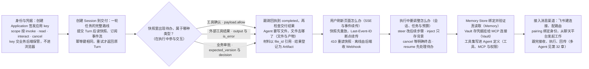
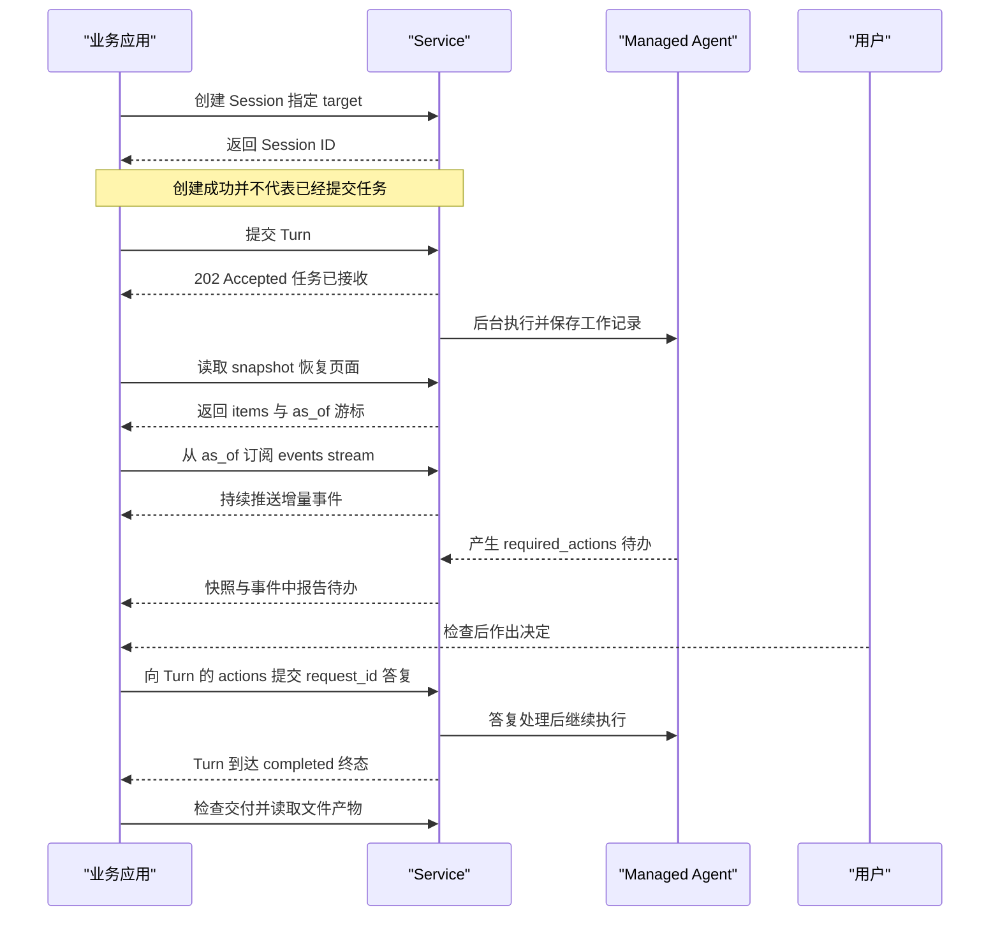

# 第 31 章 Session API：从调用到交付

> 本章导读：第 30 章里，你在 Console 和 curl 里让一个托管 Agent 回答了问题。把它接进真实业务应用时，问题立刻变得具体：应用后端用什么身份调用，才能不和某个人的浏览器登录绑在一起？用户刷新页面，已经生成的内容从哪里恢复？Agent 执行中要求确认或补充资料，页面怎么把决定递进去？产出的文件如何交到用户手上？本章沿这些问题走完一条接入路线：先用最小路径跑通"凭据 → 创建 Session → 提交 Turn → 读快照 → 订阅事件 → 答复待办 → 检查交付"；再逐个处理接入后会遇到的问题——页面刷新与断线（SSE 与事件续传）、执行中的调整（补充、取消、恢复与预算）、文件与产物交付；然后配置 Agent 运行所需的三类资源：Memory 共享知识、Vault 工具凭据、工具与 MCP 连接；最后接入消息渠道。两块内容按需选读：可恢复聊天应用的完整接入示例，以及面向排障的 Run/Task/Attempt 执行参考。读完本章，你可以把业务应用完整接入 Service，并管理 Agent 运行所需的运行资源。

> **注意**：本章"执行参考：Session、Run 与 Attempt"、"Memory：维护共享知识"、"Vault：为工具提供凭据"与"接入消息渠道"四节基于预览文档，正式版本尚未发布，接口可能调整。



*本章操作流程图*

## 身份与凭据：应用后端怎么调用

在 Console 里点一次提交，就能看到 Agent 回答——但业务应用不能依赖人工打开页面。应用需要一个程序化的入口：把工作交给 Agent，在后台等它执行，随时回来查看进度，并在需要时替用户递入决定。这就是 Session API 的职责。

接入前先解决"应用以什么身份调用"——它与某个人的浏览器登录绑在一起，还是独立的调用凭据？这一节回答这个问题，并准备贯穿全章的变量；下一节再走完"创建 Session → 提交 Turn → 观察执行 → 参与交互 → 检查交付"的主线路程。

### 认证与空间

第一次调用前，先分清两类身份，并准备好贯穿全章的变量。

**平台用户**通过 `POST /api/auth/login` 登录，请求体为 `{"username":"...","password":"..."}`，将返回的 `token` 放入 `Authorization: Bearer TOKEN`。管理 Agent、Team、Workflow 和 Application 时使用这个身份。**应用后端**则使用 Application 下签发的 `X-API-Key`，只能访问凭据明确授权的目标和操作——下一小节签发。

空间请求使用 `X-AgentScope-Tenant`、`X-AgentScope-Namespace`。如果请求体或查询参数中也包含空间字段，它们必须一致。Runtime Host、Task/Attempt 和 Environment 的执行凭据只用于相应运行协议，不能拿来调用业务 Session API。

下面的变量贯穿本章所有示例。假定已经完成部署（见第 29 章），并按第 30 章"运行第一个托管 Agent"创建了一个可以正常执行的 Managed Agent：

```bash
set -euo pipefail
export BASE_URL="http://localhost:18080"
export TOKEN="YOUR_USER_TOKEN"
export TENANT="YOUR_TENANT"
export NAMESPACE="YOUR_NAMESPACE"
export AGENT_ID="YOUR_MANAGED_AGENT_ID"
export ENVIRONMENT_ID="YOUR_ENVIRONMENT_ID"
```

消息渠道一节的示例以 `SERVICE_URL` 指代这里的 `BASE_URL`，两者是同一个 Service 地址。

### 为应用准备调用凭据

在开发和调试阶段，可以使用登录得到的用户 Bearer token（上一小节的 `TOKEN`）。接入业务后端时，建议创建 Application，为它签发独立的 API key，并明确授予它可以使用的 Agent、Team 或 Workflow。凭据属于 Application，因此同一应用更换 key 后仍能访问自己的 Session；其他应用即使使用同一个 Agent，也不能读取这些记录。API key 应保存在业务后端，由后端检查最终用户的业务权限。

创建 Application 和签发凭据属于管理操作，需要使用该 Application 所有者的用户身份。

```bash
set -euo pipefail

APPLICATION_JSON=$(
  curl -sS --fail-with-body "$BASE_URL/api/v1/applications" \
    -H "Authorization: Bearer $TOKEN" \
    -H "X-AgentScope-Tenant: $TENANT" \
    -H "X-AgentScope-Namespace: $NAMESPACE" \
    -H "Content-Type: application/json" \
    --data-binary @- <<JSON
{
  "tenant": "$TENANT",
  "namespace": "$NAMESPACE",
  "name": "report-application"
}
JSON
)
APPLICATION_ID=$(jq -er '.application.id' <<< "$APPLICATION_JSON")
```

为应用签发能够调用这个 Agent 的凭据：

```bash
KEY_JSON=$(
  curl -sS --fail-with-body "$BASE_URL/api/v1/applications/$APPLICATION_ID/credentials" \
    -H "Authorization: Bearer $TOKEN" \
    -H "X-AgentScope-Tenant: $TENANT" \
    -H "X-AgentScope-Namespace: $NAMESPACE" \
    -H "Content-Type: application/json" \
    --data-binary @- <<JSON
{
  "name": "backend",
  "scopes": [
    "invoke",
    "read",
    "interact",
    "cancel",
    "webhooks:write"
  ],
  "targets": [
    {
      "type": "agent",
      "id": "$AGENT_ID"
    }
  ]
}
JSON
)
AGENTSCOPE_API_KEY=$(jq -er '.apiKey' <<< "$KEY_JSON")
CREDENTIAL_ID=$(jq -er '.credential.id' <<< "$KEY_JSON")
```

服务只在创建凭据时返回明文 key。轮换时先签发新 key，更新应用配置并确认调用成功，再撤销旧凭据。`invoke` 允许提交工作，`read` 允许读取记录，`interact` 允许补充输入，`cancel` 允许取消；注册和管理回调还需要 `webhooks:write`。这些 scope 不会把应用变成人工审批人，指定人员的确认仍需由有权限的用户完成。Application 的完整 API 与成员角色见本章末"参考速查"。

#### 列出与撤销旧凭据

```bash
curl -sS --fail-with-body "$BASE_URL/api/v1/applications/$APPLICATION_ID/credentials" \
  -H "Authorization: Bearer $TOKEN" \
  -H "X-AgentScope-Tenant: $TENANT" \
  -H "X-AgentScope-Namespace: $NAMESPACE"
```

先使用上面的签发接口创建并验证新凭据。确认后，将 `OLD_CREDENTIAL_ID` 替换为列表中需要撤销的旧凭据 ID；此操作会停用旧 key。

```bash
OLD_CREDENTIAL_ID="OLD_CREDENTIAL_ID_FROM_LIST"
curl -sS --fail-with-body -X DELETE "$BASE_URL/api/v1/applications/$APPLICATION_ID/credentials/$OLD_CREDENTIAL_ID" \
  -H "Authorization: Bearer $TOKEN" \
  -H "X-AgentScope-Tenant: $TENANT" \
  -H "X-AgentScope-Namespace: $NAMESPACE"
```

两类身份的差别就到这里；凭据签发完成后，本章所有示例都可以跑了。

## 创建 Session 到交付：一轮任务的完整路线

应用先创建一个 Session，确定这段工作使用的 Agent 和配置，再向这个 Session 提交任务。每次提交都会创建一个 Turn，用来跟踪这一轮执行的进度和结果。Service 会在后台执行并保存工作记录，因此应用不需要保持提交请求一直连接，也可以在用户返回页面时继续查看同一项任务。

从创建 Session 到读取交付物的一轮任务生命周期如图 31-1 所示。



*图 31-1：一轮任务的调用生命周期*

下面的请求为资料助手创建 Session。Session 保存本次工作选择的配置和后续执行记录；创建成功并不代表已经提交了一项任务。建议对创建请求也提供稳定的幂等键，并保存返回的 `id`，避免网络重试时建立重复会话。

```bash
SESSION_JSON=$(
  curl -sS --fail-with-body "$BASE_URL/api/v1/agent-sessions" \
    -H "X-API-Key: $AGENTSCOPE_API_KEY" \
    -H "Content-Type: application/json" \
    -H "Idempotency-Key: report-session-001" \
    --data-binary @- <<JSON
{
  "target": {
    "type": "agent",
    "id": "$AGENT_ID"
  }
}
JSON
)
SESSION_ID=$(jq -er '.id' <<< "$SESSION_JSON")
SESSION_URL="$BASE_URL/api/v1/agent-sessions/$SESSION_ID"
```

`target.type` 可以是 `agent`、`team` 或 `workflow`。Agent 目标使用统一目录中的 ID，因此 Managed、External 和 Hosted 都使用 `agent`；它们的区别来自运行绑定。Team 使用 Team ID。Workflow 使用定义 ID，可以通过 `revisionId` 指定已发布版本；没有指定时，Service 选择当前最新的已发布版本。Workflow 的发布用于固定流程内容，与应用调用入口是两个不同的问题。

#### 使用 Team 或已发布的 Workflow

先在签发凭据的 `targets` 中授权对应 Team 或 Workflow，并填入真实 ID。以下请求是创建 Agent Session 的替代选项；Workflow 的 `revisionId` 必须指向已发布版本。

**Team**

```bash
TEAM_ID="YOUR_TEAM_ID"
SESSION_JSON=$(
  curl -sS --fail-with-body "$BASE_URL/api/v1/agent-sessions" \
    -H "X-API-Key: $AGENTSCOPE_API_KEY" \
    -H "Content-Type: application/json" \
    -H "Idempotency-Key: team-session-001" \
    --data-binary @- <<JSON
{
  "target": {
    "type": "team",
    "id": "$TEAM_ID"
  }
}
JSON
)
SESSION_ID=$(jq -er '.id' <<< "$SESSION_JSON")
SESSION_URL="$BASE_URL/api/v1/agent-sessions/$SESSION_ID"
```

**Workflow**

```bash
WORKFLOW_ID="YOUR_WORKFLOW_ID"
REVISION_ID="YOUR_PUBLISHED_REVISION_ID"
SESSION_JSON=$(
  curl -sS --fail-with-body "$BASE_URL/api/v1/agent-sessions" \
    -H "X-API-Key: $AGENTSCOPE_API_KEY" \
    -H "Content-Type: application/json" \
    -H "Idempotency-Key: workflow-session-001" \
    --data-binary @- <<JSON
{
  "target": {
    "type": "workflow",
    "id": "$WORKFLOW_ID",
    "revisionId": "$REVISION_ID"
  }
}
JSON
)
SESSION_ID=$(jq -er '.id' <<< "$SESSION_JSON")
SESSION_URL="$BASE_URL/api/v1/agent-sessions/$SESSION_ID"
```

Session 创建时会固定目标配置及其依赖。Managed Agent 可以通过 `target.version` 选择定义版本。更新 Agent、Team 或 Workflow 后，新 Session 可以使用新配置，已有 Session 继续沿用自己的配置。Environment、Memory、Vault 等运行资源有各自的访问与更新规则；保存配置版本并不意味着外部业务数据永远不变。

如果 Agent 访问外部工具时需要使用特定凭据，应在创建 Session 时选择相应的 Vault，也可以继承 Agent 的默认 Vault。应用调用 Service 所使用的 API key 不会自动成为工具访问外部系统的凭据。配置方法和 `vaultIds` 的使用方式见本章"在 Session 中选择 Vault"一节。

### 提交一轮任务

向 Session 的 `/turns` 提交请求就会创建一个 Turn。Managed Agent 支持文本 `message`，也支持由用户消息和内容块组成的 `input`。Team 和 Workflow 可以使用结构化业务 `input`，让平台将其交给协作或流程执行器；具体输入应与目标实际处理的内容一致。

```bash
TURN_JSON=$(
  curl -sS --fail-with-body "$SESSION_URL/turns" \
    -H "X-API-Key: $AGENTSCOPE_API_KEY" \
    -H "Content-Type: application/json" \
    -H "Idempotency-Key: report-task-001" \
    --data-binary @- <<'JSON'
{
  "message": "根据已授权的资料整理报告，并说明来源和待确认事项。"
}
JSON
)
TURN_ID=$(jq -er '.id' <<< "$TURN_JSON")
```

查询刚提交的任务：

```bash
curl -sS --fail-with-body "$SESSION_URL/turns/$TURN_ID" \
  -H "X-API-Key: $AGENTSCOPE_API_KEY"
```

如果请求返回 `202 Accepted`，表示任务已经接收，执行可能仍在排队或进行中。网络超时后重试时，应使用同一个 Session、同一个幂等键和完全相同的请求内容。服务会返回原来的 Turn；如果沿用 key 却修改内容，则返回 `409 Conflict`。只有确实提交下一轮任务时，才应换一个新 key。

同一个 Session 中的 Turn 按顺序执行。Managed Agent 会保留会话上下文；Team 和 Workflow 的每个 Turn 会启动独立任务，历史记录集中保存在 Session 中，但不承诺把前一个任务的内部执行上下文直接传给下一次任务。需要沿用上次结果时，应用应在输入中明确提供所需资料。对于互不相关的对象或并行批次，通常应创建不同 Session。

### 恢复页面并观察执行

任务提交后，应用应保存业务对象、Session ID 和 Turn ID 的关联。用户刷新页面时，先读取 Session 的 `/snapshot` 恢复已有内容，再从其中的 `as_of` 游标订阅 `/events/stream`。刷新只是在恢复显示，不应重新发送任务输入。如果页面仍保留之前的状态，则可以从最后已经成功处理的事件游标继续读取。

```bash
SNAPSHOT=$(
  curl -sS --fail-with-body "$SESSION_URL/snapshot" \
    -H "X-API-Key: $AGENTSCOPE_API_KEY"
)
CURSOR=$(jq -er '.as_of' <<< "$SNAPSHOT")
```

```bash
curl -sS --fail-with-body -N -G "$SESSION_URL/events/stream" \
  -H "X-API-Key: $AGENTSCOPE_API_KEY" \
  -H "Accept: text/event-stream" \
  --data-urlencode "after=$CURSOR"
```

需要只观察某一轮任务时，可以使用 `/turns/{turnId}/snapshot` 和 `/turns/{turnId}/events/stream`。Session 游标与 Turn 游标分别属于各自的事件记录，不能交叉使用。Session 事件流会继续等待后续 Turn，因此连接关闭不表示业务完成。完成判断应读取对应 Turn 的 `status`：`completed` 表示成功，`partial_succeeded` 表示部分成功，`failed`、`cancelled` 和 `timed_out` 表示其他终态。

单轮快照中的 `items`、`tools`、`required_actions`、`steps`、`artifacts` 和 `usage` 按标识组织，便于应用更新界面。Managed Session 快照同时保留完整的会话消息、子 Agent 和原生交互记录。Session 与 Turn 的全部路径见本章末"参考速查"；断线续传在下一节展开。

### 在执行中参与交互

Agent 需要用户确认、补充资料或提供外部工具结果时，应用从快照中的 `required_actions` 读取待办，再向对应 Turn 的 `/actions` 提交答复。请求应包含待办的 `request_id`，需要版本校验的待办还应包含 `expected_version`。Managed Agent 的确认答复放在 `payload` 中，例如 `{"allow":true}`。涉及指定审批人的请求，应改用该用户的登录身份提交，应用 key 本身不能替他作出决定。

先读取当前 Turn 的待办。没有待办时不需要调用 `/actions`：

```bash
ACTIONS_JSON=$(
  curl -sS --fail-with-body "$SESSION_URL/turns/$TURN_ID/actions" \
    -H "X-API-Key: $AGENTSCOPE_API_KEY"
)
jq '.required_actions' <<< "$ACTIONS_JSON"
```

检查所选待办的操作说明、`kind` 和请求内容，将真实 `request_id` 原样填入下面的变量，保留服务返回的 `native:` 等前缀。一次只答复用户选择的待办，不要自动允许列表中的所有操作。

```bash
REQUEST_ID="REQUEST_ID_FROM_PENDING_ACTION"
```

按待办类型选择一种答复。工具确认和业务审批使用有权限的用户 `TOKEN`；外部工具结果可使用具有 `interact` scope 的应用 key。

#### 工具确认

仅适用于 Managed 的 `confirmation` 待办。用户检查工具及参数后，允许时传 `allow: true`，拒绝时改为 `false` 并说明原因。用户必须是指定确认人，或由 Managed Agent 所有者明确授权。

```bash
COMMAND_JSON=$(
  curl -sS --fail-with-body "$SESSION_URL/turns/$TURN_ID/actions" \
    -H "Authorization: Bearer $TOKEN" \
    -H "X-AgentScope-Tenant: $TENANT" \
    -H "X-AgentScope-Namespace: $NAMESPACE" \
    -H "Content-Type: application/json" \
    -H "Idempotency-Key: report-confirmation-001" \
    --data-binary @- <<JSON
{
  "request_id": "$REQUEST_ID",
  "payload": {
    "allow": true,
    "reason": "用户已核对工具参数并确认执行。"
  }
}
JSON
)
COMMAND_ID=$(jq -er '.command.id' <<< "$COMMAND_JSON")
```

#### 外部工具结果

仅适用于 Managed 的 `external_execution` 待办。将 `output` 替换为实际执行结果；失败时使用 `is_error: true` 并提供真实错误信息。不要把它当作工具允许/拒绝的答复。

```bash
COMMAND_JSON=$(
  curl -sS --fail-with-body "$SESSION_URL/turns/$TURN_ID/actions" \
    -H "X-API-Key: $AGENTSCOPE_API_KEY" \
    -H "Content-Type: application/json" \
    -H "Idempotency-Key: report-tool-result-001" \
    --data-binary @- <<JSON
{
  "request_id": "$REQUEST_ID",
  "payload": {
    "output": "替换为真实工具执行结果",
    "is_error": false
  }
}
JSON
)
COMMAND_ID=$(jq -er '.command.id' <<< "$COMMAND_JSON")
```

#### 业务审批

从待办读取当前版本号，将下面的 `1` 替换为实际数字，并使用指定审批人的 `TOKEN`。业务审批必须使用待办中的最新版本号。`decision` 同意使用 `approved`，拒绝使用 `rejected`；此类答复不使用 `payload.allow`。

```bash
EXPECTED_VERSION=1
COMMAND_JSON=$(
  curl -sS --fail-with-body "$SESSION_URL/turns/$TURN_ID/actions" \
    -H "Authorization: Bearer $TOKEN" \
    -H "X-AgentScope-Tenant: $TENANT" \
    -H "X-AgentScope-Namespace: $NAMESPACE" \
    -H "Content-Type: application/json" \
    -H "Idempotency-Key: report-approval-001" \
    --data-binary @- <<JSON
{
  "request_id": "$REQUEST_ID",
  "expected_version": $EXPECTED_VERSION,
  "decision": "approved"
}
JSON
)
COMMAND_ID=$(jq -er '.command.id' <<< "$COMMAND_JSON")
```

请求返回 `202 Accepted` 只表示答复已接收。使用返回的命令 ID 查询回执，直到 `command.status` 为 `completed` 或 `failed`；失败时检查 `command.error` 并重新读取待办。相同答复重试时沿用同一个幂等键和请求体，修改答复时先重新读取待办。`interact` scope 只允许调用交互接口，不会把应用密钥变成指定的人工审批人；涉及身份约束的业务审批仍需使用被授权的用户身份。

```bash
curl -sS --fail-with-body "$SESSION_URL/turns/$TURN_ID/commands/$COMMAND_ID" \
  -H "X-API-Key: $AGENTSCOPE_API_KEY"
```

命令完成表示该答复已处理，整个任务仍可能继续执行。继续观察事件或读取 Turn 状态：

```bash
curl -sS --fail-with-body "$SESSION_URL/turns/$TURN_ID" \
  -H "X-API-Key: $AGENTSCOPE_API_KEY"
```

每种运行绑定能提供的交互不同。先读取 Session 的 `/capabilities` 了解目标支持范围，在显示取消、补充输入或恢复按钮前，再读取 Turn 的 `/capabilities` 中的 `available_commands`。取消请求被接受后，仍需继续观察状态，直到确认执行已经停止。补充要求、取消、恢复与预算的完整用法见本章"会话、任务与预算"。

```bash
curl -sS --fail-with-body "$SESSION_URL/capabilities" \
  -H "X-API-Key: $AGENTSCOPE_API_KEY"
```

```bash
curl -sS --fail-with-body "$SESSION_URL/turns/$TURN_ID/capabilities" \
  -H "X-API-Key: $AGENTSCOPE_API_KEY"
```

### 凭据、预算和后台通知

Application 的 `maxConcurrent` 和 `tokenBudget` 约束该应用通过不同 key、不同 Session 提交的工作。Token 用量依据运行时报告累计，预算耗尽时会拒绝后续提交，因此它是执行治理能力，不是外部模型账单的实时硬上限。创建 Session 时，还可以设置 `timeoutSeconds` 和 `budget.maxTokens`，约束该 Session 中每个 Turn 的执行。Managed 会话自己的预算则通过 `/budget` 管理，具体配置与用量查询见本章"用量、子 Agent 与预算"一节。

#### 设置应用限额与任务预算

应用所有者先读取当前版本，再更新限额；版本冲突时重新读取，勿覆盖其他人的更新。

```bash
APPLICATION_JSON=$(
  curl -sS --fail-with-body "$BASE_URL/api/v1/applications/$APPLICATION_ID" \
    -H "Authorization: Bearer $TOKEN" \
    -H "X-AgentScope-Tenant: $TENANT" \
    -H "X-AgentScope-Namespace: $NAMESPACE"
)
APPLICATION_VERSION=$(jq -er '.application.version' <<< "$APPLICATION_JSON")

curl -sS --fail-with-body -X PATCH "$BASE_URL/api/v1/applications/$APPLICATION_ID" \
  -H "Authorization: Bearer $TOKEN" \
  -H "X-AgentScope-Tenant: $TENANT" \
  -H "X-AgentScope-Namespace: $NAMESPACE" \
  -H "Content-Type: application/json" \
  --data-binary @- <<JSON
{
  "version": $APPLICATION_VERSION,
  "maxConcurrent": 5,
  "tokenBudget": 1000000
}
JSON
```

创建新 Session 时可同时设置每个 Turn 的超时秒数与 token 预算：

```bash
SESSION_JSON=$(
  curl -sS --fail-with-body "$BASE_URL/api/v1/agent-sessions" \
    -H "X-API-Key: $AGENTSCOPE_API_KEY" \
    -H "Content-Type: application/json" \
    -H "Idempotency-Key: limited-session-001" \
    --data-binary @- <<JSON
{
  "target": {
    "type": "agent",
    "id": "$AGENT_ID"
  },
  "timeoutSeconds": 300,
  "budget": {
    "maxTokens": 10000
  }
}
JSON
)
SESSION_ID=$(jq -er '.id' <<< "$SESSION_JSON")
SESSION_URL="$BASE_URL/api/v1/agent-sessions/$SESSION_ID"
```

后台应用可以为 Session 注册 Webhook，在任务完成、失败或等待交互时收到通知。回调可能重复投递，应用应验证签名、按事件 ID 去重，再读取 Session 或 Turn 确认最新状态。完整协议和重试方式见本章"用户离线后的 Webhook 通知"一节。

### 检查交付结果

Turn 的 `completed` 表示这轮执行成功结束。应用还需要检查实际交付是否符合业务要求，例如报告是否包含所需来源、文件是否能够下载，以及结构化结果是否包含后续处理所需的数据。返回的是文件时，应通过本章"文件与产物"中的接口读取实际产物，不能仅凭 Agent 回复中的文件名判断交付已经完成。

如果任务需要严格的业务输入和输出，可以在创建 Session 时提供 `inputSchema`、`outputSchema` 和 `resultMapping`。这些设置固定在当前 Session 的执行配置中。应先验证目标真实返回的数据，再设置输出映射和校验规则；Agent 在文字中写出 JSON，不等于平台已把这段文字转换为业务对象。这些规则用于检查数据格式，不能代替对内容质量的验收，也不会自动驱动 Agent 反复修改结果。

#### 校验结构化输入与交付结果

下面假定已发布的 Workflow 接收 `{topic}` 并实际返回 `{answer}`。请按目标真实数据修改 schema 和 JSON Pointer；示例中的 `/answer` 取自结构化结果字段。先为应用凭据授权该 Workflow。

```bash
WORKFLOW_ID="YOUR_WORKFLOW_ID"
SESSION_JSON=$(
  curl -sS --fail-with-body "$BASE_URL/api/v1/agent-sessions" \
    -H "X-API-Key: $AGENTSCOPE_API_KEY" \
    -H "Content-Type: application/json" \
    -H "Idempotency-Key: schema-session-001" \
    --data-binary @- <<JSON
{
  "target": {
    "type": "workflow",
    "id": "$WORKFLOW_ID"
  },
  "inputSchema": {
    "type": "object",
    "required": [
      "topic"
    ],
    "properties": {
      "topic": {
        "type": "string"
      }
    }
  },
  "outputSchema": {
    "type": "object",
    "required": [
      "answer"
    ],
    "properties": {
      "answer": {
        "type": "string"
      }
    }
  },
  "resultMapping": {
    "answer": "/answer"
  }
}
JSON
)
SESSION_ID=$(jq -er '.id' <<< "$SESSION_JSON")
SESSION_URL="$BASE_URL/api/v1/agent-sessions/$SESSION_ID"
```

```bash
curl -sS --fail-with-body "$SESSION_URL/turns" \
  -H "X-API-Key: $AGENTSCOPE_API_KEY" \
  -H "Content-Type: application/json" \
  -H "Idempotency-Key: schema-task-001" \
  --data-binary @- <<'JSON'
{
  "input": {
    "topic": "安装说明"
  }
}
JSON
```

如果业务还需要保存负责人、讨论和人工验收记录，可以使用 Issue（见第 33 章"工作分派、审批与验收"）来组织交付。Issue 的验收与 Session 中一次执行的完成是两个不同的判断：前者确认业务工作是否被接受，后者记录这轮执行是否结束。

### 出错时先看这里

遇到 `400` 时先检查请求内容，`401` 表示凭据无效，`403` 表示当前身份没有相应权限。`404` 可能表示资源不存在，也可能表示当前身份无权访问，不应据此推断其他用户的数据。`409` 需要检查资源状态、版本或幂等请求是否改变；事件 `410` 则需要重新加载快照。限流和临时服务错误应退避重试，并保留同一个逻辑请求的幂等键。

管理资源更新前先读取当前版本。Issue 决策与 Workflow 发布使用 `expectedVersion`，Agent 定义等更新使用各自的 `version` 字段，不能自动用新版本重放已经过期的人工决定。

### 使用 SDK 与可运行示例

Python `ServiceClient` 封装了相同的 Session API。下面的代码使用已经授予目标权限的应用 key；这里的 `AGENT_ID` 是平台 Agent ID。

```bash
export BASE_URL AGENTSCOPE_API_KEY AGENT_ID
```

```python
import os
from agentscope_service import ServiceClient

client = ServiceClient(os.environ["BASE_URL"], api_key=os.environ["AGENTSCOPE_API_KEY"])
session = client.create_session(
    {"type": "agent", "id": os.environ["AGENT_ID"]},
    idempotency_key="review-session-001",
)
turn = client.submit(session["id"], message="Review the notes", idempotency_key="review-001")
print(client.turn(session["id"], turn["id"]))
print(client.snapshot(session["id"]))
```

完整示例位于仓库 `agentscope-service/service-controlplane/examples/service-api`，可以分别对 Agent、Team 和 Workflow 创建 Session。管理对象使用 `ManagementClient`，应用执行使用 `ServiceClient`；前端 TypeScript 客户端位于 `frontend/src/api/serviceSessions.ts`。运行时注册和任务回报 SDK 则用于接入执行器，与应用调用客户端的职责不同。HTTP 客户端不会替应用批准工具操作，也不会在网络失败时擅自创建新任务；应用应保存 Session ID、Turn ID 和幂等键，按本章"恢复页面并观察执行"一节处理恢复。

> **延伸阅读**：创建与配置 Agent 本身见第 30 章"运行第一个托管 Agent"与"配置 Agent 与模型"；多 Agent 编排见第 32 章；Console 页面操作见第 33 章"可视化 Console"；六个业务案例见第 34 章。

## 用户刷新页面怎么办：SSE 与事件续传

上一节的事件订阅在页面存活的几分钟里够用，但生产环境里连接总会断：用户刷新页面、切换网络、直接离开。这一节处理三件事——刷新后如何恢复已发生的内容、断线后如何从断点继续、用户彻底离线时业务后端如何收到通知。

任务提交后，应用需要把后台的执行进度展示给用户。Session API 会保存快照与事件日志：快照用于恢复已经发生的工作，后续事件用于更新页面上的消息、工具调用和待办。应用通过 SSE 持续接收这些事件，因此用户刷新页面或网络断开后，仍可以继续观察同一项任务；关闭连接不会取消执行。

首次创建 Session 和提交 Turn 的流程见本章"通过 Session API 接入应用"。下面沿用该节的 `SESSION_URL` 和应用凭据。如果业务后端需要在用户离线后收到通知，可以直接阅读本节的"用户离线后的 Webhook 通知"，它与页面上的 SSE 订阅可以同时使用。

### 先恢复快照，再接收增量

应用第一次打开页面时，应先读取 Session 的 `/snapshot`，用返回内容恢复消息、工具和待办，然后把其中的 `as_of` 作为 `/events/stream` 的 `after` 参数。每处理完一个事件，再保存它的 cursor。网络重连时从最后成功应用的 cursor 继续；如果页面状态也丢失了，则重新加载快照。

下面使用应用凭据。平台用户也可以用有权访问该 Session 的 Bearer token 完成相同操作。

```bash
SNAPSHOT=$(
  curl -sS --fail-with-body "$SESSION_URL/snapshot" \
    -H "X-API-Key: $AGENTSCOPE_API_KEY"
)
CURSOR=$(jq -er '.as_of' <<< "$SNAPSHOT")
```

```bash
curl -sS --fail-with-body -N -G "$SESSION_URL/events/stream" \
  -H "X-API-Key: $AGENTSCOPE_API_KEY" \
  -H "Accept: text/event-stream" \
  --data-urlencode "after=$CURSOR"
```

若只显示一个任务，则使用 `/turns/{turnId}/snapshot` 与 `/turns/{turnId}/events/stream`。Session、Turn 和子 Agent 各有自己的事件日志，游标只能用在产生它的资源上。它不是时间戳，也不能通过解析其中的字符推断事件序号。服务支持 `Last-Event-ID`；这个请求头存在时优先于查询参数。

#### 单个 Turn 订阅与断线续传

只观察一个 Turn 时，使用这一对接口：

```bash
TURN_URL="$SESSION_URL/turns/$TURN_ID"
TURN_SNAPSHOT=$(
  curl -sS --fail-with-body "$TURN_URL/snapshot" \
    -H "X-API-Key: $AGENTSCOPE_API_KEY"
)
TURN_CURSOR=$(jq -er '.as_of' <<< "$TURN_SNAPSHOT")
```

```bash
curl -sS --fail-with-body -N -G "$TURN_URL/events/stream" \
  -H "X-API-Key: $AGENTSCOPE_API_KEY" \
  -H "Accept: text/event-stream" \
  --data-urlencode "after=$TURN_CURSOR"
```

重连 Session 流时，将 `LAST_APPLIED_CURSOR` 替换为最后成功应用的 Session 事件游标。本例使用请求头续传，无需同时传 `after`：

```bash
LAST_APPLIED_CURSOR="LAST_APPLIED_SESSION_CURSOR"
curl -sS --fail-with-body -N "$SESSION_URL/events/stream" \
  -H "X-API-Key: $AGENTSCOPE_API_KEY" \
  -H "Accept: text/event-stream" \
  -H "Last-Event-ID: $LAST_APPLIED_CURSOR"
```

### 理解事件与状态

SSE 的 `id` 字段是续传游标，`event` 是事件类型，`data` 是 JSON 事件。公共事件包含 `schema_version`、`id`、`type`、`session_id`、`created_at`、`cursor` 和 `data`；属于某个任务的事件还会关联 `turn_id`。应用应按事件 ID 去重，并按资源 ID 更新已有内容，不能每收到一次通知就添加一张新卡片。

`item.delta` 用于追加消息增量，`item.completed` 提供该消息的累计内容。处理完成事件时应替换累计内容，避免把同一段文字追加两次。工具事件描述单次工具调用，`required_action.*` 描述待办和答复，`step.*` 描述协作或流程步骤。只有目标 Turn 的明确状态才能判断任务是否结束，单个工具或子任务完成不代表整个任务完成。

Managed Session 快照使用运行时的资源数组，可以展示输入、子 Agent 和运行尝试；通用 Turn 与 Team、Workflow 快照使用按 ID 索引的集合。前端可复用 `agentSessions.ts` 与 `agentSessionView.ts` 处理 Managed 执行视图，或用 `serviceSessions.ts` 处理通用 Turn 视图。不要把这两种快照形状当成完全相同的数据结构。

### 分页、断线与过期

无需持续连接时，可以使用 `GET /events?after=...&limit=100` 分页读取。响应中的 `next_cursor` 用于下一页，`has_more` 表示当前还有可读事件。空页并不表示任务已完成；应用仍应读取 Turn 状态，或继续等待后续事件。

```bash
EVENT_PAGE=$(
  curl -sS --fail-with-body -G "$SESSION_URL/events" \
    -H "X-API-Key: $AGENTSCOPE_API_KEY" \
    --data-urlencode "after=$CURSOR" \
    --data-urlencode "limit=100"
)
jq . <<< "$EVENT_PAGE"
```

仅当 `has_more` 为 true 时立即读取下一页；处理完当前页后再推进游标。

```bash
if jq -e '.has_more == true' <<< "$EVENT_PAGE" > /dev/null; then
  NEXT_CURSOR=$(jq -er '.next_cursor' <<< "$EVENT_PAGE")
  curl -sS --fail-with-body -G "$SESSION_URL/events" \
    -H "X-API-Key: $AGENTSCOPE_API_KEY" \
    --data-urlencode "after=$NEXT_CURSOR" \
    --data-urlencode "limit=100"
fi
```

如果请求返回 `410` 和 `cursor_expired`，说明该资源的增量历史已超过保留范围。此时读取新的快照，并从新的 `as_of` 恢复订阅。不要为了恢复观察而重新提交任务。不同资源的游标不可交换，错误的游标会被拒绝。

### 用户离线后的 Webhook 通知

页面关掉之后呢？业务后端可以在 Session 的 `/webhooks` 注册通知，覆盖该会话中的后续任务；如果只关心一个任务，则在对应 Turn 的 `/webhooks` 注册。应用凭据需要 `webhooks:write`。下面的目标地址应替换为你实际部署的 HTTPS 接收端：

```bash
WEBHOOKS_URL="$SESSION_URL/webhooks"
WEBHOOK_JSON=$(
  curl -sS --fail-with-body "$WEBHOOKS_URL" \
    -H "X-API-Key: $AGENTSCOPE_API_KEY" \
    -H "Content-Type: application/json" \
    -H "Idempotency-Key: notifications-001" \
    --data-binary @- <<'JSON'
{
  "url": "https://your-app.example/agent-events",
  "event_types": [
    "turn.completed",
    "turn.failed",
    "required_action.created"
  ]
}
JSON
)
WEBHOOK_ID=$(jq -er '.webhook.id' <<< "$WEBHOOK_JSON")
SIGNING_SECRET=$(jq -er '.signing_secret' <<< "$WEBHOOK_JSON")
```

保存返回的 `signing_secret`，不要将它暴露给浏览器。接收端使用这个 secret，对 `时间戳 + '.' + 原始请求体` 计算 HMAC-SHA256，并与 `X-AgentScope-Signature: t=<秒>,v1=<hex>` 比较。同时检查时间窗口，并按事件 ID 去重。验签必须使用原始请求字节，不能先解析 JSON 再序列化。

如果只通知一个 Turn，在注册前改用 `WEBHOOKS_URL="$SESSION_URL/turns/$TURN_ID/webhooks"`。下面的管理请求继续使用注册时的 `WEBHOOKS_URL` 和返回的 `WEBHOOK_ID`。

Webhook 是至少一次投递，因此同一个事件可能收到多次。接收端应先可靠保存通知，再返回成功，并按需要读取 Session 或 Turn 的最新状态。`GET /webhooks` 可检查投递状态；失败后可以调用 `POST /webhooks/{webhookId}/retry` 重试，或者通过 `DELETE` 撤销订阅。Webhook 不会替业务系统完成幂等处理，也不表示外部业务事务已经提交。

#### 查看、重试与停用 Webhook

查看订阅及投递状态：

```bash
curl -sS --fail-with-body "$WEBHOOKS_URL" \
  -H "X-API-Key: $AGENTSCOPE_API_KEY"
```

接收端恢复后，按需重试失败投递：

```bash
curl -sS --fail-with-body -X POST "$WEBHOOKS_URL/$WEBHOOK_ID/retry" \
  -H "X-API-Key: $AGENTSCOPE_API_KEY"
```

不再需要通知时停用订阅：

```bash
curl -sS --fail-with-body -X DELETE "$WEBHOOKS_URL/$WEBHOOK_ID" \
  -H "X-API-Key: $AGENTSCOPE_API_KEY"
```

自动化的入站 Webhook 用于让外部系统触发工作，与这里用于通知结果的出站 Webhook 用途不同。配置入口见第 33 章"计划与事件触发"，保留和恢复策略见第 33 章"运维、恢复与排障"。

## 执行中要调整怎么办：会话、任务与预算

最小路径假设任务一次跑完。真实使用中，用户常常在执行途中改变主意：补充一句要求、修改当前任务的走向、干脆停下，或者希望 Agent 回到之前的上下文重新试验。这一节说明这些操作如何作用于已有的 Session 和 Turn。

Session 保存应用与执行目标之间的一段工作记录，Turn 表示其中一次提交的任务。Agent、Team 和 Workflow 都通过同一套 Session API 接收工作；Managed Agent 在这个入口上进一步提供连续对话、运行中补充输入、上下文恢复和子 Agent 等能力。关闭页面或断开事件连接不会取消后台任务。

首次接入请先完成本章"通过 Session API 接入应用"，取得 `SESSION_URL`、`TURN_ID` 和应用凭据 `AGENTSCOPE_API_KEY`。请求也可以使用有权访问该 Session 的平台用户 Bearer token；应用凭据必须同时具有相应 scope 和目标资源授权。

### 理解 Session 与 Turn 的关系

创建 Session 时，Service 会保存目标和当时的配置。随后提交的新 Turn 沿用这份配置，因此修改 Agent 定义不会悄悄改变已有会话。需要使用新配置时应创建新的 Session。Workflow 会话绑定的是已发布的 revision；可以显式选择版本，也可以在创建时使用最新的已发布版本。

#### 调整 Managed 会话的运行资源

Managed 会话可通过 `PATCH` 调整运行资源绑定。先完成一次 Turn 以建立运行时会话，再填入有权使用的 Environment ID；本例仅修改 Environment。这不会切换已固定的 Agent 定义版本。

```bash
ENVIRONMENT_ID="YOUR_ENVIRONMENT_ID"
curl -sS --fail-with-body -X PATCH "$SESSION_URL" \
  -H "Authorization: Bearer $TOKEN" \
  -H "X-AgentScope-Tenant: $TENANT" \
  -H "X-AgentScope-Namespace: $NAMESPACE" \
  -H "Content-Type: application/json" \
  --data-binary @- <<JSON
{
  "environmentId": "$ENVIRONMENT_ID"
}
JSON
```

同一个 Session 中的 Turn 按接收顺序执行。如果前一个任务正在等待审批，后续提交会进入队列，直到前面的任务结束。Managed Agent 会在任务之间保留对话上下文；Team 和 Workflow 的每个 Turn 启动一项独立工作，Session 将它们的进度与结果组织在一起。这种统一调用方式不意味着所有执行目标都有相同的记忆和交互能力，应用应先读取 `/capabilities` 再显示相应操作。

如果提交请求返回 `202 Accepted`，且状态为 `queued`，表示任务已经接收，但尚未完成。网络重试必须带上同一个 `Idempotency-Key` 和相同的请求内容，这样服务才会返回原来的 Turn。只有用户发起新任务时才使用新的 key。刷新页面时读取已有 Session 的快照和事件，不要重新发送输入。

### 读取结果与恢复页面

应用可以通过 `GET /turns/{turnId}` 查询任务状态，也可以读取 Session 的 `/snapshot` 恢复界面，再从快照返回的 `as_of` 连接 `/events/stream`。如果只显示某个任务，则成对使用这个 Turn 的 `/snapshot` 和 `/events/stream`，不能混用 Session 与 Turn 的游标。

```bash
curl -sS --fail-with-body "$SESSION_URL/turns/$TURN_ID" \
  -H "X-API-Key: $AGENTSCOPE_API_KEY"
```

#### 列出 Session 与历史任务

Session 列表默认仅返回 active 会话；`status=all` 包括归档记录。两种列表都返回 `items` 和 `next_offset`，后者非空时用于下一次请求的 `offset`。

```bash
curl -sS --fail-with-body -G "$BASE_URL/api/v1/agent-sessions" \
  -H "X-API-Key: $AGENTSCOPE_API_KEY" \
  --data-urlencode "status=all" \
  --data-urlencode "limit=20" \
  --data-urlencode "offset=0"
```

```bash
curl -sS --fail-with-body "$SESSION_URL" \
  -H "X-API-Key: $AGENTSCOPE_API_KEY"
```

```bash
curl -sS --fail-with-body -G "$SESSION_URL/turns" \
  -H "X-API-Key: $AGENTSCOPE_API_KEY" \
  --data-urlencode "limit=20" \
  --data-urlencode "offset=0"
```

Managed Session 的快照保留消息、工具调用、输入、待办和子 Agent 等运行时资源。Team、Workflow 与通用 Turn 快照使用按 ID 索引的集合，并包含执行步骤。客户端需要根据快照类型读取这些字段；统一的是会话和任务的身份、控制路径以及事件续传方式。事件字段和累计更新规则见本章"SSE 与事件续传"。

### 补充要求与背景材料

用户想继续提出一个新的问题时，应提交新的 Turn。如果用户要修改当前任务的后续要求，则可以对支持此能力的 Managed Turn 调用 `steer`。修改会在后续执行步骤生效，不能改变已经发送给模型的请求。只希望补充背景而不立即启动推理时，可以调用 Session 的 `/inputs/inject`。

调用前查看当前 Turn 允许的命令；不要仅根据 Agent 类型显示操作按钮：

```bash
curl -sS --fail-with-body "$SESSION_URL/turns/$TURN_ID/capabilities" \
  -H "X-API-Key: $AGENTSCOPE_API_KEY"
```

```bash
curl -sS --fail-with-body "$SESSION_URL/turns/$TURN_ID/steer" \
  -H "X-API-Key: $AGENTSCOPE_API_KEY" \
  -H "Content-Type: application/json" \
  -H "Idempotency-Key: correction-001" \
  --data-binary @- <<'JSON'
{
  "message": "先核实预算，暂时不要发送邮件。"
}
JSON
```

Managed 输入可以使用非空 `message`，也可以使用包含用户消息的 `input` 数组，二者只能选一个。结构化输入用于传递文本和文件等内容，上传与引用方式见本章"文件与产物"。`input.accepted` 表示输入已保存，`input.applied` 才表示运行时已使用它。应用不要把"接收成功"显示成"Agent 已处理"。

仅补充背景材料：

```bash
curl -sS --fail-with-body "$SESSION_URL/inputs/inject" \
  -H "X-API-Key: $AGENTSCOPE_API_KEY" \
  -H "Content-Type: application/json" \
  -H "Idempotency-Key: context-001" \
  --data-binary @- <<'JSON'
{
  "message": "补充背景：安装说明的读者是首次使用 Docker 的开发者。"
}
JSON
```

### 回答 required action

Agent 需要用户确认或等待外部执行结果时，会生成 required action。应用应保存快照或事件中的 `request_id`，向用户说明所请求的操作，再将真实决定提交到对应 Turn。

三种答复的完整请求——工具确认（`payload.allow`）、外部工具结果（`payload.output` 与 `is_error`）、业务审批（`expected_version` 与 `decision`）——已在本章"在执行中参与交互"一节逐一给出，此处补充几条通用的答复规则。`request_id` 必须来自当前待办卡片中的实际值，不能用工具调用 ID 替代；保留服务返回的 `native:` 等前缀。接口返回命令回执和状态地址，应用继续查询回执，直到命令执行完毕，同时等待任务状态变化；提交答复成功不代表整个任务已经完成。相同答复重试时沿用原来的 key，修改答复时先重新读取待办。

`interact` scope 只允许调用交互接口，不会把应用密钥变成指定的人工审批人；涉及身份约束的业务审批仍需使用被授权的用户身份。仅在待办要求外部工具结果时提交真实 `output`；执行失败时设 `is_error: true` 并提供实际错误。业务审批必须使用待办中的最新版本号，并由指定审批人的 `TOKEN` 提交。

### 取消与恢复任务

取消和恢复都作用于已有 Turn，并要求稳定的幂等键。收到取消回执后，应用仍要等待任务进入明确终态。取消无法保证撤销已经发送给外部系统的操作，因此再次执行之前，应核实这些操作的结果。

```bash
CANCEL_JSON=$(
  curl -sS --fail-with-body -X POST "$SESSION_URL/turns/$TURN_ID/cancel" \
    -H "X-API-Key: $AGENTSCOPE_API_KEY" \
    -H "Idempotency-Key: cancel-001"
)
CANCEL_COMMAND_ID=$(jq -er '.command.id' <<< "$CANCEL_JSON")
```

当 `/turns/{turnId}/capabilities` 的 `available_commands` 包含 `resume` 时，可以向同一路径下的 `/resume` 提交恢复命令。恢复保留原 Turn ID，并从已保存的状态继续。若任务仍在等待用户答复，应先处理待办；若工具调用结果未知，应先核实结果。不要把恢复当成重新提交任务的通用替代品。

```bash
RESUME_JSON=$(
  curl -sS --fail-with-body -X POST "$SESSION_URL/turns/$TURN_ID/resume" \
    -H "X-API-Key: $AGENTSCOPE_API_KEY" \
    -H "Idempotency-Key: resume-001"
)
RESUME_COMMAND_ID=$(jq -er '.command.id' <<< "$RESUME_JSON")
```

取消或恢复后查询对应命令，再读取 Turn 状态。例如，检查上面的取消命令：

```bash
curl -sS --fail-with-body "$SESSION_URL/turns/$TURN_ID/commands/$CANCEL_COMMAND_ID" \
  -H "X-API-Key: $AGENTSCOPE_API_KEY"
```

```bash
curl -sS --fail-with-body "$SESSION_URL/turns/$TURN_ID" \
  -H "X-API-Key: $AGENTSCOPE_API_KEY"
```

### 用量、子 Agent 与预算

Managed Session 的 `/subagents` 可以列出它派生的子会话。应用只需沿返回的关联读取子会话快照和事件；子会话有自己的事件游标，不能与父会话混用。`GET /usage?include_children=true` 可以汇总已报告的子树用量，但这不是所有子任务同一时刻的原子快照。

```bash
curl -sS --fail-with-body -G "$SESSION_URL/usage" \
  -H "X-API-Key: $AGENTSCOPE_API_KEY" \
  --data-urlencode "include_children=true"
```

```bash
curl -sS --fail-with-body "$SESSION_URL/turns/$TURN_ID/usage" \
  -H "X-API-Key: $AGENTSCOPE_API_KEY"
```

#### 查看子 Agent 的进度

先读取关联列表，从返回的关联中选择子会话 ID。下面的快照和 SSE 都属于该子会话：

```bash
curl -sS --fail-with-body "$SESSION_URL/subagents" \
  -H "X-API-Key: $AGENTSCOPE_API_KEY"
```

```bash
CHILD_SESSION_ID="CHILD_SESSION_ID_FROM_RESPONSE"
CHILD_URL="$SESSION_URL/subagents/$CHILD_SESSION_ID"
CHILD_SNAPSHOT=$(
  curl -sS --fail-with-body "$CHILD_URL/snapshot" \
    -H "X-API-Key: $AGENTSCOPE_API_KEY"
)
CHILD_CURSOR=$(jq -er '.as_of' <<< "$CHILD_SNAPSHOT")
```

```bash
curl -sS --fail-with-body -N -G "$CHILD_URL/events/stream" \
  -H "X-API-Key: $AGENTSCOPE_API_KEY" \
  -H "Accept: text/event-stream" \
  --data-urlencode "after=$CHILD_CURSOR"
```

如果需要限制 Managed 运行时的消耗，可以通过 `/budget` 设置模型调用次数或累计用量限制。下面的配置允许最多 30 次模型调用，并在继续执行前检查累计 token 是否已达到 100000：

```bash
curl -sS --fail-with-body -X PUT "$SESSION_URL/budget" \
  -H "X-API-Key: $AGENTSCOPE_API_KEY" \
  -H "Content-Type: application/json" \
  --data-binary @- <<'JSON'
{
  "max_model_calls": 30,
  "max_total_tokens": 100000
}
JSON
```

Token 与费用预算依据已报告用量检查，无法硬截断已经开始的并行调用。费用限制还需要配置模型计价。Application 的并发和 token 预算则用于管理整个应用的调用额度，与单个 Managed Session 的运行时预算分别生效；相关字段见本章"凭据、预算和后台通知"。

读取当前 Managed 会话的预算和已报告用量：

```bash
curl -sS --fail-with-body "$SESSION_URL/budget" \
  -H "X-API-Key: $AGENTSCOPE_API_KEY"
```

### 从 checkpoint 继续试验

Managed Session 的 `/checkpoints` 返回可恢复的上下文记录。选择实际返回的 `checkpoint_id` 后，可以调用 `/checkpoints/restore` 恢复上下文，再提交新的 Turn。恢复会追加审计记录，不会删除旧历史，也不会撤销已经发生的外部操作。

```bash
curl -sS --fail-with-body -G "$SESSION_URL/checkpoints" \
  -H "X-API-Key: $AGENTSCOPE_API_KEY" \
  --data-urlencode "limit=20"
```

填入实际返回的 checkpoint ID，在满足空闲恢复条件时执行：

```bash
CHECKPOINT_ID="CHECKPOINT_ID_FROM_RESPONSE"
curl -sS --fail-with-body "$SESSION_URL/checkpoints/restore" \
  -H "X-API-Key: $AGENTSCOPE_API_KEY" \
  -H "Content-Type: application/json" \
  -H "Idempotency-Key: restore-context-001" \
  --data-binary @- <<JSON
{
  "checkpoint_id": "$CHECKPOINT_ID",
  "reason": "回到核验前的上下文，重新试验。"
}
JSON
```

需要保留原会话并另行试验时，先创建同一 Agent 的空 Session，再对原 Session 调用 `/fork`，提交 `{target_session_id, checkpoint_id, reason}` 和幂等键。相关会话需要处于可以恢复的空闲状态，不应存在排队任务、未答交互或未知工具结果。Fork 复制 Agent 状态，不复制目标环境、凭据、工作文件或预算。

#### 创建空会话并 Fork

```bash
TARGET_SESSION_JSON=$(
  curl -sS --fail-with-body "$BASE_URL/api/v1/agent-sessions" \
    -H "X-API-Key: $AGENTSCOPE_API_KEY" \
    -H "Content-Type: application/json" \
    -H "Idempotency-Key: fork-target-001" \
    --data-binary @- <<JSON
{
  "target": {
    "type": "agent",
    "id": "$AGENT_ID"
  }
}
JSON
)
TARGET_SESSION_ID=$(jq -er '.id' <<< "$TARGET_SESSION_JSON")
```

```bash
curl -sS --fail-with-body "$SESSION_URL/fork" \
  -H "X-API-Key: $AGENTSCOPE_API_KEY" \
  -H "Content-Type: application/json" \
  -H "Idempotency-Key: fork-context-001" \
  --data-binary @- <<JSON
{
  "target_session_id": "$TARGET_SESSION_ID",
  "checkpoint_id": "$CHECKPOINT_ID",
  "reason": "保留原记录，在新会话中试验。"
}
JSON
```

后续向 `"$BASE_URL/api/v1/agent-sessions/$TARGET_SESSION_ID/turns"` 提交新任务。

Session 的 `/archive` 暂停新的提交，`/restore` 解除归档；它们与 checkpoint 恢复不同。删除 Session 会使它不再能通过应用接口访问，并不等同于立即擦除底层审计记录。备份和保留策略见第 33 章"运维、恢复与排障"。

#### 归档、解除归档与删除

归档与删除前先确保没有活动或排队 Turn，否则请求返回 409。以下是按需选择的三个操作，恢复归档只适用于 archived 会话；删除后应用不能再访问该会话。

归档：

```bash
curl -sS --fail-with-body -X POST "$SESSION_URL/archive" \
  -H "X-API-Key: $AGENTSCOPE_API_KEY"
```

解除归档：

```bash
curl -sS --fail-with-body -X POST "$SESSION_URL/restore" \
  -H "X-API-Key: $AGENTSCOPE_API_KEY"
```

删除：

```bash
curl -sS --fail-with-body -X DELETE "$SESSION_URL" \
  -H "X-API-Key: $AGENTSCOPE_API_KEY"
```

### 后台通知与客户端复用

用户离开页面后，业务后端可以使用 Session 或 Turn 的 Webhook 接收结果通知，具体签名和重试方式见本章"用户离线后的 Webhook 通知"一节。需要导出 Managed 运行记录时，可以使用 `/export` 获取公共事件的 JSONL。

```bash
curl -sS --fail-with-body "$SESSION_URL/export" \
  -H "X-API-Key: $AGENTSCOPE_API_KEY" \
  --output session-events.jsonl
```

控制台使用 `frontend/src/api/agentSessions.ts` 展示 Managed 的完整执行资源，通用应用调用使用 `serviceSessions.ts`。这两种界面都访问同一套 Session API。自行开发前端时，请保持快照与事件配对，并将服务返回的 ID 当作不透明值保存。

如果要把这些操作接入自己的聊天页面，可以继续阅读本章"接入示例：可恢复的聊天应用"。示例把任务提交、进度展示和用户操作连在一起，并说明用户离开或刷新页面后如何继续同一段工作。

## 接入示例：可恢复的聊天应用

前面各节分别讲了提交、观察和调整，现在把它们连成一个完整的前端。本例把一个 Managed"资料助手"接到业务聊天页面。用户提交整理资料的任务后，页面持续展示 Agent 的回复和工具调用；如果执行需要确认，页面让用户检查请求并作出决定。用户离开后再返回同一会话，应用会恢复已经保存的消息、工具结果和待办，再继续接收后续进度。

本例使用本章"通过 Session API 接入应用"中介绍的同一套接口，并选择 Managed Agent 展示连续对话和运行中的交互。调用 Team、Workflow 或其他类型的 Agent 时，也通过这个入口创建 Session 和提交 Turn；具体能展示哪些内容、提供哪些操作，取决于目标的执行能力。

开始前，先按第 30 章"运行第一个托管 Agent"配置模型和 Environment，并验证 Agent 能正常回答。要体验工具调用，需要按本章"工具、MCP 与权限"绑定可用工具；要体验用户确认，还应将对应工具的 `permissionPolicy.type` 设置为 `always_ask`。尚未配置工具时，也可以先完成文字对话和刷新恢复部分。

### 1. 创建会话，提交任务

下面使用 curl、jq 和登录取得的用户 token（认证方式见本章"认证与空间"一节），方便在本地验证与控制台相同的交互。接入业务后端时，可以改用入口指南中已经授权的 Application key。将示例中的 ID 替换为实际资源 ID；如果 Agent 已配置默认 Environment，也可以省略创建请求中的 `environmentId`。本地安装的 Gateway 默认端口为 18080。

创建这段对话的 Session：

```bash
SESSION_JSON=$(
  curl -sS --fail-with-body "$BASE_URL/api/v1/agent-sessions" \
    -H "Authorization: Bearer $TOKEN" \
    -H "X-AgentScope-Tenant: $TENANT" \
    -H "X-AgentScope-Namespace: $NAMESPACE" \
    -H "Content-Type: application/json" \
    -H "Idempotency-Key: notes-session-001" \
    --data-binary @- <<JSON
{
  "target": {
    "type": "agent",
    "id": "$AGENT_ID"
  },
  "environmentId": "$ENVIRONMENT_ID"
}
JSON
)
SESSION_ID=$(jq -er '.id' <<< "$SESSION_JSON")
SESSION_URL="$BASE_URL/api/v1/agent-sessions/$SESSION_ID"
```

提交第一个问题：

```bash
TURN_KEY="notes-chat-001"
TURN_JSON=$(
  curl -sS --fail-with-body "$SESSION_URL/turns" \
    -H "Authorization: Bearer $TOKEN" \
    -H "X-AgentScope-Tenant: $TENANT" \
    -H "X-AgentScope-Namespace: $NAMESPACE" \
    -H "Content-Type: application/json" \
    -H "Idempotency-Key: $TURN_KEY" \
    --data-binary @- <<'JSON'
{
  "message": "整理会议待办：小李周五完成安装说明，下周一评审，时间待确认。列出还需要核实的信息。"
}
JSON
)
TURN_ID=$(jq -er '.id' <<< "$TURN_JSON")
```

创建成功后，应用保存 `SESSION_ID`，让聊天页面的路由能够定位这段对话；同时保存 `TURN_ID`，用于识别刚提交的任务。只有用户新建会话时才创建新的 Session。如果用户只是刷新页面，应用应读取原有记录，而不是再次创建会话或发送问题。

示例中的两个幂等键分别用于创建会话和提交任务。网络超时后重试同一次操作时，应沿用原来的 key 和相同的请求内容。用户确实新建另一段对话或提出下一个问题时，应用才为相应请求生成新的 key。

### 2. 先恢复内容，再订阅 SSE

```bash
SNAPSHOT=$(
  curl -sS --fail-with-body "$SESSION_URL/snapshot" \
    -H "Authorization: Bearer $TOKEN" \
    -H "X-AgentScope-Tenant: $TENANT" \
    -H "X-AgentScope-Namespace: $NAMESPACE"
)
jq '{items, tools, turns, required_actions}' <<< "$SNAPSHOT"
CURSOR=$(jq -er '.as_of' <<< "$SNAPSHOT")
```

```bash
curl -sS --fail-with-body -N -G "$SESSION_URL/events/stream" \
  -H "Authorization: Bearer $TOKEN" \
  -H "X-AgentScope-Tenant: $TENANT" \
  -H "X-AgentScope-Namespace: $NAMESPACE" \
  -H "Accept: text/event-stream" \
  --data-urlencode "after=$CURSOR"
```

在终端按 Ctrl-C 只会关闭事件订阅，后台任务仍然继续。再次运行这一段时，快照先恢复断开期间已经保存的消息和工具结果，事件订阅再从快照的游标继续更新页面。这样，刷新后的页面既能显示之前的内容，也能接上尚未结束的执行。

同一个 Session 的 SSE 连接可以跨越多个 Turn 保持打开，因此应用不能把连接关闭当作任务完成。应根据目标 `turn_id` 的 `turn.completed` 事件或查询得到的 Turn 状态，判断这次任务是否成功。事件去重、断线续传和后台通知的完整说明见本章"用户刷新页面怎么办：SSE 与事件续传"。

```bash
curl -sS --fail-with-body "$SESSION_URL/turns/$TURN_ID" \
  -H "Authorization: Bearer $TOKEN" \
  -H "X-AgentScope-Tenant: $TENANT" \
  -H "X-AgentScope-Namespace: $NAMESPACE"
```

### 3. 接到自己的页面

控制台 Session 的 **Execution** 页签已经把这些交互连接起来，对应的组件是 `agentscope-service/frontend/src/components/SessionExecution.tsx`。可以先在这里提交任务、查看工具调用和回答待办，了解一次完整交互如何进行，再把相同能力接到自己的业务页面。

下面的连接代码可以放在控制台的 `src/` 下，复用 `api/agentSessions.ts` 读取快照和事件，再通过 `api/agentSessionView.ts` 把事件应用到页面状态。这两个文件是控制台的客户端实现。迁移到其他应用时，还需要一并适配 `api/http.ts` 的认证依赖和会话类型，并使用自己的 Gateway 地址与登录方式。

```typescript
import {
  AgentStreamError, getAgentSessionSnapshot, streamAgentSession,
} from './api/agentSessions';
import { AgentSessionView } from './api/agentSessionView';
import type { AgentSessionSnapshot } from './api/agentSessions';

export function mountConversation(
  sessionId: string,
  render: (snapshot: AgentSessionSnapshot) => void,
  showError: (error: unknown) => void,
): () => void {
  const controller = new AbortController();
  const { signal } = controller;
  const follow = async () => {
    // Reload once if the stream rejects a stale cursor.
    for (let attempt = 0; attempt < 2 && !signal.aborted; attempt++) {
      const snapshot = await getAgentSessionSnapshot(sessionId, signal);
      if (signal.aborted) return;
      const view = new AgentSessionView(snapshot);
      render(view.snapshot());
      try {
        await streamAgentSession(sessionId, {
          after: snapshot.as_of, signal,
          onEvent(event) {
            if (signal.aborted) return;
            view.apply(event);
            render(view.snapshot());
          },
        });
        return;
      } catch (error) {
        if (signal.aborted) return;
        if (attempt === 0 && error instanceof AgentStreamError
            && [400, 409, 410].includes(error.status)) continue;
        throw error;
      }
    }
  };
  void follow().catch(error => { if (!signal.aborted) showError(error); });
  return () => controller.abort();
}
```

页面打开一个会话时，调用 `mountConversation(sessionId, render, showError)` 来恢复内容并订阅后续事件。离开页面或切换到另一个会话之前，调用它返回的清理函数，停止接收旧会话的事件。`render` 根据消息 ID 和工具调用 ID 更新已有卡片，让一次回复或工具调用在同一个位置持续展示。

短暂断网时，客户端从已经成功应用的 cursor 重连；刷新后走新 snapshot。不要只把 cursor 放入 localStorage 却丢掉对应视图，否则前半段内容不会再次播放。非可恢复的认证/请求错误通过 showError 交给页面处理。

| 页面区域 | 读取 / 更新规则 |
| --- | --- |
| 消息列表 | snapshot.items 的 data.item；按 item_id 更新，item.completed 用完整内容替换 |
| 工具卡 | snapshot.tools；按 turn_id + tool_call_id 更新参数、进度、结果和状态 |
| 待办 | snapshot.required_actions；保留 request_id、turn_id 和 kind |
| 发送中 / 已结束 | snapshot.turns 或目标 turn 事件；run.ended 只表示一次执行结束 |
| 产物与子任务 | snapshot.artifacts / subagents；展开子任务时读取其独立快照与事件 |

工具参数还在生成时，也可能刷新页面；状态更新器利用 snapshot 中保留的 active_tool_call_id 接上省略调用 ID 的后续参数片段。同一任务可产生多条 assistant item 和多个工具调用，不能把全部增量拼到最后一条消息。

### 4. 把用户操作接到正确的 API

下面将聊天页面上的操作对应到 Session API。所有路径都相对于 `SESSION_URL`；应用使用服务返回的 Session、Turn 和请求 ID 定位已有工作，由服务管理具体执行过程。

显示按钮前读取当前 Turn 的能力（`/turns/{turn}/capabilities` 的 `available_commands`，请求见本章"在执行中参与交互"一节）；以下操作按用户意图选择，并不需要依次执行。各行请求的完整示例见本章"补充要求与背景材料""回答 required action"与"取消与恢复任务"三节。

| 按钮 / 场景 | 请求 | 后续处理 |
| --- | --- | --- |
| 发送新问题 | POST `/turns`，`{message}` | 新 turn、新 key，继续同一个 session 流 |
| 调整当前任务 | POST `/turns/{turn}/steer`，`{message}` | 等 input.applied；409 时重新查看当前任务 |
| 仅补充背景 | POST `/inputs/inject`，`{message}` | 不唤醒空闲 Agent；后续步骤应用 |
| 允许 / 拒绝工具 | POST `/turns/{turn}/actions` | 按实际待办构造答复，继续观察命令状态和待办变化 |
| 停止 | POST `/turns/{turn}/cancel` | 等明确 turn 结果，不把 cancel_requested 当作已停止 |
| 继续中断任务 | POST `/turns/{turn}/resume` | 先处理待办和未知工具结果；沿用 turn，可能产生新 run |

提交这些操作时都应为这一次操作提供稳定的 `Idempotency-Key`。HTTP 请求成功只说明服务接收了这次操作，不能立即把待办标为完成。如果命令失败或待办仍然存在，应重新读取最新记录，让用户了解当前状态后再决定是否重试。待办要求外部工具执行结果时，应在 `payload` 中提交实际的 `output` 和 `is_error`；需要指定人员确认时，则使用该人员有权限的用户身份。如何定位待办和处理命令回执见本章"回答 required action"一节。这些答复是在推进原来的任务，最终是否完成仍以 Turn 的结果为准。

### 5. 用真实工具走完一次流程

要验证整个交互过程，可以给资料助手绑定至少两个可用的工具操作，并让其中一个需要用户确认。随后提交与工具能力匹配的任务，例如"读取两份材料，分别核对后写出汇总"。当 Agent 调用工具并继续整理结果时，分别尝试下面的页面操作，检查应用是否能恢复已有内容并接上后续执行。

| 尝试 | 应看到的结果 |
| --- | --- |
| 文字生成途中刷新 | 先显示已提交前缀，再继续生成同一条消息 |
| 工具参数生成中刷新 | 同一工具卡接着更新参数 |
| 工具执行中关闭页面，稍后返回 | 离开期间完成的工具结果、后续工具和助手消息均可恢复 |
| 等待确认时刷新 | 待办保留；答复后继续原 turn |
| 断开 SSE 后查看任务 | 服务仍执行；连接中断不会触发 cancel |
| 完成后继续追问 | 同一 session 新建 turn，历史仍在 |

上面的页面恢复只是在重新显示已有工作。恢复旧 checkpoint 会改变 Agent 的上下文，之后需要提交新的 Turn；如果需要继续被中断的原任务，则应检查恢复条件后使用 `resume`。这两类执行操作见本章"会话、任务与预算"。

当聊天页面还需要让用户上传材料或下载结果时，可以按本章"文件与产物"接入对应能力。如果希望用户离开后由业务后端接收完成通知，则在"用户离线后的 Webhook 通知"一节中继续配置 Webhook。

## Agent 要写文件，文件去哪了：文件与产物

示例里的对话已经能恢复，接下来是材料与结果：任务需要处理报告、图片或其他文件时，应用先把材料上传到 Session，再在任务输入中引用返回的文件 ID。任务完成后，应用读取实际产物记录，将能够访问的结果交付给用户。

先说清一个容易误解的点：Agent 通过工具读写文件时，工作位置由 Environment 决定（第 29 章）；上传到 Session 的文件用于传递材料，而 Artifact 记录明确交付的结果。因此，Agent 在工作目录里写出了一个文件，并不意味着业务应用已经能下载它。应用应根据服务返回的文件或产物记录获取内容。

### 上传会话文件

以下示例沿用本章"通过 Session API 接入应用"中的 Session 和应用凭据，并假设本地已有 `report.pdf`。上传接口返回文件的 `id`；应用保存这个值，随后以 `file_id` 放入结构化消息。文件最多为 16 MiB，并归属于当前 Session，其他 Session 不能直接引用它。

先确认 Session 支持文件存储与文件输入；上传请求直接发送文件字节，不使用 multipart 表单：

```bash
curl -sS --fail-with-body "$SESSION_URL/capabilities" \
  -H "X-API-Key: $AGENTSCOPE_API_KEY" | jq '.capabilities | {files, file_input}'
```

```bash
FILE_JSON=$(
  curl -sS --fail-with-body "$SESSION_URL/files" \
    -H "X-API-Key: $AGENTSCOPE_API_KEY" \
    -H "Idempotency-Key: report-file-001" \
    -H "X-File-Name: report.pdf" \
    -H "Content-Type: application/pdf" \
    --data-binary @report.pdf
)
FILE_ID=$(jq -er '.id' <<< "$FILE_JSON")
```

再将文件 ID 放入这一轮任务的输入：

```bash
TURN_JSON=$(
  curl -sS --fail-with-body "$SESSION_URL/turns" \
    -H "X-API-Key: $AGENTSCOPE_API_KEY" \
    -H "Content-Type: application/json" \
    -H "Idempotency-Key: review-report-001" \
    --data-binary @- <<JSON
{
  "input": [
    {
      "role": "user",
      "content": [
        {
          "type": "text",
          "text": "核验这份报告，列出来源和需要确认的内容。"
        },
        {
          "type": "file",
          "file_id": "$FILE_ID"
        }
      ]
    }
  ]
}
JSON
)
TURN_ID=$(jq -er '.id' <<< "$TURN_JSON")
```

这个输入格式适用于 Managed Agent。Team 和 Workflow 接收业务定义的任务输入，Service 会将其中的会话文件关联为任务附件；执行器仍需具备读取和处理附件的能力。External 或 Hosted 的直接对话不自动获得 Managed 的文件输入能力，接入前检查 `file_input`。

上传重试时使用相同的 key、文件名、内容类型和字节内容。如果其中任意一项改变，应使用新 key。`X-File-Name` 的非 ASCII 字符需要 UTF-8 百分号编码。上传只负责保存文件，模型是否能够理解 PDF、图片或音频，还取决于模型和工具配置。

### 下载与交付

调用 `GET /files` 可以列出会话输入文件；下载内容仍需 Session 的读取权限。下载地址不是可公开转发的永久链接。

```bash
curl -sS --fail-with-body -G "$SESSION_URL/files" \
  -H "X-API-Key: $AGENTSCOPE_API_KEY" \
  --data-urlencode "limit=20" \
  --data-urlencode "offset=0"
```

列表返回 `items` 和 `next_offset`。后者非空时，用它替换下一次请求的 `offset`，直至返回 null。

```bash
curl -sS --fail-with-body "$SESSION_URL/files/$FILE_ID/content" \
  -H "X-API-Key: $AGENTSCOPE_API_KEY" \
  --output downloaded-report.pdf
```

Managed Session 可以通过 `POST /artifacts` 将已上传的文件显式发布为产物，请求体为 `{"file_id":"RETURNED_FILE_ID"}`，并提供幂等键。产物也可以引用可访问的外部 HTTPS 资源。应用从快照或 `/artifacts` 中取得实际产物记录，再按照它的文件引用下载；不要根据 Agent 回复中猜测的路径拼接下载地址。

下面将已经上传并核验过的结果文件登记为 Managed 产物。`RESULT_FILE_ID` 必须是当前 Session 的真实文件 ID；这一步登记交付记录，不会从工作目录读取或生成文件。

```bash
RESULT_FILE_ID="UPLOADED_RESULT_FILE_ID"
ARTIFACT_JSON=$(
  curl -sS --fail-with-body "$SESSION_URL/artifacts" \
    -H "X-API-Key: $AGENTSCOPE_API_KEY" \
    -H "Content-Type: application/json" \
    -H "Idempotency-Key: publish-report-001" \
    --data-binary @- <<JSON
{
  "file_id": "$RESULT_FILE_ID"
}
JSON
)
ARTIFACT_ID=$(jq -er '.artifact_id' <<< "$ARTIFACT_JSON")
```

列出会话产物，再读取刚发布的元数据：

```bash
curl -sS --fail-with-body "$SESSION_URL/artifacts" \
  -H "X-API-Key: $AGENTSCOPE_API_KEY"
```

```bash
ARTIFACT_METADATA=$(
  curl -sS --fail-with-body "$SESSION_URL/artifacts/$ARTIFACT_ID" \
    -H "X-API-Key: $AGENTSCOPE_API_KEY"
)
RESULT_FILE_ID=$(jq -er '.file_id' <<< "$ARTIFACT_METADATA")
```

```bash
curl -sS --fail-with-body "$SESSION_URL/files/$RESULT_FILE_ID/content" \
  -H "X-API-Key: $AGENTSCOPE_API_KEY" \
  --output result-report.pdf
```

#### 登记外部 HTTPS 产物

仅登记外部资源时使用 `uri`，不要同时传 `file_id`。替换为业务接收方有权访问的真实 HTTPS 地址；登记不会把外部文件复制到 Service，也不会授予访问权限。

```bash
curl -sS --fail-with-body "$SESSION_URL/artifacts" \
  -H "X-API-Key: $AGENTSCOPE_API_KEY" \
  -H "Content-Type: application/json" \
  -H "Idempotency-Key: publish-external-report-001" \
  --data-binary @- <<'JSON'
{
  "name": "report.pdf",
  "uri": "https://your-app.example/reports/report.pdf",
  "media_type": "application/pdf"
}
JSON
```

Team 和 Workflow 的任务产物由执行器回报，应用可以从 Turn 的 `/artifacts` 查看，再使用 `/turns/{turnId}/artifacts/{artifactId}` 下载。验收时应检查文件内容、版本和访问权限，不能仅凭任务返回 `completed` 判断交付物正确。第 34 章"将文档核验接入业务流程"和"在 CRM 中生成客户方案"两个案例说明了业务端如何使用这些结果。

#### 下载 Team 或 Workflow 的任务产物

以下下载路径用于 Team、Workflow 回报的任务产物。先查看列表，再把 `TURN_ARTIFACT_ID` 替换为实际产物 ID；它与上面的 Managed 产物 ID 属于不同资源。

```bash
curl -sS --fail-with-body "$SESSION_URL/turns/$TURN_ID/artifacts" \
  -H "X-API-Key: $AGENTSCOPE_API_KEY"
```

```bash
TURN_ARTIFACT_ID="TASK_ARTIFACT_ID_FROM_RESPONSE"
curl -sS --fail-with-body "$SESSION_URL/turns/$TURN_ID/artifacts/$TURN_ARTIFACT_ID" \
  -H "X-API-Key: $AGENTSCOPE_API_KEY" \
  --output task-result.pdf
```

## Memory：维护共享知识

> **注意**：此为预览文档，正式版本尚未发布。

会话文件解决单次任务的材料问题，下一个问题是反过来的：有些知识要在多次任务间复用——产品术语、操作说明、已核对的事实。每次都在输入里重贴一遍既浪费也不可靠。Memory Store 就是保存这些可复用知识文档的地方。创建 Store 并写入内容后，还需要把它的 ID 加入 Agent 的 `defaultMemoryStoreIds`，或在创建 Session 时通过 `memoryStoreIds` 选择它。运行中的 Agent 通过 `memory_store_list` 和 `memory_store_read` 按需读取这些文档，正文不会自动出现在每次模型请求中。

共享知识与会话记录分别管理。当前 Managed HarnessAgent 将共享 Store 按只读方式挂载，文档的新增和修改由有权限的用户或业务后端通过管理 API 完成。Agent 在会话里形成的工作笔记、聊天历史和任务产物不会自动写回 Store；可复用的行为步骤则更适合放入第 30 章"Workspace、Skills 与子 Agent"。

下面沿用第 29 章"部署 AgentScope Service"的平台身份变量和可用的 `ENVIRONMENT_ID`，先创建一个有明确来源的术语文档，再通过一个 Managed Agent 验证它确实被读取。

### 创建 Store 并写入知识

先创建"产品知识"Store，并把项目对 Lark 的定义写入 `product/glossary.md`。`expectedVersion: 0` 表示这个路径应当还不存在，能够避免重复练习时意外覆盖已有正文。保存响应中的 `STORE_ID`，后面用它建立资源关联。

```bash
STORE_JSON=$(curl --fail-with-body -sS "$BASE_URL/api/memory-stores" \
  -H "Authorization: Bearer $TOKEN" -H 'Content-Type: application/json' \
  -H "X-AgentScope-Tenant: $TENANT" -H "X-AgentScope-Namespace: $NAMESPACE" \
  --data '{"name":"产品知识","description":"已核对的术语与说明"}')
STORE_ID=$(printf '%s' "$STORE_JSON" | jq -er '.id')

curl --fail-with-body -sS -X PUT \
  "$BASE_URL/api/memory-stores/$STORE_ID/memories/product/glossary.md" \
  -H "Authorization: Bearer $TOKEN" -H 'Content-Type: application/json' \
  -H "X-AgentScope-Tenant: $TENANT" -H "X-AgentScope-Namespace: $NAMESPACE" \
  --data '{"content":"本项目将 Lark 定义为周报归档任务。来源：项目术语表。","expectedVersion":0}' \
  | jq '{id, path, headVersion}'
```

Store 和文档创建响应都是对象，ID 分别为 Store 的 `id` 和文档的 `id`。把已核对、可复用的结论放入共享知识，并记录来源；不要将未经确认的推测当作事实维护。

### 绑定与首次验证

Store 绑定和工具配置需要一起生效：绑定决定 Agent 可以访问哪份知识，工具决定它通过什么操作读取内容。下面创建一个专门查询知识的 Managed Agent，把 `STORE_ID` 设为默认知识来源，并在定义中显式启用两个只读工具。若要复用已有 Agent，可按第 30 章"设置 Agent 的默认资源"更新 `defaultMemoryStoreIds`，再按本章"将配置保存到 Agent"一节保留其他工具并启用这两个操作，无需另建 Agent。

```bash
AGENT_JSON=$(curl --fail-with-body -sS "$BASE_URL/api/v1/agents" \
  -H "Authorization: Bearer $TOKEN" -H 'Content-Type: application/json' \
  -H "X-AgentScope-Tenant: $TENANT" -H "X-AgentScope-Namespace: $NAMESPACE" \
  --data "$(jq -n --arg tenant "$TENANT" --arg namespace "$NAMESPACE" \
    --arg env "$ENVIRONMENT_ID" --arg store "$STORE_ID" '{
      tenant:$tenant, namespace:$namespace,
      agentKey:"knowledge-assistant", displayName:"知识查询助手",
      binding:{kind:"managed"},
      definition:{name:"知识查询助手", defaultEnvironmentId:$env,
        defaultMemoryStoreIds:[$store],
        system:"使用已绑定知识文档回答问题。先查找并读取相关来源，回答时注明文档路径；未找到时明确说明，不根据名称猜测含义。",
        tools:[{type:"agent_toolset", defaultConfig:{enabled:false}, configs:[
          {name:"memory_store_list",enabled:true,permissionPolicy:{type:"always_allow"}},
          {name:"memory_store_read",enabled:true,permissionPolicy:{type:"always_allow"}}
        ]}]}
    }')")
AGENT_ID=$(printf '%s' "$AGENT_JSON" | jq -er '.agent.id')
printf '%s' "$AGENT_JSON" | jq '.definition | {version, defaultMemoryStoreIds, tools}'
```

创建成功后，`definition.defaultMemoryStoreIds` 应包含这个 Store。`agentKey` 为 `knowledge-assistant`；重复练习时可以保留已返回的 `AGENT_ID`，或更换 key 创建另一个 Agent。接着创建 Session，省略 `memoryStoreIds`，让它继承刚才的默认绑定。

```bash
SESSION_JSON=$(curl --fail-with-body -sS "$BASE_URL/api/v1/agent-sessions" \
  -H "Authorization: Bearer $TOKEN" -H 'Content-Type: application/json' \
  -H "X-AgentScope-Tenant: $TENANT" -H "X-AgentScope-Namespace: $NAMESPACE" \
  --data "$(jq -n --arg agent "$AGENT_ID" '{target:{type:"agent",id:$agent}}')")
SESSION_ID=$(printf '%s' "$SESSION_JSON" | jq -er '.id')
SESSION_URL="$BASE_URL/api/v1/agent-sessions/$SESSION_ID"
printf '%s' "$SESSION_JSON" | jq '{id, target, memoryStoreIds}'
```

检查响应中的 `memoryStoreIds` 是否包含实际的 `STORE_ID`，再提交"请读取项目术语表，解释 Lark 并注明来源路径"的任务。按照本章"会话、任务与预算"观察 `$SESSION_URL` 的快照和事件，应能看到知识工具读取 `product/glossary.md`，并在最终答案中保留"周报归档任务"这一事实。只有模型回答了相似内容，却没有相应读取记录，不能证明它使用了 Store。

如果只希望某一次会话使用这个 Store，也可以在创建 Session 的请求中显式传入 `memoryStoreIds: ["实际的 Store ID"]`。这个数组替换该次会话的完整知识列表，不会追加到 Agent 的默认列表；需要同时使用多个 Store 时，应传入所有需要的 ID。省略字段时继承 Agent 默认值，`[]` 则表示本次不挂载默认 Store。已有 Session 不会因为 Agent 默认列表被修改而自动改变自己的选择。

### 读取与写入权限

当前 Managed HarnessAgent 运行路径将共享知识挂载为 `read_only`，适合在多次任务中查询受维护的资料。即使工具目录中存在 `memory_store_write` 或 `memory_store_edit`，启用这些工具也不会突破挂载的只读限制。Environment 的 `config.memoryAccess` 接受 `read_only` 和 `read_write`，但将它改为 `read_write` 不会让当前 Managed 路径获得共享知识写入能力。

知识维护使用本节的管理 API，并要求相应资源编辑权限。这与 Agent 的运行时只读访问是两种操作：业务后端可以先核对资料，再执行文档 PUT；Agent 负责在任务中读取。若希望把任务产出纳入共享知识，应由应用明确完成审核和写入，而不是把模型讨论过的内容自动当成已保存的知识。

`memory_store_list` 和 `memory_store_read` 通过平台访问已绑定的 Store。即使文件和 Shell 工具运行在 self_hosted Worker 中，这些知识读取也不会变成 Worker 本机目录访问。只在指令里写出 Store 名称、磁盘路径，或把读取工具打开，都不能代替通过资源 ID 建立绑定。

### 更新与移除

修改文档时，先读取当前正文和 `headVersion`，再用文档 PUT 提交新内容及相同的 `expectedVersion`。版本不匹配时重新读取并合并，避免覆盖其他维护者的修改。需要清除历史敏感内容时使用 Redact；归档会使后续资源解析或读取无法继续使用这个 Store，删除则会移除文档及历史。维护前应检查消费者并按数据保留要求备份。

Session 固定的是 Store ID，并未把共享正文冻结成会话快照。管理 API 更新文档后，可以在同一 Session 中提交新任务，明确要求再次读取相同路径，核对工具是否返回了新内容。此前已经引用到消息或产物中的旧文本不会自动重写，因此应区分"新一次读取结果"和"会话里已有的结论"。

如果 Agent 未读取预期知识，检查 Store 绑定、是否归档、内容路径和工具能力，再用新会话验证。仅在指令中写出 Store 名称不会建立资源绑定。

下一步：可继续阅读本章"Vault：为工具提供凭据"，也可回到第 29 章回顾 Service 与 Managed Agent 的整体概念。

动手练习：先用第 34 章"在 CRM 中生成客户方案"案例的内联资料验证来源引用与缺失信息处理，再把三份来源迁移到 Memory，验证授权读取和资料更新。

### 控制台查看

*当前控制台截图，使用固定演示数据。*


在 **Resources → Memory** 维护 Store 和文档，再到 Managed Agent 的 **Runtime configuration → Session defaults → Default memory stores** 选择默认知识来源。创建新会话时检查 Memory 选择；资源维护页面中的文档存在，不代表所有 Agent 都已经绑定了它。

管理 API 与版本控制的全表见本章末"参考速查"。

## Vault：为工具提供凭据

> **注意**：此为预览文档，正式版本尚未发布。

Memory 解决了知识复用，下一个问题是认证：Agent 要通过 MCP 连接访问外部系统，凭据放在哪里？写进指令或代码都不安全，也难以轮换。Vault 保存 Agent 访问外部工具时使用的凭据。要让某次执行使用它，先把凭据保存到 Vault，再把 Vault ID 加入 Agent 的 `defaultVaultIds`，或在创建 Session 时通过 `vaultIds` 指定。运行时解析这些已挂载的凭据，并将它们提供给匹配的 MCP 连接。创建 Vault 或保存 secret 本身，不会自动为某个 Agent 建立认证。

Agent 定义说明连接地址和可用工具，Vault 则保存认证内容，便于同一个 Agent 在不同 Session 中使用不同的授权。它与调用 Service API 的用户 `TOKEN` 或 Application key 分开管理：前者认证 Agent 访问外部系统，后者认证应用访问 Service。Secret 写入后，公开资源接口只返回类型、标签和目标等元数据，不重新返回明文。

下面沿用第 30 章"运行第一个托管 Agent"中的平台身份变量。验证前还需要一个已按本章"工具、MCP 与权限"配置 MCP 连接的 Managed Agent，并保留它的 `AGENT_ID`。本节使用连接名 `reports` 和变量名 `REPORTS_TOKEN`；请按实际连接调整这些名称和服务 URL。

### 创建 Vault 并添加凭据

先创建一个保存报告服务凭据的 Vault，并保留响应中的 `VAULT_ID`。随后添加的凭据属于这个集合；创建 Session 时挂载的是 Vault ID，轮换某条凭据时使用的则是它自己的 credential ID。

```bash
VAULT_JSON=$(curl --fail-with-body -sS "$BASE_URL/api/vaults" \
  -H "Authorization: Bearer $TOKEN" -H 'Content-Type: application/json' \
  -H "X-AgentScope-Tenant: $TENANT" -H "X-AgentScope-Namespace: $NAMESPACE" \
  --data '{"displayName":"报告服务凭据","metadata":{"purpose":"reports"}}')
VAULT_ID=$(printf '%s' "$VAULT_JSON" | jq -er '.id')
```

准备仅当前用户可读的 `credential.json`，将示例值替换为外部服务签发的 token；不要将真实文件提交到代码仓库：

```json
{
  "type": "environment_variable",
  "label": "Reports token",
  "target": "REPORTS_TOKEN",
  "secret": "YOUR_TOOL_TOKEN"
}
```

```bash
curl --fail-with-body -sS "$BASE_URL/api/vaults/$VAULT_ID/credentials" \
  -H "Authorization: Bearer $TOKEN" -H 'Content-Type: application/json' \
  -H "X-AgentScope-Tenant: $TENANT" -H "X-AgentScope-Namespace: $NAMESPACE" \
  --data-binary @credential.json
```

保存响应的 credential `id`，后续用它更新、检查或删除。轮换通过 PATCH 同一个凭据的 `secret` 完成；请求不会替你在外部系统签发新 token。

### 配置一个连接

选择与 MCP 连接对应的凭据类型，再建立 Agent 资源绑定和连接配置，最后执行一次只读调用验证认证。

| 类型 | 使用方式 |
| --- | --- |
| Bearer / MCP OAuth | Target 匹配连接名或完整 endpoint URL，包含路径 |
| Environment variable | 只替换 MCP header、环境或 query 中明确引用的 `${VARIABLE}` |
| Generic secret | 只提供存储，不会自动注入任意工具 |

OAuth 内容需要 `access_token`，可按连接需要包含刷新信息。保存凭据本身不意味着外部服务已授予正确权限。

### 为 Managed Agent 绑定凭据

Agent 定义中的 `mcpServers` 声明连接，`tools` 中匹配的 `mcp_toolset` 选择这个连接提供的工具；Vault 则为运行时连接提供认证信息。保存凭据不会自动增加 Agent 的工具，也不会替你建立 MCP 连接。完整的声明与绑定步骤见本章"工具配置与 Agent 的关系"一节。

如果希望该 Agent 的新会话默认使用这个 Vault，可以将 `defaultVaultIds` 设为包含 `VAULT_ID` 的列表，并按第 30 章"设置 Agent 的默认资源"中的完整 GET/PATCH 步骤保存。该步骤保留其他定义字段，并携带当前定义版本。列表表示完整的默认集合，需要保留其他 Vault 时应一并包含它们；修改这个默认值不会改变已有 Session 的挂载。

凭据类型对应 API 值 `static_bearer`、`mcp_oauth`、`environment_variable` 和 `api_key`。其中 `api_key` 是通用存储类型，不会自动配置模型认证或注入工具。环境变量类型也不会全局导出到 Dataplane 或任意 Shell 进程。

例如创建 `environment_variable` 凭据，Target 填 `REPORTS_TOKEN`，Secret 填外部服务签发的值。在 MCP 连接中显式引用；下面是连接字段片段，URL 需要替换成你的服务地址：

```json
{
  "name": "reports",
  "url": "https://reports.example.com/mcp",
  "headers": {
    "Authorization": "Bearer ${REPORTS_TOKEN}"
  }
}
```

将这些字段放入该 Agent 的 `mcpServers` 连接，并选择匹配的 HTTP transport。在同一定义的 `tools` 中，使用 `mcpServerName: "reports"` 关联对应的 `mcp_toolset`，并启用所需工具。保存后创建挂载此 Vault 的新 Session，再调用一次只读工具验证。若使用 `static_bearer`，则将 Target 设为连接名 `reports` 或完整 endpoint，由解析器设置 Bearer header，无需再配置同名占位符。一个连接只选一种清晰的认证方式，避免多个凭据竞争同一目标。

### 在 Session 中选择 Vault

Agent 已保存匹配的 MCP 配置后，就可以创建挂载此 Vault 的 Session。下面显式传入 `vaultIds`，因此只影响这次会话，不会修改 Agent 默认值。如果 Agent 已经设置了 `defaultVaultIds`，也可以省略这个字段来继承默认集合；显式传入 `[]` 则表示不挂载默认 Vault。

```bash
SESSION_JSON=$(curl --fail-with-body -sS "$BASE_URL/api/v1/agent-sessions" \
  -H "Authorization: Bearer $TOKEN" -H 'Content-Type: application/json' \
  -H "X-AgentScope-Tenant: $TENANT" -H "X-AgentScope-Namespace: $NAMESPACE" \
  --data "$(jq -n --arg agent "$AGENT_ID" --arg vault "$VAULT_ID" \
    '{target:{type:"agent",id:$agent},vaultIds:[$vault]}')")
SESSION_ID=$(printf '%s' "$SESSION_JSON" | jq -er '.id')
SESSION_URL="$BASE_URL/api/v1/agent-sessions/$SESSION_ID"
printf '%s' "$SESSION_JSON" | jq '{id, target, vaultIds}'
```

返回的 `vaultIds` 应包含刚创建的 Vault ID。这只能证明会话已经选择了资源，还需要按本章"提交一轮任务"一节的方法发起真实的只读 MCP 查询来验证认证。按本章"验证关联是否生效"一节检查工具调用、返回数据及会话错误；若外部系统拒绝访问，应检查连接名称或 URL、凭据类型、Header 占位符与实际授权范围。

`vaultIds` 会替换本次会话的完整列表，而不是在 Agent 默认列表上追加。需要组合多个 Vault 时，应传入全部 ID，并避免多个凭据同时匹配同一 MCP 连接或变量名。创建请求中的每个 Vault 都必须是当前身份有权使用的资源。

### OAuth 连接

需要用户在提供商页面授权时，使用 Vault 的 OAuth connection API 管理授权流程。以下路径相对 `/api/vaults/{vaultId}`：

| 操作 | API 与字段 |
| --- | --- |
| 创建、列出连接 | `POST/GET /oauth-connections`；通用连接传 `serverName`、`endpoint`、`authorizationEndpoint`、`tokenEndpoint`、`clientId`、`authMethod`、`scope`，按提供商要求传 `clientSecret`、`resource` 等 |
| 更新配置 | `PATCH /oauth-connections/{connectionId}` |
| 开始授权 | `POST /oauth-connections/{connectionId}/authorize`；返回 `flowId`、`authorizationUrl`、`expiresAt` |
| 查询授权状态 | `GET /oauth-connections/{connectionId}/flows/{flowId}` |
| 确认保存 | `POST /oauth-connections/{connectionId}/flows/{flowId}/complete`；返回 `connected`、`vaultId`、`credentialId` |
| 取消授权、断开连接 | `POST .../flows/{flowId}/cancel`、`POST /oauth-connections/{connectionId}/disconnect` |

浏览器打开返回的 `authorizationUrl` 并完成提供商授权。回调成功后还需由授权发起人调用 complete，把凭据保存进 Vault；创建连接本身不会完成授权。流程使用浏览器绑定 cookie 和发起人身份校验，不应把它改造成无用户确认的后台 token 导入。GitHub 连接使用 `provider:"github"` 并依赖管理员配置的集成，详见本章"SDK 与可运行示例"所在节的集成说明。

### 验证和轮换

`validate` 做本地解密检查，并对 HTTP(S) Target 尝试有时限的可达性探测；不会携带 secret 验证提供商权限。`ok:true` 不代表外部授权有效，还需查看 checks 并完成实际工具调用。轮换前确认外部系统中的新凭据有效，再 PATCH 对应 credential 的 `secret`。Session 保留的是 Vault ID，后续运行时解析会读取可用的凭据；它不会把创建时的 secret 永久冻结到 Agent 定义中。轮换后应提交新的只读调用验证结果，已经发送出去的请求不会因此撤回。删除前查看消费者，避免同时中断多个 Agent。

不把 secret 写进 Instructions、AGENTS.md、聊天或公开示例。Vault 加密数据依赖部署的 master key；管理员备份必须同时保存数据库和原密钥，单独恢复数据库不足以恢复连接。

失败时检查 Target 是否完整匹配、变量是否明确引用、Vault 是否绑定以及外部权限是否有效。不要通过在聊天里直接粘贴 secret 来排障。

下一步：工具连接配置见本章"工具、MCP 与权限"，备份与恢复见第 33 章"运维、恢复与排障"。

### 控制台查看

*当前控制台截图，使用固定演示数据。*


在 **Resources → Vault** 创建集合并维护凭据，再到 Managed Agent 的 **Runtime configuration → Session defaults → Default vaults** 选择默认集合。新建会话时还可以调整 Vault 选择。截图只展示演示凭据元数据；资源列表中出现某个 Vault，并不代表当前 Agent 或 Session 已经挂载它。

Vault 管理 API 的全表见本章末"参考速查"。

## 工具、MCP 与权限

知识有了来源、凭据有了去处，还差最核心的一块：Agent 到底能做什么。工具让 Managed Agent 能够读取文件、执行命令和访问业务系统。要让某个 Agent 使用这些能力，需要把工具配置保存到它的 **Agent 定义**中。随后，应用使用这个 Agent 的 ID 创建 Session，Service 就会按照该 Session 选定的定义版本，为运行中的 HarnessAgent 装配工具。应用提交任务时无需重新声明工具。

本节说明如何完成这条配置路径。开始前，请先按第 29 章"部署 AgentScope Service"准备 `BASE_URL`、`TOKEN`、`TENANT`、`NAMESPACE` 和 `ENVIRONMENT_ID`，并确认所选环境可用。只想先体验文件读写时，可以先完成第 30 章"运行第一个托管 Agent"；需要连接自己的业务系统时，再继续下面的 MCP 配置。

### 工具配置与 Agent 的关系

一个 Managed Agent 的 `definition` 中，`tools` 决定它能够使用哪些工具，以及调用时是否需要确认。其中，`agent_toolset` 配置 HarnessAgent 提供的内置工具，`mcp_toolset` 配置某个 MCP 服务提供的工具。两种工具集可以同时放在同一个 `tools` 数组中，因此一个 Agent 可以先查询业务系统，再用文件工具整理结果。

MCP 还需要 `definition.mcpServers` 描述如何连接服务。连接中的 `name` 是这个 Agent 内部的连接标识，`mcp_toolset.mcpServerName` 引用相同的名称，将工具选择和权限策略关联到该连接。例如，连接名为 `catalog` 时，对应工具集也应填写 `mcpServerName: "catalog"`。这两个字段都属于同一个 Agent 的定义，不需要先创建独立的 Tool 资源再按 ID 绑定。

在 API 中，创建 Agent 时将这些字段放在 `POST /api/v1/agents` 请求的 `definition` 内；修改已有 Agent 时，则通过 `PATCH /api/v1/agents/{agentId}/definition` 保存。工具目录和 MCP 目录可以帮助你选择配置，但查看目录或部署一个 MCP 服务本身，都不会改变某个 Agent 的定义。

下面的配置方式适用于 Service 托管的 Managed Agent。External Agent 的工具由外部应用管理，Hosted Agent 则需要遵循其运行时提供方支持的工具映射。当前 Managed 定义 API 接受 `agent_toolset` 和 `mcp_toolset` 两种工具集；如果希望它调用自己的业务函数，可以将函数暴露为 MCP 工具，再通过 `mcpServers` 连接。

### 准备内置工具与 MCP 配置

下面使用一个资料助手说明完整配置。它可以通过产品目录 MCP 查询产品，也可以在执行环境中读写文件。请先准备一个实际提供 `lookup_product` 工具的 MCP 服务，将下面的 URL 替换为其真实地址，并把 JSON 保存为终端当前目录中的 `agent-definition.json`。如果你的服务使用其他工具名，应同时修改 `configs` 中的名称和后面验证任务的要求。

这个文件保存 Agent 的行为定义，下一节会把它作为创建请求的 `definition` 提交给 Service。示例为两个工具集分别设置了 `defaultConfig.enabled: false`，然后显式启用需要的工具。其中读取文件和查询产品可以直接执行，写入文件则需要用户确认。

```json
{
  "name": "产品资料助手",
  "system": "使用产品目录中的实际数据回答问题。需要文件交付时，整理结果并在写入后读取核对；查询失败或信息缺失时如实说明。",
  "maxIters": 20,
  "mcpServers": [
    {
      "name": "catalog",
      "transport": "http",
      "url": "https://YOUR_MCP_HOST/mcp",
      "required": true,
      "initializationTimeout": "PT30S",
      "timeout": "PT30S"
    }
  ],
  "tools": [
    {
      "type": "agent_toolset",
      "defaultConfig": {"enabled": false},
      "configs": [
        {"name": "read", "enabled": true, "permissionPolicy": {"type": "always_allow"}},
        {"name": "write", "enabled": true, "permissionPolicy": {"type": "always_ask"}}
      ]
    },
    {
      "type": "mcp_toolset",
      "mcpServerName": "catalog",
      "defaultConfig": {"enabled": false},
      "configs": [
        {"name": "lookup_product", "enabled": true, "permissionPolicy": {"type": "always_allow"}}
      ]
    }
  ]
}
```

#### 内置工具如何选择

`agent_toolset` 的 `defaultConfig` 为内置工具设置默认启用状态，`configs` 再覆盖指定工具。设置为 `false` 后，示例只在这个内置工具集中启用 `read` 和 `write`，不会因此关闭另一个 `mcp_toolset` 中的产品查询工具。如果希望使用 Shell 或查找文件，可以在同一组 `configs` 中增加相应条目。

| 配置中的工具名 | 执行记录中的工具名 | 用途 |
| --- | --- | --- |
| `read` / `write` / `edit` | `read_file` / `write_file` / `edit_file` | 读取、创建和修改文件 |
| `glob` / `grep` / `list_dir` | `glob_files` / `grep_files` / `list_files` | 查找文件和内容 |
| `bash` | `execute` | 在支持 Shell 的 Environment 中运行命令 |

工具启用后，还需要相应的执行资源。例如，文件工具操作的是所选 Environment（见第 29 章）的工作目录；Local 在 Dataplane 内执行，Sandbox 和 self_hosted Worker 使用各自的文件与依赖，remote 文件环境不提供 Shell。Agent 指令中出现某个路径或命令，并不会自动挂载文件、安装程序或授予系统权限。

#### MCP 连接与工具名如何对应

示例中的 `catalog` 用来关联连接和工具集，`lookup_product` 则必须是 MCP 服务实际提供的工具名。`configs` 中填写服务返回的原始名称；运行时会为 MCP 工具加上连接名前缀，因此在执行记录中会看到 `catalog__lookup_product`。不要把这个带前缀的运行时名称再填回 `configs`。

同一个 Agent 的连接名称必须唯一，长度为 1–64 个字符，可使用字母、数字、连字符和下划线，但不能包含连续两个下划线。新增连接时，应同时为它配置匹配的 `mcp_toolset`；重命名或删除连接时，也要一起更新引用它的工具集。引用未声明连接的工具集会被拒绝。

当 `mcp_toolset.defaultConfig.enabled` 为 `false` 时，只有 `configs` 中明确启用的 MCP 工具可用。如果改为 `true`，该连接的工具将默认启用，包括服务以后增加的工具，再由单项配置排除不需要的工具。通常只需在工具集中维护这份选择；如果还设置了连接级 `enableTools` 或 `disableTools`，这些过滤条件也会限制最终可用的工具。

| Transport | 配置与执行条件 |
| --- | --- |
| `http` | 使用 Streamable HTTP，填写 Dataplane 能访问的 `url` |
| `sse` | 填写与服务端 SSE MCP 协议匹配的 `url` |
| `stdio` | 显式选择 Local Environment，并在 Dataplane 中准备 `command`、`args` 及程序依赖 |

`initializationTimeout` 控制连接初始化等待时间，`timeout` 控制调用等待时间，两者都使用 `PT30S` 这样的时长字符串。`required` 默认为 `true`，表示连接加载失败会阻止本轮任务继续执行；设为 `false` 后，Agent 可以在缺少该连接工具的情况下继续，连接错误仍会记录在会话事件中。保存定义时不会完成一次真实业务调用，因此仍需在 Session 中验证网络、认证和工具结果。

### 将配置保存到 Agent

准备好定义文件后，可以创建新的 Agent，也可以把工具配置应用到已有 Agent。两种方式最终都会将配置保存为该 Agent 的定义版本；请选择与你当前工作相符的方式。

#### 创建新的 Agent

下面的命令将 `agent-definition.json` 放入请求的 `definition` 字段，并通过 `defaultEnvironmentId` 绑定已准备好的执行环境。`binding.kind: "managed"` 表示由 Service 使用 HarnessAgent 内核运行这个定义。命令会保存返回的 Agent ID 和定义版本，后面创建 Session 时将使用它们。

```bash
AGENT_JSON=$(curl --fail-with-body -sS "$BASE_URL/api/v1/agents" \
  -H "Authorization: Bearer $TOKEN" -H 'Content-Type: application/json' \
  -H "X-AgentScope-Tenant: $TENANT" -H "X-AgentScope-Namespace: $NAMESPACE" \
  --data "$(jq -n --slurpfile definition agent-definition.json \
    --arg tenant "$TENANT" --arg namespace "$NAMESPACE" \
    --arg env "$ENVIRONMENT_ID" '{
      tenant:$tenant, namespace:$namespace,
      agentKey:"product-assistant", displayName:$definition[0].name,
      binding:{kind:"managed"},
      definition:($definition[0] + {defaultEnvironmentId:$env})
    }')")
AGENT_ID=$(printf '%s' "$AGENT_JSON" | jq -er '.agent.id')
AGENT_VERSION=$(printf '%s' "$AGENT_JSON" | jq -er '.definition.version')
printf '%s' "$AGENT_JSON" | jq '{agentId:.agent.id, definition:.definition}'
```

响应的 `definition.tools` 和 `definition.mcpServers` 应包含刚才的配置。至此，工具已经关联到 `AGENT_ID` 对应的 Agent，但还没有开始执行。`agentKey` 是稳定的业务标识；如果这个标识已经存在，应更新已有 Agent，而不是反复调用创建接口来覆盖配置。

#### 更新已有 Agent

如果要为已有 Agent 配置工具，请先将 `AGENT_ID` 设为它的平台 ID，再执行下面的命令。这里先读取当前定义，保留名称、指令、模型和资源绑定等可写字段，再用文件中的 `tools`、`mcpServers` 替换对应配置。文件中的名称和指令不会覆盖已有 Agent。

```bash
CURRENT=$(curl --fail-with-body -sS "$BASE_URL/api/v1/agents/$AGENT_ID/definition" \
  -H "Authorization: Bearer $TOKEN" \
  -H "X-AgentScope-Tenant: $TENANT" -H "X-AgentScope-Namespace: $NAMESPACE")
UPDATED=$(printf '%s' "$CURRENT" | jq --slurpfile config agent-definition.json '
  .definition | {
    name, description, system, model, maxIters, tools, mcpServers, skills, multiagent,
    workspaceId, workspacePath, workspaceBinding, defaultEnvironmentId,
    defaultVaultIds, defaultMemoryStoreIds, version
  }
  | .tools = $config[0].tools
  | .mcpServers = $config[0].mcpServers
  | if (.workspaceId // "") != "" then
      .workspaceBinding.overrides =
        (((.workspaceBinding.overrides // []) + ["tools", "mcpServers"]) | unique)
    else . end')
SAVED=$(curl --fail-with-body -sS -X PATCH "$BASE_URL/api/v1/agents/$AGENT_ID/definition" \
  -H "Authorization: Bearer $TOKEN" -H 'Content-Type: application/json' \
  -H "X-AgentScope-Tenant: $TENANT" -H "X-AgentScope-Namespace: $NAMESPACE" \
  --data "$UPDATED")
AGENT_VERSION=$(printf '%s' "$SAVED" | jq -er '.definition.version')
printf '%s' "$SAVED" | jq '.definition | {version, tools, mcpServers, workspaceBinding}'
```

这个 PATCH 接口的定义字段直接位于请求顶层，不再包一层 `definition`。它也不是对任意字段进行局部合并，因此不能只发送一段 `tools` 配置而省略其他需要保留的字段。`tools` 和 `mcpServers` 都按完整列表保存；如果还要保留已有工具或连接，应先把它们合并到文件中的相应数组。

请求中的 `version` 使用读取到的 `definition.version`，用来检查定义是否被其他维护者修改。成功后会返回新版本；如果收到 `409 Conflict`，应重新读取当前定义，核对差异后再提交。它与目录身份中的 `agent.version` 不同，不能互相替代。

#### 已经绑定 Workspace 时

Agent 可以从 Workspace（见第 30 章）的发布版本继承工具与 MCP 配置。继承关系由 `workspaceBinding.overrides` 决定：其中没有 `tools` 或 `mcpServers` 时，相应字段使用 Workspace 的内容，即使请求中填写了 Agent 自己的配置，也会在解析定义时采用继承值。

因此，上面的更新命令在检测到 Workspace 绑定后，会为 `tools` 和 `mcpServers` 两项增加显式覆盖，让本次配置成为该 Agent 自己的工具配置，同时保留其他覆盖项。这样做后，这两项不会再随该 Agent 后续选择的 Workspace 版本继承更新。如果团队希望继续共享同一套工具，应改为更新并发布 Workspace，再让 Agent 选择新的发布版本。无论采用哪种方式，保存后都应检查返回的定义，确认实际使用的配置来源。

### 创建 Session 时提供运行资源和认证

保存 Agent 定义后，应用只需在创建 Session 时通过 `target` 引用这个 Agent。Service 会固定所选定义版本，其中也包括工具和 MCP 连接配置。下面显式使用刚才返回的 `AGENT_VERSION`；省略 `target.version` 时，会在创建时选择当前定义版本。已有 Session 会继续使用自己保存的版本，所以修改工具配置后，应创建新 Session 验证效果。

MCP 认证则通过 Vault 提供。对于示例中的 `catalog` 连接，可以在 Vault 中添加 `static_bearer` 凭据，将 `target` 设置为 `catalog`，或设置为该连接完整的 URL，并把外部服务签发的 token 保存到 `secret`。创建 Session 时通过 `vaultIds` 挂载这个 Vault，运行时才会为匹配连接设置 Bearer 请求头。仅创建 Vault 或保存凭据，不会自动把它提供给这个 Agent 的所有会话。

下面的命令假设你已按本章"Vault：为工具提供凭据"取得 `VAULT_ID`。如果 MCP 服务不需要认证，可将 `VAULT_IDS_JSON` 设置为 `[]`。如果希望后续 Session 默认使用同一组 Vault，也可以把 ID 列表保存在 Agent 定义的 `defaultVaultIds` 中，并省略会话请求中的 `vaultIds`；显式传入 `[]` 则表示本次不挂载默认 Vault。

```bash
VAULT_IDS_JSON=$(jq -n --arg id "$VAULT_ID" '[$id]')
SESSION_JSON=$(curl --fail-with-body -sS "$BASE_URL/api/v1/agent-sessions" \
  -H "Authorization: Bearer $TOKEN" -H 'Content-Type: application/json' \
  -H "X-AgentScope-Tenant: $TENANT" -H "X-AgentScope-Namespace: $NAMESPACE" \
  --data "$(jq -n --arg agent "$AGENT_ID" --argjson version "$AGENT_VERSION" \
    --argjson vaults "$VAULT_IDS_JSON" '{
      target:{type:"agent", id:$agent, version:$version}, vaultIds:$vaults
    }')")
SESSION_ID=$(printf '%s' "$SESSION_JSON" | jq -er '.id')
SESSION_URL="$BASE_URL/api/v1/agent-sessions/$SESSION_ID"
```

如果连接需要自定义 Header，可以在 `mcpServers[].headers` 中使用 `${VARIABLE}` 引用已挂载 Vault 中的 `environment_variable` 凭据；OAuth 的授权与保存流程也见本章"Vault：为工具提供凭据"。连接中的 `env` 只传给本地 stdio 进程，不会变成远程 HTTP 认证，也不是 Session 的 Environment 资源。工具凭据与应用调用 Session API 使用的平台 token 或 Application key 分别承担不同的认证职责。

### 在控制台中配置同一个 Agent

在控制台打开目标 Agent，进入 **Definition → Tools & MCP**，即可编辑该 Agent 的工具配置。内置工具区域用于选择工具及其调用权限；在 **MCP connections → Add connection** 中填写连接名称、Transport 和 URL 后，再配置默认启用状态与逐项工具规则。点击 **Save connection** 会同时保存 MCP 连接和对应的工具集，因此后续无需再执行一次单独的"绑定 Agent"操作。

如果页面提示工具来自 Workspace，应先确认是修改共享 Workspace，还是为当前 Agent 设置覆盖；修改权限和继承关系都会影响页面是否允许编辑。配置保存后，通过新建 Session 验证；需要 OAuth 认证时，完成 **Connect account** 或 **Connect GitHub** 流程，并确认对应 Vault 已被会话挂载。工具目录中的条目只是配置起点，仍需具备实际可用的 MCP 服务和认证信息。

### 权限与人工确认

平台访问权限决定谁可以修改 Agent、使用 Environment 或挂载 Vault；工具集中的 `enabled` 决定 Agent 能否选择某个工具；`permissionPolicy` 则决定选中工具后能否执行。这些控制分别生效。例如，Agent 已启用文件写入工具，但它的策略为 `always_ask` 时，仍然需要先取得用户确认。

`always_allow` 允许直接调用，`always_ask` 要求确认，`deny` 拒绝执行。可以在工具集的 `defaultConfig.permissionPolicy` 中设置默认策略，再由 `configs` 中的单项策略覆盖。未显式配置时，内置工具的默认策略为允许，MCP 工具集的默认策略为询问；对业务操作建议像本节示例一样明确配置，便于维护者理解 Agent 的行为。

当示例 Agent 尝试写入文件时，Session 快照的 `required_actions` 会出现确认请求。应用应向用户说明实际工具和参数，再使用返回的 `request_id`，向 `POST /api/v1/agent-sessions/{sessionId}/turns/{turnId}/actions` 提交决定，并跟踪命令回执和任务状态。完整请求见本章"在执行中参与交互"一节。具有交互 scope 的应用密钥不能冒充指定的人工审批人。

工具确认允许的是这次操作，不会扩大操作系统或业务系统中的权限，也不同于 Workflow 步骤审批和 Issue 结果验收。拒绝或取消之后，应检查已经发生的外部操作；取消任务不能保证撤销这些操作。

### 验证关联是否生效

创建 Session 后，可以提交一个范围明确的任务，例如要求查询目录中一个已知产品，并把查询结果整理到 `product-summary.md` 后读回核对。把下面的 `KNOWN_PRODUCT_ID` 替换为你能核验的产品标识；它只是验证输入，不是预置的演示数据。

```bash
TURN_JSON=$(curl --fail-with-body -sS "$SESSION_URL/turns" \
  -H "Authorization: Bearer $TOKEN" -H 'Content-Type: application/json' \
  -H 'Idempotency-Key: catalog-check-001' \
  --data '{"message":"请使用产品目录查询 KNOWN_PRODUCT_ID，根据实际结果生成 product-summary.md，写入后读回核对。如果查询失败，请说明原因，不要编造产品信息。"}')
TURN_ID=$(printf '%s' "$TURN_JSON" | jq -er '.id')
curl --fail-with-body -sS "$SESSION_URL/snapshot" \
  -H "Authorization: Bearer $TOKEN" | jq '{tools, required_actions, turns}'
```

任务提交后在后台执行，一次快照可能还没有工具记录。按本章"会话、任务与预算"继续读取快照或订阅事件，确认实际出现 `catalog__lookup_product` 的调用、参数与返回数据；写文件前应出现待确认请求，允许后才继续写入和读回。最终还需核对产品信息与来源是否一致，不能仅凭模型声称"已查询"就判断接入成功。网络重试应沿用同一个幂等键和消息，新任务才使用新的 key。

如果预期工具没有出现，先检查 Agent 返回的定义是否包含工具集、连接名是否对应，以及 Session 是否使用了更新后的版本；如果工具已经尝试连接但报错，再检查 Dataplane 的网络、所挂载的 Vault 和外部系统权限。`required: false` 的连接失败时，Agent 仍可能完成其他工作，因此应同时查看工具结果和会话错误事件。文件写入成功后，如需提供可下载的交付物，再按本章"文件与产物"发布相应引用。

## 接入消息渠道

> **注意**：此为预览文档，正式版本尚未发布。

到这一节，业务应用接入的完整调用面已经讲完。还剩一种入口：用户不打开你的应用，而是在已有的聊天平台里直接提出工作。Channel 将外部消息平台连接到 AgentScope Service，负责接收消息、匹配目标并回传结果。创建渠道、配置路由、启停连接和查询回传状态都可以通过 API 完成。自有业务应用若只需要 HTTP 调用入口，使用 Session API（见本章开篇）；Channel 适合让用户从已有聊天平台发起工作。

当前适配器包含钉钉、飞书、企业微信、GitHub 和 GitLab，具体配置通过类型接口查询。其中把外部消息关联为持久 Issue、路由给 Agent / Team 并回传工作进展的完整流程，目前仅支持飞书。其他适配器不能据此推定具有相同的任务协作能力。与第 25 章 IM 渠道集成不同，本节的渠道是 Service 平台内的 Channel 资源。

### 查询平台要求并创建连接

以下示例使用 Bash、`curl` 和 `jq`。先按本章"认证与空间"一节准备 `SERVICE_URL`（Service 地址）、`TOKEN`（用户 Bearer token）、`TENANT`、`NAMESPACE`，并定义请求函数：

```bash
api() {
  curl --fail-with-body --silent --show-error \
    -H "Authorization: Bearer $TOKEN" \
    -H "X-AgentScope-Tenant: $TENANT" \
    -H "X-AgentScope-Namespace: $NAMESPACE" \
    -H 'Content-Type: application/json' "$@"
}
```

Channel 管理路径目前为 `/api/channels`，使用平台用户身份和空间请求头。先查询所需凭据、传输方式和回调地址模板：

```bash
api "$SERVICE_URL/api/channels/types" | jq .
```

下面创建暂不启动的飞书连接。将 `FEISHU_APP_ID`、`FEISHU_APP_SECRET`、`FEISHU_VERIFICATION_TOKEN` 设为平台应用的值；外部平台的应用、权限与事件订阅需先配置好。

```bash
channel=$(api "$SERVICE_URL/api/channels" --data "$(jq -n \
  --arg app "$FEISHU_APP_ID" --arg secret "$FEISHU_APP_SECRET" \
  --arg verification "$FEISHU_VERIFICATION_TOKEN" \
  '{type:"feishu",disabled:true,dmScope:"PER_PEER",
    properties:{appId:$app,appSecret:$secret,verificationToken:$verification}}')")
CHANNEL_ID=$(jq -r '.channelId' <<<"$channel")
```

创建响应直接返回 Channel 对象。根据类型接口的 `callbackUrlTemplate` 替换 channel ID，并使用部署的公开 HTTPS origin，在飞书侧配置回调。连接类型和必填 `properties` 随平台而变，不要把飞书字段原样用于其他适配器。

### 将收到的工作交给 Agent 或 Team

准备同一空间内的 `TEAM_ID`，为该渠道启用工作接待。首次配置读取的版本通常为 0，后续保存都复用当前 `version`：

```bash
settings=$(api "$SERVICE_URL/api/channels/$CHANNEL_ID/collaboration")
api "$SERVICE_URL/api/channels/$CHANNEL_ID/collaboration" -X PUT \
  --data "$(jq -n --arg team "$TEAM_ID" \
  --argjson version "$(jq '.version' <<<"$settings")" \
  '{enabled:true,version:$version,defaultTarget:{targetType:"team",targetRef:$team},
    routes:[],allowGroupWork:false,notifyEvents:["result","status"]}')"
api "$SERVICE_URL/api/channels/$CHANNEL_ID/enable" -X POST
api "$SERVICE_URL/api/channels/$CHANNEL_ID"
```

单 Agent 目标使用 `targetType:"agent"`；当前工作路由不支持直接选择 Workflow。`defaultTarget` 处理未匹配细分规则的消息，`routes` 可按 `accountId`、`peerKind`（`DIRECT` / `GROUP`）、`peerId`、可选 `threadId` 设置目标。群工作需同时启用 `allowGroupWork` 并由用户明确发起共享工作。

`started:true` 表示适配器已经启动，不能证明消息订阅、工作路由和回传都成功。下一步从外部平台发送一个小任务，验证完整往返。

### 关联用户身份并开始工作

工作接待按实际发消息的用户检查权限。登录用户调用 pairing 获取一次性绑定命令：

```bash
api "$SERVICE_URL/api/channels/$CHANNEL_ID/pairing" -X POST
```

响应的 `command` 形如 `/bind ...`，在 `expiresInSeconds` 指定的有效期内私聊机器人发送，完成外部身份与平台账号关联。之后从该对话提出工作请求；Service 根据路由、访问范围及当前会话关联创建或跟进 Issue。需要解除当前用户关联时调用 `DELETE /api/channels/{channelId}/identity`。

应用无需调用 `/api/internal/channels/...` 模拟用户消息；这些路径是受信任适配器的内部交付协议。希望从普通业务系统触发任务时，选择 Issue API（见第 33 章）或第 33 章"计划与事件触发"中的 Automation Webhook。

### 跟进接收、执行和回传

```bash
api "$SERVICE_URL/api/channels/$CHANNEL_ID/activity"
```

activity 包含当前用户可访问的消息接收、工作关联与发送记录。沿关联 Issue 使用任务 API（见第 33 章）读取执行与结果；同时检查渠道的 outbound delivery。Agent 完成工作不代表外部平台已经收到结果。

接收失败可通过 `POST /api/channels/{channelId}/messages/{messageId}/retry` 重试，回传失败使用 `/deliveries/{deliveryId}/retry`。取消某个外部会话对工作的订阅使用 `DELETE /api/channels/{channelId}/links/{linkId}`；这不会取消 Issue 执行。

更改连接凭据使用 `PUT /api/channels/{channelId}`，读取详情时密钥会被遮盖。启停使用 `/enable`、`/disable`，删除使用 `DELETE /api/channels/{channelId}`。更换凭据或回调设置后，重新验证接收与发送两条路径。

控制台配置表单、工作路由和身份绑定入口见第 33 章"定时工作、事件与消息渠道"。

## 执行参考：Session、Run 与 Attempt

> **注意**：此为预览文档，正式版本尚未发布。

> 本节是选读内容。业务应用接入使用本章前面各节的 Session API 即可；本节面向需要沿业务请求排障的读者——从 Issue 追到 Run、Task、Attempt，理解它们的状态与控制接口。执行详情仍受空间、工作自身权限及运维能力约束。

### 关联一项工作

从 Issue ID 查询关联 Run，先看输入、运行方式与实际目标，然后查询节点、AgentTask 和最新 Attempt。Session 记录模型或 provider 上下文。提交排障信息时保留这些 ID，避免只提供可读性好的显示名称。

| Run mode | 形态 |
| --- | --- |
| direct | 单 Agent 工作 |
| adaptive | Lead 动态协调的 Team 工作 |
| declared | 固定 Workflow revision |
| subrun | 父节点调用的子流程 |

### Run 状态与控制

planned 表示尚未开始，running 表示正在推进，waiting 表示等待条件、信号或外部结果。paused 停止新节点派发，cancelling 等待取消收敛。终态为 cancelled、succeeded、partial_succeeded 或 failed。

Pause 不冻结已经开始的外部进程。Cancel 也不自动回滚已经产生的文件或外部操作，更不会自动接受 Issue。查看节点和 Attempt 的最终状态确认取消是否完成。

控制 Run 使用 `POST /api/v1/orchestration-runs/{runId}/pause`、`/resume`、`/cancel`，请求体 `{}`，返回 `{run}`。终态后用 `/rerun` 提交必填 `idempotencyKey` 和可选 `input`，返回新的 `{run}`，其中 `rerunOfRunId` 保留来源。

任务取消使用 `POST /api/v1/agent-tasks/{taskId}/cancel` 与当前 `expectedVersion`；任务重试使用 `/retry`。不要把 Task ID 传到 Run 控制接口，也不要直接改写 Attempt 状态来代替取消。

### 三种重复执行

基础设施重试可以为同一 Task 产生新的 Attempt；节点策略重试可以产生新 Task；终态 Run 的人工 Rerun 创建新 Run 并保留来源。每次都要查看实际执行目标和输入，避免把旧的失败和新的成功混为一次运行。

显式配置 fresh fallback 才允许按策略跨候选后端重建执行上下文，恢复依赖 Issue、Comment 和 Artifact，而非原进程内状态。

### 等待与失败

先看 waitReason/error，再判断是否需要人工动作、在线 Host、Worker、模型凭据或更多容量。`requires_action` 的 Session 可能在等待工具结果，不能只依据该状态判断是人工审批。

工具事件、最终回复、Attempt 成功和 Issue 验收是不同证据。对最终交付使用验收 API（第 33 章"Inbox 通知与审批"一节）；Managed 结果语义见第 33 章"状态、结果与验收"。

### 断线后继续观察

刷新页面后重新打开原工作，查询当前状态和已保存事件。SSE 长连接结束不代表任务失败。代理应及时转发事件；不要因为前端连接断开就用新的幂等键重复提交。

### 查询 Session 诊断

`GET /api/v1/sessions` 列出授权范围内的会话；具体会话使用 `GET /api/v1/sessions/{sessionRef}`。优先使用 Attempt 返回的 `sessionRef`（控制面记录 ID），不要混用运行时的 `sessionId` 或 provider 的 `providerSessionId`。查询时同时携带正确的 tenant/namespace。

诊断接口包括 `/messages`（`offset`、`limit`、`fromEnd`）、`/context`、`/events`、`/events/stream`、`/turns`。内容是否可用取决于运行时提供的观测与查询能力，注册为 Agent 不代表都支持完整上下文或恢复。该组接口用于执行诊断；业务侧会话管理优先使用前述 Agent API。

### Managed Session 的日志与恢复入口

Agent API 使用 session_id → turn_id → run_id 关联推理工作；run_id 不是编排 Run ID。GET snapshot 返回已保存的 items/tools/turns/required_actions 与公共 as_of cursor，再从 events/stream 续传。GET turns 按提交返回的 turn ID 查询队列和结果。

完整执行历史与 checkpoint 在原生 Session Log；普通客户端读公共投影，授权管理员才能读取 trace/recovery。断线只重连，不再 POST 输入；中断的执行先检查未知工具结果，再按 actions/resume 流程继续。具体位置、HTTP 示例和边界见本章"会话、任务与预算"。

查询执行的 API 全表见本章末"参考速查"。

### 一次排障应记录什么

用第 34 章"从故障告警生成可审查的修复"案例练习：从主 Issue 查询 Run graph，在使用 Hosted 目标时找到执行任务与最新 Attempt，再核对其 Session、日志与文件。需要图形入口时参阅第 33 章"配置 Team 与 Workflow"。

| 记录 | 用途 |
| --- | --- |
| Issue ID 与验收要求 | 确定要交付什么，以及是否仍待人工验收 |
| Run ID、mode 与目标 revision | 确定是哪次执行、采用哪种编排和定义 |
| Node / Task / Attempt ID | 找到实际失败步骤，区分重试层级 |
| Session ID、Host/provider（如果适用） | 定位上下文与执行主机 |
| 状态、错误、时间与最后事件游标 | 区分正在等待、已经终止和仅观察连接中断 |
| Artifact 与测试日志 | 判断结果是否满足要求，而非仅查看状态标签 |

若第二次 Attempt 成功，仍保留第一次失败的记录，并把交付指向成功执行的文件。若只有 SSE 断线，按本章"用户刷新页面怎么办：SSE 与事件续传"使用原调用的游标恢复观察；不要把它当作新的业务任务。

### Managed 执行与持久化

控制面解析 Agent 定义、版本、环境及知识与凭据引用。Dataplane 将定义文件准备到会话目录，构建 Harness，并连接持久状态存储。定义快照、执行文件和共享资源各有自己的生命周期：保存 Agent 配置不等于修改正在执行的所有实例。

Workspace 保存能力定义；Environment 决定文件和命令在哪执行；Memory Store 是共享知识；Vault 在连接工具前解析凭据。资源用法集中在本章与第 29、30 章的资源小节。

Harness 使用显式 Model 或部署默认 Model，按指令进行推理、请求工具并读取结果。`maxIters` 限制迭代，工具权限决定操作能否执行。需要确认时任务可能等待用户决定；这时重复发送相同工作可能造成额外执行。

Local 工具在 Dataplane 环境执行，sandbox 使用 E2B，remote 使用共享文件存储，self_hosted 将工具工作交给 Worker。self_hosted 中模型仍由 Dataplane 驱动；Worker 的职责是接收工具工作并返回结果。

会话状态、事件和协调记录存储在部署配置的持久存储中。多副本使用协调租约约束执行；恢复仍依赖数据库、工作文件、所选环境和外部工具可用。一次工具成功后的外部副作用不会因服务重启自动撤销。

共享 Memory 是按需访问的实时平台知识，不应理解为每次调用都完整复制进模型提示。修改它需要按共享知识维护流程处理，不能假设 Agent 定义版本同时固定所有外部知识。

## 本章小结

这一章沿一条接入路线走完了 Session API 的完整调用面：

1. **凭据与空间**：平台用户 Bearer 管理资源，Application 的 `X-API-Key` 提交工作，scope 精确到 invoke / read / interact / cancel / webhooks:write；
2. **最小路径**：创建 Session 固定目标配置 → 幂等键提交 Turn → 读快照恢复页面 → 订阅事件流 → 答复 required_action → 检查交付；
3. **刷新与断线**：快照先恢复、游标后续传，`Last-Event-ID` 优先于 `after`；410 就重读快照；用户离线靠 Webhook，验签并按事件 ID 去重；
4. **执行中调整**：steer 改后续步骤、inject 只存背景、cancel 要等终态、resume 先处理待办；预算在 Turn、Session、Application 三层分别生效；
5. **文件与产物**：文件上传到 Session 传递材料，Artifact 登记交付——Agent 在工作目录写的文件不会自动可下载；
6. **运行资源**：Memory 共享知识（当前只读挂载）、Vault 工具凭据（`vaultIds` 按会话挂载）、工具与 MCP（定义内声明，连接名对应工具集）；
7. **消息渠道**（预览）：飞书适配器把聊天平台消息接成 Issue 并回传结果；
8. **执行参考**（选读）：Run / Task / Attempt 三层记录用于排障定位。

这套接口在 Team 与 Workflow 上同样适用——第 32 章用同一套 Session API 组织多 Agent 协作；第 34 章的六个案例则是本章最好的练习场。

**验收清单**——读到这里，你应该能：

- ☐ 创建 Application 并签发授权指定 Agent 的 key，说明各 scope 的用途；
- ☐ 跑通"创建 Session → 提交 Turn → 读快照 → 订阅事件"最小路径，并用幂等键安全重试；
- ☐ 回答一次工具确认待办，并把命令回执跟踪到 `completed`；
- ☐ 解释用户刷新页面后应用如何恢复内容（快照 + `as_of` + `after` / `Last-Event-ID`）；
- ☐ 区分 steer、inject、cancel、resume 各自的作用与前提条件；
- ☐ 上传会话文件、在输入中引用文件 ID，并把结果文件发布为 Artifact；
- ☐ 创建 Memory Store 并验证 Agent 确实读取了文档，而不是凭相似表述猜测；
- ☐ 创建 Vault、绑定 MCP 连接，并用一次真实只读调用验证认证；
- ☐ （选做）从飞书发起一项工作，跟完接收、执行、回传的完整往返。

## 参考速查：API、SDK 与目录管理

本节收拢本章各节引用过的 API 全表与参数索引，供实施时查阅；正文主线中的最小路径不依赖本节。

### Application 与调用凭据

Application 保存调用方身份、成员和额度。创建凭据时需要显式给出 `targets` 和 `scopes`，服务只返回一次完整的 `apiKey`；列表接口不会返回明文。应用凭据不会自动获得管理资源或替指定人员审批的权限。

| API | 参数与行为 |
| --- | --- |
| `POST /api/v1/applications` | `name`, `tenant`, `namespace`; `description`, `members`, `maxConcurrent`, `tokenBudget` |
| `GET /api/v1/applications` / `/{id}` | 列表或详情 |
| `PATCH /api/v1/applications/{id}` | `version`, `name`, `description`, `status`, `members`, `maxConcurrent`, `tokenBudget` |
| `POST /api/v1/applications/{id}/credentials` | `name`, `targets:[{type,id}]`, `scopes`; `expiresAt` |
| `GET /api/v1/applications/{id}/credentials` | 凭据元数据 |
| `DELETE /api/v1/applications/{id}/credentials/{credentialId}` | 撤销凭据 |

凭据 scope 包括 `invoke`、`read`、`interact`、`cancel` 和 `webhooks:write`。Application 成员角色为 `viewer`、`operator`、`approver`。并发限制用于控制应用待处理的工作数量；tokenBudget 依据已报告用量限制后续调用，不是供应商的预付费硬额度。

### Session 与 Turn API

以下路径以 `/api/v1/agent-sessions` 为前缀。创建 Session 时，`target.type` 为 `agent`、`team` 或 `workflow`，`target.id` 为相应资源 ID。Agent 可指定 `version`，Workflow 可指定 `revisionId`。省略版本时，Service 在创建会话时解析并固定版本，后续 Turn 沿用该配置。

Managed Session 还可指定 `environmentId`、`memoryStoreIds`、`vaultIds`、`agentOverrides` 和 `resources`。通用参数包括 `timeoutSeconds`、`budget.maxTokens`、`inputSchema`、`outputSchema` 和 `resultMapping`；需要约束业务输入和输出时，应在创建 Session 时提供这些契约。

| API | 用途 |
| --- | --- |
| `POST /` | 创建会话；可携带幂等键 |
| `GET /` | 列表：agentId、status、limit、offset |
| `GET /{session}` | 读取会话及固定目标 |
| `PATCH /{session}` | 更新 Managed 的环境与资源设置 |
| `POST /{session}/archive, /restore` | 归档与解除归档 |
| `DELETE /{session}` | 停止应用访问该会话 |
| `GET /{session}/capabilities` | 目标能力与上下文语义 |
| `POST /{session}/turns` | message 或 input；必须携带幂等键 |
| `GET /{session}/turns, /turns/{turn}` | 任务列表与状态 |
| `GET /{session}/snapshot, /events, /events/stream` | 会话快照和持久事件 |
| `GET /{session}/turns/{turn}/snapshot, /events, /events/stream` | 单个任务的快照和事件 |
| `GET /{session}/turns/{turn}/capabilities` | 读取 available_commands |
| `POST /{session}/turns/{turn}/actions, /inputs, /cancel, /resume` | 交互命令；必须携带幂等键 |
| `GET /{session}/turns/{turn}/commands/{command}` | 命令回执状态 |
| `POST/GET /{session}/files` | 上传字节或列出会话文件 |
| `GET /{session}/files/{file}/content` | 读取已授权的文件内容 |
| `POST/GET /{session}/webhooks` | 注册或查看通知订阅 |

表中逗号后的路径与同一行第一个路径共享前缀。Turn 下也提供 `/actions`、`/usage`、`/artifacts` 和 `/webhooks` 查询；Webhook 撤销与重试分别使用 `DELETE /webhooks/{id}` 和 `POST /webhooks/{id}/retry`。

Managed Agent 的 `/budget`、`/checkpoints`、`/fork`、`/inputs/inject`、`/subagents` 与 `/export` 是同一套 API 的能力扩展。并非每个目标都支持这些操作，请按本章"会话、任务与预算"与 capabilities 使用。文件格式见本章"文件与产物"，事件与签名见本章"SSE 与事件续传"。

### 统一 Agent 目录与运行绑定

以下接口使用平台身份；创建和列表的 `tenant`、`namespace` 与请求头范围保持一致。Agent 的 `id`、`agentKey` 和展示名称不是同一个字段。创建/注册的操作示例见第 30 章"运行第一个托管 Agent"与"注册 External Agent"。

| 方法和路径 | 请求参数 | 响应与用途 |
| --- | --- | --- |
| `POST /api/v1/agents` | `agentKey`；`tenant`、`namespace`、`displayName`、`description`；可带 `binding`、`definition` | `{agent,binding,policy,definition}`；Managed/Hosted 一次准备运行绑定与行为定义；没有绑定只创建目录记录 |
| `GET /api/v1/agents` | 查询 `tenant`、`namespace`、`status`、`includeArchived`、`limit` | `{items:[Agent]}` |
| `GET/PATCH /api/v1/agents/{id}` | PATCH：`version`，及 `displayName`、`description`、`status` 等修改项 | `{agent}`；归档使用 `status:"archived"`，不是删除运行历史 |
| `GET/PATCH /api/v1/agents/{id}/definition` | PATCH：`name`、定义 `version` 和完整保留后的行为字段 | `{definition}`，更新响应还包含 `agent`；定义参数见第 30 章"配置 Agent 与模型" |
| `GET /api/v1/agents/{id}/versions` / `/{version}` | Agent ID；单版查询用定义版本号 | 定义历史；创建 Session 时可指定版本 |
| `GET/POST /api/v1/agents/{id}/bindings` | 创建使用 `kind`、`configuration`、`priority`、`enabled` | 从列表读取绑定；修改使用 `PATCH .../bindings/{bindingId}` 和 `version`，完整提交 `configuration`、`priority`、`enabled` |
| `GET /api/v1/agents/{id}/instances` / `/runtime-inventory` / `/overview` | Agent ID | 实例、External 运行报告、概览；无报告不能推断为执行就绪 |
| `GET/PUT /api/v1/agent-runtime-policies/{id}` | PUT：`tenant`、`namespace`、`agentId`、`selectionMode`、`fallbackMode`、`candidates` 等 | 选择运行候选；参数见第 32 章"Team 角色、成员与策略参数" |
| `GET /api/v1/agents/runtime-options` | 查询 `tenant`、`namespace` | `{runtimes,profiles,pools}`，供 Hosted 选择 Runtime |

`binding.kind` 使用 `managed`、`hosted-runtime` 或 `external-application`。Managed 创建时由平台生成绑定配置；Hosted 配置使用 `runtimeProfileId`、`runtimePoolId`。External 使用独立注册流程，不通过普通创建接口直接伪造一个在线实例。

`POST /api/v1/agent-registrations` 接受 `agentKey`、`instanceKey`、范围、`framework`、`routingKey`、`capabilities` 等，返回 `agent`、`binding`、`instance`、`registrationCredential`。当前注册入口不校验调用身份，需由部署方限制受信任接入范围；返回注册凭据不代表首次注册已经通过身份认证。字段和实际传输接入见第 30 章"注册 API"一节。

### 任务、编排、自动化与资源参数

以下参考覆盖创建、更新和反馈参数；各页同时给出 API 操作与返回值衔接，Console 操作另列在第 33 章"可视化 Console"。

| 资源 | API 起点 | 参数与使用参考 |
| --- | --- | --- |
| Issue / AgentTask / Inbox / Approval | `/api/v1/issues`、`/agent-tasks`、`/inbox`、`/approvals` | 任务分派与反馈见第 33 章"工作分派、审批与验收"；执行记录见本章"执行参考：Session、Run 与 Attempt" |
| Team 与成员 | `/api/v1/teams` | Team 参数见第 32 章"Team 角色、成员与策略参数"；协作协议见第 32 章"设计可协作的角色" |
| Workflow definition / revision / run | `/api/v1/orchestration-definitions`、`/orchestration-runs` | 节点、发布、启动与信号见第 32 章"编排 Workflow" |
| Automation 与投递 | `/api/v1/automations` | 触发器、action、运行和反馈参数见第 33 章"计划与事件触发" |
| Channel 与工作接入 | `/api/channels` | 渠道配置、路由和工作回传见本章"接入消息渠道" |
| Workspace | `/api/workspaces` | 文件、版本、发布与绑定见第 30 章"Workspace、Skills 与子 Agent" |
| Environment | `/api/environments` | type、config 与 Worker 见第 29 章"Environments：配置执行位置" |
| Memory | `/api/memory-stores` | 文档、版本和访问策略见本章"Memory：维护共享知识" |
| Vault | `/api/vaults` | secret、作用范围与引用见本章"Vault：为工具提供凭据" |
| Namespace 与权限 | 见授权资源的具体接口 | 访问控制参考见第 29 章"账号、Namespace 与权限 API" |

### Memory 管理 API 与版本

请求使用平台用户 Bearer token 和 `X-AgentScope-Tenant`、`X-AgentScope-Namespace`，变量准备见第 29 章"部署 AgentScope Service"。读取需要资源 inspect 权限，修改需要 edit，创建需要空间资源创建权限；列表只返回当前身份可检查的 Store。

下表 `path` 是 Store 内的文档路径，例如 `product/glossary.md`。URL 按路径段编码，保留目录分隔符。`versions/` 是读取历史的保留前缀，不应用作文档路径前缀。

| 操作 | API | 参数与响应 |
| --- | --- | --- |
| 列出、创建 Store | `GET/POST /api/memory-stores` | GET 返回数组；POST 传 `name`、可选 `description`，返回 `id`、名称、说明与时间戳 |
| 读取、删除 Store | `GET/DELETE /api/memory-stores/{id}` | GET 返回资源对象；DELETE 返回 204 并删除其文档 |
| 归档 | `POST /api/memory-stores/{id}/archive` | 返回 `id`、`archivedAt` |
| 列出文档 | `GET /api/memory-stores/{id}/memories` | 返回包含 `path`、`content`、`headVersion` 的文档数组 |
| 读取、写入文档 | `GET/PUT /api/memory-stores/{id}/memories/{path}` | PUT 传 `content`、可选 `expectedVersion`；返回文档及新 `headVersion` |
| 版本历史 | `GET /api/memory-stores/{id}/memories/versions/{path}` | 返回按版本倒序排列的 `memoryId`、`version`、`content`、`createdAt` 数组 |
| 删除文档 | `DELETE /api/memory-stores/{id}/memories/{path}` | 删除正文与版本历史，返回 204 |
| 脱敏 | `POST /api/memory-stores/{id}/redact` | `path`、可选 `replacement`；替换正文并清除旧历史，默认替换为 `[REDACTED]` |

Store 列表支持 `limit`（1–500）、`offset`（须与 limit 一起使用），总数在 `X-Total-Count`。当前没有 Store 名称或描述的 PATCH 接口。

文档每次 PUT 都生成新版本。建议新建时传 `expectedVersion:0`，更新时先读取并传入当前 `headVersion`；版本已变化则返回 409，重新读取后再合并。省略条件表示允许覆盖当前正文。普通更新保留旧版本，Redact 会移除旧版本中的敏感内容，但不会自动修改此前已经复制到会话、产物或其他系统的文本。

### Vault 管理 API

请求使用平台用户 Bearer token 和 `X-AgentScope-Tenant`、`X-AgentScope-Namespace`，变量准备见第 30 章"运行第一个托管 Agent"中的 API 身份准备。资源读取需要 inspect、修改需要 edit，创建需要空间资源创建权限。列表按可检查资源过滤，绑定到 Agent 时还会检查依赖访问权限。

| 操作 | API | 参数与响应 |
| --- | --- | --- |
| 列表、创建 | `GET/POST /api/vaults` | GET 返回数组；POST 传 `displayName`、可选 `metadata`，返回 Vault 对象 |
| 读取、修改 | `GET/PATCH /api/vaults/{id}` | `id`、`displayName`、`metadata`、`ownerId`、时间戳；PATCH 修改名称或整体替换 metadata |
| 归档、删除 | `POST /api/vaults/{id}/archive`、`DELETE /api/vaults/{id}` | 归档返回 `id`、`archivedAt`；删除返回 204 |
| 列出、添加凭据 | `GET/POST /api/vaults/{id}/credentials` | POST 传 `type`、`label`、`target`、非空 `secret`；响应不含 secret |
| 更新或轮换凭据 | `PATCH /api/vaults/{id}/credentials/{credentialId}` | 可选 `label`、`target`、`secret`；非空 secret 替换旧值，type 不可修改 |
| 删除凭据 | `DELETE /api/vaults/{id}/credentials/{credentialId}` | 返回 204 |
| 检查凭据 | `POST /api/vaults/{id}/credentials/{credentialId}/validate` | 返回 `ok`、`checks`、`checkedAt` |

Vault 列表支持 `limit`（1–500）和 `offset`（须与 limit 同时提供），总数在 `X-Total-Count`。Vault 与静态凭据 PATCH 当前没有版本条件参数；更新前检查现有元数据，避免并发覆盖。返回的凭据字段为 `id`、`type`、`label`、`target`、`createdAt`。

### 查询执行的 API

以下接口使用用户 Bearer token，并携带相同的 `X-AgentScope-Tenant`、`X-AgentScope-Namespace`。列表查询还需显式提供 `tenant`、`namespace`。完整请求示例见第 32 章"编排 Workflow"与第 33 章"工作分派、审批与验收"。

| 操作 | API | 查询参数 / 返回 |
| --- | --- | --- |
| 查关联 Run | `GET /api/v1/orchestration-runs` | `issueId`、`definitionId`、`state`、`active`、`offset`、`limit`；返回 `{runs}` |
| 查 Run | `GET /api/v1/orchestration-runs/{runId}` | 返回 `{run}`，含 `state`、`input`、`output`、`waitReason`、失败信息 |
| 查执行图 | `GET /api/v1/orchestration-runs/{runId}/graph` | `run`、`nodes`、`edges`、`tasks`、`attempts`、可选 `childRuns` |
| 查历史事件 | `GET /api/v1/orchestration-runs/{runId}/events` | `after` 为 sequence 游标，`limit` 控制数量；返回 `{events}` |
| 查任务 | `GET /api/v1/agent-tasks/{taskId}` | 返回 `{task,inputSummaries}`，含结果和待处理输入概览 |
| 查 Attempt | `GET /api/v1/execution-attempts` | `taskId`、`state`、`limit`；返回 `{attempts}` |
| 查单次 Attempt | `GET /api/v1/execution-attempts/{attemptId}` | 返回 `{attempt}`，含后端、执行状态、结果和会话关联 |

`RunEvent.sequence` 用于本 Run 内增量读取，`type` 表示事件类型，`nodeId` / `agentTaskId` / `attemptId` 关联受影响对象。这里的 events 是 JSON 查询，不是 SSE。发布服务的业务客户端应优先使用 Turn 返回的 statusUrl / eventsUrl，见本章"通过 Session API 接入应用"。

### 机器可读契约与迁移说明

机器可读契约位于 `agentscope-service/docs/service-api/openapi-v1.json`，其中列出当前 Session API 和应用凭据路径。旧调用入口的迁移说明位于同目录的 `session-api-migration.md`。
