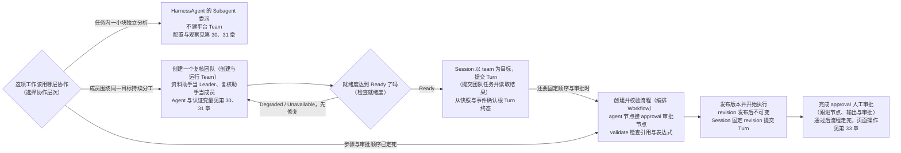
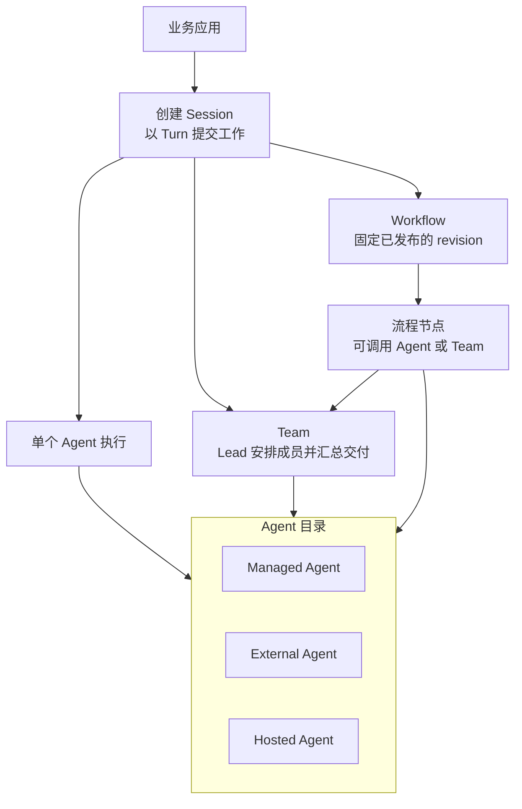

# 第 32 章 编排：Team 与 Workflow

> 本章导读：到这里为止，你的 Agent 都是一个人在工作。真实业务很快会带来三种新局面：任务执行到一半，有一块分析需要独立完成；一项工作需要几个成员围绕同一个目标持续分工；或者步骤与审批顺序已由业务定死，不能交给模型自由发挥。本章沿这条问题线给出三个协作层次——HarnessAgent 内部的 Subagent 委派、Team 组织的持续分工、Workflow 约束的固定流程——先讲清楚什么局面用哪一层，再动手走通两条主线：创建一个复核团队并提交团队任务，以及定义、校验、发布并执行一个带人工审批的 Workflow。读完本章，你可以把单 Agent 验证扩展为可验收的团队协作，或带人工审批的固定流程。

> **注意**：本章 Team 与 Workflow 相关内容均为预览文档，正式版本尚未发布。



*本章操作流程图*

## 多 Agent 编排概览

假设你已经有一个能独立完成任务的 Agent，现在接到一项需要不同专业能力配合的工作。按工程习惯，你会把它拆成职责和交付明确的部分，再让多个 Agent 共同推进——真正的困难在于：这些能力从哪里来，协作按什么规则进行。AgentScope Service 支持在托管任务内部委派子 Agent，也支持通过 Team 组织独立成员，或者通过 Workflow 规定步骤与依赖。选择哪种方式，取决于这项工作需要临时分工、持续协作，还是明确的执行流程。

先说成员从哪里来：参与协作的成员可以是 Service 运行的 Managed Agent，也可以是已经开发好的 External Agent，或通过 Runtime Host 连接的 Hosted Agent。它们进入同一个 Agent 目录后，可以按实际能力参与团队和流程编排，因此已有业务 Agent 和 Coding Agent 也能够与托管 Agent 配合完成工作。

本章的路线由此确定：先用 Managed Agent 完成一次协作（32.2 节的 Team、32.3 节的 Workflow），确认协作本身能跑通；已有应用或 Coding Agent 需要参与时，再按"需要已有能力时接入其他 Agent"接入；协作能够正常执行后，最后按"让编排融入业务工作"接入业务验收、定时触发或消息平台。

### 选择协作层次

**第一种局面：当前任务里只有一部分需要独立分析或复核。** 这时不需要新的协作单元，使用 HarnessAgent 的 Subagent 即可。主 Agent 在自己的执行过程中发起委派，通过子会话取得结果，再继续完成原任务。这种委派属于当前 Agent 的运行过程，不会自动创建一个平台 Team。

**第二种局面：几个成员要围绕同一个目标持续分工、沟通并交付。** 单次委派撑不起这种协作，可以创建 Service Team。Lead 根据任务安排成员，成员通过持久的任务与讨论记录协作，结果也可以进入业务验收。Team 的成员可以使用不同的运行方式，因而适合将托管助手、专用业务 Agent 和 Coding Agent 组织在一起。

**第三种局面：工作的步骤和推进条件已经明确。** 当业务明确规定"生成报告 → 人工审批 → 交付"这样的顺序时，可以使用 Workflow，把依赖、分支和人工审批表达为执行图。流程中的节点可以调用 Agent 或 Team：Team 负责在某一步中组织成员完成目标，Workflow 则决定这一步何时开始，以及满足什么条件后继续。

三类协作层次与 Session 调用路径的关系如图 32-1 所示。



*图 32-1：Agent、Team 与 Workflow 的编排关系*

三种局面可以直接对应成一张选型表：

| 你的处境 | 更合适的层次 |
| --- | --- |
| 当前任务中只有一部分需要独立分析或复核 | HarnessAgent 的 Subagent |
| 几个成员围绕同一目标持续分工、沟通并交付 | Service Team |
| 步骤和推进条件已经明确，需要固定依赖、分支与人工审批 | Workflow |

再补一条判断边界：需要由 Leader 动态拆分工作时用 Team；需要固定节点顺序、条件和汇合规则时用 Workflow——Workflow 内也可以调用 Team 节点，把动态协作嵌入更大的流程。Subagent 的配置与观察方式见第 30 章"添加 Skills 与子 Agent"和第 31 章"会话、任务与预算"。

### 先建立一个纯 Managed Team

首次验证团队协作时，可以先创建 Lead、Researcher 和 Reviewer 三个 Managed Agent，分别确认模型、工具与资源访问正常。为每个角色约定清楚的交付：Researcher 提供来源和事实，Reviewer 检查结论是否有依据，Lead 根据成员结果完成汇总，并保留尚未解决的问题。

随后按本章"创建与运行 Team"添加成员和角色，再提交一个规模较小的任务。检查 Issue 中的讨论和 Run graph，可以确认 Lead 是否实际分派了工作、成员是否返回了结果，以及汇总是否使用了这些交付。需要人工验收时，由有权限的人检查并决定接受或退回。

团队验证通过后，再根据工作需要增加成员或并发。如果多个成员需要修改同一份材料，应先约定文件所有权和同步方式，让每个成员知道自己能够修改什么，以及如何把结果交给下一位成员。

### 需要已有能力时接入其他 Agent

已有使用 AgentScope SDK 开发的应用，可以按第 30 章"注册 External Agent"接入平台，保留自己的进程和业务逻辑，并作为 External Agent 接收分派。其他框架或已有业务服务则按第 30 章"External SDK 与运行协议"适配任务领取、事件、结果与取消。接入后，团队引用平台中的 Agent ID，由运行绑定将工作交给原来的应用执行。

如果希望复用已安装的 Coding Agent provider，可以按第 30 章"连接 Hosted Agent"准备运行环境，再由 Runtime Host（见第 29 章）启动 provider、管理工作目录并回报执行记录。模型和启动选项等设置见第 30 章"Hosted Agent 配置"。这样，负责代码修改的成员可以继续使用自己的运行方式，同时向团队交付结果。

注册完成后，应先单独执行一个小任务，检查成员是否支持团队所需的任务派发、协作和控制操作，再把它加入 Team 或配置为 Workflow 的执行目标。目录中能够看到 Agent，或者它能够回答聊天问题，都不能证明这些协作能力已经具备。验证方法见第 31 章"SDK 与可运行示例"一节。

External 和 Hosted Agent 也可以直接作为 Session 的 Agent 目标执行任务。组成团队时，Managed Lead 可以负责整体协调，External 成员提供内部业务能力，Hosted 成员完成代码工作；应用仍通过 Session API 提交工作并读取结果。

### 通过 Session API 调用与观察协作

验证协作后，应用直接选择 Team 或 Workflow 创建 Session。Workflow 需要先发布 revision，Session 会固定这个版本；Team 会固定创建时的协作配置。应用随后以 Turn 为单位提交工作、读取进度和处理待办。每个 Turn 对应独立的协作或流程任务，具体调用方式见第 31 章"通过 Session API 接入应用"。

查看一个任务时，应用先恢复快照，再持续接收事件。如果需要了解某个成员如何处理分派，可以进一步查看内部 Issue 和 Run；需要检查交付时，则读取实际产物与业务验收记录。事件展示和文件交付分别见第 31 章"SSE 与事件续传"和"文件与产物"。

成员不自动共享同一个文件系统，应通过可访问的 Artifact 传递结果。取消或重试也不会撤销已经发生的外部操作；更换运行方式前，需要检查成员状态和已完成的工作。具体约束见本章"设计可协作的角色"等 Team 协作小节与第 31 章"执行参考：Session、Run 与 Attempt"。

### 让编排融入业务工作

如果工作需要负责人、讨论和人工验收，可以用 Issue（见第 33 章"工作分派、审批与验收"）保存目标和交付标准，并交给 Agent 或 Team 执行。这样，成员的执行记录与业务的接受或退回决定能够关联到同一项工作。

需要定期执行或由外部事件发起工作时，可以配置计划与事件触发（见第 33 章"计划与事件触发"），在指定时间或收到 Webhook 时把任务交给 Agent 或 Team。规则负责决定工作何时开始，执行目标的配置决定工作如何完成。当前 Automation 不能直接以 Workflow 为执行目标；如果需要运行固定流程，应用应通过 Session API 调用已发布的 Workflow revision。

如果用户从消息平台提出需求，可以按消息渠道接入（见第 31 章"接入消息渠道"）配置消息接收、目标路由和结果回传。当前飞书支持将外部消息关联为 Issue，并交给 Agent 或 Team 执行；这一工作路由不接受 Workflow 目标。其他渠道适配器的能力应分别确认，不能仅凭连接成功就认定它们支持相同流程。消息渠道需要单独配置，不是 Automation 的一种触发方式；接入时应将外部对话、执行记录和验收结果关联起来，方便用户跟进工作。

## 创建与运行 Team

概览一节把"持续分工"指向了 Team，这一节动手建一个最小的复核团队：两个 Managed Agent，一个当 Leader 整理材料，一个当成员负责复核。

Team 将多个已注册 Agent 组织成一个可被分派和调用的协作单元。Leader 理解目标、选择成员并汇总交付，成员通过任务与讨论交换结果。业务应用只需提交目标和输入，不必把团队内部每次委派改写成前端流程。

Managed、External、Hosted Agent 可以按各自能力加入同一 Team。先确认每个 Agent 已注册、可执行任务，且运行时支持所需协作协议；组成 Team 不会自动为运行时增加工具或协议能力。

第一次建团队时，可以按第 30 章"运行第一个托管 Agent"分别创建资料助手和复核助手，让两个 Managed Agent 完成本节流程。Team 不依赖 External 或 Hosted；需要已有能力时再添加对应成员。内部 Subagent、Team 与 Workflow 的区别见本章"多 Agent 编排概览"。

### 检查就绪度

| 状态 | 含义与处理 |
| --- | --- |
| Ready | 当前配置与成员能力满足就绪检查，可进行小任务验证 |
| Degraded | 部分成员或能力不可用，阅读每个成员的原因 |
| Unavailable | 当前无法开始有效协作，优先修复 Lead 或运行时依赖 |

成员可能使用不同运行方式。配置 Runtime policy 或成员覆盖前，确认所需能力、目标运行时及安全约束都能满足；更多候选运行时不意味着无损迁移会话。

### 创建一个复核团队

以下示例使用 Bash、`curl` 和 `jq`。先按第 31 章"认证与空间"一节准备 `SERVICE_URL`（Service 地址）、`TOKEN`（用户 Bearer token）、`TENANT`、`NAMESPACE`，并定义请求函数：

```bash
api() {
  curl --fail-with-body --silent --show-error \
    -H "Authorization: Bearer $TOKEN" \
    -H "X-AgentScope-Tenant: $TENANT" \
    -H "X-AgentScope-Namespace: $NAMESPACE" \
    -H 'Content-Type: application/json' "$@"
}
```

准备资料助手和复核助手，将其 ID 分别设为 `LEADER_AGENT_ID`、`REVIEWER_AGENT_ID`。下面让 Leader 整理材料，成员负责复核。Leader 不需要重复列入 `members`，每个成员的 Agent ID 和 role 必须唯一。

```bash
created=$(api "$SERVICE_URL/api/v1/teams" --data "$(jq -n \
  --arg tenant "$TENANT" --arg namespace "$NAMESPACE" \
  --arg leader "$LEADER_AGENT_ID" --arg reviewer "$REVIEWER_AGENT_ID" \
  '{tenant:$tenant,namespace:$namespace,name:"资料复核团队",leaderAgentId:$leader,
    instructions:"Leader 整理材料后委派 reviewer 检查证据与缺失项，按反馈修订并交付统一报告。",
    policy:{maxActiveTasks:3,maxFanout:2,requireReview:true},
    members:[{agentId:$reviewer,role:"reviewer",instructions:"检查事实、证据及未确认信息。"}]}')")
TEAM_ID=$(jq -r '.team.id' <<<"$created")
api "$SERVICE_URL/api/v1/teams/$TEAM_ID/overview"
```

`instructions` 描述协作方式，成员的 `instructions` 说明各自职责，`policy` 约束并发、委派与验收。概览返回团队的配置和运行情况；创建成功不代表每个运行时已经在线，应进一步核对成员可用性并执行一个小任务。完整策略见本章末"参考速查"。

### 提交团队任务并读取结果

团队准备好后，直接创建以它为目标的 Session。这里继续使用平台用户身份验证；接入业务后端时，可以按第 31 章"通过 Session API 接入应用"改用授权这个 Team 的应用凭据。

```bash
session=$(api "$SERVICE_URL/api/v1/agent-sessions" --data "$(jq -n \
  --arg team "$TEAM_ID" '{target:{type:"team",id:$team}}')")
SESSION_ID=$(jq -er '.id' <<<"$session")
turn=$(api "$SERVICE_URL/api/v1/agent-sessions/$SESSION_ID/turns" \
  -H 'Idempotency-Key: team-report-001' \
  --data '{"message":"Review this week’s material and deliver a report with sources."}')
TURN_ID=$(jq -er '.id' <<<"$turn")
api "$SERVICE_URL/api/v1/agent-sessions/$SESSION_ID/turns/$TURN_ID"
api "$SERVICE_URL/api/v1/agent-sessions/$SESSION_ID/snapshot"
```

Service 在后台派发 Leader 和成员任务，并将它们的进度整理到这个 Turn。应用用 Session 快照恢复页面，再订阅事件；根 Turn 的状态用于判断团队是否完成，而不是任意一个成员的完成通知。需要进一步诊断时，可以从控制台进入关联的 Issue、Run 和执行图。人工分派与验收仍可使用任务管理（见第 33 章），但应用调用无需自行创建这些内部记录。

### 调整成员与协作方式

读取 `GET /api/v1/teams/{teamId}` 获得完整配置。新增成员调用 `POST /api/v1/teams/{teamId}/members`，请求体包含 `agentId`、`role` 和可选 `instructions`；服务返回的 `member.id` 用于后续成员更新与移除。

更改团队名称、指令或策略使用 `PATCH /api/v1/teams/{teamId}`，携带当前 `expectedVersion`、`name`、`leaderAgentId`，并保留要沿用的策略和说明；更改成员角色使用 `PATCH /api/v1/teams/{teamId}/members/{memberId}`，携带 `expectedTeamVersion`。这些配置用于后续执行，已经开始的任务仍要按其实际执行记录跟进。不要通过移除成员来代替取消正在运行的任务。这些接口的完整行为约束见本章末"参考速查"。

### 提供给业务应用

应用调用 Team 时，直接创建 `target:{"type":"team","id":"TEAM_ID"}` 的 Session，再向 `/turns` 提交工作。Service 会将每个 Turn 转成一项团队任务，应用通过同一个 Session 查询进度、待办和产物。调用凭据在 Application 下签发，并显式授权这个 Team；调用方不需要获得修改成员或创建 Agent 的管理权限。完整流程见第 31 章"通过 Session API 接入应用"。

这也是 Agent API 覆盖 Team 的方式：对外提供统一的调用与结果协议，内部仍使用团队自己的委派和协作机制。Team 的任务执行不等于 Managed Agent 的可恢复会话；不要把 Managed 专属的 checkpoint、文件等会话接口套用于所有成员。

如果步骤、依赖和审批顺序由业务固定，继续阅读本章"编排 Workflow"。需要在页面上操作，见第 33 章"配置 Team 与 Workflow"。协作原理见本章"设计可协作的角色"。

### 设计可协作的角色

以技术调研为例，Lead 明确问题并整合报告；Researcher 收集带来源的事实；Reviewer 检查证据与遗漏。每个角色都应有独立可验证的输出，避免多个 Agent 同时无边界地改同一文件。

成员可以混用 Managed、Hosted 和 External，但必须具备对应任务派发与协作能力。能在 Chat 回答并不一定能充当 coordinator。先单独验证每个成员，再把任务交给 Team。

角色定下来后，协作过程要留下持久记录：用 Comment 和 mention 传递进展、问题与后续请求，用 Artifact 交付文件，用 child Issue 拆出可独立跟踪的子目标。不要依赖某个成员进程内的消息作为唯一协作记录。处理一次输入后需要记录处理情况，避免重试时重复响应。

Runtime Host 在任务执行中注入范围凭据和上下文。支持 Shell 的 provider 可以使用一组任务环境内的协作命令（完整清单见本章末"参考速查"）；这些命令在 Host 启动的任务环境中运行，不是在管理员普通终端里通过复制内部令牌模拟运行。MCP provider 可使用对应 collaboration 工具。Coordinator 使用节点完成/失败能力明确交付结果；普通回复不能替代流程收敛。

交付质量可以用模板约束。当第 34 章"从故障告警生成可审查的修复"案例需要扩展为多角色团队时，Developer 的交付评论可包含以下内容，并附 PR 和实际测试记录：

```text
目标：实现订单筛选与分页；保留原验收检查并补充边界测试。
修改：列出变更的文件与规则。
验证：JDK 版本、执行目录、命令、退出码、测试日志和 CI 链接。
交付：GitHub Issue、PR、head SHA、Review 与 Artifact 标识。
未完成项：列出没有验证的条件；没有则明确说明。
```

模板只是交付结构，不能把其中的占位内容当作已发生的执行。Lead 打开真实 Artifact 并核对证据后再汇总；成员各自的工作目录不自动共享，评论中的本地绝对路径也不等于另一个成员可以读取的文件。

### 一次运行的生命周期

**定义与一次运行**。Team 定义包含 Leader、成员和策略；Run 固定这次协作的快照，便于追查当时的团队配置。控制面为 Team 创建一个 coordinator node 和初始 Leader 任务，而不是为每个成员无条件创建一次调用。Leader 根据上下文选择成员。

**如何结束工作**。成员回复、Attempt 成功、coordinator node 完成、Run 终态和 Issue 验收分别表达不同层次。Leader 的最终文字不能代替节点完成。仍有必要子工作未完成时，应等待、调整计划或明确失败，不能用"报告已生成"掩盖未完成义务。

人工验收需要检查最终结果、重要来源和失败说明，再接受结果或要求修改。查看 Run succeeded/partial_succeeded 时也要核对业务验收要求。

**扩展与恢复**。新增成员前先单独验证它的能力，再检查 Leader 是否能正确使用该角色。混合 Managed、Hosted、External 时，用参考速查"Team 角色、成员与策略参数"中的成员混用检查逐个验收。

恢复依赖持久工作和执行状态；Runtime fresh fallback 重建上下文，不迁移旧进程。排障时沿 Issue → Run → Node → Task → Attempt 检查：未派发看就绪度与策略，执行卡住看后端与确认请求，交付未结束看成员义务和协调节点状态。

> **延伸阅读**：Team 的管理 API 全表、字段与策略参数、业务协作 API、Runtime Host 协作命令与执行回报协议，见本章末"参考速查"；页面操作与诊断见第 33 章"配置 Team 与 Workflow"与"分派、跟进与验收工作"。

## 编排 Workflow

Team 让 Leader 现场决定怎么拆工作；当业务明确规定"生成报告 → 人工审批 → 交付"时，顺序本身已经固定，这时可以用 Workflow 保存步骤和依赖。先发布一个 revision，再创建以该 Workflow 为目标的 Session，即可通过 Turn 提交任务。需要由 Leader 动态拆分工作时，使用本章"创建与运行 Team"；两者采用相同的应用调用路径。

Workflow 有可编辑的定义和发布后不可变的 revision。每次 Run 固定一个 revision，因此修改草稿不会改变已经开始的执行。

可以直接使用已经验证的 Managed Agent 作为流程节点；需要分工时再让节点调用 Team。先按第 30 章"运行第一个托管 Agent"运行一个托管 Agent，再固定流程与审批人。选型对比见本章"多 Agent 编排概览"。

### 创建并校验流程

以下示例继续使用 Bash、`curl` 和 `jq`，并沿用 32.2 节定义的 `api` 请求函数与 `SERVICE_URL`、`TOKEN`、`TENANT`、`NAMESPACE` 变量（变量准备见第 31 章"认证与空间"一节）。

将 `AGENT_ID` 设为已经可执行任务的 Agent ID，`APPROVER_ID` 设为审批人的账号标识。下面的流程先生成报告，再等待人工审批：

```bash
defined=$(api "$SERVICE_URL/api/v1/orchestration-definitions" --data "$(jq -n \
  --arg tenant "$TENANT" --arg namespace "$NAMESPACE" \
  --arg agent "$AGENT_ID" --arg approver "$APPROVER_ID" \
  '{tenant:$tenant,namespace:$namespace,name:"报告复核流程",
    draftSpec:{nodes:[
      {key:"draft",type:"agent",agentId:$agent,input:{request:"run.input.request"}},
      {key:"review",type:"approval",approval:{approverType:"human",approverRef:$approver,prompt:"请检查报告及证据"}}
    ],edges:[{from:"draft",to:"review",on:["succeeded"]}]}}')")
WORKFLOW_ID=$(jq -r '.definition.id' <<<"$defined")
api "$SERVICE_URL/api/v1/orchestration-definitions/$WORKFLOW_ID/validate" --data '{}'
```

节点 `key` 在流程中唯一，边把前一步的状态与后一步连接。`input` 将输入字段映射为 CEL 表达式；这里将请求里的 `request` 交给 draft 节点。表达式可读取 `run`、`issue`、`trigger` 和前序 `nodes`，不能作为任意脚本执行器。服务端校验检查节点类型、引用、表达式及环路；目标运行时是否可用仍要在实际执行前确认。

### 发布版本并开始执行

校验通过后发布当前定义，保存返回的 revision ID。后续修改使用 `PATCH /api/v1/orchestration-definitions/{definitionId}`，传入 `draftSpec` 和 `expectedVersion`，然后再次发布。

```bash
published=$(api "$SERVICE_URL/api/v1/orchestration-definitions/$WORKFLOW_ID/publish" \
  --data "$(jq -n --argjson version "$(jq '.definition.version' <<<"$defined")" \
  '{expectedVersion:$version}')")
REVISION_ID=$(jq -r '.revision.id' <<<"$published")
session=$(api "$SERVICE_URL/api/v1/agent-sessions" --data "$(jq -n \
  --arg workflow "$WORKFLOW_ID" --arg revision "$REVISION_ID" \
  '{target:{type:"workflow",id:$workflow,revisionId:$revision}}')")
SESSION_ID=$(jq -er '.id' <<<"$session")
turn=$(api "$SERVICE_URL/api/v1/agent-sessions/$SESSION_ID/turns" \
  -H 'Idempotency-Key: weekly-report-001' \
  --data '{"input":{"request":"Produce this week’s report with sources"}}')
TURN_ID=$(jq -er '.id' <<<"$turn")
```

保存 Session ID 和 Turn ID，后续查询、审批和取消都围绕这两个资源进行。Service 会自动建立流程执行与工作记录。重试同一任务时沿用相同幂等键；新任务使用新的 key。

### 跟进节点、输出与审批

```bash
api "$SERVICE_URL/api/v1/agent-sessions/$SESSION_ID/turns/$TURN_ID"
api "$SERVICE_URL/api/v1/agent-sessions/$SESSION_ID/snapshot"
```

Turn 详情返回当前任务状态、结果和失败原因；Session 快照用于恢复应用界面。需要实时展示时，按照第 31 章"SSE 与事件续传"从快照游标订阅增量事件。只有诊断流程内部节点时，才需要从控制台查看关联 Run 的执行图。

review 节点会出现在 Turn 的 required_actions 中。指定审批人使用自己的平台 token，向该 Turn 的 `/actions` 提交实际的 `request_id`、`expected_version` 和 `decision`。审批通过后流程继续，应用密钥不能替代指定人员的身份。

### 逐步增加流程能力

| 节点类型 | 用途与关键字段 |
| --- | --- |
| `agent` / `team` | 执行单 Agent 或团队任务；使用 `agentId` / `teamRef` |
| `condition` | 用 `condition` 表达式判断路径，边也可设置条件 |
| `join` | 按 `join.mode` 的 `all`、`any` 或 `quorum` 汇合依赖 |
| `approval` | 用 `approval.approverRef` 指定审批人 |
| `timer` | 用 `timer.durationSeconds` 或 `timer.at` 等待 |
| `signal` | 等待 `signalName` 指定的外部信号 |
| `subrun` | 用 `definitionRevisionId` 调用固定版本的子流程 |

例如增加等待 `report.ready` 的 signal 节点后，外部业务通过下面的 API 推进流程：

```bash
api "$SERVICE_URL/api/v1/agent-sessions/$SESSION_ID/turns/$TURN_ID/inputs" \
  -H 'Idempotency-Key: report-upload-001' \
  --data '{"request_id":"RETURNED_SIGNAL_REQUEST_ID","expected_version":1,"payload":{"artifactId":"YOUR_ARTIFACT_ID"}}'
```

请求中的 ID 和版本必须取自当前 required_actions，不能直接使用示例占位值。signal 是流程的外部输入，不会自动替代审批。更复杂的流程先运行小样本，查看真实节点输出，再编写下游映射；不要假定不同运行时的结果结构完全相同。

### 取消任务与运维控制

应用通过 Turn 的 `/cancel` 取消当前任务，通过 capabilities 判断是否可以 `/resume`；再次从头执行时提交一个新的 Turn。以下 Run 接口供控制台运维和流程诊断使用，Run ID 从关联执行记录获取，不是 Turn ID。

`POST /api/v1/orchestration-runs/{runId}/pause` 阻止新节点调度，已运行步骤仍可能返回；`/resume` 恢复调度；`/cancel` 请求取消节点、任务和子运行，不会删除或验收 Issue。请求体可使用 `{}`。

终态后向 `/rerun` 提交 `{"idempotencyKey":"weekly-report-retry-001"}` 创建新的 Run，保留与原运行的关联；可加 `input` 替换输入。节点支持 `timeoutSeconds`、`retry` 和 `failurePolicy`，其中失败策略可选 `fail_fast`、`continue`、`partial_success`。重试不保证撤销已经发生的外部副作用。

应用创建 Session 时，使用 `target:{"type":"workflow","id":"WORKFLOW_ID","revisionId":"REVISION_ID"}`。省略 `revisionId` 时，Service 在创建会话时选择最新的已发布版本；已有会话不会自动切换到新版本。

> **延伸阅读**：控制台设计器与运行图见第 33 章"配置 Team 与 Workflow"。

## 本章小结

这一章沿"一个 Agent 不够用"的问题线走完了三层协作：

1. **选层次**：任务内一小块独立工作用 Subagent 委派；持续分工建 Team；顺序固定用 Workflow——Workflow 节点还能调用 Team，把动态协作嵌进固定流程；
2. **Team 跑起来**：创建复核团队（Leader、成员、policy），检查就绪度，以 team 为目标创建 Session、提交 Turn，从快照和事件跟进进度；
3. **团队可维护**：成员与配置的每次修改都带版本号（`expectedVersion` / `expectedTeamVersion`），业务应用用被显式授权的 Application 凭据调用同一个 Team；
4. **协作可信赖**：角色要有独立可验证的输出，进展留在 Comment、Artifact 和 child Issue 里，交付模板让成员结果可复核；结束时以 coordinator node 完成和 Issue 验收为准，而不是 Leader 的最后一句话；
5. **Workflow 固定顺序**：定义可编辑、revision 不可变，Run 固定版本执行；approval 节点把人工审批接进流程，节点类型覆盖条件、汇合、定时、信号与子流程；取消与重跑围绕 Turn 和 Run 接口进行。

本章的 API 操作在 Console 页面上都有对应入口，第 33 章"配置 Team 与 Workflow"专门演示页面操作。

**验收清单**——读到这里，你应该能：

- ☐ 面对一项具体工作，判断它该用 Subagent 委派、Team 还是 Workflow；
- ☐ 创建一个含 Leader 和成员的 Team，并解读 Ready / Degraded / Unavailable 三种就绪度；
- ☐ 以 Team 为目标创建 Session、提交 Turn，并从快照与事件跟进团队进度；
- ☐ 新增、调整和移除成员，并说明 PATCH 为什么要携带 `expectedVersion`；
- ☐ 解释 Run、coordinator node 与 Issue 验收在一次团队任务中的关系；
- ☐ 定义、校验并发布一个 Workflow，提交 Turn 并完成 approval 节点的人工审批；
- ☐ 取消一个流程任务，并用 rerun 创建一个新的 Run。

## 参考速查

本节收拢本章正文引用过的管理 API 全表、字段与策略参数，供配置和排障时查阅；正文主线中的最小路径不依赖本节。

### Team 管理 API

所有路径相对 Service 地址，使用用户 Bearer token 和已授权空间。列表请求必须提供 `tenant`、`namespace`；创建时将两者写入 JSON。示例与认证函数见本章"创建一个复核团队"。

| 操作 | API | 请求与返回 |
| --- | --- | --- |
| 创建 | `POST /api/v1/teams` | 必填 `tenant`、`namespace`、`name`、`leaderAgentId`；可同时传 `members`、`policy`；返回 `{team}` |
| 列表 / 详情 | `GET /api/v1/teams`、`GET /api/v1/teams/{id}` | 分别返回 `{items}`、`{team}` |
| 更新 | `PATCH /api/v1/teams/{id}` | 必填 `name`、`leaderAgentId`，携带当前 `expectedVersion`，并保留希望沿用的 `policy` 与 `description`；返回 `{team}` |
| 新增成员 | `POST /api/v1/teams/{id}/members` | `agentId`、`role` 及可选成员字段；返回 `{member}` |
| 更新成员 | `PATCH /api/v1/teams/{id}/members/{memberId}` | 必填 `role`，携带 `expectedTeamVersion`；可更新职责、能力要求和运行策略；返回 `{member}` |
| 移除成员 | `DELETE /api/v1/teams/{id}/members/{memberId}` | 成功返回 204；不取消正在运行的任务 |

`PATCH Team` 目前要求提交名称和 Leader，并会应用请求中的 policy，不是任意字段的局部合并。先 GET 当前定义再改写需要的字段，避免遗漏原策略。更新成员时同样保留要沿用的配置；其 `agentId` 不可在该 PATCH 中更换，改换 Agent 应移除后重新添加。

Team 响应的 `id`、`version`、`members[].id` 用于后续操作；`members[].agentId` 是注册 Agent 的身份，不能拿成员记录 ID 当作 Agent ID。Leader 不再重复放入成员列表，成员 Agent 和 role 均须唯一。

### Team 角色、成员与策略参数

**团队和成员字段**

| 层次 | 字段 | 用途 |
| --- | --- | --- |
| Team | `name`, `description` | 团队名称与适合处理的工作 |
| Team | `leaderAgentId` | 统一接收任务、协调并汇总的 Agent |
| Team | `instructions` | 团队目标、委派规则、失败处理与交付要求 |
| Team | `status` | `active` 或 `disabled` |
| Member | `agentId` | 同一范围内的 Agent 身份 |
| Member | `role` | 职责标签，例如 researcher、reviewer |
| Member | `instructions` | 该成员在团队中的具体职责 |
| Member | `capabilityRequirements` | 派发所需能力要求 |
| Member | `runtimeBindingPolicy` | 该团队成员的运行候选及回退策略 |

例如 Researcher 必须交付来源和结论，Reviewer 必须指出证据缺口；Leader 负责消除冲突、说明未完成项并提交一份最终结果。成员角色不能代替 Agent 自己的模型、工具和资源配置。

**协作限制（policy）**

| `policy` 字段 | 控制内容 | 零值语义 |
| --- | --- | --- |
| `maxActiveTasks` | 并发任务上限 | 使用默认值 32 |
| `maxHops` | 委派跳数 | 使用默认值 8 |
| `maxFanout` | 单次委派接收者数量 | 不增加 Team 专属限制 |
| `maxChildDepth` | 子 Issue 深度 | 使用默认值 4 |
| `maxChildIssues` | 每个父 Issue 的子 Issue 数量 | 不增加 Team 专属限制 |
| `maxTaskRetries` | 每个任务的重试限制 | 不增加 Team 专属限制 |
| `allowExternalDelegation` | 是否允许委派给名单外 Agent/Team | false |
| `allowMentionAll` | 是否允许面向全体成员的委派 | false |
| `requireReview` | 按执行策略要求人工复核 | false |

"名单外委派"不是指 External Agent 运行模式。一个在成员名单中的 External Agent 仍然是本团队成员。

API 可显式设置策略；控制台创建表单也可能传入自己的初始值。以读取到的 `team.policy` 为准，不要把所有零值都解释为无限制或禁用。所有数值限制不能为负；`maxHops` 最大 64、`maxChildDepth` 最大 32、`maxFanout` 最大 256，具体操作仍受平台约束。

下面是一个小团队的策略片段，可用于理解字段组合：

```json
{
  "policy": {
    "maxActiveTasks": 4,
    "maxFanout": 3,
    "maxHops": 4,
    "maxChildDepth": 2,
    "maxChildIssues": 8,
    "allowExternalDelegation": false,
    "allowMentionAll": false,
    "requireReview": true
  }
}
```

修改 Team 时 API 使用 `expectedVersion` 做版本检查。并发、层级和人数限制不构成外部模型账单的硬上限；还需按实际 provider 的用量与账户策略管理预算。

**交付与资源策略**

其他策略参数用于限制交付与资源消耗：

| 字段 | 含义 |
| --- | --- |
| `maxArtifactBytes`、`allowedArtifactMediaTypes` | Artifact 大小与允许的 MIME 类型 |
| `maxIssueTokens`、`maxIssueCostMicros` | 根据已回报用量检查 Issue 预算；费用单位为 micro |
| `issueSlaSeconds`、`taskTimeoutSeconds` | 工作截止时间默认值与任务超时限制 |
| `secretPolicy`、`piiPolicy` | `allow` / `block`，按平台规则检查协作内容 |

预算依赖运行时如实回报用量，内容检查也不能代替工具与数据权限。不要将这些字段理解为外部提供商账单的实时硬限额或完整的数据防泄漏系统。

**成员混用检查**

| 模式 | 加入前验证 |
| --- | --- |
| Managed | 模型可用，Environment/Memory/Vault 绑定正确，可完成一次任务 |
| Hosted | Host 在线、provider 可用、定义映射通过，任务协作 MCP/CLI 可用 |
| External | 适配器具备任务入口与真实完成/失败回报；仅有观测注册不够 |

Leader 必须具备团队协调能力，包括委派、查看结果和节点完成/失败。普通成员只需完成其承担的角色；并非所有能进行 Chat 的 Agent 都适合当 Leader。

**Runtime policy**

`runtimeBindingPolicy` 包含有序 `candidates`、`selectionMode`、`fallbackMode` 和可选 `retryPolicy`。候选中的 `binding` 指定执行后端，`requiredCapabilities` 与 `securityConstraints` 限制选择条件。成员覆盖要求显式设置 `selectionMode:"ordered"`、`fallbackMode:"disabled"` 或 `"fresh"`，并提供至少一个有效 candidate。候选 binding 使用实际运行绑定结构，不填写主机进程号或任意 URL。

选择遵循节点覆盖、成员覆盖、Agent 策略的层次。显式 fresh fallback 是新执行上下文，保留的工作证据必须在 Issue、评论与 Artifact 中。先验证单候选，再增加回退；扩容与回退都不会自动解决共享文件冲突。

Agent 级默认策略通过 `GET/PUT /api/v1/agent-runtime-policies/{agentId}` 管理。PUT 提交 `tenant`、`namespace`、非空 `candidates`，每个 candidate 的 `binding.bindingId` 必须属于该 Agent 且可用；服务会解析实际后端。可设置 `selectionMode`、`fallbackMode`、`maxConcurrency`、`queueTimeoutSeconds`、`attemptTimeoutSeconds`、`retryPolicy`，响应为 `{policy}`。GET 查询仍需携带 tenant/namespace。

### 业务应用的协作 API

以下操作使用用户 Bearer token 和相应工作授权。它们操作持久业务记录，不要求调用方知道成员当前在哪个运行时执行。

| 操作 | API 与关键参数 |
| --- | --- |
| 补充信息、请求成员处理 | `POST /api/v1/issues/{issueId}/comments`：`content`、可选 `parentId`、`type`、`mentions:[{type,ref}]` |
| 预览评论路由 | `POST /api/v1/issues/{issueId}/comments/preview-routing`：与评论相同的输入，返回 `targets` |
| 读取讨论 | `GET /api/v1/issues/{issueId}/comments`：`limit`、`cursor`、可选 `threadId`、`rootsOnly`；返回 `items`、`nextCursor` |
| 创建独立子目标 | `POST /api/v1/issues/{issueId}/children`：标题、说明、负责人及验收字段，返回 `issue`、`agentTask` |
| 查询子工作 | `GET /api/v1/issues`：`tenant`、`namespace`、`parentIssueId` |
| 文件交付 | `POST /api/v1/artifacts/uploads`：multipart 的 `tenant`、`namespace`、`issueId`、`relation`、`file` |
| 读取产物 | `GET /api/v1/issues/{issueId}/artifacts`，随后 `POST /api/v1/artifacts/{artifactId}/download` |

`mentions[].type` 选择 `agent`、`team` 或 `human`，`ref` 使用对应身份标识。正文中的名字不是结构化路由。提交评论后检查返回的 `routes`，确认是已排队、已合并还是被策略阻止；这些结果比"评论写入成功"更能说明是否产生了后续工作。仅记录进度时使用 `type:"progress"`，不设置 mentions，避免隐式派发。

### Runtime Host 协作命令

Runtime Host 在任务执行中注入范围凭据和上下文。支持 Shell 的 provider 可以使用：

```bash
as task context
as issue current
as task progress --content-file ./progress.md
as task respond --content-file ./reply.md
as artifact upload ./report.md
as team current
as task run graph
```

这些命令在 Host 启动的任务环境中运行，不是在管理员普通终端里通过复制内部令牌模拟运行。MCP provider 可使用对应 collaboration 工具。

### 任务执行回报协议

执行适配器使用平台下发的任务凭据访问 `/api/v1/agent-tasks/{taskId}` 下的协议入口，业务用户 token 不能冒充正在执行的任务。`GET .../context` 返回当前工作上下文；`POST .../progress` 接受 `content`、可选 `parentId` 与 `mentions`；`POST .../complete` 可回报 `expectedVersion`、`summary`、`result`、`usage` 及已处理输入 ID。失败回报 `POST .../fail` 使用 `expectedVersion`、`code`、`message`。

Hosted provider 通常通过注入的 CLI / MCP 使用这些能力，External 适配器按任务接入协议（见第 30 章"用 API 观察和控制一次执行"）接入。协调节点完成/失败还有专门的 coordinator 权限；普通成员的结果回报不会自动取得 Leader 权限。
