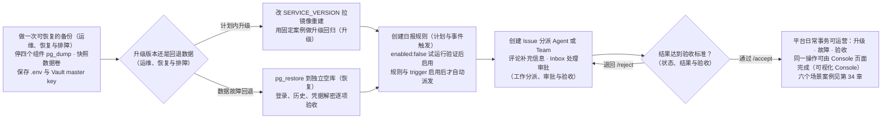
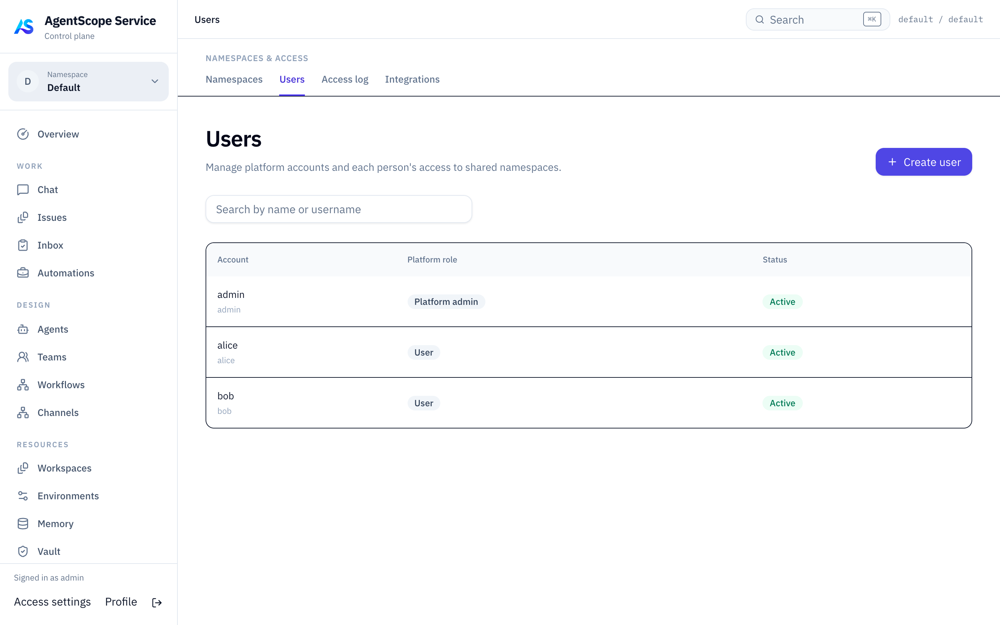
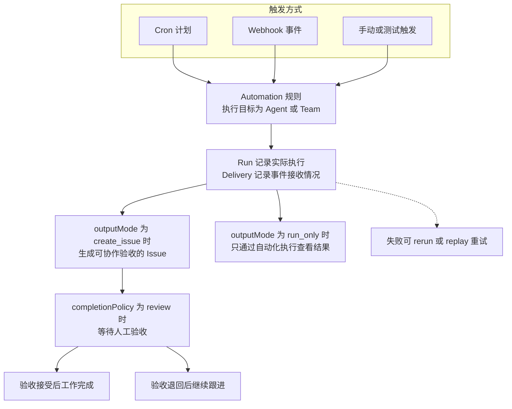
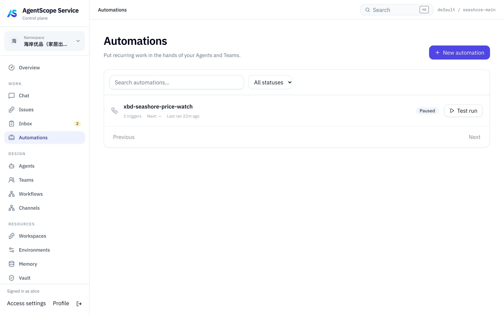

# 第 33 章 运维与运营

> 本章导读：平台部署并接入应用之后，剩下的工作是让它持续可靠地运行并被业务团队用好。本章以运维、恢复与排障开篇——备份、升级、恢复验收和一套按现象索引的排错表；随后是定时与事件触发（Automation）、工作分派审批与验收（Issue/Inbox）、可视化 Console 的完整页面导览、部署配置参考，最后用六个场景案例的概览收束，引出第 34 章的完整案例。读完本章，你可以运营一个多团队共用的 Service 平台，并处理升级、故障与人工验收的日常事务。



*本章操作流程图*

## 运维、恢复与排障

> **注意**：当前发布版本为 `2.1.0-BETA1`，属于预发布版本。用于生产前请验证实际部署。

一份可恢复的备份包括数据库、Workspace、Artifact 和解密这些数据所需的密钥。

### 数据持久化

Compose 使用三个命名卷分别保存 PostgreSQL 数据、共享 Workspace 和 Artifact。可以通过 `docker volume ls` 找到本项目的卷，并将它们纳入备份策略。备份加密数据时，还必须妥善保留 `.env` 中的 Vault master key，因为恢复这些数据时仍需要原来的密钥。

如果工具需要读取宿主机上的业务资料，应显式配置目录挂载，并保证容器用户 `65532:65532` 具有所需权限。只在 Agent 指令中写出宿主路径，并不会使这个路径出现在容器里。准备资料时，应先确认所选 Environment 实际能够访问哪个目录，再将对应位置提供给 Agent。

### 更新配置和版本

修改 `.env` 后，需要重新执行 Compose 启动命令，让服务使用新的配置。随后检查组件状态，确认更新后仍能正常运行。

```bash
docker compose up -d --wait --wait-timeout 600
docker compose ps
```

升级版本时，应先在 `.env` 中修改 `SERVICE_VERSION`，再拉取对应的新镜像并重新启动服务。初始化脚本会保留已有 `.env`，所以重新运行 `init-env.sh` 不会替你完成这次版本修改。如果需要变更密钥，还应协调使用该密钥的各个组件；尤其是 Vault master key，它关系到已有数据的解密，不能像普通登录密码一样直接替换。

完整 Compose 使用 standalone HTTP 运行方式。如果还要接入依赖 ASDP 的 External SDK，应先按 External 接入说明（第 30 章"External SDK 与运行协议"）准备对应的运行通道。生产环境的 Kubernetes 安装方式见第 29 章"生产安装"，无论采用哪种部署方式，都应在升级前完成本章的备份恢复演练。

### 停止、继续与排错

需要暂时停止平台时，可以执行 `docker compose down`。这个命令会停止服务并保留数据卷，之后重新运行启动命令即可继续使用已有数据。日常停止时不要附加 `-v`，因为该参数会同时删除数据卷。

如果启动失败，先用 `docker compose ps -a` 确认哪个组件未正常运行，再通过 `docker compose logs --tail=100` 查看对应错误，判断问题是否发生在镜像拉取、数据库连接或组件启动阶段。如果宿主端口已被占用，可以修改 `.env` 中的 `GATEWAY_PORT`；若对外访问地址也随之变化，还需同步更新 `BUILDER_OAUTH_PUBLIC_URL`，然后重建容器。

### Docker 备份

安排维护窗口，先停止四个应用组件，保留数据库运行：

```bash
docker compose stop gateway scheduler data control
mkdir -p backup
chmod 700 backup
docker compose exec -T db pg_dump -U agentscope -d agentscope -Fc > backup/database.dump
```

使用你的卷备份工具为 `workspaces`、`artifacts` 命名卷制作快照，保存 `.env`，并记录 `SERVICE_VERSION`、镜像 digest 和快照时间。备份目录应位于安装目录之外的受保护持久存储中。确认数据库备份与文件快照属于同一维护窗口后再启动应用。

```bash
docker compose up -d --wait --wait-timeout 600
```

Kubernetes 同样需要数据库备份与 PVC 快照；根据存储提供程序选择快照方式，保存配置 Secret 的受保护副本。

### 升级

阅读新版本的迁移与兼容性说明，先在测试数据库副本上演练。完成备份后，Docker 修改 `.env` 中的 `SERVICE_VERSION`，拉取镜像并重建容器；Helm 使用指定版本的 Chart 执行 upgrade。

Go 在启动时执行产品与运行状态迁移，Java 当前通过 Hibernate 更新表结构。组件镜像回退不保证旧版本可以读取新 schema。

### 恢复

需要回退数据时，先停止应用写入。在独立空数据库中恢复备份，恢复同一批 Workspace / Artifact 快照与原 Vault 密钥，再用备份对应的组件版本启动。不要把 `pg_restore --clean` 指向仍在使用的业务数据库。

对新建的恢复数据库执行示例：

```bash
pg_restore --no-owner --no-acl --dbname="$RESTORE_DATABASE_URL" backup/database.dump
```

恢复到同一 PostgreSQL 实例中的新数据库后，在 Compose `.env` 设置 `POSTGRES_DB` 为恢复库名称，并使用原密钥和同批文件快照启动。数据库容器只在数据目录为空时初始化数据库；已有实例中的恢复库需要预先创建。

### 恢复验收

检查管理员登录、已有 Agent 与 Session 历史、Workspace 文件、Vault 凭据解密、运行时连接，以及一项新的小任务。Task/Issue 的验收状态应与备份时刻相符。

只有数据库、文件和密钥都能共同恢复，备份才算通过验证。升级按维护窗口执行；单副本安装不提供多副本 HA 或无停机升级保证。

### 用 API 检查恢复后的服务

恢复后先做读取，再提交一个明确的新测试任务：

| 核对内容 | API |
| --- | --- |
| Agent 与运行绑定 | `GET /api/v1/agents`、`GET /api/v1/agents/{id}/bindings` |
| 会话配置与版本 | `GET /api/v1/agent-sessions/{sessionId}`，读取固定 target |
| 已有业务结果与页面 | `GET /api/v1/agent-sessions/{sessionId}/turns/{turnId}`、`GET .../{id}/snapshot` |
| 未完成编排与实际执行 | `GET /api/v1/orchestration-runs/{id}/graph`、`GET /api/v1/execution-attempts/{id}` |
| 通知与自动化 | 查询原 Webhook/Automation 的投递记录，核对回调去重与运行状态 |

读取使用原调用归属的凭据或已授权平台身份。Turn 数据、Managed 原生日志、Workspace 文件和凭据加密密钥都需恢复；只恢复其中一层不能保证任务可继续。过期事件 cursor 应重新获取 snapshot，不重新提交已完成工作。接口和认证见第 31 章"API、SDK 与目录管理"。

### 恢复后重新开放服务

先保持定时规则和外部入口受控，在测试工作上验证登录、历史、文件和凭据。确认 Runtime Host 重新上线，再逐个恢复计划触发与业务流量。数据库快照恢复不会撤销备份之后已经发出的消息或外部写入；对照业务系统核对幂等记录和未完成工作后再重跑。

### 用固定案例做升级回归

在升级前保存第 34 章"在 CRM 中生成客户方案"案例的固定请求、来源版本与验收结果，在隔离的恢复环境中重复调用。模型措辞可以不同，下面的事实和持久化结果应可核对：

| 检查 | 验收依据 |
| --- | --- |
| 来源恢复 | 请求中的三份资料与版本一致；若生产接入了 Memory，另外验证实际读取 |
| 文件恢复 | 原 Artifact 可以下载，内容与备份记录一致 |
| 新任务 | 新 Turn / Run 完成，引用正确来源，未把未确认产品能力写成承诺 |
| 历史 | 升级前的 Turn、事件、产物与应用验收记录仍能查看 |
| Host 与调度（如果使用） | 在测试目标上运行代码修复或周期研究案例，检查关联记录 |

记录升级前后版本、备份批次、用例输入、执行 ID 和差异。只在需要对应集成时验证其凭据可用性；知识读取案例本身没有外部凭据，不能证明 Vault 解密路径也已验证。

### 获取组件日志

```bash
docker compose logs --tail=200 control data scheduler gateway
kubectl -n agentscope logs deployment/service-agentscope-control --tail=200
kubectl -n agentscope describe pod POD_NAME
```

Gateway 正常不代表模型或工具执行正常。Managed 会话故障查看 Dataplane；渠道与 Worker 调度查看 Scheduler；产品 Automation、资源、账号和编排派发查看 Control。Hosted provider 故障还需对应主机的 daemon 日志。

### 重启没有重置管理员密码

这是预期行为。`CONTROL_PLANE_BOOTSTRAP_PASSWORD` 只用于空账号表。已有账号通过 Profile 或管理员账号管理修改密码，不通过重新生成 `.env` 重置。

这里的管理员账号管理，对应控制台的 Namespaces & Access → Users 页：



实测部署中的账号与平台角色在这一个页面集中维护；已有账号的密码在这里或账号自身的 Profile 里修改，重新生成 `.env` 只影响空账号表的初始化，不会改写图中已有的账号。

### Vault 解密失败

检查恢复时是否保留了原 `BUILDER_VAULT_MASTER_KEY`，以及各组件是否一致。不要通过随意替换密钥来修复；先恢复匹配的配置与数据。

### 收到任务但没有最终结果

先从 Issue 的 Executions 判断 Run、Node 和最新 Attempt，而不是看最后一条文字。waiting 时查看依赖、approval 或 signal；blocked 时补充信息；failed 时检查错误和部分产物。Inbox 的 Request changes 不自动启动执行。External 接入应核对是否实现任务回报，Hosted 接入应核对 provider 是否退出并完成回传。

### Webhook 或 Session 重复请求

先查询已有 Delivery/Turn 的状态。保持同一逻辑请求的幂等键和内容，只有新的业务请求才使用新 key。事件被过滤看 trigger 的 event 配置；请求被拒绝看认证头和 schema。SSE 断线后优先查询返回的 statusUrl。

### 统一服务 API 调用排障

保存 Session ID、Turn ID、请求幂等键和错误码。先读取 `/api/v1/agent-sessions/{sessionId}/turns/{turnId}` 确认任务状态，再通过同一 Turn 的 `/snapshot` 和 `/capabilities` 了解已保存的结果与当前可用命令。

| 现象 | 核对方法 |
| --- | --- |
| 创建 Session 后没有 key | 凭据由 Application 单独签发，创建时显式提供 targets 和 scopes |
| 401/403 | 检查凭据目标授权、Application 状态与 scope、待办指定审批人 |
| 409 | 区分资源版本冲突、幂等键内容不一致、目标能力不匹配或活动 Conversation 冲突 |
| 输入命令已接收但没生效 | 查询返回的 command 状态；持久接收不代表模型已消费 |
| SSE 返回 410/cursor_expired | 重新读取 snapshot 替换界面，再从新的 as_of 继续；不重发任务 |
| 某个成员完成但调用仍运行 | 检查 Turn 与 steps，不把成员结果当成根工作终态 |
| 恢复按钮不可用 | 按 available_commands 展示；并非所有后端支持 resume，公共 API 不支持 checkpoint restore |

`/api/v1/events` 是 WebSocket 刷新通知，不能替代持久 Turn SSE。具体请求和响应字段见第 31 章"通过 Session API 接入应用"。

### Agent API 与 SSE

以下针对 Managed 原生会话。先保存 session ID、turn ID、最近事件 ID、HTTP 状态码和脱敏错误。区分页面连接、任务执行和上下文恢复：

| 现象 | 处理方式 |
| --- | --- |
| 刷新后只有后半段文字，或缺少离开期间的工具 | 先 GET snapshot 渲染 items/tools，再从 as_of 订阅；只恢复 cursor 不会重建 UI |
| SSE 连接关闭，任务是否停止不确定 | GET turns/{turn} 或 snapshot；断线不取消，也不重新 POST turns |
| run.ended / item.completed 后仍显示运行中 | 等目标 turn 的明确结果；执行、消息、工具完成不等于任务完成 |
| 400 / 409 cursor 错误 | 核对 session 范围，重新取快照；不要自行解析、递增 cursor |
| 410 资源分页过期 | 从资源第一页重新读取；资源分页 cursor 不可传给 SSE |
| 确认已提交但工具没有继续 | 查 required_actions 和 GET turns/{turn}/actions；accepted 仅接收，rejected 时先读 reason 和 pending |
| steer 返回 409 | 任务可能已结束或关闭输入；重新读取状态，新的独立问题提交新 turn |
| checkpoint 恢复返回 409 | 先处理未关闭任务、待办、未消费输入和未知工具结果；恢复不能撤销外部操作 |
| 费用不完整或预算拒绝执行 | 查 usage/budget 的未计价调用、模型用量和计价配置；调整限制后按任务状态显式 resume |
| Webhook 没收到 | 检查允许主机、注册时间、事件过滤与 deliveries；连续失败暂停后修复接收端再 retry |
| 有心跳却无文字 | 检查任务状态、工具和模型；它们可能不提供增量；若内容集中到达，检查代理缓冲 |

具体请求见第 31 章"会话、任务与预算"，刷新和断线恢复见第 31 章"SSE 与事件续传"。应用只需要保存 Session、Turn 和游标，无需参与内部运行时记录的映射。

### 更新 Control Plane 名称

Go 组件位于 `agentscope-service/service-controlplane`，服务端二进制名为 `service-controlplane`。升级已有部署时，需要一起更新构建路径、启动命令、部署清单和环境变量。Control Plane 配置统一使用 `CONTROL_PLANE_` 前缀；HTTP 客户端使用 `CONTROL_PLANE_HTTP`，CLI 和 Runtime Host 使用 `CONTROL_PLANE_URL`。命令行工具使用 `as`，Runtime Host 可执行文件改为 `agentscope-runtime-host`。建议以同一 Service 版本附带的环境配置模板为准，避免新二进制加载旧配置。

Java 接入模块为 `agentscope-extensions-controlplane`，入口为 `io.agentscope.extensions.controlplane.ControlPlane` 和 `ControlPlaneConfig`。Python 分发包为 `agentscope-service-sdk`，代码中通过 `agentscope_service` 导入；DSH 插件为 `@agentscope-service/dsh-controlplane`。已有接入应用需要更新依赖和导入后再部署。如果使用了自定义日志目录、Helm 资源名或 Console 偏好设置，也需要在升级时迁移这些本地配置。数据库 schema 和 ASDP 的 `agentscope.protocol.v1` 线上协议标识沿用原值。

## 计划与事件触发

> **注意**：此为预览文档，正式版本尚未发布。

Automation 将"执行什么"和"何时触发"分开保存。同一份日报 Runbook 可以由工作日定时触发，也可以在收到外部事件时执行。每次触发留下 Delivery 或 Run 记录，业务应用可查询是否接收、是否执行以及交付结果。

配置规则时，可以选择 Agent 或 Team 作为执行目标，再决定由手动请求、Cron 计划还是 Webhook 事件发起工作。如果工作需要固定步骤，应按 Workflow（见第 32 章"编排 Workflow"）定义流程，并通过 Session API（见第 31 章）调用已发布的 revision。当前 Automation 还不能直接触发 Workflow，来自消息平台的工作则需要单独接入消息渠道（见第 31 章"接入消息渠道"），不能将 Channel 配置为 Automation 的触发器。

自动化任务从触发到验收的流转如图 33-1 所示。



*图 33-1：Automation 任务的触发与验收流转*

### 创建日报规则

以下示例使用 Bash、`curl` 和 `jq`。先按第 31 章"认证与空间"一节准备 `SERVICE_URL`（Service 地址）、`TOKEN`（用户 Bearer token）、`TENANT`、`NAMESPACE`，并定义请求函数：

```bash
api() {
  curl --fail-with-body --silent --show-error \
    -H "Authorization: Bearer $TOKEN" \
    -H "X-AgentScope-Tenant: $TENANT" \
    -H "X-AgentScope-Namespace: $NAMESPACE" \
    -H 'Content-Type: application/json' "$@"
}
```

设置 `AGENT_ID` 为日报 Agent。下面创建一条暂不启用的规则，同时定义工作日计划和 Webhook；先验证一次执行，再开启自动触发。

```bash
created=$(api "$SERVICE_URL/api/v1/automations" --data "$(jq -n \
  --arg tenant "$TENANT" --arg namespace "$NAMESPACE" --arg agent "$AGENT_ID" \
  '{tenant:$tenant,namespace:$namespace,name:"项目日报",enabled:false,
    execution:{runbook:"汇总 Workspace 中的项目进展，标明来源和待确认事项。",
      assigneeType:"agent",assigneeRef:$agent,outputMode:"create_issue",
      completionPolicy:"review",concurrencyPolicy:"skip",
      queueTimeoutSeconds:3600,runTimeoutSeconds:3600},
    triggers:[{type:"cron",enabled:true,schedule:"0 9 * * 1-5",timezone:"Asia/Shanghai"},
      {type:"webhook",enabled:true,events:["build.completed"]}]}')")
AUTOMATION_ID=$(jq -r '.automation.id' <<<"$created")
TRIGGER_ID=$(jq -r '.automation.triggers[] | select(.type=="webhook") | .id' <<<"$created")
AUTOMATION_SECRET=$(jq -r '.webhookSecret' <<<"$created")
```

`execution.runbook` 是交给 Agent 的工作说明。使用 Team 时将负责人类型改为 `team`；运行环境和工具来自目标本身。`outputMode:"create_issue"` 保留可协作、验收的工作项；`run_only` 用于只通过自动化执行查看结果，并采用自动完成策略。

`webhookSecret` 只在创建或轮换时返回，保存到发送方的凭据配置。创建响应中的 trigger ID 也应保留，后续更新 triggers 时复用原 ID，保持触发器身份稳定。

### 核对计划并试运行

计划必须明确时区。预览返回未来五次执行时间：

```bash
api "$SERVICE_URL/api/v1/automations/schedule-preview" \
  --data '{"schedule":"0 9 * * 1-5","timezone":"Asia/Shanghai"}'
tested=$(api "$SERVICE_URL/api/v1/automations/$AUTOMATION_ID/trigger?test=true" \
  -H 'Idempotency-Key: digest-test-001' --data '{"project":"example"}')
AUTOMATION_RUN_ID=$(jq -r '.run.id' <<<"$tested")
api "$SERVICE_URL/api/v1/automations/$AUTOMATION_ID/runs/$AUTOMATION_RUN_ID"
```

Test run 会实际调用模型和工具，可以用于尚未启用的规则。普通手动执行使用同一 `/trigger` 路径但不加 `test=true`。响应的 `run.id` 用于后续查询，不能把 HTTP 202 当作工作完成。

读完执行结果及产物后，再用当前版本启用：

```bash
current=$(api "$SERVICE_URL/api/v1/automations/$AUTOMATION_ID")
api "$SERVICE_URL/api/v1/automations/$AUTOMATION_ID" -X PATCH \
  --data "$(jq -n --argjson version "$(jq '.automation.version' <<<"$current")" \
  '{enabled:true,expectedVersion:$version}')"
```

更新 Runbook、目标和触发器也使用 PATCH 与 `expectedVersion`；遇到冲突先重新读取。规则与对应 trigger 都启用后，计划或 Webhook 才能自动派发。

### 接收外部 Webhook

外部系统向下面的地址提交 JSON 对象或数组。该入口使用 `X-Automation-Secret`，不使用用户 Bearer token：

```bash
curl --fail-with-body "$SERVICE_URL/hooks/v1/automations/$AUTOMATION_ID/$TRIGGER_ID" \
  -H 'Content-Type: application/json' \
  -H "X-Automation-Secret: $AUTOMATION_SECRET" \
  -H 'Idempotency-Key: build-001' -H 'X-Event-Type: build.completed' \
  --data '{"project":"example","commit":"COMMIT_SHA","result":"passed"}'
```

重传同一事件使用相同 key 和内容，新事件使用新 key。`events` 为空时接收全部事件；也可以通过 payload 的 `event` 字段提供事件类型。输入会作为 `Trigger data` 加入工作说明，应在 Runbook 中约定字段含义、资料读取方式与缺失信息处理。

这里的入站 Webhook 用于让外部系统触发 Service 工作。需要 Service 把结果通知你的后端时，应注册 Session 或 Turn Webhook（见第 31 章"用户离线后的 Webhook 通知"）。两种通知方向不同，地址和认证方式也不同；外部平台无法提供必需 header 时，可由业务后端适配。

### 查询结果、控制积压与重试

```bash
api "$SERVICE_URL/api/v1/automations/$AUTOMATION_ID/deliveries?limit=25"
api "$SERVICE_URL/api/v1/automations/$AUTOMATION_ID/runs?limit=25"
api "$SERVICE_URL/api/v1/automations/$AUTOMATION_ID/runs/$AUTOMATION_RUN_ID"
```

Delivery 说明事件收到、过滤或拒绝的情况；Run 记录实际执行的 `status`、`waitReason`、输入输出和错误，详情还关联 Issue、任务及 Artifact。`review` 工作完成计算后仍可能等待人工验收，按验收 API（本章"Inbox 通知与审批"一节）继续。

`concurrencyPolicy:"skip"` 在已有运行占用时跳过新触发，`queue` 依次排队。`queueTimeoutSeconds` 限制排队等待，`runTimeoutSeconds` 限制执行，两者允许 60～604800 秒。关闭规则只停止后续触发；停止已有运行使用 `POST /api/v1/automations/{id}/runs/{runId}/cancel`。

失败后可调用 `/runs/{runId}/rerun`；重放某次事件使用 `/deliveries/{deliveryId}/replay`，两者均提交新的 `Idempotency-Key`，并保留来源关联。先查看失败原因再重试，因为重新执行可能重复外部副作用。轮换密钥调用 `/rotate-secret`，传入 `expectedVersion` 并更新发送方。

控制台的配置和执行记录入口见本章"定时工作、事件与消息渠道"。

## 工作分派、审批与验收

> **注意**：此为预览文档，正式版本尚未发布。

Issue 保存一项工作的目标、负责人、讨论、执行记录和交付物。业务应用可以通过 API 创建工作、交给 Agent 或 Team、补充信息并验收结果。例如，用户提交"分析日志并整理错误报告"后，后端创建 Issue，页面持续展示进展，最后让用户按验收标准确认交付。

这个流程适用于已经注册且具备任务执行能力的 Agent，不取决于它采用 Managed、External 还是 Hosted 运行方式。运行时接入见第 31 章"统一 Agent 目录与运行绑定"。如果应用只需要提交任务、跟进执行并取得结果，可以直接通过 Session API（见第 31 章）创建以 Agent、Team 或 Workflow 为目标的 Session，无需先自行创建 Issue。需要在业务层管理负责人、讨论和验收过程时，再按本节使用 Issue API。

### 创建第一项工作

以下示例使用 Bash、`curl` 和 `jq`。先按第 31 章"认证与空间"一节准备 `SERVICE_URL`（Service 地址）、`TOKEN`（用户 Bearer token）、`TENANT`、`NAMESPACE`，并定义请求函数：

```bash
api() {
  curl --fail-with-body --silent --show-error \
    -H "Authorization: Bearer $TOKEN" \
    -H "X-AgentScope-Tenant: $TENANT" \
    -H "X-AgentScope-Namespace: $NAMESPACE" \
    -H 'Content-Type: application/json' "$@"
}
```

将 `AGENT_ID` 设为同一空间中可执行任务的 Agent ID。创建时直接指定负责人，Service 会生成任务并异步派发；API 返回成功说明工作已接收，实际执行状态仍需后续查询。

```bash
created=$(api "$SERVICE_URL/api/v1/issues" --data "$(jq -n \
  --arg tenant "$TENANT" --arg namespace "$NAMESPACE" --arg agent "$AGENT_ID" \
  '{tenant:$tenant,namespace:$namespace,
    title:"分析示例日志并输出错误分类报告",
    description:"读取 Workspace 中的 sample.log，生成 report.md，标明无法确认的原因。",
    acceptanceCriteria:["包含错误分类与数量","每类给出带行号的证据"],
    assigneeType:"agent",assigneeRef:$agent,access:{mode:"private"}}')")
ISSUE_ID=$(jq -r '.issue.id' <<<"$created")
TASK_ID=$(jq -r '.agentTask.id // empty' <<<"$created")
printf '%s\n' "$created" | jq .
```

`issue.id` 标识业务工作，`agentTask.id` 标识交给 Agent 的一次任务。后续重试、协作或补充信息可能关联新的任务记录，应用应围绕 Issue 展示完整过程。Team 任务把 `assigneeType` 改为 `team`，`assigneeRef` 改为 Team ID；人工负责人使用 `human`。省略负责人时先保存工作，稍后再分派。

`access.mode` 默认为 `private`。需要空间成员共同查看时使用 `namespace`；指定协作者时使用 `shared` 并提供 `members`。授权范围同时影响讨论和执行结果。Agent 能否读取 `sample.log` 则由其实际 Workspace 和工具权限决定。

### 分派已有工作与补充信息

修改已有工作时先读取最新 `version`，将它作为 `expectedVersion` 提交，避免覆盖其他参与者的修改。下面把已有 Issue 分派给一个 Team：

```bash
current=$(api "$SERVICE_URL/api/v1/issues/$ISSUE_ID")
api "$SERVICE_URL/api/v1/issues/$ISSUE_ID/assign" --data "$(jq -n \
  --arg team "$TEAM_ID" --argjson version "$(jq '.issue.version' <<<"$current")" \
  '{assigneeType:"team",assigneeRef:$team,expectedVersion:$version}')"
```

分派后无需再调用一次 `dispatch` 才能开始正常调度。检查返回的 `agentTask` 和后续执行状态；分派到人类负责人时不会生成 Agent 执行。

任务进行中，使用评论补充输入或提出修改要求。需要明确通知某个 Agent 时，传入结构化 `mentions`，不要只在正文写一个名字：

```bash
api "$SERVICE_URL/api/v1/issues/$ISSUE_ID/comments" --data "$(jq -n \
  --arg agent "$AGENT_ID" \
  '{content:"请额外统计超时错误，并在报告中区分已确认和待确认的原因。",
    mentions:[{type:"agent",ref:$agent}]}')"
```

响应中的 `routes` 说明信息是排队、合并到已有任务还是被策略阻止。评论可能触发后续工作；纯进度记录可使用 `type:"progress"` 且不设置 mentions。回复某条评论时增加 `parentId`。需要在提交前展示路由预览，可向 `POST /api/v1/issues/{issueId}/comments/preview-routing` 提交同样的请求体。

### 读取进展和交付物

页面重新打开时，先读取 Issue，再读取相关任务、评论和文件，恢复完整工作视图：

```bash
api "$SERVICE_URL/api/v1/issues/$ISSUE_ID"
api "$SERVICE_URL/api/v1/agent-tasks" --get \
  --data-urlencode "tenant=$TENANT" --data-urlencode "namespace=$NAMESPACE" \
  --data-urlencode "issueId=$ISSUE_ID"
api "$SERVICE_URL/api/v1/issues/$ISSUE_ID/comments?limit=50"
api "$SERVICE_URL/api/v1/issues/$ISSUE_ID/artifacts"
api "$SERVICE_URL/api/v1/issues/$ISSUE_ID/activity?limit=50"
```

任务返回的 `result`、错误和执行关联用于展示结果或排查失败。评论分页继续使用返回的 `nextCursor`。文件列表给出 Artifact ID，后续通过 `POST /api/v1/artifacts/{artifactId}/download` 获取下载信息；上传使用 `POST /api/v1/artifacts/uploads`，具体字段见第 31 章"API、SDK 与目录管理"。

需要实时更新时，平台工作通知入口 `GET /api/v1/events?tenant=...&namespace=...` 使用 **WebSocket**，用于提示应用重新读取状态，不提供断点回放。重连后仍要刷新上述 REST 数据。如果请求来自 Session API，使用对应 Turn 的 SSE 事件（见第 31 章）跟进该次调用；两种事件入口用途不同。

### 状态、结果与验收

Issue 从待处理进入执行中，完成后可能进入 `in_review` 等待验收，也可能因缺少输入进入 `blocked`。一次 AgentTask 或 Run 成功，表示那次执行已结束；业务交付是否完成仍由 Issue 的完成策略决定。普通 Issue 创建接口当前采用 `review`，需要验收后变为 `done`。

下表是执行器报告的 Outcome，不是客户端可任意 PATCH 的 Issue 状态。Turn completed、原生 turn completed、Run succeeded 和 Issue accepted 属于不同资源，不能相互替代。

| Outcome | 意义 | 下一步 |
| --- | --- | --- |
| succeeded | 有明确交付且执行可完成 | 检查产物并按 Issue 策略验收 |
| waiting | 等待已存在、可追踪的依赖任务 | 查看依赖 ID 和真实状态 |
| blocked | 缺少信息或条件，保留当前已完成部分 | 补充具体输入，再沿工作流程继续 |
| failed | 执行失败 | 阅读错误与部分结果，修复后决定重试 |

"稍后继续""正在等待"这类普通文本不构成成功。还有未结束的后台任务或异常停止时，也不能据此判定成功。Runtime 为续轮和等待设置预算，超过限制时会停止自动推进。

子任务使用独立执行上下文，通过持久任务记录返回结果。创建子 Agent 不会自动增加它没有的网络、工具或权限。查询不到依赖时应报告错误，不能无限等待一个不存在的任务。

Lead 应把子结果整理到主 Issue 的结果和 Artifact 中，标明部分完成、失败与未确认事实。文件搜索结果被截断时需要缩小范围继续查询，而非把截断内容当作完整证据。

沿用上文创建的 `ISSUE_ID`。先加载完整结果，确认 Issue 当前为 `in_review`：

```bash
review=$(api "$SERVICE_URL/api/v1/issues/$ISSUE_ID")
api "$SERVICE_URL/api/v1/issues/$ISSUE_ID/artifacts"
api "$SERVICE_URL/api/v1/issues/$ISSUE_ID/comments?limit=50"
printf '%s\n' "$review" | jq '.issue | {title,status,version,acceptanceCriteria}'
```

应用让用户检查验收标准、最终报告和必要的子任务结果。用户确认通过后，提交刚才检查的版本：

```bash
api "$SERVICE_URL/api/v1/issues/$ISSUE_ID/accept" --data "$(jq -n \
  --argjson version "$(jq '.issue.version' <<<"$review")" \
  '{expectedVersion:$version,reason:"已核对报告与证据，满足验收要求"}')"
```

不通过时改用 `/reject`，请求体仍包含 `expectedVersion`，并在 `reason` 写清缺失项。退回把工作置为 `in_progress`，不会自动重新执行；随后按本章"分派已有工作与补充信息"的评论与分派流程通知负责人继续。不要把查看子 Issue 或解决评论线程当作对当前 Issue 的验收。

若返回版本冲突，重新加载并让用户检查更新后的结果。不要自动换成最新版本重发旧的验收决定。

### Agent 如何回报任务

对于 Managed Agent 和已经接入平台协议的运行时，任务进度、结果和错误由执行适配器回报。业务应用读取它们即可。接入自有运行时时，可使用任务协议的 `/agent-tasks/{taskId}/progress`、`/respond`、`/complete`、`/fail` 等入口；这些接口要求执行上下文下发的 **AgentTask token**，普通用户 token 不能代替任务执行身份。详见第 30 章"用 API 观察和控制一次执行"。

需要先在对话中澄清需求时，应用可以先使用聊天流程（第 31 章"接入示例：可恢复的聊天应用"），再把明确后的目标写入 Issue。控制台中的创建、讨论、文件与 Chat 转任务入口统一见本章"分派、跟进与验收工作"。

### Inbox 通知与审批

Inbox 代表当前登录用户的信箱，不能通过请求参数把它切换成其他人的信箱。使用用户身份访问：

```bash
api "$SERVICE_URL/api/v1/inbox" --get \
  --data-urlencode "tenant=$TENANT" --data-urlencode "namespace=$NAMESPACE" \
  --data-urlencode 'view=action' --data-urlencode 'limit=50'
api "$SERVICE_URL/api/v1/inbox/summary" --get \
  --data-urlencode "tenant=$TENANT" --data-urlencode "namespace=$NAMESPACE"
```

列表返回 `items`、`hasMore` 和 `nextCursor`；继续翻页时传入 `cursor`。`view=action` 只看待决策事项，`unread` 只看未读，`attention` 查看需要关注的内容，`all` 查看全部未归档消息；查归档时增加 `archived=true`。

选择一条消息后，通过 `GET /api/v1/inbox/{inboxId}` 读取内容，再用其中的工作或审批引用加载详情。页面应展示用户正在决定的对象、当前结果及版本，不能仅凭通知标题完成验收。

#### 处理执行中的审批

审批可以来自 Workflow 的人工节点或运行时的操作请求。`APPROVAL_ID` 来自通知的审批引用，也可以用 `GET /api/v1/approvals?tenant=...&namespace=...` 查询。先读取请求者、操作对象与原因；只有指定的审批人可以决定：

```bash
approval=$(api "$SERVICE_URL/api/v1/approvals/$APPROVAL_ID")
printf '%s\n' "$approval" | jq .
```

在用户明确作出批准决定后调用：

```bash
api "$SERVICE_URL/api/v1/approvals/$APPROVAL_ID/decide" --data "$(jq -n \
  --argjson version "$(jq '.approval.version' <<<"$approval")" \
  '{expectedVersion:$version,status:"approved",decision:{reason:"已核对操作范围"}}')"
```

拒绝使用 `status:"rejected"`。决定可能使等待执行继续或失败；这不会同时验收最终交付。过期或与当前执行不再匹配的请求需要重新读取和判断。

直接通过 Agent API 发起会话时，工具确认还可能通过会话的待处理输入来完成，见第 31 章"回答 required action"。不要假定所有会话确认都会成为 Inbox Approval。

#### 已读、归档与页面更新

读完通知后调用 `POST /api/v1/inbox/{inboxId}/read`；不再需要保留在当前列表时调用 `/archive`。这些操作不会删除 Issue、取消执行或替代审批。Inbox 的计数通过 `/inbox/summary` 更新。

应用可以定时刷新 Inbox，或在平台 WebSocket 收到工作更新后重新查询。它是当前用户的待办投影，不是完整的执行日志；执行过程与断点续传使用 SSE 与状态 API（见第 31 章）。

需要直接在平台页面完成这些操作，见本章"分派、跟进与验收工作"。

失败任务可以调用 `POST /api/v1/agent-tasks/{taskId}/retry`，停止任务使用 `/cancel`。先读取失败原因与当前状态；重试保留旧记录，也可能再次产生外部副作用。

## 可视化 Console

Console 和 API 是使用 AgentScope Service 的两种入口。Console 适合在浏览器中配置 Agent、直接提交工作、观察执行并处理需要人工参与的事项；API 则让应用和脚本完成相应的操作。两者使用同一套平台资源和权限规则，因此在 Console 中创建的 Agent 可以被应用直接调用，通过管理 API 创建的 Agent 也可以在 Console 中继续配置。

你可以完全通过 Console 使用平台，也可以让 Console 与应用配合工作。例如，先在页面中调整指令和工具，通过一次实际执行确认行为，再让应用使用同一个 Agent；应用接入后，团队仍可以在 Console 中管理配置、跟进相关工作和验收交付。两种入口都可以独立使用，也可以随工作需要交替使用。

首次使用前，先完成服务部署（见第 29 章"部署 AgentScope Service"），取得 Console 地址和账号。登录后确认当前 Namespace，因为 Agent、资源和工作记录都在相应空间中管理，账号权限决定你能够查看和修改哪些内容。下面先完成一个托管 Agent 的配置与执行，再介绍如何接入应用和扩展业务协作。

### 创建并配置 Agent

打开 **Design → Agents → New agent**，为 Agent 填写名称和用途，并在 **Instructions** 中说明它需要完成什么工作、依据什么材料判断，以及应当怎样交付结果。首次使用时，将 **Runtime** 选择为 **AgentScope Managed**，由 Service 运行基于 HarnessAgent 内核的托管 Agent。**Model** 留空会使用部署中的默认模型，也可以填写需要的模型覆盖。

在 **Advanced settings** 中检查 **Agent key**，给 Agent 保留一个稳定的业务标识；使用中文名称时，可以另外填写 `notes-assistant` 这样的 key。确认运行方式后，点击 **Create & open agent**。进入详情页后，可以在 **Definition → Behavior** 继续调整行为和模型，而不需要重新创建 Agent。

*Agent 目录示例，使用固定演示数据。*


如果 Agent 需要访问文件或调用业务系统，进入 **Definition → Tools & MCP** 选择工具，并为需要确认的操作设置 **Ask**。MCP 连接也在这里配置，需要保存服务器连接及相应工具的启用规则；这些设置属于当前 Agent 的定义，后续会话引用这个 Agent 时就会使用它们。工具如何声明、筛选和设置权限，见第 31 章"工具、MCP 与权限"。

需要复用共享指令、Skills 或子 Agent 时，先在 **Resources → Workspaces** 中准备内容，再到当前 Agent 的 **Definition → Workspace** 选择 Workspace 和要绑定的版本。保存绑定后，检查哪些配置由 Workspace 继承、哪些由当前 Agent 覆盖；仅在资源目录中创建 Workspace，并不会让 Agent 自动使用它。**Definition → Skills** 和 **Subagents** 用于查看或调整相应能力，绑定和版本规则见第 30 章"Workspace、Skills 与子 Agent"。

执行资源的关联在 **Runtime configuration** 中完成。为 Agent 选择默认 Environment 后，新会话就有了工具执行位置；选择 Memory 和 Vault 后，新会话可以按配置使用共享知识和工具凭据。这些资源需要先在 **Resources** 中准备，再关联到 Agent，不能仅凭资源已经存在就认定它可被使用。具体的配置与生效范围见第 30 章"配置 Agent 与模型"、第 29 章"Environments：配置执行位置"、第 31 章"Memory：维护共享知识"和"Vault：为工具提供凭据"。

已有应用先按第 30 章"注册 External Agent"完成运行接入，再到 Agents 目录查看绑定和实例。已有 Coding Agent 则先连接 Runtime Host（见第 30 章"连接 Hosted Agent"），再在创建表单中选择发现的 Hosted provider。这些 Agent 也可以在 Console 中接收工作或参与协作，但可用的工具和控制操作取决于其实际运行能力，应先单独执行一个小任务验证。

### 在 Console 中运行 Session

在 Agent 详情页打开 **Connections → Session API**，直接填写 **Task message**。首次体验时，可以将 **Application API key** 留空，使用当前登录身份执行。点击 **Create Session and submit** 后，Console 会先创建引用当前 Agent 的 Session，再将输入提交为一个 Turn。这是一次真实的后台执行，使用的是当前配置的模型、工具和运行环境。

任务提交后，页面会显示 Session ID、Turn ID 和执行状态，并持续更新消息与 **Tool activity**。如果状态为 `queued`，表示工作已经接收但仍在排队；只有看到相应 Turn 完成后，才能判断本轮执行已经结束。检查工具记录中的输入和结果，可以确认 Agent 是否实际访问了材料、调用了工具，以及最终回复是否有依据。页面提供产物记录时，可以下载文件并核对交付内容，文件访问方式见第 31 章"文件与产物"。

如果执行需要你补充信息或决定是否允许某项操作，先阅读 **Required actions** 中的请求，再按要求提交回应。被指定给某个人的审批应使用该人员的登录身份处理，应用调用凭据不会自动获得代替他审批的权限。页面也会根据当前目标支持的能力提供补充输入、取消或恢复操作；提交控制请求后，仍应观察执行状态，确认请求是否真正生效。

后续任务可以通过 **Submit next Turn** 提交到同一个 Session。对于 Managed Agent，这样可以沿用已有对话上下文；如果希望开始一段独立工作，点击 **New Session**。调整 Agent 定义或资源绑定后，也应新建 Session 来验证新配置，因为已有 Session 会保留创建时选定的配置。刷新页面用于恢复已有 Session 和 Turn 的显示，不会自动重新提交任务。

需要先在对话中澄清需求时，也可以使用 **Work → Chat → New chat**。Agent 详情页中的 Session API 区域更适合同时验证执行行为和应用调用方式，两种入口都应以实际执行结果来判断配置是否符合预期。

### 与 API 共用 Agent 服务

在 Console 中完成配置后，应用可以直接使用这个 Agent 的平台 ID 创建 Session，Service 会按该 Agent 已保存的定义执行工作。反过来，使用管理 API 创建或更新 Agent 后，有相应权限的用户可以在同一 Namespace 的 Console 中继续管理它。Console 和 API 通过同一个资源 ID 关联，后续配置调整也保存在同一份 Agent 定义中。

在 **Connections → Session API → Application credentials** 中选择已有 Application，或者创建代表自己业务应用的 Application，再选择需要的 scope 并点击 **Issue key**。该凭据会授权当前执行目标和选定的调用操作，适合由业务后端创建 Session、提交任务并读取结果；它不等同于用于配置平台资源的用户身份。新 key 只在创建时显示，离开页面前应保存到业务后端。

展开 **API example** 可以查看当前目标对应的 Session 创建和 Turn 提交请求。应用沿用同一个目标 ID，即可把在 Console 中验证过的 Agent 接入自己的产品；调用时保存返回的 Session ID 和 Turn ID，后续读取进度、提交回应或恢复页面时继续使用这些记录。完整调用过程见第 31 章"通过 Session API 接入应用"，Agent 定义的管理请求见第 31 章"统一 Agent 目录与运行绑定"。

如果希望在接入前验证应用身份，可以在尚未创建 Session 时填入 Application API key，再提交一次任务。这样可以检查应用被授予的目标和操作是否足以完成实际调用。批量管理、自动化接入或界面尚未提供的参数可以通过对应 API 完成；Console 仍可用于管理相关资源和查看其关联工作。

### 分派、跟进与验收工作

Session 适合提交任务并持续交互。如果业务还需要明确的负责人、讨论和验收过程，可以进入 **Work → Issues → New issue**，填写目标、交付要求和验收标准，再分派给 Agent、Team 或人员。也可以在 Chat 中使用 **Create issue**，但提交前应检查并补全带入的资料；保存对话来源引用，并不意味着协作成员能够读取完整的私人对话。

工作开始后，在 Issue 中查看讨论和交付，通过关联的 **Executions** 了解成员任务、执行步骤及失败原因。需要补充要求时，可以通过评论和 Mention 将信息交给相应成员，并检查路由后的执行是否继续推进。工作进入 `Blocked` 时，应先解决缺失的条件；进入 `In review` 时，则应对照验收标准检查结果，而不是仅凭某次执行成功就判定业务已经完成。

在 **Work → Inbox → Needs action** 中打开 **Review result**，核对结果、附件和相关子任务，再选择 **Accept result** 或 **Request changes** 并提交 review。退回修改会记录反馈，但仍需要跟进后续执行。操作审批与结果验收是不同的决定：允许一次工具或流程操作，不代表已经接受最终交付。Session 中的工具待办应在对应会话中处理，并非所有请求都会出现在 Inbox。Issue 的状态与 API 操作见本章"工作分派、审批与验收"。

*Inbox 结果验收示例，使用固定演示数据。*


### 配置 Team 与 Workflow

当一个 Agent 难以独立完成目标时，可以先验证各个成员，再进入 **Design → Teams → New team** 选择 Leader Agent 和 Additional members，并说明共同的交付要求。在 **Advanced coordination instructions** 中写清楚委派和复核规则后，提交一个 Team 任务，检查实际分工、成员结果和 Leader 汇总。Managed、External 与 Hosted Agent 可以按各自支持的能力共同参与，成员选择与运行方法见第 32 章"创建与运行 Team"。

如果工作需要按固定步骤推进，进入 **Design → Workflows**，在 **Workflow design** 中配置节点、依赖和输入映射，再依次保存草稿、校验并发布版本。通过 **Run Workflow** 可以填写输入并关联 Issue，也可以在 Session API 区域测试已经发布的 revision。运行开始后会固定所选版本，后续修改草稿不会改变这次执行。节点和控制操作的详细说明见第 32 章"编排 Workflow"。

Team 和 Workflow 同样可以通过 Session API 区域创建会话并观察结果，因此应用接入仍使用 Session 和 Turn。它们的每个 Turn 分别启动一项协作任务或流程执行，不会像 Managed Agent 那样自动延续整段对话上下文。选择哪种协作方式，见第 32 章"多 Agent 编排概览"。

### 定时工作、事件与消息渠道

需要定期运行 Agent 或 Team 时，进入 **Work → Automations → New automation**，保存要执行的 Runbook、负责人和交付要求，并检查计划、时区与 Next runs。先保存为关闭状态，通过 **Test run** 检查实际结果，再启用规则。需要由外部事件发起工作时，可以添加 Webhook trigger，配置接收的事件类型，并按页面提供的 URL 和 secret 接入发送方。后续可以从 Webhook deliveries 和 Runs 分别检查事件接收与执行，具体规则见本章“计划与事件触发”。

这张 Automations 页截图摄于 2026-10-31 的本地实测（agentscope-service 栈，aistio 0.2.0，模型经 glm-5.3-flash 的 merchant-gateway 自有通道调用）：



列表里就是 Step 10 创建的 `xbd-seashore-price-watch` 定时复核规则——处于 Paused 状态，带 1 个触发器与最近执行时间，可直接发起 Test run。页面把创建收敛为三件事——写 Runbook、选负责人、设计划或 Webhook，与 API 中 execution 和 triggers 两组字段一一对应。

如果希望用户从已有消息平台提出需求，进入 **Design → Channels** 配置平台连接、凭据和路由，并完成外部平台要求的回调或事件订阅。连接显示运行中之后，还应从测试账号发起一项工作，检查消息是否被接收、是否交给正确目标，以及结果是否成功回传。当前飞书支持将消息关联为 Issue 并交给 Agent 或 Team；其他适配器的能力应分别确认，详情见第 31 章“接入消息渠道”。

Console 中的规则和渠道也可以通过 API 管理，使用哪种方式取决于这次操作由人完成还是由业务系统自动完成。当前 Automation 和渠道工作路由都不能直接以 Workflow 为执行目标；已有工作也不会因为规则暂停或浏览器关闭而自动取消，需要进入相应执行记录处理。

## 配置参考

> **注意**：此为预览文档，正式版本尚未发布。

Docker 在 `.env` 中配置；Kubernetes 将敏感项放入已有 Secret，通过 Chart values 配置入口与存储。

| 配置 | 用途 | 注意事项 |
| --- | --- | --- |
| `IMAGE_REPOSITORY` / `SERVICE_VERSION` | Compose 镜像命名空间与版本 | 使用发布说明中的明确版本 |
| `BIND_ADDRESS` / `GATEWAY_PORT` | Compose 对外监听 | 默认 `127.0.0.1` / `18080`，改变后同步公开 URL |
| `POSTGRES_DB` | Compose 数据库名称 | 默认 `agentscope`，恢复后可切换到新数据库 |
| `POSTGRES_PASSWORD` | Compose 内置数据库密码 | 初始化后保持稳定，使用 URL-safe 值 |
| `CONTROL_PLANE_PRODUCT_DSN` | 控制面产品数据库 | 使用 `cp` schema |
| `CONTROL_PLANE_STORAGE_DSN` | 控制面运行状态数据库 | 设置 `search_path=rt` |
| `BUILDER_DB_URL` / `USER` / `PASSWORD` | Java JDBC 连接 | 完整名称为 `BUILDER_DB_USER`、`BUILDER_DB_PASSWORD`；使用 `dp` |
| `BUILDER_JWT_SECRET` | 用户令牌签名 | 至少 32 字符，相关组件一致 |
| `BUILDER_INTERNAL_TOKEN` | 组件间认证 | 至少 32 字符，不用于用户登录 |
| `BUILDER_VAULT_MASTER_KEY` | 凭据加密 | 各组件一致，随数据备份 |
| `CONTROL_PLANE_BOOTSTRAP_ADMIN` / `PASSWORD` | 空数据库初始管理员 | 密码完整名称为 `CONTROL_PLANE_BOOTSTRAP_PASSWORD`，12–72 字节 |
| `CONTROL_PLANE_SEED_USERS` | Go 演示账号初始化 | 发布配置固定为 `false` |
| `BUILDER_SEED_USERS` | Java 演示账号初始化 | 发布配置固定为 `false` |
| `BUILDER_ALLOW_LOCAL_ENVIRONMENT` | 是否允许 Local Environment | 默认 `false` |
| `BUILDER_OAUTH_PUBLIC_URL` | 用户可访问的公开 origin | 必须与 OAuth 回调配置一致 |
| `DASHSCOPE_API_KEY` | 默认 DashScope 模型凭据 | 只在使用该模型路径时需要 |
| `BUILDER_E2B_API_KEY` | E2B 环境凭据 | 仅对应 Sandbox 路径需要 |

### 统一服务调用的配置

Session / Turn 在控制面保存调用、事件、命令和 Webhook 状态，使用持久 Store 后可跨进程恢复。以下属于控制面进程配置，与后面的 Managed Dataplane 配置分别生效：

| 配置 | 默认或来源 | 用途 |
| --- | --- | --- |
| `service-controlplane --service-event-retention` | `720h`，`0` 关闭清理 | 清理超过保留期的终态 Turn 增量事件，累计快照保留；旧 cursor 返回 410 后重新读取 snapshot |
| `CONTROL_PLANE_ENDPOINT_CREDENTIAL_KEY` | 未设置时回退平台 JWT secret | 加密 Webhook 签名密钥；保留历史配置名，多副本和备份恢复时保持一致。应用 API key 只保存哈希 |
| `service-controlplane --enable-asdp` | `true` | 初始化运行通道处理器；当前 HTTP worker 也复用它，HTTP 传输不要求 worker 可访问 gRPC 端口 |

Application 的并发和 token 预算通过 Application API 管理；Session 的超时、单次任务预算和输入输出契约在创建会话时确定。公共 Session Webhook 使用控制面的 HTTPS 目标校验和签名投递，数据面原生 Webhook 的 allowed-hosts 配置不控制这条公共调用路径。

### Managed 原生会话 API 配置

这些是 **Dataplane 的 Spring 配置项**。通过实际加载的 application.yml、启动参数或传入进程的环境配置设置；仅往 Compose 的 `.env` 加一行不会自动传给容器，需要在服务定义中映射并重建 data 容器。

| 配置项 | 默认值 | 用途 |
| --- | --- | --- |
| `builder.agent-api.files.max-bytes` | `16777216` | 单文件上传上限（16 MiB），不改变模型或上下文限制 |
| `builder.agent-api.webhooks.allowed-hosts` | 空 | 允许投递的精确主机名，多个以逗号分隔；仅 HTTPS 443，默认不允许注册目的地址 |
| `builder.agent-api.webhooks.poll-ms` | `2000` | Webhook 投递轮询间隔（毫秒） |
| `builder.agent-api.pricing.models` | `{}` | JSON 字符串：模型名到每百万输入/输出 token 单价的映射 |
| `builder.agent-api.pricing.currency` | `USD` | 估算费用币种；应与 max_cost 预算一致 |
| `builder.agent-api.trace-enabled` | `false` | 管理员诊断；启用后仍检查 session 所有者及 ROLE_ADMIN / ROLE_SESSION_TRACE |
| `builder.agent-api.inbox-poll-ms` | `1000` | 持久任务队列的派发轮询间隔（毫秒） |
| `builder.agent-api.export-poll-ms` | `5000` | 原生日志公共事件补导出轮询间隔（毫秒），不是 SSE token 刷新周期 |

在 Dataplane 实际加载的 YAML 中，例如：

```yaml
builder:
  agent-api:
    files:
      max-bytes: 16777216
    webhooks:
      allowed-hosts: notify.example.com
    pricing:
      currency: USD
      models: '{"your-model":{"input_per_million":1,"output_per_million":2}}'
```

替换为你的通知主机和模型标识。示例价格只用于展示格式，实际价格由部署方维护。未配置价格时费用显示不完整，不能按零费用处理。SSE 消息与工具增量默认持久保存，无需开启 preview。

多副本共享 Data Plane 数据库及支持条件写入的 BaseStore；工作文件的 Filesystem 也可使用分布式后端。日志位置见第 31 章"会话、任务与预算"。代理应关闭 SSE 缓冲、及时转发并配置足够的读取超时；15 秒心跳只保持连接，不表示模型有输出。

### 文件与组件地址

发布配置统一挂载 `/data/workspaces`。控制面使用 `CONTROL_PLANE_WORKSPACE_ROOT`，Java 使用 `BUILDER_WORKSPACE_ROOT`。产物目录由 `CONTROL_PLANE_ARTIFACT_ROOT` 指定。

`BUILDER_CONTROL_URL`、`BUILDER_DATA_URL`、`BUILDER_SCHEDULER_URL` 是组件内部可达地址。不要用浏览器里的 `localhost` 替代它们。

### 版本与迁移

Dataplane/Scheduler 默认使用 Hibernate `update`，Go 在启动时执行迁移。`BUILDER_JPA_DDL_AUTO=validate` 只校验已有表，不初始化新数据库；仅在已自行完成 schema 管理时使用。升级前按本章"运维、恢复与排障"备份和演练。

### 修改后如何确认生效

先区分部署配置和 Agent 配置，按下面的范围验证：

| 修改位置 | 操作与验证 |
| --- | --- |
| Compose `.env` | 重新创建受影响容器；仅 `docker compose restart` 不会把新的环境变量应用到已有容器 |
| Helm values / Secret | 按生产安装流程更新，并确认受影响 Pod 使用新配置；环境变量不会在已有进程中自动刷新 |
| Agent Instructions / Definition | 通过 definition API 更新；按需发布 Workspace revision，并创建新 Session 验证 |
| Session defaults | 新建 Session 验证继承值；已有 Session 的显式选择需要单独检查 |
| Memory 文档正文 | 要求 Agent 再次读取；旧回复不会因知识更新自动改写 |

例如修改默认模型凭据后，在安装目录按第 29 章"部署 AgentScope Service"的 Compose 流程重新创建服务，检查健康状态，再通过 API 创建新 Managed 会话并提交简单请求。模型请求成功后，再执行第 34 章"在 CRM 中生成客户方案"案例的固定输入检查；如果进一步接入 Memory，再验证资源读取，可以分别定位模型配置和资源绑定问题。

验收记录保留修改项名称、应用版本、重建时间和新 Session ID；不记录密钥原文。修改 bootstrap 配置不会覆盖数据库中已存在的管理员密码，处理方式见第 29 章"账号、Namespace 与权限 API"。

## 场景案例

Agent as a Service 的接入通常从一个具体业务动作开始，例如生成方案、调查异常、核查材料或定期研究。应用先确定谁发起工作、Agent 能读取什么资料，以及结果怎样交付和验收，再选择单 Agent、Team 或 Workflow。执行目标可以变化，应用始终通过 Session API 提交和跟踪任务。

自托管团队先完成部署（见第 29 章）和第一个 Managed Agent（见第 30 章），再按应用接入指南（第 31 章）配置凭据。下面的案例使用虚构资料说明接入设计，不代表已经完成真实业务部署。

### 在 CRM 中生成客户方案

商机 OPP-104 的用户希望生成方案初稿，离开页面后再回来审阅。应用将商机版本与 Session 关联，让生成过程成为产品原有工作的一部分，而不要求用户进入另一套 Agent 控制台。打开旧商机页面时，读取原 Session 的快照和事件，恢复生成进度、问题与文件。客户需求发生变化后，应提交带有新需求版本的 Turn，保留之前的结果，避免旧任务完成后覆盖新方案。文件工具写入成功只说明工作目录中存在文件；交付给用户前还需要将内容保存为可下载文件或登记 Artifact。

详细步骤见第 34 章"在 CRM 中生成客户方案"。

### 从故障告警生成可审查的修复

告警 INC-204 指出订单查询没有正确处理状态筛选和分页。研发平台归并重复告警后，创建一次修复工作，让 Agent 在指定仓库与提交上调查问题、修改代码并提供测试证据。研发平台保存告警编号、base commit、修复轮次和 Session/Turn 的关联。同一轮修复的网络重试沿用相同幂等键，新的修复意见才提交下一轮任务。后台可以订阅 Session 回调，在完成后重新读取结果并链接到研发平台，前端无需一直保持连接。

详细步骤见第 34 章"从故障告警生成可审查的修复"。

### 将文档核验接入业务流程

文档处理流水线需要核对发票 DOC-101 的抽取字段与原文是否一致。Agent 负责定位问题和证据，应用负责决定文档是否继续流转，以及哪些结果需要人工复核。应用保存文档版本、抽取批次、规则版本和 Session/Turn 的关联，并将当前文档保持在待核验状态。收到结果后，先检查输出结构，再把发现的问题和原文定位放在同一界面。发现业务矛盾是一次有效核验结果，与工具无法读取文件等执行故障应分别处理。

详细步骤见第 34 章"将文档核验接入业务流程"。

### 在产品中提供连续交互的业务助手

用户询问订单 O-1001 为什么延迟，以及能否保证次日送达。助手需要先读取订单事实，解释已知状态，再在用户确认后创建支持工单。应用中的聊天页面与订单页面共用同一业务身份。Agent 等待确认时，页面读取 required_actions 并显示实际待执行操作。用户答复后，应用通过对应 Turn 的 actions 接口传回请求 ID 和决定；指定人员审批需要该人员的登录身份。刷新页面时恢复 Session 快照即可，不应重新提交"创建工单"的消息。

详细步骤见第 34 章"在产品中提供连续交互的业务助手"。

### 周期研究与批量后台任务

每天的计划为客户 A-101 整理公开资料中的变化，并将可核对的事实与销售假设分开保存。此类任务由调度器发起，不依赖用户保持页面在线。调度器记录哪些对象已经提交、仍在执行或需要重试，通过回调或定期查询核对结果。收到通知后先读取 Turn 的最终状态，再更新业务记录；同一个回调重复到达时不重复写入。平台 Automation 也能组织内部工作，但直接使用 Session API 的调度器仍负责自己的批次与业务补偿。

详细步骤见第 34 章"周期研究与批量后台任务"。

### 供上层 Agent 调用的专业服务

采购助手希望把供应商 V-101 的资料核验交给专门的 Agent，再根据结论继续组织自己的工作。专业 Agent 可以被多个应用复用，而工具包装由上层应用提供。适配器将上层工具调用标识与 Session/Turn 持久关联。相同工具调用重试时使用原来的幂等键，并先查找已保存的任务。上层任务取消后，适配器按记录取消下游工作并确认最终状态；任意应用之间的父子取消和累计预算关系不会仅因为使用了同一个 API 就自动建立。

详细步骤见第 34 章"供上层 Agent 调用的专业服务"。

### 如何选择第一个场景

优先选择资料可获得、工具已接通、交付可以检查的工作。先用一个 Managed Agent 跑通提交、执行、取回和复核，再根据实际需要增加协作、固定流程或定时触发。上线前保留输入版本、Session、Turn、来源与真实产物，实际核对质量、耗时、成本以及中断后恢复的行为。

行业公开材料可以帮助理解产品形态，例如 [Notion 的 Agent 工作流](https://claude.com/customers/notion-qa)和 [Claude Managed Agents 文档](https://platform.claude.com/docs/en/managed-agents/overview)。它们是设计参考，不表示相关企业使用了 AgentScope Service，也不意味着上文的业务系统连接已经开箱即用。


