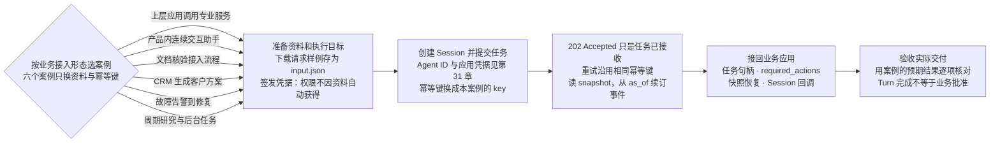
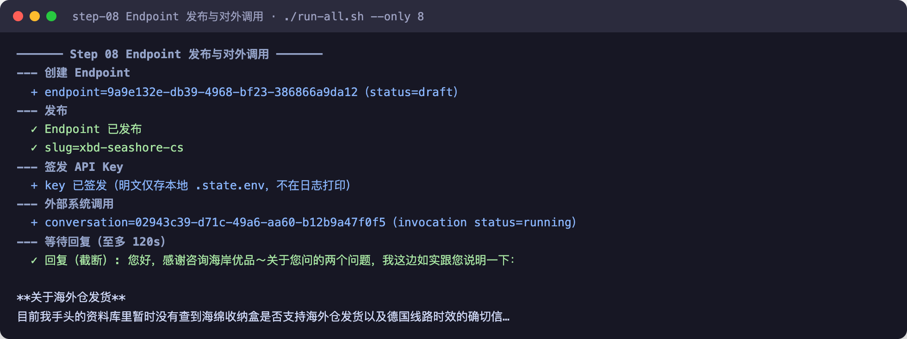
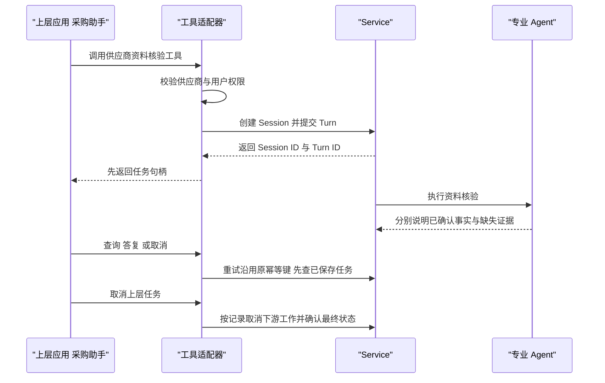
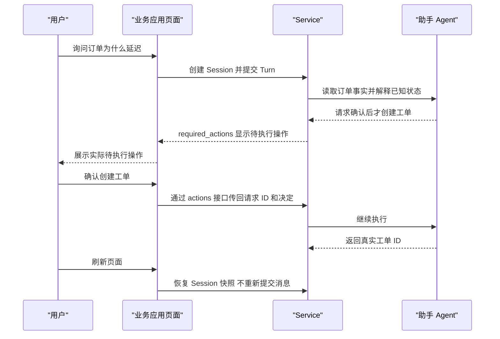
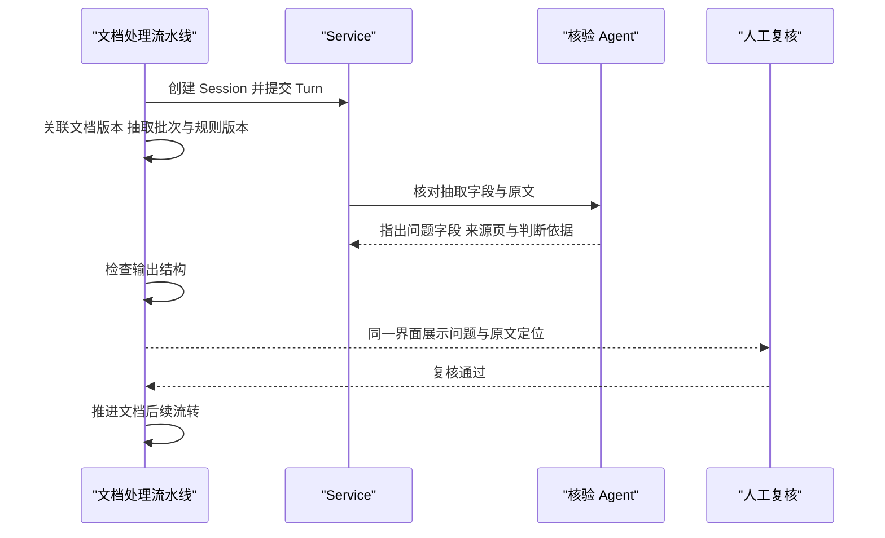
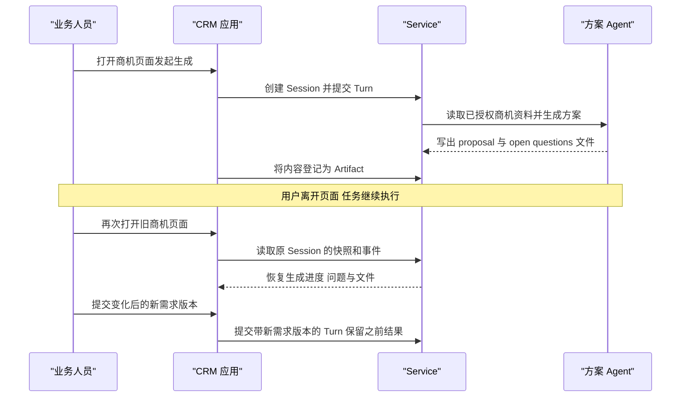
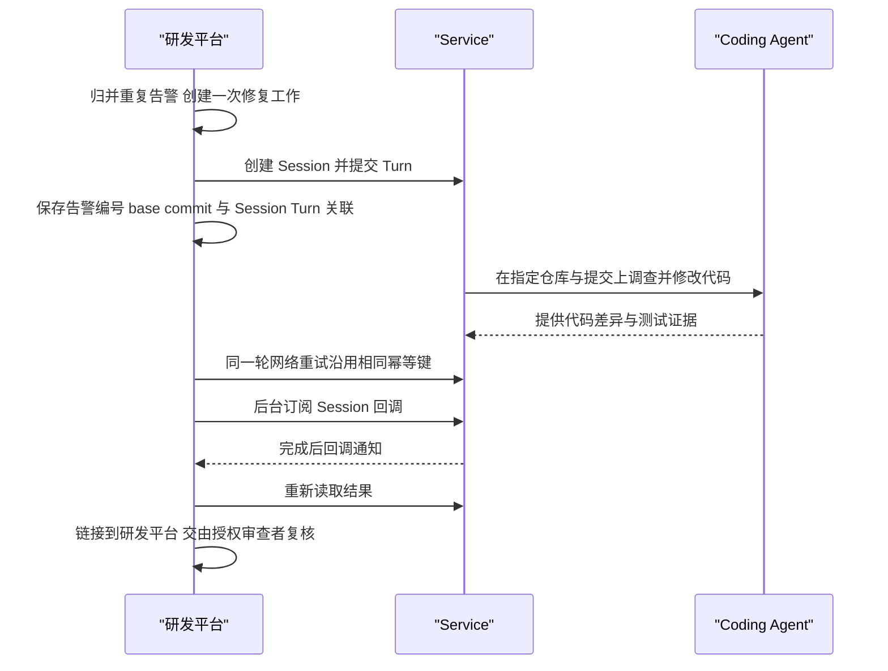
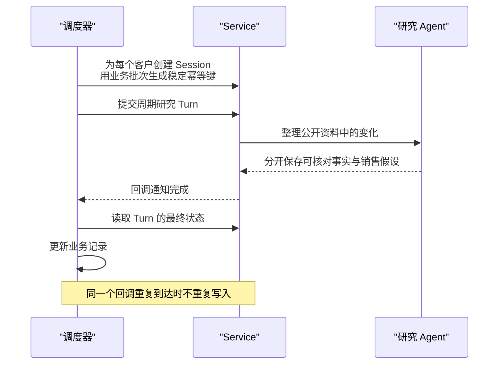

# 第 34 章 Service 实战案例

> 本章导读：到这里，Service 已经部署（第 29 章），托管 Agent 已经能跑（第 30 章），应用已经能通过 Session API 接回结果（第 31 章），Team 与 Workflow 也已就绪（第 32 章）。剩下的问题是：这些能力落进真实业务，长什么样？本章用六个案例回答，各对应一类业务接入形态：把 Agent 包装成上层应用可调用的专业服务、产品内连续交互的业务助手、接入业务流程的文档核验、CRM 中可离开再返回的方案生成、从故障告警到可审查修复的研发接入，以及调度器发起的周期后台任务。每个案例都围绕同一条骨架展开——准备资料和执行目标、创建 Session 并提交任务、接回业务应用、验收实际交付——并用验收小节告诉你"怎样才算接对了"。



*本章操作流程图*

案例资料均为虚构，"预期结果"是验收要求，并非一次已完成的业务实跑。六个案例共用同一套创建 Session 与提交 Turn 的命令，只有幂等键不同——完成第一个案例后，其余案例只需替换资料与幂等键。

## 供上层 Agent 调用的专业服务

**场景**：采购助手希望把供应商 V-101 的资料核验交给专门的 Agent，再根据结论继续组织自己的工作。专业 Agent 可以被多个应用复用，而工具包装由上层应用提供。

### 准备资料和执行目标

下载请求样例（原始文档中的 `examples/service/agent-as-tool/input.json.txt`）并保存为 `input.json`。样例中的员工数量和网页支持来自供应商自述，独立安全审查与交付 SLA 的证据尚未提供。预期结果应分别说明已确认事实、缺失证据和需要追问的问题，不批准采购，也不扩大调用方的资料访问权限。

为上层应用签发只允许使用这个专业 Agent 的凭据。工具适配器校验供应商与用户权限后，创建 Session 并提交 Turn。专业任务可能持续较久，因此工具可以先返回包含 Session ID 和 Turn ID 的任务句柄，再提供查询、答复和取消工具。

### 创建 Session 并提交任务

先按应用接入指南（第 31 章"通过 Session API 接入应用"）准备 Agent ID 和应用凭据。下面的命令使用 Bash、curl 和 jq，将样例资料整理为 Managed Agent 的文本消息；后续案例沿用同一套命令，只更换幂等键。有一条安全边界贯穿所有案例：Service 不会因为资料中写有仓库地址、文件路径或订单编号，就自动获得相应系统的访问权限。

```bash
SESSION_JSON=$(curl --fail-with-body -sS "$BASE_URL/api/v1/agent-sessions" \
  -H "X-API-Key: $AGENTSCOPE_API_KEY" -H 'Content-Type: application/json' \
  -H 'Idempotency-Key: agent-as-tool-session-001' \
  --data "$(jq -n --arg id "$AGENT_ID" '{target:{type:"agent",id:$id}}')")
SESSION_ID=$(printf '%s' "$SESSION_JSON" | jq -er '.id')
SESSION_URL="$BASE_URL/api/v1/agent-sessions/$SESSION_ID"
TURN_JSON=$(curl --fail-with-body -sS "$SESSION_URL/turns" \
  -H "X-API-Key: $AGENTSCOPE_API_KEY" -H 'Content-Type: application/json' \
  -H 'Idempotency-Key: agent-as-tool-task-001' \
  --data "$(jq '{message:(.message // (.input | tojson))}' input.json)")
TURN_ID=$(printf '%s' "$TURN_JSON" | jq -er '.id')
curl --fail-with-body -sS "$SESSION_URL/turns/$TURN_ID" \
  -H "X-API-Key: $AGENTSCOPE_API_KEY"
```

返回 `202 Accepted` 表示任务已接收，尚不能据此判断完成。保存 Session 和 Turn ID，网络重试沿用相同 key 与请求内容；新任务才更换 key。需要查看进展时，读取 Session 的 snapshot，再从其 `as_of` 继续订阅事件。

六个案例的资料是虚构的，这条骨架却可以真实跑通。2026-10-31，我们在本地 agentscope-service 栈（aistio 0.2.0，模型走 glm-5.3-flash 的 merchant-gateway 自有通道）把“专业服务对外发布”完整演练了一遍：创建 Endpoint 并发布得到 slug，签发 API Key，再以外部系统身份发起调用：



外部系统拿到的是真实回复：Agent 如实说明“资料库里暂时没有查到海绵收纳盒是否支持海外仓发货以及德国线路时效的确切信息”，没有替业务作出承诺——这正是本案例要求的“分别说明已确认事实与缺失证据”在一次真实调用中的样子；API Key 明文仅存本地状态文件、不打印进日志，凭据也只对这一个服务有效，与上文签发凭据的要求一致。

### 接回业务应用

适配器将上层工具调用标识与 Session/Turn 持久关联。相同工具调用重试时使用原来的幂等键，并先查找已保存的任务。上层任务取消后，适配器按记录取消下游工作并确认最终状态；任意应用之间的父子取消和累计预算关系不会仅因为使用了同一个 API 就自动建立。

本案例从上层调用到接回业务的时序如图 34-1 所示。



*图 34-1：供上层 Agent 调用的专业服务时序*

### 验收实际交付

用重复调用、越权供应商、缺失证据和上层取消分别验收。如果希望通过 MCP 提供这些工具，由应用实现并发布 MCP 包装；Service 的内部协作 MCP 与这个面向上层应用的工具接口用途不同。

## 在产品中提供连续交互的业务助手

**场景**：用户询问订单 O-1001 为什么延迟，以及能否保证次日送达。助手需要先读取订单事实，解释已知状态，再在用户确认后创建支持工单。应用中的聊天页面与订单页面共用同一业务身份。

### 准备资料和执行目标

下载请求样例（原始文档中的 `examples/service/business-assistant/input.json.txt`）并保存为 `input.json`。请求样例只包含用户问题，配套的订单数据（`examples/service/business-assistant/orders.json.txt`）提供虚构订单事实。准备只读订单查询工具和受控工单创建工具，将未知的物流承诺保留为待确认信息。工具实现负责按业务用户检查订单访问权限，不能根据提示词中出现的用户姓名直接授权。

选择 Managed Agent 作为 Session 目标，并为需要确认的写操作配置工具权限。应用按用户和订单保存 Session，在用户继续追问时向同一个 Session 提交新的 Turn，使助手能够沿用之前的对话。更换订单或业务身份时，应重新判断是否需要建立独立 Session。

### 创建 Session 并提交任务

命令与第一个案例完全相同，幂等键换为 `business-assistant-session-001` 与 `business-assistant-task-001`（Agent ID 和应用凭据的准备见第 31 章"通过 Session API 接入应用"）：

```bash
SESSION_JSON=$(curl --fail-with-body -sS "$BASE_URL/api/v1/agent-sessions" \
  -H "X-API-Key: $AGENTSCOPE_API_KEY" -H 'Content-Type: application/json' \
  -H 'Idempotency-Key: business-assistant-session-001' \
  --data "$(jq -n --arg id "$AGENT_ID" '{target:{type:"agent",id:$id}}')")
SESSION_ID=$(printf '%s' "$SESSION_JSON" | jq -er '.id')
SESSION_URL="$BASE_URL/api/v1/agent-sessions/$SESSION_ID"
TURN_JSON=$(curl --fail-with-body -sS "$SESSION_URL/turns" \
  -H "X-API-Key: $AGENTSCOPE_API_KEY" -H 'Content-Type: application/json' \
  -H 'Idempotency-Key: business-assistant-task-001' \
  --data "$(jq '{message:(.message // (.input | tojson))}' input.json)")
TURN_ID=$(printf '%s' "$TURN_JSON" | jq -er '.id')
curl --fail-with-body -sS "$SESSION_URL/turns/$TURN_ID" \
  -H "X-API-Key: $AGENTSCOPE_API_KEY"
```

同样是 `202 Accepted`：任务已接收不等于完成；重试沿用相同 key 与请求内容，新任务才更换 key，进展从 Session 的 snapshot 及其 `as_of` 之后的事件读取。

### 接回业务应用

Agent 等待确认时，页面读取 required_actions 并显示实际待执行操作。用户答复后，应用通过对应 Turn 的 actions 接口传回请求 ID 和决定；指定人员审批需要该人员的登录身份。刷新页面时恢复 Session 快照即可，不应重新提交"创建工单"的消息。

本案例从用户提问到接回业务的时序如图 34-2 所示。



*图 34-2：连续交互的业务助手时序*

### 验收实际交付

验收时检查回答是否忠于订单数据，未确认前是否没有工单写入，确认后是否产生真实工单 ID。重复点击、断网重试和页面刷新不应创建额外 Turn；业务工具本身也需要使用业务幂等标识，避免外部系统发生重复写入。

## 将文档核验接入业务流程

**场景**：文档处理流水线需要核对发票 DOC-101 的抽取字段与原文是否一致。Agent 负责定位问题和证据，应用负责决定文档是否继续流转，以及哪些结果需要人工复核。

### 准备资料和执行目标

下载请求样例（原始文档中的 `examples/service/document-verification/input.json.txt`）并保存为 `input.json`。样例保留了原文页码、抽取结果和规则。原文中的 4 件商品、32 美元单价与 128 美元总价应共同用于核验；发生矛盾时，结果应指出具体字段、来源页和判断依据。扫描质量不足的页面也应列为待复核，不能当作核验通过。

先配置只读核验 Agent，并明确它能够读取的资料与规则版本。下面的文本示例将小型资料快照作为消息发送；处理原始文件时，可以先上传 Session File，再用内容块引用它。OCR、文档权限和领域规则的准备仍属于接入方的业务流水线。

### 创建 Session 并提交任务

命令与第一个案例完全相同，幂等键换为 `document-verification-session-001` 与 `document-verification-task-001`：

```bash
SESSION_JSON=$(curl --fail-with-body -sS "$BASE_URL/api/v1/agent-sessions" \
  -H "X-API-Key: $AGENTSCOPE_API_KEY" -H 'Content-Type: application/json' \
  -H 'Idempotency-Key: document-verification-session-001' \
  --data "$(jq -n --arg id "$AGENT_ID" '{target:{type:"agent",id:$id}}')")
SESSION_ID=$(printf '%s' "$SESSION_JSON" | jq -er '.id')
SESSION_URL="$BASE_URL/api/v1/agent-sessions/$SESSION_ID"
TURN_JSON=$(curl --fail-with-body -sS "$SESSION_URL/turns" \
  -H "X-API-Key: $AGENTSCOPE_API_KEY" -H 'Content-Type: application/json' \
  -H 'Idempotency-Key: document-verification-task-001' \
  --data "$(jq '{message:(.message // (.input | tojson))}' input.json)")
TURN_ID=$(printf '%s' "$TURN_JSON" | jq -er '.id')
curl --fail-with-body -sS "$SESSION_URL/turns/$TURN_ID" \
  -H "X-API-Key: $AGENTSCOPE_API_KEY"
```

同样是 `202 Accepted`：任务已接收不等于完成；重试沿用相同 key 与请求内容，新任务才更换 key，进展从 Session 的 snapshot 及其 `as_of` 之后的事件读取。

### 接回业务应用

应用保存文档版本、抽取批次、规则版本和 Session/Turn 的关联，并将当前文档保持在待核验状态。收到结果后，先检查输出结构，再把发现的问题和原文定位放在同一界面。发现业务矛盾是一次有效核验结果，与工具无法读取文件等执行故障应分别处理。

本案例从提交核验到接回业务流程的时序如图 34-3 所示。



*图 34-3：文档核验接入业务流程时序*

### 验收实际交付

用已知正确、明确矛盾、缺页和无法读取的样例分别验收，检查是否给出预期问题及证据。需要结构化结果时，应验证实际 result，而不是仅根据回复中出现 JSON 字样判断成功。人工复核通过后，再由应用推进后续流程。

## 在 CRM 中生成客户方案

**场景**：商机 OPP-104 的用户希望生成方案初稿，离开页面后再回来审阅。应用将商机版本与 Session 关联，让生成过程成为产品原有工作的一部分，而不要求用户进入另一套 Agent 控制台。

### 准备资料和执行目标

下载请求样例（原始文档中的 `examples/service/in-product-delivery/input.json.txt`）并保存为 `input.json`。样例包含 80 家门店的需求，以及尚未确认的 SSO 协议、数据区域和峰值并发。要求 Agent 生成 proposal.md 和 open-questions.md，保留资料来源与版本，不代替业务人员向客户作出承诺。

首先配置能读取授权商机资料并写入工作目录的 Managed Agent。应用负责验证当前用户能否访问该商机，再把已授权资料或受控工具交给 Agent。内容需要多种专业能力时，可以在新 Session 中改用 Team；调用方仍保存同样的 Session 和 Turn 记录。

### 创建 Session 并提交任务

命令与第一个案例完全相同，幂等键换为 `in-product-delivery-session-001` 与 `in-product-delivery-task-001`：

```bash
SESSION_JSON=$(curl --fail-with-body -sS "$BASE_URL/api/v1/agent-sessions" \
  -H "X-API-Key: $AGENTSCOPE_API_KEY" -H 'Content-Type: application/json' \
  -H 'Idempotency-Key: in-product-delivery-session-001' \
  --data "$(jq -n --arg id "$AGENT_ID" '{target:{type:"agent",id:$id}}')")
SESSION_ID=$(printf '%s' "$SESSION_JSON" | jq -er '.id')
SESSION_URL="$BASE_URL/api/v1/agent-sessions/$SESSION_ID"
TURN_JSON=$(curl --fail-with-body -sS "$SESSION_URL/turns" \
  -H "X-API-Key: $AGENTSCOPE_API_KEY" -H 'Content-Type: application/json' \
  -H 'Idempotency-Key: in-product-delivery-task-001' \
  --data "$(jq '{message:(.message // (.input | tojson))}' input.json)")
TURN_ID=$(printf '%s' "$TURN_JSON" | jq -er '.id')
curl --fail-with-body -sS "$SESSION_URL/turns/$TURN_ID" \
  -H "X-API-Key: $AGENTSCOPE_API_KEY"
```

同样是 `202 Accepted`：任务已接收不等于完成；重试沿用相同 key 与请求内容，新任务才更换 key，进展从 Session 的 snapshot 及其 `as_of` 之后的事件读取。

### 接回业务应用

打开旧商机页面时，读取原 Session 的快照和事件，恢复生成进度、问题与文件。客户需求发生变化后，应提交带有新需求版本的 Turn，保留之前的结果，避免旧任务完成后覆盖新方案。文件工具写入成功只说明工作目录中存在文件；交付给用户前还需要将内容保存为可下载文件或登记 Artifact。

本案例从生成方案到离开再返回的时序如图 34-4 所示。



*图 34-4：CRM 中生成客户方案的离开与返回时序*

### 验收实际交付

核对两个文件是否可以实际取得，关键承诺是否有来源，未知信息是否仍被标明。应用在业务人员复核后才将结果写入正式交付记录；Turn 完成表示执行结束，不代表方案已获业务批准。

## 从故障告警生成可审查的修复

**场景**：告警 INC-204 指出订单查询没有正确处理状态筛选和分页。研发平台归并重复告警后，创建一次修复工作，让 Agent 在指定仓库与提交上调查问题、修改代码并提供测试证据。

### 准备资料和执行目标

下载请求样例（原始文档中的 `examples/service/incident-to-pr/input.json.txt`）并保存为 `input.json`。下载请求样例后，将 repository 和 base_commit 替换为练习仓库及真实提交。练习还提供 `OrderQuery.java.txt`、测试文件 `OrderQueryTest.java.txt` 和 CI 配置 `ci.yml.txt`（均见原始文档的示例文件）。这些文件定义了先筛选再分页、保留顺序与边界参数的验收条件。

可以使用配置了代码工具的 Managed Agent，也可以使用已经接入 Runtime Host 的 Hosted Coding Agent。执行环境需要预先准备仓库访问、依赖和测试命令。如果希望把诊断、修复和审查分开，再用 Team 或 Workflow 组织执行；创建 Session 时选择相应目标即可。

### 创建 Session 并提交任务

命令与第一个案例完全相同，幂等键换为 `incident-to-pr-session-001` 与 `incident-to-pr-task-001`：

```bash
SESSION_JSON=$(curl --fail-with-body -sS "$BASE_URL/api/v1/agent-sessions" \
  -H "X-API-Key: $AGENTSCOPE_API_KEY" -H 'Content-Type: application/json' \
  -H 'Idempotency-Key: incident-to-pr-session-001' \
  --data "$(jq -n --arg id "$AGENT_ID" '{target:{type:"agent",id:$id}}')")
SESSION_ID=$(printf '%s' "$SESSION_JSON" | jq -er '.id')
SESSION_URL="$BASE_URL/api/v1/agent-sessions/$SESSION_ID"
TURN_JSON=$(curl --fail-with-body -sS "$SESSION_URL/turns" \
  -H "X-API-Key: $AGENTSCOPE_API_KEY" -H 'Content-Type: application/json' \
  -H 'Idempotency-Key: incident-to-pr-task-001' \
  --data "$(jq '{message:(.message // (.input | tojson))}' input.json)")
TURN_ID=$(printf '%s' "$TURN_JSON" | jq -er '.id')
curl --fail-with-body -sS "$SESSION_URL/turns/$TURN_ID" \
  -H "X-API-Key: $AGENTSCOPE_API_KEY"
```

同样是 `202 Accepted`：任务已接收不等于完成；重试沿用相同 key 与请求内容，新任务才更换 key，进展从 Session 的 snapshot 及其 `as_of` 之后的事件读取。

### 接回业务应用

研发平台保存告警编号、base commit、修复轮次和 Session/Turn 的关联。同一轮修复的网络重试沿用相同幂等键，新的修复意见才提交下一轮任务。后台可以订阅 Session 回调，在完成后重新读取结果并链接到研发平台，前端无需一直保持连接。

本案例从告警到可审查修复的时序如图 34-5 所示。



*图 34-5：从故障告警生成可审查修复的时序*

### 验收实际交付

验收时应检查实际代码差异、运行过的测试、测试输出和 PR 地址。保留原有测试并补充边界覆盖，再由仓库授权审查者决定是否合并。Agent 声称已修复或 Turn 返回 completed，都不能替代这些代码与测试证据。

## 周期研究与批量后台任务

**场景**：每天的计划为客户 A-101 整理公开资料中的变化，并将可核对的事实与销售假设分开保存。此类任务由调度器发起，不依赖用户保持页面在线。

### 准备资料和执行目标

下载请求样例（原始文档中的 `examples/service/scheduled-research/input.json.txt`）并保存为 `input.json`。样例包含 research_date、strategy_version 和已获取的来源快照。相同客户、日期和策略版本代表同一个业务批次；采集新资料或调整策略后，应明确是否产生新的任务版本。Agent 需要引用来源，不应把模型推断描述成已发生的客户事实。

准备一个能够读取授权资料的研究 Agent，让调度器为每个独立客户任务创建 Session，并用业务批次生成稳定的创建与提交幂等键。不同客户可以使用不同 Session 并行处理，应用仍需根据平台配额限制提交速度。

### 创建 Session 并提交任务

命令与第一个案例完全相同，幂等键换为 `scheduled-research-session-001` 与 `scheduled-research-task-001`：

```bash
SESSION_JSON=$(curl --fail-with-body -sS "$BASE_URL/api/v1/agent-sessions" \
  -H "X-API-Key: $AGENTSCOPE_API_KEY" -H 'Content-Type: application/json' \
  -H 'Idempotency-Key: scheduled-research-session-001' \
  --data "$(jq -n --arg id "$AGENT_ID" '{target:{type:"agent",id:$id}}')")
SESSION_ID=$(printf '%s' "$SESSION_JSON" | jq -er '.id')
SESSION_URL="$BASE_URL/api/v1/agent-sessions/$SESSION_ID"
TURN_JSON=$(curl --fail-with-body -sS "$SESSION_URL/turns" \
  -H "X-API-Key: $AGENTSCOPE_API_KEY" -H 'Content-Type: application/json' \
  -H 'Idempotency-Key: scheduled-research-task-001' \
  --data "$(jq '{message:(.message // (.input | tojson))}' input.json)")
TURN_ID=$(printf '%s' "$TURN_JSON" | jq -er '.id')
curl --fail-with-body -sS "$SESSION_URL/turns/$TURN_ID" \
  -H "X-API-Key: $AGENTSCOPE_API_KEY"
```

同样是 `202 Accepted`：任务已接收不等于完成；重试沿用相同 key 与请求内容，新任务才更换 key，进展从 Session 的 snapshot 及其 `as_of` 之后的事件读取。

### 接回业务应用

调度器记录哪些对象已经提交、仍在执行或需要重试，通过回调或定期查询核对结果。收到通知后先读取 Turn 的最终状态，再更新业务记录；同一个回调重复到达时不重复写入。平台 Automation 也能组织内部工作，但直接使用 Session API 的调度器仍负责自己的批次与业务补偿。

本案例从调度触发到结果回收的时序如图 34-6 所示。



*图 34-6：周期研究与批量后台任务时序*

### 验收实际交付

验收应覆盖同一批次重复触发、部分对象失败、资料来源不可用和通知丢失。每个对象都应能对应到明确的 Session、Turn、输入版本与结果；研究结束后不自动联系客户，是否跟进由业务应用决定。

## 本章小结

六个案例演示了六种接入形态，反复练习的是同一条工作骨架：

1. **供上层 Agent 调用的专业服务**：工具适配器把专业 Agent 包装成可调用工具，先返回任务句柄，再提供查询、答复和取消；
2. **产品内连续交互的业务助手**：同一 Session 沿用对话上下文，required_actions 把"等待用户确认"接回产品页面；
3. **文档核验接入业务流程**：应用保存文档版本、抽取批次与规则版本的关联；业务矛盾是一次有效核验结果，与执行故障分开处理；
4. **CRM 中生成客户方案**：离开再返回靠 Session 快照恢复进度，需求变化提交带新需求版本的 Turn，而不是重跑；
5. **故障告警到可审查修复**：幂等键管理修复轮次，后台回调解耦前端连接，验收看代码差异与测试证据；
6. **周期研究与批量后台任务**：调度器为每个客户创建 Session，用业务批次生成稳定幂等键，并自己负责批次与业务补偿。

骨架之外，三条约束贯穿全部案例：`202 Accepted` 只说明任务已接收，不等于完成；重试沿用相同幂等键，新任务才更换 key；Turn 完成只表示执行结束，业务验收才是交付标准。

**验收清单**——读到这里，你应该能：

- ☐ 为一类业务接入形态找到对应案例，并说出它从场景到验收的完整路径；
- ☐ 解释 `202 Accepted` 的含义，以及幂等键在重试与新一轮任务中的不同用法；
- ☐ 为"离开再返回"的场景选择恢复 Session 快照，而不是重新提交消息；
- ☐ 区分业务矛盾（一次有效核验结果）与工具无法读取文件（执行故障）；
- ☐ 说出至少三条贯穿案例的边界：访问权限不因资料内容自动获得、指定人员审批需要本人身份、Turn 完成不等于业务批准。

## 延伸阅读

六个案例共同依赖的接口细节：文件输入和下载见第 31 章"文件与产物"；交互与取消见第 31 章"通过 Session API 接入应用"；回调与重连见第 31 章"SSE 与事件续传"。
