# 第 39 章 如何构建 Agent Harness

> 本章导读：本章完整收录"如何构建 Agent Harness"系列四篇博文，依次对应本章四节，节内小节编号（1.1、2.1、3.1、4.1）延续原系列编号。第一篇建立 Model、Harness、Runtime、Sandbox 与 Agent Platform 的责任边界，并给出 `HarnessAgent` 的四种运行形态（本地工作区、嵌入式应用、长任务服务、平台化交付）；第二篇讲执行与编排——Agent Loop 与任务状态机、Planning 与阶段门禁、Subagent 委派契约、异步续行与完成验证；第三篇讲信息工程——Context 构建管线与 Manifest、压缩与 Continuation、Session/Task/Workspace 边界、Memory 与 Knowledge 治理、Skill 资产化；第四篇讲行动与反馈——Action Plane 统一行动契约、Tool/MCP/A2A 职责边界、Environment Contract 与 Sandbox、Permission/HITL（Human-in-the-Loop，人工介入）、Streaming 交互协议，以及从 Trace 到 Harness Patch 的评估闭环。全系列以"生产服务漏洞修复与变更发布 Agent"为贯穿案例；原文中"本系列第 N 篇"的交叉引用已改写为本章内的小节引用，各篇末尾的系列导航因合并入同一章而移除；文中偶见的"构建（Build）/运行（Run）/治理（Governance）篇"指 AgentScope 官方文档的篇章划分，非本书各篇。四篇按 1→4 的顺序读即是推荐路径：先定责任边界，再补执行与编排，然后处理信息组织，最后收紧行动与反馈；只想深入某一主题的读者可以按节跳读，每篇开头都交代了它从前一节承接的问题，与前面章节重复的 SDK 细节也在对应小节标注了出处。

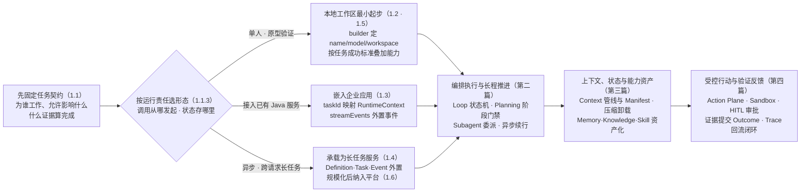

*本章操作流程图*

## 第一篇 架构范式与责任边界

这是“如何构建 Agent Harness”系列的第一篇。本节先建立 Model、Harness、Runtime、Sandbox 与 Agent Platform 的责任边界，再以 AgentScope Java 的 `HarnessAgent` 为统一入口，说明同一套 Harness 如何从本地工作区逐步演进为嵌入式服务、长任务 Worker 和多租户平台。

编码 Agent 为这项工作提供了一个可观察的工程样本。在代码、文件和测试构成的环境中，模型可以通过工具持续行动，系统也可以用编译、测试和文件差异验证结果。它说明，模型能力只有经过上下文组织、任务循环、状态管理、工具执行、权限控制和结果验证，才可能稳定转化为任务结果。但编码场景不是所有企业任务的替代物。审批、交易、客服和运营任务具有不同的业务状态、权限边界和成功标准，企业不能照搬一套 Coding Agent 流程，而应复用其中可泛化的 Harness 机制。

从工程视角看，构建 Agent 的主要工作，是为模型建立与任务结构、风险等级相匹配的 Harness。使用 `HarnessAgent` 并不意味着一次打开所有能力；更稳妥的方式是从相同入口出发，按运行形态逐步增加责任：

- 在本地工作区构建最小 Harness

- 将 Harness 嵌入现有 Java 应用

- 将 Harness 承载为可恢复的长任务服务

- 将多个 HarnessAgent 纳入统一平台交付

在单个 Agent 之外，企业还需要 Agent Platform 创建和接入这些 Agents，并提供规模化交付、运行、治理、协作、观测和优化能力。

这四种形态不是互斥的产品分类，而是 `HarnessAgent` 在不同运行责任下的部署视图。同一企业可以让开发者在本地验证任务契约，让业务服务通过 Java API 调用同一 Agent，再用共享状态、Sandbox、事件流和任务调度承载长任务，最后由 Agent Platform 统一管理版本、租户、资源、发布与质量事实。

### 1.1 Agent = Model + Harness

#### 1.1.1 Harness 是模型之外的工程系统

本节将 Agent Harness 定义为：

> **模型之外、围绕 Agent Loop 组织上下文、能力、状态、环境与控制机制，并将模型判断转化为可执行、可恢复、可验证任务过程的代码、配置和执行逻辑。**

这个定义包含三层含义。

- 第一，Harness 不是一个更长的 System Prompt。Prompt 只是它在某一轮推理中生成的输入之一。Harness 还包括任务状态机、工具注册、计划管理、权限检查、环境适配、事件处理、错误恢复和完成验证等确定性逻辑。

- 第二，Harness 不是某一种 Agent Framework 的同义词。Framework 可以帮助企业实现 Harness；成熟的 Coding Agent CLI 或 SDK 可以提供一套现成 Harness；Managed Agents 还可以把 Harness 连同执行服务一起托管。Harness 描述的是 Agent 如何工作的系统层，而不是某一类产品形态。

- 第三，Harness 不是 Runtime 或 Sandbox。Harness 决定下一步应为模型提供什么、允许模型提出什么行动、怎样推进任务；Runtime 负责持续承载这个过程；Sandbox 负责把实际行动限制在可控环境中。三者协同，但责任不同。

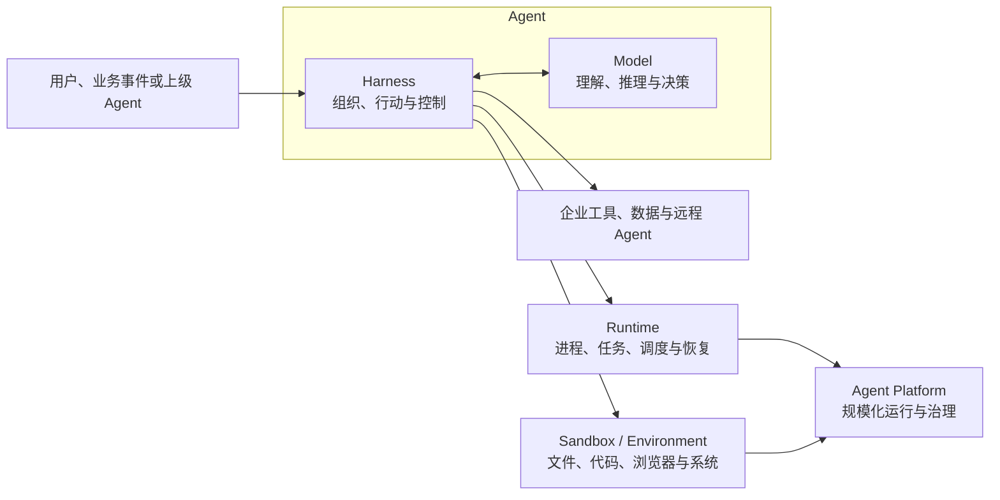

一次模型调用没有可靠的跨轮状态，也不知道任务是否已经在其他节点推进；上下文窗口有限，无法自然保留长任务中的全部事实；工具调用只表达行动意图，并不等于当前用户获得执行授权；模型可以声称任务完成，却不能证明文件已经生成、测试已经通过、订单已经提交或审批已经生效。

Harness 因而要把概率性的模型判断嵌入确定性的系统边界。模型决定 Agent 能理解和推理到什么程度，Harness 决定这些能力怎样持续转化为任务结果，Runtime 与 Sandbox 则决定这个过程如何被承载和限制。

| 层次 | 核心问题 | 主要责任 |
| --- | --- | --- |
| Model | Agent 能理解和推理到什么程度 | 语义理解、规划判断、生成与工具选择 |
| Harness 编排 | Agent 如何工作 | Loop、Context、State、Plan、Tool、Skill、Subagent、Permission 与 Verification |
| Runtime | Agent 如何持续运行 | 进程承载、任务调度、并发、等待与故障恢复 |
| Sandbox / Environment | Agent 在哪里行动、影响范围多大 | 文件、进程、网络、Secret、资源和环境隔离 |
| Agent Platform | 如何规模化交付和治理 | 多租户、发布、网关、配额、观测、评估、安全和运营 |

这些逻辑边界不一定对应五个独立产品或部署单元。一个 SDK 可以同时包含 Harness 和本地 Runtime，托管服务也可以同时提供 Harness、Runtime 与 Sandbox。但在架构设计中仍要保留边界，否则企业无法判断故障归属、数据位置、迁移成本和最终责任。

#### 1.1.2 开发 Harness 要实现哪些对象

从开发者视角看，构建 Harness 不是罗列功能，而是让一组工程对象在同一个任务生命周期中协同工作：

| 构建对象 | 开发阶段需要回答的问题 | 主要交付物 |
| --- | --- | --- |
| Agent Contract | Agent 为谁工作、目标是什么、允许和禁止什么 | 角色指令、任务输入输出和成功标准 |
| Execution | 模型怎样循环、规划、等待、委派和结束 | Agent Loop、状态机、预算与 Verifier |
| Context & State | 每轮看见什么，任务事实保存在何处 | Context Policy、Session / Task Schema、Workspace 与 Memory |
| Capability | Agent 可以使用哪些方法和外部能力 | Tool Schema、MCP、Skill、Subagent 与能力目录 |
| Environment | 文件、命令、浏览器或企业系统在哪里运行 | Environment Contract、Sandbox 与 Artifact 边界 |
| Control | 以谁的身份行动，哪些动作要拒绝或审批 | Permission Policy、HITL 与短时凭证 |
| Interaction | 用户和上层应用如何看进度、干预和恢复 | Event Schema、Streaming、Channel 与恢复游标 |
| Quality | 如何证明一次任务完成，并判断新版本是否更好 | Trace、Outcome、测试用例和评估基线 |

一个最小 Agent 可以只实现其中一部分，但进入企业生产环境后，这些问题都必须有明确责任人。选择 Harness 构建路径，本质上就是决定哪些对象由企业开发，哪些对象复用现有产品，哪些对象交给托管平台承载。

这些对象可以进一步归纳为三个能力域：执行与编排、上下文与状态、行动与反馈。这里只把它们作为构建检查表；本章后续三节将分别展开它们的内部原理、实现方式和调优方法。

图 1-1　企业 Agent 的构建与承载关系


构建 Agent 不能从选择框架或打开工具开始，而应先固定任务契约（Agent Contract）。任务契约说明 Agent 为谁工作、接受什么输入、交付什么结果、允许影响哪些系统、哪些动作必须拒绝或审批，以及什么证据能够证明任务完成。同一个修复高危依赖漏洞目标，可以只生成分析报告，也可以在隔离环境中修改代码并运行测试，还可以创建合并请求；除非契约明确授予发布权限并规定审批条件，这些 Agent 都不应把修复完成解释为已经发布生产。

#### 1.1.3 四种运行形态解决不同责任问题

在选择具体实现之前，企业还要判断任务路径由谁控制。步骤、分支和异常在设计时已经明确的任务，更适合使用 Workflow；执行路径必须根据中间结果和环境反馈动态决定时，可以由 Agent 持有部分决策权；高风险主流程稳定、局部判断复杂的任务，则可以使用 Hybrid，由 Workflow 固定审批、交易和发布边界，由 Agent 负责检索、分析和方案生成。Workflow、Agent 主导与 Hybrid 描述路径控制方式，不是与 Single-Agent、Long-Horizon Agent 和 Multi-Agent 并列的应用形态。

在此基础上，可以把 `HarnessAgent` 的落地方式归纳为四种运行形态。它们最显著的差异不是模型能力，而是调用从哪里发起、状态保存在哪里、Runtime 与 Sandbox 由谁提供，以及业务应用要补齐哪些控制和验收责任。Single-Agent、Long-Horizon Agent 和 Multi-Agent 都可以采用其中任一形态；任务形态决定所需的状态与协作契约，运行形态决定这些能力部署在哪里。

| 运行形态 | AgentScope 入口 | 企业直接控制的重点 | 需要补齐的运行能力 | 企业仍需承担的责任 | 更适合的条件 |
| --- | --- | --- | --- | --- | --- |
| 本地工作区 | `HarnessAgent.builder()` + Local Filesystem | Loop、Context、Plan、工具与验证逻辑 | 本地进程、文件和开发者交互 | 任务正确性、安全配置和回归测试 | 单人开发、原型验证与可信环境 |
| 嵌入式应用 | `call` / `streamEvents` + `RuntimeContext` | 业务入口、Session 映射、权限与事件展示 | 应用进程、共享状态和业务工具 | 多租户接入、凭证、Artifact 与 Outcome | 将 Agent 接入现有 API、工作台或 Channel |
| 长任务服务 | `HarnessAgent` Worker + StateStore + Sandbox | 任务调度、恢复点、预算、并发与完成门禁 | Worker、任务队列、隔离环境和事件存储 | 幂等、故障恢复、审批、数据边界和结果验收 | 异步、批量和跨请求长任务 |
| 平台化交付 | 版本化的 HarnessAgent 定义与工作区资产 | Agent 目录、资源组合、发布范围和质量基线 | 多租户 Runtime、网关、观测与评估 | 业务目标、所有权、风险策略和最终验收 | 多团队、多 Agent 的规模化运营 |

表 1-2　四种 HarnessAgent 运行形态的主要差异

四种形态可以渐进演进。一个在本地验证过的 `HarnessAgent` 可以被嵌入业务服务，再由任务队列调度到独立 Worker；当 Agent 数量和团队数量增加后，再把定义、工作区资产、权限策略和质量基线纳入统一平台。选择时应分别判断任务效果是否依赖修改 Loop 或 Context、数据和执行环境能否集中承载、团队是否愿意维护状态恢复与 Sandbox，以及最终交付对象是个人工作区、嵌入式应用、异步任务服务还是平台内业务 Agent。

### 1.2 基于高代码框架自主构建 Harness

高代码 Agent Framework 提供模型、消息、工具、Agent、状态和编排等代码级抽象，应用团队在其上定义任务循环、上下文策略、能力组合和企业集成。这里的“高代码”强调开发团队可以直接控制和扩展 Harness 机制，与依靠可视化配置或预置模板的构建入口相区分，并不表示框架路径一定更复杂或更成熟。以 AgentScope Java 为例，HarnessAgent 将工作区、状态、Memory、Context 压缩、Plan Mode、Skill、Subagent、Sandbox 和交互控制等能力组织在统一运行上下文中，使团队可以按业务需要自主构建 Harness。这里的自主构建指开发团队使用框架设计和实现 Harness，并不是 Agent 自己生成或重构 Harness。

下面的 Builder 代码你在第 2 章“快速开始”和第 11 章“Harness 架构深入”里已经见过，能力配置的逐项清单也在那里。本节不再展开配置细节，而是回答一个更架构化的问题——同一套 `HarnessAgent` 如何随运行责任逐步演进。

Framework 路径的核心价值是任务语义控制。企业可以决定每轮 Context 怎样组成、哪些错误可以重试、计划何时生成和更新、何时请求审批、怎样创建子任务，以及什么证据算完成。与之对应，Framework 提供的是构建材料，不会自动补齐多租户隔离、状态恢复、Sandbox、安全策略、评估基线和业务验收。

一个最小 AgentScope Harness 可以先确定三件事：使用什么模型、Agent 在哪个 Workspace 工作、一次调用属于哪个用户和 Session。

```java
HarnessAgent agent = HarnessAgent.builder()
    .name("remediation-agent")
    .model(model)
    .workspace(Paths.get(".agentscope/workspace"))
    .build();

agent.call(message, RuntimeContext.builder()
    .userId("u-1842")
    .sessionId("remediation-2026-0917")
    .build()).block();
```

这段代码已经建立了最小 Harness 边界，但还不是完整的企业 Agent。name 标识行为主体，model 提供推理能力，workspace 为指令、文件、计划、Memory、Skill 和任务产物提供外部空间，RuntimeContext 则把用户与 Session 身份带入当前调用。

接下来不应一次性打开所有能力，而应从任务成功标准反推需要的 Harness。例如，漏洞修复 Agent 至少需要读取代码、生成补丁、执行测试和验证安全扫描；如果计划未经确认不能修改代码，就需要 Plan Mode 与 Permission；如果分析和评审可以并行，就需要 Subagent；如果任务跨越多个调用，就需要外置状态和可恢复 Workspace。

#### 1.2.1 按业务需求组合 Harness 能力

AgentScope 使用 Builder、Middleware 和工作区资产逐步叠加能力。下面的示例在最小 Agent 上增加计划、Todo、上下文压缩、大工具结果卸载和 E2B Sandbox：

```java
HarnessAgent agent = HarnessAgent.builder()
    .name("remediation-agent")
    .model(model)
    .workspace(Paths.get(".agentscope/workspace"))
    .enablePlanMode()
    .enableTaskList()
    .compaction(CompactionConfig.builder()
        .triggerMessages(30)
        .keepMessages(10)
        .build())
    .toolResultEviction(ToolResultEvictionConfig.defaults())
    .filesystem(new DockerFilesystemSpec()
        .image("ubuntu:24.04"))
    .build();
```

真正的构建工作不在于调用多少 Builder 方法，而在于定义这些能力之间的契约：

| 能力 | AgentScope 中的构建入口 | 应用团队需要决定什么 |
| --- | --- | --- |
| 指令与上下文 | AGENTS.md、附加 Context、Middleware | 指令层级、动态信息、Token 预算和冲突规则 |
| 状态与记忆 | Workspace、StateStore、Memory、Compaction | Session / Task 边界、写入规则、恢复和多租户隔离 |
| 计划与任务 | Plan Mode、Todo、Task State | 何时先规划、谁批准、阶段目标如何验收 |
| 能力资产 | Tool、Skill Repository、Subagent | 能力发现、版本、权限、委派和输出契约 |
| 执行环境 | FileSystem、Docker 或其他 Sandbox | 文件、网络、Secret、资源、快照和隔离范围 |
| 控制与交互 | Permission、Channel、Middleware | ALLOW / DENY / ASK、用户干预和事件映射 |
| 质量与反馈 | Trace、Verifier、评估接口 | 完成证据、观测字段和版本回归标准 |

稳定、确定性的步骤应尽量沉淀为 Tool、脚本或策略；需要模型理解目标和权衡方案的部分留在 Agent Loop；可能影响外部世界的动作统一经过权限和 Sandbox。这样构建出来的 Harness 才具有可测试边界，而不是由 Prompt 驱动的一组隐式行为。

#### 1.2.2 从单机进程走向分布式服务

本地 HarnessAgent 解决的是单个 Agent 如何工作。要把它变成企业在线服务，还需要在外围建立多租户接入、任务调度、共享状态、隔离环境、能力网关和观测评估系统。

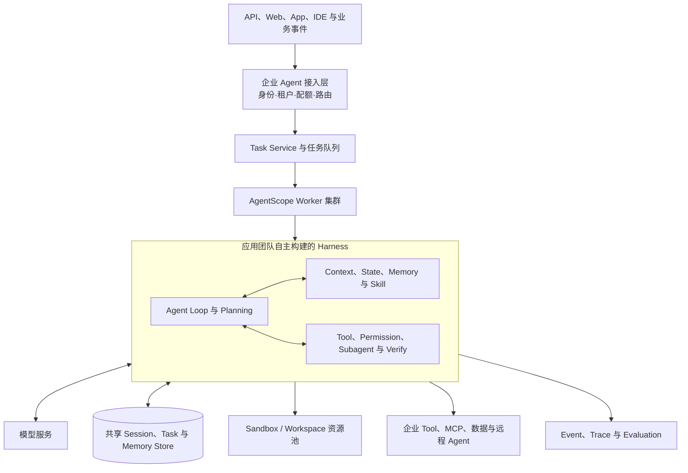

在线实例不应依赖进程内消息历史恢复任务。应用团队需要把 Session、Task、Plan、子任务和 Artifact 映射到共享状态接口；为同一任务设置并发写入或执行租约；在 Worker 失效后从安全点恢复；按租户创建或复用 Sandbox；使用短时身份访问企业工具。物理存储、调度和容灾属于 Runtime，但 Harness 必须先定义相应逻辑契约。

工作区 Agent 的架构重心会有所不同：它可以直接运行在 IDE、CLI 或团队 Workspace 中，保留更长生命周期的文件和用户交互；但只要进入多人、多项目或后台执行，同样需要身份、状态、权限、Artifact 和 Trace 边界。

#### 1.2.3 适用边界与构建交付物

Framework 路径适合业务逻辑独特、数据或执行环境不能交给外部托管、需要改变 Loop 或 Context 策略，或者企业希望沉淀统一 Agent 技术底座的场景。它也要求团队具备模型应用、分布式系统、安全和效果评估能力。

这一条路径在 Build 阶段至少应形成：可测试的 Harness 代码、Agent Contract、状态 Schema、Context Policy、Tool 与 Skill 清单、Environment Contract、Permission Policy、Verifier、事件模型和回归用例。只有模型与这些行为配置被共同版本化，线上结果才能被复现和回滚。

### 1.3 将 HarnessAgent 嵌入企业应用

本地运行证明了 Agent 能完成任务，但企业交付还需要稳定的调用边界。`HarnessAgent` 同时提供 `call`、`stream` 和 `streamEvents`：业务只关心最终回复时使用 `call`，需要展示模型增量和工具事件时使用流式接口。无论从 REST API、研发工作台还是 IM Channel 发起，请求都应先映射为稳定的 `RuntimeContext`，再进入同一个 Harness。

#### 1.3.1 用 RuntimeContext 固定身份与会话边界

应用层不应把 HTTP 连接或 WebSocket 当成 Session。连接会断开，任务仍可能继续；同一任务也可能从不同 Channel 恢复。更可靠的做法是由业务系统维护 `taskId`，并将租户、用户和任务映射为稳定的 `userId` 与 `sessionId`：

```java
RuntimeContext context = RuntimeContext.builder()
    .userId(request.tenantId() + ":" + request.userId())
    .sessionId(request.taskId())
    .build();

agent.streamEvents(request.prompt(), context)
    .doOnNext(event -> eventStore.append(request.taskId(), event))
    .blockLast();
```

同一个 `sessionId` 的后续调用可以恢复对话与 Harness 状态，但业务系统仍要保存 `taskId`、Agent 版本、输入、Artifact、审批记录和 Outcome。Agent Session 负责推理连续性，业务 Task 负责目标与验收，两者不能混为一谈。

#### 1.3.2 把业务能力接入 Harness

嵌入应用的价值不只是把模型输出换成 API 返回值，而是让 Agent 在企业边界内使用确定性能力。应用可以注册 Java Tool、连接 MCP Server、加载 Skill Repository，或声明 Subagent；高影响动作则通过 Permission 与 Middleware 进入统一决策链。

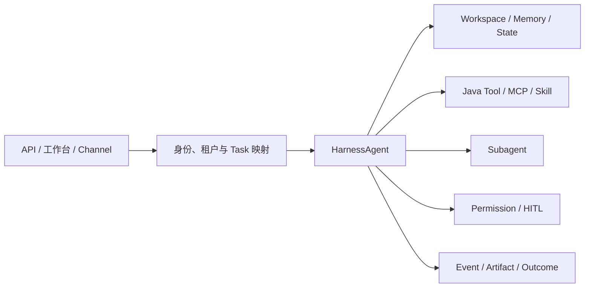

对调用方而言，最重要的不是暴露多少工具，而是建立稳定的能力契约：参数能否校验、调用身份来自哪里、结果是否可审计、失败是否可重试、写操作是否可撤销，以及哪些动作必须等待批准。

#### 1.3.3 嵌入式形态的适用边界

嵌入式形态适合把 Agent 接入已有 Java 服务和业务入口，团队能够直接控制 Agent Contract、工具与事件模型。它仍然不自动提供跨节点任务调度、共享状态、执行租约或租户级 Sandbox 池。只要任务可能跨请求、跨进程或运行较长时间，就应继续演进为独立 Worker，而不是让一次前端连接承担任务生命周期。

### 1.4 将 HarnessAgent 承载为长任务服务

长任务服务并不是另一种 Agent 实现。它仍然运行同一个 `HarnessAgent`，只是把调用从同步请求线程移到可调度的 Worker，并将 Session、事件和执行环境外置。这样即使客户端断开、Worker 重启或任务转移到另一节点，任务仍能从权威状态继续推进。

#### 1.4.1 用四类对象组织长任务

一个可恢复的 HarnessAgent 服务至少需要四类对象：

- **Agent Definition**：固定模型、Harness 配置、Tool、Skill、Subagent 与权限策略，并带有可追溯版本。

- **Task**：保存目标、业务状态、预算、幂等键、审批条件、Artifact 与完成证据。

- **Runtime Context**：把当前用户与 Session 身份传给 `HarnessAgent`，用于状态和资源隔离。

- **Event**：记录可流式展示和可重放的进度、工具、审批、结果与错误事件。

任务队列只负责“何时由哪个 Worker 运行”，不能代替 Harness 内部的 Plan、Todo 与 Session 状态。反过来，Harness Session 也不能代替业务 Task 的状态机和完成标准。

#### 1.4.2 在 Worker 中恢复并推进 HarnessAgent

Worker 收到任务后，使用任务中固定的 Agent 版本创建或取得 `HarnessAgent`，构造相同的 `RuntimeContext`，再消费 `streamEvents`。生产环境应为 Agent State 和 Workspace 配置共享或可恢复的后端，并对同一任务设置执行租约。

```java
void run(Task task) {
    HarnessAgent agent = registry.get(task.agentVersion());
    RuntimeContext context = RuntimeContext.builder()
        .userId(task.tenantId() + ":" + task.userId())
        .sessionId(task.id())
        .build();

    agent.streamEvents(task.nextInput(), context)
        .doOnNext(event -> eventStore.append(task.id(), event))
        .doOnComplete(() -> verifier.verifyAndRecord(task.id()))
        .blockLast();
}
```

如果工具可能修改代码、执行脚本或访问不可信输入，Worker 还应使用 `SandboxFilesystemSpec`，并让 Session 的 Sandbox 状态可以快照与恢复。恢复前必须核对外部系统状态、幂等键和已产生的 Artifact，不能机械重放失效前的写操作。

#### 1.4.3 长任务服务的责任边界

AgentScope Harness 负责一轮任务如何规划、行动、压缩上下文、调用子 Agent 和保持 Session 连续；企业 Runtime 负责队列、并发、租约、超时、节点故障与事件保留；Sandbox 负责限制文件、进程、网络、Secret 和资源；Verifier 根据真实环境证据判定 Outcome。四者可以部署在同一服务，也可以拆分，但接口与责任必须清晰。

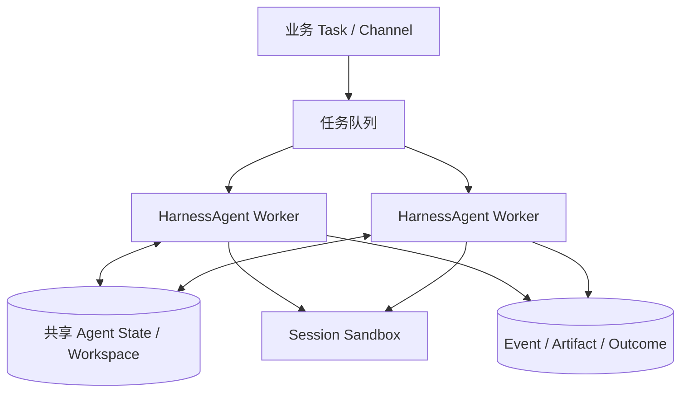

#### 1.4.4 适用边界与构建交付物

长任务形态适合异步、批量、跨请求或需要隔离执行的任务。Build 阶段除 Harness 代码外，还应交付 Task Schema、状态转换规则、任务与 Session 映射、事件模型、租约策略、恢复点、Sandbox Contract、Artifact 生命周期和 Verifier。若这些对象仍只存在于 Prompt 或进程内存中，服务就无法可靠恢复。

### 1.5 用工作区资产快速组装 HarnessAgent

并非每个 Agent 都需要重新编写 Java 逻辑。`HarnessAgent` 把 `AGENTS.md`、Knowledge、Memory、Skill 与 Subagent 声明组织在 Workspace 中，稳定的行为约定和可复用方法可以作为版本化资产交付。应用团队在相同 Builder 基线之上选择工作区、模型、能力仓库和运行策略，就能快速形成面向不同任务的 Agent。

#### 1.5.1 从任务契约反推能力组合

组装 Agent 时，应先定义目标、输入输出、允许影响的资源和完成证据，再决定要加载哪些资产：

| 构建对象 | HarnessAgent 中的载体 | 企业需要确定的内容 |
| --- | --- | --- |
| Agent 定义与版本 | Builder 配置、`AGENTS.md` | 目标、行为边界、所有者、版本和回滚策略 |
| Knowledge 与 Memory | Workspace、Memory 配置 | 来源、作用域、检索策略、写入规则和保留周期 |
| Tool、MCP 与 Skill | Toolkit、MCP、Skill Repository | 能力契约、参数校验、风险分级、依赖和审批点 |
| Plan 与 Subagent | Plan Mode、Todo、Subagent 声明 | 分解规则、委派边界、阶段门禁和结果合并方式 |
| Runtime 与 Sandbox | StateStore、FilesystemSpec | 状态后端、隔离粒度、网络、Secret、资源和快照 |
| 交互与质量 | Event、Middleware、Verifier | Channel 映射、可见事件、完成证据和评估基线 |

把所有可用知识与工具一次性装入 Agent 会扩大 Context、权限和回归面。更好的做法是通过 Skill 与能力目录渐进披露，只有当前任务需要且当前身份获权的能力才进入 Harness。

#### 1.5.2 让工作区成为可发布资产

工作区不是某台机器上的临时目录。`AGENTS.md`、Skill、子 Agent 规格、测试样例和策略文件都应与 Harness 代码一起版本化；Memory、Session 快照和任务 Artifact 则按作用域写入运行存储。发布时固定代码版本与资产版本，回滚时同时回滚，避免“代码已回退但 Prompt、Skill 或权限规则仍是新版本”。

#### 1.5.3 从一个 Agent 扩展到多个角色

多个 Agent 之间的差异应优先体现在任务契约、工作区资产、工具权限和 Subagent 规格，而不是复制整套运行框架。例如漏洞修复 Agent、数据分析 Agent 与评审 Agent 可以共享状态、Sandbox、事件和评估基础，只替换各自的 `AGENTS.md`、Skill 与 Verifier。这样既保留任务差异，也减少基础设施分叉。

#### 1.5.4 组装式构建的适用边界

组装式构建适合任务模式相近、主要差异来自领域指令和能力资产的 Agent。如果任务需要改变 Agent Loop、Context 编译、状态语义或权限决策，应回到代码层扩展 Builder 与 Middleware，而不是把复杂控制塞进工作区文本。

### 1.6 用 Agent Platform 规模化交付 HarnessAgent

当多个团队和多个 `HarnessAgent` 同时存在时，平台的重点从“创建一个 Agent”转向“持续交付一组可管理、可运行、可评估的 Agent”。平台统一的是目录、身份、资源、版本、任务和质量事实，不是要求所有 Agent 使用完全相同的 Prompt、工具和工作区。

#### 1.6.1 企业级 Agent Platform 的能力边界

| 平台能力 | 主要管理对象 | 对 HarnessAgent 交付的价值 |
| --- | --- | --- |
| Agent 目录与发布 | Definition、Workspace Version、Owner、Tenant | 统一所有权、版本、灰度与回滚 |
| 运行与调度 | Worker、Deployment、Task、Session、Lease | 多副本运行、故障恢复、限流与成本控制 |
| 能力与数据资源 | Model、Tool、MCP、Skill、Memory、Credential | 复用经过审核的企业能力，避免凭证散落 |
| 安全与治理 | Identity、Permission、Policy、Audit、Retention | 在 Harness 执行前后实施统一控制 |
| 交互与协作 | Endpoint、Channel、Event、HITL、Subagent | 从多个入口安全推进同一任务 |
| 观测与优化 | Trace、Artifact、Outcome、Dataset、Evaluation | 连接运行轨迹、业务结果和版本改进 |

平台可以为 `HarnessAgent` 提供标准 Builder 基线、共享状态适配器、Sandbox 资源池和事件网关，但不能替业务应用定义任务目的、正确性和最终责任。一个版本“运行成功”只说明调用链结束，不代表业务 Outcome 已经达成。

#### 1.6.2 让不同 HarnessAgent 进入同一平台

平台接入应使用公共契约，而不是侵入每个 Agent 的内部实现。Agent Definition 记录 Builder 与工作区版本；Task 保存目标与业务状态；Runtime Context 传递租户、用户和 Session；Event 传播进度与干预；Artifact 和 Outcome 用于验收；Trace 连接每一次模型、工具和权限决定。

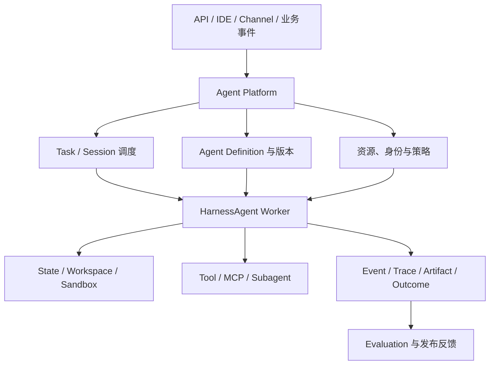

#### 1.6.3 从规模化运行走向持续优化

平台化之后，Agent 版本、模型、System Context、Tool Schema、Skill、权限策略和 Sandbox 镜像都应进入同一个发布单元。每次变更先在固定数据集与环境中回放，再灰度到受控流量，最后根据 Outcome、成本、时延、越权率和人工介入率决定是否扩大发布。失败案例应回流为测试、Verifier、策略或 Skill，而不是只追加一句 Prompt。

这条反馈链路让 `HarnessAgent` 不只是可运行的 Java 对象，而是可版本化、可部署、可观测、可评估和可回滚的企业 Agent 交付单元。

### 1.7 本节小结

构建企业级 Agent 的核心，是决定怎样实现 Harness，以及由谁承担其行为、运行和效果责任。`HarnessAgent` 提供统一的代码入口，但本地工作区、嵌入式应用、长任务服务和平台化交付仍具有不同的 Runtime、状态、隔离和验收责任。

四种形态不是成熟度高低关系，也不必互斥。企业应根据任务结构、数据边界、环境影响、团队能力和交付方式选择最低充分方案。无论采用哪种形态，都要区分 Task 与 Session、Event 与 Trace、Artifact 与 Outcome，把权限与验证落实为确定性机制，并让模型、Harness 配置、工作区资产、环境、策略和评估基线共同受版本控制。

当多个团队和多个 `HarnessAgent` 同时存在时，Agent Platform 不只是创建 Agent 的入口，而是支持 Agent 创建、接入、规模化交付、运行、治理、协作、观测和优化的综合平台。平台统一公共对象和质量事实，但不抹平任务差异，也不替业务应用定义任务目的和正确性。这一边界使不同形态的 HarnessAgent 能够进入同一套运行、治理与调优体系。

接下来，本章后续三节将继续从任务、信息、行动三类工程契约展开 Agent Harness 的构建。


## 第二篇 任务编排、长程推进与协作流转

上一节建立了 `HarnessAgent` 从本地工作区、嵌入式应用、长任务 Worker 到平台化交付的四种运行形态。本节继续向下，关注一个更具体的问题：当任务不能通过一次模型调用完成时，Harness 如何把模型的离散判断组织为可持续推进、可中断恢复、可验证结束的任务过程。

模型的一次输出只是离散判断，而要解决一个企业级任务通常是一个持续的过程。它可能需要先理解环境、再制定计划，连续调用多个工具，在关键动作前等待审批，把部分工作委派给子代理，经历失败和恢复，最后还要用环境事实证明目标已经达成。Harness 执行内核的职责，就是把模型的每一次判断组织成有状态、可控制、可恢复的任务过程。

本节聚焦 Harness 的执行与编排系统：Agent Loop 如何推进任务，Planning 和 Todo 如何把目标外部化，Subagent 如何形成受控委派，异步任务如何跨越请求、进程和上下文窗口，以及如何判断 Agent 是真正完成，而不是仅仅停止。Context、Memory 与 Workspace 的信息组织将在本章“上下文、状态与可复用能力资产”一节展开；工具、Sandbox、权限、Streaming、Trace 与 Evaluation 则在本章“受控执行、验证反馈与交付准备”一节主讲。

本节使用同一个企业案例贯穿全节，这个案例既包含长程执行，也包含并行委派、异步等待、人工介入和确定性验证，能够代表大量企业工程任务。

> **生产服务漏洞修复与变更发布 Agent**：收到支付服务高危依赖漏洞任务后，Agent 需要定位受影响代码和运行实例，制定升级方案，将依赖分析、代码修改和独立评审分配给不同执行者，在隔离环境中修改代码并运行测试，生成变更单；涉及发布时等待责任人审批，最后以代码差异、测试报告、安全扫描和发布状态验证任务是否完成。

### 2.1 Agent Loop 与任务状态机

#### 2.1.1 从模型调用到任务循环

Agent Loop 是 Harness 最稳定的内核。它不要求模型一次性给出完整答案，而是允许模型根据当前目标和环境反馈，重复执行“判断—行动—观察—再判断”，直到任务被验证完成、进入等待、失败或取消。这个循环在第 4 章“Agent 与 ReAct 循环”中已用最小例子出现过；本节把它放进任务状态机与预算边界的企业语境。

一个最小但完整的 Loop 可以抽象为五个阶段：

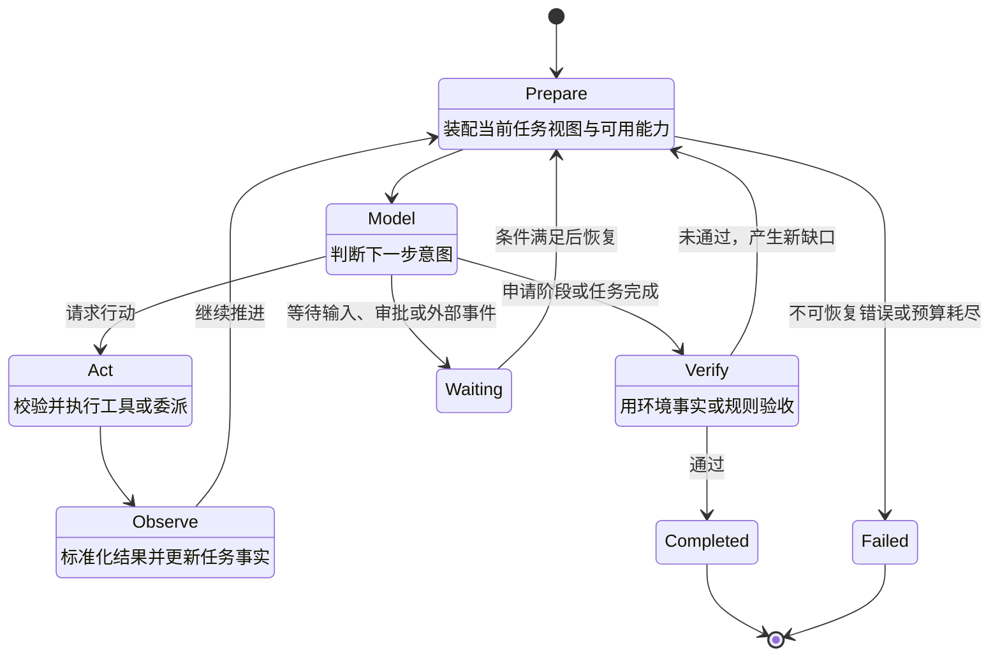

- **Prepare** 读取权威任务状态，确定本轮目标，并向本章“上下文、状态与可复用能力资产”一节介绍的 Context Builder 请求模型输入。

- **Model** 调用模型，由模型判断下一步应行动、委派、询问、等待还是申请完成。

- **Act** 将模型意图交给本章“受控执行、验证反馈与交付准备”一节介绍的 Action Plane，完成参数、身份、策略、审批和执行。

- **Observe** 将工具、环境、子任务或用户反馈转换为结构化 Observation，并更新任务事实。

- **Verify** 不接受“我已经完成”作为唯一依据，而是运行与任务相匹配的验收器。

浏览文件、执行代码、查询业务系统和调度远程 Agent，都是 Act 的不同实现；用户追加要求、工具返回和异步任务完成，都是 Observe 的不同来源。核心 Loop 保持稳定，具体能力通过扩展点加入。

#### 2.1.2 用权威状态驱动任务

消息历史记录了模型和用户曾经交换的内容，却不应成为任务状态的唯一来源。企业 Harness 至少要维护一份可机读的权威状态：目标、当前阶段、Plan 与 Todo、已确认事实、阻塞项、子任务、Artifact、剩余预算、等待原因和完成依据。

| 状态 | 语义 | 允许的下一步 |
| --- | --- | --- |
| CREATED | 任务已经建立但尚未开始 | 进入运行或取消 |
| RUNNING | 正在准备、推理或行动 | 继续、暂停、等待、验证、失败或取消 |
| WAITING_INPUT | 缺少用户或业务信息 | 接收输入后恢复，或超时结束 |
| WAITING_APPROVAL | 行动明确但需要批准 | 批准、拒绝、修改或取消 |
| WAITING_EVENT | 等待工具、子任务或外部系统 | 收到事件后恢复，或按策略超时 |
| PAUSED | 用户或系统主动暂停 | 恢复、修改规则或取消 |
| VERIFYING | 正在核验阶段或最终结果 | 通过、生成修复项或失败 |
| COMPLETED | 验收条件已经满足 | 交付结果与证据 |
| FAILED | 当前策略下不能继续 | 重开尝试、转人工或结束 |
| CANCELLED | 任务被显式终止 | 清理资源并保留审计事实 |

WAITING 不是失败，PAUSED 也不是结束。只有把这些状态显式化，上层 Runtime 才能在等待期间释放计算资源并准确恢复；交互界面才能说明 Agent 在等什么；观测系统才能区分执行慢、审批慢和工具慢。

Loop 还必须有外部终止边界。步骤数、总时长、Token 与费用、工具调用次数、子任务并发数、高风险动作次数都应进入预算。预算接近阈值时，Harness 可以要求模型收敛范围、停止新委派、优先完成可交付部分或请求用户选择；预算耗尽时，则应产生明确终态与未完成清单，而不是悄然截断。

#### 2.1.3 案例：一次修复任务如何推进

漏洞修复任务进入系统后，不应只生成一串聊天消息，而应形成持续更新的任务对象。例如在完成影响分析后，权威状态可以表示为：

```text
task_id: remediation-2026-0917
goal: 修复 payment-service 中 CVE-XXXX 并形成可审批变更
state: RUNNING
stage: implement_fix
facts:
  affected_module: payment-core
  current_version: 4.2.1
  target_version: 4.2.4
todos:
  - {id: t1, title: 确认影响范围, status: completed}
  - {id: t2, title: 修改依赖并补充测试, status: in_progress}
  - {id: t3, title: 独立评审变更, status: pending}
artifacts:
  - impact-report.md
budgets:
  remaining_steps: 36
  remaining_minutes: 48

completion_evidence: [ ]
```

模型看到的是由这份状态生成的当前任务视图，而不是被迫从几百条历史消息中猜测进度。当安全扫描还未通过时，即使模型输出“修复已完成”，状态也只能进入 VERIFYING；只有验收器补齐证据，才能提交 COMPLETED。

### 2.2 Planning、Todo 与阶段目标

#### 2.2.1 把计划变成外部控制对象

Planning 的价值不是展示模型隐藏的思考过程，而是把任务结构外部化为 Harness 和用户都能读取、修改和验证的控制对象：要达到什么阶段目标、有哪些依赖、哪一步正在执行、用什么证据判定完成。

根据任务复杂度，Harness 可以使用三种控制方式：

| 模式 | 表示方式 | 适用任务 |
| --- | --- | --- |
| 轻量 Todo | 简短、有序的待办列表 | 目标明确、步骤少、反馈快 |
| Plan Mode | 只读探索、形成计划、确认后执行 | 影响面较大、需要审阅、环境尚不清楚 |
| Planner–Executor | Planner 维护阶段和依赖，Executor 逐项执行 | 长任务、多依赖、可并行或需要专业角色 |

计划必须允许修订。工具结果可能推翻假设，用户可能改变目标，环境也可能暴露新约束。每次重规划都应说明触发事实并保留已完成项，不能通过改写目标掩盖失败。Todo 则不需要记录每次微小工具调用，只记录会改变任务可交付状态的事项，并保持唯一的当前进行项或明确的并行分组。

#### 2.2.2 用阶段门禁约束执行

长任务不应直到最后才验证。漏洞修复案例可以划分为五个阶段：

| 阶段 | 主要产物 | 进入下一阶段的门禁 |
| --- | --- | --- |
| 影响分析 | 受影响模块、依赖链、运行实例清单 | 影响范围可追溯，版本事实已核验 |
| 修复规划 | 升级方案、兼容风险、回滚方案 | 计划获批准，写操作权限被放开 |
| 变更实施 | 代码差异、依赖锁文件、测试补充 | 修改仅发生在授权工作区 |
| 独立验证 | 单测、集成测试、安全扫描、评审意见 | 所有强制检查通过或缺口被显式接受 |
| 发布准备 | 变更单、发布窗口、回滚入口 | 责任人审批；本节不自动执行生产发布 |

阶段门禁既降低错误方向上的继续投入，也为 Context 压缩、人工接管和跨窗口续行提供稳定边界。有效的阶段描述必须回答“输出是什么、证据在哪里、谁来确认”，而不是只写“分析问题”“处理代码”“确保质量”。

#### 2.2.3 将探索、计划和执行分开

在 Framework 路径中，应用团队可以直接把计划能力组合进 Harness。下面的 AgentScope 示例为修复 Agent 启用 Plan Mode 与任务列表：

```java
HarnessAgent agent = HarnessAgent.builder()
    .name("remediation-agent")
    .model(model)
    .workspace(workspace)
    .enablePlanMode()
    .planFileDirectory("plans")
    .enableTaskList()
    .build();
```

Plan Mode 将执行过程分为“只读探索—写入计划—人工确认—进入执行”。探索阶段只开放只读工具以及 plan_enter、plan_write、plan_exit、todo_write 等计划工具；plan_exit 触发人工确认，获批后才进入可修改工作区的阶段。计划写入 plans/PLAN.md，Todo 保存在 Agent 状态中，因此两者都能跨调用恢复。

这一实现展示了 Prompt 与 Harness 控制的区别：Prompt 可以要求模型“先规划再修改”，但只有权限模式、工具白名单、持久状态与 HITL 共同生效，系统才真正具备“计划获批前不可写”的约束。

Plan Mode 的工具清单、状态持久化与 `todo_write` 的协作已在第 17 章“计划模式”中逐项展开；本节关注的是它作为阶段门禁的编排语义。

### 2.3 Subagent 与任务委派

#### 2.3.1 何时值得委派

Subagent 的价值不是把一个 Agent 包装成多个角色，而是解决三个具体问题：

1. **上下文隔离**：子任务只加载相关文件、工具和历史，避免主 Agent 的窗口被探索过程占满。

1. **能力隔离**：不同子任务使用不同模型、指令、Skill、工具与权限。

1. **并行执行**：互不依赖的检索、实现或验证可以同时推进，缩短墙钟时间。

任务很短、步骤高度依赖或共享对象频繁变化时，委派会增加通信和合并成本。只有隔离、专业化或并行收益超过这些成本时，Subagent 才有价值。

子 Agent 的声明方式、ISOLATED 与 SHARED 隔离、同步与后台执行已在第 16 章“子 Agent 协作”中展开；本节补齐的是委派契约与失败传播——SDK 告诉你怎么声明，这里回答怎么委派才可靠。

#### 2.3.2 建立清晰的委派契约

主 Agent 负责全局目标、计划、预算、依赖和最终结果，不应把“任务完成”的责任一并交出去。研究 Subagent 收集事实与候选方案，执行 Subagent 在限定范围内产生变更，评审 Subagent 使用相对独立的上下文寻找缺口。这些是运行时职责，不一定是永久角色。

每个子任务都应携带可机读契约：

| 契约项 | 需要回答的问题 |
| --- | --- |
| 目标与边界 | 交付什么；哪些目录、系统和动作在范围内 |
| 已知上下文 | 哪些事实已确认；哪些决定不可自行改变 |
| 能力与权限 | 可用模型、Skill、Tool、环境和权限是什么 |
| 预算 | 最大时间、步骤、Token、费用和并发是多少 |
| 输出与证据 | 结果采用何种结构，证据和来源如何附带 |
| 失败语义 | 何时重试、返回部分结果、升级或终止 |
| 验收条件 | 父 Agent 用什么条件判断结果可采用 |

**Delegation** 是父任务保留责任，将有边界的子任务委派出去；结果返回后仍由父 Agent 整合和验收。**Handoff** 则是任务控制权发生转移，接收者成为当前责任人，并获得继续推进所需的目标、状态和恢复位置。二者都不能只通过一条自然语言消息实现；至少要有任务关系、状态与责任变更记录。

#### 2.3.3 案例：分析、修改和评审如何协同

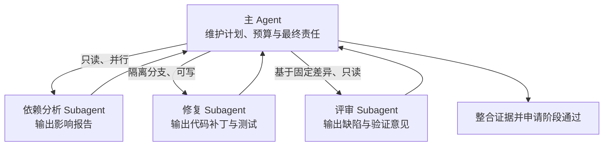

分析与代码库探索可以并行，但代码修改需要基于已确认目标版本；评审必须读取固定的差异和测试结果，而不能与执行者共享未经提交的中间判断。多个执行者若同时修改同一工作区，应使用隔离分支、对象级锁或补丁合并，不能依赖“大家小心不要冲突”。

AgentScope 支持把子代理声明为工作区中的版本化规格。例如：

```text
---
description: 对漏洞修复补丁进行独立评审，检查兼容性、测试和回滚风险。
workspace:
  mode: isolated
steps: 8
tools: [read_file, grep_files]
---

只审查已生成的差异和测试证据，不修改代码。
按“阻断问题、一般问题、证据缺口”输出结构化结果。
```

主 Agent 可通过 agent_spawn 同步调用，也可以设置后台执行并获得 task_id。子代理默认不应继承父任务的全部上下文和权限；父任务有权委派，并不意味着子 Agent 自动获得同等授权。

#### 2.3.4 合并结果与传播失败

父任务需要显式定义子任务失败策略：关键分析失败时 FAIL_FAST；非关键探索可以 BEST_EFFORT；瞬时故障可以 RETRY_OR_REASSIGN；需要业务决定时进入 ESCALATE。合并结果时还要校验输入版本和证据时间，避免采用基于旧代码或旧业务状态得出的结论。

Subagent 的产物不是主 Agent 可以直接复述的“答案”，而是新的 Observation。只有经过 Schema 校验、版本检查和父任务验收后，才能进入权威任务状态。

### 2.4 异步任务与长程续行

#### 2.4.1 让任务脱离当前连接持续存在

企业任务经常超过一次 HTTP 请求、一个终端进程或一个模型上下文的生命周期。Harness 必须把任务身份与当前连接分离：调用方提交任务后获得稳定 task_id，可以持续消费事件，也可以断开；任务进入等待或后台运行时，Runtime 可以释放当前计算资源；条件满足后，从权威状态恢复，而不是依赖原进程仍然存在。

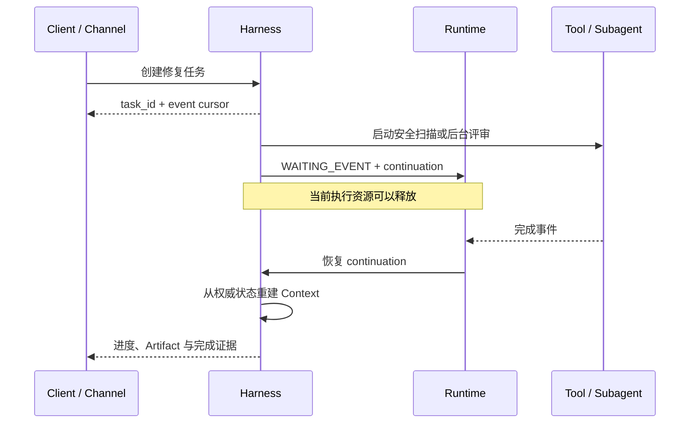

后台任务、事件和恢复应共用一套契约：稳定任务 ID、父任务 ID、当前状态、创建者与执行者、输入和 Artifact 引用、事件序号、超时、取消与幂等语义、结果位置、错误分类，以及恢复所需的 Continuation。

暂停前，Harness 应停止创建新行动，处理可中断操作并保存最新状态；恢复时重新检查目标、外部条件、工具是否实际执行、权限是否仍有效、工作区是否变化以及剩余预算。取消需要沿父子任务传播，但已发生的外部副作用不能假装消失，必须保留事实并在必要时执行补偿。

Context Reset 只负责控制语义：在旧窗口结束前形成一致的继续点，在新窗口中从权威状态重建当前任务视图。Continuation 应包含目标、当前 Plan、已确认事实、失败尝试、Artifact、等待项、剩余预算和权限模式。其具体存储、压缩和装配方式将在本章“上下文、状态与可复用能力资产”一节展开。

#### 2.4.2 将 HarnessAgent 嵌入企业服务

希望保留现有业务入口、同时复用成熟执行内核时，可以直接在 Java 服务中调用 `HarnessAgent`。下面的示例用稳定的用户与任务标识构造 `RuntimeContext`，再消费任务级事件；事件写入外部存储后，客户端无需维持原连接也能查询进度或恢复显示。

```java
RuntimeContext context = RuntimeContext.builder()
    .userId(task.tenantId() + ":" + task.userId())
    .sessionId(task.id())
    .build();

agent.streamEvents(
        "分析 payment-service 的高危依赖漏洞，修改代码并补充测试；不要发布。",
        context)
    .doOnNext(event -> eventStore.append(task.id(), event))
    .doOnError(error -> taskStore.recordFailure(task.id(), error))
    .blockLast();
```

`HarnessAgent` 提供 Loop、Plan、工具调用、上下文压缩和 Session 接续；企业服务仍需补齐租户身份、任务队列、Agent 版本、Artifact 存储、权限策略和业务验收。相同 `sessionId` 解决的是 Harness 状态接续，不会自动解决同一任务的并发执行和业务幂等。

在多实例或弹性环境中，应配置共享 `AgentStateStore`，并让 Workspace 或 Sandbox 快照可以从其他 Worker 恢复。任务调度器对同一 `taskId` 设置执行租约，Worker 失效后由新 Worker 使用相同 `RuntimeContext` 继续推进；恢复前先查询外部工具和业务系统的真实状态，避免重复执行写操作。

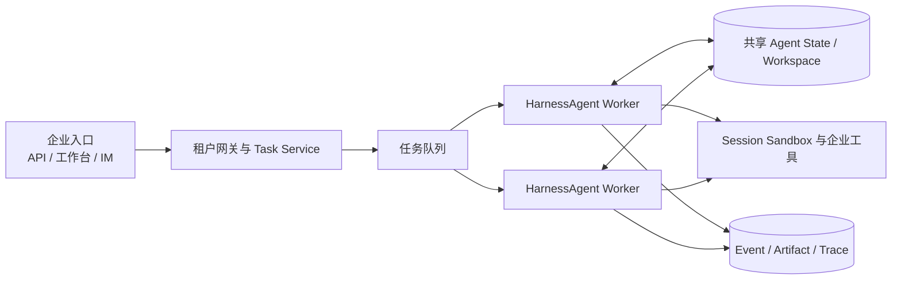

#### 2.4.3 由平台调度 HarnessAgent 长任务

当团队不希望每个应用各自维护 Worker、状态适配器和 Sandbox 池时，可以由统一 Agent Platform 承载 `HarnessAgent`。平台固定 Agent Definition 与工作区版本，Task Service 维护业务状态与幂等，Worker 使用 `RuntimeContext` 恢复 Session，Event Store 提供事件游标与重连，Verifier 依据环境事实提交 Outcome。

平台化降低了重复建设成本，但业务责任不会消失。企业仍要定义工具与数据边界、任务目标、审批人、成功标准和最终验收。本章“受控执行、验证反馈与交付准备”一节将用同一案例展示 HarnessAgent 的事件流、审批与 Sandbox 连接。

### 2.5 Middleware 与执行内核测试

#### 2.5.1 保持核心 Loop 稳定

一个常见演进问题是：每加入压缩、计划、权限、模型路由或观测能力，就在 Loop 中增加一组条件分支。短期直接，长期会使状态迁移不可预测。更稳健的结构是“稳定内核 + 可插拔能力”：核心 Loop 只定义阶段与状态迁移；Middleware、Hook 或 Ability 在明确的生命周期点读取 Runtime Context，返回放行、修改、短路或追加行为。中间件如何装备、内置清单有哪些，已在第 9 章“中间件”给出；本节关注扩展时机的约定，以及扩展本身要守住的工程纪律。

| 扩展时机 | 可加入的能力 | 不应做的事 |
| --- | --- | --- |
| Task 创建前后 | 任务分类、初始预算、版本绑定 | 隐式改变用户目标 |
| Prepare 前后 | 计划提醒、Context 请求、模型路由 | 把持久状态只写进 Prompt |
| Model 调用前后 | 参数策略、输出解析、无进展检测 | 记录不应保留的敏感推理内容 |
| Action 前后 | 预算检查、结果标准化 | 绕过本章“受控执行、验证反馈与交付准备”一节定义的统一 Action Plane |
| State 变化前后 | 状态校验、Checkpoint、通知 | 多处各自维护权威状态 |
| Verify 前后 | 选择验收器、生成缺口、质量门禁 | 仅凭模型自述标记完成 |

扩展本身也需要顺序、读写范围、冲突规则、失败语义和可观测性。最好让扩展返回结构化 Decision 或 Patch，由核心 Loop 统一提交，而不是任意修改共享对象。

AgentScope 的 HarnessAgent 采用能力组合方式，将工作区、状态存储、计划、Subagent、Memory、压缩、Skill、Sandbox 与 Channel 叠加到统一运行上下文中。Framework 路径因此具有最大的业务调优空间，也意味着应用团队要为能力组合、生命周期顺序和最终效果负责。

#### 2.5.2 对确定性部分做契约测试

Harness 测试不能只看最终回答。执行内核至少需要四类确定性测试：

- **状态迁移测试**：每个状态只接受合法事件，暂停、取消和失败正确传播。

- **扩展顺序测试**：Middleware 在确定时机运行，冲突与短路行为稳定。

- **恢复测试**：在任意安全点中断后，任务能够重建且不重复副作用。

- **预算与边界测试**：达到步骤、时间、费用和风险阈值后，Loop 按设计收敛。

例如，修复 Agent 的恢复测试可以在“补丁已写入但测试结果尚未返回”时强制中断：恢复后应先查询原测试任务，而不是再次修改文件或重复启动发布。模型输出可通过固定样本、录制回放或模拟器替代，以验证 Harness 的确定性控制；真实模型的端到端效果进入本章“受控执行、验证反馈与交付准备”一节的 Evaluation。

### 2.6 可靠性与完成验证

#### 2.6.1 针对失败类型选择恢复策略

“Agent 失败”不是一个可执行的诊断。瞬时模型或网络错误适合有界退避；参数错误需要修正；环境缺失需要重建；权限拒绝应等待或终止；重复探索需要重新规划；业务条件不满足则要明确缺口。盲目重试只会增加成本和风险。

有副作用的行动在重试前必须先回答“上一次究竟有没有发生”。对于发布、通知、写数据库等操作，超时可能只是响应丢失。Harness 应生成幂等键，记录请求与结果，并优先查询状态；无法证明未执行时，不应直接重复。切换模型、工具或环境的降级路径也要被记录，因为能力、权限和结果质量可能已经变化。

无进展检测比单纯的最大步数更早发现问题。常见信号包括：连续调用相同工具且参数高度相似、反复得到同一错误、Plan 长时间不变、工作区没有新增事实、模型在少数行动间循环。检测后可以先要求模型根据结构化证据重新规划，再逐步采取缩小任务、切换能力、创建独立评审或转人工。

#### 2.6.2 让完成由证据决定

模型只能提出完成申请，Harness 才能提交完成状态。验证强度应与风险匹配：

| 层级 | 验证方式 | 适用结果 |
| --- | --- | --- |
| 结构验证 | Schema、必填字段、格式和文件存在 | 低风险结构化产物 |
| 环境验证 | 查询真实系统、检查文件差异与执行结果 | 工具和工作区任务 |
| 确定性验证 | 测试、规则、静态检查和业务校验 | 可编码成功条件 |
| 独立模型验证 | 使用独立 Context 检查质量与遗漏 | 开放式分析和复杂内容 |
| 人工验收 | 责任人审阅、签署或批准 | 高影响、主观或合规任务 |

Verifier 应返回结构化缺口、失败证据和可修复性。验证失败不是简单结束，而是新的 Observation：Harness 决定继续修复、重新规划、转交还是失败。Verifier 是单次任务的完成门禁；跨版本判断某个 Harness 是否更好，则属于本章“受控执行、验证反馈与交付准备”一节的 Evaluation Harness。

#### 2.6.3 案例：什么才算漏洞修复完成

对贯穿案例而言，以下事实必须同时成立：

1. 依赖清单证明受影响版本已经被替换，且没有通过传递依赖重新引入。

1. 代码差异仅落在授权目录，变更与已批准计划一致。

1. 单元测试、集成测试和安全扫描均有可寻址报告，强制项全部通过。

1. 独立评审没有未关闭的阻断问题。

1. 变更单包含影响范围、回滚方案和证据引用。

1. 如果目标只到“形成可审批变更”，系统不得把“尚未发布”误判为未完成；如果目标包含发布，则必须进一步核验审批和真实部署状态。

因此，最终结果不是一句“已完成”，而是一组目标相关的事实：

```text
state: COMPLETED
outcome: change_ready_for_approval
evidence:
  dependency_check: artifacts/dependency-tree.json
  code_diff: artifacts/remediation.patch
  unit_tests: artifacts/unit-test.xml
  integration_tests: artifacts/integration-test.xml
  security_scan: artifacts/security-scan.sarif
  review: artifacts/review.json
  change_request: CR-18427
remaining_actions:
  - 由服务负责人审批并安排发布窗口
```

这套结构可以直接迁移到其他场景：合同审查以条款覆盖、来源和责任人签署为证据；数据修复以影响行数、抽样校验和回滚点为证据；客户工单以系统状态、沟通记录和用户确认作为证据。变化的是 Verifier，稳定的是“模型申请完成、Harness 依据事实提交完成”的原则。

#### 2.6.4 用 HarnessAgent 的 Trace 与 Outcome 完成验证

`HarnessAgent` 的运行事件与 Trace 可以统一呈现模型调用、Plan 变化、工具执行、Subagent 状态和权限决定，但它们不应替代业务完成语义。业务 Task 仍需维护状态版本、幂等键、审批条件和 Artifact 引用，并把当前 Agent 与工作区版本写入任务记录。

获得授权的 Verifier 联合确定性测试、真实业务系统状态和人工授权判定 Outcome。平台统一运行多个 `HarnessAgent`，也不意味着它们天然共享同一父子任务语义或完成标准。可复用的是事件、Trace、资源装配和评估基础；具体业务何时算完成，仍由 Agent Contract 和 Verifier 定义。

### 2.7 本节小结

Harness 执行内核把模型的离散判断组织成可靠任务过程。稳定的 Agent Loop 以 Prepare、Model、Act、Observe、Verify 推进任务；显式状态和多维预算提供确定性边界；Planning、Todo 与阶段门禁把任务控制外部化；Subagent 通过上下文、能力和责任隔离实现受控委派；异步任务、Continuation 与共享 Session 让任务跨越连接、进程和上下文窗口；Middleware 则使能力可以在不重写核心 Loop 的前提下组合演进。

下一节进入 Harness 的信息工程，即上下文、状态与可复用能力资产：如何在有限模型窗口与持续增长的任务事实之间，组织 Context、Session、Workspace、Memory、Knowledge 和 Skill。


## 第三篇 上下文、状态与可复用能力资产

**长程任务每推进一轮，广义 Harness 都要重新回答一个看似简单、实际决定执行质量的问题：模型此刻应当看见什么。把完整对话、全部文件、所有工具说明和长期经验同时放入模型窗口，不仅会增加成本与延迟，也会让关键约束被重复信息和低可信内容淹没；只保留最近几轮交互，又会丢失目标变更、已确认事实、外部副作用、验收缺口和恢复位置。模型窗口有限，而任务世界持续增长，两者之间必须存在一套独立的信息组织机制。**

因此，Harness 需要一套独立的上下文与状态系统。它不是把更多文本喂给模型，而是持续完成四项工作：把多来源信息编译成本轮 Context；把不断增长的历史压缩和卸载；把任务事实保存在模型窗口之外；把长期 Memory、企业 Knowledge 与可复用 Skill 在正确权限下按需提供给模型。

本节与上一节有明确边界：本章“任务编排、长程推进与协作流转”一节定义任务如何流转，本节定义任务过程中的信息和状态如何表示、保存和进入模型。物理数据库、索引、对象存储和跨副本恢复属于 Runtime 实现；本节聚焦 Harness 所依赖的逻辑模型、构建管线和资产契约。

本节继续使用“生产服务漏洞修复与变更发布 Agent”作为贯穿案例。进入本节后，我们关心的不再是任务如何推进，而是 Agent 在每一步应看见什么：初始漏洞公告、项目规则、当前依赖版本和计划如何进入 Context；长日志和测试报告如何退出模型窗口但仍可查询；计划、补丁和证据如何保存在 Workspace；一次成功修复又如何沉淀为后续任务可以发现但不会被误用的 Memory 与 Skill。

### 3.1 Context 构建管线

#### 3.1.1 System Context 的动态编译

生产级 Agent 的 System Prompt 不应只是仓库中的一个长字符串。模型每轮实际接收到的 System Context，需要根据 Agent 版本、当前任务阶段、用户身份、工作区规则、剩余预算、可用工具和选中的 Skill 动态生成。其角色更接近一次“编译”：多个来源按优先级合并，冲突被处理，超出预算的内容被压缩或移除，最终得到本轮可执行的模型视图。

```text
System Context
├── Platform Policy        平台安全边界、不可覆盖规则
├── Agent Contract         角色、目标、能力边界与输出要求
├── Tenant / Project Rule  租户制度、项目约定与工作区规则
├── Runtime Reminder       当前阶段、预算、等待项与操作模式
├── Selected Skill         本轮所需方法、脚本与参考资料
└── Tool Descriptors       本轮允许披露的能力与参数 Schema

Task Context
├── User Goal / Steering   原始目标和最新纠偏
├── Plan / Todo            当前阶段和未解决事项
├── Recent Interaction     最近消息和 Observation
├── Compacted History      早期过程的结构化摘要
├── Retrieved Memory       与当前任务相关的历史经验
├── Retrieved Knowledge    带来源、权限和时效的企业事实
└── Workspace References   文件、Artifact 和大结果引用
```

这套分层解决的是责任问题。平台策略不能被项目文档覆盖；用户最新要求可以改变任务方向，却不能突破企业安全边界；Memory 中的历史偏好不能替代当前业务事实；工具返回的外部内容也不能自动升级为系统指令。若所有内容被拼接成同一层文本，Harness 将很难判断冲突来自哪里，更无法进行独立版本和回归。

#### 3.1.2 Context Builder 的处理流程

Context Builder 在每次模型调用前执行一条确定性管线：

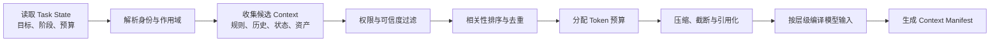

候选信息至少从 Agent 配置、Task State、Session、Workspace、Memory、Knowledge、Skill Registry 和 Tool Registry 中产生。管线应先做身份和权限过滤，再做相关性排序，不能为了排序方便先把跨租户内容交给检索器或模型。对于外部内容，还要保留来源和信任等级，避免检索到的文档或网页把自身文本伪装成高优先级指令。

#### 3.1.3 优先级与 Token 预算

Context 构建不能只按相似度排序。一个实用的优先级函数通常同时考虑：

- **约束强度**：平台政策和明确业务规则高于经验性建议。

- **任务相关性**：是否直接影响当前阶段的判断与行动。

- **时间有效性**：当前环境事实高于已经过期的历史结论。

- **来源可信度**：权威系统事实高于未经确认的模型摘要。

- **执行依赖**：即将调用的工具说明和验收条件应优先保留。

- **信息增量**：与已选内容重复的信息应合并或移除。

- **Token 成本**：同等价值下优先采用更紧凑、可引用的表达。

Harness 可以把可用窗口划分为若干预算区，例如为不可覆盖规则、当前目标和状态保留固定下限，为最近交互、检索知识、Skill 和工具 Schema 分配动态额度，并预留模型输出与后续 Observation 空间。预算不是静态百分比：当任务进入工具密集阶段时，工具定义和环境状态权重上升；进入最终综合阶段时，证据和验收条件更重要。

#### 3.1.4 用 Context Policy 与 Manifest 管理模型输入

每次模型调用都应生成一份 Context Manifest，记录模型究竟看到了什么，而不只是保存最终拼接文本。Manifest 至少包括：

| 字段 | 说明 |
| --- | --- |
| source_type / source_id | 来源类型与稳定标识 |
| scope | Global、Tenant、Project、User、Session 或 Task |
| version | 指令、文档、Skill、Tool Schema 或摘要版本 |
| trust_level | 平台规则、企业事实、用户输入、外部内容等可信等级 |
| permission_basis | 本轮为何有权读取该内容 |
| selected_reason | 规则命中、当前阶段、检索相关或显式引用 |
| token_count | 实际占用窗口大小 |
| transform | 原文、摘要、截断、去重或引用化 |
| content_hash | 支持回放与变更检测的内容摘要 |

Manifest 为三类工作提供基础：开发时解释模型为什么遗漏某项信息；评估时比较两个 Agent 版本的 Context 差异；安全审计时确认某条敏感内容为什么进入了模型输入。只记录 Prompt 文本无法稳定完成这些任务，因为同一文本片段的来源、权限和版本可能完全不同。

企业应把上下文层级、检索范围、预算分配、压缩阈值、工具披露和敏感内容处理统一定义为 Context Policy，并与可运行的 Agent 版本绑定。模型、Prompt、Skill 或 Knowledge 索引变化后，Context Policy 仍决定它们如何组合。这样才能把“偶然在某次调用中看见了什么”转化为可测试、可回放的工程行为。

在漏洞修复任务的“变更实施”阶段，一份精简的 Manifest 可以是：

```text
model_call_id: call-083
context_policy: remediation-context@2.3
sources:
  - {type: platform_policy, id: prod-change-policy, version: 7, tokens: 620}
  - {type: agent_instruction, id: remediation-agent, version: 12, tokens: 480}
  - {type: task_state, id: remediation-2026-0917, version: 19, tokens: 910}
  - {type: workspace_rule, id: payment-service/AGENTS.md, version: a83c1e, tokens: 740}
  - {type: skill, id: dependency-remediation, version: 3.1, tokens: 530}
  - {type: artifact_ref, id: impact-report.md, transform: summary, tokens: 360}
omitted:
  - {id: raw-security-scan.sarif, reason: artifact_reference_only}
  - {id: unrelated-user-memory, reason: scope_mismatch}
```

这份 Manifest 不保存敏感内容本身，却能回答本轮采用了哪些版本、为何选择、如何变换以及为何排除。出现错误时，团队可以先检查“模型是否看见了正确材料”，再判断模型推理或工具执行是否有问题。

### 3.2 Context 生命周期与压缩

随着任务推进，消息、工具结果和文件内容会持续增长。将完整历史永久放进窗口，会同时带来成本、延迟和注意力退化；简单截断最早内容，又容易丢失初始目标和关键决定。Harness 应把原始历史保存在外部状态中，并根据当前阶段构造一个分层的活动上下文：

```text
Active Context
├── Stable goal and constraints  长期稳定、不可遗漏
├── Current task state           当前阶段、Plan、Todo、预算和阻塞
├── Recent verbatim turns        需要精确理解的最近交互
├── Structured history summary   更早过程的压缩表示
├── Retrieved facts              本轮相关 Memory / Knowledge
└── Artifact references          可按需继续读取的外部内容
```

“最近”不只按时间定义。用户对目标的最新修改、尚未解决的工具错误、待审批动作和验收失败证据，即使产生得更早，也应被视为活动状态；已经完成且可由 Artifact 证明的探索过程，则可以退出活动窗口。

压缩阈值、保留策略与卸载目标在 SDK 中怎么配，第 8 章“上下文”和第 13 章“上下文管理”已经给出；本篇关心的是这些配置背后共同的生命周期：什么必须先落盘，什么可以退出窗口。

#### 3.2.1 Commit、Compact、Rebuild 与 Validate

对话压缩不是普通摘要。它要支持下一轮继续执行，因此至少保留：

- 原始目标、成功标准和不可变约束；

- 已确认事实及其来源，区分事实、假设和模型建议；

- 已做决定、决定原因和被否决方案；

- 已执行行动、工具结果和副作用；

- 当前 Plan、Todo、阻塞与下一步；

- Artifact、工作区路径和外部对象 ID；

- 用户偏好、审批结果和权限模式；

- 失败尝试及避免重复的原因。

摘要应采用结构化 Schema，并携带覆盖的事件范围、生成版本和来源引用。高风险事实不能只由模型自由归纳，最好从 Task State、工具结果和审批记录中确定性提取，再让模型压缩叙述性内容。

一次日志查询、网页抓取、代码搜索或数据分析可能返回数万行内容。大结果不应反复进入每轮 Context。Harness 可以将原始结果写入 Workspace 或 Artifact Store，只保留结果摘要、首尾或关键片段、内容类型、大小、生成工具、权限范围和可继续读取的引用。

模型需要细节时，通过搜索、范围读取或分页工具按需取回。引用必须稳定且受权限保护；如果只给出一个临时 URL，任务恢复时可能已经失效。如果结果会随时间变化，还要记录读取时版本、时间或快照标识，避免后续将新内容与旧推理混为一谈。

任何会影响后续行动的事实，都应先进入权威状态，再允许从活动上下文中移除。典型包括审批、工具提交结果、Plan 状态、Artifact、外部对象 ID、预算消耗和用户变更。否则一次不准确的摘要就可能改变任务真实状态。

完整的生命周期可以归纳为四步：

1. **Commit**：将结构化事实提交到 Task State、Workspace 或相应资产库。

1. **Compact**：把可叙述历史转换为摘要，附带来源和覆盖范围。

1. **Rebuild**：用新摘要、当前状态和最近消息重新构造 Context，并检查关键约束是否仍在。

1. **Validate**：对目标、未解决项、权限模式和关键证据做完整性检查，并用续行用例验证行为没有明显漂移。

当多次压缩仍不足以维持有效窗口，或任务进入新的大阶段时，可以进行 Context Reset。Reset 的前提是本章“任务编排、长程推进与协作流转”一节所述 Continuation 已经形成一致继续点。本节负责把它表达为可重新加载的信息包：

```text
Continuation Package
├── Goal & Acceptance Criteria
├── Current Plan / Todo / Blockers
├── Structured Facts & Decisions
├── Workspace / Artifact Manifest
├── Active Async Tasks & Approvals
├── Relevant Memory / Knowledge References
├── Permission & Budget Snapshot
└── Next-step Brief
```

新窗口不需要重放全部对话，而是从 Continuation Package、权威 Task State 和当前环境重新构建。文件式交接特别适合工作区 Agent：计划、进度、发现和测试结果可以由人和 Agent 共同检查，也不会因为一次模型上下文结束而消失。

压缩质量不能只看节省多少 Token。至少要同时衡量：

- **事实保留率**：关键事实、约束和决定是否完整保留。

- **继续成功率**：压缩或 Reset 后能否在不重复大量探索的情况下继续。

- **矛盾率**：摘要是否与工具事实、Task State 或最新指令冲突。

- **引用可用率**：外部 Artifact 和分页引用是否仍可访问。

- **成本收益**：减少的 Token 与额外压缩调用、读取轮次之间的平衡。

压缩器、摘要 Schema 和阈值都应版本化，并进入 Agent 版本的回归范围。

#### 3.2.2 AgentScope：让大结果退出窗口而不退出任务

Framework 路径下，应用团队可以根据场景定义压缩阈值与保留尾部，并把超大工具结果卸载到 Workspace。下面的 AgentScope 配置表示：历史达到 30 条消息时进行压缩，保留最近 10 条；过大的工具结果不继续内嵌，而是写入外部文件并在 Context 中留下引用。

```java
HarnessAgent agent = HarnessAgent.builder()
    .name("remediation-agent")
    .model(model)
    .workspace(workspace)
    .compaction(CompactionConfig.builder()
        .triggerMessages(30)
        .keepMessages(10)
        .build())
    .toolResultEviction(ToolResultEvictionConfig.defaults())
    .build();
```

在漏洞修复案例中，完整安全扫描结果可以保存为 evidence/security-scan.sarif，活动 Context 只保留漏洞数量、阻断项摘要和文件引用。Agent 若需要查看某条漏洞，再按范围读取原始 Artifact。由此节省的不是一次输入长度，而是后续每一轮都不再重复携带同一大结果。

### 3.3 Session、Task State 与 Workspace

#### 3.3.1 区分 Call、Session 与 Task

这三个边界经常被合并为“会话”，但它们解决不同问题：

| 对象 | 定义 | 生命周期 | 典型内容 |
| --- | --- | --- | --- |
| Call | 一次应用对 Agent 的请求或恢复动作 | 秒到分钟 | 请求 ID、当前身份、临时凭证、输入和返回游标 |
| Session | 某个用户或调用方与 Agent 的连续交互边界 | 分钟到数天 | 参与者、Channel、消息、偏好和可见任务 |
| Task | 围绕一个可验收目标持续存在的执行对象 | 可跨 Call、Session、进程和节点 | 目标、状态、计划、子任务、预算、Artifact 和完成证据 |

一个 Session 可以发起多个 Task；一个长 Task 也可以在多个 Session 中被查看、干预和恢复。将 Task ID 绑定为消息线程 ID，会限制后台执行、多人协作和跨渠道续接。Harness 应分别保留两者，并显式记录关联关系。

#### 3.3.2 用状态事实支持恢复

任务状态可以用三种互补表示：

- **Event Log** 记录发生过什么，适合追踪因果、审计和重建。

- **Snapshot** 记录某一时刻的聚合状态，适合快速读取当前视图。

- **Checkpoint** 表示可以安全恢复执行的位置，除 Snapshot 外还要包含 Continuation、幂等和环境依赖。

三者不能互相替代。只有 Event Log，恢复成本会随任务长度增长；只有 Snapshot，无法解释状态如何形成；把每次状态保存都称作 Checkpoint，则会掩盖某些工具事务仍在进行、不能安全重放的事实。

Harness 应定义状态 Schema、事件到状态的归并规则、乐观并发版本和安全点语义；“运行（Run）”篇再决定这些对象落在数据库、日志系统、对象存储还是其他后端。

Harness 还应面向逻辑状态接口编程，而不是把恢复能力绑定到本地内存或某个数据库：

- append_event：追加带版本与因果关系的事件；

- load_task_state / commit_task_patch：读取和提交权威状态；

- save_snapshot / load_snapshot：保存和读取聚合视图；

- put_artifact / get_artifact：存取带元数据的对象；

- create_checkpoint / resume_checkpoint：在安全点保存与恢复；

- search_workspace / read_range：为 Context Builder 提供按需访问。

本地 Agent 可以把这些接口映射到文件和进程内状态；分布式在线 Agent 则映射到外置状态服务。只要逻辑语义一致，Framework、SDK 和托管路径就能接入同一企业状态平台。

#### 3.3.3 Workspace 的外部工作记忆模型

Workspace 为 Agent 提供可寻址、可检查、可逐步修改的外部工作空间。它可以是代码目录、文档空间、数据分析目录、远程文件系统或受控对象存储视图。与 Memory 的主要区别是：Workspace 服务当前任务的显式工作过程，内容通常可被用户直接查看和编辑；Memory 则是跨任务选择性保留的经验和事实。

文件系统与工作区目录在 SDK 中的约定见第 12 章“工作区与文件系统”；本节强调的是目录形式背后的生命周期与责任边界。

```text
Workspace
├── inputs/       用户提供或任务同步的输入
├── scratch/      临时分析、搜索结果和中间文件
├── state/        Plan、Todo、Continuation 和结构化任务视图
├── artifacts/    可交付产物与机器可读结果
├── evidence/     测试、查询、审批和验证证据
└── manifest      来源、版本、权限、状态和保留策略
```

目录形式只是示意，核心是区分生命周期和责任。输入应保持来源；Scratch 可以在任务结束后清理；状态文件由 Harness 管理；Artifact 是可能交付、发布或进入下游系统的结果；Evidence 用于证明完成。不能因为它们都存在文件系统中，就使用同样的保留和权限策略。

#### 3.3.4 文件与 Artifact 的生命周期

Harness 对 Workspace 中的对象至少要记录：稳定 ID、路径或对象引用、内容类型、创建者、来源、版本、权限范围、所属任务、状态、校验摘要和保留期限。

Artifact 可以经历：

```text
Draft → Validating → Ready → Published / Rejected → Archived / Deleted
```

模型写出文件不等于产物已经完成。进入 Ready 前应通过格式、测试或业务验收；进入 Published 往往还需要权限审批和提交动作。本章“受控执行、验证反馈与交付准备”一节的 Action Plane 负责这些状态变化对应的实际外部行动，本节负责保存对象与版本事实。

#### 3.3.5 案例：把任务世界放在模型窗口之外

在 AgentScope 的 Workspace 约定中，指令、长期记忆、知识、Skill、Subagent、Plan 与任务状态可以形成可检查的文件结构。结合本节案例，可以组织为：

```text
.agentscope/workspace/
├── AGENTS.md                         # 项目级工作规则
├── MEMORY.md                         # 已整理的长期经验
├── knowledge/KNOWLEDGE.md            # 企业知识入口
├── skills/dependency-remediation/    # 漏洞修复 Skill
├── subagents/security-reviewer.md    # 独立评审者规格
├── plans/PLAN.md                     # 当前修复计划
├── tasks/remediation-2026-0917/
│   ├── STATE.yaml                    # 当前阶段与 Todo
│   ├── CONTINUATION.md               # 跨窗口交接
│   ├── scratch/                      # 临时分析
│   ├── artifacts/remediation.patch   # 变更产物
│   └── evidence/security-scan.sarif  # 完成证据
└── sessions/                         # 会话历史与摘要
```

真实产品不必采用完全相同的目录，但必须具备相同的逻辑边界。这样即使模型窗口被重置、执行节点被替换，新的 Worker 仍能通过 Task State、Continuation 和 Artifact 引用恢复；用户也可以直接审查计划、差异和证据，而不必阅读完整对话历史。

### 3.4 Memory 与企业知识

#### 3.4.1 四类 Memory

Memory 不是一个无限增长的历史数据库。它是 Harness 有选择地写入、检索、更新和遗忘的信息，用于改善后续决策。按功能可分为四类：

| 类型 | 内容 | 典型作用域 | 进入 Context 的方式 |
| --- | --- | --- | --- |
| Working Memory | 当前任务的临时事实、变量和未解决项 | Task / Session | 直接来自 Task State 或 Workspace |
| Episodic Memory | 过去任务、行动和结果的经验片段 | User / Project / Tenant | 按当前任务相似性和结果质量检索 |
| Semantic Memory | 稳定事实、偏好、实体和关系 | User / Project / Tenant | 按实体、主题和权限检索 |
| Procedural Memory | 已验证的方法、步骤和注意事项 | Project / Tenant / Global | 通常沉淀为 Skill、规则或策略 |

Working Memory 与第 3.3 节的 Task State 关系最紧密，不一定长期保留。Episodic Memory 要保留当时条件和 Outcome，避免把一次偶然成功当成普遍规律。Semantic Memory 需要来源与更新时间。Procedural Memory 如果已经稳定且可复用，最好升级为受版本治理的 Skill，而不是长期停留在自由文本记忆中。

#### 3.4.2 Memory 的写入与使用

“每次任务结束自动总结并写入 Memory”很容易造成污染。Harness 在写入前应判断：

1. 这条信息是否会在未来任务中产生可预期价值？

1. 它是经过环境验证的事实，还是模型推测或用户临时表达？

1. 它应属于哪个用户、项目、租户和保留周期？

1. 是否包含敏感、受限或依法不应长期保存的数据？

1. 是否已经存在，应该新增、合并、更新还是标记冲突？

1. 如果未来错误，谁可以纠正或删除，派生索引如何清理？

高价值 Memory 应包含内容之外的元数据：来源事件、证据、可信度、适用条件、作用域、创建者、最近验证时间、使用次数、成功或失败反馈、过期策略和版本。

Memory 检索应同时考虑语义相关性、实体匹配、时间、作用域、可信度和历史效果。被检索到并不代表可以直接写入 Context；Context Builder 还要依据当前身份和任务目的过滤，并把它标记为历史经验而不是当前事实。

当新信息与旧 Memory 冲突时，Harness 不应静默覆盖。可以保留多个版本和来源，按时间或权威性选择当前值，并在高影响场景请求确认。长期未使用、长期未验证或持续导致错误结果的 Memory 应衰减权重、进入复核或被遗忘。

遗忘不是只删向量。它要同时处理原文、摘要、索引、缓存、派生实体关系和可能引用该 Memory 的 Skill 或评估样本。删除语义将在第 3.6 节统一说明。

#### 3.4.3 让 Knowledge 提供事实、Memory 提供经验

企业 Knowledge 是由组织维护、具有来源和时效的业务事实，例如制度、产品说明、技术文档、数据字典和经营数据；Memory 是 Agent 从任务和用户交互中选择性积累的经验或个体信息。两者都可以通过检索进入 Context，但治理责任不同：

| 维度 | Knowledge | Memory |
| --- | --- | --- |
| 主要来源 | 企业权威文档、数据库、知识系统 | Agent 任务、用户反馈、历史行动与结果 |
| 权威责任 | 内容所有者和业务系统 | Harness、用户或项目责任人 |
| 更新方式 | 同步、发布、索引刷新与数据查询 | 写入、合并、纠正、衰减和遗忘 |
| 使用风险 | 过期、权限泄漏、来源冲突 | 污染、错误固化、跨用户混淆 |
| 进入 Context | 带来源、权限、时间和版本 | 带来源、作用域、可信度和适用条件 |

通用知识库的切分、向量化和召回算法不是本节重点。Harness 更关心的是：当前任务是否需要这项事实；调用方是否有权获得；来源是否仍有效；多个来源冲突时如何呈现；答案是否需要引用证据；检索结果是否含有试图改变 Agent 行为的非可信指令。

面向 Harness 的知识接口应返回结构化证据，而不仅是一段拼接文本：

```text
Knowledge Evidence
├── content / structured value
├── source and stable identifier
├── version or effective time
├── owner and authority level
├── tenant / project / ACL scope
├── retrieval reason and score
├── freshness / expiration
└── citation or query trace
```

对实时经营数据或强一致事实，优先查询权威工具，而不是依赖离线索引；对稳定文档，可使用检索索引定位，再读取原始来源。任何检索结果在进入模型前都必须完成租户和用户权限过滤，权限不能仅靠向量库中的自然语言标签推断。

#### 3.4.4 AgentScope：用双层记忆保留经验

一种实用实现是把“原始记忆流水”和“已整理长期记忆”分开。AgentScope 将当日抽取的事实追加到 memory/YYYY-MM-DD.md，再周期性合并、去重到 MEMORY.md；前者保留来源过程，后者在每轮按策略进入 System Context。对话压缩前还可以先 Flush 关键事实，避免摘要把可复用经验一起抹掉。

记忆组件本身的配置与读写见第 14 章“记忆”；这里的双层结构是同一套机制在“保留经验但不污染”约束下的用法。

在漏洞修复任务中，下面的内容适合写入不同位置：

| 信息 | 去向 | 原因 |
| --- | --- | --- |
| 当前补丁、测试状态和待审批项 | Task State / Workspace | 只服务当前任务，必须精确恢复 |
| 某依赖在 payment-service 中存在特殊兼容约束 | Project Memory 候选 | 后续升级可能复用，但需来源与验证时间 |
| 企业批准的依赖升级与发布制度 | Knowledge | 由制度所有者维护，不应由 Agent 自行改写 |
| 已验证的影响分析与测试步骤 | Skill 候选 | 稳定方法应被测试、版本化和发布 |
| 模型曾猜测某版本“不兼容”但未验证 | 不写入长期 Memory | 推测不应固化为事实 |

这一区分可以阻止最常见的记忆误用：把一次任务的临时状态当成长期经验，把模型总结当成企业事实，或把尚未验证的方法直接推广到所有项目。

### 3.5 Skill 与渐进式能力披露

#### 3.5.1 Skill 的能力资产模型

Tool 告诉 Agent “能做什么动作”，Skill 告诉 Agent “在某类任务中如何正确使用若干动作”。一个 Skill 可以由指令、脚本、模板、示例、检查清单和参考资料组成，封装经过验证的任务方法，例如服务故障排查、合同审阅、数据质量分析或发布前检查。

Skill 不等于一段 Prompt，也不等于 Tool 的别名。它通常包含模型需要判断的步骤，也可以调用确定性脚本和工具；它不直接拥有额外权限，只有在当前用户、任务和环境允许时，相关能力才能执行。

Skill 在 AgentScope 中的编写与加载方式见第 15 章“技能（Skill）”；本节把视角拉高到资产治理：Skill 如何被发现、测试、发布和回归。

```text
Skill Package
├── manifest
│   ├── name / version / owner
│   ├── description / applicability
│   ├── required tools / permissions / environment
│   └── input / output / acceptance contract
├── instructions
├── scripts
├── templates
├── examples
├── references
└── tests / evaluation cases
```

#### 3.5.2 发现与按需加载

当企业积累数百个 Skill 时，全部注入每轮 Context 会迅速耗尽窗口，也会让模型选择错误能力。渐进式披露可分为三层：

1. **发现层**：模型只看见名称、简短描述、适用条件和主要风险。

1. **选择层**：Harness 根据任务、权限和环境解析候选 Skill，加载完整 Manifest。

1. **执行层**：只有真正需要某一步时，才读取详细指令、脚本、模板和参考资源。

Skill 选择不应只依赖模型语义匹配。Harness 还应检查模型兼容性、工具依赖、环境条件、租户许可、数据范围和版本状态。若 Skill 要求写生产系统，而当前任务处于只读探索阶段，它可以被发现，但不能进入可执行状态。

**确定性步骤与模型判断的边界。**

Skill 中稳定、重复、可编码且失败代价高的步骤，适合沉淀为脚本、工具或规则，例如格式转换、固定校验、权限查询和测试执行；需要理解模糊目标、比较方案、解释异常或根据新证据调整方向的部分，保留为模型指令。

这个边界可以降低成本和方差：模型负责语义判断，确定性组件负责可以明确表达的执行。但脚本不能藏在说明文本中被不受控地运行，仍要通过本章“受控执行、验证反馈与交付准备”一节的 Action Plane、环境和权限契约。

#### 3.5.3 案例：把成功修复沉淀为 Skill

一次任务成功，不意味着它已经成为可复用能力。团队应先从 Trace 中提取稳定步骤，移除特定任务 ID、临时路径和一次性判断，为脚本和模板补充测试，再形成 Skill。下面是一份精简的 SKILL.md：

```text
---
name: dependency-remediation
description: 当企业代码库需要分析并修复第三方依赖漏洞、生成可审批变更时使用。
---

# Dependency Remediation

1. 读取项目规则和漏洞公告，确认坐标、受影响版本与修复版本。
2. 运行 `scripts/dependency-tree.sh`，将完整结果保存到 evidence/。
3. 先生成影响报告与回滚方案；计划获批前不得修改文件。
4. 只在隔离工作区升级依赖并补充必要测试。
5. 运行 `scripts/verify.sh`，不得跳过失败检查。
6. 输出补丁、测试、安全扫描和未解决风险；不得自行发布生产环境。
```

Skill 的描述决定它何时进入候选集合，正文说明模型判断步骤，脚本承担确定性动作，参考目录保存项目规范和兼容矩阵。完整内容只在任务真正需要时加载；若当前用户没有仓库写权限或任务处于 Plan Mode，Skill 仍不能绕过 Action Plane 获得写能力。

#### 3.5.4 将 Skill 纳入发布与回归

企业需要把 Skill 当作软件资产管理。Skill Registry 至少记录所有者、作用域、版本、依赖、权限需求、支持的 Agent / Model、测试结果、发布日期、弃用状态和使用效果。

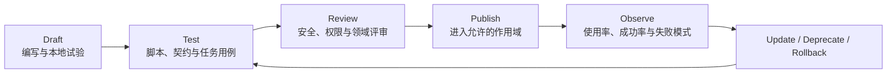

Skill 的评估不应只看是否被模型选中。还要比较启用前后的任务成功率、步骤数、工具错误、人工修改量、成本和安全事件；对于很少被采用或持续降低效果的 Skill，应调整描述、缩小适用范围或下线。

线上 Trace 必须能够定位到具体 Skill 版本。latest 指针适合开发，不适合不可追溯的生产执行。Agent 版本可以锁定允许的 Skill 集与版本范围；紧急修复通过新 Agent 版本、受控热补丁或明确的策略覆盖生效，并触发相关回归集。

`HarnessAgent` 的 Skill Repository 可以连接项目目录、Git 或企业 Registry，使能力资产按需发现。无论 Repository 位于本地还是共享服务，Skill 的所有权、依赖、权限、评估和版本都应纳入企业统一治理。

### 3.6 多租户资产治理与反退化

#### 3.6.1 用作用域和元数据建立资产边界

Context、Memory、Knowledge 和 Skill 都可能跨任务复用，但不能默认全局可见。企业应建立一致的作用域模型：

| 作用域 | 典型资产 | 默认可见范围 |
| --- | --- | --- |
| Global | 平台安全策略、通用基础 Skill | 所有获授权 Agent，通常只读 |
| Tenant | 企业制度、租户 Knowledge、租户 Skill | 单一企业或组织 |
| Project | 项目规则、代码规范、项目 Memory | 项目成员和关联 Agent |
| User | 个人偏好、个人历史经验 | 用户本人及明确委派任务 |
| Session | 当前交互偏好和临时输入 | 当前 Session |
| Task | Plan、Todo、Scratch、Artifact 和证据 | 当前 Task 及获授权父子任务 |

检索和 Context 构建必须先确定调用身份、租户、项目和任务，再查询允许作用域。不要先跨作用域召回再在生成端“提醒模型不要泄漏”，因为内容进入模型输入时，隔离已经失败。

每项资产都应携带最小治理元数据：来源、所有者、作用域、版本、创建与更新时间、权限、敏感级别、保留周期、内容摘要、派生关系和状态。Memory 还需要可信度与适用条件，Knowledge 需要生效时间与权威来源，Skill 需要依赖和评估基线，Context Summary 需要覆盖事件范围。

统一元数据使 Harness 可以用同一套 Policy 决定“能否读取、能否写入、如何引用、何时过期、如何删除”，也使 Agent 版本能准确绑定所依赖的资产版本。

#### 3.6.2 防止污染并支持真正的删除

1. **记忆污染**：错误推测、失败轨迹或恶意输入被长期写入，并在未来任务中被当作经验。

1. **指令污染**：外部文档、工具结果或 Memory 中的文字被错误提升为高优先级行为规则。

1. **跨租户污染**：索引、缓存、摘要、Artifact 或评估数据把一个租户的信息带入另一个租户。

防护需要覆盖写入和读取两端。写入时进行来源识别、验证、敏感数据检测、作用域绑定和冲突检查；读取时进行身份过滤、信任标记、指令与数据分离、最小披露和输出审查。高风险 Memory 可以先进入候选区，经过人工或规则验证后再发布。

企业要能够从稳定资产 ID 追踪派生链：原始文档产生了哪些切片、向量、摘要和实体；某条 Memory 是否被合并到更高层总结；某个 Skill 是否引用了已经下线的模板。当用户请求删除、数据保留期到期或来源失效时，系统需要：

- 禁止新的读取与 Context 注入；

- 删除或隔离原始内容；

- 清理索引、缓存、摘要和其他派生数据；

- 更新引用该资产的 Manifest 与 Skill；

- 保留法律允许且最小化的审计证明；

- 触发受影响 Agent 版本的验证或重新发布。

“遗忘”有时是权重衰减，有时是彻底删除，二者必须在策略中区分。需要撤回的数据不能只通过降低检索分数来处理。

#### 3.6.3 把资产变更纳入反退化闭环

Context Policy、Memory、Knowledge 和 Skill 的任何更新都可能改变 Agent 行为。企业应把资产变更纳入与代码相同的发布链：

```text
资产变更
  → 结构与权限校验
  → 受影响 Agent / 用例分析
  → 离线回放与安全评估
  → 灰度进入新 Agent 版本
  → Trace 与 Outcome 监测
  → 保留、修订或回滚
```

反退化不仅是防止成功率下降，还要监测成本、延迟、引用准确性、跨租户泄漏、错误 Memory 使用、Skill 误选和上下文膨胀。一个资产可能提升某类任务，却损害另一类任务，因此评估必须按场景、租户、风险和任务复杂度分层。

#### 3.6.4 三种 HarnessAgent 运行形态如何实现上下文与状态

同一个 `HarnessAgent` 在不同运行形态下使用相同的逻辑对象，但存储与恢复责任不同：

| 能力 | 本地工作区 | 嵌入式企业服务 | 分布式长任务 Worker |
| --- | --- | --- | --- |
| Context 装配 | Builder、Middleware、Workspace 与本地检索器 | 在相同基线上加入租户身份、业务状态和企业检索 | 按固定 Agent 与资产版本从共享来源重建 Context |
| Session / Task | 本地 Session 可满足交互接续，Task 可轻量维护 | 应用保存业务 Task 与 `RuntimeContext` 映射 | 共享 AgentStateStore 保存 Session，Task Service 管理租约、幂等和终态 |
| Workspace / Artifact | 本地文件系统承载工作区与产物 | 重要 Artifact 外置并绑定任务与访问权限 | 使用共享文件系统或 Sandbox 快照，按 Worker 恢复 |
| Memory / Knowledge | 适合个人或项目作用域 | 按租户、用户和项目过滤读写 | 统一作用域、版本、保留和删除策略，跨副本一致 |
| Skill | 从项目目录或 Git Repository 发现 | 由应用固定允许的 Repository 与版本 | 随 Agent Definition 发布，并通过评估和灰度进入生产 |

本地形态便于快速验证任务与 Context；嵌入式服务需要补齐身份、Task 和外部 Artifact；分布式 Worker 进一步要求共享状态、执行租约、Sandbox 恢复和资产版本锁定。运行位置发生变化时，不应改变 Context、Session、Workspace、Memory 和 Skill 的语义。

### 3.7 本节小结

Harness 上下文与状态系统的目标，是在有限模型窗口与持续增长的任务世界之间建立可靠边界。Context Builder 将平台策略、Agent 指令、任务状态、历史、Memory、Knowledge、Skill 和 Tool 描述按身份、可信度、相关性与 Token 预算动态编译，并用 Context Manifest 保持可解释性。压缩、卸载和 Reset 负责控制窗口增长，但任何关键事实都必须先保存到权威状态。

Session 表达交互连续性，Task 表达可验收目标，Workspace 承载模型窗口之外的工作记忆；Event Log、Snapshot 和 Checkpoint 分别记录过程、当前视图和安全恢复点。Memory 保存经选择的经验，Knowledge 提供带来源和权限的企业事实，Skill 则把可复用行动方法变成可发现、可测试、可发布的能力资产。所有这些资产都必须具有明确作用域、版本、所有者、保留与删除语义，并与 Agent 版本绑定。

下一节将进入 Harness 的第三类工程契约：行动。即模型产生行动意图之后，系统如何连接 Tool、MCP、远程 Agent 和执行环境，如何用 Sandbox、Permission 与 HITL 控制副作用，并通过交互事件、Trace 和 Evaluation 把真实结果反馈到下一次 Harness 迭代。


## 第四篇 受控执行、验证反馈与交付准备

模型输出的工具调用只是一项行动意图。它没有自动获得当前用户身份，不等于企业策略允许执行，也不能证明远程系统已经产生预期结果。真正把意图转化为行动的是 Harness：它选择并披露能力，校验参数，绑定身份与凭证，执行权限和审批策略，在隔离环境中运行，将结果转换为 Observation，再把任务过程交给用户、观测和评估系统。

本节把这些能力统一称为 Harness 的行动与反馈系统。它包含两条相连的链路：Action Plane 负责连接外部世界并限制影响范围；Feedback Plane 负责把执行进度、状态、结果和质量信号反馈给用户与下一个 Agent 版本。Tool、MCP、A2A、Sandbox、HITL、AG-UI、A2UI、Trace 和 Evaluation 在这套架构中各有位置，而不是一组并列的协议或产品名称。

本章“任务编排、长程推进与协作流转”一节已经定义何时行动和如何推进任务，“上下文、状态与可复用能力资产”一节定义行动所依赖的上下文与状态。本节进一步回答：行动怎样被注册、授权和执行，人与应用怎样持续干预，真实执行结果又怎样成为 Harness 演进的依据。

本节继续使用“生产服务漏洞修复与变更发布 Agent”作为贯穿案例。前两节已经让它完成计划、补丁和测试，本节将重点观察最后一公里：Agent 如何获得仓库和安全扫描工具，代码如何在隔离环境中执行，变更单为什么可以自动创建而生产发布必须等待审批，用户如何在断线后继续查看任务，以及一次失败怎样从 Trace 进入下一版 Harness。

### 4.1 Harness Action Plane

#### 4.1.1 从模型意图到环境事实

一个完整的行动链不应从“调用 Tool”开始，也不应在“返回文本”处结束：

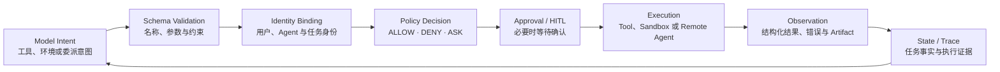

这条链路建立三个必须区分的事实：

1. **模型看见某个工具**，表示 Tool 描述进入了当前 Context。

1. **Harness 注册某个工具**，表示系统知道如何调用和解析它。

1. **当前用户和任务获得执行授权**，才表示这次具体行动可以发生。

三者不是同一件事。企业可以在 Registry 中注册大量能力，却只向当前模型披露少数相关能力；模型能够描述高风险动作，也仍需 Policy 和审批决定是否执行。若“出现在 Tool Schema 中”就等价于“可以调用”，最小权限、用户委派和阶段性只读模式都无法成立。

#### 4.1.2 用统一行动契约约束不同能力

模型可能通过 Function Calling 请求 Tool，也可能要求 Shell、浏览器、Computer Use 或远程 Agent。Harness 应先把这些不同表达转换为统一 Action Request：

```text
Action Request
├── action_id / task_id / parent_event_id
├── capability_id / version
├── arguments and expected output schema
├── actor: user / service / agent identity
├── purpose and current task stage
├── requested environment and resource scope
├── side-effect / reversibility / risk classification
├── idempotency key and timeout
└── approval and audit requirements
```

统一请求使预算、权限、审计、重试和 Trace 不必为每一种连接方式重新实现。模型产生的自由文本说明只能作为 purpose 的候选输入，能力名称、参数类型、影响范围和身份必须由确定性代码解析与校验。

Action 本身也应有生命周期：REQUESTED → VALIDATED → AUTHORIZED / WAITING_APPROVAL → RUNNING → SUCCEEDED / FAILED / CANCELLED。对于外部异步系统，还可能进入 ACCEPTED 或 WAITING_RESULT。任务状态与 Action 状态相关，但不能混为一谈：一个 Tool 失败不一定使整个 Task 失败，一个 Task 取消也可能需要等待已提交 Action 返回后再补偿。

Action Result 不应只有模型可读文本，至少应包括：

- 成功、失败、未知或部分完成状态；

- 结构化数据与面向模型的紧凑 Observation；

- 原始结果、日志或 Artifact 的稳定引用；

- 错误类别、可重试性和是否已产生副作用；

- 实际执行身份、环境、时间、版本和成本；

- 对 Task State 的候选 Patch；

- 可供 Verifier 使用的环境证据。

Harness 统一提交 State Patch，避免每个 Tool 任意修改任务权威状态。大结果按本章“上下文、状态与可复用能力资产”一节的规则卸载，敏感字段在进入 Context 和交互事件前分别脱敏。

每个 Agent 版本都应明确：可发现和可执行的能力集合、Action Schema、身份传递方式、风险等级、超时与幂等、环境需求、Observation 格式和验收证据。Runtime、Sandbox 和 Gateway 可以采用不同实现，但必须兑现这份契约。

这也是不同 `HarnessAgent` 运行形态的共同边界。本地工作区可以在可信环境中直接执行；嵌入式服务通常接入企业工具和权限网关；长任务 Worker 则在可恢复的 Session 与隔离环境中执行。无论谁承载，企业都要知道一次行动以谁的身份、在哪个环境、依据什么策略发生，并能够关联到最终 Outcome。

#### 4.1.3 案例：创建变更单与执行发布是两个 Action

漏洞修复 Agent 已经生成补丁和验证报告。此时“创建变更单”与“发布生产环境”不能被包装成一个模糊工具，因为它们的身份、风险、可逆性和审批要求完全不同。创建变更单的请求可以表示为：

```text
action_id: act-241
task_id: remediation-2026-0917
capability: change.create@v3
actor:
  user: u-1842
  agent: remediation-agent@12
purpose: 为已验证的漏洞修复创建待审批变更
arguments:
  service: payment-service
  patch_ref: artifacts/remediation.patch
  evidence_refs:
    - evidence/unit-test.xml
    - evidence/security-scan.sarif
risk: medium
reversible: true
idempotency_key: remediation-2026-0917:create-change
policy_decision: ALLOW
```

production.deploy 则应成为新的 Action：它引用已经创建的变更单和批准版本，风险为高，Policy 返回 ASK，进入 WAITING_APPROVAL。即使两个动作最终调用同一变更平台，Harness 也能分别授权、审计、重试和验证。企业 Tool 设计应优先暴露这种业务语义，而不是让模型通过通用 HTTP 或 Shell 自行拼接生产操作。

### 4.2 工具、MCP 与远程 Agent

#### 4.2.1 Function Calling、MCP 与 A2A 的职责边界

这三者处理的是不同连接层次：

- **Function Calling** 让模型用结构化形式表达“想调用哪个能力、提供什么参数”。它是模型与 Harness 之间的意图接口。

- **MCP** 让 Agent Host 以标准方式发现和连接工具、资源等外部能力。它是 Harness 与能力提供方之间的连接协议。

- **A2A** 面向拥有独立任务循环、状态和自主性的远程 Agent。它传递任务、消息、状态和 Artifact，而不只是执行一个函数。

协议不会替 Harness 完成授权、租户隔离、业务语义验证和效果评估。MCP Server 能描述工具，不代表调用方有权访问底层数据；A2A Agent 声明任务完成，也仍需委派方按契约验收。

#### 4.2.2 面向 Agent 的 Tool 设计

Tool 是 Harness 交给模型的行动单元。模型能否正确使用，取决于 Tool 是否提供清晰、稳定、可约束的语义，而不仅是 API 能否调用。

一个适合 Agent 的 Tool 应做到：

- 名称和描述说明业务目的、适用条件与非目标。

- 输入 Schema 使用明确类型、枚举、边界和示例，避免让模型拼接任意请求。

- 输出区分结构化结果、面向模型的摘要和原始证据引用。

- 明确是否只读、是否有副作用、是否可逆、是否支持预览和幂等。

- 错误采用稳定分类，告诉 Harness 能否重试、需要修正参数还是转人工。

- 将认证和 Secret 留在执行侧，不放入 Tool 描述或模型 Context。

工具粒度过粗，会让一次调用影响范围过大，审批和验证都难以精确；粒度过细，则需要模型编排大量低级步骤，增加错误与成本。合理粒度通常对应一个可描述、可授权、可观察和可验证的业务动作。

例如，change.create 的 Schema 应要求服务名、补丁引用、验证证据和回滚说明，而不是只接收一段自由文本；返回值应包括稳定 change_id、对象版本、可审批状态和系统查询入口。这样模型负责选择与补齐业务参数，Harness 负责确定性校验，Verifier 能再次查询真实变更单，而不必解析自然语言回执。

#### 4.2.3 Registry、Gateway 与渐进式披露

Tool、MCP Server 和 Remote Agent 都应进入统一或可关联的能力目录。Registry 负责能力元数据、所有者、版本、健康、作用域和依赖；Gateway 负责协议入口、身份、凭证、路由、限流、审计和策略执行；Harness 则根据任务选择候选能力，并向模型渐进式披露。

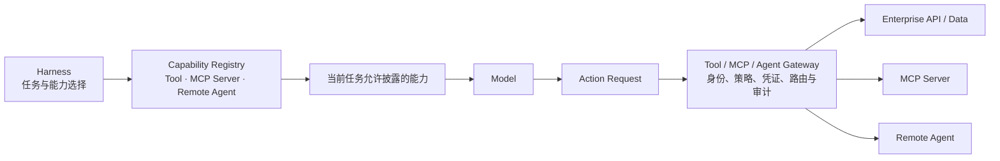

当能力数量较少且信任边界简单时，Harness 可以直连；当多个 Agent、框架和团队共享大量能力时，Registry 与 Gateway 可以避免凭证和治理逻辑在每套 Harness 中重复。具体网关实现属于运行与平台治理层，本节只固定 Harness 所依赖的发现、身份、权限和审计契约。

#### 4.2.4 Tool、MCP Server、Skill、Subagent 与 Remote Agent 的边界

| 对象 | 是否有独立 Agent Loop | 主要封装 | 状态与责任 | Harness 中的使用方式 |
| --- | --- | --- | --- | --- |
| Tool | 否 | 一个可执行动作 | 调用方负责组合和验收 | 产生一次 Action Request |
| MCP Server | 否，协议本身不要求 | 一组工具、资源等能力 | Server 负责能力实现，Host 负责选择、授权与集成 | 发现后注册为 Tool / Resource |
| Skill | 否 | 完成某类任务的方法、脚本和资料 | 当前 Agent 仍负责 Loop 与结果 | 按需加载到 Context 并调用 Tool |
| Subagent | 是，通常由同一 Harness 或平台承载 | 有边界的子任务执行者 | 父 Agent 保留总体责任 | 本地 Delegation，父子状态可直接关联 |
| Remote Agent | 是，独立部署和治理 | 可持续执行的外部任务能力 | 远程 Agent 对其任务承诺负责，委派方负责最终采用 | 通过 A2A 或 Agent API 建立远程任务 |

这张表能避免两种常见混淆。把固定 API 包装成“Agent”不会自动获得规划和恢复能力；把复杂远程 Agent 当作同步 Tool，则会丢失任务状态、异步事件和 Artifact 语义。

#### 4.2.5 连接远程 Agent

本章“任务编排、长程推进与协作流转”一节已经定义 Delegation 的编排语义。跨系统委派还要增加互操作契约：

- 远程 Agent 的身份、能力声明、版本和服务边界；

- 任务目标、输入、上下文引用与数据使用限制；

- remote_task_id 与本地 task_id 的关联；

- 状态、进度、消息、Artifact 和错误的映射；

- 超时、取消、幂等、重试与回调语义；

- 凭证委派、租户边界和可审计的代表关系；

- 结果 Schema、证据和最终验收标准。

远程 Agent 不应获得父 Agent 的全部 Context。委派方发送最小必要信息，并将数据使用限制作为机器可执行策略一并传递。接收方返回的消息和 Artifact 都是外部输入，必须经过 Schema、权限和内容安全检查，不能因为来源是另一个 Agent 就被视为可信系统指令。

如果能力是短时、参数明确且结果可立即返回的动作，优先使用 Tool / Function Calling；如果需要跨 Host 复用工具或数据能力，可采用 MCP；如果能力拥有自己的任务循环，需要异步状态、进度、消息和 Artifact，则使用 A2A 或等价 Agent API。企业可以在内部保留专有协议，但应在 Harness 边界转换为统一 Action 与 Event 语义，避免协议差异侵入核心 Loop。

在本节案例中，读取依赖清单适合本地 Tool，连接企业安全扫描平台可以使用 MCP Server，委派给独立安全团队维护的审计 Agent 则适合 A2A 或企业 Agent API。协议选择由能力是否拥有独立任务循环、是否需要异步状态和 Artifact 决定，而不是由协议的新旧或流行程度决定。

### 4.3 执行环境与 Sandbox 契约

Agent 不只通过业务 API 行动，还可能直接使用 File、Shell、Code Interpreter、Browser 和 Computer Use。这些能力给模型提供了通用操作空间，也显著扩大了副作用和攻击面。Harness 需要声明完成任务所需的 Environment，Runtime 与 Sandbox 则负责真正创建、隔离和销毁它。

| 环境能力 | 典型用途 | 主要风险 | 必要控制 |
| --- | --- | --- | --- |
| File | 读取、搜索、修改工作区文件 | 越界读取、覆盖、路径穿越、敏感文件泄漏 | 根目录、读写范围、版本和变更集 |
| Shell | 执行命令、构建、测试和系统检查 | 任意代码、进程逃逸、网络与 Secret 暴露 | 命令策略、用户权限、资源和网络隔离 |
| Code Interpreter | 数据处理、代码运行与文件生成 | 不受控依赖、资源耗尽、恶意输入执行 | 临时环境、包策略、CPU/内存/时间限制 |
| Browser | 页面检索、表单和 Web 系统操作 | Prompt Injection、会话劫持、误提交 | 域名策略、下载隔离、操作确认、内容信任标记 |
| Computer Use | 操作通用桌面和应用 | 影响面难预测、视觉误判、不可逆操作 | 应用范围、屏幕/输入隔离、预览与人工确认 |

沙箱的隔离范围、快照恢复与后端选择已在第 18 章“沙箱执行”中逐项说明；本节从契约的角度重述：Harness 声明需要什么，Runtime 与 Sandbox 负责兑现。

Tool 常把复杂操作压缩成受 Schema 约束的业务动作，环境接口则更通用、更灵活。能用窄 Tool 完成的高风险动作，通常不应优先开放通用 Shell 或 Computer Use；当企业需要处理长尾应用和非结构化工作区时，再用 Sandbox 把通用能力限制在可接受边界内。

#### 4.3.1 声明并兑现 Environment Contract

Harness 不应假定“本机一定有某目录、某版本依赖或可访问公网”，而应提交 Environment Contract：

```text
Environment Contract
├── image / OS / architecture
├── filesystem mounts and read-write scope
├── network egress / ingress policy
├── secret references and delegated identity
├── required tools, packages and versions
├── CPU / memory / storage / GPU quotas
├── timeout, idle policy and concurrency
├── persistence / snapshot requirement
└── audit and cleanup policy
```

Runtime 根据契约选择本地、共享、托管或自托管环境，Sandbox 将逻辑要求落实为进程、容器、虚拟机或其他隔离机制。如果环境无法满足，Action 应在执行前失败或请求降级，而不是让模型进入不确定状态后自行猜测。

| 形态 | 优点 | 限制 | 适合场景 |
| --- | --- | --- | --- |
| 本地工作区 | 访问用户真实文件和应用，交互延迟低 | 环境差异大，影响用户设备，难以集中治理 | IDE、CLI、个人工作区 Agent |
| 共享远程环境 | 复用基础设施和缓存 | 租户隔离、并发冲突与残留数据风险高 | 受控内部开发与低风险任务 |
| 托管隔离环境 | 按 Session / Task 快速创建，生命周期清晰 | 数据边界、镜像定制和网络接入需评估 | 在线、异步、批量 Agent |
| 企业自托管 Sandbox | 数据和工具执行留在企业网络 | 企业承担容量、补丁和隔离质量 | 强合规、私域数据和内网工具 |

托管 Harness 与自托管 Sandbox 可以组合：推理和任务编排由平台管理，实际工具执行留在企业环境。关键是 Session、Harness 与 Sandbox 之间使用稳定事件、状态和身份契约，不能把长期 Secret 或完整企业数据复制到托管控制侧。

环境可以按 Agent、Session、Task 或 Action 隔离。粒度越细，污染和横向移动风险越低，但创建成本和状态传递成本越高。在线多租户任务通常至少按 Task 或 Session 隔离；同一用户的长期工作区可以持久化，但要把可共享基础镜像与私有可写层分开。

环境生命周期包括：创建、准备、挂载输入、运行、快照、恢复、清理和销毁。销毁前应明确 Artifact 和证据已经转存，临时凭证已经撤销；恢复时要验证镜像、依赖、文件版本和外部对象是否仍与 Checkpoint 一致。

`HarnessAgent` 通过可插拔 FileSystem 和 Sandbox 适配本地、远程或企业自建环境。应用可以让每个 Session 获得独立隔离环境，也可以在受控条件下复用缓存与基础设施；具体实现不同，Harness 依赖的仍是同一 Environment Contract。

#### 4.3.2 让代码修改只发生在隔离工作区

Framework 路径中，应用团队可以把 Sandbox 作为 Harness 的文件系统实现，而不是让模型直接操作宿主机。下面的 AgentScope 示例为每个 Session 绑定 Docker 文件系统；项目规则、Skill 和输入文件投影到隔离工作区，补丁与测试结果再作为 Artifact 取回。

```java
HarnessAgent agent = HarnessAgent.builder()
    .name("remediation-agent")
    .model(model)
    .workspace(workspace)
    .filesystem(new DockerFilesystemSpec()
        .image("ubuntu:24.04"))
    .build();

agent.call(message, RuntimeContext.builder()
    .userId("u-1842")
    .sessionId("remediation-2026-0917")
    .build()).block();
```

生产部署还要为镜像固定摘要，限制网络与资源，为持久工作区配置快照，并在多副本并发恢复时增加执行租约。AgentScope 也可以将 StateStore 与 Sandbox Snapshot 接到 Redis、数据库和对象存储，或通过统一分布式存储配置完成多节点接续。代码示例展示的是 Harness 接口，不代表默认 Docker 配置已经满足生产隔离要求。

对贯穿案例而言，Sandbox 允许修改 payment-service 副本并执行构建，却不提供生产集群凭证；发布只能通过受控 production.deploy Tool 发起。即使工作区中的恶意文件诱导模型执行部署命令，Sandbox 网络与 Secret 边界仍阻止它绕过企业 Action Plane。

#### 4.3.3 Secret、网络与数据出站

Secret 不应出现在 System Prompt、Tool Schema、Task State 或模型可见环境变量中。执行侧应根据 Action、身份和目的获取短时凭证，只注入目标工具或进程，并记录使用而不记录密文本身。

网络策略应默认限制出站目标、协议和数据量。浏览器访问的网页、下载文件和工具返回必须被标记为不可信内容；高敏数据出站需要额外策略或审批。Sandbox 防止进程越界，Policy 决定业务上是否允许，二者缺一不可。

运行时资源调度、镜像供应链、快照后端、容灾和规模化 Sandbox 属于后续运行与治理工作；本节的 Build 交付物是可验证、可移植的环境与隔离要求。

### 4.4 Permission、HITL 与安全控制

#### 4.4.1 让身份、资源与风险共同参与决策

Harness 需要同时记录三类信息：发起任务的用户或服务身份、发起行动的 Agent 版本、实际执行 Tool 或 Sandbox Action 的 Runtime 身份。一次调用可以使用服务身份，也可以传递用户委派，但必须明确数据访问和副作用最终归属于谁。

权限决策至少考虑：主体、租户、任务目的、能力、参数、目标资源、环境、当前阶段、数据敏感度、影响范围、可逆性、预算和历史审批。仅按 Tool 名称做静态白名单，无法区分“读取一条测试记录”和“导出整个生产库”。

Harness 可以将策略结果统一为三类：

- **ALLOW**：当前条件下可直接执行，并记录决策依据。

- **DENY**：无论模型如何解释都不得执行，向 Loop 返回结构化原因和允许替代项。

- **ASK**：动作可以执行，但需要指定的人或系统确认。

ASK 不是默认兜底。过多审批会让用户形成机械确认，也让 Agent 失去连续性。应该优先通过更窄 Tool、参数约束、预览、资源范围和 Sandbox 降低风险，只在目的或后果无法由策略充分判断时请求人工参与。

| 风险示例 | 建议默认策略 |
| --- | --- |
| 读取当前项目内非敏感文件 | ALLOW，记录范围 |
| 查询当前用户有权查看的业务数据 | ALLOW 或基于数据等级 ASK |
| 修改工作区文件但尚未提交外部系统 | ALLOW，并提供 Diff 与可撤销能力 |
| 发送外部消息、发布、支付、删除或改变生产数据 | ASK 或 DENY，要求预览和明确影响 |
| 访问跨租户数据、绕过安全控制、请求长期 Secret | DENY |

#### 4.4.2 在真正需要判断的位置引入 HITL

HITL 可以出现在三个层次：

1. **Plan 审批**：在进入执行前确认目标、范围、方案和影响面。

1. **Action 审批**：对某次具体 Tool、环境或远程 Agent 调用进行批准、拒绝或修改。

1. **结果验收**：对高影响 Artifact 或业务结果做最终签署。

审批请求应包含：Agent 想做什么、为什么、以谁的身份、作用于什么对象、预计影响、参数和差异、是否可逆、失败如何处理，以及批准范围是仅本次、当前 Task 还是一类受限动作。用户批准后，Harness 仍要重新校验对象版本和策略，防止等待期间环境已经变化。

不可逆或高影响动作可以统一采用“Preview—Approve—Commit—Verify”模式：Preview 展示接近实际提交的内容和影响；Approve 绑定身份、范围和对象版本；Commit 使用幂等键执行；Verify 查询真实系统状态。无法回滚的动作必须在 Preview 中明确说明，验证失败则进入 Repair、Compensate 或 Escalate，而不是把已发送的请求当作成功。

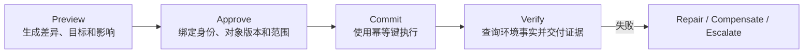

#### 4.4.3 把 HarnessAgent 审批接入企业界面

企业应用可以让 `HarnessAgent` 使用 `DEFAULT` 权限模式，并把规则判定为 `ASK` 的 Tool 请求转换为审批事件。审批界面展示关联 Task、调用身份、Tool、参数、目标资源和预计影响；后端完成确定性策略校验后，再把批准或拒绝结果交回当前 Session。

```java
RuntimeContext context = RuntimeContext.builder()
    .userId("tenant-a:operator-1842")
    .sessionId("remediation-2026-0917")
    .build();

agent.setPermissionMode(context, PermissionMode.DEFAULT);

agent.streamEvents(
        "读取验证报告并生成变更单；写入或提交前必须询问。",
        context)
    .doOnNext(event -> approvalGateway.publishIfRequired(
        "remediation-2026-0917", event))
    .blockLast();
```

Permission Mode、规则写法与 HITL 的基础接法已在第 10 章“权限系统与人工介入”给出；本节讨论把它们接进企业审批链路时，策略与交互各自要守住什么。

事件发布只是交互入口，企业后端仍应依据当前登录身份、租户、资源版本和 Policy 做确定性判断。对生产发布，批准结果应生成短时、限定目标与动作的授权，不能把整个 Session 永久切换成无条件放行模式。拒绝也必须成为可恢复的任务事实，让 Harness 保留草稿并说明未完成项。

**Steering、Interrupt 与 Resume。**

人工参与不只发生在审批点。用户还需要在任务运行中追加信息、改变优先级、缩小范围、暂停或取消。Harness 应把 Steering 表示为高优先级任务事件，由本章“任务编排、长程推进与协作流转”一节定义的状态机在安全点处理；对紧急中断，可以取消可中断行动并阻止新 Action。

恢复前，Harness 要把用户新要求提交到 Task State，判断现有 Plan、权限和后台任务是否仍有效，再重新构建 Context。直接把一条用户消息追加到长历史末尾，可能无法覆盖已经进入执行队列的旧计划。

#### 4.4.4 Guardrail 与 Prompt Injection 防护

Guardrail 可以部署在输入、Context 构建、Action 请求、Tool 结果和输出阶段，但它不应成为唯一安全边界。对确定可编码的权限和资源限制，应使用 Policy 与 Sandbox；模型或分类器适合识别复杂语义风险、敏感内容和可疑意图，并把结果作为额外信号。

Prompt Injection 的关键防线是区分指令与数据。网页、邮件、文档、MCP Server、工具结果和远程 Agent 返回的内容都属于不可信输入，不能改变平台政策、授权范围或当前 Tool Set。Harness 应保留内容来源，限制外部文本进入高优先级指令层，对数据外传和高风险 Action 做独立授权，并在必要时隔离读取与执行阶段。

完整威胁模型、身份体系、MCP 安全、Sandbox 逃逸和合规审计将在“治理（Governance）”篇展开。本节给出的是 Build 阶段必须嵌入 Harness 的执行控制点。

### 4.5 Streaming、Channel 与交互协议

#### 4.5.1 面向任务语义的事件流

长任务如果只在结束时返回一段文本，用户无法知道 Agent 当前在做什么、是否等待审批、是否遇到阻塞，也无法及时纠偏。Harness 应产生一组与内部事件对应、经过脱敏的外部语义事件：

| 事件类别 | 典型内容 | 界面或调用方用途 |
| --- | --- | --- |
| Text | 文本增量、最终说明 | 实时展示模型对用户的可见输出 |
| Progress | 当前阶段、Todo、百分比或里程碑 | 解释任务正在推进到哪里 |
| Tool | 工具意图、执行状态、紧凑结果 | 展示行动与失败，不泄露 Secret |
| State | Running、Waiting、Paused、Completed 等 | 驱动界面和上层业务状态机 |
| Approval | 预览、风险、选项与决策结果 | 呈现 HITL 控件 |
| Artifact | 文件、报告、Diff、链接和版本 | 交付可检查结果 |
| Error | 错误分类、可重试性与下一步 | 恢复、转人工或告警 |
| Usage | Token、费用、预算和资源 | 成本展示与预算控制 |

模型内部的隐藏推理不需要通过 Streaming 暴露。用户真正需要的是任务状态、可见说明、行动、证据和可操作选项。

#### 4.5.2 Channel 的职责

Channel 是 Agent 与 Web、App、IDE、CLI、企业 IM 或其他入口之间的适配层。它不负责重写 Harness，而是处理：

- 将外部用户和组织身份映射到平台身份；

- 将消息线程映射到 Session，并选择或创建 Task；

- 把附件、回复、按钮和命令转换为统一输入事件；

- 将 Harness 事件转换为渠道支持的消息、卡片和状态；

- 在用户从一个入口切换到另一个入口时保持任务连续；

- 实施渠道级内容限制、速率、脱敏和审计。

Session 和 Task 的分离在这里尤其重要：一个 IM 线程可以查看后台 Task，IDE 中创建的 Task 也可以在 Web 控制台继续审批。Channel 不应成为唯一状态存储。

#### 4.5.3 AG-UI 与 A2UI

**AG-UI** 适合表达 Agent 与应用之间的双向、流式交互事件，使前端不必依赖某个 Framework 的内部对象。它可以承载运行生命周期、文本、工具、状态和中断等语义。采用时，企业仍需决定内部事件到外部事件的映射、字段脱敏、身份绑定和恢复游标。

**A2UI** 适合让 Agent 输出声明式界面，例如表单、卡片、列表和动作。客户端使用本地受信组件目录渲染，而不是执行模型生成的任意代码。A2UI 描述“界面是什么”，AG-UI 处理“Agent 与应用如何交换事件”；A2UI Payload 可以通过 AG-UI 或其他传输发送，两者并不互相替代。

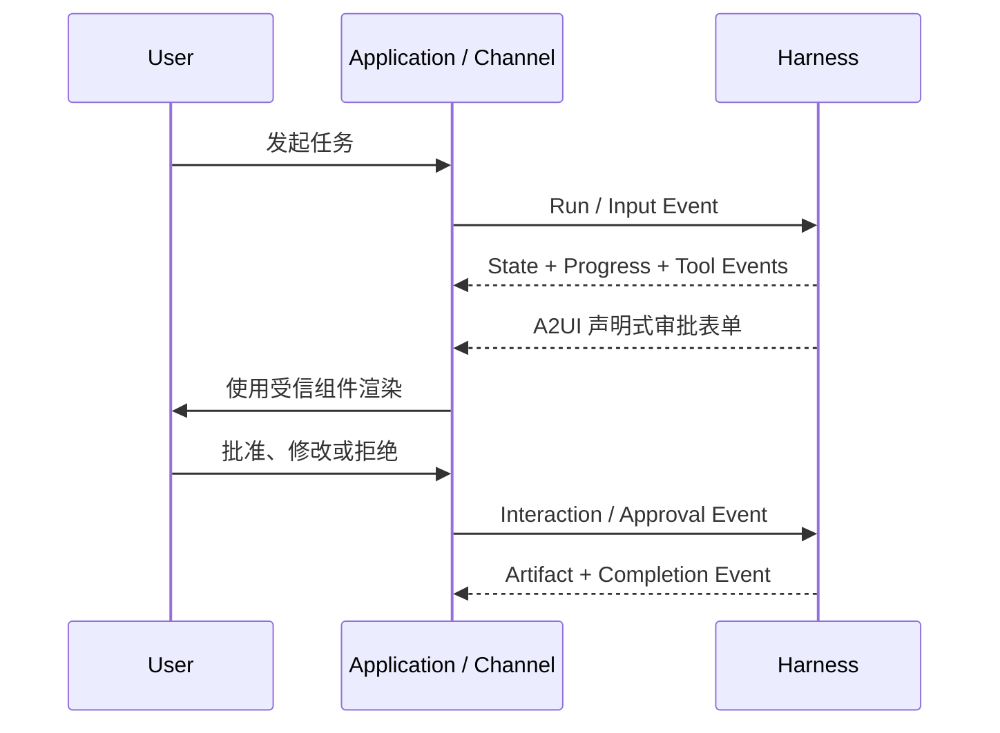

#### 4.5.4 让事件可以续传、限流和按身份展示

事件流必须假定网络会断开、客户端会重复连接、消费者速度不同。每个事件要有单调序号或可恢复游标；客户端重连时从最后确认位置续传，服务端支持去重；快消费者可以实时接收增量，慢消费者可以先读取状态快照再补充关键事件。

对于高频文本 Token 或细粒度工具日志，系统可以合并、采样或仅在调试模式下发送；状态、审批、Artifact 和终态事件则不能因背压被丢弃。用户发出 Cancel 或 Interrupt 后，Channel 要尽快确认请求已经进入状态机，并区分“已收到取消”和“底层 Action 已安全停止”。

同一 Task 在不同 Channel 中显示的内容可能不同。开发控制台可以查看详细 Tool 和 Trace，面向客户的应用只展示业务进度；审批人能查看影响对象，普通观察者只能看到等待状态。事件发布前要根据接收者身份与 Channel 能力生成视图，不能把内部 Trace 原样广播。

协议的价值是降低适配成本，语义契约才决定体验能否一致。企业应先稳定 Task、Event、Approval 和 Artifact 模型，再选择 AG-UI、A2UI、WebSocket、SSE 或消息平台接口作为具体承载。

#### 4.5.5 用 HarnessAgent 事件承载持续任务

`HarnessAgent.streamEvents` 把一次 Session 中的模型、工具和状态变化暴露为流。应用将这些事件写入带单调序号的 Event Store，再通过 SSE、WebSocket 或消息平台向客户端投影；客户端断线后从最后确认的游标续传，而不是要求原 Worker 和原连接一直存在。

事件怎么读取、断线后怎么恢复显示，第 19 章“会话日志与恢复”已经操作化地讲过；本节补充的是事件语义的分类，以及哪些事件不可丢弃。

```java
RuntimeContext context = RuntimeContext.builder()
    .userId(task.tenantId() + ":" + task.userId())
    .sessionId(task.id())
    .build();

agent.streamEvents(task.nextInput(), context)
    .index()
    .doOnNext(item -> eventStore.append(
        task.id(), item.getT1(), item.getT2()))
    .blockLast();
```

客户端应在完整事件处理成功后保存游标，并对重复事件幂等。文本增量和细粒度日志可以合并或采样；状态、审批、Artifact、错误和终态事件不可丢弃。企业应用还要把 `sessionId` 关联到 Task、租户和审批单，并针对不同 Channel 与接收者生成安全视图。

当 Harness 等待 Tool 审批、用户输入或外部任务时，任务进入显式 WAITING 状态；`idle`、流结束或模型停止都不能单独判定完成。恢复时，Runtime 使用相同 `RuntimeContext` 重新进入 Harness，先核对 Task State、外部系统和剩余授权，再继续行动。

### 4.6 Observability、Evaluation 与效果闭环

#### 4.6.1 用端到端 Trace 连接决定、行动与结果

Agent 的最终质量来自模型与 Harness 的组合，问题可能发生在 Context、计划、工具、权限、环境、状态或验证任一环节。Trace 因而不能只记录模型输入输出。一次 Task Trace 至少应关联：

```text
Task Trace
├── Agent Version / Model / Harness Version
├── Session / Task / Parent-child topology
├── Context Manifest and compaction decisions
├── Plan / Todo / state transitions
├── Model calls, latency, token and cost
├── Action Requests, policy and approvals
├── Tool / Environment / Remote Agent results
├── Workspace changes and Artifacts
├── Retry, downgrade and failure classification
├── Verifier results and completion evidence
└── Business Outcome and user feedback
```

Trace 需要因果关系，而不只是按时间排列的日志。一次模型决策使用了哪份 Context，产生了哪个 Action，Action 又更新了哪些状态、触发了哪次验证，都应能够关联。敏感原文可加密、脱敏或只保存摘要与引用，但核心元数据和决策事实不能缺失。

在 Build 阶段，应用团队应为每个 Loop 阶段、Middleware、Tool、Subagent、Environment 和 Verifier 定义 Span 或等价观察单元，统一任务、模型、能力、权限、成本和错误属性。还要明确：

- 哪些内容默认记录，哪些仅在调试模式记录；

- 敏感字段如何分类、脱敏、加密和控制保留期；

- Trace 如何关联 Agent 版本与 Context Manifest；

- Outcome 从哪个业务系统或人工反馈写回；

- 采样后如何保留错误、高风险和低频长尾任务；

- 多个 Agent、Runtime 和远程系统之间如何传递 Trace Context。

线上采集、指标聚合、SLO、告警和根因分析将在“治理（Governance）”篇展开。本节强调：如果 Build 时没有稳定事件、版本和关联 ID，后续平台无法补出可信的 Agent Trace。

#### 4.6.2 区分单次完成门禁与跨版本评估

需要再次区分两套系统：

| 系统 | 核心职责 | 输入 | 输出 |
| --- | --- | --- | --- |
| Agent Harness | 在真实或测试环境中完成一次任务 | 目标、Context、能力、环境与策略 | 轨迹、Artifact、完成证据和 Outcome |
| Evaluation Harness | 以一致方式运行、回放和比较 Agent 版本 | 数据集、环境、预算、评分器和待测 Agent 版本 | 指标、失败聚类、版本差异和发布建议 |

Evaluation Harness 必须固定或披露模型、推理设置、Harness、工具版本、预算、重试、环境和评分规则。否则两个版本的分数差异可能来自运行条件，而不是所评估的 Harness Patch。

本章“任务编排、长程推进与协作流转”一节介绍的 Verifier 是单次任务完成门禁，运行在 Agent Harness 内部；Evaluation 则对多个样本和版本进行质量判断。Verifier 可以成为 Evaluation 的数据来源，Evaluation 也可能发现某类 Verifier 过松或过严，但不应把昂贵的发布评估器直接嵌入每次线上任务。

对高风险任务，Verifier 关注可交付底线；对 Agent 版本，Evaluation 还要判断相对改进、退化分布和长尾风险。人工反馈也不是天然真值，需要区分用户偏好、业务结果和操作便利性，并与环境证据结合解释。

**三层评测对象。**

| 层级 | 评测对象 | 典型问题 | 适合方法 |
| --- | --- | --- | --- |
| 单步 | 某次 Context、模型判断或 Tool 调用 | 工具是否选对、参数是否正确、检索是否包含关键证据 | 规则、Schema、标注和局部模型评分 |
| 轨迹 | 从任务开始到结束的状态与行动序列 | 是否绕路、重复、越权、错误委派或过度消耗 | 轨迹规则、序列比较、专家或模型评审 |
| 最终结果 | Artifact、环境终态和业务 Outcome | 目标是否真正达成、质量是否可接受 | 测试、业务查询、人工验收、独立 Evaluator |

只评最终结果可能掩盖高成本或高风险轨迹；只评单步又可能惩罚有效探索。企业需要同时衡量任务成功率、完成质量、人工接管率、工具错误、权限事件、延迟、成本和业务价值，并按任务类型和风险分层。

**从 Trace 到 Harness Patch。**

效果闭环不应从单条失败直接改 Prompt。更稳健的过程是：

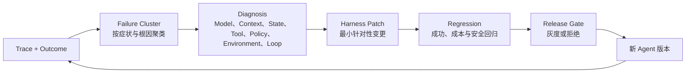

常见 Patch 与根因应一一对应：缺少事实时调整 Context 或 Knowledge；错误经验反复出现时修复 Memory；不会执行稳定方法时新增或修订 Skill；工具误用时改进 Tool Schema 或权限；无进展时调整 Loop、Plan 或模型；环境不一致时修复 Environment Contract；完成误判时强化 Verifier。只有确定模型能力本身不足时，才优先更换模型或路由策略。

回归集必须同时包含原失败用例、相邻正常用例和安全对抗用例，防止局部补丁损害其他任务。模型升级后，还应重新检查旧 Harness 中的补偿逻辑，删除已经失效或阻碍新模型的规则。

#### 4.6.3 案例：从一次错误审批到 Harness 修复

假设线上 Trace 显示，修复 Agent 在创建变更单后，把用户此前对生成草稿的同意错误解释为允许生产发布。问题表面是一次越权，沿因果链检查后可以定位到：

```text
Context Manifest
  └── 包含“可以生成变更”的用户回复
Model Decision
  └── 请求 production.deploy
Policy Decision
  └── 仅按 Tool 名称匹配，错误返回 ALLOW
Action
  └── 发布因目标环境无权限而失败
Outcome
  └── 任务未造成生产变更，但触发高风险越权事件
```

正确的 Patch 不是在 Prompt 中再增加一句谨慎发布，而是拆分 change.create 与 production.deploy，让生产发布策略校验审批类型、对象版本、目标环境和短时授权，并加入草稿获批不得推导为发布获批的确定性回归用例。随后在 Evaluation Harness 中同时运行原失败样本、正常创建变更样本、合法发布样本和 Prompt Injection 对抗样本，确认安全修复没有让所有任务都陷入无效审批。

#### 4.6.4 不同 HarnessAgent 运行形态如何形成反馈闭环

| 运行形态 | 漏洞修复案例中的实现重点 | 企业必须保留的责任 |
| --- | --- | --- |
| 本地工作区 | 用 HarnessAgent 组合 Tool、Plan Mode、Sandbox、Permission、事件与 Trace，快速调试任务行为 | Action Contract、隔离配置、Verifier 和本地回归 |
| 嵌入式服务 | 通过 `RuntimeContext`、`streamEvents` 和企业审批网关接入业务入口，外置 Artifact 与 Outcome | 租户身份、业务 Tool、共享状态、审批后端和验收标准 |
| 长任务 Worker | 用任务队列调度 HarnessAgent，通过共享 AgentStateStore、Sandbox 快照和事件存储跨节点恢复 | Task 映射、租约、幂等、数据边界、证据来源和故障恢复 |
| 平台化交付 | 统一发布 HarnessAgent、工作区资产、模型、Tool、Skill、策略和 Sandbox 版本，并用 Trace 与 Outcome 做灰度评估 | Agent 所有权、发布准入、业务结果、成本安全指标和跨版本评估 |

四种形态可以使用同一套 Evaluation Harness。它接收带版本的 Trace、Outcome、用例和评分器，对不同 `HarnessAgent` 版本进行一致比较。运行形态决定谁承载执行，统一评估闭环决定系统是否真的变好。

### 4.7 本节小结

Harness 行动与反馈系统把模型意图变成受控的环境事实。统一 Action Plane 按 Schema、身份、Policy、审批、执行、Observation 和 Trace 推进行动；Function Calling、MCP 与 A2A 分别位于模型意图、工具连接和远程 Agent 协作层；Tool、Skill、Subagent 与 Remote Agent 具有不同的自主性和责任边界。

Environment Contract 让 Harness 声明所需能力，Runtime 和 Sandbox 负责文件、进程、网络、Secret 与资源的真实隔离；ALLOW、DENY、ASK 与 Preview—Approve—Commit—Verify 模式控制高风险副作用；Streaming、Channel、AG-UI 和 A2UI 则把任务状态、审批和 Artifact 以可持续交互的方式提供给用户。

最终，Trace 将 Agent 版本、Context、行动、状态、成本和 Outcome 连成因果链；Evaluation Harness 从单步、轨迹和最终结果三个层次比较版本，把真实失败转化为有针对性的 Harness Patch。至此，“构建”篇形成了完整答案：构建 Agent，就是围绕任务、信息、行动三类工程契约构建 Harness，并将它形成可运行、可治理、可优化的 Agent。


## 四篇要点回顾

用贯穿案例（“生产服务漏洞修复与变更发布 Agent”）把四篇串起来看：

- **第一篇 架构范式与责任边界**：Agent = Model + Harness；Model、Harness、Runtime、Sandbox 与 Agent Platform 各回答一个问题。`HarnessAgent` 以本地工作区、嵌入式应用、长任务服务、平台化交付四种运行形态承载同一套能力，选择时看调用从哪里发起、状态存在哪里、Runtime 与 Sandbox 由谁提供。
- **第二篇 任务编排、长程推进与协作流转**：稳定 Loop（Prepare—Model—Act—Observe—Verify）配显式状态机与多维预算；Planning 与阶段门禁把计划外部化；Subagent 靠委派契约隔离上下文、能力与责任；异步任务靠权威状态与 Continuation 跨连接续行；完成由证据决定，不由模型自述决定。
- **第三篇 上下文、状态与可复用能力资产**：Context 每轮动态编译并以 Manifest 保持可解释；压缩、卸载与 Reset 控制窗口增长，关键事实先进权威状态；Call/Session/Task/Workspace 各管一段生命周期；Memory 存经验、Knowledge 存事实、Skill 把方法变成可治理资产——所有资产都有作用域、版本与删除语义。
- **第四篇 受控执行、验证反馈与交付准备**：Action Plane 按 Schema、身份、Policy、审批、执行、Observation 推进行动；Sandbox 与 Permission 控制副作用，Preview—Approve—Commit—Verify 处理高风险动作；事件流按身份呈现、可续传；Trace 连出因果链，Evaluation Harness 把失败转成有针对性的 Harness Patch。

与第 4-20 章的关系一句话可以说清：那些章节给的是“在 SDK 里怎么配”，本篇给的是“为什么这样配，以及规模变大后还缺什么”。读完全篇再回去翻配置细节，两边会互相印证。
