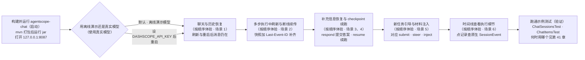
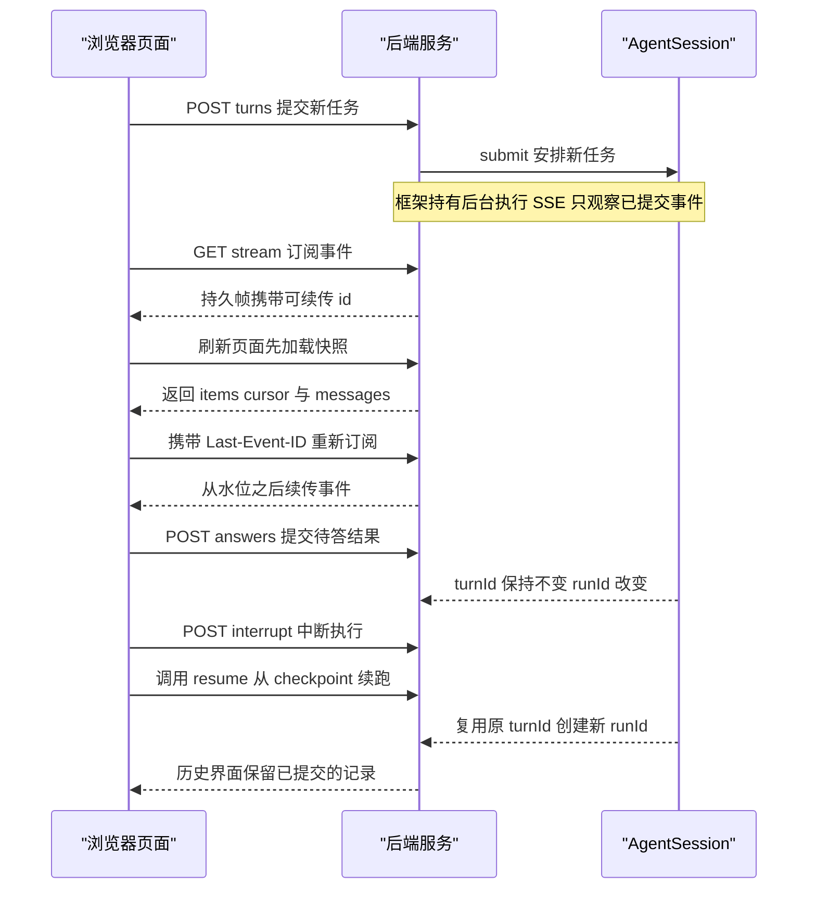

# 第 40 章 最佳实践：可恢复会话聊天

> 本章导读：一个可以直接运行的 HarnessAgent Web Chat 示例（agentscope-chat），演示持久会话、实时事件、SSE 续传和 checkpoint 恢复：多步执行中刷新页面与断线重连后界面如何补齐、补充信息后如何恢复同一 turn、中断后如何从 checkpoint 续跑，以及新任务排队与运行中引导的区别。示例默认使用离线演示模型，无需 API Key、数据库或 Node.js，只需 JDK 17+ 和 Maven；读完本章，你可以照此把"页面离开后任务仍在执行"的聊天应用搭起来。



*本章操作流程图*

完整源代码位于仓库 [agentscope-chat](https://github.com/agentscope-ai/agentscope-java/tree/main/agentscope-examples/agents/agentscope-chat)。示例的浏览器页面包含聊天区、待答请求和已提交事件时间线。

本示例承接第 2 章（快速开始）：普通问答和当前请求的流式输出使用 `call` / `streamEvents` 即可。这里使用 `AgentSession`，是因为页面离开后任务仍需执行，还需要排队、回复待办和中断后继续。会话 API 的逐步用法见第 19 章（会话日志与恢复）。

页面、后端与 AgentSession 的交互时序如图 40-1 所示。



*图 40-1：可恢复会话聊天的交互时序*

## 启动

在 agentscope-java 仓库根目录运行：

```bash
mvn -pl agentscope-examples/agents/agentscope-chat -am package -DskipTests
java -jar agentscope-examples/agents/agentscope-chat/target/agentscope-chat.jar
```

打开 [http://127.0.0.1:8087](http://127.0.0.1:8087)。示例只监听本机地址。默认 Workspace 是 `~/.agentscope/session-chat`，原生日志保存在该目录的 `.agentscope-runtime/` 中；重启时保留此目录即可。

可以指定独立的数据目录和端口：

```bash
CHAT_WORKSPACE=/absolute/path/to/chat-workspace CHAT_PORT=8088 \
  java -jar agentscope-examples/agents/agentscope-chat/target/agentscope-chat.jar
```

## 按顺序体验

以下 6 个场景由浅入深：先验证会话与历史能否持久，再体验执行中的刷新与断线，之后是挂起恢复、中断续跑与任务排队，最后查看执行细节。全程使用离线演示模型，切到真实模型的方法见本章后面的"使用真实模型"一节。

### 1. 聊天与历史恢复

发送“请记住我喜欢简洁的回答”，等待完成。刷新页面，消息仍在。停止并重启服务，选择同一个会话再发送“我之前说了什么”，演示模型会展示恢复后看到的早期消息。

浏览器保存当前 session 的选择；消息从服务器日志加载，不依赖浏览器保存一份聊天记录。新建会话会创建新的 sessionId，不删除原历史。

### 2. 多步执行中的刷新与断线续传

点击“多步执行 · 刷新续传”发送 `/slow`。Agent 会先生成一段说明，调用两次 `demo_lookup` 查询不同主题，再生成第二段说明，调用 `demo_verify`，最后给出总结。工具通过真实 Toolkit 执行本地只读演示逻辑，并逐段报告进度。

可以在以下时刻刷新页面、切换到其他会话，或断开事件连接后重新连接：

- 第一段或最后一段 AssistantMessage 仍在生成时：已经展示的前缀会恢复，并接着增长。
- ToolCall 参数尚未生成完时：工具卡片保留已提交的参数片段。
- 工具正在执行时：恢复工具名称、参数、状态和已提交进度。
- 离开期间跨过多个步骤时：恢复全部中间消息、ToolCall 和 ToolResult，同时显示当前正在执行的条目。

浏览器始终使用同一个持久视图。快照的 `items` 包含完整消息、生成中的消息和工具卡片，`cursor` 与它们来自同一段日志；`messages` 则保留完整消息历史。`model/chunk` 重建消息和参数，`tool/chunk` 重建进度，完整消息及结果按稳定 ID 更新对应条目，不重复追加。

SSE 只观察已提交事件并触发视图更新。普通断线由 EventSource 携带 Last-Event-ID 重连，页面刷新先加载快照，再订阅该水位之后的事件。显示内容跟随日志提交节奏更新，不会把无法重放的临时文本拼到持久前缀上；关闭页面不会停止后台执行。

### 3. 补充信息后恢复同一 turn

发送 `/ask`。演示模型调用 `ask_user` 外部工具，执行进入 suspended，并显示输入框。可以先刷新页面，或停止并重启程序，待答请求仍会从日志恢复。

输入答案后点击“提交并继续”。观察 turnId 保持不变，runId 改变；原生记录出现 interaction/resolved、turn/resumed 和新的 run/start，最终完成原 turn。

### 4. 暂停与 checkpoint 续跑

发送 `/slow`，点击“中断执行”，等待状态变成“已中断”。可以在此时重启服务，再点击“继续原任务”。恢复使用已提交状态和原 turnId，创建新的 runId；执行会从工作状态继续；历史界面仍保留此前已提交的消息片段和工具记录。

强制终止进程时，旧 writer 租约可能需要等待约两分钟才到期。如果检查发现工具结果未知，示例会要求核对结果，不会自动假定成功；实际应用的核对用法见第 19 章“核对结果未知的工具”一节。

### 5. 新任务、运行中引导与材料注入

发送 `/slow` 后，在“输入用途”中选择“补充当前任务”，输入“重点比较运维成本”。该输入在后续推理步骤进入原 turn/run。选择“新任务”则创建另一个 turn，忙时显示在队列中。选择“只补充材料”只保存上下文，空闲时不会启动 Agent。

中断不会丢弃排队任务；先恢复原任务或回答待办，之后继续处理队列。页面刷新只恢复展示，不重新提交任何操作。

### 6. 查看执行细节

点击时间线记录，查看对应的原生 SessionEvent，包括 turnId、executionRunId 和 payloadJson。可观察模型请求、模型片段、消息、工具交互和 checkpoint。

页面同时显示历史消息数与工作消息数。历史供界面和审计读取；工作上下文还可能包括系统消息或经过压缩的内容，因此两个计数不要求相等。

## 使用真实模型

设置环境变量后重新启动：

```bash
export DASHSCOPE_API_KEY=your_api_key
export CHAT_MODEL=qwen-plus
java -jar agentscope-examples/agents/agentscope-chat/target/agentscope-chat.jar
```

真实模型下使用自然语言聊天，`/slow` 和 `/ask` 是离线模型的演示指令。要体验挂起，可以请模型先通过 ask_user 询问你的偏好。切回离线模式使用 `CHAT_MODEL=demo`。模型切换不改变日志位置；如需分开历史，可新建会话。

## API 与代码阅读顺序

| 操作 | 示例接口 |
| --- | --- |
| 列出会话 | `GET /api/sessions` |
| 快照、消息、待答请求与状态 | `GET /api/sessions/{session}` |
| 提交新 turn | `POST /api/sessions/{session}/turns`，body 为 `{request_id,message}` |
| 引导当前任务 | `POST /api/sessions/{session}/steer`，body 为 `{message}` |
| 只补充材料 | `POST /api/sessions/{session}/inject`，body 为 `{message}` |
| SSE 观察与续传 | `GET /api/sessions/{session}/stream?after={cursor}`，支持 Last-Event-ID |
| 分页查看原生记录 | `GET /api/sessions/{session}/events?after={cursor}&limit=100` |
| 提交外部结果并续跑 | `POST /api/sessions/{session}/answers`，body 为 `{request_id,output}` |
| 合作式暂停 | `POST /api/sessions/{session}/interrupt`，body 为 `{run_id}` |
| 从 checkpoint 续跑 | `POST /api/sessions/{session}/turns/{turn}/resume` |

示例使用 `agent.session(context)`：`submit` 接收并安排新任务，`steer` 在当前任务下一步骤补充要求，`inject` 保存材料而不启动任务，`respond` 和 `resume` 自动关联原 turn。框架持有后台执行，SSE 只观察已提交历史。提交重试沿用相同 request_id 和输入，turnId 由框架分配。

建议依次阅读：

1. `ChatApplication.java`：选择模型和 Workspace。
2. `ChatSessions.java`：构建 HarnessAgent、启动执行、处理补充结果和恢复。
3. `ChatHistory.java`：从同一个已提交前缀生成消息、待办、状态和 cursor。
4. `ChatItems.java`：将模型片段、消息、工具参数、进度和结果投影为稳定的 UI 条目。
5. `ChatController.java`：HTTP 与只读 SSE，持久帧携带可续传的 id。
6. `static/chat.js`：快照替换、事件通知、固定会话排序、重连和操作按钮。

## 适用范围

这是本地单进程、单用户的 SDK 集成示例。POST 返回表示输入已持久接收，可能仍在排队。SDK 使用同一日志后端下的 inbox 保存队列；应用启动时调用 session.start() 开启已接收任务的调度，不自动恢复已中断任务。它不提供 Service 的认证、公共事件投影和托管运维能力。完整原生载荷只供本地调试，公共服务应增加认证、授权、事件内容筛选和容量限制。生产托管推理请使用 Service Agent API（见第 31 章）的公共事件协议；本示例接口不是其替代协议。

## 验证

```bash
mvn -pl agentscope-examples/agents/agentscope-chat -am test \
  -Dtest=ChatSessionsTest,ChatItemsTest -Dsurefire.failIfNoSpecifiedTests=false
```

## 本章小结

本章用一个可运行的示例把第 19 章的会话机制连到了真实页面上：持久会话让刷新与重启不丢历史；SSE 续传靠"快照 + Last-Event-ID"补齐界面；`ask_user` 挂起后用 `respond` 在原 turn 上继续；中断后用 `resume` 从 checkpoint 续跑；新任务、运行中引导与材料注入分别对应 `submit`、`steer` 与 `inject`。这些操作背后的选择依据（什么时候该用哪一个）在第 41 章逐条展开；把示例搬到公共环境之前，先读第 42 章的生产差异。
