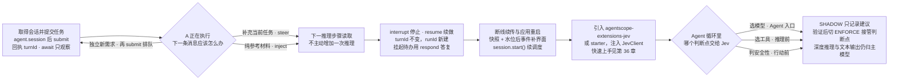

# 第 41 章 会话执行控制与结构化决策

> 本章导读：两篇互为补充的运行时实践。前半篇解决"任务怎么排队、怎么引导、怎么中断续做"：通过 `agent.session(context)` 取得 `AgentSession`，用 `submit` / `steer` / `inject` / `interrupt` / `resume` / `respond` 表达用户意图，理解 session → turn → run 三层结构，掌握断线续传与应用重启的恢复方式，并对照 AgentScope Service 的对应入口。后半篇回答"高频小判断交给谁"：Jev 结构化决策模型以 Noul / Choice / Score 三类问题返回类型化答案与校准概率，配合模型路由、工具选择、执行守卫三个中间件覆盖 Agent 循环的关键判断点，同时划清边界——需要深度推理与文本输出的场景仍属于主模型。



*本章操作流程图*

## 会话操作：提交、引导、中断与恢复

用户点击“停止生成”后又输入一条要求，应用需要继续原任务，还是提交新任务？Agent 正在调用工具时补充“预算改为 5000 元”，模型什么时候能看到？浏览器断开 SSE，后台是否继续执行？

普通多轮聊天和当前请求内的流式展示，可以继续使用第 2 章（快速开始）中的 `call` / `streamEvents`；它们也会保存 Harness 会话记录。本节聚焦后台执行、任务排队和中断续做。

使用 `HarnessAgent` 构建这类应用时，通过 `agent.session(context)` 取得 `AgentSession`，用不同操作表达用户意图。框架负责执行与持久队列；前端读取历史和事件。完整 API 见第 19 章（会话日志与恢复），可运行应用见第 40 章（最佳实践：可恢复会话聊天）。

### 先选择用户真正想做的操作

| 用户意图 | API | 生效方式 |
| --- | --- | --- |
| 发起一个新任务 | `session.submit(input)` | 创建 turn；忙时按接收顺序排队 |
| 纠正或补充当前任务 | `session.steer(input)` | 当前 turn/run 的下一推理步骤读取 |
| 保存参考材料，不主动唤醒 Agent | `session.inject(context)` | 在后续推理步骤读取，空闲时不执行 |
| 停止当前执行 | `session.interrupt()` | 通过既有协作中断机制停止，保留原任务 |
| 中断后继续原任务 | `session.resume(turnId)` | 恢复 checkpoint，保留 turnId，新建 runId |
| 回答工具问题或审批 | `session.respond(requestId, answer)` | 查询待办归属，使用原有 HITL 机制继续 |
| 刷新页面或断线重连 | 读取快照和水位后的持久事件 | 补齐界面，不重新提交或启动执行 |

同一 session 可以包含多个 turn；一个 turn 可以跨多个 run。模型和工具调用是 run 内部的步骤，不要求应用每次创建一个 turn。

### 取得会话并提交任务

下面假设 `agent` 是配置了稳定 agentId 和持久日志后端的 `HarnessAgent`，`ownerId` 来自认证身份，`sessionId` 已完成访问权限检查。

```java
import io.agentscope.core.agent.RuntimeContext;

var session = agent.session(RuntimeContext.builder()
        .userId(ownerId).sessionId(sessionId).build());
var task = session.submit("request-001", "比较三个出差方案");
System.out.println(task.turnId());
```

取得会话不会执行 Agent。`submit` 同步持久接收输入并开启后台调度，返回回执；排队时 runId 可以为空。网络重试沿用相同 request key 和输入，避免生成重复任务。

Web 接口可直接返回回执，页面独立读取进度。命令行若需要等待本次执行结束，可使用：

```java
var outcome = session.await(task).block();
System.out.println(outcome.status());
```

`await` 只观察本次执行，不负责启动或取消。返回 `suspended` 表示仍有待办或挂起原因，不能当作任务完成；对等待操作使用 timeout 也只会停止等待。

这些存储操作是阻塞调用。WebFlux 集成应安排到 `Schedulers.boundedElastic()`，不要占用网络事件线程。

### A 正在执行，下一条消息应该怎么办

独立的新需求用 `submit`，当前任务的修正用 `steer`，纯参考材料用 `inject`：

```java
session.submit("request-002", "之后再比较退改签政策");
session.steer(task, "预算改为 5000 元");
session.inject("参考材料：会议地点在市中心。");
```

第二个任务会排队。引导绑定当前 task，防止延迟请求误投到后来开始的任务；无运行任务时 `steer` 会报错。它不会修改已经发出的模型请求或正在执行的工具参数，而是在下一推理步骤生效。

`inject` 不主动增加一次推理：如果当前任务已无后续步骤，材料保留到下一次执行。输入接收、执行开始和输入应用分别记录，接收成功不等于模型已经采用。中断前未消费的引导仍属于原 turn，在恢复时读取。

任务等待 HITL 或被中断时，后续任务保留在队列中。先答复待办或继续原任务，原任务结束后才调度下一项任务。

### 中断和继续不需要重新拼装输入

```java
session.interrupt();
var stopped = session.await(task).block();
if ("interrupted".equals(stopped.status())) {
    var continued = session.resume(task.turnId());
}
```

界面已绑定某次 run 时，使用 `session.interrupt(runId)`，可以拒绝误中断后续执行的过期请求。中断信号通过既有检查点生效，不会回滚已产生的外部副作用；工具长期阻塞时仍可能需要等待。

恢复使用已提交工作状态和尚未应用的原输入，无需手工重放全部消息。它保留 turnId、创建新的 runId，不恢复原 Java 线程或工具内部进度。若工具结果未知，先核对外部系统，再按照第 19 章“核对结果未知的工具”一节继续。

### HITL 答复关联原请求

```java
session.pending().forEach((requestId, event) ->
        System.out.println(requestId + " " + event.data().get("kind")));

session.respond("external-request-id", "选择方案 B");
session.respond("confirmation-request-id", true);
```

字符串用于外部执行结果，布尔值用于工具确认。请求 ID 必须来自持久待办；框架查找原 turn 和工具调用，拒绝未知或不匹配的请求。拒绝某项工具行动使用对应答复，不等于中断整个任务。

这里使用挂起式 HITL：答复后创建新 run，继续原 turn。在线等待式 Service 交互仍应通过所属服务的 actions 接口处理。

### 断线续传与应用重启

关闭浏览器或取消事件订阅，不会取消框架持有的后台执行。前端刷新时先读取完整快照和对应水位，再订阅后续事件；仅保存游标无法补回游标之前的文字和工具卡片。

```java
var history = session.transcript();
var events = session.log().readAfter(lastAppliedSeq, 100);
```

原生日志的 seq、实时 AgentEvent 的 ID 与 Service 公共 cursor 是不同概念，不能混用。只有已提交记录可用于可靠续传；消息、工具参数和结果按稳定 ID 更新，避免重复追加。

重启后使用相同 userId、agentId、sessionId 和日志后端取得会话。查看历史不启动推理；应用显式调用 `session.start()` 恢复已接收任务的调度，中断任务仍需 `resume`。退出时关闭 `agent`，框架负责中断活动执行并保留持久队列。

### AgentScope Service 的对应入口

托管 Agent 使用 Agent API（见第 31 章）：创建 `/api/v1/agent-sessions`，向 session 的 `/turns` 提交任务，通过 `/snapshot` 和 `/events/stream` 恢复界面，使用 actions/resume 接口继续原任务。它有自己的持久命令、鉴权和公共事件协议。

SDK `AgentSession` 与 Service 表达相同的会话和任务概念，但不是同一个调度器。Service 已持有自己的任务租约和命令队列，不应在一个请求中再嵌套 SDK 会话调度。旧 `/api/sessions` 事件接口和 Endpoint SSE 的行为见 SSE 格式（见第 31 章），不能套用新 Agent API 的排队与 cursor 约定。

需要后台排队和中断续做的应用可以使用上述会话操作。已有工作流或服务调度器时，仍可使用 `call` / `streamEvents` 驱动执行；更底层的执行控制用于自定义调度器和协议适配。简洁的配套代码见 [SessionRunGuide.java](https://github.com/agentscope-ai/agentscope-java/blob/main/docs/examples/execution-control/SessionRunGuide.java)。

## 让 Agent 学会判断：Jev 与结构化决策

前半篇处理的是任务生命周期由谁控制：应用用 `submit` / `steer` / `inject` / `interrupt` / `resume` / `respond` 表达用户意图，框架负责排队与恢复。但任务跑起来之后，Agent 循环内部还有另一类问题——每一轮"该用哪个模型、该暴露哪些工具、这条命令能不能放行"。这些高频判断如果都塞给主模型推理或硬编码规则，开销和可靠性都不理想。后半篇介绍把这类判断单独抽出来的做法：Jev 结构化决策模型。

一个 Agent 从收到请求到完成任务，看起来是在"推理"和"执行"之间循环。但仔细拆开每一步，你会发现真正密集发生的是另一件事：判断。

这个请求该用哪个模型处理？当前上下文里哪些工具应该暴露给模型？这个 bash 命令能不能自动放行？这个回答的置信度够不够直接返回？这些判断每一个都不复杂，但它们出现在 Agent 运行时的每一个角落，加起来就变成了一个被长期低估的系统性开销。

AgentScope Java 最近集成了 [TypeSafe AI 的 Jev](https://docs.typesafe.ai/)。本节不只介绍集成本身——更重要的是借这个机会聊清楚：为什么 Agent 系统需要一种独立于"推理"的"判断"能力，以及这种能力应该怎么用。

### Agent 运行时里的高频小决策

先看一个典型场景。

一个 ReAct Agent 正在处理用户请求。模型推理完成，产生了三个工具调用：一个文件读取、一个命令执行、一个代码搜索。在工具真正执行之前，系统需要回答：

| 判断点 | 需要什么 |
| --- | --- |
| 该用哪个模型处理下一轮推理？ | 请求复杂度评估 |
| 三个工具调用中哪个有风险？ | 命令内容 + 上下文分析 |
| 文件读取的结果是否需要截断？ | 输出大小预估 |
| 这个回答可以直接返回吗？ | 置信度评估 |

这些判断有三个共同特点：**高频、低复杂度、需要确定性输出**。它们不需要模型展开长链路推理，但需要系统快速得到一个可以做分支的结论。

目前的做法通常有两种，各有问题。

**第一种：让主模型顺便做判断。** 在 prompt 里加一句"先判断该用哪个模型，再回答"。这确实能工作，但每次判断都要走完整的推理路径，返回的是一段自由文本，系统还要再做一次解析。更麻烦的是，主模型的输出格式不受控——你让它返回 JSON，它可能在 JSON 前面加一段"好的，我来分析一下"。

**第二种：写硬编码规则。** "包含 `rm -rf` 的命令一律拒绝"、"超过 100 个字符的请求用大模型"。这解决了确定性问题，但覆盖不了长尾。"列出这个目录下的所有文件"和"删掉这个目录"在规则层面很难区分，在语义层面一目了然。

问题的本质是：Agent 系统里大量需要的不是"更聪明的推理"，而是"更便宜、更可靠的判断"。


### Jev 是什么：一种新的模型形态

[Jev](https://docs.typesafe.ai/) 是 TypeSafe AI 推出的结构化决策模型。它不是聊天模型，不生成文本，也不做工具调用。它做的事情只有一件：接收上下文和一组结构化问题，返回类型化的答案和校准概率。

具体来说，它支持三种问题类型，恰好对应 Agent 系统里三类判断需求：

| 问题类型 | 判断模式 | Agent 场景 |
| --- | --- | --- |
| `NoulQuestion` | 是/否的概率 | "这个操作安全吗？" |
| `ChoiceQuestion` | 选项集合的概率分布 | "该用哪个模型？哪个工具？" |
| `ScoreQuestion` | 等级评分 | "这段回答质量如何？" |

与传统 LLM 的关键差异在于返回形式。你问"这个 bash 命令安全吗"，Jev 不会返回一段分析文本，而是直接返回 `noul: 0.92`——P(安全) = 92%。你问"该用哪个模型"，Jev 返回每个模型的概率分布和整体置信度，而不是一段建议文字。

| 维度 | 聊天模型 | Jev |
| --- | --- | --- |
| 输出 | 自由文本 / 工具调用 | 类型化答案 + 概率 |
| 延迟 | 秒级到十秒级 | 亚秒级 |
| 格式可靠性 | 依赖 prompt engineering 和后解析 | 结构化协议保证 |
| 成本 | 按推理路径计费 | 按决策请求计费 |

就像你不需要为“今天星期几”这个问题启动一个深度研究流程——有些问题只需要一个快速的、确定性的回答。Jev 做的事情类似：为 Agent 里高频、结构化的判断提供一种专门优化过的计算路径。


### 在 AgentScope Java 里怎么接入

AgentScope 没有把 Jev 注册成 `Model` provider。原因很简单：`Model` 接口面向的是聊天推理，返回 `ChatResponse`；Jev 返回的是结构化答案，两者在调用频率、超时预期和类型系统上都不匹配。硬塞进同一个接口只会让配置语义变得混乱。所以 Jev 以独立扩展模块的方式存在，应用代码直接注入 `JevClient` 做判断，或者通过 middleware 挂到 Agent 循环里。

依赖引入：

```xml
<dependency>
    <groupId>io.agentscope</groupId>
    <artifactId>agentscope-extensions-jev</artifactId>
    <version>${agentscope.version}</version>
</dependency>
```

Spring Boot 项目可以直接用 starter：

```xml
<dependency>
    <groupId>io.agentscope</groupId>
    <artifactId>agentscope-jev-spring-boot-starter</artifactId>
    <version>${agentscope.version}</version>
</dependency>
```

```yaml
agentscope:
  jev:
    api-key: ${TYPESAFE_API_KEY:}
    base-url: https://api.typesafe.ai
    model: jev-latest
    timeout: 5s
```

如果想在业务代码里直接调用 `JevClient` 做 `Noul`、`Choice` 或 `Score` 判断（不经过 middleware），完整的快速上手示例见 Jev 集成文档（见第 36 章）。


### 三个中间件：覆盖 Agent 循环的关键判断点

除了 `JevClient`，扩展模块还提供了三个参考 middleware，分别覆盖 Agent 循环的三个阶段。它们不只是简单的示例——每一个都对应一个真实的工程问题。

| 中间件 | 拦截点 | 判断类型 |
| --- | --- | --- |
| `JevModelRouterMiddleware` | `onAgent` / `onModelCall` | Choice：选模型 |
| `JevToolSelectionMiddleware` | `onReasoning` | Choice：选工具 |
| `JevAutoModeMiddleware` | `onActing` | Noul：判断安全性 |

三个拦截点——Agent 入口、推理前、行动前——恰好覆盖了 Agent 生命周期中最需要做判断的三个位置。这不是巧合，而是"判断"作为一类系统关注点的自然分布。

#### 模型路由：规划资源分配

`JevModelRouterMiddleware` 在 Agent 调用入口做一次模型选择，整轮调用复用这个决策。

```java
JevModelRouterMiddleware modelRouter =
        JevModelRouterMiddleware.builder(client)
                .choice("fast", fastModel, "Direct lookups, extraction, and localized changes.")
                .choice("powerful", powerfulModel, "Architecture and high-stakes decisions.")
                .instructions("Choose the least costly model that can complete the task.")
                .confidenceThreshold(0.75)
                .execution(new io.agentscope.extensions.judge.jev.JevExecution.Options(
                    io.agentscope.extensions.judge.jev.JevExecution.Mode.SHADOW,
                    java.time.Duration.ofSeconds(2), "v1", (ctx, record) -> {}))
                .build();

ReActAgent agent =
        ReActAgent.builder()
                .name("assistant")
                .model(fallbackModel)
                .middleware(modelRouter)
                .build();
```

每个候选模型有自己的路由标准。Jev 根据用户请求在候选中做 Choice 判断，返回概率和置信度。置信度不够就退回默认模型——**判断失败不是让 Agent 停摆，而是降级到安全路径**。

中间件默认处于 OFF；上面的示例显式开启了 SHADOW，即只记录 Jev 的建议、不实际生效，需要真正接管时改为 ENFORCE——本节描述的筛选与拦截行为都在 ENFORCE 下生效。另外，模型路由对带工具的请求默认回退到默认模型，需通过 compatible 谓词声明候选能力。

#### 工具选择：规划上下文可见性

`JevToolSelectionMiddleware` 在每轮推理前对工具列表做过滤和排序，只把相关的工具 schema 发给主模型。

```java
JevToolSelectionMiddleware toolSelection =
        JevToolSelectionMiddleware.builder(client)
                .alwaysIncludeTools(Set.of("load_skill_through_path", "reset_tools"))
                .maxTools(3)
                .confidenceThreshold(0.8)
                .execution(new io.agentscope.extensions.judge.jev.JevExecution.Options(
                    io.agentscope.extensions.judge.jev.JevExecution.Mode.SHADOW,
                    java.time.Duration.ofSeconds(2), "v1", (ctx, record) -> {}))
                .build();
```

当一个 Agent 注册了 50 个工具，每轮推理的 tool schema 就是一笔不小的 token 开销。更重要的是，工具太多会稀释模型的注意力。让 Jev 先做一轮筛选，只把当前任务相关的工具暴露给模型，既省 token 又提升准确率。

#### 执行守卫：判断行为风险

`JevAutoModeMiddleware` 在工具执行前做风险判断。这是三个中间件里最能体现"判断"价值的一个。

```java
JevAutoModeMiddleware autoMode =
        JevAutoModeMiddleware.builder(client)
                .guardedTool("bash")
                .safetyThreshold(0.8)
                .execution(new io.agentscope.extensions.judge.jev.JevExecution.Options(
                    io.agentscope.extensions.judge.jev.JevExecution.Mode.SHADOW,
                    java.time.Duration.ofSeconds(2), "v1", (ctx, record) -> {}))
                .build();

ReActAgent agent =
        ReActAgent.builder()
                .name("assistant")
                .model(model)
                .toolkit(toolkit)
                .middleware(autoMode)
                .build();
```

当一个 `bash` 工具调用产生时，middleware 会把完整对话历史和命令内容发给 Jev，问一个 Noul 问题："这个调用安全吗？" `noul: 0.92` 就放行，`noul: 0.3` 就拒绝——拒绝的调用不会执行，而是写入一个 `DENIED` 的工具结果，让模型知道这个操作被拦截了。

执行模式有 OFF、SHADOW 与 ENFORCE 三种，默认 OFF。失败时的行为有明确约定：工具推荐/路由失败回退原流程；执行防护在 ENFORCE 下失败则拒绝受保护调用。


### 什么时候不该用

Jev 不是万能的，也不是"更便宜的大模型"。以下场景仍然需要主模型的深度推理：

- **需要多步逻辑推导的判断**：比如"这段代码为什么会并发死锁"，需要理解上下文、追踪调用链、做因果分析。这类问题的答案不是概率，是推理过程。
- **需要理解复杂代码或长文本的判断**：比如"这个 PR 是否可以合并"，需要阅读完整 diff、理解架构约束、评估测试覆盖。Jev 的 state 可以携带上下文，但它做不了深度推理。
- **输出本身是文本的场景**：Jev 返回的是概率和选项，不是分析文本。如果你需要一段解释、一个代码补丁、或一份报告，那是主模型的工作。

一个简单的判断标准：如果一个决策可以表达成"是/否"、"从 N 个选项里选一个"、或"打一个分"，且系统会根据这个结果做分支（if/else、路由、阈值判断），那它适合 Jev。如果这个决策需要先理解、再分析、再推导，那它属于推理模型的领地。

换句话说：Jev 回答的是"可以吗"和"选哪个"，不是"为什么"。


### 判断与规划：比集成本身更重要的东西

回过头看上面三个中间件，它们解决的问题可以归纳为两个词。

**规划**：在行动之前决定"做什么、用什么做"。选模型是规划资源分配，选工具是规划上下文可见性。这类决策决定了 Agent 的效率和成本。

**判断**：在执行之前决定"能不能做、值不值得做"。风险守卫是判断行为边界，置信度评估是判断输出质量。这类决策决定了 Agent 的安全性和可靠性。

这两个词覆盖了 Agent 系统里大量非推理类的计算。目前这些计算大多被塞进了主模型的推理路径，或者被硬编码进了业务逻辑。Jev 提供了第三条路：把这些判断抽出来，交给一个专门优化的决策模型，用类型化接口和校准概率返回结果。

顺着这个思路，还有很多地方可以用同样的模式优化：

- **RAG rerank**：检索结果先做一轮相关度评分，只把高相关的片段送进主模型。
- **意图分类**：请求入口先做一次路由分类，不同意图走不同的处理链路。
- **质量守卫**：模型输出后做一次评分，低质量结果触发重试或升级。
- **任务分解**：复杂任务先做优先级排序，再分发给 subagent。

这些场景的共同特征是：判断本身不复杂，但频率高、需要确定性、失败时有明确的降级路径。这恰好是 Jev 这类结构化决策模型的适用范围。

Agent 系统的下一步不只是"更强的推理"，还需要"更高效的判断"。推理决定 Agent 能走多远，判断决定它能不能走得又快又稳。

## 本章小结

本章两篇回答两个层面的问题。执行控制层面：按用户意图选对操作——新任务 `submit`、当前任务补充 `steer`、纯材料 `inject`、停止 `interrupt`、续跑 `resume`、答复挂起 `respond`；session → turn → run 三层结构解释了为什么恢复后 turnId 不变、runId 新建；断线后用"快照 + 水位后的事件"补齐界面，应用重启后 `session.start()` 恢复已接收任务的调度。结构化决策层面：Jev 用 Noul / Choice / Score 三类问题返回类型化答案与校准概率，模型路由、工具选择、执行守卫三个中间件分别覆盖 Agent 入口、推理前、行动前三个判断点；需要深度推理或文本输出的场景仍交给主模型。

**验收点**——读到这里，你应该能：

- ☐ 为"用户在执行中补充一句话"的场景选对 `steer` 还是 `submit`；
- ☐ 解释中断恢复后为什么 turnId 不变、runId 新建；
- ☐ 说出三个 Jev 中间件各自的拦截点与判断类型；
- ☐ 判断一个具体决策适合 Jev 还是主模型。
