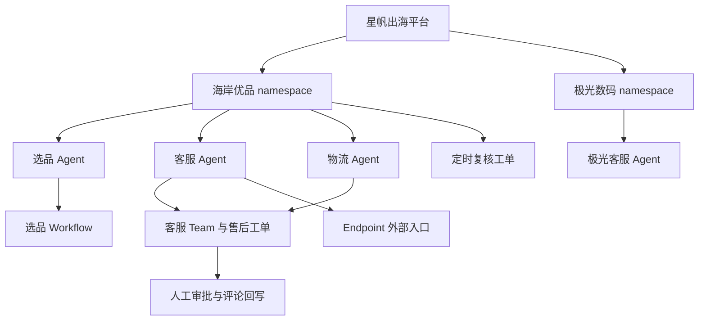
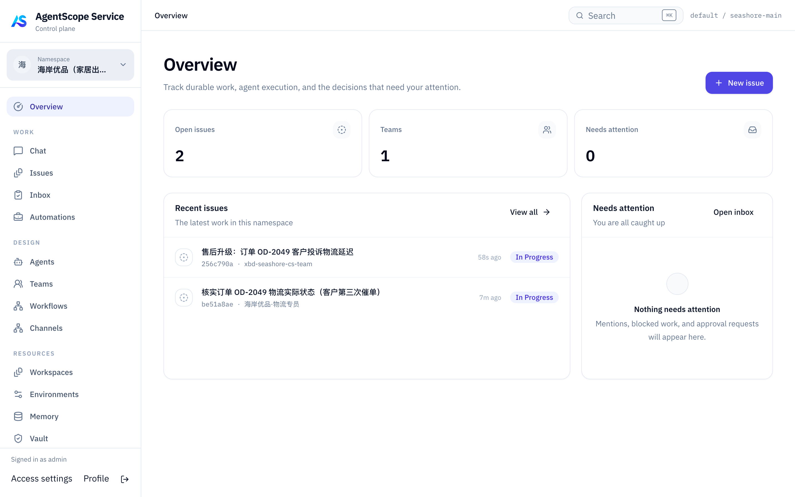
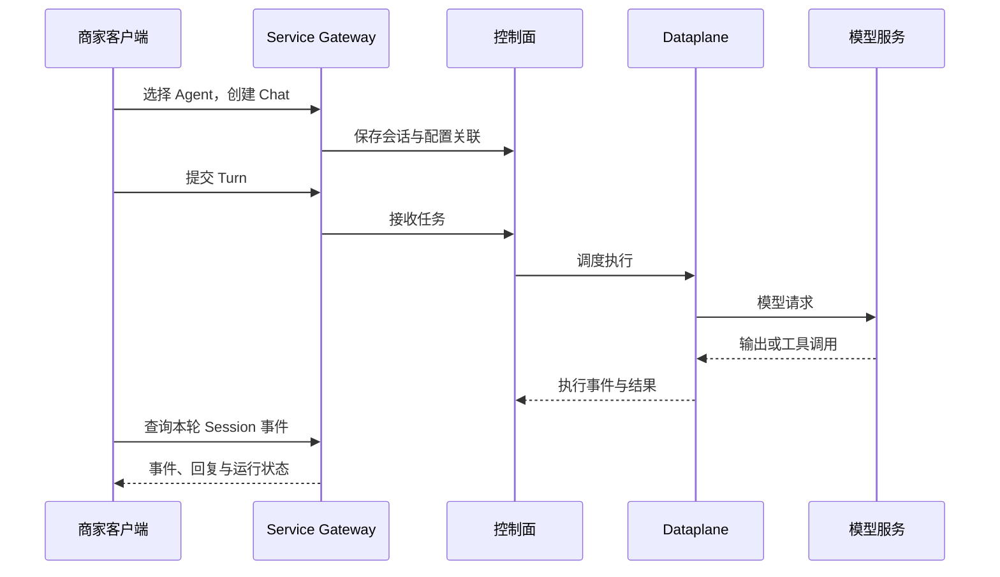

# 第 43 章 跨境电商 Agent 多租户平台实战

> 本章导读：假设你正在为跨境商家搭建 Agent 平台。两家商家都需要客服，但不能互看资料；同一家商家的客服、选品和物流需要协作；售后规则会更新，退款建议需要人工复核，模型请求还要接入公司的统一网关。本章围绕这一场景，把前面章节的 Service、Workspace、执行环境与模型接入串成一条可以动手验证的路径。
>
> 配套代码位于 [demo/cross-border-commerce](../demo/cross-border-commerce/README.md)，共 13 步，每步提供教程与同名 Bash 脚本。本章解释业务关系、关键操作和验收方法，逐条 API 请求以配套步骤为准。这是教学平台，不是已经接入真实订单、物流和支付的生产系统。

## 43.1 从两家商家开始：我们要交付什么？

「星帆出海」为商家提供 Agent 服务。海岸优品经营家居商品，需要选品、客服和物流三个角色；极光数码经营 3C 配件，需要自己的客服。平台运营负责商家入驻、资源治理和审批。

| 参与方 | Service 中的身份与资源 | 业务职责 |
| --- | --- | --- |
| 星帆出海 | 平台运营身份 | 建立商家空间、复核获授权的工单 |
| 海岸优品 | `seashore-main` namespace | 选品 Agent、客服 Agent、物流 Agent |
| 极光数码 | `aurora-main` namespace | 独立客服 Agent，作为隔离对照 |
| 商家外部系统 | Endpoint 调用方 | 通过已发布入口接入客服能力 |

这里的 `tenant=default` 是部署级配置，两个商家落在不同 namespace。我们演示的是同一部署内的商家资源隔离，不能把它说成两套独立 tenant 部署。



*图 43-1：以商家资源归属为基础，把单个 Agent 扩展为可协作、可发布、可治理的平台。*

这套资源规划落到控制台上，就是商家 namespace 的工作台。2026-10-31 从 Step 01 顺跑至 Step 13 后，切到海岸优品 namespace，Overview 页如下——



两张进行中工单正是上方参与方表的分工痕迹：“售后升级：订单 OD-2049 客户投诉物流延迟”挂在 `xbd-seashore-cs-team` 名下，“核实订单 OD-2049 物流实际状态（客户第三次催单）”由海岸优品·物流专员认领——客服与物流两个角色的协作，在运营视图里留下的是同一 namespace 下的两张工单。

完成本章学习后，你应能解释四种边界：**谁能访问资源、Agent 使用什么材料、工具在哪里执行、模型请求发往哪里**。它们分别由身份与 namespace、Workspace、Environment 和模型通道承担，不能靠一个“商家 ID”或一段提示词全部解决。

## 43.2 先搭实验环境，再选择学习路线

客户端需要 Bash、curl、jq；服务端需要完整 AgentScope Service 开发栈。先按 [第 29 章](29-service-deploy.md) 与目标 Service 仓库说明启动服务，再从教程仓库根目录执行：

```bash
cd demo/cross-border-commerce
cp .env.example .env
# 编辑 .env：BASE_URL 指向实际 Gateway，按说明配置模型参数。
./run-all.sh --list
./run-all.sh --dry-run
```

`.env.example` 默认 Gateway 为 `http://localhost:18080`，已有本地实测使用 `28080`。端口取决于你的部署，不要为了照抄示例再启动一套服务。模型 Key 必须进入真正运行模型的 Dataplane；只填写客户端 `.env` 不会改变已运行的服务进程。

| 步骤 | 学习内容 | 配套教程 |
| --- | --- | --- |
| 01 | 平台版本、登录与身份 | [平台初始化](../demo/cross-border-commerce/steps/step-01-platform-init.md) |
| 02 | 商家入驻与 namespace 成员 | [商家入驻](../demo/cross-border-commerce/steps/step-02-tenant-onboarding.md) |
| 03 | 建立四个业务 Agent | [Agent 矩阵](../demo/cross-border-commerce/steps/step-03-agent-matrix.md) |
| 04 | Chat、Turn 与执行事件 | [会话调用](../demo/cross-border-commerce/steps/step-04-session-api.md) |
| 05 | 跨商家拒绝访问及正向对照 | [隔离检查](../demo/cross-border-commerce/steps/step-05-isolation-check.md) |
| 06 | 售后工单与团队协作 | [Team 编排](../demo/cross-border-commerce/steps/step-06-team-orchestration.md) |
| 07 | 调研后等待人工放行 | [Workflow 流水线](../demo/cross-border-commerce/steps/step-07-workflow-pipeline.md) |
| 08 | 发布客服对外入口 | [Endpoint 发布](../demo/cross-border-commerce/steps/step-08-endpoint-publish.md) |
| 09 | 工单共享、决批与结果回写 | [人工审批](../demo/cross-border-commerce/steps/step-09-hitl-approval.md) |
| 10 | 排程预览、测试触发与幂等 | [Automation](../demo/cross-border-commerce/steps/step-10-automation.md) |
| 11 | 工作区文件、发布与版本绑定 | [Workspace](../demo/cross-border-commerce/steps/step-11-workspace.md) |
| 12 | 默认环境与 E2B 沙箱配置 | [Environment 与沙箱](../demo/cross-border-commerce/steps/step-12-sandbox.md) |
| 13 | 自有模型网关与 Dataplane 适配 | [模型通道](../demo/cross-border-commerce/steps/step-13-model-channel.md) |

默认 `./run-all.sh` 按 01–13 执行，失败即停止并保留状态。`--only` 选择单步，`--from` 从指定步骤续跑。编号表示阅读顺序，单步执行仍要满足前置依赖：09 依赖 06 的工单，10 依赖 02 的商家空间，11 依赖 01–03，12 与 13 依赖 11 的实验 Agent。

如果模型暂时不可用，完成 01–03 后可以直接学习基础设施配置：

```bash
./run-all.sh --only 1
./run-all.sh --only 2
./run-all.sh --only 3
./run-all.sh --from 11
```

这条路线仍需正常的 Service；Step 03 也保留模型 Key 前置检查。Step 11 不提交模型任务，12/13 默认只检查配置，因此不能将这条路线通过视作模型执行已验证。

## 43.3 商家入驻：先证明隔离，再增加能力

Step 01 确认服务版本与身份，Step 02 由平台建立两个 namespace，Step 03 在各自作用域创建业务 Agent。这里最容易犯的错误，是把“创建成功”当成“资源归属正确”。每次创建后都要用对应商家身份回读，并确认另一商家无法访问。

| 对象 | 需要回答的问题 | 本例的检查方式 |
| --- | --- | --- |
| namespace | 当前用户是否有成员权限？ | 商家只看到自己有权访问的空间 |
| Agent | 资源属于哪家商家？ | 回读归属，检查商家列表 |
| Chat / Session | 是否能越权查看另一商家对话？ | 跨商家读取 Chat 和事件流应被拒绝 |
| 工单 | namespace 有权是否就能参与这张工单？ | 独立检查工单 access，按需要显式共享 |

当前 API 有请求头、查询参数等作用域通道，冲突的请求本身就可能失败。隔离测试必须避免这种冲突，否则测到的可能只是参数校验，而非权限拒绝。Step 05 对负向查询清空请求头作用域，再以查询参数指定目标空间，同时保留“读取自家资源成功”的正向对照。

Step 11 会给海岸增加一个实验 Agent，所以 Step 05 检查的是业务角色齐全、返回资源全部属于正确 namespace，而不是把海岸 Agent 总数永远写死为 3。这个小变化说明：**好的验收应检查权限和业务约束，而不是依赖某次运行恰好的资源数量。**

机制回顾：[第 29 章](29-service-deploy.md)、[第 30 章](30-managed-agents.md)。

## 43.4 从一次咨询到协作任务

### 客服会话：拿到回复只是第一层验收

客户询问“订单 OD-2049 为什么还没到”。Step 04 使用当前 Catalog Agent 与 Chat API 创建或复用对话，提交新的 Turn，再检查本轮新增事件与结束状态。



*图 43-2：接受任务、执行完成与业务答案正确，是三个不同的验收点。*

配套 Demo 使用 `/api/v1/agents`、`/api/v1/chats` 和 Session 事件接口。不要把旧版示例中的 `/api/v1/agent-sessions` 或 Application Key 直接搬过来。运行脚本会检查新增事件，避免把上次的回复当作本次成功。

当前 Demo 没有接入真实订单和物流工具，所以客服回答只能用于观察调用机制。要用于业务，还必须验证订单数据来源、工具访问权限和回答依据。相关调用机制见 [第 31 章](31-session-api.md)。

### Team 与 Workflow：两类任务如何分开？

同一个售后问题可能需要客服与物流协作；选品任务则可能要求“调研完成后，必须人工放行”。前者用 Team 表达角色协作，后者用 Workflow 表达明确的步骤依赖。

| 机制 | 本例任务 | 重点观察 |
| --- | --- | --- |
| Team（06） | 客服 Lead 与物流成员处理售后工单 | Issue、AgentTask、attempt，以及最终任务状态 |
| Workflow（07） | 选品 Agent 调研 → 等待 `release` 信号 | 草稿校验、不可变 revision、Run 和节点事件 |

Step 06 的脚本门槛是产生执行 attempt，任务失败时会输出状态；这并不证明物流完成了工作或 Lead 汇总了结果。Step 07 的示例只有调研和人工放行两个节点，没有真实发品接口；名称里的“上架”表达的是建议流程，不意味着已经向电商平台发布商品。

在工程上，应把“系统已调度”与“业务已交付”分别记录。协作与流程的深入机制见 [第 32 章](32-orchestration.md)。

## 43.5 把能力开放出去，也把运营过程记录下来

### Endpoint：商家系统如何调用客服？

Step 08 将客服 Agent 发布为 Endpoint，签发独立凭据，通过 `/invoke/v1` 调用。平台管理使用的 JWT 与 Endpoint API Key 是不同用途的凭据，不应混用。

外部调用还需要明确幂等语义：同一个业务请求重试时使用同一幂等键，可以复用已有结果；要检验新模型、新版本或新回复，就必须发起新的业务请求。Demo 的固定键会回读历史 conversation，因此“得到 completed”不能单独证明本轮生成了回复。

### 人工审批：批准记录不等于执行退款

Step 09 先把指定工单显式共享给平台运营，再创建审批，带 `expectedVersion` 决批，最后把结论作为评论写回商家工单。使用旧版本重复决批会返回 409，演示的是乐观锁如何避免重复决定。

本例的审批对象是工单，未调用退款接口，也未验证敏感工具的运行时暂停与恢复。要接入真实退款，还需要把审批结果、工具执行和业务单据对账关联起来，不能让一句“已批准”直接替代交易结果。

### Automation：先验排程和工单，再接业务数据

Step 10 配置每日上海时间 9 点的复核任务，预览未来触发时间，以 `test=true` 生成测试工单，并查询 queued 到 completed 的运行记录。规则默认停用；本例没有等待真实定时触发，也没有抓取竞品价格。

这三步分别对应外部入口、人的决定、周期触发。它们都应留下独立记录，并能关联回具体业务请求。平台运营与审批机制见 [第 33 章](33-operations.md)。

## 43.6 售后政策如何更新：把 Workspace 当作可发布的材料

客服不能只靠一次聊天记住商家规则。Step 11 创建独立 Workspace，写入指令与政策文件，再发布版本并绑定实验 Agent：

```text
workspace/
├── AGENTS.md
└── knowledge/
    └── refund-policy.md
```

`AGENTS.md` 约定回答前读取政策、不要虚构订单与物流、退款建议交人工复核。政策文件中的 `XBD-POLICY-V1` 用作读取验收标记。


*图 43-3：编辑草稿、发布版本、Agent 采纳版本与运行验收分开进行。*

草稿 version 与发布 revision 是不同计数器。相同内容重复发布会复用已发布版本；绑定 Agent 时使用发布响应的版本。政策升级后，需要明确让 Agent 采纳新版本；回滚则重新绑定已有旧版本，再用新 Chat 验证。

修改 Agent 时采用 GET 完整 definition → 修改目标字段 → 带当前 version PATCH，保留模型、工具、环境等其他配置。遇到版本冲突先重新读取，不要删除 version 强行覆盖。具体请求见 [Step 11](../demo/cross-border-commerce/steps/step-11-workspace.md)。

还要分清配置与运行：控制面能够回读文件，不等于 Dataplane 已经把文件投影到执行环境；模型说“看过政策”也不是证据。真实验收需要本轮工具读取结果、正确标记和最终回复。测试问题中不要直接给出标记，否则答案无法证明文件被读取。

机制回顾：[第 12 章](12-workspace.md)、[第 30 章](30-managed-agents.md)。

## 43.7 文件和命令在哪里执行：Environment 与沙箱

Workspace 决定携带什么材料，Environment 决定工具执行后端。Step 03 自动关联的 `default-local` 不等于已经启用独立沙箱；在 Docker 中部署 Dataplane，也不等于为每次任务创建隔离容器。

| Service 类型 | 当前教程基线中的执行方式 | 验收重点 |
| --- | --- | --- |
| `local` | Dataplane 主机或容器上的文件系统与 Shell | 文件实际落点、部署边界 |
| `sandbox` | E2B 后端 | 凭据、模板、实例启动与会话隔离 |
| `remote` | 共享 KV 文件系统 | 文件访问，不提供本地 Shell |
| `self_hosted` | 外部 Environment Worker 领取工具任务 | Worker 在线、身份凭据与其自身隔离方式 |

SDK 支持 Docker、Kubernetes 等后端，不代表当前 Service 的 `type` 字段可以直接填写 `docker`。Step 12 对照当前实现登记 E2B 环境，使用 `templateId`、`workspaceRoot`、`sandboxTimeoutSeconds` 和 `isolationScope` 等配置。

```bash
# 在 demo/cross-border-commerce 目录下
bash steps/step-12-sandbox.sh           # 只读检查
bash steps/step-12-sandbox.sh --create  # 登记环境，不启动云沙箱
```

E2B Key 要注入 Dataplane；Environment 创建响应中的 Worker key 不是 E2B Key。准备好后，按配套教程修改实验 Agent 的默认环境，并创建新 Chat，不能假设已有 Session 自动迁移。

真正的隔离验收应让 Chat A 写入随机运行文件，再让 Chat B 读取同一路径，结合实例和工具事件检查 SESSION 隔离。运行文件不要加入共享发布模板，否则另一会话可能通过模板获得它，污染实验。沙箱回收后是否保留文件，也要依据实际后端和存储配置测试。

机制回顾：[第 18 章](18-sandbox.md)、[Step 12](../demo/cross-border-commerce/steps/step-12-sandbox.md)。

## 43.8 模型请求走哪里：接入公司统一网关

Service Gateway 接受平台 API 请求，模型网关接受 Dataplane 发出的模型请求，这是两条链路。把公司的模型地址填进 Demo 的 `BASE_URL` 会把平台请求发错位置。

| 配置 | 本例含义 |
| --- | --- |
| `BASE_URL` | Service Gateway |
| `XBD_MODEL_BASE_URL` | 自有模型网关根地址 |
| `XBD_MODEL_ENDPOINT_PATH` | Chat Completions 协议路径 |
| `XBD_MODEL_NAME` | 网关公布的上游模型 ID |
| `merchant-gateway` | 在 Dataplane 注册的平台模型别名 |
| `XBD_MODEL_API_KEY` | 上游模型鉴权凭据 |

当前标准 Dataplane 默认包含 DashScope 扩展。接入其他通道需要确认运行镜像中的模型依赖，并将连接参数真正传入模型客户端；不能假定设置 `OPENAI_BASE_URL` 就会被当前实现自动读取。

Step 13 提供 [Java 注册类](../demo/cross-border-commerce/examples/model-channel/MerchantModelConfig.java)、[Maven 依赖片段](../demo/cross-border-commerce/examples/model-channel/dependency.xml)和 [YAML 配置](../demo/cross-border-commerce/examples/model-channel/application-merchant.yml)。它针对 Chat Completions 兼容协议，以 Bearer Key 鉴权，并注册 `merchant-gateway`。这些文件需要加入目标 Dataplane、加载配置并部署，放在 Demo 目录里不会自动生效。

接入可以按三个层次推进：

1. **验证上游协议**：从可达网络调用文本与工具探针，确认路径、模型名、鉴权以及可解析的 tool call。
2. **部署与选择模型**：把扩展和注册代码部署到承接任务的 Dataplane 副本，再只修改实验 Agent 的 model 字段。
3. **验证 Service 执行**：新建 Chat，观察网关请求、本轮模型事件、工具结果续写和流式输出。

```bash
# 以下探针会请求模型网关并消耗相应额度。
bash steps/step-13-model-channel.sh --probe-text
bash steps/step-13-model-channel.sh --probe-tools
# 适配类已经部署并注册后，再选择别名。
bash steps/step-13-model-channel.sh --set-model merchant-gateway
```

探针成功只证明当前终端到网关的基础协议可用，不能证明 Dataplane 网络可达或流式和工具执行正常。保存 model 字符串成功也不证明别名已经注册。完整配置与排障见 [Step 13](../demo/cross-border-commerce/steps/step-13-model-channel.md)；原理见 [第 6 章](06-model.md)和 [第 21 章](21-model-providers.md)。

## 43.9 如何判断这套平台实验完成了？

验收应沿着“配置资源 → 调度执行 → 业务结果”逐层推进。下表摘自 2026-10-13 的 [Demo 验证记录](../demo/cross-border-commerce/verification.md)，描述当时的结果，不代表所有环境都能直接通过。

| 范围 | 已有证据 | 仍有的限制 |
| --- | --- | --- |
| 01–05 | 身份、商家资源、会话新事件与 9 项隔离检查通过 | 回复完成不代表业务答案正确 |
| 06 Team | 产生执行 attempt | Task 最终 failed，协作闭环未完成 |
| 07 Workflow | 定义与运行链路可追踪 | 模型返回 403 `AllocationQuota.FreeTierOnly`，Run failed |
| 08 Endpoint | 重新发布并回读 completed conversation | 固定幂等键复用历史回复，未验证新调用 |
| 09–10 | 审批、409、评论及测试工单运行通过 | 未执行退款、真实定时触发或价格抓取 |
| 11 Workspace | 文件回读、重复发布、绑定版本与摘要通过 | 未验证运行期投影和模型工具读取 |
| 12 沙箱 | local 环境回读、E2B 环境登记与复用通过 | 未启动云沙箱及验证跨会话文件隔离 |
| 13 模型通道 | 定义保存、适配类编译、本地桩探针测试通过 | 未部署自定义 Dataplane 或调用真实自有网关 |

因此，不能把当前记录概括为“13 步全量通过”。恢复模型额度或接好自有通道后，还要检查新任务的结果，尤其不能用旧 Endpoint 回复替代新模型验收。

重跑也不是重建：配置资源按名称复用，Chat 会产生新轮次，Team 工单、Workflow Run 与审批属于业务增量。`teardown.sh` 默认预览，`--apply` 可逆停用 Endpoint 和 Automation，保留业务资源与历史，不清空数据库。

```bash
./teardown.sh
./teardown.sh --apply
```

## 本章小结与练习

这套案例把一个客服扩展成商家平台：先确定身份与资源归属，再引入协作、流程、发布与运营，最后管理工作材料、执行环境和模型通道。每层都要有自己的配置和证据，不能用下一层的“看起来成功”补足上一层缺失的验证。

完成基础实验后，可沿着同一业务场景继续练习：

- 发布售后政策 V2，让实验 Agent 显式升级，再回滚到 V1，使用新 Chat 验证文件读取。
- 配置可用 E2B 环境，以两个独立 Chat 验证运行文件隔离和实例回收行为。
- 接入自有模型网关，依次验收文本、工具、流式与 Service 新任务，记录对应请求和执行事件。
- 接入只读订单或物流工具，为客服回复增加可核对的业务依据，再设计真实写操作的审批与对账。

继续阅读：[Demo 完整目录](../demo/cross-border-commerce/README.md) · [第 42 章 走向生产](42-production.md) · [第 44 章 常见问题](44-faq.md)。
