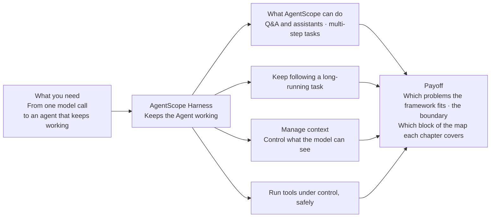

# Chapter 1 Getting to Know AgentScope 2.0

> Chapter guide: When you want an application to move from "call a model once and return a block of text" to an agent that can look up business data, run a task across several steps, and confirm with you before it continues, do not start by writing code. This chapter first answers what kind of application AgentScope is for, then takes apart the three dimensions Harness uses to keep an Agent working. By the end you know which problems the framework fits, where its boundary is, and which block of the map each later chapter covers.

*Figure: map of this chapter*

## What AgentScope can do

The first kind of application is Q&A and assistants. For support, knowledge Q&A, and a business assistant, you can have the Agent answer from session history, retrieval results, and live business data, and have it query an order, update a ticket, or call a system you already run. The front end can show the answer, the tool call in progress, and the item waiting on the user.

The second kind is multi-step tasks. For research, data analysis, and code changes, the Agent can read material in a workspace, make a plan, run tools, and write files. When the work needs a different skill, it delegates to a sub-agent (a Subagent: an agent that takes one piece of work from the main Agent and finishes it on its own). The context a long task builds up, requirements the user adds in the middle, and the state needed to resume after a pause each have a way to be managed.

For example, an Agent that "sorts customer feedback and writes an improvement report" can first read the material and the team rules, call business tools to check the data, have sub-agents analyze different product lines, and then write the report. The user can add a focus during the run, confirm before the report is sent, or leave the page and come back to the progress. **Harness puts the runtime those steps need in one place, so the developer defines the business goal, the tools, and the execution boundary.**

## How Harness keeps an Agent working

After "what it can do", look at "what it uses to do it". The ReAct loop — reason, run a tool, observe the result — is the base of AgentScope Harness. `ReActAgent` provides reasoning, tools, permissions, and middleware (a cross-cutting interceptor on the request chain). `HarnessAgent` combines workspace, context, and session management on that same loop, and keeps the work going along the three dimensions below. Start from `HarnessAgent`, then configure the capabilities the scene needs. The combination is in Chapter 11. The next three subsections are one dimension each: how a task keeps being followed, how context is managed, and how tools run under control.

### Keep following a long-running task

For multi-step work such as a code fix or a research task, you can turn on Todo (the built-in task-list tool the Agent uses to record steps and progress) and, with Plan Mode, investigate and write a plan first, then execute after the user confirms. Work that stands alone can be delegated to a sub-agent, either waited on or finished in the background. The plan, the todos, and the subtasks each have state, so later execution can keep following work that is not done. When the acceptance criteria are clear, the application can also record the task requirements and the verification result, and give the next step something to stand on.

Two data pillars hold that follow-through. The Session Log stores messages, tool calls, and the interaction. A checkpoint stores the state needed to continue. When the work has to run in the background, queue while busy, take an extra requirement, or resume after an interrupt, `AgentSession` (the session entry point that accepts tasks and schedules background execution) manages the task. The front end fills in progress already in the log, then receives new events. See Chapter 17 (Plan Mode), Chapter 16 (sub-agents), and Chapter 19 (session operations and recovery).

### Manage context, and control what the model can see

Before each model request, Harness reassembles the stable instructions, the conversation history, the current task state, and the reference material. The workspace provides project rules, memory, knowledge, and Skills (a capability package described in a Markdown file and loaded when needed). Dynamic sources add the latest business facts on that turn. The application can configure sources, priority, and budget so this turn's input stays on the current work. Memory and external material are reference. Permission to read business data is still checked by the application.

As the task grows, Harness saves oversized tool results to files, picks material within the budget, and keeps the goal, the key findings, and the next step through structured compaction. The model uses the shortened working context. The full execution history stays in the Session Log. Information that crosses sessions is carried by long-term memory. See Chapter 13 (context management), Chapter 12 (the workspace), and Chapter 14 (memory).

### Run tools under control, and safely

Java tools and MCP (Model Context Protocol, the standard protocol that connects a model to external tools) connect the model's request to act with files, code, and business systems. The application configures which tools are available. The permission system then decides, from rules, the run mode, and the actual arguments, whether to allow, deny, or ask the user to confirm. An action that needs a person to approve it, or an external system to run it, can be saved as a pending item, wait for the result, and then continue reasoning.

When running code and commands, you can configure Docker or a remote sandbox, and choose a scope isolated by user or by session. The real file, network, and resource boundaries are enforced by the tool implementation and the execution backend. Tool calls, results, and approvals are shown and traced through typed events (each kind of event is a definite Java event type) and the session log. See Chapter 7 (tools), Chapter 10 (permissions and human intervention), and Chapter 18 (the sandbox).

The outline of the framework is in place: two kinds of application, held up by three dimensions. Chapter 2 runs the smallest line of that — create an Agent, two turns of Q&A, and streaming output.
