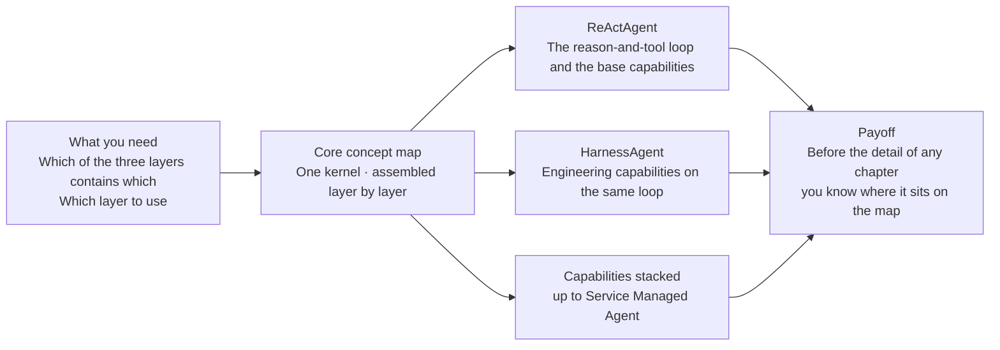
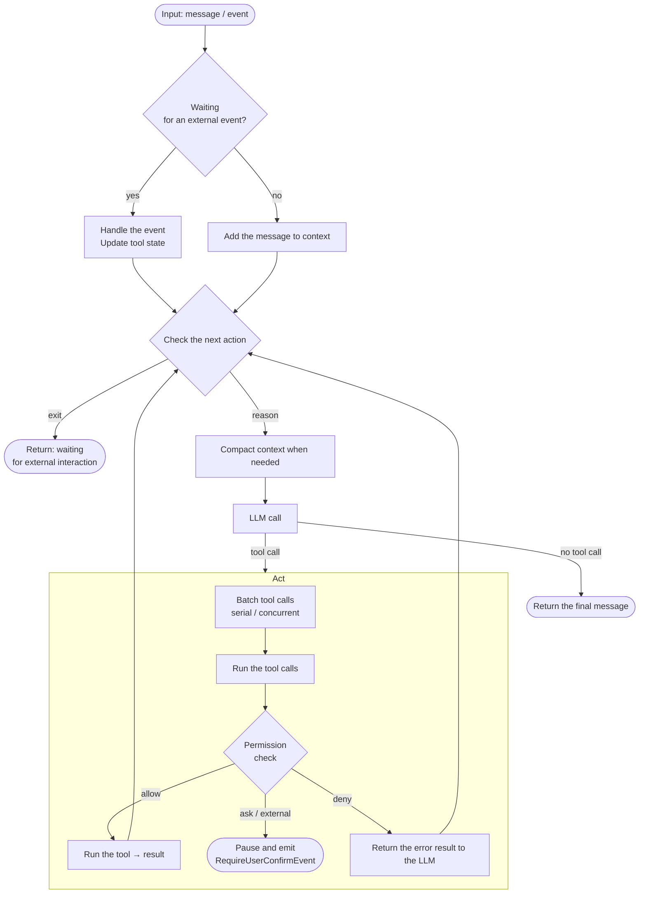
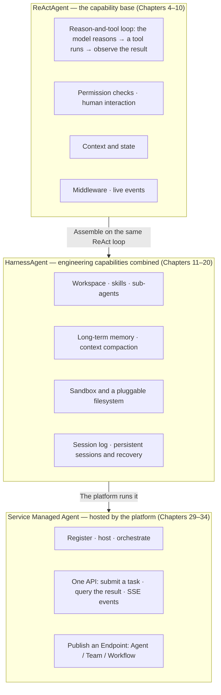

# Chapter 3 Core Concept Map

> Chapter guide: After the first two chapters you can run a `HarnessAgent`, and you still cannot tell whether ReActAgent, HarnessAgent, or Service Managed Agent contains the others, or which layer to use. This chapter draws the concepts of the book as a three-layer map. After it, before you open the detail of any chapter, you know where that topic sits on the map.

*Figure: map of this chapter*

The API surface of AgentScope Java 2.0 is not small: ReActAgent, HarnessAgent, Managed Agent, the workspace, the session log, the Session API. What gets lost at the start is usually not one particular call. It is not knowing which concept contains which, and which problem each one solves.

AgentScope's capabilities stack layer by layer. The bottom layer is ReActAgent. It implements the ReAct loop "model reasons, runs a tool, observes the result", and hangs base capabilities such as permissions, human interaction, and middleware on that loop. The middle layer is HarnessAgent. On the same loop it builds in the workspace, long-term memory, context compaction, skills, sub-agents, the sandbox, and session recovery, so a long-running application does not have to assemble each piece itself. The top layer is the Managed Agent on the AgentScope Service platform. It uses HarnessAgent as its kernel. The platform runs it. The business application submits a task, receives events, and collects the deliverable through an API.

The three layers are "one kernel, assembled layer by layer", not three separate frameworks. That is also the hidden line of the book's chapters: Part 2 is the base, Part 3 is the combination, Part 5 is hosting. To split the work more plainly: this chapter only draws the map and does not teach configuration. The detail of each layer starts in Chapter 4, Chapter 11, and Chapter 29. After this chapter, before you open the detail of any chapter, you should know where it sits on the map.

## When you need it

This map answers "which layer, and where does this topic sit". You use it at three typical moments:

**The first time you decide which layer to use.** For example, the company wants an assistant that can look up tickets and join a business process. If you want to customize it deeply in application code, start from `HarnessAgent`. If you want the platform to host it and call it through an API, configure a Managed Agent on Service. You do not have to pick only one. An existing Harness application can also join Service as an External Agent. The framework's own recommendation: prefer `HarnessAgent` for business Agent development, and use `ReActAgent` when you need to assemble the base capabilities yourself.

**When a later chapter loses you.** Later chapters each go deep on one capability of one layer. You can come back here at any time and check which layer the current topic belongs to, and which capabilities sit beside it.

**When you explain the design to the team.** The three-layer picture of "one kernel, assembled layer by layer" can go straight into a design review: which capabilities are ready to use, which you assemble yourself, and who runs it. The figure makes that plain.

How this sits with what you already read: Chapter 1 answered "what it can do" from scenes. Chapter 2 ran the `HarnessAgent` line. This chapter adds the full coordinate system. The map comes before the detail. Chapters 4–10 take the base capabilities of the ReActAgent layer apart one by one. Chapter 11 covers how Harness combines those capabilities. From Chapter 29 the book enters platform hosting. This chapter does not open any configuration item.

## ReActAgent: the reason-and-tool loop and the base capabilities

AgentScope unifies how an agent is called through the `Agent` interface. It provides the lower-level `ReActAgent` and the `HarnessAgent` wrapped on top of it. Both support the two entry points `call` and `streamEvents`. **ReAct is the execution base of AgentScope Harness.** `ReActAgent` runs the loop "the model reasons, a tool runs, the result is handed back to the model" until it returns a result or waits for an outside interaction. Permission checks, human interaction, context and state, middleware, and live events all work around that loop.

Both `ReActAgent` and `HarnessAgent` run one `call` through the reason-and-act loop below. Harness's built-in capabilities join at the matching stage:

Choose the entry point by the scene. To get a reply, or to put the Agent in a workflow, use `call`. To show text and tool progress step by step in the current request, use `streamEvents`. When the work has to keep running in the background, queue while busy, take an extra requirement during the run, or continue the original task after an interrupt, use the `AgentSession` operations that only HarnessAgent provides. The code and the detail of the three ways are in Chapter 4 and Chapter 11.

## HarnessAgent: engineering capabilities on the same loop

After the base, go up one layer. `HarnessAgent` wraps `ReActAgent`. It keeps the same reasoning and execution loop, and it also builds in the workspace, long-term memory, context compaction, skills, sub-agents, the sandbox, and the session log and recovery. After you use Harness, **the reasoning and execution loop itself has not changed.** More of the runtime is assembled by Harness, and the business developer configures it and uses it.

One run reads the current session state, builds the model input, calls tools as needed, and saves the result. The workspace, memory, and compaction take effect in those steps. The business customizes behavior through the builder, tools, and middleware. The table below summarizes the engineering capabilities built into HarnessAgent and the chapter for each topic. The configuration of each capability is opened one by one in Chapters 12–20.

| Capability | What problem it solves | See |
| --- | --- | --- |
| A persona driven by the workspace | Persona, knowledge, sub-agents, skills, and the MCP allowlist all exist as files | Chapter 12 |
| State persistence and the execution log | The full record, checkpoints, recovery across requests and across nodes | Chapter 19 |
| Session task management | Background execution, a durable queue, extra information, and recovery | Chapter 19 |
| Two-layer long-term memory | Facts that are worth keeping in a long session are stored automatically | Chapter 14 |
| Conversation compaction and offloading large tool results | Context stays bounded. An oversized tool result is written to disk and a placeholder is kept | Chapter 13 |
| Sub-agent orchestration | Delegate to a sub-agent, synchronously or in the background, with an automatic callback | Chapter 16 |
| A pluggable filesystem and sandbox isolation | Switch among local disk, shared storage, and a sandbox without changing code. Files and commands run in isolation | Chapters 12 and 18 |
| Plan mode | A read-only thinking stage, then leave it through HITL | Chapter 17 |
| Skill assembly | Skills come from Git, Nacos, MySQL, the classpath, or the workspace | Chapter 15 |
| MCP integration and a tool allowlist | Declarative MCP servers, allow or deny at tool granularity | Chapter 12 |
| Channel routing | Session management, per-session concurrency control, multi-agent routing, streaming events | Chapter 20 |

Recommendation: **for business Agent development, prefer `HarnessAgent`.** When you need to assemble the base capabilities yourself, you can use `ReActAgent` directly.

## Stacking capabilities: from ReActAgent to Service Managed Agent

Put the three layers together and you get the capability stack that runs through the book. Each layer does not replace the one under it. It assembles more ready-made capability on top, and moves responsibility for running the agent upward.

- **ReActAgent (opened in Chapters 4–10):** the reason-and-tool loop, plus base capabilities such as permissions, middleware, and messages and events. It is the execution kernel of every layer above.
- **HarnessAgent (opened in Chapters 11–20):** on the same loop, the workspace, memory, compaction, skills, sub-agents, the sandbox, and session recovery. It covers the engineering problems of long tasks and production deployment.
- **Service Managed Agent (opened in Chapters 29–34):** the hosted form that uses HarnessAgent as its kernel. The platform runs it. The business application submits a task, receives events, and collects the deliverable through one API.

Whichever layer you enter from, the message shape, the tool protocol, and the event model underneath stay the same. `HarnessAgent` is a thin wrap of `ReActAgent`, and the builder interfaces are largely the same. An existing Harness application can also join Service as an External Agent and keep its own process. What changes is only who assembles the capabilities, and who runs them.
