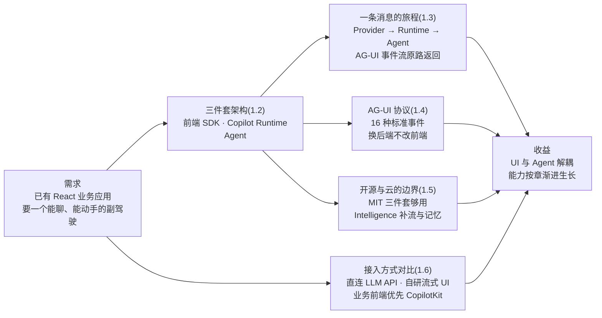
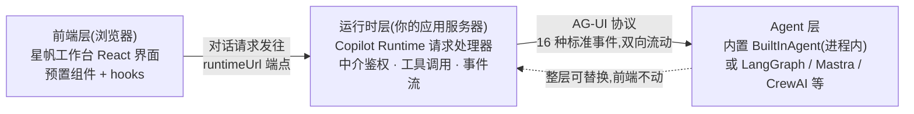
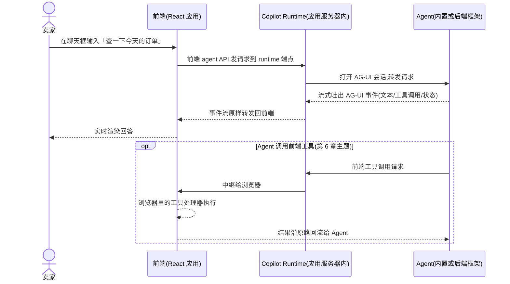
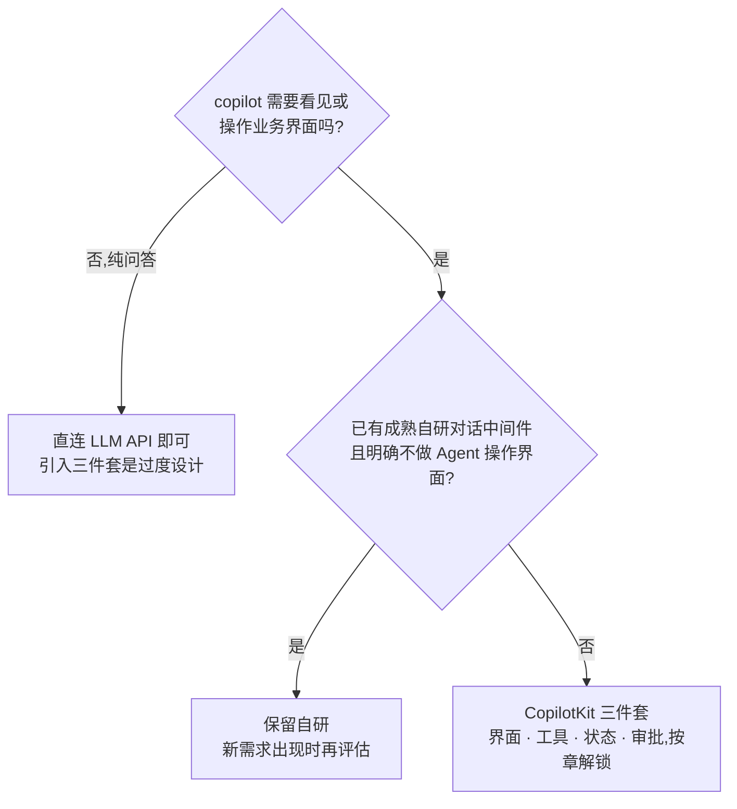

# 第 1 章 初识 CopilotKit

> 本章导读：星帆工作台是一个再普通不过的 React 卖家运营台——订单列表、商品管理、物流看板，界面齐全，但没有一丝智能。产品经理的诉求只有一句话：「让卖家能直接问系统，让系统替卖家动手。」如果直连大模型 API 从零造一个聊天页，意味着自研流式渲染、自定前端工具协议、自己维护与后端 Agent 的对接——每一样都是不小的工程，而且每换一次模型或框架都可能返工。CopilotKit 把这些做成了一套可组装的三件套：前端 SDK、运行时（Copilot Runtime）、代理（agent），中间用开放的应用软件协议 Agent User Interaction（AG-UI）连接。本章不展开实现，任务是给你一张全景地图：三件套各管什么、一条消息怎么从输入框流到 Agent 再流回来、开源与云的边界在哪、以及为什么业务前端优先选它而不是直连 API。读完本章，你能对着星帆工作台说出 copilot 该长在哪、能力从哪来、边界在哪。



*本章导览图*

## 你什么时候需要它

三种典型处境，对应本章三种读法。

**你有一个现成的 React 业务应用，想给它加一个「能聊、能动手」的助手**——从 1.1 读起，按顺序读到 1.3。这三节回答「CopilotKit 是什么、由哪几块组成、一条消息怎么流」，是后面所有章节的地基。

**你担心这东西要不要付费、要不要把数据交出去**——直接看 1.5。结论先给：构建一个能用的 agentic 应用，开源三件套（MIT 授权）就够了，不需要任何 CopilotKit 托管服务；Intelligence 平台补的是跨设备会话、记忆与运营分析。

**你在技术选型会上被问「为什么不直接调大模型 API」**——直接看 1.6。这一节把直连 API、自研流式聊天层、CopilotKit 三条路线摆在一个表里对比，并给出本书的选型立场。

**你想先看懂整体，再决定要不要动手**——重点读 1.2 与 1.3。一张架构图、一张时序图，讲清三件套怎么协作；读完再翻第 2 章动手，心里有底。

前置：无。本章零假设——不要求你用过 CopilotKit，也不要求你了解任何 Agent 编排框架。贯穿案例星帆工作台此刻还是一个没有智能的普通 React 应用（React 18 + Vite + TypeScript，工程名 `starfish-console`），本章只画地图，不动工。

## 1.1 概述

先回答最根本的问题：CopilotKit 解决什么问题？

一句话：**CopilotKit 把副驾驶（copilot）植入你已有的应用，而不是把你的用户搬进一个新造的聊天页面。**官方架构文档对它的自我描述是一个三层栈——前端、运行时、代理——由开放的 AG-UI 事件协议连接，并且明确指出：运行时住在**你自己的应用服务器**里，因此你的 UI 与 Agent 之间只隔着一层你可以审查的线格式（wire format）。这句话里藏着 CopilotKit 的全部气质：它是「接入层」而不是「托管层」，界面是你的，服务器是你的，数据流经的每一跳都是你能看见的。

把「工作台 copilot」这个需求拆开看，它不是一件事，而是五件事的组合：

| 组成 | 它要求什么 | 没有工具链时要自己造什么 |
|------|-----------|------------------------|
| 一个聊天窗 | 界面、输入框、消息流、加载态 | 组件与交互细节全套 |
| 流式回答 | 逐字渲染、中断恢复 | 流式响应的解析与渲染逻辑 |
| Agent 看见业务数据 | 界面状态随请求发布给 Agent | 自定上下文注入协议 |
| Agent 操作界面 | 前端暴露可被调用的工具 | 自定工具调用与回传协议 |
| 关键操作有人把关 | 危险动作暂停等确认 | 自研审批交互与状态机 |

CopilotKit 的做法是给每一行右列一个现成答案：前三行来自前端 SDK 与预置组件，第四行由 AG-UI 事件承载，第五行有协议内建的暂停语义（第 7 章）。**评估一个 AI 集成框架，本质就是评估这张表右列被填掉了多少。**

对前端工程师来说，它具体给你三样东西：

1. **聊天界面**——预置组件 `CopilotChat`、`CopilotSidebar`、`CopilotPopup` 开箱即用；想完全自定义，还有 headless API 自己搭界面；也可以两者混用。
2. **状态与工具 API**——框架原生（React hooks 形态）的 API，让 Agent 能读到界面数据、调用前端工具、把状态变化流回界面。
3. **运行时与 Agent 接入**——一个挂在你应用服务器里的请求处理器，后面接任何 AG-UI 兼容的 Agent：内置的 `BuiltInAgent`，或 LangGraph、Mastra、CrewAI、Pydantic AI 等框架搭的 Agent。

第 2、3 样东西贯穿全书，按章节逐步解锁：

| 你要的能力 | CopilotKit 的对应物 | 深入章节 |
|-----------|--------------------|---------|
| 一个聊天窗口落在工作台角落 | 预置组件，Provider 包住应用即得 | 第 2、3 章 |
| 聊天窗口对齐星帆的设计规范 | headless API 与样式定制 | 第 3 章 |
| Agent 能答「今天卖了多少」 | 界面状态发布给 Agent | 第 4 章 |
| Agent 能查「ORD-20431 为什么没发货」 | 后端 Agent 与 Runtime 集成 | 第 5 章 |
| 回答里直接渲染订单卡片 | 前端工具与生成式用户界面（Generative UI） | 第 6 章 |
| 改价操作必须人工确认 | 人工介入与审批 | 第 7 章 |
| 多 Agent 协作、上生产 | 协议、线程与部署 | 第 8 章 |

接入的「壳」薄到什么程度？给一个最小示意（第 2 章逐行跑通，此处只为建立直觉）:

```tsx
// 示意:Provider 包住现有应用,业务界面原样留在里面
import { CopilotKitProvider } from "@copilotkit/react-core/v2";
import "@copilotkit/react-core/v2/styles.css";

<CopilotKitProvider runtimeUrl="/api/copilotkit" agentId="default">
  {/* 星帆工作台现有的全部页面 */}
</CopilotKitProvider>
```

一个 Provider 组件、两个属性：`runtimeUrl` 指向挂在应用服务器里的运行时端点，`agentId` 指定对话交给哪个 Agent（星帆工作台先用内置的 `default`，第 5 章换成自建的 `seller_agent`）。业务代码不需要重写，现有的页面树原样留在 Provider 内部——这就是「植入」二字的字面含义。**CopilotKit 的定位不是「再造一个聊天产品」，而是把 Agent 能力接进你已有的界面**——这也是全书所有示例都从「星帆工作台已有页面」出发的原因。

## 1.2 三件套架构

官方架构文档把 CopilotKit 概括为一个三层栈，层与层之间靠 AG-UI 事件协议连接。先把三块各管什么画出来：



三层的总览表：

| 层 | 形态 | 核心职责 | 你掌控什么 |
|----|------|---------|-----------|
| 前端 | `@copilotkit/react-core/v2` 的 hooks 与预置组件 | 连接 UI 与运行中的 Agent；渲染事件流 | 界面长什么样、暴露哪些数据与工具 |
| 运行时 | `@copilotkit/runtime/v2`，挂在你应用服务器里的请求处理器 | 中介鉴权与工具调用，把工作经 AG-UI 转发给 Agent | 部署位置、鉴权策略、接哪个 Agent |
| Agent | `BuiltInAgent` 或任意 AG-UI 兼容后端 | 跑提示词、调工具、吐状态、流式回事件 | 用哪个框架、什么模型、什么业务逻辑 |

### 1.2.1 前端层：框架原生的 SDK 与组件

前端层就是你正在写的那个应用——星帆工作台的 React 界面。CopilotKit 在这一层提供的是框架原生的状态与工具 API，加上预置聊天组件（`CopilotChat`、`CopilotSidebar`、`CopilotPopup`）。三条使用路线由你选：

| 路线 | 做法 | 适用 |
|------|------|------|
| 预置聊天界面 | 直接挂预置组件，拿到完整的聊天体验 | 快速上线，样式后调 |
| headless 自建 | 用 headless API 完全自建界面 | 要对齐自有设计规范 |
| 两者混用 | 主体用预置，局部自建 | 常见的渐进式改造 |

第三条路线正是星帆工作台会走的路：第 2 章先用预置组件把聊天窗挂进角落，第 3 章再迁到侧边栏并接入工作台的设计规范。

再理清这一层里两样东西的分工，初学者最容易在这里绕晕：

| | 预置组件 | headless API | hooks（`useAgent` 等） |
|--|---------|--------------|----------------------|
| 给你什么 | 现成的聊天界面 | 界面的积木，不带成品 | 数据与行为的接线 |
| 你控制什么 | 主题与布局参数 | 全部 DOM 与样式 | 暴露哪些数据、工具、状态 |
| 典型用法 | 几行代码挂进应用 | 对齐自有设计规范 | 预置与自建都离不开它 |

三者的关系不是三选一：预置组件内部同样跑在 hooks 之上，headless 是把组件层换成你自己的，hooks 始终是地基。**界面上「看起来像聊天」的部分是可替换的，「连着 Agent」的部分是同一套。**

v2 的 React hooks 按能力分组，全书各章会逐一登场：

| API | 干什么 | 深入章节 |
|-----|--------|---------|
| `useAgent` | 订阅与读写 Agent 的状态（agent state） | 第 4 章 |
| `useAgentContext` | 把界面数据作为轻量上下文发布给 Agent | 第 4 章 |
| `useFrontendTool` / `useComponent` | 定义前端工具；把 React 组件注册成「组件即工具」 | 第 6 章 |
| `useRenderTool` / `useDefaultRenderTool` / `useRenderToolCall` / `useRenderedMessages` | 控制工具调用在界面上如何渲染 | 第 6 章 |
| `useHumanInTheLoop` / `useInterrupt` / `useHeadlessInterrupt` | 人工介入：暂停、审批、恢复 | 第 7 章 |

官方 SDK 同时覆盖 Angular 与 Vue，本书聚焦 React。**选 React 主线不是能力边界，而是叙事聚焦**：三件套的架构与 AG-UI 协议对各框架完全一致。

### 1.2.2 运行时层：住在你服务器里的请求处理器

运行时（Copilot Runtime）是一个挂进你应用服务器的请求处理器。它收前端发来的请求，中介鉴权与工具调用，然后把工作经 AG-UI 转发给 Agent。官方列出的宿主：

| 宿主 | 说明 |
|------|------|
| Next.js（App Router） | React 全栈项目最自然的落点 |
| Express / Hono | 传统 Node 服务器 |
| Bun / Deno | 替代运行时 |
| Cloudflare Workers | 边缘部署 |

如果暂时不想跑一个独立的 Agent 进程，还有一条框架无关的路径：在运行时内直接实例化一个 `BuiltInAgent`，让 Agent 循环与应用同进程跑——星帆工作台第 2 章就是这么起步的，一个服务器进程装下三件套里的两件。

按官方架构文档的描述，运行时在一条请求的路径上做三件事，每一件都值得单独记住：

1. **收请求并中介鉴权**——前端不直接触达 Agent，鉴权策略收敛在服务器侧；
2. **打开 AG-UI 会话并把工作转发给 Agent**——Agent 是谁、在哪儿，由运行时配置决定，前端不感知；
3. **把事件流式回传、中继工具调用**——Agent 吐出的事件原样流向前端；Agent 要调前端工具时，把请求中继进浏览器，再把结果带回。

这三件事让运行时成为整条链路上唯一「知道全部」的节点——也正因如此，把它放在你自己的服务器里才有意义（下一小节展开）。

**运行时住在你自己的服务器里，是 CopilotKit 与「托管式聊天服务」最本质的区别。**对话请求、工具调用、事件流全部经过你自己的后端，Agent 的选择权在你手里——这就是官方说的「UI 与 Agent 之间只隔着一层可审查的线格式」的含义：你可以在自己的服务器上打印、检查、拦截这条流。代码形态上，它是一个可实例化的 `CopilotRuntime` 类，配合各宿主的薄适配器接入；具体配置第 5 章展开。

### 1.2.3 Agent 层：可替换的大脑

Agent 层是真正「思考与动手」的部分。官方对它的职责描述是四个动词，每个动词都对应着后端的一次真实投入：

- **运行提示词**——系统提示词、业务规则、卖家偏好（1.3.2 的运行上下文）在这里生效；
- **调用工具**——后端工具（查物流、改库存）与前端工具（第 6 章）都在它的调用范围内；
- **产出状态**——Agent 侧维护一份可被前端订阅的状态，`dashboard` 的数字更新走这条路（第 4 章）；
- **流式回事件**——以上一切以 AG-UI 事件的形式流出，前端只认事件，不认框架。

四个动词是协议层面的能力清单，与用哪个框架实现无关——这正是下面这张选择表可以随便换行的原因：

| 选择 | 说明 | 适用阶段 |
|------|------|---------|
| `BuiltInAgent`（内置 Agent） | 进程内 Agent 循环，支持 OpenAI、Anthropic、Google 等模型 | 起步、原型、不需要外部框架时 |
| LangGraph / Mastra / CrewAI / Pydantic AI / Microsoft Agent Framework | 各框架经 AG-UI 适配器接入 | 需要编排能力、复杂业务流程时 |
| 自定义实现 | 任何 AG-UI 兼容的后端 | 已有自研 Agent 时 |

**Agent 层的选择是可逆的**：起步用内置 Agent，业务复杂后换成 LangGraph 编排的 `seller_agent`，前端一行不改——这个「不改」由 1.4 节的 AG-UI 协议保证，也是星帆工作台演进线（第 2 章内置 → 第 5 章换框架 → 第 8 章扩子代理）能够成立的前提。

### 1.2.4 分层给星帆工作台带来什么

把三件套对到星帆工作台上，分工是这样的：

- **前端层**在浏览器里：预置组件提供聊天窗，`useAgentContext` 把 `dashboard` 数据发布出去（第 4 章），前端工具让 Agent 能调 `get_orders`、`update_price`（第 6 章）；
- **运行时层**在 `starfish-console` 自己的应用服务器里：管鉴权、管工具中继，第 5 章起负责把请求转给 LangGraph 的 `seller_agent`；
- **Agent 层**从内置的 `default` 起步，逐步长成 `seller_agent`，第 8 章再扩出 `pricing_agent` 子代理。

**每一层独立演化、互不锁死——这是三件套架构真正的收益，也是本书按「层」组织章节的原因。**全书各章分别动哪一层，一图在手：

| 章节 | 主要动的层 | 换句话说 |
|------|-----------|---------|
| 第 2 章 | 三层一起接通 | 最小可运行系统 |
| 第 3 章 | 前端层 | 界面与样式 |
| 第 4 章 | 前端层 + Agent 层的数据面 | 状态发布与订阅 |
| 第 5 章 | 运行时层 + Agent 层 | 换大脑、配运行时 |
| 第 6 章 | 前端层 + Agent 层的动作面 | 前端工具与渲染 |
| 第 7 章 | 全链路 | 在动作上插人 |
| 第 8 章 | 运行时层 + 协议 + 部署 | 多 Agent 与生产化 |

## 1.3 一条消息的旅程

架构是静态的，消息是流动的。跟着一条消息从输入框走到渲染，三件套如何协作就一目了然。

### 1.3.1 时序图与七步流程

官方架构文档给了完整的请求流程，画成时序图：



按官方文档的七步流程逐格核对：

| 步 | 发生什么 | 星帆工作台里的对应物 |
|----|---------|---------------------|
| 1 | 用户在前端应用里发出一条消息 | 卖家在侧边栏输入「查一下今天的订单」 |
| 2 | 前端 agent API 把请求发往运行时端点 | 请求打到 `runtimeUrl` 指向的 `/api/copilotkit` |
| 3 | 运行时与配置好的 Agent 建立 AG-UI 会话 | Runtime 找到 `agentId` 对应的 Agent |
| 4 | Agent 以 AG-UI 事件流出文本、工具调用、状态更新 | `default`（或第 5 章起的 `seller_agent`）开始工作 |
| 5 | 运行时把事件流回前端，前端实时渲染 | 回答在聊天窗里逐字出现 |
| 6 | 若 Agent 调用前端工具：运行时中继请求，浏览器里的处理器执行，结果流回 Agent | 第 6 章的 `get_orders` 在浏览器里查到订单 |
| 7 | 线程、持久化、实时同步（配置后）由 CopilotKit Intelligence 平台侧中介 | 第 8 章生产化时才涉及 |

值得指出的是：第 2 到第 5 步在星帆工作台第 2 章结束时就会全部跑通——那时工作台copilot「能聊但看不见页面」；第 6 步要等到第 6 章前端工具上线；第 7 步是可选项，第 8 章再回来讨论。

再用星帆的口吻把前五步走一遍。卖家在侧边栏输入「查一下今天的订单」——这条消息不进浏览器里任何业务组件，而是由前端 agent API 打到 `/api/copilotkit`（第 2 步）。运行时在自己的服务器上收到它，确认请求合法，找到 `agentId` 指向的 `default` Agent，开一条 AG-UI 会话把工作交出去（第 3 步）。Agent 循环开始转：它决定先回答一句，再调用订单查询——于是文本增量事件、工具调用事件、状态更新事件接连流入运行时（第 4 步）。运行时不加工、不解释，把事件流原样转发回前端（第 5 步），聊天窗里回答逐字浮现，一切发生在几百毫秒到几秒之间。

注意这趟旅程里前端的「无知」是设计出来的：它不知道 Agent 是内置的还是 LangGraph 的，不知道模型是哪家的，也不知道后面还有几个子代理。**前端只认 AG-UI 事件——这份「无知」正是 1.4 节要展开的解耦点。**

### 1.3.2 消息里还带着什么：运行上下文

消息不只有问题文本。前端可以在每次运行时发布「运行上下文」——比如卖家在设置面板里选的语气、回复长度、专业程度。官方把这叫 agent config：一个由前端持有的类型化配置对象，Agent 每轮运行都会读取它并重建系统提示词。React 侧的发布方式是 `useAgentContext`（示意，第 4 章展开）:

```tsx
// 示意:把界面上选好的偏好,随每次运行发布给 Agent
useAgentContext({
  description: "卖家回复偏好",
  value: { tone: "professional", language: "zh-CN" },
});
```

它到 Agent 侧的旅程取决于运行时架构：住在运行时后面的 Agent 在每轮运行时从 agent state 里读到它；与运行时同进程的内置 Agent 则直接作为转发属性拿到——同一份配置，两种接线方式。官方给了一条清晰的分界，帮你判断一个值该走哪条路：

- 如果这些值是用户**偶尔调节的「频道」**（设置面板、下拉框），用 agent config；
- 如果是 Agent 应当**写回的「内容」**（笔记、文档、计划），走共享状态——星帆工作台里 `dashboard` 数字随对话变化就是后者，第 4 章的主题。

两种数据方向对照着记：

| | agent config（频道） | 共享状态（内容） |
|--|--------------------|----------------|
| 谁写 | 前端（用户在界面上调） | Agent 与前端双向 |
| 典型例子 | 语气、专业度、回复语言 | `dashboard` 数字、草稿、计划 |
| 前端 API | `useAgentContext` | `useAgent`（第 4 章） |
| 星帆工作台场景 | 卖家选「正式/轻松」回复风格 | Agent 改库存，页面跟着变 |

### 1.3.3 前端工具：旅程里唯一的「回程」

七步主流向都是「Agent → 前端」，唯独第 6 步反过来：Agent 点名要调一个住在浏览器里的工具，运行时把请求中继进来，你的 React 处理器执行，结果再流回去。这让 Agent 拥有了「操作界面」的手——第 6 章的 `get_orders`、`update_price` 全靠这条回路。**记住这个方向感：其余一切都是 Agent 流向前端的「事件」，只有前端工具是前端被 Agent 调用后把结果「送回去」。**第 7 章的人工介入（在关键操作上暂停等人拍板）本质上也走这条双向通道。

## 1.4 AG-UI 协议：为什么中间要一层标准

### 1.4.1 没有标准协议的世界

三件套之间的桥是 AG-UI。官方的定义：AG-UI 是一个轻量的、基于事件的协议，标准化 AI Agent 与面向用户的应用之间的连接方式；它是一个开放标准，由 CopilotKit 团队与多家 Agent 框架伙伴共同制定。

为什么需要它？反过来想：没有标准协议时，每个前端与每个 Agent 框架之间都要一条定制的管道——自定义的 WebSocket 消息格式、各家不一样的流式解析、对接新框架就要重写一遍。前端团队被迫维护一堆只有自己看得懂的「方言」。这些「方言」有三笔长期成本：

- **对接成本**——每换一个 Agent 框架，前端与后端的中间层重写一遍；
- **维护成本**——自定义格式没有社区演进，边界情况（断线、乱序、超时）全靠自己补；
- **锁死成本**——前端与那家框架的实现细节耦合越深，越不敢换。

官方文档对 AG-UI 的定位正是取代这些：**统一承载前端与 AI Agent 之间的全部来回通信，取代自定义的 WebSocket 格式与文本解析。**

### 1.4.2 四个关键特性

| 特性 | 含义 | 对你的直接好处 |
|------|------|---------------|
| 事件驱动 | 16 种标准事件类型：文本增量、工具调用、状态快照与增量、运行生命周期 | 所有交互都是同一种「形状」，渲染逻辑可以复用 |
| 双向 | 用户发输入、Agent 回应、Agent 可为人工介入（Human-in-the-Loop）暂停等待、前端可暴露前端工具供 Agent 调用 | 「Agent 操作界面」与「人审 Agent」都有协议位 |
| 传输无关 | SSE、WebSocket、webhooks 都行 | 不绑死某一种推送技术 |
| 框架无关 | 每个受支持的集成都带一个薄 AG-UI 适配器 | 换后端只改一行运行时配置 |

四条里最有工程分量的是最后一条。框架无关不是靠「支持很多框架」堆出来的，而是靠**把适配收敛到 Agent 侧的薄适配器**：每个集成都说 AG-UI 这一种语言，前端与运行时只认协议。于是「换后端」从「前端重写」降级为「运行时改一行配置」，还可以多个后端并行跑——星帆工作台第 5 章换 `seller_agent` 时，聊天窗与全部界面代码原封不动。

另外两条也别当空气。传输无关意味着今天用 SSE、明天换 WebSocket 时，事件语义不变，前端渲染代码不动；双向则意味着协议从一开始就给「Agent 暂停等人」和「Agent 调浏览器里的工具」留了位置——第 6、7 章的能力不是补丁，是协议的原生设计。

### 1.4.3 16 种事件里，你最先遇到的四类

| 事件类别 | 流动内容 | 前端发生什么 |
|---------|---------|-------------|
| 文本增量 | 逐段的回答文本 | 聊天窗打字机式流式渲染 |
| 工具调用 | 工具名、参数、结果 | 展示调用卡片；前端工具被触发执行 |
| 状态快照与增量 | Agent 侧状态的完整快照或增量更新 | 界面随状态实时刷新（第 4 章的主角） |
| 运行生命周期 | 一轮运行的开始、结束等标记 | 驱动「思考中/已完成」等界面状态 |

完整的 16 种事件清单在官方 AG-UI 文档里；第 8 章会回到协议层面把事件全景过一遍。现在只需要带走一个直觉：**前端渲染聊天窗所需的全部信息，都在这四类事件里**——文本管「说什么」，工具调用管「做什么」，状态管「界面变成什么样」，生命周期管「进行到哪了」。

### 1.4.4 协议地图：AG-UI 不是孤岛

再放大一层视野：官方把 Agent 世界的协议分成几块，CopilotKit 全部兼容：

| 连接对象 | 协议 | 用途 |
|---------|------|------|
| Agent ↔ 用户交互 | AG-UI（Agent User Interaction 协议） | 连接 Agent 与面向用户的应用，承载实时、多模态、可交互的体验 |
| Agent ↔ 工具与数据 | MCP（Model Context Protocol） | 让 Agent 安全连接外部系统：工具、工作流、数据源 |
| Agent ↔ Agent | A2A（Agent to Agent） | 定义 Agent 之间在分布式系统里如何协作与分工 |

此外还有一批生成式 UI 规范——A2UI（Google）、MCP Apps（MCP 生态）、Open-JSON-UI（OpenAI），CopilotKit 全部支持（第 6 章展开）。这些协议可以**直接用，也可以组合用**:AG-UI 与 MCP、A2A 之间有「握手」——你的宿主 Agent 若通过 MCP 或 A2A 连接子代理，子代理的 UI 属性可以一路透传到面向用户的应用，同时保留完整的安全、策略与可观测控制。这是第 8 章多 Agent 场景的协议基础。

官方文档里有一句话值得抄在团队 wiki 首页（译述）:**「Agent 的未来不属于某一家公司或一个平台，而是由协议连接的 agentic 生态。」**落到工程决策上，这句话的意思是：**契约是协议而不是 SDK 锁定——你可以整体替换 Agent 层而不重写前端，可以并行跑多个 Agent 后端，可以对接任何 AG-UI 兼容的东西：MCP 服务器、A2UI 组件，乃至 Oracle、Google、AWS 的 Agent 平台。**星帆工作台第 5 章把内置 Agent 换成 LangGraph、第 8 章再扩子代理，靠的都是这个解耦点。

## 1.5 开源与云的边界

CopilotKit 的开源部分与云服务（Intelligence）边界清晰。官方的表述：开源的 SDK 与 TypeScript 运行时把前端连到 Agent，**不需要任何 CopilotKit 服务**；CopilotKit Intelligence 在此之上提供 AG-UI Streams、User Memories、Automatic Learning、Product Analytics、Channels 五类平台能力。

### 1.5.1 开源核心里有什么

| 组成 | 内容 | 说明 |
|------|------|------|
| 前端 SDK | `@copilotkit/react-core`（v2 从 `/v2` 子路径引入） | hooks 与预置组件：聊天、工具、状态、线程、生成式 UI |
| 运行时 | `@copilotkit/runtime`（v2 为 `/v2` 子路径） | 挂在应用服务器里的请求处理器；Express、Hono、Bun、Deno、Cloudflare Workers 薄适配 |
| AG-UI 协议 | 开放标准 | 16 种标准事件，传输无关 |
| 内置 Agent | `BuiltInAgent` | 进程内 Agent 循环，支持 OpenAI、Anthropic、Google 等模型，不依赖外部框架 |
| 集成 | LangGraph（Python / TypeScript / FastAPI）、Mastra、CrewAI、Pydantic AI、Microsoft Agent Framework、AWS Strands、Google ADK 等 | 第一方适配器 |
| 生成式 UI 原语 | 工具渲染、状态渲染、headless API、框架原生主题 | 第 6 章的主题 |

开源部分 MIT 授权，可以跑在任何主机、任何云、配任何大模型服务商。**而且自管持久化始终是选项**:LangGraph 的 checkpointer、ADK 的 session 服务、应用自有的存储，都可以保存会话历史——存储与 UI 集成权完全在你，不经过 CopilotKit 的任何服务。

### 1.5.2 哪些能力需要 Intelligence

官方的能力对照表：

| 能力 | 仅开源即可 | 需要 CopilotKit Intelligence |
|------|-----------|------------------------------|
| Agent 聊天、前端工具、Agent 状态、生成式 UI | ✓ | |
| 任意 AG-UI 集成（LangGraph、Mastra、内置、自定义） | ✓ | |
| 框架原生或应用自有的持久化 | ✓（自己运营与集成） | |
| 本地 Inspector：调试实时事件、工具、状态与连接 | ✓ | |
| AG-UI Streams（保存会话与 UI、可恢复运行、实时同步） | | ✓ |
| User Memories 与 Automatic Learning | | ✓ |
| Product Analytics 与云托管的 Channels 连接 | | ✓ |
| Inspector 的 Rich Threads 与 Automatic Learning 面板 | | ✓ |
| Intelligence 项目管理与 API key | | ✓ |

五类 Intelligence 能力，各用一句话说清：

| 能力 | 一句话 | 星帆工作台何时需要 |
|------|--------|-------------------|
| AG-UI Streams | 保存会话、UI 与输入，跨设备重开，断线重连活跃运行 | 卖家在手机上接着电脑上的对话继续聊 |
| User Memories | 把事实保留到单次会话之外（用户与项目两个作用域） | 记住「这个卖家主推美线」 |
| Automatic Learning | 把真实使用转化为可人工审核后发布的技能（Skill delivery 投放给 Agent） | 把高频问法沉淀为正式技能 |
| Product Analytics | 理解用户怎么用你的 Agent 与工具 | 运营要看 copilot 使用数据 |
| Channels | 把已有 Agent 接入 Slack 或 Microsoft Teams（云托管；开源 Channels SDK 也可自建 runner） | 工作台之外的渠道触达 |

### 1.5.3 云托管与自托管：同一套代码

Intelligence 有两种部署：**云托管**——注册拿 API key，把运行时指向它，平台侧零运维；**自托管**——跑在你自己的基础设施上（Kubernetes 用 Helm chart，AWS 用 ECS bundle），你负责运维服务与依赖。**两种部署下应用代码完全相同，只换平台端点与凭证**——今天选云托管，明天迁自托管，前端 SDK 与运行时 API 一行不改。

### 1.5.4 两个容易被忽略的边界

**其一，运行时语言的差别。**TypeScript 运行时是默认的、功能最全的实现，也是唯一不依赖 Intelligence 就能工作的运行时；Python、Go、Ruby、C#/.NET 运行时需要云托管或自托管的 Intelligence（它们的源码同样开源，区别在于依赖的服务）。本书与星帆工作台用 TypeScript 运行时，正好落在「零 Intelligence 依赖」这一侧。

**其二，Inspector 的两副面孔。**Inspector（开发期调试工具）在 React、Vue、Angular 浏览器应用的开发构建里默认可用：实时 AG-UI 事件、工具、状态与连接调试，这些本地面板不需要 Intelligence；但它的 Rich Threads 与 Automatic Learning 面板需要对应的 Intelligence 服务才有数据可看。开发期本地调试零成本，平台级面板才谈钱。

### 1.5.5 给星帆工作台的加减法

把上面的边界落到决策上，星帆工作台的需求逐项过一遍：

| 星帆的需求 | 开源三件套够吗 | 依据 |
|-----------|---------------|------|
| 聊天窗、流式回答 | 够 | 预置组件与 hooks 在开源 SDK 里 |
| Agent 查订单、改价格 | 够 | 前端工具与 AG-UI 集成是开源能力 |
| 改价前人工审批 | 够 | 暂停语义在协议内（第 7 章） |
| 对话历史保存 | 够（自己管） | 自管持久化是官方明确列出的选项 |
| 卖家换设备接着聊 | 不够 | 跨设备重开与断线重连属 AG-UI Streams |
| 运营要看使用数据 | 不够 | 属 Product Analytics |

本书的立场：**星帆工作台的主线全程只依赖开源三件套**——第 2 章的内置 Agent、第 4 章的状态共享、第 6 章的前端工具、第 7 章的人工介入，没有一样需要 Intelligence 凭证。**先把开源部分用透，再按需上云**：等工作台需要跨设备续聊、长期记忆或运营分析时（第 8 章），再加 Intelligence，且不必改应用代码。

## 1.6 CopilotKit 与其他接入方式的对比（本书立场）

> 本节为原创内容，官方文档没有专门的对比篇。事实边界依据 architecture.mdx 与 ag-ui.mdx，选型判断为本书观点。

### 1.6.1 三条路线

业务前端要接入 copilot，常见三条路线：

- **路线 A，直连大模型 API**：前端（或自建后端）直接调模型服务的对话接口，自己拼提示词、解析响应、画界面。
- **路线 B，自研流式聊天层**：在 A 之上自己实现流式协议、消息格式、工具调用约定——团队里常见的「自研一套简易 Agent 网关 + 聊天组件」。
- **路线 C，CopilotKit**：三件套 + AG-UI，聊天界面、流式渲染、工具回路、状态同步都是现成的协议与组件。

三条路线各有典型画像。走路线 A 的，多数是刚做完 demo、还没想过「Agent 要操作界面」的团队——demo 到产品的距离就是全部补课清单。走路线 B 的，是吃过 A 的亏后认真投入过的团队——他们自研的东西往往能用，但每接一个新框架、每加一类交互，中间层都要动刀，且这套投入无法迁移。走路线 C 的，是把「界面与 Agent 怎么连」当作已解决的问题，把工程预算花在自己的业务逻辑上。

### 1.6.2 逐维度对比

| 维度 | A 直连 LLM API | B 自研流式聊天层 | C CopilotKit |
|------|---------------|------------------|--------------|
| 聊天界面 | 自建 | 自建，含流式渲染 | 预置组件三种布局，或 headless 自建 |
| 前后端事件约定 | 无（自己定） | 自定义格式，自己维护解析 | AG-UI 标准事件，16 种 |
| Agent 接入 | 逐家模型 API 自己封装 | 逐个框架自己对接 | 各框架薄适配器，换后端一行配置 |
| 工具调到前端组件 | 无此概念，自行设计协议 | 自定格式，文本解析 | AG-UI 事件原生承载前端工具回路 |
| 界面状态同步 | 自己轮询或另定协议 | 自定义 WebSocket 格式 | 状态快照与增量事件，UI 与 Agent 实时同步 |
| 人工介入与审批 | 自研 | 自研 | 协议内建暂停/恢复语义（第 7 章） |
| 换模型或 Agent 框架 | 前端逻辑跟着改 | 中间层跟着改 | Agent 层整体替换，前端不动 |
| 每加一个能力的成本 | 一个新工程 | 一个新工程 | 平台内建，按章解锁 |

### 1.6.3 决策树

把上面的判断标准画成一棵决策树，选型会上可以直接投影：


### 1.6.4 公允性与结论

这张表的公允性说明：路线 A 并非一无是处——**如果你的需求只是一个不碰业务数据、不调工具的纯问答框（比如静态站的 FAQ 机器人），直连 API 更轻，引入三件套是过度设计。**路线 B 也有存续空间——已有成熟自研对话中间件、且明确不打算做「Agent 操作界面」的团队，保留自研合理。

但星帆工作台不在这些例外里，它的需求清单是：Agent 要看见 `dashboard` 数字（状态同步）、要查订单（后端 Agent）、要在回答里渲染订单卡片（前端工具与生成式 UI）、改价要人工确认（审批）。**判断标准一句话：只要 copilot 需要「看见或操作你的业务界面」，直连 API 与自研路线的成本会随功能清单线性上涨，而 CopilotKit 把这些能力做成了协议与组件，按需取用。**所以本书的选型立场是：**业务前端接入 copilot，优先 CopilotKit；纯问答场景才考虑直连 API。**

选型的下一步不是论证，是验证：第 2 章会用二十分钟在星帆工作台里把三条诉求中的第一条——一个能聊的窗口——真正跑起来。到时候你手里的判断依据就从这张表变成一次亲手运行。

## 本章小结

1. **CopilotKit 是接入层，不是托管层**：把 copilot 植入已有 React 应用，运行时住在你自己的应用服务器里，UI 与 Agent 之间只有一层可审查的线格式。
2. **三件套各司其职**：前端 SDK 管界面与 hooks，`CopilotRuntime` 管鉴权、工具中继与事件流转发，Agent 管思考与动手；层与层可独立替换。
3. **一条消息七步走**：输入 → 运行时端点 → AG-UI 会话 → 事件流回 → 实时渲染；前端工具调用是唯一的「回程」，Intelligence 相关的线程与同步是可选的第 7 步。
4. **AG-UI 是解耦点**:16 种标准事件、双向、传输无关、框架无关；换 Agent 后端只改一行运行时配置——星帆工作台从内置 Agent 到 LangGraph 的演进靠它成立。
5. **开源够用**:MIT 授权的三件套覆盖聊天、工具、状态、生成式 UI 与本地 Inspector；AG-UI Streams、User Memories、Automatic Learning、Product Analytics、Channels 才需要 Intelligence，且云托管与自托管应用代码相同。
6. **选型立场**:copilot 要「看见或操作业务界面」时优先 CopilotKit；纯问答框直连 API 更轻。

→ 地图已就位。**第 2 章**把这张地图变成运行中的系统：二十分钟在星帆工作台里挂上 `CopilotKitProvider`、内置 Agent 与第一个聊天窗。

## 验收清单

读到这里，你应该能：

- ☐ 对着星帆工作台说出三件套各部署在哪里：前端 SDK 在浏览器，`CopilotRuntime` 在自己的应用服务器，Agent 在进程内（`BuiltInAgent`）或独立后端；
- ☐ 画出一条消息从输入框到渲染的七步旅程，并指出前端工具调用发生在哪一步、方向为何相反；
- ☐ 说出 AG-UI 的四个特性（事件驱动、双向、传输无关、框架无关），并解释「换 Agent 后端不改前端」靠的是哪一条；
- ☐ 把常见能力（聊天、前端工具、生成式 UI、本地 Inspector、自管持久化）与需要 Intelligence 的能力（AG-UI Streams、User Memories、Automatic Learning、Product Analytics、Channels）正确分组；
- ☐ 说出 TypeScript 运行时与其他语言运行时（Python、Go、Ruby、C#/.NET）在 Intelligence 依赖上的差别；
- ☐ 在「直连 LLM API / 自研流式聊天层 / CopilotKit」三条路线中，为星帆工作台给出选型理由与判断标准；
- ☐ 向团队解释星帆工作台的 copilot 为什么「能聊但看不见页面」只是第 2 章的中间态，而不是最终形态。

## 参考速查

理解主线不依赖本节；本节是全书 v2 核心 API 的名词对照，随读随查。

| 名词 | 是什么 | 深入章节 |
|------|--------|---------|
| `CopilotKitProvider` | 前端 Provider 组件；属性 `runtimeUrl`（运行时端点）、`agentId`（默认 Agent） | 第 2 章 |
| `useAgent` | 订阅与读写 agent state 的 hook | 第 4 章 |
| `useAgentContext` | 轻量上下文发布（如 agent config） | 第 4 章 |
| `useFrontendTool` / `useComponent` | 定义前端工具；组件即工具 | 第 6 章 |
| `useRenderTool` / `useDefaultRenderTool` / `useRenderToolCall` / `useRenderedMessages` | 工具调用渲染相关 hooks | 第 6 章 |
| `useHumanInTheLoop` / `useInterrupt` / `useHeadlessInterrupt` | 人工介入：审批、打断、无头打断 | 第 7 章 |
| `CopilotRuntime` | 运行时类，自管服务器时实例化 | 第 5 章 |
| `BuiltInAgent` | 进程内内置 Agent，支持多家模型 | 第 2 章 |
| `createCopilotNodeListener` | Node 侧适配器 | 第 5 章 |
| AG-UI | 16 种标准事件的开放协议 | 第 8 章 |

## 延伸阅读

- **第 2 章（快速开始）**——本章的全景地图落地为可运行系统：Provider、内置 Agent 与第一个聊天窗；官方 Quickstart 用内置 Agent 十来分钟即可跑通。
- **第 8 章（多 Agent、协议与生产化）**——AG-UI 事件全景、A2A/MCP 握手、线程生命周期与 Intelligence 部署决策，本章 1.4 与 1.5 留下的伏笔都在那里收口。
- **第 6 章（前端工具与生成式 UI）**——生成式 UI 六原语（组件即工具、工具调用渲染、状态渲染、推理、A2UI、MCP Apps）的「作者控制 → 声明式 → 开放式」谱系。
- **第 5 章（接入后端 Agent）**——Agent 层从内置换成 LangGraph 等框架时，运行时如何配置、`seller_agent` 如何注册。
- **官方文档 Architecture 与 AG-UI 两篇**——本章的逐节依据；AG-UI 的官网 ag-ui.com 可看协议生态全貌。
