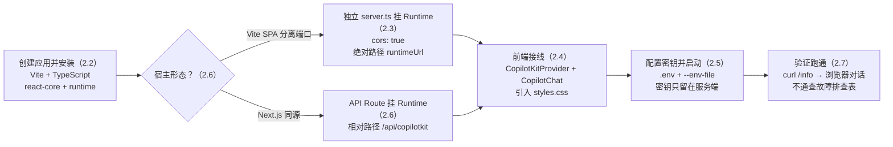
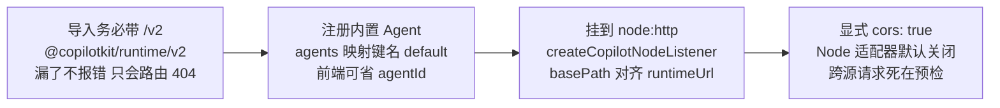
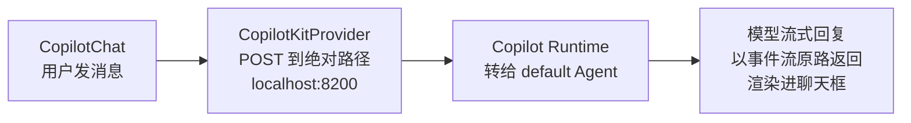
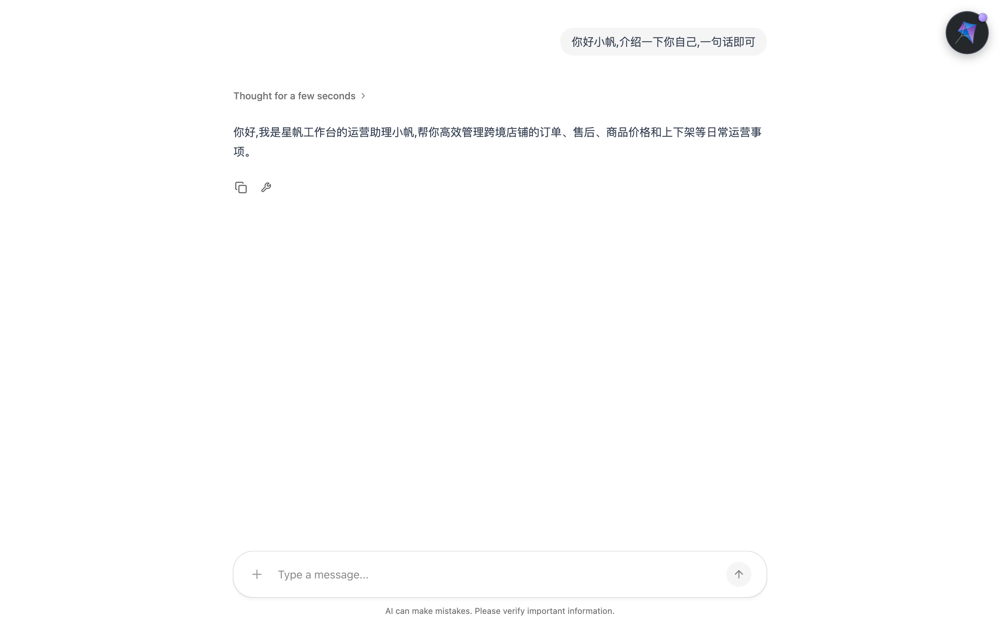
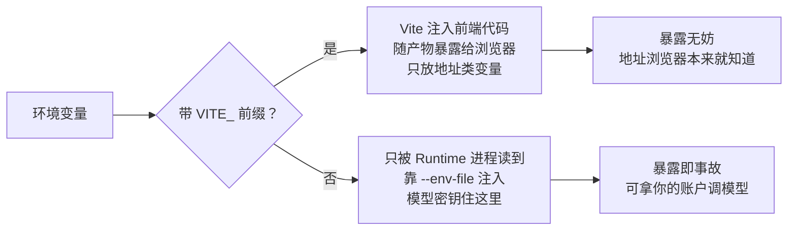

# 第 2 章 快速开始：二十分钟跑通第一个 copilot

> 本章导读：星帆工作台目前只是一个普通的 React 应用——订单列表、商品管理、物流看板，没有一个字和 AI 有关。本章的目标很具体：给这个工作台的角落装上一个能聊天的 copilot，用户点开输入框、敲一句话，回答从模型流式吐回来。为此我们要搭起第 1 章讲过的那套最小架构：前端装上 `CopilotKitProvider` 和聊天组件，另起一个进程跑 Copilot Runtime（运行时），再在里面注册一个内置 Agent（内置智能体）。二十分钟走完，你会亲手敲出两条启动命令、一份完整的 `server.ts`、一段前端接线代码，并学会用 `curl` 在开浏览器之前先确认 Runtime 活着。不过也别期待太高：此刻的 copilot 只是「能说话」，它看不见订单页、不知道今天卖了多少——这个缺口正是第 4 章共享状态要补的。读完本章，你能：在任意 React 应用里跑通一次完整对话；说出「前端 + Runtime 两个进程」各自负责什么；把模型密钥安全地放在它该在的地方。



*本章操作流程图*

## 你什么时候需要它

三种典型处境，对应本章三种用法。

**我要起一个全新的 React 项目，从第一行就开始用 CopilotKit**——按 2.2 → 2.3 → 2.4 顺序走。本章主线就是这条：Vite + TypeScript 从零建应用，Runtime 单独一个进程，前端接上就能聊。

**我手里已经有一个 Vite SPA（或 Create React App 老项目），不想迁去 Next.js**——重点看 2.3 和 2.6。SPA 没有自己的服务端，Runtime 必须独立成进程，由此带来两条铁律：`cors: true` 和绝对路径 `runtimeUrl`。这两条是本章最容易踩的坑，也是 SPA 场景与官方 Next.js 快速开始唯一的本质差异。

**我只想先看看效果，不想动自己的项目**——照 2.2 建一个一次性目录跑通，看完就删。或者如果你是 Next.js 用户，直接看 2.6 的同源路线：一条 API Route 就把 Runtime 挂上了，连单独的进程都不用起。

前置：第 1 章的架构图（前端、Copilot Runtime、Agent 三层怎么连）；一个 OpenAI API Key（或第 5 章将讲到的其他模型提供商）；Node.js 20.6 以上（为了 `--env-file` 标志）；React 18 以上。

## 2.1 概述：为什么是「前端 + Runtime 两个进程」

第 1 章说过，CopilotKit 的架构里浏览器从不直接和模型对话。中间隔着一层 Copilot Runtime（运行时）：它替你保管模型密钥、转发聊天请求、在协议层把模型输出翻成前端能消费的事件流。落到开发机上，这件事的物理形态就是一个问题——**Runtime 的代码跑在哪个进程里？**

官方快速开始默认你用 Next.js：它既是前端框架又自带服务端，API Route 天然是挂 Runtime 的地方，前后端同源，一个项目一个端口搞定。但星帆工作台是 React 18 + Vite 的单页应用——Vite 开发服务器只管静态资源，没有服务端代码的容身之处。于是本章的架构是「两个进程」：

| 进程 | 端口（默认） | 职责 | 代码载体 |
|------|------------|------|---------|
| React 应用（Vite 开发服务器） | `5173` | 渲染工作台界面；`CopilotKitProvider` 把聊天请求发往 Runtime | `src/App.tsx` 等 |
| Copilot Runtime（独立 Node 进程） | `8200` | 托管 Runtime HTTP 端点，注册 Agent，保管模型密钥 | `server.ts` |

两个进程、两个端口、两个源（origin，源）——这个「分离」是本章一切特殊配置的总根源：

- 浏览器从 `localhost:5173` 向 `localhost:8200` 发请求，跨源了，所以 Runtime 必须显式开启 CORS（跨源资源共享，Cross-Origin Resource Sharing），而 Node 适配器默认**不**开；
- 相对路径 `/api/copilotkit` 在 SPA 里会解析到 `5173` 自己身上，那里什么都没有，所以 `runtimeUrl` 必须写全 `http://localhost:8200/api/copilotkit`；
- 模型密钥只该出现在 Runtime 进程的环境变量里，前端代码里永远不该出现它。

与之相对，Agent（智能体）这层的最小选择是 CopilotKit 自带的内置 Agent（Built-in Agent）：它不经任何外部框架，直接调用模型，支持工具、生成式 UI 等全部 CopilotKit 能力。对「先跑起来」这个目标，它是最短路径——星帆工作台的 copilot 在第 5 章之前都由它扮演。本章末尾的对比表（2.6）会把两条宿主路线摆在一起，如果你是 Next.js 用户，可以只读 2.4 与 2.6，跳过独立进程的部分。

## 2.2 创建应用与安装 CopilotKit

### 2.2.1 创建 Vite 应用

如果星帆工作台还不存在，用官方脚手架从零建一个（已有项目可跳到 2.2.2，直接在项目里装包）：

```bash
npm create vite@latest my-copilot-app -- --template react-ts
cd my-copilot-app
npm install
```

这会生成一个 React 18 + TypeScript 的最小工程。已有的 Create React App 项目做法完全一致——区别只在最后一步的启动命令（CRA 用 `npm start`，Vite 用 `npm run dev`）。

**验证点**：命令结束后，目录里有 `src/main.tsx`、`src/App.tsx` 和 `package.json`，执行 `npm run dev` 能看到 `Local: http://localhost:5173/` 字样。本书贯穿案例的工程名约定是 `starfish-console`，你可以把上面命令里的 `my-copilot-app` 换成它。

### 2.2.2 安装两个包

前端包和 Runtime 包一起装，再把后面 `server.ts` 要用的开发依赖补上：

```bash
npm install @copilotkit/react-core @copilotkit/runtime
npm install -D tsx typescript @types/node
```

两个包各管一头：`@copilotkit/react-core` 提供前端组件与 Hook，`@copilotkit/runtime` 提供 Runtime 本体。`tsx` 用来直接运行 TypeScript 写的 `server.ts`，`@types/node` 给 Node 的类型定义。

**注意 TypeScript 的模块解析配置**：CopilotKit 的 `/v2` 子路径是通过包的 `exports` 映射发布的，TypeScript 老的 `"moduleResolution": "node"`（node10）不认它——类型检查会报 `Cannot find module '@copilotkit/react-core/v2'`，尽管代码实际能跑。打开 `tsconfig.json`，确认（或改成）：

```jsonc
{
  "compilerOptions": {
    "moduleResolution": "bundler",
    "module": "esnext"
  }
}
```

`module` 字段在它是 `commonjs` 或未设置时才需要一并设置。`npm create vite` 生成的工程已经是 `bundler`，通常不用动。

**验证点**：`package.json` 的 `dependencies` 里出现 `@copilotkit/react-core` 与 `@copilotkit/runtime`，`devDependencies` 里出现 `tsx`。

## 2.3 启动 Copilot Runtime：内置 Agent 与 server.ts

### 2.3.1 注册一个内置 Agent

SPA 没有自己的服务端，Runtime 需要一个独立进程安身。在项目根目录（与 `package.json` 平级）新建 `server.ts`：

```ts
// server.ts
import { createServer } from "node:http";
import { BuiltInAgent, CopilotRuntime } from "@copilotkit/runtime/v2";
import { createCopilotNodeListener } from "@copilotkit/runtime/v2/node";

const runtime = new CopilotRuntime({
  agents: {
    default: new BuiltInAgent({
      model: "openai:gpt-5-mini",
      prompt: "You are a helpful assistant for a React app.",
    }),
  },
});

const port = 8200;

createServer(
  createCopilotNodeListener({
    runtime,
    basePath: "/api/copilotkit",
    cors: true,
  }),
).listen(port, () => {
  console.log(
    `Copilot Runtime listening at http://localhost:${port}/api/copilotkit`,
  );
});
```

逐行拆开看，这份二十来行的文件里有四个关键决定，从导入到监听串成一条线——先看图，再回读代码：



*图 2-1：server.ts 的四个关键决定——导入、注册、挂载、放行跨源*

其中最后一环 `cors: true` 是整章最重要的一行，下一小节单独说它；`BuiltInAgent` 的 `model` 用 `"provider:model"` 字符串格式，`prompt` 即它的系统提示词。

### 2.3.2 `cors: true` 为什么不能省

你的应用在 `localhost:5173`，Runtime 在 `localhost:8200`——浏览器把跨端口也算作跨源，任何跨源请求发出前都要先经过一次预检（preflight，预检）。`createCopilotNodeListener` 和 `createCopilotRuntimeHandler` 的 CORS **默认是关闭的**：不写 `cors: true`，每次浏览器请求都死在预检上，表现是聊天框渲染得好好的一切正常、发消息却永远没有回应——这是官方文档点名的「最常见的让聊天渲染了却不响应的原因」。

值得一提的是，这个默认值并不统一：Express 与 Hono 适配器默认是放开的 CORS（`origin: "*"`），Node 适配器是关闭的。别靠肌肉记忆，靠这一行显式声明。上生产环境前，`cors` 还可以传配置对象按源收紧（完整配置见第 8 章）：

```ts
createCopilotNodeListener({
  runtime,
  basePath: "/api/copilotkit",
  cors: {
    origin: "https://app.example.com",
    methods: ["GET", "POST", "OPTIONS"],
  },
});
```

### 2.3.3 启动前先用 curl 验证

`server.ts` 引用了 `process.env` 里的模型密钥（下一节配置它），配好后启动：

```bash
npx tsx --env-file=.env server.ts
```

看到 `Copilot Runtime listening at http://localhost:8200/api/copilotkit` 就说明进程起来了。但「进程起来了」不等于「就绪了」，官方文档特别强调：**开浏览器之前**，先确认 Runtime 真的可服务：

```bash
curl --fail --silent --show-error http://localhost:8200/api/copilotkit/info
```

`/info` 是 Runtime 的自描述端点，返回注册的 Agent 清单。等这条命令成功，并且返回的 JSON 里能看到 `default` 这个 Agent，再打开前端。

**为什么这么较真**：如果某个开发脚本把两个进程一起拉起，「Vite 已经监听」并不代表「Runtime 已经就绪」。过早打开页面会让它的首次 Runtime 连接落在错误状态上；如果已经发生了，等 `/info` 成功后刷新页面即可。这一习惯在第 5 章接入自建 Agent 时依然适用。

**验证点**：终端打出监听日志；`curl /info` 返回包含 `default` 的 JSON。

## 2.4 前端接线：Provider、聊天组件与样式

前端要做的只有三件事：引入样式、包上 Provider、放进聊天组件。

### 2.4.1 引入样式

在应用入口 `src/main.tsx` 引一次包自带的样式表，它是自包含的，聊天组件不需要任何其他 CSS 就能正常渲染：

```tsx
// src/main.tsx
import React from "react";
import ReactDOM from "react-dom/client";
import App from "./App";
import "@copilotkit/react-core/v2/styles.css";

ReactDOM.createRoot(document.getElementById("root")!).render(
  <React.StrictMode>
    <App />
  </React.StrictMode>,
);
```

漏了这一行不会报错——组件照常出现，只是没有样式，一大块无格式的 DOM 裸奔在页面上。第 3 章讲自定义外观时会回到这份样式表。

### 2.4.2 Provider 与聊天组件

`CopilotKitProvider` 负责与 Runtime 通信，`CopilotChat` 是一个占满给定高度的聊天面板。下面是星帆工作台的 `src/App.tsx`——与官方示例唯一的区别，是我们在聊天框旁边摆了一小块订单列表，提醒你这是个「业务应用里长出来的 copilot」：

```tsx
// src/App.tsx
import { CopilotKitProvider, CopilotChat } from "@copilotkit/react-core/v2";

const orders = [
  { id: "ORD-20431", buyer: "Maria", amount: "$86.40", status: "待发货" },
  { id: "ORD-20407", buyer: "Liam", amount: "$42.00", status: "已发货" },
  { id: "ORD-20395", buyer: "Emma", amount: "$128.50", status: "售后中" },
];

export default function App() {
  return (
    <CopilotKitProvider runtimeUrl="http://localhost:8200/api/copilotkit">
      <div style={{ display: "flex", height: "100vh" }}>
        <main style={{ flex: 1, padding: 24 }}>
          <h1>星帆工作台</h1>
          <ul>
            {orders.map((o) => (
              <li key={o.id}>
                {o.id} · {o.buyer} · {o.amount} · {o.status}
              </li>
            ))}
          </ul>
        </main>
        <div style={{ width: 380 }}>
          <CopilotChat />
        </div>
      </div>
    </CopilotKitProvider>
  );
}
```

到这里架构已经完整——一条消息从聊天框出发，走完一圈回到聊天框：



*图 2-2：一条消息的完整链路——前端两个组件、Runtime、模型*

**布局提示**：`CopilotChat` 是全高聊天面板。把它换成 `CopilotSidebar`（可折叠侧栏）或 `CopilotPopup`（悬浮窗），props 完全相同——星帆工作台第 3 章会把聊天从面板迁进侧边栏，届时只需换一个组件名。

### 2.4.3 `agentId` 什么时候需要写

本章的 Runtime 注册的 Agent 键名是 `default`，预置组件默认就找它，所以上面没写 `agentId`。当注册键不是 `default`（比如官方集成快速开始里的 `sample_agent`），把它写进 Provider：

```tsx
<CopilotKitProvider
  runtimeUrl="http://localhost:8200/api/copilotkit"
  agentId="sample_agent"
>
  <CopilotChat />
</CopilotKitProvider>
```

一个容易混淆的点在此说清：`CopilotKitProvider` 用的属性名是 `agentId`；v1 遗留组件 `<CopilotKit>` 例子里的 `agent` 属性**不是** Provider 的属性。全书统一 v2 API，v1 遗留 API 只在迁移语境出现（第 8 章末有汇总）。

**验证点**：`npm run dev` 打开 `http://localhost:5173`，左侧是订单列表，右侧出现带输入框的聊天面板；发一句 `Can you tell me a joke?`，回答流式吐回。此刻你可以顺便问它「我的订单 ORD-20431 到哪了？」——它会礼貌地告诉你它什么都不知道。这不是故障，是本章架构的边界：copilot 能说话，但看不见页面。把这条体验记下来，第 4 章共享状态会精确地补掉它。

本书贯穿案例的完整工程在仓库 `books/copilotkit/demo/starfish-console/`，按 2.6 接好模型通道即可复跑。下面是跑通后的第一次对话（问「介绍一下你自己」）:



*图 2-4：接上 copilot 后的第一次对话（实测截图，`@copilotkit/react-core` 1.83.0）——「Thought for a few seconds」是模型的推理折叠，回复流式吐回*

## 2.5 环境变量与密钥安全

### 2.5.1 `.env` 与 `--env-file`

Runtime 进程需要模型密钥。在项目根目录（与 `server.ts` 平级）创建 `.env`：

```dotenv
OPENAI_API_KEY=sk-...
```

同时把这个文件挡在版本控制之外——`.gitignore` 里加一行：

```gitignore
.env
```

为什么是 `.env` 而不是交给 Vite？因为**独立 Node 进程不会自动加载 `.env` 文件**——Vite 加载 `.env` 是给前端用的，和 `server.ts` 这个进程毫无关系。所以官方给 `tsx` 加了 `--env-file` 标志（Node.js 20.6+ 原生支持），在 Runtime 的 import 执行之前把文件内容注进环境：

```bash
npx tsx --env-file=.env server.ts
```

两个实用细节：第一，`--env-file` 不会覆盖 shell 里已存在的同名变量，已导出的 `OPENAI_API_KEY` 优先——如果你希望 `.env` 在本地开发时反过来赢，安装 `dotenv` 并在 `server.ts` 构造 Agent 之前加上显式加载：

```bash
npm install dotenv
```

```ts
// server.ts —— 加在最前面
import { config } from "dotenv";

config({
  path: new URL("./.env", import.meta.url),
  override: true,
});
```

`path` 指向 `server.ts` 旁边的 `.env`；`override: true` 只在「这个文件应当压过继承自 shell 的环境」时才用——没有它，shell 里导出的旧密钥会一直赢，轻则请求打到错误的项目，重则模型认证报错还找不到原因。第二，如果 CopilotKit CLI 曾把 `.env` 写到上级目录，把 `--env-file` 指向那个文件即可。

### 2.5.2 `VITE_` 前缀的边界：服务端密钥不得进入

Vite 有一套自己的环境变量机制：只有以 `VITE_` 开头的变量才会被注入前端代码——**而这恰恰意味着它们会随前端产物暴露给浏览器**。所以纪律只有一条：

> 服务端密钥（模型密钥、Runtime 密钥）**永远不进 `VITE_` 变量，永远不进前端代码**；它们只属于 `server.ts` 所在的 Runtime 进程。

值得写对的是正例：前端确实需要一个环境变量——`runtimeUrl` 的主机与端口，这样生产环境可以把前端指向部署好的 Runtime 而不用改代码：

```dotenv
# .env —— Vite 读取,注入前端
VITE_COPILOT_RUNTIME_URL=http://localhost:8200/api/copilotkit
```

```tsx
// src/App.tsx —— 改从环境变量读取
<CopilotKitProvider
  runtimeUrl={import.meta.env.VITE_COPILOT_RUNTIME_URL}
>
```

两条路径的边界画成一张图就一目了然——密钥在服务端、地址在服务端之外，这条边界全书不再重复，生产化部署（第 8 章）在此之上再叠认证与收紧 CORS：



*图 2-3：密钥与地址的两条路径——VITE_ 进前端，密钥只留服务端*

**验证点**：重启 Runtime 后 `curl /info` 依旧成功；故意把 `.env` 里的密钥改错再重启，启动或首次对话时会出现模型认证错误——确认密钥确实是这个进程在读。

## 2.6 两种宿主形态：Next.js 同源与 Vite SPA 分离端口

本章主线是 Vite SPA，但正如 2.1 所说，官方快速开始的默认形态是 Next.js。两种形态的组件、Hook、样式完全一致，唯一分叉就是「Runtime 跑在哪」，把两条路线并排放好，以后读任何官方页面都能立刻对号入座：

| | Next.js 同源 | Vite SPA 分离端口 |
|------|-------------|------------------|
| Runtime 载体 | API Route（`route.ts`） | 独立 `server.ts` 进程 |
| 挂载方式 | `createCopilotRuntimeHandler` | `createCopilotNodeListener` |
| 端口 | 与应用同端口 | 应用 `5173` + Runtime `8200` |
| `runtimeUrl` | 相对路径 `/api/copilotkit` | 绝对路径 `http://localhost:8200/api/copilotkit` |
| CORS | 同源，不需要 | 必须 `cors: true`（默认关） |
| 密钥加载 | `.env`（由框架/进程读） | `.env` + `--env-file`（进程不自动读） |

### 2.6.1 Next.js 同源路线

`npx create-next-app@latest my-copilot-app` 建好项目、装上同样的两个包后，Runtime 挂进一条 catch-all（全捕获）路由：

```ts
// app/api/copilotkit/[[...slug]]/route.ts
import {
  CopilotRuntime,
  createCopilotRuntimeHandler,
} from "@copilotkit/runtime/v2";
import { BuiltInAgent } from "@copilotkit/runtime/v2";

const builtInAgent = new BuiltInAgent({
  model: "openai:gpt-5.4-mini",
});

const runtime = new CopilotRuntime({
  agents: { default: builtInAgent },
});

const handler = createCopilotRuntimeHandler({
  runtime,
  basePath: "/api/copilotkit",
});

export const GET = handler;
export const POST = handler;
export const PATCH = handler;
export const DELETE = handler;
```

前端在 `app/providers.tsx` 里包 Provider——`app/layout.tsx` 是服务端组件，不能直接放 Provider，由它转手渲染这个客户端文件：

```tsx
// app/providers.tsx
"use client";

import { CopilotKitProvider } from "@copilotkit/react-core/v2";

export function Providers({ children }: { children: React.ReactNode }) {
  return (
    <CopilotKitProvider runtimeUrl="/api/copilotkit">
      {children}
    </CopilotKitProvider>
  );
}
```

```tsx
// app/layout.tsx
import { Providers } from "./providers";
import "@copilotkit/react-core/v2/styles.css";
import "./globals.css";

// ...

export default function RootLayout({ children }: { children: React.ReactNode }) {
  return (
    <html lang="en">
      <body>
        <Providers>
          {children}
        </Providers>
      </body>
    </html>
  );
}
```

注意两个对仗：这里 `runtimeUrl` 是**相对路径**——之所以成立，仅仅因为 Next.js 把应用和 Runtime 服务在同一个源上；而 `styles.css` 的引入从入口文件挪到了 layout，其他别无二致。页面里放上 `CopilotSidebar` 就能聊：

```tsx
// app/page.tsx
"use client";

import { CopilotSidebar } from "@copilotkit/react-core/v2";

export default function Page() {
  return (
    <main>
      <h1>Your App</h1>
      <CopilotSidebar />
    </main>
  );
}
```

### 2.6.2 一条来自官方文档的选型提醒

官方对「已有 Agent 的人」有一句重要警告，本章提前转述：**不要因为 BuiltInAgent 简单就用它顶替你已有的 Agent**。`BuiltInAgent` 是 CopilotKit 自己的 Agent，直接调模型；把它注册成 `default`，聊天对象就是它，而不是你写的 LangGraph、CrewAI、Mastra、ADK 或 Pydantic AI Agent——它是**替换**你的 Agent，不是**连接**它。已有 Agent 的正确姿势是前端步骤照抄本章、Runtime 接线换成对应框架快速开始的注册写法，这是第 5 章的主线。反之，如果你的场景就是「聊天 + 工具」，不需要对 Agent 循环的精细控制，内置 Agent 是官方认可的合理终点。

### 2.6.3 SPA 接走框架快速开始的通用公式

2.6.1 的表格换个方向读，还能得到一个通用结论：任何集成快速开始（LangGraph 等）给出的 Next.js 路由，搬进 SPA 时**保留**本页的两样东西——`server.ts` 这个宿主和绝对路径 `runtimeUrl`——**替换**掉它的路由注册段。换言之，SPA 特有的知识本章已经全部讲完，后面的章节（工具、状态、人工介入）在 Vite 与 Next.js 里写法一字不差。

## 2.7 首跑故障排查：现象 → 原因 → 修法

第一次跑通的人几乎都会在下面这张表里停留一两行。按「你看到的症状」对号入座：

| 现象 | 原因 | 修法 |
|------|------|------|
| 聊天框渲染正常，发消息却石沉大海；控制台有 CORS 或预检失败 | Node 适配器 CORS 默认关闭，SPA 跨源请求死在预检 | `createCopilotNodeListener` 里补 `cors: true`，重启 Runtime |
| 请求 404，打到了 `5173` 自己 | `runtimeUrl` 写成了相对路径 `/api/copilotkit`，同源假设在 SPA 不成立 | 改成绝对路径 `http://localhost:8200/api/copilotkit`（经 `VITE_` 环境变量注入） |
| 页面加载时 `POST /agent/default/connect` 返回 404，响应体 `{"error":"Agent not found","message":"Agent 'default' does not exist"}` | URL 里的 `agentId` 没有注册——预置组件默认找名为 `default` 的 Agent | 在 `agents` 映射里用 `default` 作键注册（或前端显式传 `agentId`），再用 `curl /info` 确认它出现 |
| 聊天组件出现但没有样式，一坨无格式 DOM | 应用入口漏引样式表 | 在 `src/main.tsx` 引入 `@copilotkit/react-core/v2/styles.css` |
| TypeScript 报 `Cannot find module '@copilotkit/react-core/v2'`，但应用能跑 | `tsconfig.json` 用了老的 `moduleResolution: node`，不认 `exports` 子路径 | 改为 `"moduleResolution": "bundler"`；`module` 为 `commonjs` 或缺省时一并设 `"esnext"` |
| 模型认证错误，或提示密钥未配置 | `.env` 没被 Runtime 进程读到（Vite 读它自己的，救不了 `server.ts`）；或 shell 里的旧密钥压过了 `.env` | 用 `npx tsx --env-file=.env server.ts` 启动；需要 `.env` 优先时上 `dotenv` 的 `override: true` |
| Runtime 完全无响应，`curl` 连接被拒 | 进程没起来，或端口不对 | 看启动日志；监听地址是 `http://localhost:8200/api/copilotkit` |

三个补充说明，覆盖表格外的高频追问：

**关于 `localhost`**：如果连接问题蹊跷，试着把 URL 里的 `localhost` 换成 `0.0.0.0` 或 `127.0.0.1`——这是官方快速开始给的第一条排查建议。

**关于 `/info` 的双重身份**：它既是你的调试探针，也是前端启动时的 Agent 发现端点。前端报 `runtime_info_fetch_failed`，就等于这条 `curl` 失败——先修它，再管聊天。

**关于开太早**：页开在 `/info` 成功之前，首次连接会落在错误状态；刷新页面即可，不必重启任何进程。

## 本章小结

1. **两个进程是最小架构**：前端（Vite，`5173`）负责界面，Runtime（独立 Node 进程，`8200`）负责托管端点、注册 Agent、保管密钥。SPA 的所有特殊配置都从「分离」推出：`cors: true`、绝对路径 `runtimeUrl`、`--env-file`。
2. **Runtime 侧四件事**：从 `@copilotkit/runtime/v2` 导入；`CopilotRuntime` 的 `agents` 映射里注册 `BuiltInAgent`；`createCopilotNodeListener` 挂到 `node:http`；`cors: true` 显式打开。
3. **前端侧三件事**：`styles.css` 引一次；`CopilotKitProvider` 用绝对 `runtimeUrl` 包住应用；`CopilotChat`（或 Sidebar/Popup，props 相同）放进布局。Agent 键名是 `default` 时 `agentId` 可省。
4. **密钥纪律**：服务端密钥只走 `.env` + `--env-file`，不进 `VITE_`、不进前端代码；`VITE_` 前缀的变量必然暴露给浏览器，只放地址这类无妨信息。
5. **验证顺序**：`curl /info` 成功且含 `default` → 再开浏览器；开早了刷新即可。
6. **星帆工作台此刻的状态**：copilot 落在工作台右栏，能聊，但答不出「ORD-20431 发货了吗」——它还看不见页面。补上这只眼睛是第 4 章的事；中间的第 3 章，先解决聊天界面长什么样、怎么对齐工作台的设计规范。

## 验收清单

读到这里，你应该能：

- ☐ 在一个 Vite + TypeScript 项目里，从零完成安装、`server.ts`、前端接线三步，跑通一次流式对话；
- ☐ 说出 `cors: true` 与绝对路径 `runtimeUrl` 各自针对的问题，并解释为什么 Next.js 同源路线两者都不需要；
- ☐ 解释 `VITE_` 前缀的语义，并为「`VITE_COPILOT_RUNTIME_URL` 可以进前端、`OPENAI_API_KEY` 不行」给出理由；
- ☐ 在开浏览器之前用 `curl` 验证 Runtime 就绪，并说出 `/info` 端点在前端启动流程中的另一个身份；
- ☐ 对着故障排查表，把「聊天框正常但永不回复」定位到 CORS、把 `Agent not found` 404 定位到注册键名；
- ☐ 说清 `BuiltInAgent` 的适用边界：它是 CopilotKit 自带的 Agent，注册 `default` 即接管聊天，已有框架 Agent 的场景应等第 5 章。

## 参考速查

理解主线不依赖本节；跑通之后再回来对照，比翻正文快。

**命令与文件**（按动手顺序）：

| 步骤 | 命令/动作 | 备注 |
|------|----------|------|
| 建应用 | `npm create vite@latest my-copilot-app -- --template react-ts` | 已有项目跳过 |
| 装包 | `npm install @copilotkit/react-core @copilotkit/runtime` | 前端与 Runtime 一起装 |
| 开发依赖 | `npm install -D tsx typescript @types/node` | `tsx` 跑 `server.ts` 用 |
| 密钥文件 | `.env` 写 `OPENAI_API_KEY=sk-...`，并加入 `.gitignore` | 与 `server.ts` 平级 |
| 起 Runtime | `npx tsx --env-file=.env server.ts` | Node.js 20.6+ 支持 `--env-file` |
| 验证就绪 | `curl --fail --silent --show-error http://localhost:8200/api/copilotkit/info` | 成功且含 `default` 再开浏览器 |
| 起前端 | `npm run dev` | Vite 默认 `5173`；改端口用 `npm run dev -- --port 3000`（Vite 不认 `PORT` 环境变量） |

**关键配置项**：

| 名称 | 位置 | 值与作用 |
|------|------|---------|
| `CopilotRuntime` / `BuiltInAgent` | `@copilotkit/runtime/v2` | Runtime 本体与内置 Agent；务必带 `/v2` |
| `createCopilotNodeListener` | `@copilotkit/runtime/v2/node` | Node 适配器，挂 `node:http` |
| `basePath` | 适配器配置 | `/api/copilotkit`，与前端 `runtimeUrl` 路径一致 |
| `cors: true` | 适配器配置 | Node 适配器默认关闭；SPA 跨源必须显式开 |
| `agents` 映射键名 | `new CopilotRuntime({ agents: {...} })` | `default` 时前端可省 `agentId` |
| `runtimeUrl` | `CopilotKitProvider` | SPA 用绝对路径；Next.js 同源用 `/api/copilotkit` |
| `agentId` | `CopilotKitProvider` | 注册键非 `default` 时必填；`agent` 是 v1 属性，勿混用 |
| `model` | `BuiltInAgent` | `"provider:model"` 格式，如 `openai:gpt-5-mini` |
| `VITE_` 前缀 | Vite 环境变量 | 注入前端并随产物暴露；只放地址，不放密钥 |

## 延伸阅读

- **第 3 章（预置组件与自定义聊天界面）**——本章的 `CopilotChat` 只是最朴素的形态：侧边栏、弹窗、样式定制与受控聊天全在那里，星帆工作台的 copilot 将迁进侧边栏并对齐设计规范。
- **第 5 章（接入后端 Agent）**——`BuiltInAgent` 的替代方案：LangGraph 等框架 Agent 的注册、Runtime 与框架集成。本章 2.6.2 的「替换 vs 连接」警告在那一章展开。
- **官方文档 Runtime HTTP endpoints（backend/runtime-endpoints.mdx）**——本章只用到了 `/info` 一条路由；`/connect`、线程路由、认证钩子（`hooks`）的完整清单适合上线前通读。
- **官方文档 React SPA（frontends/react-spa.mdx）**——本章主线的素材源，SPA 场景最权威的一页；它同时是理解「其余 React 文档在 Vite 里原样适用」这句话的入口。
- **官方文档 Model Selection（integrations/built-in-agent/model-selection.mdx）**——`"provider:model"` 字符串的全量清单：OpenAI、Anthropic、Google 各型号与写法。

