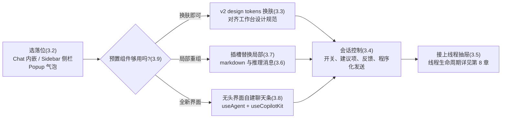

# 第 3 章 预置组件与自定义聊天界面

> 本章导读：第 2 章末尾，聊天窗落进了星帆工作台的角落——能聊了，但两个问题马上浮出来：弹窗盖在订单列表上，卖家回复到一半就被挡住；配色和圆角与工作台的设计规范格格不入。本章解决「聊天界面长什么样、怎么改」：先在三种布局组件里选对落位，把弹窗迁到侧边栏；再用 v2 design tokens 把配色对齐设计规范；然后逐层加深——插槽（slots）替换欢迎屏与消息卡、markdown 与推理消息微调、直到用无头界面（headless UI）的底层 hook 自建一个极简聊天条。读完本章，你能：为任意业务界面选出正确的聊天布局；沿「预置 → 换肤 → 插槽 → 无头」四级阶梯递进定制而不推倒重来；用代码控制聊天的开关、反馈、建议项与发送。



*本章操作流程图*

## 你什么时候需要它

三种典型处境，对应本章三条主线。

**聊天窗的位置不对，挡住了业务内容**——看 3.2。三种布局组件（CopilotChat / CopilotSidebar / CopilotPopup）是同一套原语的三种外壳，换个组件就是换落位，业务逻辑一行不改。

**样式与设计规范冲突，产品设计师提了配色稿**——看 3.3（CSS tokens 换肤）。只改颜色、圆角、字体时不需要碰任何组件；要换掉欢迎屏、消息气泡这类「结构」时，再上 3.7（插槽）。

**需要从聊天窗之外驱动 copilot**——自己的按钮开关聊天、工具栏开新会话、订单页一键触发分析：看 3.4（会话控制与程序化发送）。要做的根本不是聊天窗，而是仪表盘、画布这类「会说话的界面」：直接看 3.8（无头界面）。

另外，用户问「昨天的对话去哪了」——看 3.5（线程抽屉）；想微调回复里 markdown 和「思考中」卡片的观感——看 3.6。

前置：第 2 章的最小可运行 copilot（`CopilotKitProvider` + 一个预置组件）。本章不动后端，Agent 能力从哪来是第 5 章的事。

## 3.1 概述：组件体系与定制阶梯

CopilotKit 的界面层可以按「你写多少、官方管多少」分成四层：

| 层 | 你写什么 | 官方替你管什么 | 对应小节 |
|----|---------|---------------|---------|
| 预置组件（prebuilt components） | 一行组件声明 | 布局、流式输出、工具调用渲染、建议项，全部开箱即带 | 3.2 |
| 样式定制 | CSS 变量覆盖 | 组件结构不动，只换颜色与观感 | 3.3 |
| 插槽（slots） | 替换个别子组件 | 消息管线、状态管理、滚动行为不动 | 3.6、3.7 |
| 无头界面（headless UI） | 全部 UI 自己写 | 通信、消息管理、流式、工具调用分发 | 3.8 |

官方文档把这四级叫**定制阶梯（customization ladder）**，并把它写成一条设计原则：**你永远不必为了外观把预置组件扔掉**。从第二级开始，每一级都是增量——同一个应用里，你可以同时用 CSS 变量、自定义欢迎屏插槽和无头的工具调用渲染器，互不冲突；需求涨到哪一级，才往下走哪一级。本书把这个原则作为本章的选型基调：**先停在高处，确认不够再下探**。

### 三个布局组件，一套原语

`CopilotChat`、`CopilotSidebar`、`CopilotPopup` 是三个预置聊天界面，后两个是同一套原语上的薄封装，只差布局。三者的分工一句话说完：`CopilotChat` 是内嵌面板（放哪、多大都由你的布局决定），`CopilotSidebar` 是停靠侧栏（从应用边缘滑出，不挤压主内容），`CopilotPopup` 是浮动气泡（覆盖在页面之上）。选型细节与代码见 3.2。

### import 路径与 v1 遗留

全书基于 v2，界面代码统一从 `@copilotkit/react-core/v2` 导入，并引入一次样式：

```tsx
import { CopilotKitProvider, CopilotSidebar } from "@copilotkit/react-core/v2";
import "@copilotkit/react-core/v2/styles.css";
```

两个容易踩的版本坑，先立此存照：

| 坑 | 现象 | 修法 |
|----|------|------|
| `@copilotkit/react-ui` 也有同名 `CopilotChat` / `CopilotSidebar` / `CopilotPopup` | 从错包导入，拿到的全是 v1 遗留组件（v1 遗留） | 认准 `@copilotkit/react-core/v2` |
| Provider 组件名在官方文档两处写法不一 | `chat` 等页写作 `<CopilotKit>`，`threads drawer` 页写作 `<CopilotKitProvider>` | 本书统一用 `CopilotKitProvider`（属性 `runtimeUrl`、`agentId`），与第 5 章后端接入一致；两者都在 v2 包内，本书立场是以 `CopilotKitProvider` 为准 |

`CopilotSidebar` 与 `CopilotPopup` 各自独有 `defaultOpen`、`header` 槽、`toggleButton` 槽；其余属性（如 `agentId`、`labels`、各消息槽）与 `CopilotChat` 一致——毕竟它们只是「套了壳的 CopilotChat」。

## 3.2 三种布局组件：把聊天窗放对地方

第 2 章用 `CopilotPopup` 把聊天窗挂进了星帆工作台：卖家点右下角气泡，弹出一个小窗。问题随后就来了——卖家核对订单列表时，弹窗正好盖住金额列；小窗的样式也与工作台的设计规范对不上。本章先解决「放哪」。

### CopilotChat：内嵌面板

`CopilotChat` 是基础的预置聊天界面，渲染在你想放的任何容器里，尺寸随容器。官方文档列出的适用场景：撑满容器的整幅聊天、作为大页面中的一个内嵌面板、独立的 `/chat` 路由，以及「要最大布局自由、不要停靠外壳和启动按钮」的场合。

```tsx
// frontend/src/chat/AssistantPane.tsx —— 星帆工作台:订单详情页旁的内嵌助手面板
import { CopilotKitProvider, CopilotChat } from "@copilotkit/react-core/v2";
import "@copilotkit/react-core/v2/styles.css";

export function AssistantPane() {
  return (
    <CopilotKitProvider runtimeUrl="/api/copilotkit">
      <div style={{ height: "100%", minHeight: 480 }}>
        <CopilotChat agentId="default" />
      </div>
    </CopilotKitProvider>
  );
}
```

### CopilotSidebar：停靠侧栏（星帆的迁移目标）

`CopilotSidebar` 停靠在应用边缘，把主内容包起来，聊天按需滑出——适合「常驻、可折叠、用户随时能唤起但不被抢占视线」的应用内 copilot。官方文档强调它的渲染方式：侧栏与主内容是**兄弟节点**，滑出时不会引起页面回流（reflow）。

把星帆的弹窗迁成侧栏，改动只有组件名与布局：

```tsx
// frontend/src/App.tsx —— 聊天窗从弹窗迁到侧边栏
import { CopilotKitProvider, CopilotSidebar } from "@copilotkit/react-core/v2";
import "@copilotkit/react-core/v2/styles.css";
import { OrderList } from "./pages/OrderList";

export default function App() {
  return (
    <CopilotKitProvider runtimeUrl="/api/copilotkit">
      <div style={{ display: "flex", height: "100dvh" }}>
        <main style={{ flex: 1 }}>
          <OrderList />
          <CopilotSidebar defaultOpen={true} agentId="default" />
        </main>
      </div>
    </CopilotKitProvider>
  );
}
```

`defaultOpen={true}` 让侧栏首次渲染即展开；`agentId="default"` 指向第 2 章配置的内置 Agent（换成后端自建 Agent 是第 5 章的事）。

### CopilotPopup：浮动气泡

`CopilotPopup` 是给既有应用加 copilot 的最轻方式：一个角落气泡，点开是覆盖在页面内容之上的聊天窗，不挤压、不回流任何布局。第 2 章的星帆工作台就是它。它的适用场景：足迹最小的 assistant、用户只为「短平快」的任务型对话打开它。

```tsx
// 第 2 章的形态:角落里的聊天气泡
import { CopilotKitProvider, CopilotPopup } from "@copilotkit/react-core/v2";
import "@copilotkit/react-core/v2/styles.css";

export function AppWithPopup() {
  return (
    <CopilotKitProvider runtimeUrl="/api/copilotkit">
      <OrderList />
      <CopilotPopup
        defaultOpen={false}
        labels={{ chatInputPlaceholder: "问点订单上的事……" }}
      />
    </CopilotKitProvider>
  );
}
```

### 选型对比

| | CopilotChat | CopilotSidebar | CopilotPopup |
|----|------------|----------------|--------------|
| 形态 | 内嵌面板 | 停靠侧栏，滑出不回流 | 浮动气泡，覆盖内容 |
| 占用布局 | 占据你给它的容器 | 展开时与主内容并排 | 不占布局，悬浮 |
| 适合 | 专页、内嵌面板、`/chat` 路由 | 常驻 copilot，边看边聊 | 足迹最小，偶发问答 |
| 独有属性/槽 | — | `defaultOpen`、`header`、`toggleButton` | `defaultOpen`、`header`、`toggleButton` |
| 星帆落位 | 物流看板旁的分析面板 | **订单/商品页主聊天**（本章迁移目标） | 临时挂角（第 2 章形态） |

三者的公共属性一张表（来自官方 `CopilotChat` 属性表；后两者「接受与 `CopilotChat` 相同的槽与文案，外加少量壳属性」）：

| 属性 | 作用 |
|------|------|
| `agentId` | 聊天对接的 Agent 标识，须与运行时配置的某个 agent 匹配 |
| `labels` | 用户可见文案：标题、占位符、欢迎语、免责声明 |
| `messageView` | 消息列表槽（见 3.7） |
| `input` | 输入区槽（输入框、发送按钮、免责声明） |
| `scrollView` | 滚动容器槽（自定义滚动渐隐等） |
| `suggestionView` | 消息下方建议项（pills）槽 |
| `welcomeScreen` | 空状态欢迎屏槽，传 `false` 可关闭 |

一个实践提醒：三个组件是同一原语的封装，所以**先选落位、再谈定制**——后续的样式、插槽、控制手段对三者通用，迁移时业务代码不动。

## 3.3 样式定制：用 design tokens 对齐设计规范

聊天窗放对了位置，接下来解决「长得不像自家人」。v2 组件基于 Tailwind v4 与 shadcn/ui 的 token 体系构建，读取一组作用域在 `[data-copilotkit]` 根元素上的 CSS 颜色变量（官方文档说明其取值用 `oklch` 色彩空间，以保持不同色相下感知亮度一致；`hsl()`、`rgb()`、十六进制等任何合法 CSS 颜色也都可以）。**换肤因此变成覆盖几个 CSS 变量的事，每个组件自动跟随**。

### 星帆的主题文件

工作台的设计规范是：主色为品牌蓝、浅色界面、圆角统一 10px、支持暗色模式。落到聊天窗上，就是一份主题 CSS:

```css
/* frontend/src/theme.css —— 星帆工作台:聊天界面 tokens 对齐设计规范 */
[data-copilotkit] {
  --primary: oklch(0.55 0.22 264);        /* 品牌 blue:主按钮、交互色 */
  --primary-foreground: oklch(0.99 0 0);  /* 主色之上的文字 */
  --background: oklch(1 0 0);             /* 界面底色 */
  --foreground: oklch(0.145 0 0);         /* 正文文字 */
  --muted: oklch(0.97 0 0);               /* 弱背景(卡片、面板) */
  --border: oklch(0.922 0 0);             /* 分隔线、描边 */
  --radius: 0.625rem;                     /* 全局圆角,--radius-sm/md/lg/xl 由它派生 */
}

/* 暗色模式以 .dark 祖先元素为开关 */
.dark [data-copilotkit] {
  --background: oklch(0.145 0 0);
  --foreground: oklch(0.985 0 0);
  --border: oklch(0.269 0 0);
}
```

在页面模块里 import 这份 CSS 即可（打包器会随路由带上）。官方文档给出的最常覆盖的 v2 token:

| Token | 作用 |
|-------|------|
| `--background` / `--foreground` | 基础表面底色与主文字色 |
| `--primary` / `--primary-foreground` | 强调/动作色，及其上的文字 |
| `--secondary` / `--secondary-foreground` | 次级表面（卡片、面板）及其文字 |
| `--muted` / `--muted-foreground` | 弱化背景与弱化文字 |
| `--accent` / `--accent-foreground` | 悬停/激活态及其文字 |
| `--border` / `--input` / `--ring` | 分隔线描边、输入框描边、焦点环 |
| `--destructive` / `--destructive-foreground` | 错误/危险色及其文字 |
| `--card` / `--popover`（含 `-foreground`） | 浮层表面底色及其文字 |
| `--sidebar-*` | 侧栏自身的底色/文字/描边/焦点环一组 |
| `--radius` | 基准圆角，`--radius-sm/md/lg/xl` 由它派生 |

完整 token 集（popover、accent、destructive、chart、sidebar 变体）在 `@copilotkit/react-core/v2/styles.css` 里，覆盖时照着它写即可。

### 图标与文案

颜色之外，两类轻量定制走组件属性。图标用 `icons` 属性；文案用 `labels` 属性（可用键如 `welcomeMessageText`、`modalHeaderTitle`、`chatInputPlaceholder`、`chatDisclaimerText`，均来自官方文档示例）：

```tsx
import { CopilotChat } from "@copilotkit/react-core/v2";

export function Chat() {
  return (
    <CopilotChat
      icons={{ openIcon: <SfOpenIcon />, closeIcon: <SfCloseIcon /> }}
      labels={{
        welcomeMessageText: "你好,我是星帆助理,订单与商品都可以问我。",
        modalHeaderTitle: "星帆助理",
        chatInputPlaceholder: "问点订单上的事……",
        chatDisclaimerText: "AI 回复可能不准确,请核对后操作。",
      }}
    />
  );
}
```

### v1 遗留：别用错变量体系

官方 CSS 文档同时记录了一套 `--copilot-kit-*` 变量（如 `--copilot-kit-primary-color`）与一组 `.copilotKit*` 类名（如 `.copilotKitMessages`、`.copilotKitButton`）。注意：这套变量样式的是 **v1 组件 CSS（`@copilotkit/react-ui`）**，与 3.1 的 import 坑同源。v2 组件读的是本节的 shadcn token。在全书基于 v2 的前提下，这套变量与类名只在维护 v1 遗留代码时才会遇到，新代码一律走 `[data-copilotkit]` token。

## 3.4 会话控制：开关、反馈与程序化发送

界面落位、样式归队之后，下一个需求来自交互：星帆想在工作台自己的导航栏放一个「问助理」按钮，而不是只靠侧栏自带的开关；想在工具栏放「新对话」；想收集卖家对回复的点赞/点踩；还想让订单页的一枚按钮直接触发一次分析——不经过聊天输入框。这一节把这些控制手段一次讲完。

### 受控开关：open 与 onOpenChange

`CopilotSidebar` 与 `CopilotPopup` 支持标准的受控模式：传入 `open` 与 `onOpenChange`，开关状态的唯一事实来源就是你的 state:

```tsx
import { useState } from "react";
import { CopilotSidebar } from "@copilotkit/react-core/v2";

function Layout() {
  const [chatOpen, setChatOpen] = useState(false);

  return (
    <>
      <nav>
        <button onClick={() => setChatOpen(true)}>问助理</button>
      </nav>
      <CopilotSidebar open={chatOpen} onOpenChange={setChatOpen} />
    </>
  );
}
```

按钮在侧栏之外——这正是受控模式的价值：**打开聊天不需要在聊天子树里渲染任何东西**。既然 `open` 是事实来源，你还可以把它与路由、快捷键或任意既有状态联动。

一个容易误解的细节，官方文档专门标注过：`onOpenChange` 上报的是**请求**，不是**变更**。如果你不把新值写回 `open`，界面就停在原地。这恰好使「有条件放行」成为可能——比如未登录时拦截打开请求。也可以只传 `onOpenChange` 而不传 `open`：界面继续自我管理，你只收通知。

与受控对应的是非受控起点：`defaultOpen`。两者同时传入时 `open` 赢——和 React 受控/非受控的惯例一致。

### chat configuration 上下文：setModalOpen 与 startNewThread

不想把开关状态提升到自己组件里的话，开关状态也住在**聊天配置上下文**里，用 `useCopilotChatConfiguration()` 读取：

```tsx
import { useCopilotChatConfiguration } from "@copilotkit/react-core/v2";

function OpenChatButton() {
  const config = useCopilotChatConfiguration();

  // 只有当树中存在拥有 modal 状态的 provider 时,setModalOpen 才存在
  // (预置的 CopilotPopup / CopilotSidebar 会自动创建)
  if (!config?.setModalOpen) return null;

  return (
    <button onClick={() => config.setModalOpen(true)}>问助理</button>
  );
}
```

读取 `config.isModalOpen` 还可以做出切换按钮：`config.setModalOpen(!config.isModalOpen)`。注意这个能力边界：`setModalOpen` / `isModalOpen` 只在树中有 provider 拥有 modal 状态时才有定义；预置的 `CopilotPopup` 与 `CopilotSidebar` 会自动创建。如果你按 3.8 的方式自组聊天界面，需要把相关子树包在 `<CopilotChatConfigurationProvider isModalDefaultOpen={false}>` 里，modal 状态才存在。

同一个上下文还提供了 `startNewThread()`：给聊天一个新的线程 id 并回到欢迎屏——效果上等效于「清空当前聊天窗、开始新会话」。星帆把它接到工具栏按钮上：

```tsx
import {
  CopilotKitProvider,
  CopilotChatConfigurationProvider,
  CopilotChat,
  useCopilotChatConfiguration,
} from "@copilotkit/react-core/v2";
import "@copilotkit/react-core/v2/styles.css";

function NewConversationButton() {
  const configuration = useCopilotChatConfiguration();

  return (
    <button type="button" onClick={() => configuration?.startNewThread()}>
      新对话
    </button>
  );
}

export default function App() {
  return (
    <CopilotKitProvider runtimeUrl="/api/copilotkit">
      <CopilotChatConfigurationProvider>
        <div style={{ display: "flex", flexDirection: "column", height: "100dvh" }}>
          <header>
            <NewConversationButton />
          </header>
          <CopilotChat />
        </div>
      </CopilotChatConfigurationProvider>
    </CopilotKitProvider>
  );
}
```

两个来自官方文档的接线要点：按钮必须与聊天同处一个 `<CopilotChatConfigurationProvider>` 内，否则 `useCopilotChatConfiguration()` 返回 `null`，按钮点了没反应；新会话要等第一次运行后才会出现在线程列表里，空线程不占一行。

### 开场建议项：useConfigureSuggestions

聊天窗空着的时候，新用户往往不知道能问什么。官方文档在预置组件总览里介绍了 `useConfigureSuggestions`：在用户抵达的瞬间，给聊天播种一组贴合当前上下文的开场建议项，官方示例用的是一条「Write a sonnet」。落到星帆：订单页挂载时播种「帮我看看今天待发货的订单」这类建议，让卖家零输入起步。

需要说明：官方文档以代码片段形式展示该 hook，未在本文素材中给出完整参数签名，本书不臆造其 props 形状；用法以官方 reference 页为准。概念上它与 3.7 的 `suggestionView` 槽是一对——一个决定建议项**从哪来**（数据），一个决定建议项**长什么样**（渲染）。

### 消息反馈：thumbs up / down

v2 中，给助理消息加点赞/点踩的方式是向 **assistant message 槽**传 `onThumbsUp` / `onThumbsDown`；不接 Automatic Learning 采集时，只有提供了处理函数（或自定义拇指槽）按钮才会渲染：

```tsx
import { CopilotSidebar } from "@copilotkit/react-core/v2";

export function Chat() {
  return (
    <CopilotSidebar
      messageView={{
        assistantMessage: {
          onThumbsUp: (message) =>
            analytics.track("feedback", { messageId: message.id, value: "up" }),
          onThumbsDown: (message) =>
            analytics.track("feedback", { messageId: message.id, value: "down" }),
        },
      }}
    />
  );
}
```

每个处理函数收到完整的助理 `message`，可以按 `message.id` 把反馈记到具体回复上。`messageView` 槽在 `CopilotPopup` 与 `CopilotSidebar` 上同样可用（它们包着 `CopilotChat`）。按钮文案来自聊天 labels:`assistantMessageToolbarThumbsUpLabel` 默认 `"Good response"`、`assistantMessageToolbarThumbsDownLabel` 默认 `"Bad response"`，可按需覆盖。

### 程序化发送：不经过输入框驱动一次运行

最后一类控制更进一步：把一次 agent 运行交给代码触发——按钮、表单、快捷键都行。官方程序化控制页给出的标准模式是三步：用 `agent.addMessage(...)` 追加一条用户消息（只入列、不运行），再 `copilotkit.runAgent({ agent })` 启动运行，必要时用 `copilotkit.stopAgent({ agent })` 取消在途运行：

```tsx
import { useAgent, useCopilotKit } from "@copilotkit/react-core/v2";

export function AgentTrigger({ agentId }: { agentId: string }) {
  const { agent } = useAgent({ agentId });
  const { copilotkit } = useCopilotKit();

  const run = async () => {
    if (agent.isRunning) return;

    agent.addMessage({
      id: crypto.randomUUID(),
      role: "user",
      content: "总结今天的销售数据",
    });

    try {
      await copilotkit.runAgent({ agent });
    } catch (error) {
      console.error("CopilotKit runAgent 失败:", error);
    }
  };

  return (
    <>
      <button onClick={run} disabled={agent.isRunning}>让助理分析</button>
      <button onClick={() => copilotkit.stopAgent({ agent })} disabled={!agent.isRunning}>
        停止
      </button>
    </>
  );
}
```

`copilotkit.runAgent({ agent })` 与 agent 实例上的低层 `agent.runAgent(options)` 都能触发运行，但层级不同：前者是**推荐默认**，编排完整生命周期——执行前端工具、处理后续运行、把错误路由进订阅系统；后者只把请求发给运行时，不执行前端工具、不串联后续运行。除非明确要底层控制，一律用前者。

同样的三件原语里还剩 `agent.subscribe(subscriber)`：低层的 AG-UI 事件订阅（返回 `{ unsubscribe }`），可监听 `onRunStartedEvent`、`onRunFinalized`、`onRunFailed`、`onCustomEvent` 及各类流式增量，用来做进度 UI 或埋点。它与打断（interrupt）恢复的组合留到第 7 章——那里才是它的主场。

## 3.5 历史与线程：CopilotThreadsDrawer

卖家的新问题是：昨天问过的事，今天想接着问。这需要**线程（thread）**——一段可持久化、可切换的对话。预置组件之外，官方提供了一个即插即用的线程切换器 `<CopilotThreadsDrawer>`：列出、切换、新建、归档、删除线程，而且**你不需要接线任何「当前线程」状态**——把它放到聊天旁边，它自动连上。

```tsx
import {
  CopilotKitProvider,
  CopilotChatConfigurationProvider,
  CopilotChat,
  CopilotThreadsDrawer,
} from "@copilotkit/react-core/v2";
import "@copilotkit/react-core/v2/styles.css";

export default function Page() {
  return (
    <CopilotKitProvider runtimeUrl="/api/copilotkit">
      <CopilotChatConfigurationProvider>
        <div style={{ display: "flex", height: "100dvh" }}>
          <CopilotThreadsDrawer />
          <CopilotChat />
        </div>
      </CopilotChatConfigurationProvider>
    </CopilotKitProvider>
  );
}
```

整个接入就是这些。原理：抽屉与聊天共享同一个 `<CopilotChatConfigurationProvider>`——选中一行即把聊天连到那个线程并回放历史；「New Conversation」行即调 `startNewThread()` 重置聊天。手写侧栏则要自己维护 `threadId` 状态、在列表与聊天之间穿回调；这里共享配置替你做了。`<CopilotSidebar>` 与 `<CopilotPopup>` 内部渲染的就是 `CopilotChat`，因此以同样方式承载抽屉。

使用前必须知道的四件事：

| 事项 | 说明 |
|------|------|
| 依赖 CopilotKit Intelligence | 官方文档明确：线程存储与同步在服务端。云托管项目用 `CPK_INTELLIGENCE_API_KEY`；自托管部署给运行时 `licenseToken` 选项或 `COPILOTKIT_LICENSE_TOKEN` 环境变量。无有效授权时抽屉显示带 Upgrade 链接的锁定视图，不发出线程请求 |
| 只显示一个 Agent 的线程 | agentId 解析顺序：抽屉自身 `agentId` → 最近 `CopilotChatConfigurationProvider` 的 `agentId` → `CopilotKitProvider` 的 `agentId` → `"default"`。要列其他 agent 的线程，显式传 `<CopilotThreadsDrawer agentId="…" />` |
| 桌面端没有启动按钮 | 移动端视口才有从聊天头部唤起抽屉的启动按钮；桌面端抽屉是常驻面板，「桌面没有启动按钮」是设计而非接线错误 |
| 自建线程 UI 的出路 | 同一份数据与动作通过 `useThreads` hook 无头暴露（官方称 Headless Threads）；预置抽屉的行内菜单只有归档/删除，重命名要自建 |

可配置项不多：`label`（无障碍名，默认 `"Threads"`）、`recentLabel`（列表标题，默认 `"Recent Conversations"`）、`limit`（分页大小，有更多线程时出现「Load more」）、`onThreadSelect` / `onNewThread`（接管选择的逃生口）、`renderRow`（自定义行内容）。定制走三条有限通道：原生 `slot` 属性投影（`header`、`empty`、`footer` 等）、`renderRow`、CSS `::part()` 与 `--cpk-drawer-*` token——抽屉渲染在 shadow root 里，这是有意的封装边界。

线程的生命周期（创建、归档语义、按登录用户隔离、多设备同步）在第 8 章展开，本节止于「能用」。

## 3.6 markdown 与推理消息定制

助理的回复以 markdown 到达。默认渲染已经不错，但星帆的设计规范对链接样式有要求，而且产品想把模型（o1 这类推理模型）的「思考过程」展示得更有品牌感。这一节讲两个定点微调：markdown 渲染与推理消息卡片。

### markdownRenderer 槽：三层定制

助理消息的 markdown 渲染走 `markdownRenderer` 槽，默认实现是 Streamdown 的薄封装——一个专为「还在流式输入的文本」设计的 markdown 渲染器。抵达路径是从聊天组件逐层下钻：

```tsx
<CopilotChat
  messageView={{
    assistantMessage: {
      markdownRenderer: {
        /* …… */
      },
    },
  }}
/>
```

**第一层：替换单个 HTML 标签**（官方建议的首选路线）。槽把属性转发给 Streamdown，传一个 `components` 映射即可换掉某个标签的渲染组件：

```tsx
import { CopilotChat } from "@copilotkit/react-core/v2";

export function Chat() {
  return (
    <CopilotChat
      messageView={{
        assistantMessage: {
          markdownRenderer: {
            components: {
              a: ({ node, children, ...props }) => (
                <a {...props} className="sf-link">{children}</a>
              ),
            },
          },
        },
      }}
    />
  );
}
```

写这个映射有三个官方点名的坑：

1. **解构丢弃 `node`**。每个组件会拿到一个 `node` 属性（解析后的语法树节点），它不是 DOM 属性——直接展开进元素会在 HTML 里写出字面量 `node="[object Object]"`。像上面那样先解构出来，它就消失了。
2. **展开其余属性**。剩下的 props 来自**消毒后的文档**，不是模型原始输出：链接自带 `target="_blank" rel="noopener noreferrer"`（渲染器的链接加固已应用）。手工重建元素会把这些安全处理丢掉。
3. **你在替换而非扩展**。默认组件携带 Streamdown 自己的类名和 `data-streamdown` 属性；你的组件若不写这些，针对 `[data-streamdown="link"]` 的既有 CSS 会失配。

**第二层：整块调样式。** 只想改整体观感时，传一个类名字符串，它会合并到 markdown 容器上：`markdownRenderer: "text-sm leading-7"`。

**第三层：整个替换渲染器。** 传组件而非对象，组件只收一个 `content` 属性（原始 markdown）。官方提醒：仅在想换 markdown 引擎时才走这条路——Streamdown 在做的事并不轻松：流式半截渲染不闪断、数学公式与语法高亮、以及**消毒模型生成的 HTML**。`content` 是原始模型输出，你的渲染方式必须能安全面对它。

还有一条**红线**：自定义标签不支持。类型层只接受真实 HTML 标签名（自定义键直接编译报错）；运行时渲染器先按标准 HTML 元素白名单消毒，未知标签被剥掉、文字保留，注册的组件永远不会被调到。想要会话里出现更丰富的非文本界面，正道是生成式 UI——agent 调工具、你为工具调用渲染 React 组件（第 6 章），而不是关掉消毒硬塞自定义标签。

### 推理消息：默认已可用，样式可替换

推理模型（如 OpenAI 的 o1、o3、o4-mini）会发出**推理 token**——最终答案之前的内部「思考」轨迹。CopilotKit 自动把它们装进一张可折叠的推理卡片，无需任何配置：推理中显示「Thinking…」与脉冲指示、自动展开供你实时跟随；结束后折叠为「Thought for X seconds」；内容按 markdown 渲染；随时可再展开回看。

卡片由三个子组件构成，经 `messageView` 槽可逐一替换：

| 子组件 | 槽属性 | 职责 |
|--------|--------|------|
| `Header` | `header` | 可点击的标题条：图标、文案、展开箭头 |
| `Content` | `contentView` | 推理文本区（markdown） |
| `Toggle` | `toggle` | 展开/折叠动画包裹层 |

自定义 Header 收到的属性值得列全（做本地化文案要用）：`isOpen`（当前是否展开）、`label`（流式中的 `labels.reasoningMessageThinkingLabel`，默认 `"Thinking…"`；结束后为 `"Thought for X seconds"`）、`hasContent`（是否已收到推理文本）、`isStreaming`（推理是否仍在流入）、`elapsedSeconds`（已用秒数）、`onClick`（切换处理，仅 `hasContent` 为真时存在）。

星帆的做法：保留默认行为，只把标题条换成中文品牌文案——

```tsx
import { CopilotChat } from "@copilotkit/react-core/v2";
import "@copilotkit/react-core/v2/styles.css";

function SfReasoningHeader({
  isOpen,
  label,
  hasContent,
  isStreaming,
  ...props
}: React.ButtonHTMLAttributes<HTMLButtonElement> & {
  isOpen?: boolean;
  label?: string;
  hasContent?: boolean;
  isStreaming?: boolean;
}) {
  return (
    <button
      className="flex w-full items-center gap-2 px-3 py-2 text-sm font-medium"
      {...props}
    >
      {isStreaming ? "思考中" : "已思考"}
      <span>{label}</span>
      {hasContent && <span className="ml-auto text-xs">{isOpen ? "收起" : "展开"}</span>}
    </button>
  );
}

export function Chat() {
  return (
    <CopilotChat
      messageView={{ reasoningMessage: { header: SfReasoningHeader } }}
    />
  );
}
```

还有一条轻量路线：`CopilotChatReasoningMessage` 内置组件支持 render-prop——把 `header`、`contentView`、`toggle` 这些预渲染元素交给你重排，不必重新实现子组件，适合「只换布局不换零件」的场合。

## 3.7 插槽：逐个替换子组件

3.3 改颜色，3.6 微调了两种消息的渲染；当需求变成「把欢迎屏换成引导卡片」「给助理回复加业务标记」时，就该用插槽了。插槽（slot）是聊天组件里一个个**命名的子组件**，每个都能单独替换。官方文档强调两点：插槽是**递归的**——可以逐层下钻到任意深度；三级定制手段可以按槽混用。

### 三档替换力度

| 力度 | 传什么 | 效果 |
|------|--------|------|
| Tailwind 类 | 字符串 | 与默认组件的类名合并，最轻的样式微调 |
| 属性覆盖 | 对象 | 覆盖默认组件的部分 props（类名、事件、`data-testid` 等） |
| 自定义组件 | React 组件 | 完全替换该槽，组件收到与默认相同的 props |

```tsx
import { CopilotChat } from "@copilotkit/react-core/v2";

// 第一档:类字符串
<CopilotChat
  messageView="bg-gray-50 dark:bg-gray-900 p-4"
  input="border-2 border-blue-400 rounded-xl"
/>;

// 第二档:属性覆盖
<CopilotChat
  messageView={{
    className: "my-custom-messages",
    "data-testid": "message-view",
  }}
  input={{ autoFocus: true }}
/>;
```

### 根级槽清单

| 槽 | 职责 |
|----|------|
| `messageView` | 消息列表容器 |
| `scrollView` | 滚动容器（含自动滚动行为） |
| `input` | 输入区（文本框、发送/语音控制） |
| `suggestionView` | 消息下方的建议项 pills |
| `welcomeScreen` | 初始空状态屏，传 `false` 关闭 |

`CopilotSidebar` 与 `CopilotPopup` 额外有 `header`（头部栏）与 `toggleButton`（开关按钮）两个槽。

### 嵌套下钻与工具调用容器

槽的递归性意味着可以两层、三层地钻。`messageView` 里的 `assistantMessage` 槽自身还持有 `toolbar`、`copyButton`、`toolCallsView`、`markdownRenderer`（见 3.6）等子槽。星帆的需求：给工具调用的展示区加一个虚线框，同时**保留**已注册的工具渲染器——包装默认的 `CopilotChatToolCallsView` 即可，不必重写任何渲染逻辑：

```tsx
import {
  CopilotChat,
  CopilotChatToolCallsView,
  type CopilotChatToolCallsViewProps,
} from "@copilotkit/react-core/v2";

const CustomToolCallsView = (props: CopilotChatToolCallsViewProps) => (
  <div className="rounded-lg border border-dashed p-2">
    <CopilotChatToolCallsView {...props} />
  </div>
);

export function Chat() {
  return (
    <CopilotChat
      messageView={{
        assistantMessage: { toolCallsView: CustomToolCallsView },
      }}
    />
  );
}
```

工具调用卡片有进行中、完成、展开、失败四种状态，官方提供了 Storybook stories 供逐态查看；想改变调用的**分组方式**（一张卡、一行文字、堆叠、每轮一条摘要）而不写组件，设置消息视图上的 `toolCallDisplay` 即可——细节在第 6 章生成式 UI 中展开。

### labels：插槽之外的文案开关

所有用户可见文案走 `labels` 属性——它是三个聊天组件上的独立便利属性，**不属于插槽系统**：

```tsx
<CopilotChat
  labels={{
    chatInputPlaceholder: "问什么都可以……",
    welcomeMessageText: "今天我能帮你什么?",
    chatDisclaimerText: "AI 回复可能不准确。",
  }}
/>
```

经验法则：改**字**用 `labels`，改**形**用插槽，改**色**用 3.3 的 tokens——三件事三层，互不纠缠。

## 3.8 无头界面（headless UI）：自建极简聊天条

阶梯的最后一格。当插槽也罩不住——布局完全不同、要把聊天嵌进自有交互模式的界面、或者要做的根本不是聊天窗（仪表盘、画布、检查器），但仍想与 agent 对话——就走无头界面（headless UI）：**自带全部 UI,CopilotKit 只管通信、消息管理、工具调用渲染与流式**。没有 `<CopilotChat>`、没有插槽覆盖，只有你的组件架在底层 hook 上。

### 三个核心 hook

官方文档指出，无头模式靠三个 hook 撑起——正是 `<CopilotChat>` 内部使用的那几个：

| Hook | 提供 |
|------|------|
| `useAgent({ agentId })` | 当前会话：`messages`、`isRunning` 与运行状态对象 |
| `useCopilotKit()` | 运行时句柄，调 `copilotkit.runAgent({ agent })` |
| `useRenderToolCall()` | 返回一个渲染函数，把任何已注册的工具调用画成内联 UI |

### 极简聊天条

星帆的物流看板想要一条嵌在面板底部的迷你聊天条，不弹窗、不占侧栏。用三核心 hook 手写一个（示例依官方文档对简版的描述改写，**未实测**；消息对象上的工具调用字段名以官方类型定义为准）：

```tsx
import { useState } from "react";
import {
  useAgent,
  useCopilotKit,
  useRenderToolCall,
} from "@copilotkit/react-core/v2";

export function MiniChat({ agentId }: { agentId: string }) {
  const { agent } = useAgent({ agentId });
  const { copilotkit } = useCopilotKit();
  const renderToolCall = useRenderToolCall();
  const [draft, setDraft] = useState("");

  const send = async () => {
    const content = draft.trim();
    if (!content || agent.isRunning) return;
    setDraft("");
    agent.addMessage({ id: crypto.randomUUID(), role: "user", content });
    await copilotkit.runAgent({ agent });
  };

  return (
    <div className="sf-minichat">
      <div className="sf-minichat-messages">
        {agent.messages.map((message) => (
          <div
            key={message.id}
            className={message.role === "user" ? "sf-row sf-row-user" : "sf-row"}
          >
            {message.content}
          </div>
        ))}
        {agent.isRunning && <div className="sf-row">助理思考中……</div>}
      </div>
      <div className="sf-minichat-composer">
        <input
          value={draft}
          onChange={(event) => setDraft(event.target.value)}
          placeholder="问物流看板……"
        />
        <button onClick={send} disabled={agent.isRunning}>发送</button>
      </div>
    </div>
  );
}
```

消息列表就是对 `agent.messages` 的一次 `.map()`：用户消息右对齐，助理消息渲染流式文本。官方简版还会把助理消息上的每个工具调用经 `renderToolCall({ toolCall })` 画成内联 UI（配套查兄弟 `tool` 角色消息，按 `toolCallId` 关联后一并交给渲染器）——上面从简省略，接入方式与 3.4 的 `AgentTrigger` 同源。

### 完整管线与 useRenderedMessages

简版的代价，官方文档说得直白：**你只得到文本与工具调用**。推理消息、activity 消息（A2UI 与 MCP Apps）、自定义前后插槽，不自己接线就不会出现。官方完整示例的中心，是一个手写的 `useRenderedMessages(messages, isRunning)` 组合 hook——返回同一条消息列表，但每条消息多出一个 `renderedContent: ReactNode` 字段；它是对 `<CopilotChatMessageView>` 内部渲染管线的手工复刻，由三个更底层的 hook 喂养：

| 底层 hook | 喂进来什么 |
|-----------|-----------|
| `useRenderToolCall()` | 任何已注册工具调用的渲染器（按名注册的 `useRenderTool` / `useComponent`，加上兜底的 `useDefaultRenderTool`） |
| `useRenderActivityMessage()` | 当前 agent 作用域内的 A2UI 与 MCP Apps activity 消息渲染 |
| `useRenderCustomMessages()` | 调用向活跃 `CopilotChatConfigurationProvider` 注册的 `renderCustomMessage` hook，在每条消息前后产出 `"before"` / `"after"` 插槽 |

按角色分发后再配一层「纯外壳」气泡组件（收 `renderedContent`、套样式，不 import 任何聊天原语），就得到一个与预置组件管线逐行对齐、但外观完全自主的聊天界面。这一层的完整代码在官方 headless 示例中；第 6 章讲工具渲染器注册（`useRenderTool` / `useComponent`）后，这条管线才真正威力全开。

### 什么时候真的需要下到这一层

官方文档给出的适用面与它的成本同样明确。用无头，当：插槽系统不够、要完全不同的布局；要把聊天嵌进已有交互模式的 UI；要造**非聊天表面**但仍与 agent 对话（想单独使用 `useRenderToolCall` / `useRenderActivityMessage`）；想在聊天之外渲染生成式 UI 原语。反过来，官方在文档结尾的提醒也值得抄下来：插槽往往已经够用，比全无头便宜得多；只是要换肤，3.3 一行 token 就够。

## 3.9 自定义界面选型决策

本章素材的全部手段，收进一张四档对比表（对应官方「定制阶梯」的 Level 1-4）：

| 档位 | 做什么 | 改动量 | 保留的官方能力 | 典型触发条件 |
|------|--------|--------|---------------|-------------|
| L1 预置原样 | 直接渲染组件 | 零 | 全部：流式、工具调用、建议项 | 验证期、内部工具 |
| L2 CSS 换肤 | 覆盖 `[data-copilotkit]` tokens、icons、labels | 小（纯 CSS + 少量 props） | 全部功能，只换观感 | 设计规范对色、暗色模式 |
| L3 插槽重组 | 替换个别子组件（欢迎屏、消息卡、输入区……） | 中 | 消息管线、状态管理、流式不动 | 品牌化局部、加业务标记 |
| L4 无头界面 | 底层 hook 自建全部 UI | 大 | 通信、消息管理、工具调用分发；渲染责任全在你 | 非聊天表面、完全不同的布局 |

两条决策辅助：

**递增混合，不推倒重来。** 官方文档明确：L1 以下的每一级都是增量——CSS 变量、自定义欢迎屏插槽、无头工具调用渲染器可以在同一个应用里自由混用。今天停在 L2，明天局部升 L3，不需要回滚任何已有工作。

**用「改什么」定位档位。** 只改观感 → L2；改某个零件 → L3；改整体形态或表面本身 → L4。判断「插槽够不够」的最快办法：把你的设计稿与默认界面逐块对比，数一数要换的零件——零个停在 L2，一两个停 L3，「几乎每块都不同」才值得 L4。

星帆的落位决策：订单/商品页用 **L2 + 局部 L3**——侧栏落位，design tokens 对齐设计规范，欢迎屏换成业务引导卡，thumbs 反馈接埋点；物流看板用一条 L4 迷你聊天条试水。L4 全量接管暂缓：第 6 章生成式 UI 上线后，订单卡片要在回复里直接渲染，那时工具调用渲染才是定制的主战场——先让预置管线把脏活干着。

## 本章小结

1. **三种布局组件、一套原语**：`CopilotChat`（内嵌）、`CopilotSidebar`（停靠）、`CopilotPopup`（浮动）只差外壳；星帆的迁移只是换个组件名。import 认准 `@copilotkit/react-core/v2`,provider 统一用 `CopilotKitProvider`。
2. **换肤是 CSS 变量的事**：v2 读 `[data-copilotkit]` 上的 shadcn token（oklch），暗色挂在 `.dark [data-copilotkit]`；`--copilot-kit-*` 与 `.copilotKit*` 是 v1 遗留，新代码不碰。
3. **会话控制三条路**：受控 `open` / `onOpenChange`（上报的是请求）；`useCopilotChatConfiguration` 的 `setModalOpen` 与 `startNewThread`（等效清空开新会话）；程序化 `addMessage` + `runAgent` + `stopAgent`（优先 `copilotkit.runAgent` 而非低层 `agent.runAgent`）。
4. **线程抽屉零接线，但有前提**：`CopilotThreadsDrawer` 需要共享 `CopilotChatConfigurationProvider` 与 CopilotKit Intelligence 授权；一次只显示一个 agent 的线程；生命周期在第 8 章。
5. **微调有定点手段**：markdown 走 `markdownRenderer` 槽（记住丢 `node`、展开剩余 props、替换不扩展、自定义标签是红线）；推理卡片默认可用，`header` / `contentView` / `toggle` 三个子槽可换。
6. **插槽递归、三档力度**：类字符串 → 属性对象 → 自定义组件；能钻到任意深度；labels 不属于插槽系统。
7. **无头是最后一级**：`useAgent` + `useCopilotKit` + `useRenderToolCall` 撑起自建 UI;`useRenderedMessages` 复刻预置渲染管线；插槽往往已经够用。

→ 界面就位了，但它还「看不见」页面：第 4 章用共享状态（shared state）把 `dashboard` 交给 Agent，让「今天卖了多少钱」有答案。

## 验收清单

读到这里，你应该能：

- ☐ 说出三种布局组件的分工，并把第 2 章的弹窗聊天迁成 `CopilotSidebar`，业务代码零改动；
- ☐ 用 v2 design tokens 把聊天界面主色改成设计规范色，并说明暗色模式该覆盖在哪个选择器下；
- ☐ 用受控 `open` / `onOpenChange` 从工作台自己的按钮打开聊天，并解释为什么 `onOpenChange` 上报的是「请求」而非「结果」；
- ☐ 为助理消息接上 thumbs 反馈，并说出反馈数据挂在哪个字段上；
- ☐ 完成一次程序化发送：`addMessage` 追加、`runAgent` 启动、`stopAgent` 中断，并说出它与 `agent.runAgent` 的层级差异；
- ☐ 面对一份设计稿，按「改观感/改零件/改表面」判断定制应停在 L1-L4 的哪一档。

## 参考速查

理解主线不依赖本节；以下是本章 API 的集中查阅。

**根级插槽**（`CopilotChat` 全有；`CopilotSidebar` / `CopilotPopup` 加后两行）：

| 槽 | 职责 |
|----|------|
| `messageView` | 消息列表（下钻：`assistantMessage` → `toolbar` / `copyButton` / `toolCallsView` / `markdownRenderer`；`reasoningMessage` → `header` / `contentView` / `toggle`） |
| `scrollView` | 滚动容器 |
| `input` | 输入区（下钻：`disclaimer`） |
| `suggestionView` | 建议项 pills |
| `welcomeScreen` | 欢迎屏，传 `false` 关闭 |
| `header` | 头部栏（仅侧栏/弹窗） |
| `toggleButton` | 开关按钮（仅侧栏/弹窗） |

**常用 v2 design tokens**（覆盖在 `[data-copilotkit]`，暗色在 `.dark [data-copilotkit]`）：`--primary` / `--primary-foreground`、`--background` / `--foreground`、`--muted` / `--muted-foreground`、`--border` / `--input` / `--ring`、`--radius`。

**会话控制 API**：

| API | 作用 |
|-----|------|
| `open` / `onOpenChange` / `defaultOpen` | 受控开关；同时传入时 `open` 优先 |
| `useCopilotChatConfiguration()` → `setModalOpen` / `isModalOpen` | 上下文式开关；仅在树中有 modal 状态 owner 时存在 |
| `useCopilotChatConfiguration()` → `startNewThread()` | 新线程并回欢迎屏；须在 `CopilotChatConfigurationProvider` 内 |
| `messageView.assistantMessage.onThumbsUp` / `onThumbsDown` | 消息反馈，回调整条 `message` |

**程序化控制**：

| API | 作用 |
|-----|------|
| `useAgent({ agentId })` | 会话句柄：`messages`、`isRunning` |
| `agent.addMessage({ id, role, content })` | 追加消息，不触发运行 |
| `copilotkit.runAgent({ agent })` | 推荐入口：编排前端工具、后续运行、订阅生命周期 |
| `copilotkit.stopAgent({ agent })` | 取消在途运行 |
| `agent.subscribe(subscriber)` | 低层 AG-UI 事件订阅，返回 `{ unsubscribe }` |

**实测状态说明**：3.2-3.5、3.7 的代码直接取自或仅轻改官方文档示例；3.4 的星帆按钮案例、3.6 的中文 Header、3.8 的 `MiniChat` 为依素材改写，未实测，以官方 reference 与类型定义为准。

## 延伸阅读

- **第 2 章（快速开始）**——预置组件第一次落进星帆工作台的过程；本章的迁移起点。
- **第 4 章（共享状态）**——界面就位后，让 Agent 看见 `dashboard`：本章的「聊天窗」配上第 4 章的「状态」才成为业务助手。
- **第 6 章（前端工具与生成式 UI）**——`toolCallsView` 背后的渲染器注册（`useRenderTool` / `useComponent`），以及 markdown 自定义标签被拦下后的正道。
- **第 7 章（人工介入）**——3.4 埋下的伏笔：`agent.subscribe` 与打断恢复的组合，让关键操作回到人工把关。
- **第 8 章（多 Agent、协议与生产化）**——线程生命周期、按用户隔离与部署；`CopilotThreadsDrawer` 的后端故事在那里讲完。
