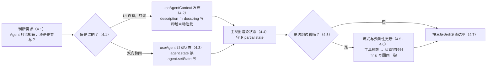
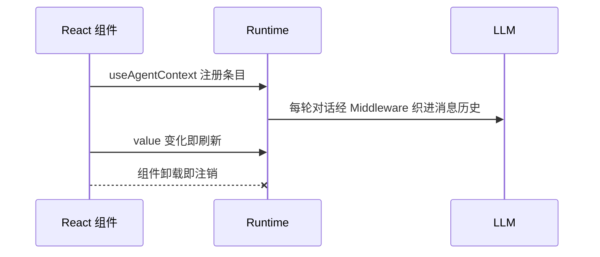
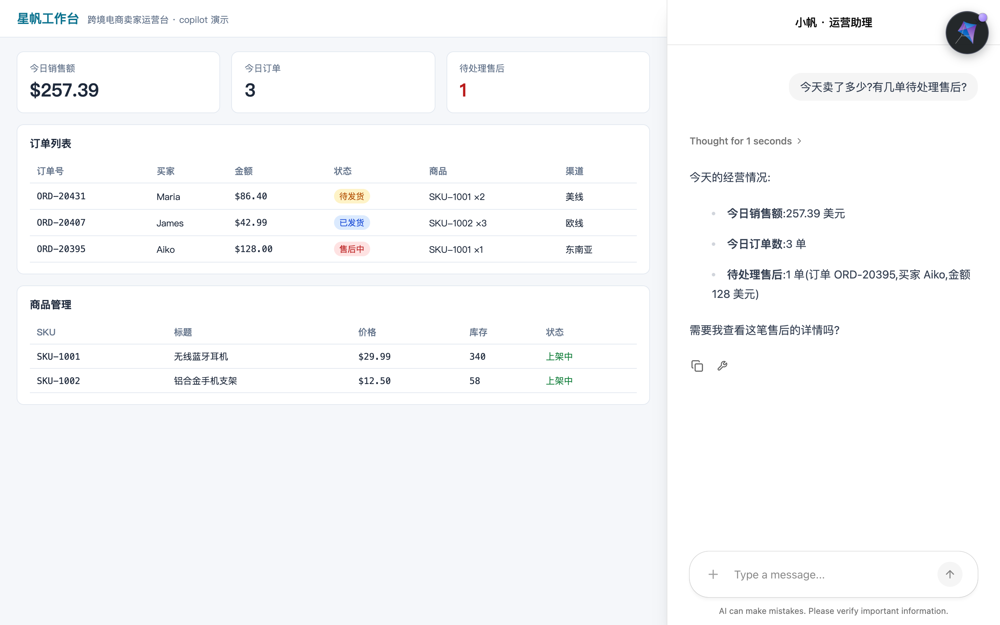
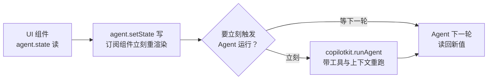
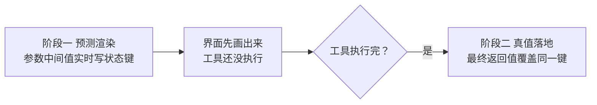

# 第 4 章 共享状态：让 Agent 看见并操作你的界面

> 本章导读：第 3 章结束时，星帆工作台的侧边栏里住着一个能聊的 copilot，但它仍然「看不见」页面——你问它「今天卖了多少钱」，它只能礼貌地道歉。本章补上这只眼睛：把仪表盘上的今日销售额、订单数、待处理售后数交给 Agent，让它有问必答；再进一步，把库存这类业务状态变成 Agent 与界面共同编辑的一块工作区——Agent 改了库存，页面上的数字立刻跟着变；你在界面上勾掉一项，Agent 下一轮就知情。为此我们会认识两个 Hook（`useAgentContext` 与 `useAgent`）、三种状态流动的方向，以及让长任务「边跑边渲染」的流式技巧。读完本章，你能：为一个页面状态选对发布通道，并亲手完成一次双向同步与一次流式渲染。



*本章操作流程图*

## 你什么时候需要它

三种典型处境，对应本章三条通道。

**我只要让 Agent 「知道」页面上有什么**——当前登录的卖家、正在查看的商品、仪表盘的今日数字。这些值归界面所有，Agent 读一读就够了，绝不该写。直接看 4.2 的 `useAgentContext`：一次调用发布一个值，组件卸载自动注销，Agent 每一轮都能看到。

**我要 Agent 和用户共用一套状态、互相推动**——Agent 写了一份补货清单，界面上渲染出来；用户在界面上勾掉一项，Agent 下一轮就知道。这是共享状态（shared state）的主场，看 4.3 的 `useAgent`：`agent.state` 读、`agent.setState` 写，4.4 把它渲染进主视图而不是聊天框。

**我要用户亲眼看着 Agent 干活**——Agent 花几十秒写一份运营日报，默认行为下用户盯着一个转圈；流式状态更新让文字一个词一个词长出来。看 4.5 与 4.6：后端做一条「工具参数 → 状态键」映射，前端订阅代码与普通共享状态完全一样。

前置：第 2 章跑通的「前端 + Runtime」两个进程，与第 3 章落位的 `CopilotSidebar`。本章的 Agent 仍是第 2 章注册的 `default`；「Agent 主动写状态」的完整闭环需要支持状态协议的后端 Agent（LangGraph 的 `seller_agent`），接入方法在第 5 章——本章会把前端侧的全部接线先做完。

## 4.1 概述：两个层级，一条光谱

第 2 章的架构里，聊天内容只走一条路：用户消息 → Runtime → Agent → 回复。界面上的业务数据从不参与。共享状态（shared state）把这条单行道升级成双向公路——官方文档给它下的定义是「在你的 UI 与 Agent 的执行之间建立一条双向连接」，具体能做三件事：

| 能力 | 说明 |
|------|------|
| 展示进展 | 显示 Agent 当前的进度与中间结果 |
| 反向输入 | 通过界面交互更新 Agent 的状态 |
| 实时响应 | 状态一变，全应用的订阅组件即时重渲染 |

### 4.1.1 两个层级：代理上下文与共享状态

而 CopilotKit v2 实际提供了**两个层级**的通道，不是一条。分清它们是本章最重要的决定：| | 代理上下文（agent context） | 共享状态（shared state） |
|------|---------------------------|--------------------------|
| Hook | `useAgentContext` | `useAgent` |
| 方向 | 单向：UI → Agent | 双向：Agent ↔ UI |
| Agent 能否写回 | 不能——没有 setter，也没有可改它的工具 | 能——工具调用、节点流转都会改状态 |
| 值的归属 | UI 自有（用户身份、选中记录、页面快照） | 双方共有（文档草稿、任务清单、执行进度） |
| 生命周期 | 随组件挂载注册、卸载自动注销 | 挂在 Agent 实例上，随线程延续 |
| Agent 何处看到 | 每一轮被注入模型的消息历史 | 作为 Agent 的 state 参与执行 |
| 一句话定位 | 「给 Agent 的 props」 | 「你们俩共同编辑的工作区」 |

**选型的第一刀就切在这里：值归界面所有、Agent 只读，用代理上下文；双方都要读写，才上共享状态。** 判断方法很朴素——问一句「这个值被 Agent 改了算不算事故」。今日销售额被 Agent 改成 9999 是事故，所以它走上下文；补货清单被 Agent 增删是本意，所以它走共享状态。

在共享状态内部，还有两个进阶能力：**状态流式（state streaming）**——把工具参数的生成过程实时写进状态键（4.5）；**预测性状态更新（predictive state updates）**——LangGraph 语境下对同一机制的称呼，强调「工具还没执行完，界面先按预测渲染」（4.6）。它们不改变选型，只改变体验的顺滑度。

### 4.1.2 状态的源头在后端 Agent

有一个容易误判的事实先说破：**`agent.state` 不是前端的状态，它的源头定义在后端 Agent 里。** 前端只是订阅和写回。官方文档里完整的共享状态示例，状态都定义在后端 Agent 的 state 结构上——以 LangGraph 为例（Python 版，第 5 章的 `seller_agent` 就是这个写法）：

```python
# agent.py —— LangGraph 后端：Agent 的 state 定义
from copilotkit import CopilotKitState

class AgentState(CopilotKitState):
    dashboard: dict      # 仪表盘快照（本章 4.2 以上下文发布的同一份数据）
    restock: dict        # 补货清单（本章 4.3/4.4 双向编辑的工作区）
    report: str          # 运营日报（本章 4.5 流式写入的目标键）
```

LangGraph 的状态在节点之间流转，每过一个节点就可能被更新一次；前端订阅到的 `agent.state`，就是这份后端状态的实时投影。TypeScript 版的状态定义（`StateSchema` + `CopilotKitStateSchema.fields`）与完整的 Runtime 接线见第 5 章。

那第 2 章注册的内置 Agent（`BuiltInAgent`）呢？**官方文档在本章素材中给出的共享状态示例全部以后端 Agent 为对象，没有内置 Agent 与共享状态组合的示例；官方对 `BuiltInAgent` 的定位也是「聊天 + 工具」的最短路径。** 本书立场是：本章 4.2-4.4 的前端接线代码现在就可以写进星帆工作台，它们不依赖后端形态；而「Agent 主动写状态」「流式更新」这两类体验，建议等第 5 章把 `seller_agent` 接进来后再验收——届时本章的前端代码一字不改，直接受益。

## 4.2 useAgentContext：让 Agent「知道」页面

代理上下文（agent context）解决的是最常见也最容易被过度设计的需求：**Agent 只需要知道界面此刻是什么样，不需要参与修改。** 星帆工作台首页仪表盘就是典型——今日销售额、订单数、待处理售后数，这三样数据归业务界面所有，Agent 拿到它们就能回答「今天卖了多少钱」，但绝不该有能力把它们改成别的数。

### 4.2.1 基本用法：一次调用发布一个值

`useAgentContext({ description, value })` 每次调用发布一个值。把仪表盘快照发布给 Agent：

```tsx
// src/pages/DashboardPage.tsx
import { useState } from "react";
import { useAgentContext } from "@copilotkit/react-core/v2";

type Dashboard = {
  salesToday: number;        // 今日销售额（美元）
  orderCount: number;        // 今日订单数
  pendingAfterSales: number; // 待处理售后单数
};

export default function DashboardPage() {
  const [dashboard] = useState<Dashboard>({
    salesToday: 1284.5,
    orderCount: 47,
    pendingAfterSales: 3,
  });

  useAgentContext({
    description:
      "星帆工作台仪表盘快照：今日销售额（美元）、今日订单数、待处理售后单数。",
    value: dashboard,
  });

  return (
    <main>
      <h2>今日概览</h2>
      <p>销售额 ${dashboard.salesToday}</p>
      <p>订单 {dashboard.orderCount} 单</p>
      <p>待处理售后 {dashboard.pendingAfterSales} 单</p>
    </main>
  );
}
```

按官方文档，这一次调用会在 Runtime 注册一条动态上下文条目。刷新、注销、注入三个行为随组件生命周期自动发生，画成一条时序：



*图 4-1：上下文条目随组件挂载注册、值变即刷新、卸载即注销，每轮对话注入模型。*

**验证点**：启动两个进程后，在聊天框问「今天卖了多少钱？」——Agent 的回答里应该出现 `$1284.5` 或它的中文等价表述。再把 `salesToday` 改成别的数保存（Vite 热更新会重渲染），再问一次，答案跟着变。若回答不出，先回到 4.7.3 的坑位表查上下文注入这一行。

下面是星帆工作台的实测效果——Agent 没有任何后端数据源，答出的三个数字全部来自 `useAgentContext` 发布的界面状态，与左侧仪表盘完全一致：



*图 4-5：`useAgentContext` 的实测效果（内置 Agent）——答案里的数字与左侧仪表盘逐项吻合，连售后单的订单号与买家都对得上*

### 4.2.2 description 是写给 Agent 的参数文档

`description` 不是注释，是 Agent 每一轮都能看到的标签——官方文档的建议是**把它当成参数的 docstring 来写**。它决定了 Agent 拿到一坨 JSON 之后知不知道该拿它干什么。两种写法的差距：

```ts
// 差：没有说清结构，也没有说单位
description: "dashboard"

// 好：说清每一样东西是什么、单位是什么
description:
  "星帆工作台仪表盘快照：今日销售额（美元）、今日订单数、待处理售后单数。",
```

这与工具描述的写作是同一门手艺（→ mcp 书第 6 章）：description 是模型做匹配的依据。差版本的后果很具体——用户问「今天生意怎么样」，Agent 看着一堆没有标签的数字，只能泛泛而谈甚至编造字段含义。

### 4.2.3 值从哪来：接你已有的状态

`useAgentContext` 不关心 `value` 的来源。官方文档列出的合法来源包括本地 `useState`、React Context、Redux、查询缓存——唯一的要求是**值的身份要足够稳定，让 React 能避免渲染循环**。也就是说，不要在每次渲染时都新造一个引用（比如在组件体里直接写对象字面量传给它），用 state 或 memo 保持引用稳定即可。在星帆工作台的真实工程里，`dashboard` 大概率来自一个数据请求的缓存——写法完全一样：

```tsx
// 来源换成任何状态库，模式不变
import { useAgentContext } from "@copilotkit/react-core/v2";
import { useDashboardQuery } from "../api/dashboard";

export function DashboardContextBridge() {
  const { data } = useDashboardQuery();

  useAgentContext({
    description: "星帆工作台仪表盘快照：今日销售额（美元）、今日订单数、待处理售后单数。",
    value: data ?? null,
  });

  return null; // 桥接组件不渲染任何东西
}
```

这个「桥接组件」模式值得记住：上下文发布和界面渲染可以彻底解耦——一个不渲染任何内容的组件，专职把数据推给 Agent。

### 4.2.4 只读是设计出来的，不是约定出来的

官方文档对这一通道的安全性有一句准确的表述：Agent **看不到 setter，也没有任何可以修改这些值的工具**，所以「一个犯糊涂的 LLM 想更新它们」这件事在机制上就不成立。这比「在提示词里叮嘱它不要改」可靠得多——约束在机制里，不在劝说里。

因此 `useAgentContext` 的适用判据可以浓缩成一句话：**值是输入，不是字段。** 用户身份、功能开关、选中的记录、滚动位置——它们是「每一轮递给 Agent 的上下文对象」的组成部分，而不是「你们俩共同编辑的工作台」。一旦你发现「Agent 也该能改它」，就换 4.3 的共享状态。

## 4.3 useAgent：订阅与写入共享状态

共享状态的通道由 `useAgent` 打开。它返回一个 `agent` 对象，`agent.state` 是当前的共享状态，`agent.setState` 把新值写回去。官方文档强调两件事：**`agent.state` 就是一个普通对象**，像读任何 React 状态一样读它；**UI 的写入会真实地牵引模型**——Agent 在它的下一轮读回新值。

### 4.3.1 读：组件订阅 agent.state

在商品管理页订阅库存状态：

```tsx
// src/pages/InventoryPage.tsx
import { useAgent } from "@copilotkit/react-core/v2";

type InventoryState = {
  stock: Record<string, number>; // SKU 编码 → 库存
};

export default function InventoryPage() {
  // 不传参数，连接名为 default 的 Agent（第 2 章注册的那个）
  const { agent, isReady } = useAgent();
  const state = (agent.state ?? {}) as Partial<InventoryState>;

  return (
    <main>
      <h2>商品库存</h2>
      <ul>
        <li>
          SKU-1001 蓝牙耳机 —— 库存 {state.stock?.["SKU-1001"] ?? "…"}
        </li>
        <li>
          SKU-1002 手机支架 —— 库存 {state.stock?.["SKU-1002"] ?? "…"}
        </li>
      </ul>
      {!isReady && <p>正在连接 Agent…</p>}
    </main>
  );
}
```

按官方文档，**Agent 每次修改它的状态——比如通过一次工具调用——这个 Hook 就会触发，你的组件带着新值重渲染**。这就是「Agent 改库存，页面数字跟着变」的全部实现：不需要轮询，不需要手动订阅，React 渲染管线自己完成同步。

`agent.state` 在运行过程中可能是**部分的（partial）**——尤其当 4.5 的流式更新开启后，状态会一半一半地到达。所以官方示例统一用 `?? {}` 兜底、渲染时逐字段给默认值，这个习惯从第一个组件就要养成。

### 4.3.2 写：agent.setState 与「下一轮生效」

同一个 `agent` 对象暴露 `setState`。在界面事件里调用它，就把新值推进了共享状态，Agent 在**它的下一轮**读回。给库存页加一个「盘点校正」按钮：

```tsx
// src/pages/InventoryPage.tsx —— 追加写入逻辑
import { useAgent } from "@copilotkit/react-core/v2";

type InventoryState = {
  stock: Record<string, number>;
};

export default function InventoryPage() {
  const { agent } = useAgent();
  const state = (agent.state ?? {}) as Partial<InventoryState>;

  const correctStock = (sku: string, counted: number) => {
    agent.setState({
      ...(agent.state ?? {}),
      stock: {
        ...(agent.state?.stock ?? {}),
        [sku]: counted,
      },
    });
  };

  return (
    <main>
      <h2>商品库存</h2>
      <p>SKU-1002 手机支架 —— 库存 {state.stock?.["SKU-1002"] ?? "…"}</p>
      <button onClick={() => correctStock("SKU-1002", 55)}>
        盘点校正：SKU-1002 实存 55
      </button>
    </main>
  );
}
```

读、写、生效与重跑的时机画成一条回路——注意官方文档的表述：**写入立即反映在所有订阅组件上，但 Agent 读到它是在下一次运行时**，这就是「双向」的真实含义：



*图 4-2：读写回路——写入即时生效，Agent 默认下一轮读回，重要选择可立即重跑。*

**验证点**：点击按钮后，页面上其他订阅同一状态的组件（比如 4.4 将建的看板）数字立刻变化；随后在聊天框里问「现在 SKU-1002 的库存是多少」，Agent 的下一轮回答应包含 55。

### 4.3.3 想让写入立刻触发运行：copilotkit.runAgent

有时你不想等 Agent 的下一轮——图 4-2 的右侧分支就是官方给出的做法，写完状态后手动重跑：

```tsx
// src/pages/InventoryPage.tsx —— 追加
import { useAgent, useCopilotKit } from "@copilotkit/react-core/v2";

export function InventoryQuickActions() {
  const { agent } = useAgent();
  const { copilotkit } = useCopilotKit();

  const correctAndConsult = (sku: string, counted: number) => {
    agent.setState({
      ...(agent.state ?? {}),
      stock: { ...(agent.state?.stock ?? {}), [sku]: counted },
    });
    // 用更新后的状态立刻重跑 Agent
    copilotkit.runAgent({ agent });
  };

  return (
    <button onClick={() => correctAndConsult("SKU-1002", 55)}>
      校正并请 Agent 复核
    </button>
  );
}
```

官方文档特别说明：**通过 `copilotkit` 这个入口去跑，前端工具和上下文会随这次运行一起带上，前端工具调用也会照常执行**——直接调 Agent 对象上的低层运行方法则没有这层编排（第 3 章 3.7 讲程序化控制时已提过同一优先级）。`useCopilotKit` 返回的 `copilotkit` 对象是前端侧的总编排入口，第 6 章的前端工具、第 7 章的人工介入都从它身上过。

## 4.4 界面内渲染 Agent 的工作过程

到 4.3 为止，订阅都发生在业务页面里。官方文档专门用一页强调一个模式：**`useAgent` 在 Provider 之内的任何组件里都能用，不必靠近聊天框**——你可以在主视图、画布、地图、表格里订阅 `agent.state`，把它渲染成应用的主角，而聊天只是旁边的一个消费者。

### 4.4.1 模式：主视图与侧边栏共享同一个 Agent

给星帆工作台建一块「补货看板」：Agent 在共享状态里维护一份补货清单，看板把它渲染成主视图内容：

```tsx
// src/components/RestockBoard.tsx
import { useEffect } from "react";
import { useAgent } from "@copilotkit/react-core/v2";

type RestockState = {
  title: string;
  items: { id: string; label: string; done: boolean }[];
};

// UI 自有的初始状态：Agent 还没写状态之前，看板也有内容可显示
const INITIAL_RESTOCK_STATE: RestockState = {
  title: "今日补货清单",
  items: [
    {
      id: "sku-1002",
      label: "手机支架（SKU-1002，库存 58，低于阈值）",
      done: false,
    },
  ],
};

export function RestockBoard() {
  const { agent, isReady } = useAgent();
  const state = (agent.state ?? {}) as Partial<RestockState>;

  useEffect(() => {
    if (!isReady) return;

    const current = (agent.state ?? {}) as Partial<RestockState>;
    const updates: Partial<RestockState> = {};

    if (current.title === undefined) {
      updates.title = INITIAL_RESTOCK_STATE.title;
    }
    if (current.items === undefined) {
      updates.items = INITIAL_RESTOCK_STATE.items;
    }

    if (Object.keys(updates).length > 0) {
      agent.setState({ ...(agent.state ?? {}), ...updates });
    }
  }, [agent, isReady, state.title, state.items]);

  return (
    <main className="board">
      <h2>{state.title ?? "补货清单"}</h2>
      <ul>
        {(state.items ?? []).map((item) => (
          <li key={item.id} data-done={item.done}>
            {item.label}
          </li>
        ))}
      </ul>
    </main>
  );
}
```

把它与第 3 章的侧边栏放进同一个布局：

```tsx
// src/App.tsx —— 主视图与聊天是同一个 Agent 的两个消费者
import { CopilotKitProvider, CopilotSidebar } from "@copilotkit/react-core/v2";
import { RestockBoard } from "./components/RestockBoard";

export default function App() {
  return (
    <CopilotKitProvider runtimeUrl="http://localhost:8200/api/copilotkit">
      <div style={{ display: "flex", height: "100vh" }}>
        <div style={{ flex: 1, padding: 24 }}>
          <h1>星帆工作台</h1>
          <RestockBoard />
        </div>
        <div style={{ width: 380 }}>
          <CopilotSidebar />
        </div>
      </div>
    </CopilotKitProvider>
  );
}
```

官方文档对这份布局有一个值得原文引用的论断：**看板和侧边栏都对同一个 `agentId` 调 `useAgent()`，所以它们共享同一个 Agent 实例和同一个状态对象——读 `agent.state` 没有任何聊天专属的东西，侧边栏并不特殊。** 这句话是整个共享状态章的「世界观」：聊天面板只是 Agent 的一个消费者，你的主视图是另一个平级的消费者。

### 4.4.2 初始状态归谁：UI 自有与后端自有

`INITIAL_RESTOCK_STATE` 这种「UI 自有的初始状态」是官方示例里的一个精细设计，两个要点：

- **它让看板在 Agent 写状态之前就有内容**——空白看板对用户是故障感，预置的初始清单是产品感；
- **补写时只填 `undefined` 的字段、保留其余状态**——上面 `useEffect` 里的三段判断就是这个逻辑，Agent 已写的内容一个字都不覆盖。

初始状态也可能归后端所有（比如 Agent 的 state 定义里带了默认值）。官方文档的说法是：后端拥有初始状态时，在对应框架的共享状态配置（shared-state setup）里定义——LangGraph 的做法见第 5 章。

### 4.4.3 从主视图写回：同一的双向通道

看板不必只是只读镜像。同一的 `agent.setState` 在主视图的事件处理器里一样可用——勾掉一项补货任务：

```tsx
// src/components/RestockBoard.tsx —— 追加
function toggleItem(id: string) {
  agent.setState({
    ...(agent.state ?? {}),
    items: (agent.state?.items ?? []).map((it) =>
      it.id === id ? { ...it, done: !it.done } : it,
    ),
  });
}
```

把 `<li>` 改成带 `onClick={() => toggleItem(item.id)}` 的按钮即可。官方文档的总结：这与 4.3 的双向通道是同一条，唯一的区别是读写发生在应用的主界面而不是聊天里。

### 4.4.4 两个工程细节：partial 守卫与节流

官方在文档结尾给了三条 Tips，前两条是工程上必须立刻照做的：

| 细节 | 做法 | 针对的问题 |
|------|------|-----------|
| partial 守卫 | 把 `agent.state` 当作可能残缺的对象，逐字段给默认值 | 流式更新进行到一半时，半截状态直接把渲染打崩 |
| 高频节流 | `useAgent({ throttleMs })` 限制重渲染频率 | 流式运行让沉重的画布每秒重渲染太多次 |
| 多 Agent 定向 | `useAgent({ agentId: "research-agent" })` | 不止一个 Agent 时，默认连的是 `default` |

**验证点**：在侧边栏对 Agent 说「把手机支架加进补货清单」（需要第 5 章的后端 Agent 支持写状态），看板清单立刻多出一行；反向，点看板上的清单项把它勾成完成，再问 Agent 「补货清单还剩几项没做」，回答应与新状态一致。

## 4.5 流式状态更新：让数字边变边渲染

### 4.5.1 默认行为为什么「卡」

官方文档指出的默认行为：**Agent 状态只在后端的检查点（checkpoint）之间更新**——一次跑得很久的工具调用（写整份文档、起草一封长邮件），对界面来说就是结尾处的一大坨。文档的原话很传神：对 agent 原生应用来说这「感觉是坏的」——用户盯着一个转圈，而他们期待的是看着输出一点点成形。

**状态流式（state streaming）**的解法是把某个工具参数的生成过程实时写进指定的状态键（整条链路见 4.5.3 的图 4-3）。前端用 `useAgent` 订阅，就能看着答案一个词一个词长出来。

什么时候值得上它？官方给出的三种典型形状——输出的形态是长文本或持续增长的结 构化值：

| Agent 形态 | 流式的内容 | 状态键里长出来的东西 |
|-----------|-----------|-------------------|
| 协作写作 Agent | 一份文档 | `document` 字符串逐词变长 |
| 调研 Agent | 一份发现清单 | `findings` 数组逐条增加 |
| 规划 Agent | 一步步的计划 | `plan` 结构逐步补全 |

星帆工作台对应的场景是**今日运营日报**：让 Agent 写一份日报，看板上实时铺开——不用流式，用户要盯着聊天框干等十几秒。

### 4.5.2 映射规则：一个工具参数 → 一个状态键

后端的模式永远是同一条（完整后端接线在第 5 章铺开，这里先立规则）：**把一个流式工具参数映射到一个共享状态键**。官方文档为此给出三条必须踩对的规则：

1. **状态键必须存在于 Agent 的状态定义里**——比如映射目标写 `report`，Agent 的 state 里就得真有 `report` 这个键；
2. **工具名与参数名必须与那次 LLM 面向的工具调用一字不差**——文档的示例是 `write_document.document` 的形式（工具 `write_document` 的参数 `document`）；
3. **工具调用完成时，它的最终返回值会写进同一个键**——流式过程里那些半成品，最终会被工具的权威返回值替换。

第三条是最容易忽略也最让人安心的一条：**流式的半成品不是最终值，它是「预测」；工具执行完，预测被真值覆盖。** 这也是下一节「预测性状态更新」这个名字的由来。

### 4.5.3 前端订阅：与普通共享状态完全一致

前端侧没有任何新东西——流式更新在协议层就是普通的状态更新，只是来得密。从后端发射到前端渲染的整条链路是：


*图 4-3：流式链路——前端只做 4.3 的订阅，半成品由工具最终返回值收口。*

```tsx
// src/pages/ReportPage.tsx
import { useAgent } from "@copilotkit/react-core/v2";

type ReportState = {
  report: string; // 今日运营日报，随生成逐词变长
};

export default function ReportPage() {
  const { agent, isRunning } = useAgent();
  const state = (agent.state ?? {}) as Partial<ReportState>;

  return (
    <main>
      <h2>
        今日运营日报 {isRunning ? "● 直播中" : "· 已保存"}
      </h2>
      <article style={{ whiteSpace: "pre-wrap" }}>
        {state.report ?? "尚无日报——去右侧让 Agent 写一份。"}
      </article>
    </main>
  );
}
```

官方文档点名的两个可用件：`useAgent` 配合 `OnStateChanged` 得到响应式的 `agent.state`；想要「直播中 / 已完成」的指示器，再加上 `OnRunStatusChanged`。不配指示器的话，`agent.isRunning` 这个布尔值也够用——上面代码用的就是它。对底层机制好奇的读者：直接使用 SDK 适配器的框架，会在自己的流式循环里解析半截的工具参数、每当映射的值变化就发出一条 `STATE_SNAPSHOT` 事件——这是状态流式在 AG-UI 协议层的真身，协议细节在第 8 章。

**验证点**：后端配上流式映射（第 5 章接入 `seller_agent` 后），让 Agent 写日报，页面上 `report` 的内容应逐词增长而不是最后一次性出现；生成结束后内容不再抖动（最终返回值已覆盖半成品）。

## 4.6 预测性状态更新：工具没跑完，界面先动起来

### 4.6.1 为什么叫「预测」

「预测性状态更新（predictive state updates）」出自 LangGraph 集成文档，与 4.5 的状态流式是**同一个机制的两侧**：4.5 从「状态怎么流」的角度讲，这一节从 LangGraph 的执行模型讲——并且给出后端发射更新的三种具体写法。

先接住官方文档对问题的定义：**LangGraph 的状态只在节点转换之间更新，是断续的；而单个节点内部常常要跑很多秒，还包含用户关心的子步骤。** Agent 原生应用要做的，是把 Agent 正在干什么「尽可能连续地」反映给用户。官方列出三个收益，值得整段抄录：

| 收益 | 说明 |
|------|------|
| 留住注意力 | 避免长时间只有加载指示器 |
| 建立信任 | 让用户看见 Agent 正在做什么 |
| 支持转向 | 用户可以中途纠偏——这里接回 4.3：纠偏的落点就是 `agent.setState` |

### 4.6.2 方式一：手动发射 copilotkit_emit_state

长任务里手动发射状态更新，控制力最强。官方示例模拟一个逐步执行的任务，每走一步就发射一次（Python）：

```python
# agent.py —— LangGraph 后端：手动发射
import asyncio
from copilotkit.langgraph import copilotkit_emit_state

async def chat_node(state: AgentState, config):
    steps = [
        "Analyzing input data...",
        "Identifying key patterns...",
        "Generating recommendations...",
        "Formatting final output...",
    ]
    for step in steps:
        state["observed_steps"] = state.get("observed_steps", []) + [step]
        await copilotkit_emit_state(config, state)  # 每步发射一次
        await asyncio.sleep(1)
```

TypeScript 的等价物是 `@copilotkit/sdk-js/langgraph` 里的 `copilotkitEmitState(config, state)`，调用时机相同。前端观察端还是 4.3 的订阅，读的键换成 `observed_steps`：

```tsx
// ui/app/page.tsx —— 官方文档示例的观察端
import { useAgent } from "@copilotkit/react-core/v2";

export function AgentProgress() {
  const { agent } = useAgent({ agentId: "sample_agent" });
  const observedSteps = (agent.state.observed_steps as string[]) ?? [];

  return (
    <div>
      <h1>Agent Progress</h1>
      <ul>
        {observedSteps.map((step, i) => (
          <li key={i}>{step}</li>
        ))}
      </ul>
    </div>
  );
}
```

### 4.6.3 方式二：工具参数映射 emitIntermediateState

4.5 的映射规则落到 LangGraph 的配置层，就是 `emitIntermediateState`。在调用模型的节点里包一层配置（Python 的 `copilotkit_customize_config`，TypeScript 的 `copilotkitCustomizeConfig`）：

```python
# agent.py —— Python：声明「哪个工具的哪个参数 → 哪个状态键」
from copilotkit.langgraph import copilotkit_customize_config

async def chat_node(state: AgentState, config):
    streaming_config = copilotkit_customize_config(
        config,
        emit_intermediate_state=[
            {
                "state_key": "observed_steps",
                "tool": "step_progress_tool",
                "tool_argument": "steps",
            },
        ],
    )
    # 用 streaming_config 去调用绑定了工具的模型……
```

```ts
// agent-js/src/agent.ts —— TypeScript：字段名换驼峰
const streamingConfig = copilotkitCustomizeConfig(config, {
  emitIntermediateState: [
    {
      stateKey: "observed_steps",
      tool: "StepProgressTool",
      toolArgument: "steps",
    },
  ],
});
```

配置的含义是「预测」与「落地」先后两个阶段，也是本节开头说的「乐观 UI」：



*图 4-4：两阶段——界面先按工具参数预测渲染，工具完成后真值覆盖预测（4.5.2 第三条规则）。*

### 4.6.4 方式三：预置 Agent 的 StateStreamingMiddleware

如果你用的不是手写的自定义图，而是 LangGraph 的预置 Agent（如 `create_agent`），不必手动发射、也不用碰 `RunnableConfig`——把流式中间件作为中间件传进去即可。每种 `StateItem` 就是一条「工具参数 → 状态键」映射，与方式二的概念完全同源（Python）：

```python
# agent.py —— 预置 Agent：中间件方式
from copilotkit import (
    CopilotKitMiddleware,
    StateStreamingMiddleware,
    StateItem,
)

graph = create_agent(
    model="openai:gpt-5.4",
    tools=[step_progress_tool],
    middleware=[
        CopilotKitMiddleware(),
        StateStreamingMiddleware(
            StateItem(state_key="observed_steps",
                      tool="step_progress_tool",
                      tool_argument="steps")
        ),
    ],
    system_prompt="You are a task performer. Report your steps using step_progress_tool.",
    state_schema=AgentState,
)
```

TypeScript 侧对应 `@copilotkit/sdk-js/langgraph-middlewares` 包的 `stateStreamingMiddleware(stateItem({...}))`。三种方式的选型逻辑放在一起看就清楚了：

| 方式 | 适用 | 控制粒度 |
|------|------|---------|
| 手动 `copilotkit_emit_state` | 自定义图里的长任务，想在任意位置发射 | 最细——走到哪、发到哪 |
| `emitIntermediateState` 映射 | 自定义图，想声明式地把工具参数流进状态 | 中——按映射自动，无需逐点调用 |
| `StateStreamingMiddleware` | 预置 Agent，不能改图的内部代码 | 中——声明式，但配置位置在中间件层 |

### 4.6.5 铁律：节点返回值是唯一事实源

官方文档为预测性状态更新单独加了一条 Important Note，语气罕见地重，值得整段转述：**当 LangGraph 的一个节点执行完毕，它返回的状态成为唯一事实源（single source of truth）。中间状态更新对实时反馈很好，但任何你想保留的变更，必须显式包含在节点的最终返回状态里——否则节点完成时它们会被覆盖。**

落到工程习惯：流式/预测的那条状态键，在节点的返回字典里也要写上（或确保工具的返回值写入它，如 4.5.2 第三条所说）。**把中间更新当展示层，把节点返回值当数据层，两者不要混淆。**

**验证点**：任务执行中，步骤列表逐条出现（预测生效）；任务结束后列表稳定为工具最终写入的内容且不回退（真值替换了预测）；故意在节点返回值里漏写该键并重跑，观察「任务结束后步骤列表被冲掉」——亲手触发一次 4.6.5 的坑，比读三遍记得牢。

## 4.7 选型决策与坑位速查

### 4.7.1 三条通道，一张表

本章所有内容收进一张决策表。先问「方向」，再问「形态」：

| 你的需求 | 通道 | 用什么 | 前端动作 | 后端要求 |
|---------|------|--------|---------|---------|
| Agent 读界面，永不写 | 代理上下文 | `useAgentContext` | 每值一次调用，写好 `description` | 后端把上下文织入消息历史 |
| Agent 与 UI 读写同一份状态 | 共享状态 | `useAgent` | 订阅 `agent.state`、写 `agent.setState` | Agent 的 state 定义（第 5 章） |
| 长任务边跑边渲染 | 状态流式/预测性更新 | 前端不变，仍 `useAgent` | 同上，另加 partial 守卫与节流 | 工具参数 → 状态键映射（4.5.2/4.6） |

再给一个反向排除清单——这些需求**不属于**本章的通道，别在这里绕路：

- 「Agent 应该**执行**我应用里的某个函数」→ 那是前端工具 `useFrontendTool`（第 6 章）；
- 「Agent 的某次工具调用应该**长成**某个组件」→ 那是渲染类 Hook：`useRenderTool`、`useComponent`、`useDefaultRenderTool`（第 6 章）；
- 「Agent 应该**停下来问人**」→ `useHumanInTheLoop` / `useInterrupt`（第 7 章）；
- 「我要**自建**整个聊天界面」→ `useRenderToolCall` 支撑的无头界面（第 3 章 3.8 讲过）。

官方文档把 v2 Hook 的选择法则总结成一句话：**从动词出发**。agent 要「跑」什么 → 工具 Hook；要「长成」什么 → 渲染 Hook；要「停下来问」→ 人工介入 Hook；要「知道/共享」什么 → 本章的两个 Hook。动词对了，Hook 不会选错。

### 4.7.2 本章 Hook 速查

| Hook / 对象 | 来源包 | 一句话职责 |
|-------------|--------|-----------|
| `useAgentContext({ description, value })` | `@copilotkit/react-core/v2` | 发布一条 UI → Agent 的只读上下文，卸载自动注销 |
| `useAgent()` / `useAgent({ agentId })` | `@copilotkit/react-core/v2` | 连接 Agent（默认 `default`），订阅状态 |
| `useAgent({ throttleMs })` | `@copilotkit/react-core/v2` | 同上，限流高频重渲染 |
| `agent.state` | `useAgent` 返回值 | 普通 React 数据，可能 partial，读时兜底 |
| `agent.setState(obj)` | `agent` 对象 | 写回共享状态，Agent 下一轮读回 |
| `agent.isRunning` | `agent` 对象 | 是否有在途运行，流式指示器用 |
| `copilotkit.runAgent({ agent })` | `useCopilotKit()` | 带前端工具与上下文的完整重跑入口 |

### 4.7.3 坑位速查：现象 → 原因 → 修法

| 现象 | 原因 | 修法 |
|------|------|------|
| 问「今天卖了多少钱」，Agent 答不上或编数字 | 上下文没发布或 `description` 没写清结构与单位 | 检查 `useAgentContext` 是否在 Provider 之内被调用；`description` 按 4.2.2 重写 |
| 页面因上下文发布陷入无限重渲染 | `value` 每次渲染都是新引用，身份不稳定触发刷新循环 | 用 state/memo 稳住值的引用（4.2.3 的稳定身份要求） |
| 离开页面后 Agent 还「记得」该页的数据 | 预期行为反了：这是共享状态才会有的持久性，上下文应随卸载消失 | 该值应走 `useAgentContext` 而不是共享状态 |
| 界面组件不随 Agent 更新 | `useAgent` 的 `agentId` 与后端注册键不一致（默认只连 `default`） | 对齐 `agentId`，或后端用 `default` 作键（第 2 章 2.4.3 同源问题） |
| 流式期间页面偶发白屏或报 `undefined` | 半截状态（partial state）撞上无守卫的渲染 | 逐字段 `?? 默认值`，`agent.state` 永远当可能残缺处理（4.4.4） |
| 流式画布每秒重渲染几十次，页面发烫 | 高频 `STATE_SNAPSHOT` 直达渲染层 | `useAgent({ throttleMs })` 限频（4.4.4） |
| 任务结束后步骤列表被冲掉或回退 | 节点最终返回值没包含该状态键，完成时覆盖了中间更新 | 按 4.6.5：想保留的变更必须写进节点返回状态 |
| 工具参数流不进状态键 | 工具名/参数名与映射配置不一致，或状态键不在 state 定义里 | 逐字核对 4.5.2 的两条「一字不差」规则 |

## 本章小结

1. **两个层级，第一刀**：代理上下文（`useAgentContext`）是单向 UI → Agent 的只读通道，「给 Agent 的 props」；共享状态（`useAgent`）是双向工作区。判据一句话——值被 Agent 改了算不算事故。
2. **上下文的三个确定行为**：值变即刷新、卸载即注销、每轮注入模型消息历史；`description` 按 docstring 写，约束在机制里而不是劝说里。
3. **共享状态就是普通 React 数据**：`agent.state` 读、`agent.setState` 写；写入立刻反映到所有订阅组件，Agent 下一轮读回；要立刻触发就 `copilotkit.runAgent({ agent })`。
4. **侧边栏并不特殊**：`useAgent` 在 Provider 内任何组件可用，主视图与聊天是同一个 Agent 的两个平级消费者；UI 自有的初始状态只填 `undefined` 字段。
5. **流式与预测是一套机制的两个名字**：后端做「一个工具参数 → 一个状态键」的映射，前端订阅代码不变；LangGraph 侧三种发射方式（手动发射、`emitIntermediateState` 映射、`StateStreamingMiddleware`）按控制粒度选；节点返回值是唯一事实源。
6. **星帆工作台此刻的状态**：仪表盘数字 Agent 对答如流（上下文），补货看板与 Agent 共同编辑（共享状态），日报边写边显（流式）——「看不见页面」的缺口补上了。但写状态的 Agent 还是第 2 章的内置 Agent，真正能查「ORD-20431 为什么还没发货」的后端 Agent `seller_agent`，是第 5 章的主角。

## 验收清单

读到这里，你应该能：

- ☐ 对着一个页面状态，用「被 Agent 改了算不算事故」判定它该走代理上下文还是共享状态，并说出两条通道在方向与生命周期上的差异；
- ☐ 用 `useAgentContext` 把仪表盘快照发布给 Agent，写出含结构与单位的 `description`，并解释为什么组件卸载后 Agent 不再看到它；
- ☐ 完成一次双向同步：前端 `agent.setState` 写入、其他订阅组件即时变化、Agent 下一轮读回；需要时改用 `copilotkit.runAgent({ agent })` 让写入立刻触发运行；
- ☐ 把 `agent.state` 渲染进主视图组件，落实「只填 `undefined` 字段」的初始状态补写与 partial 守卫；
- ☐ 说清状态流式的映射规则（工具参数 → 状态键）与「最终返回值覆盖半成品」的关系，并解释「预测性状态更新」里「预测」二字的含义；
- ☐ 说出 LangGraph 侧三种发射方式的适用场景，并复述「节点返回值是唯一事实源」这条铁律的工程含义。

## 延伸阅读

- **第 5 章（接入后端 Agent）**——`agent.state` 的源头：LangGraph `seller_agent` 的状态定义、Runtime 接线与流式映射的完整后端配置。本章前端代码在那章直接受益。
- **第 6 章（前端工具与生成式 UI）**——4.7.1 排除清单的正主：`useFrontendTool` 定义工具、`useRenderTool` / `useComponent` 渲染工具调用；Agent 「操作界面」的完整形态在那章。
- **第 7 章（人工介入）**——双向通道的治理层：Agent 能写界面之后，哪些写入该停下来等人拍板。
- **官方文档 Shared State（shared-state.mdx 及其子页）**——本章主素材；`useAgent` 的完整签名与选项见官方 Hook reference 的 `useAgent` 页。
- **官方文档 Which Hook for Which Job（concepts/which-hook.mdx）**——v2 全部 Hook 的选型地图，「从动词出发」法则的原文出处，适合打印贴墙。

## 复核清单（发布前）

- [ ] 4.2-4.4 代码在第 2 章工程（`starfish-console`）实测通过
- [ ] `useAgentContext` 对内置 Agent（`default`）的上下文注入行为实测确认（4.1.2 立场句随之修订）
- [ ] 4.5/4.6 后端示例在第 5 章 `seller_agent` 接入后实测并回填
- [ ] `OnStateChanged` / `OnRunStatusChanged` 的准确签名对照 v2 Hook reference 补注
