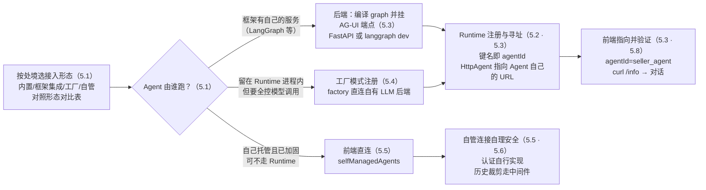

# 第 5 章 接入后端 Agent：Runtime 与框架集成

> 本章导读：第 4 章的星帆工作台里，copilot 已经看得见 `dashboard` 状态了，但它的背后仍是第 2 章那个内置 Agent——一个直接调模型的「聊天手」，没有任何业务数据来源。你问它「ORD-20431 为什么还没发货」，它只能礼貌地承认自己不知道。本章把内置 Agent 换成真正长在后端的 LangGraph Agent：`seller_agent`。为此我们要把第 1 章一图带过的中间层 Copilot Runtime 讲透——统一端点、agents 注册表、AG-UI 协议转换各管什么；把三种接入形态（框架集成、工厂模式、自管 Agent）摆在一起选型；再沿着 LangGraph 官方快速开始，把后端图、Runtime 注册、前端接线三段代码一次接通，最后完整走一遍星帆工作台的迁移。读完本章，你能：把任意框架的 Agent 挂进 Runtime 并让前端指到它；为一个不经框架的自有 LLM 后端写工厂注册；判断你的 Agent 该不该裁剪转发的对话历史。



*本章操作流程图*

## 你什么时候需要它

三种典型处境，对应本章三种用法。

**我手里已经有（或打算写）一个框架 Agent——LangGraph、CrewAI、ADK 等——想让工作台的 copilot 聊的就是它**——这是本章主线，按 5.1 → 5.2 → 5.3 → 5.8 走。核心动作是把框架 Agent 变成一个 HTTP 服务，再用一个包装器把它注册进 Runtime 的 agents 注册表。

**我的 Agent 逻辑就在 Runtime 进程里写（TypeScript），不想引入外部框架，但内置 Agent 的 simple 模式不够用**——看 5.4 的工厂模式（factory mode）：`BuiltInAgent` 允许你提供一个工厂函数，自己决定模型怎么调、工具怎么接，CopilotKit 只负责协议与生命周期。线程的存储位置也在这一节（AgentRunner）。

**我的 Agent 服务已经独立上线并且自己管安全（或者它自己保存对话历史）**——看 5.5（自管 Agent 与本地直连）和 5.6（消息历史裁剪）。前者讲怎么让前端绕过 Runtime 直连你的 Agent；后者讲当 Agent 自己存历史时，CopilotKit 默认的「每次全量转发对话」会出什么问题、怎么裁。

前置：第 2 章的最小架构（前端 + Runtime 两个进程、`curl /info` 验证习惯）；第 4 章的共享状态与 `useAgentContext`（本章讲「配置怎么传给后端 Agent」时会回接它）。不假设你用过 LangGraph，5.3 会从图（graph）是什么讲起。

## 5.1 概述：Runtime 在中间做什么，Agent 从哪里接入

第 2 章我们已经在用 Runtime 了，但只用了它最薄的一面：托管一个 HTTP 端点、转发聊天请求。官方对它的完整定义是「连接前端应用与 AI Agent 的后端层」，并把它列为使用 CopilotKit 的**推荐方式**。本章既然要把真正的后端 Agent 接进来，先把这一层的职责摆全：

| 职责 | 官方说法落点 | 对你的意义 |
|------|------------|-----------|
| **统一端点** | 前端只认 `runtimeUrl`；注册多个 Agent 时，Runtime 自动做发现与路由（agent routing） | 前端不需要知道每个 Agent 住在哪个进程、哪个端口 |
| **注册表与寻址** | `new CopilotRuntime({ agents: {...} })` 的键名就是 `agentId`；`POST /agent/:agentId/run` 按 id 分发 | 「前端在跟谁聊天」由注册表这一个映射决定 |
| **密钥与安全默认** | Runtime 跑在你的服务器上，Agent 通信留在服务端；默认阻止 Agent 端点被未认证访问 | 模型密钥、服务间凭据只在服务端进程出现 |
| **协议转换** | Agent 的输出被翻成 AG-UI 事件流；`run` 路由返回 SSE（Server-Sent Events）流 | 前端组件消费的是统一事件，不关心 Agent 用什么框架 |
| **服务端中间件** | AG-UI 中间件（`agent.use`）在服务端可信环境执行，客户端篡改不了 | 日志、护栏、请求改写都挂在可信一侧 |
| **线程与持久化** | 线程（thread）的存储由 AgentRunner 决定（5.4.3） | 「刷新页面历史还在吗」由你选的 runner 回答 |

一条请求在本章之后的完整链路是：

```text
浏览器（CopilotKitProvider）
  → ① 浏览器 → Runtime 这一跳：POST {runtimeUrl}/agent/:agentId/run
  → ② Runtime → Agent 这一跳：Runtime 按注册表找到 Agent 实例，把 AG-UI 输入交给它
  → Agent（框架服务 / 进程内工厂 / 你自己的服务）
  → AG-UI 事件流原路流回，前端组件渲染
```

**①和②是两个不同的地址**——这句话是官方文档专门用警告框强调的，也是本章最高频的错误来源（5.2.2 展开）。

### 5.1.1 四种接入形态

「把 Agent 接进来」在官方文档里不是一条路，而是四条。选型的分岔点只有一个问题：**Agent 的循环由谁驱动**。

| 形态 | Agent 循环在哪 | 注册写法 | 适合 | 本章落点 |
|------|--------------|---------|------|---------|
| 内置 Agent（第 2 章） | CopilotKit 自带的 `BuiltInAgent`，直接调模型 | `agents: { default: new BuiltInAgent({ model, prompt }) }` | 聊天 + 工具，不需要自建 Agent 循环 | 已学，本章替换掉它 |
| 框架集成（本章主线） | 独立的框架服务（LangGraph 服务化后暴露 AG-UI 端点） | `HttpAgent`（通用）或 `LangGraphAgent`（LangSmith 路线）包一层注册 | 已有或需要框架的编排能力（图、检查点、打断） | 5.3 |
| 工厂模式（factory mode） | 仍在 Runtime 进程内，但模型调用由你写工厂接管 | `new BuiltInAgent({ type, factory })` | 要完全控制 LLM 调用与工具接线，或不经框架 | 5.4 |
| 自管 Agent（self-managed agents） | 你自己托管的服务，前端直连，不经过 Runtime | 前端 Provider 的 `selfManagedAgents` 映射 | 企业场景：端点已自行加固、自行认证 | 5.5 |

一个容易混的对照在这里说清：**内置 Agent 是「替换」你的 Agent，框架集成是「连接」你的 Agent**。第 2 章 2.6.2 引用过官方的这句警告，本章就是那句警告的正面解答。`BuiltInAgent` 自己支持工具、生成式 UI、共享状态等全部 CopilotKit 能力——如果你的场景就是「聊天 + 工具」，不需要对 Agent 循环的精细控制，它依然是官方认可的合理终点，不必为了「看起来更高级」而引入框架。

**业务上的推荐次序**：先问自己要不要框架能力（多步编排、检查点、人工介入的图内表达）——要，走框架集成；不要但要自定义模型调用，走工厂模式；Agent 服务已经独立存在且安全自洽，才考虑自管直连。托管 Runtime 的三条形态（内置、框架集成、工厂）共享全部 Runtime 能力，直连是例外而非默认。

### 5.1.2 本章与前后章的分工

本章只解决「Agent 从哪来、怎么挂进 Runtime、前端怎么指到它」。Agent 挂进来之后：它在**前端界面的操作出口**（工具调用、生成式 UI 组件渲染）见第 6 章；LangGraph 的**打断（interrupt）如何变成人工介入**见第 7 章；**线程持久化、认证与多 Agent 生产化**见第 8 章——本章 5.4.3 会把 runner 的选型讲清到「够用」，纵深留给第 8 章。

**验证点**：能用一句话回答「你的 copilot 背后是谁在驱动对话循环」——第 2 章的答案是 `BuiltInAgent`，本章读完后的答案应当变成一个具体的名字，比如 `seller_agent`。

## 5.2 agents 注册表与 agentId：Runtime 如何寻址 Agent

### 5.2.1 注册表：键名即 agentId

注册表就是 `CopilotRuntime` 构造参数里的那个 `agents` 映射：

```ts
import { CopilotRuntime } from "@copilotkit/runtime/v2";

const runtime = new CopilotRuntime({
  agents: {
    // 键名 = agentId，前端靠它寻址
    default: builtInAgent,     // "default" 有特权，见下
    seller_agent: httpAgent,   // 其他 Agent 靠 agentId 显式指
  },
});
```

三条寻址规则，全部来自官方文档：

1. **`default` 有自动接线的特权**。注册在 `"default"` 名下的 Agent，预置组件不加任何配置就会使用它——这是官方给「只有一个主 Agent、不想到处写 `agentId`」的场景留的便利。注册多个 Agent 时，`default` 是聊天组件的默认对话对象，其余 Agent 靠传 `agentId` 寻址。
2. **`agentId` 同时是 HTTP 路由的一段**。运行时每次对话走的是 `POST /agent/:agentId/run`（多路由模式），路径里的 `:agentId` 就来自注册表键名——第 2 章故障排查表里那个 `Agent not found` 404，根源就是路由段在注册表里查不到。
3. **`/info` 是注册表的对外窗口**。前端启动时调用 `GET /info` 发现已注册的 Agent 与其元数据；你调试时用它（第 2 章的习惯在本章依然成立）：`curl http://localhost:8200/api/copilotkit/info` 的返回里必须能看到你注册的键名，前端才指得到它。

### 5.2.2 两个官方点名的注册错误

把外部框架 Agent 注册进 `agents` 时，官方文档用警告框点名了「大多数失败的两个来源」，这里原文照录并展开：

**错误一：把框架自己的 SDK 客户端当成 Agent 传进去。** `agents` 映射收的是 AG-UI 的 `AbstractAgent` 实例；框架自己的 SDK client（LangGraph 的客户端、CrewAI 的客户端等）不是它。正确做法是传该框架对应的 `@ag-ui/<framework>` 包装器，或者一个普通的 `HttpAgent`。包装器负责把框架的调用翻译成 AG-UI 协议——这正是「协议转换」职责在注册环节的体现。

**错误二：把外部 Agent 的 URL 写成 `/api/copilotkit`。** 回看 5.1 的链路图：`/api/copilotkit` 是**浏览器 → Runtime** 这一跳的地址；**Runtime → Agent** 是另一跳，走的是 Agent 自己的服务器或部署地址。两者是不同的地址，写混了的表现是 `/info` 一切正常（第一跳没问题），一开口对话却连不上（第二跳打了错误的地方）。官方特别提醒：**每个集成指南都会写明自己框架服务的确切 URL，包括必需的后缀**——接框架前先找到那一行。

星帆工作台的写法预览（5.8 完整展开）：

```ts
import { HttpAgent } from "@ag-ui/client";

const runtime = new CopilotRuntime({
  agents: {
    seller_agent: new HttpAgent({
      // 指向 LangGraph Agent 自己的 FastAPI 服务——不是 /api/copilotkit
      url: process.env.SELLER_AGENT_URL || "http://localhost:8123",
    }),
  },
});
```

### 5.2.3 注册之外的第二个问题：运行配置怎么传给 Agent

注册解决「找到谁」，还有一半问题是「怎么调」——语气、专业程度、回复长度这类用户可调的偏好，不适合混进聊天输入里。官方 agent-config 文档给出了按运行架构分流的两条通道：

| Agent 形态 | 配置通道 | Agent 侧读取点 |
|-----------|---------|---------------|
| 住在 Runtime 后面的框架 Agent（本章主线） | 前端用 `useAgentContext`（第 4 章）把类型化配置发布为 agent context，每次运行随上下文到达 | 从当前 run 的 context 里读最新配置，重建系统提示词 |
| 进程内 Agent（工厂模式，5.4） | 前端 Provider 的 `properties` 属性传类型化对象 | 工厂函数从 `input.forwardedProps` 读 |

两条通道的用户体验一致，接线不同。本书主线（框架集成）走第一条——第 4 章的 `useAgentContext` 原样适用，不需要新知识。第二条通道的代码与安全纪律（`forwardedProps` 只放非敏感的、浏览器可控的偏好，**不得**用于凭据、租户身份或授权）放在 5.4.1 与工厂模式一起讲。

**验证点**：往注册表里加第二个 Agent 后，`curl /info` 的返回里能看到两个键名；把其中一个的键名改掉而不改前端 `agentId`，前端会在连接时收到 `Agent not found`——亲手制造一次这个 404，比背规则记得牢。

## 5.3 LangGraph 集成：把 seller_agent 挂进 Runtime

本章主线。LangGraph 是 LangChain 家族的 Agent 编排框架：把 Agent 写成一张**图**——节点（node）是步骤（调一次模型、查一次数据），边（edge）决定流向，所有节点共享一个状态对象。你不需要先会 LangGraph，本节用到的 API 只有六个，每个都会逐行解释。

### 5.3.1 两条服务化路线

LangGraph Agent 要被 CopilotKit 接入，前提是它变成了一个能收 HTTP 请求的 AG-UI 端点。官方快速开始给了两条路线，先认清分岔再写代码：

| | 路线 A：FastAPI 自托管 | 路线 B：LangGraph API server（LangSmith 路线） |
|---|---|---|
| 语言 | 仅 Python | Python 与 TypeScript 都支持 |
| 服务载体 | 你自己的 FastAPI + uvicorn 进程 | `langgraph dev`（LangGraph CLI）起的 API server |
| 持久化 | 自己在 `compile()` 时挂 checkpointer | 平台在运行时注入，**禁止**自己挂（见 5.3.3 的坑） |
| 额外依赖 | `ag-ui-langgraph`、`fastapi`、`uvicorn`、`copilotkit` | `@langchain/langgraph-cli`（TS）或 Python `langgraph-cli`；用已有 Agent 需 LangSmith API key |
| Runtime 侧注册 | `HttpAgent` | `LangGraphAgent` |
| 适合 | 后端自有服务、不想引入外部平台 | 想直接用 LangGraph 平台的部署与持久化 |

**本书主线选路线 A**：星帆工作台的后端是自有服务，路线 A 不依赖任何外部平台，三条进程边界（Agent、Runtime、前端）看得最清楚。路线 B 给出全部关键差异，读者按需切换。

### 5.3.2 路线 A：FastAPI 自托管

**第一步，安装。** 在 Agent 工程目录（本书设为 `seller-agent/`）：

```bash
uv add langgraph langchain-openai langchain-core python-dotenv
uv add ag-ui-langgraph fastapi uvicorn copilotkit
```

第一行是 LangGraph 本体与模型接入，第二行是路线 A 专属：`ag-ui-langgraph` 负责把 graph 暴露成 AG-UI 端点，`copilotkit` 提供 `LangGraphAGUIAgent` 包装器（对应 5.2.2 说的「传包装器，不传 SDK client」）。如果你的项目锁定了精确版本，注意 `uv add` 会重写锁文件——官方提醒这种情况改为手动把依赖写进依赖文件，别让其他锁死的版本被牵动。

**第二步，写图。** 先看官方最简示例——一个只有一个节点的图：

```python
# seller-agent/main.py
from dotenv import load_dotenv
from langchain_core.messages import SystemMessage
from langchain_openai import ChatOpenAI
from langgraph.graph import END, START, MessagesState, StateGraph
from langgraph.checkpoint.memory import MemorySaver
import uvicorn

load_dotenv()

async def mock_llm(state: MessagesState):
    model = ChatOpenAI(model="gpt-4.1-mini")
    system_message = SystemMessage(content="You are a helpful assistant.")
    response = await model.ainvoke(
        [
            system_message,
            *state["messages"],
        ]
    )
    return {"messages": response}


graph = StateGraph(MessagesState)
graph.add_node(mock_llm)
graph.add_edge(START, "mock_llm")
graph.add_edge("mock_llm", END)
graph = graph.compile(
    checkpointer=MemorySaver()
)
```

逐行拆开这份二十行的文件：

1. **`MessagesState` 是 LangGraph 预置的状态类型**，只有一个字段 `messages`，并带一个「追加」语义的 reducer——每个节点返回的 `{"messages": ...}` 会被**追加**进状态，而不是覆盖。对话历史就是这么在节点之间流动的。
2. **`StateGraph(MessagesState)` 建图，`add_node` 注册节点**。函数名（或你传的名字）就是节点名。
3. **`add_edge(START, "mock_llm")` 与 `add_edge("mock_llm", END)` 定流向**：每次运行从 START 进、走一个节点、到 END 出。
4. **`compile(checkpointer=MemorySaver())` 编译成可运行的图，并挂上检查点器（checkpointer）**。这是路线 A 的**必要项**，不是可选项：`ag-ui-langgraph` 要通过 `graph.aget_state(...)` 读取线程状态，没挂 checkpointer 的图会直接抛 `ValueError: No checkpointer set`。`MemorySaver()` 把状态存在进程内存里——本地开发够用，生产要换持久化的 saver（官方原话：例如 Postgres）。

**第三步，挂 AG-UI 端点并启动。** 接着在上面文件里加：

```python
# seller-agent/main.py（续）
from ag_ui_langgraph import add_langgraph_fastapi_endpoint
from copilotkit import LangGraphAGUIAgent
from fastapi import FastAPI

app = FastAPI()

add_langgraph_fastapi_endpoint(
    app=app,
    agent=LangGraphAGUIAgent(
        name="sample_agent",
        description="An example agent to use as a starting point for your own agent.",
        graph=graph,
    ),
    path="/",
)

def main():
    """Run the uvicorn server."""
    uvicorn.run(
        "main:app",
        host="0.0.0.0",
        port=8123,
        reload=True,
    )

if __name__ == "__main__":
    main()
```

三个关键点：`LangGraphAGUIAgent` 的 `name` 参数**就是这个 Agent 对外的名字**，下一小节它将成为 Runtime 注册表里的 `agentId`；`path="/"` 表示端点挂在服务根路径；uvicorn 的端口写死为 `8123`——**Runtime 侧的 URL 必须与它一致**，两端一起改，这是官方特别强调的对齐关系。启动：

```bash
uv run main.py
```

Agent 服务就绪于 `http://localhost:8123`。它现在是一个标准的 AG-UI 端点——你可以不用 CopilotKit、直接用任何 AG-UI 客户端连它，这正是「开放协议」的含义（AG-UI 是前端与 Agent 通信的开放协议，第 1 章介绍过；Runtime 只是它最常用的消费方）。

### 5.3.3 路线 B：LangGraph API server 与 LangGraphAgent

如果你的 Agent 已经部署在 LangGraph 平台上，或者你想用官方 CLI 起服务，走路线 B。以 TypeScript Agent 为例（Python 的差异见后）：

```ts
// seller-agent/src/agent.ts
import { SystemMessage } from "@langchain/core/messages";
import { ChatOpenAI } from "@langchain/openai";
import {
  END,
  MessagesAnnotation,
  START,
  StateGraph,
} from "@langchain/langgraph";

async function mockLlm(state: typeof MessagesAnnotation.State) {
  const model = new ChatOpenAI({ model: "gpt-4.1-mini" });
  const response = await model.invoke([
    new SystemMessage("You are a helpful assistant."),
    ...state.messages,
  ]);
  return { messages: response };
}

export const graph = new StateGraph(MessagesAnnotation)
  .addNode("mock_llm", mockLlm)
  .addEdge(START, "mock_llm")
  .addEdge("mock_llm", END)
  .compile();
```

注意与路线 A 的第一处相反：**不要给 `compile()` 传 checkpointer**。LangGraph API server 在运行时自己注入持久化；你自己编译进去一个，`langgraph dev` 会拒绝加载这个图（报错明说 `persistence is handled automatically by the platform`），已部署的图则直接忽略它。**两条路线、两条相反的规则**，是 LangGraph 集成里最容易踩的坑，汇总成表：

| | 路线 A（FastAPI） | 路线 B（API server） |
|---|---|---|
| `compile()` 的 checkpointer | **必须挂**（缺了抛 `ValueError: No checkpointer set`） | **不许挂**（`langgraph dev` 拒绝加载；部署图忽略之） |

TS 路线还需要一个 `langgraph.json` 声明图与入口：

```json
{
  "node_version": "20",
  "dependencies": ["."],
  "graphs": {
    "sample_agent": "./src/agent.ts:graph"
  },
  "env": ".env"
}
```

`graphs` 的键 `sample_agent` 是 **graphId**，值是 `<文件>:<导出名>`——必须精确指向代码里 `export const graph` 那个常量，名字对不上，CLI 会报 `graph is nullish`。启动服务：

```bash
npx @langchain/langgraph-cli dev --port 8123 --no-browser
```

**`--port 8123` 不是装饰**：裸跑 `langgraph dev`（无论 Python 还是 TS CLI）默认端口是 **2024**。官方明确警告：要么用 flag 把端口钉在 8123 与 Runtime 侧的 URL 对齐，要么去掉 flag 把 Runtime 侧 URL 改成 `http://localhost:2024`——**唯独不能两边各说各话**，否则 Runtime 连不上 Agent，而且除了一个连接错误之外没有任何诊断线索。

Runtime 侧的注册换一个包装器（Next.js 官方原文示例）：

```ts
// app/api/copilotkit/[[...slug]]/route.ts —— 路线 B
import {
  CopilotRuntime,
  createCopilotRuntimeHandler,
} from "@copilotkit/runtime/v2";
import { LangGraphAgent } from "@copilotkit/runtime/langgraph";

const runtime = new CopilotRuntime({
  agents: {
    sample_agent: new LangGraphAgent({
      deploymentUrl: process.env.LANGGRAPH_DEPLOYMENT_URL || "http://localhost:8123",
      graphId: "sample_agent",
      langsmithApiKey: process.env.LANGSMITH_API_KEY || "",
    }),
  },
});

const handler = createCopilotRuntimeHandler({
  runtime,
  basePath: "/api/copilotkit",
});

export const GET = handler;
export const POST = handler;
export const PATCH = handler;
export const DELETE = handler;
```

`LangGraphAgent` 从 `@copilotkit/runtime/langgraph` 导入（注意没有 `/v2` 前缀，这是官方原文的导入路径），三个参数各管一跳：`deploymentUrl` 指向 LangGraph API server，`graphId` 对应 `langgraph.json` 里的键，`langsmithApiKey` 在连接已有 Agent 时需要。星帆工作台如果走路线 B，把这段注册逻辑照 2.6.3 的通用公式搬进 `server.ts` 即可。

### 5.3.4 Runtime 注册与前端接线（路线 A）

回到主线。路线 A 的 Runtime 侧注册只比内置 Agent 多一个包装器（这里按星帆工作台的 SPA 形态写进 `server.ts`，宿主与第 2 章完全一致）：

```ts
// server.ts —— 注册 sample_agent（演示用，5.8 换成 seller_agent）
import { createServer } from "node:http";
import { CopilotRuntime } from "@copilotkit/runtime/v2";
import { HttpAgent } from "@ag-ui/client";
import { createCopilotNodeListener } from "@copilotkit/runtime/v2/node";

const runtime = new CopilotRuntime({
  agents: {
    sample_agent: new HttpAgent({
      url: process.env.SAMPLE_AGENT_URL || "http://localhost:8123",
    }),
  },
});

const port = 8200;

createServer(
  createCopilotNodeListener({
    runtime,
    basePath: "/api/copilotkit",
    cors: true,
  }),
).listen(port, () => {
  console.log(
    `Copilot Runtime listening at http://localhost:${port}/api/copilotkit`,
  );
});
```

对照第 2 章的 `server.ts`，变的只有两行：`HttpAgent`（来自 `@ag-ui/client`，需要 `npm install @ag-ui/client`）替换了 `BuiltInAgent`，注册键从 `default` 换成了 `sample_agent`。`createCopilotNodeListener`、`basePath`、`cors: true` 全部原样保留——**SPA 场景的知识没有因为换 Agent 而增加**。

官方快速开始用的宿主是 Next.js（前端与 Runtime 同源），它比 SPA 还少一条：`runtimeUrl` 写相对路径 `/api/copilotkit`，并且 Provider 上显式写 `useSingleEndpoint={false}` 与多路由 catch-all 处理器配对。SPA 的 Provider 不写这个属性时，会自行探测 Runtime 的传输方式，所以星帆的 Provider 保持第 2 章的样子即可。

前端只改一处——`agentId`：

```tsx
// src/App.tsx（节选）
<CopilotKitProvider
  runtimeUrl="http://localhost:8200/api/copilotkit"
  agentId="sample_agent"
>
```

键名不是 `default` 了，`agentId` 从「可省」变成「必写」（规则见 5.2.1）。样式、聊天组件、共享状态 Hook 一概不动。

还有一个值得知道的默认行为：官方快速开始里 Runtime 配了 `intelligence` 与 `identifyUser`（CopilotKit 的商用持久化与用户识别，参数是项目 API key）。**去掉这两项，Runtime 会退回 SSE 模式加内存 runner**——聊天照常工作，只是线程持久化与调试检查器不可用。本书主线走自托管路线，这正是第 2 章以来的形态；线程与生产化的完整讨论在第 8 章。

**验证点**：三个进程按序起——`uv run main.py`（8123）→ `npx tsx --env-file=.env server.ts`（8200）→ `npm run dev`（5173）；`curl http://localhost:8200/api/copilotkit/info` 的返回里出现 `sample_agent`，再开浏览器发一句 `Can you tell me a joke?`。

### 5.3.5 LangGraph 集成首跑排查表

| 现象 | 原因 | 修法 |
|------|------|------|
| Runtime 起了、`/info` 正常，一对话就连接错误 | Runtime → Agent 这一跳不通：Agent 服务没起，或 URL/端口不匹配 | 先 `curl http://localhost:8123` 确认 Agent 活着；核对注册 URL 与 uvicorn 端口 |
| `langgraph dev` 起的 Agent，Runtime 死活连不上 | 裸 `langgraph dev` 默认端口 **2024**，Runtime 却指着 8123 | `--port 8123` 钉端口，或把 Runtime 侧 URL 改成 2024——两边必须一致 |
| TS CLI 起的 Agent，`http://127.0.0.1:8123` 连不上 | `@langchain/langgraph-cli` 默认 host 是 `localhost`，在双栈机器上只绑 IPv6 的 `::1` | 用 `http://localhost:8123` 或 `http://[::1]:8123`；要 IPv4 就 `--host 127.0.0.1` 显式绑定 |
| `langgraph dev` 报 `ValueError: ... includes a custom checkpointer` | 路线 B 的图自己 `compile(checkpointer=...)` 了 | 删掉 checkpointer，持久化由平台注入 |
| FastAPI 版运行时抛 `ValueError: No checkpointer set` | 路线 A 的图 `compile()` 时没挂 checkpointer | 补 `checkpointer=MemorySaver()`（生产换持久 saver） |
| `graph is nullish` | `langgraph.json` 的 `<文件>:<导出名>` 与代码里导出的常量名对不上 | 改成 `export const graph` 实际的名字 |

## 5.4 自定义 Agent 与 AgentRunner：不经框架的两种控制力

框架集成把 Agent 循环交给框架；这一节讲两个「留在自己手里」的控制点：**模型调用**（工厂模式）与**线程存储**（AgentRunner）。两者都不需要引入任何 Agent 框架。

### 5.4.1 工厂模式：自己决定模型怎么调

`BuiltInAgent` 有两种模式。simple 模式（第 2 章用的）传一个模型字符串就完事；**工厂模式（factory mode）**让你提供一个工厂函数，接管整个 LLM 调用——CopilotKit 只负责把返回的流翻成 AG-UI 事件、管理生命周期、接进 Runtime。官方的对比表：

| | simple 模式 | 工厂模式 |
|---|---|---|
| 搭建 | 传一个模型字符串 | 自己拥有 LLM 调用与流 |
| 模型解析 | 内置（`"openai/gpt-4o"` 这类字符串） | 自己设置模型 |
| 工具、MCP、状态工具 | 自动接线 | 工厂里自己接 |
| 支持的后端 | 仅 Vercel AI SDK | 任意：AI SDK、TanStack AI 或自定义后端 |
| 适合 | 快速搭建、标准场景 | 完全控制、非标准后端 |

官方建议直白：simple 模式够用就别用工厂模式；工厂模式是为了 simple 给不了的控制。AI SDK 后端的完整例子（官方原文，宿主改为星帆的 `server.ts` 形态）：

```ts
// server.ts —— 工厂模式：AI SDK 后端
import { createServer } from "node:http";
import {
  CopilotRuntime,
  BuiltInAgent,
  InMemoryAgentRunner,
  convertMessagesToVercelAISDKMessages,
} from "@copilotkit/runtime/v2";
import { streamText } from "ai";
import { openai } from "@ai-sdk/openai";
import { createCopilotNodeListener } from "@copilotkit/runtime/v2/node";

const agent = new BuiltInAgent({
  type: "aisdk",
  factory: ({ input, abortSignal }) =>
    streamText({
      model: openai("gpt-4o"),
      messages: convertMessagesToVercelAISDKMessages(input.messages),
      abortSignal,
    }),
});

const runtime = new CopilotRuntime({
  agents: { default: agent },
  runner: new InMemoryAgentRunner(),
});

createServer(
  createCopilotNodeListener({
    runtime,
    basePath: "/api/copilotkit",
    cors: true,
  }),
).listen(8200);
```

工厂收到的上下文（`BuiltInAgentFactoryContext`）里最有用的是 `input`——一个完整的 AG-UI `RunAgentInput`，字段包括 `messages`（对话）、`tools`（前端注册的工具定义）、`state`（共享状态）、`context`（`useAgentContext` 发布的上下文）、`threadId`、`runId`、`forwardedProps`（Provider 传来的运行配置）。生命周期事件（`RUN_STARTED` / `RUN_FINISHED`）、流转换、错误处理、取消，全部由 CopilotKit 包办——**你的工厂不需要发出任何生命周期事件**。

一个必须记住的坑：工厂拿到的 `abortController` 是给 TanStack AI 这类**要求完整控制器**的后端用的——把它交出去，让后端自己拥有它；**不要在工厂内部自己调 `.abort()`**，那会绕过 CopilotKit 取消这次运行，运行的收尾就不会发生。要主动取消，调用 Agent 上的 `abortRun()`；凡是接受信号的场合（AI SDK、`fetch`、自定义后端），传 `abortSignal`。

`type` 有三个取值：`"aisdk"`（Vercel AI SDK，返回 `streamText` 的结果）、`"tanstack"`（TanStack AI，返回 `chat()` 的结果，需要 `abortController`）、`"custom"`（异步生成器，直接 yield AG-UI 事件——等于自己写协议流，全量事件类型见官方 AG-UI 事件参考）。前两者有现成的转换函数可以白拿：

| 工具函数 | 作用 |
|---------|------|
| `convertMessagesToVercelAISDKMessages(messages)` | AG-UI 消息 → AI SDK 的 `ModelMessage[]` |
| `convertToolsToVercelAITools(tools)` | 前端定义的工具（JSON Schema）→ AI SDK 的 `ToolSet` |
| `convertToolDefinitionsToVercelAITools(tools)` | `defineTool()` 定义（Standard Schema）→ AI SDK 的 `ToolSet` |
| `convertInputToTanStackAI(input)` | `RunAgentInput` → `{ messages, systemPrompts }`，自动处理 system/developer 消息、context 与 state |
| `resolveModel(spec)` | `"openai/gpt-4o"` 字符串 → AI SDK 模型实例 |

其中 `convertToolsToVercelAITools(input.tools)` 值得划重点：**工厂模式不会自动接线工具**——第 6 章的前端工具到了工厂模式手里，要靠这一行把它们转给模型。simple 模式与框架集成路线没有这一步，这也是「simple 自动、工厂自己接」在代码上的具体位置。

`input.state` 与 `input.context` 同理：共享状态与上下文不会自动进提示词，官方示例是自己拼接——遍历 `input.context` 把 `description: value` 逐条推进系统段，把 `input.state` 序列化成 `Application State:` 一段，再 `unshift` 一条 system 消息。第 4 章在 simple 模式与框架路线里「免费」得到的状态可见性，在工厂模式里是显式劳动。

最后补一条 `forwardedProps` 的纪律（5.2.3 的第二条通道）：它由前端 Provider 的 `properties` 属性传入，适合放「非敏感、浏览器可控」的偏好——官方示例用它传模型选择与温度，且**每个值都要按后端自有边界校验**后才允许影响执行；凭据、租户身份、授权、不受限的模型选择，一律不得走这条通道。

### 5.4.2 一个内置 Agent 实例一次只跑一轮

注册在模块作用域的 `BuiltInAgent` 实例，**拒绝在自身上并发第二个运行**，报错原文是 `Agent is already running. Call abortRun() first or create a new instance.`。本地开发、单人使用没感觉；一旦服务多于一个人，第二个并发请求就是失败的那个。官方给的修法顺着架构来：**每线程状态存在 runner 里而不是 Agent 里**，所以给每个并发运行自己的实例即可——在请求内构造 Agent，而不是在模块作用域构造一个共享实例；或者按用户串行化。工厂模式下这自然是请求内构造，不构成问题。

### 5.4.3 AgentRunner：线程存在哪、丢不丢

Runtime 把「启动运行、重连线程、停止运行」委托给一个 **AgentRunner**（Agent 执行器）。它是一个抽象类，四个方法恰好对应 Runtime 的 HTTP 路由：

```ts
import type { Observable } from "rxjs";
import type { BaseEvent } from "@ag-ui/client";

abstract class AgentRunner {
  // 启动一次运行；返回 AG-UI 事件流
  abstract run(request: AgentRunnerRunRequest): Observable<BaseEvent>;
  // 重连到已有线程的流（刷新页面 / 断线重连）
  abstract connect(request: AgentRunnerConnectRequest): Observable<BaseEvent>;
  // 该线程当前是否在运行
  abstract isRunning(request: AgentRunnerIsRunningRequest): Promise<boolean>;
  // 停掉该线程上正在进行的运行
  abstract stop(request: AgentRunnerStopRequest): Promise<boolean | undefined>;
}
```

`runner` 在 `CopilotRuntime` 上配置一次，对**所有**注册的 Agent 生效；不传时默认用 `InMemoryAgentRunner`。选型一张表（TelemetryAgentRunner 是遗留包装行为，`@copilotkit/runtime/v2` 不含它，了解即可）：

| Runner | 导入自 | 用途 |
|--------|-------|------|
| `InMemoryAgentRunner` | `@copilotkit/runtime/v2` | 默认。线程存在进程内存：本地开发、单实例部署，或作为扩展基类 |
| `SqliteAgentRunner` | `@copilotkit/sqlite-runner` | 第一方文件持久化：单实例重启后历史还在。需要 `better-sqlite3` peer 依赖与真实的（非 `:memory:`）`dbPath` |
| `IntelligenceAgentRunner` | `@copilotkit/runtime/v2` | CopilotKit Intelligence 商用后端：跨实例持久化。Intelligence 运行时自动使用，**不允许再传 `runner`**（传了是类型错误，绕过类型也会在构造时被拒绝） |

内存 runner 的两个硬事实，决定了「什么时候必须换」：**重启即丢**（历史只在进程内存），以及**实例间不共享**（横向扩展直接失效）。它默认有界，不会无限吃堆内存——上限三个参数：`maxThreads`（默认 1000，超限整体逐出最久未用线程）、`maxRunsPerThread`（默认 100，逐出最旧运行）、`maxBytes`（默认 512 MiB，跨线程总量上限）；哪个先到哪个生效，活跃运行所在的线程永不逐出。另一个实用选项是并发语义：默认同线程第二个 `run()` 抛 `Thread already running`，传 `onConcurrentRun: "supersede"` 则改为中止在途运行、让新运行顶替（被顶替运行的部分输出丢弃）。星帆工作台本地开发用默认内存 runner 足够；上生产的选型（SQLite 与共享存储之间）是第 8 章的话题，这里只需要知道分界线在哪。

**验证点**：说出「一个线程的对话历史此刻存在哪个进程的哪块存储里」——用默认 runner 的答案是「Runtime 进程的内存里，重启就没」；这句话能脱口而出，5.4.3 就算过关。

## 5.5 自管 Agent：绕过 Runtime 的直连

前四节的一切都发生在「前端 → Runtime → Agent」的托管链路上。官方也留了一条**不经 Runtime** 的路：把 AG-UI Agent 实例直接交给前端 Provider。这条路分生产和开发两个选项，选错代价不同。

**生产选项：`selfManagedAgents`**——官方定义的「受支持的配置项」，用于接入你自己托管、已经自行加固的 AG-UI 兼容后端（例如一个指向你自有服务的 `HttpAgent`）。注意官方的定位说明：它属于 CopilotKit 的 Enterprise Intelligence 层，**生产使用需要商业许可**。用法：

```tsx
import { HttpAgent } from "@ag-ui/client";
import { CopilotKitProvider } from "@copilotkit/react-core/v2";

const supportAgent = new HttpAgent({
  url: "https://agents.example.com/support",
});

<CopilotKitProvider selfManagedAgents={{ "support-agent": supportAgent }}>
  <YourApp />
</CopilotKitProvider>
```

映射的键同样是 `agentId`——聊天组件与前端 Agent API 就用它寻址。因为请求不再穿过 Runtime，**Runtime 的服务端认证、中间件、路由全部不适用**：你的 Agent 端点必须自己认证并鉴权每一个请求。它可以与 `runtimeUrl` 共存——Runtime 发现的 Agent 与自管 Agent 合并在同一个客户端注册表里，各按 `agentId` 寻址；撞键时 `selfManagedAgents` 赢（合并语义等价于 `{ ...运行时发现, ...selfManagedAgents }`）。

**开发选项：`agents__unsafe_dev_only`**——同形的映射，名字故意起得很响。它只在本地开发与原型阶段使用：你正在本地接一个 Agent，还不想为它起一个 Runtime。官方明确：**不要带上生产**；要自管就切换到 `selfManagedAgents`（前提是你已经加固了端点），或者把 Agent 挪回 Runtime 后面。

（示例中的 `CopilotKitProvider` 是本书的统一写法；官方文档这两页用 v2 包内的 `<CopilotKit>` 组件呈现同样的属性，第 3 章已说明两者关系与本书立场。）

为什么默认路线仍是 Runtime？官方的对比表原文转录如下，五行差异每一行都是托管链路换来的：

| | 走 Runtime | 直连 |
|---|---|---|
| 认证 | 提供安全默认 | 自己管 |
| AG-UI 中间件 | 服务端执行 | 不可用 |
| Agent 路由 | 自动 | 手动 |
| 生态功能 | 完整支持 | 受限 |
| 官方支持 | 支持 | 不支持（开发选项） |

**验证点**：能说出「`agents__unsafe_dev_only` 与 `selfManagedAgents` 的名字为什么一个响亮一个正式」——前者是官方用命名防止你带上生产的开发通道，后者是受支持但要求你自担安全的生产通道（且属企业许可范围）。

## 5.6 消息历史：CopilotKit 转发的是什么，何时裁剪

一个贯穿本章的默认行为现在值得单独一节：**CopilotKit 每次运行都转发整段对话**。前端持有全部聊天记录，每次 run 都把它作为 `input.messages` 带给你的 Agent。无状态的 Agent 需要这样——转发的记录是它对这段对话的唯一记忆。

但本章接的 seller_agent 恰恰不是无状态的：FastAPI 路线的 graph 在 `compile()` 时挂了 checkpointer（5.3.2），Agent 自己就存着对话历史。官方文档点名的四类「自存历史」后端：LangGraph checkpointer、Mastra memory、AWS Strands `SessionManager`、Microsoft Agent Framework 的 chat-history provider。这时对话就有了**两份副本**，两个症状会找上门：

- **历史重复**：Agent 把 CopilotKit 转来的消息与自己存的消息合并，模型每轮都收到两份对话，token 成本翻倍。合并还可能把工具调用与工具结果拆散——自存历史以一个悬空的工具调用结尾时，转来的副本被接在它后面，调用就不再紧跟结果，Anthropic 会直接拒绝这次运行。
- **请求膨胀**：请求体随对话增长，长线程抬高每轮延迟，代理可能用 HTTP 413 拒绝请求。

**不裁剪的情形同样明确**：无状态 Agent 只从 `input.messages` 读对话，裁掉的负载就是它对这段线程的记忆——裁了等于让它失忆。

### 5.6.1 浏览器侧：`messageFilter` 是大多数应用的答案

前端 Provider 的 `messageFilter` 属性决定每次运行把哪些消息放上线路——返回要发的那些：

```tsx
// src/App.tsx —— seller_agent 自存历史，只转发最后一轮
<CopilotKitProvider
  runtimeUrl="http://localhost:8200/api/copilotkit"
  agentId="seller_agent"
  messageFilter={(messages) => messages.slice(-1)}
>
```

这是官方给两个症状的最短修法，而且**再钝的规则在这里也安全**：CopilotKit 在请求发出前会自动修复被拆散的工具调用对——转发的工具结果会把它的调用补回到前面，转发的调用会把结果补回来，所以 `slice(-1)` 也不可能把一次待审批的调用孤悬在线路上。四样东西它不碰：聊天界面的渲染（界面仍然显示完整记录）；`selfManagedAgents` 传入的实例（那是你的对象，要用下面的中间件）；Intelligence 运行时（它是线程的存档方，客户端无权截断）；建议（suggestion）运行（它在全新线程上跑，随发的消息本就是它唯一的上下文）。容错也省心：过滤器抛错或返回了非数组，CopilotKit 会警告并回退为全量发送——裁剪是优化，它的 bug 不该弄挂运行。一个工程细节：给过滤器一个稳定引用（React 里用 `useCallback`），内联箭头函数每次渲染都重新注册，无害但多余。

### 5.6.2 Runtime 侧与你自己的实例：中间件

有两条路 `messageFilter` 够不着：在 Runtime 内部裁（裁剪规则必须服务端说了算时），以及裁你自己传进来的 Agent 实例。这两条路**没有自动修复通道**，过滤器必须自己保持工具调用与结果成对出现。做法是把「选择消息的函数」装进一个 AG-UI 中间件，挂到 Agent 上：

```ts
// trim-history.ts —— 骨架；选择函数见官方 message-history 文档的完整实现
import {
  Middleware,
  type AbstractAgent,
  type Message,
  type RunAgentInput,
} from "@ag-ui/client";

/** 保留最后一轮，外加被转发的工具结果所回答的那些工具调用。 */
export function lastTurnOnly(messages: Message[]): Message[] {
  // 官方文档给出完整实现：定位最后一条 user 消息，
  // 收集其后被结果回答的工具调用并拉回，
  // 且把每次拉回的调用直接放在回答它的结果之前——
  // 因为模型供应商要求「调用由紧随其后的消息回答」。
}

/** 重写一次运行的 messages，不动已存储的记录本身。 */
export class TrimHistoryMiddleware extends Middleware {
  constructor(private readonly trim: (messages: Message[]) => Message[]) {
    super();
  }

  run(input: RunAgentInput, next: AbstractAgent) {
    return this.runNext({ ...input, messages: this.trim(input.messages) }, next);
  }
}
```

挂载点在注册之前：

```ts
// server.ts —— Runtime 内裁剪
import { HttpAgent } from "@ag-ui/client";
import { CopilotRuntime } from "@copilotkit/runtime/v2";
import { lastTurnOnly, TrimHistoryMiddleware } from "./trim-history";

const agent = new HttpAgent({ url: process.env.AGENT_URL! });
agent.use(new TrimHistoryMiddleware(lastTurnOnly));

const runtime = new CopilotRuntime({
  agents: { default: agent },
});
```

`.use()` 定义在 `AbstractAgent` 上，所以无论包装的是哪个框架，注册前的这一次调用就覆盖了所有运行——Runtime 每次运行会克隆注册的 Agent，克隆体带着中间件走。自建实例（`selfManagedAgents` 那条路）同样用它：过滤后的消息直接成为 HTTP 请求体，界面上的记录依然完整。

两条裁剪路径的选择表：

| | `messageFilter`（浏览器） | 中间件（服务端 / 自建实例） |
|---|---|---|
| 工具调用对 | **自动修复**，规则再钝也安全 | 自己保持成对（`lastTurnOnly` 已处理） |
| 缩小浏览器发出的请求体 | 是 | 否（浏览器仍发全量，Runtime 内才裁） |
| 适用对象 | Runtime 发现的 Agent | Runtime 内注册的 Agent、自建实例 |
| 出错行为 | 警告 + 回退全量发送 | 无回退通道，需自行正确 |

最后记住裁剪**不会**改变的三样东西：聊天界面的完整渲染、Runtime 对线程事件的持久化、以及 `input.state` / `input.tools` / `input.context`——被改写的只有消息列表。

**验证点**：对接 seller_agent 后问它三个问题再问第四个，打开浏览器网络面板看 run 请求体——配了 `messageFilter` 后，请求里的消息条数不再随对话轮数增长；这就是「Agent 自存历史 + 只转发最后一轮」生效的物证。

## 5.7 其他框架一览

LangGraph 之外，官方集成目录里还有一批框架，接入方式与本章完全同构：**框架服务暴露 AG-UI 端点 → 包装器（或 `HttpAgent`）注册进 agents 注册表 → 前端 `agentId` 指过去**。下表的「一句话」译自各框架集成页的官方描述，选型时先扫一眼：

| 框架 | 官方一句话 | 备注 |
|------|-----------|------|
| LangGraph | 把你的 LangGraph Agent 交给用户 | 本章主线；官方快速开始同时提供 Python 与 TypeScript 路线 |
| Built-in Agent | 用任意模型使用 CopilotKit 的内置 Agent | 第 2 章已学；「替换而非连接」你的 Agent |
| CrewAI | 经 AG-UI 把 CrewAI 的 Flow 型 Agent 交给用户 | Flow 型（crewai-flows 目录） |
| AG2 | 经 AG-UI 把 AG2 Agent 交给用户 | |
| ADK | 把 ADK Agent 变成 Agent 原生应用 | |
| Pydantic AI | 经 AG-UI 把 Pydantic AI Agent 交给用户 | |
| Mastra | 经 AG-UI 把 Mastra Agent 交给用户 | |
| LlamaIndex | 经 AG-UI 把 LlamaIndex Agent 交给用户 | |
| A2A | 把 A2A Agent 变成 Agent 原生应用 | A2A 是 Agent 间协议，CopilotKit 以集成目录形式接入其 Agent |
| Microsoft Agent Framework | 经 AG-UI 把 Microsoft Agent Framework Agent 交给用户 | |
| Claude SDK | 在 CopilotKit 后运行 Claude Agent SDK 的 Python / TypeScript Agent | 官方分 claude-sdk-python 与 claude-sdk-typescript 两个快速开始页 |
| Deep Agents | 经 AG-UI 把 Deep Agents 交给用户 | |
| Agno | 经 AG-UI 把 Agno Agent 交给用户 | |
| Agent Spec | 配置 Agent Spec + AG-UI 并连接 CopilotKit UI，含各适配器安装步骤 | 面向可移植的 Agent 规格描述 |

三句选型注解。第一，**这些集成的差异几乎全部在「后端怎么写、怎么暴露」**，一旦 AG-UI 端点就绪，Runtime 注册、前端接线、共享状态、工具、人工介入的玩法与框架无关——这正是第 1 章「协议先行」的意义。第二，除 LangGraph 在官方快速开始中同时给出 Python 与 TypeScript 两条路线、Claude SDK 分 Python 与 TypeScript 两页外，各框架的语言支持以各自快速开始页为准，本书不代为断言。第三，若你的后端 Agent 本体长在 **Java 技术栈**上，Agent 本身的搭建可以参考（→ agentscope-java 书）的「星帆出海」体系——但对接层仍以本书讲清的 AG-UI 协议为准：上表清单里没有 AgentScope，不要指望 CopilotKit 官方直接连接它，可行的路径是给你的 Java 服务包一层 AG-UI 端点再走 `HttpAgent`。

**验证点**：给一个新框架 Agent 接 CopilotKit 时，先找三样东西——它的 AG-UI 包装器或端点暴露方式、它服务的确切 URL（含后缀）、它在官方目录里有没有现成集成页；三样齐了，本章的流程原样重放。

## 5.8 迁移星帆：从内置 Agent 到 seller_agent

主线落地。目标：把第 2 章注册的内置 Agent 撤下，换成 LangGraph 的 `seller_agent`——它能查后端（演示中是内存 mock，真实项目里是数据库）的订单数据，回答「ORD-20431 为什么还没发货」这类必须落到数据的问题。

### 5.8.1 迁移后的目录与进程

```text
starfish-console/
├── server.ts            # Runtime 进程（8200）——演进：注册 seller_agent
├── src/App.tsx          # 前端（5173）——只改一行 agentId
├── .env                 # Runtime 侧变量（SELLER_AGENT_URL 等）
└── seller-agent/        # 新增：LangGraph Agent 服务（8123）
    ├── main.py
    └── .env             # Agent 侧密钥：OPENAI_API_KEY
```

进程从两个变成三个，密钥的位置跟着模型调用走：**内置 Agent 时代，模型密钥属于 Runtime 进程；框架集成之后，模型调用发生在 Agent 服务里，密钥随之移进 `seller-agent/.env`**——「服务端密钥只留在服务端进程」的纪律没有变，变的是哪个进程算服务端。两个 `.env` 各管各的，都进 `.gitignore`。

### 5.8.2 seller_agent 的图

在 `seller-agent/` 目录初始化并安装（5.3.2 的依赖一次装齐）：

```bash
uv init seller-agent
cd seller-agent
uv add langgraph langchain-openai langchain-core python-dotenv \
  ag-ui-langgraph fastapi uvicorn copilotkit
```

`main.py` 在 5.3.2 最简图的基础上扩成两个节点：一个**确定性查询节点**（不用模型，纯正则从对话里抓订单号、查数据），一个**回答节点**（带系统提示词调模型）。数据用全书贯穿案例的订单：

```python
# seller-agent/main.py
import re

from dotenv import load_dotenv
from ag_ui_langgraph import add_langgraph_fastapi_endpoint
from copilotkit import LangGraphAGUIAgent
from fastapi import FastAPI
from langchain_core.messages import SystemMessage
from langchain_openai import ChatOpenAI
from langgraph.checkpoint.memory import MemorySaver
from langgraph.graph import END, START, MessagesState, StateGraph
import uvicorn

load_dotenv()

# 演示数据：与前端订单列表、全书案例数据同源。
# 真实项目里，这个函数体换成数据库/中台接口查询。
ORDERS = {
    "ORD-20431": {
        "buyer": "Maria",
        "amount": "$86.40",
        "status": "待发货",
        "reason": "华南仓拣货中，美线时效 9-12 天",
    },
    "ORD-20407": {"buyer": "Liam", "amount": "$42.00", "status": "已发货", "reason": ""},
    "ORD-20395": {"buyer": "Emma", "amount": "$128.50", "status": "售后中", "reason": ""},
}


def fetch_order(state: MessagesState):
    """确定性节点：从最近一条用户消息里抓订单号，查本地数据。

    不经模型，保证查询结果稳定可测；抓不到订单号就原样放行。
    """
    order_id = None
    for message in reversed(state["messages"]):
        if message.type == "human":
            matched = re.search(r"ORD-\d+", str(message.content))
            if matched:
                order_id = matched.group(0)
            break

    if order_id is None:
        return {"messages": []}

    order = ORDERS.get(order_id)
    if order is None:
        note = f"[内部查询结果] 未找到订单 {order_id}"
    else:
        note = (
            f"[内部查询结果] 订单 {order_id}：买家 {order['buyer']}，"
            f"金额 {order['amount']}，状态 {order['status']}，{order['reason']}"
        )
    return {"messages": [SystemMessage(content=note)]}


async def answer(state: MessagesState):
    """回答节点：基于系统提示词与（可能包含查询结果的）对话调模型。"""
    model = ChatOpenAI(model="gpt-4.1-mini")
    system_message = SystemMessage(
        content=(
            "你是星帆工作台的卖家助手 seller_agent。"
            "回答要基于消息里的[内部查询结果]；没有查询结果时直接凭对话回答。"
        )
    )
    response = await model.ainvoke([system_message, *state["messages"]])
    return {"messages": response}


graph = StateGraph(MessagesState)
graph.add_node("fetch_order", fetch_order)
graph.add_node("answer", answer)
graph.add_edge(START, "fetch_order")
graph.add_edge("fetch_order", "answer")
graph.add_edge("answer", END)
graph = graph.compile(checkpointer=MemorySaver())

app = FastAPI()

add_langgraph_fastapi_endpoint(
    app=app,
    agent=LangGraphAGUIAgent(
        name="seller_agent",
        description="星帆工作台卖家助手：可查询订单状态与未发货原因。",
        graph=graph,
    ),
    path="/",
)


def main():
    uvicorn.run("main:app", host="0.0.0.0", port=8123, reload=True)


if __name__ == "__main__":
    main()
```

对着 5.3.2 的最简图看差异，只有四处：`add_node` 显式给了节点名；`START → fetch_order → answer → END` 的边构成一条固定流水线（真实 Agent 会在这里加条件边与工具循环，本书不展开 LangGraph 本身）；`fetch_order` 返回的 `SystemMessage` 会经 reducer **追加**进对话，成为 `answer` 看得到的查询结果；`LangGraphAGUIAgent(name="seller_agent", ...)` 把名字定为 `seller_agent`——这个名字马上成为注册表的键。

`.env` 与启动：

```dotenv
# seller-agent/.env
OPENAI_API_KEY=sk-...
```

```bash
uv run main.py    # Agent 服务就绪于 http://localhost:8123
```

### 5.8.3 server.ts 与前端的演进

`server.ts` 的完整演进版（与第 2 章逐行可比）：

```ts
// server.ts —— 第 5 章：内置 Agent 换成 LangGraph 的 seller_agent
import { createServer } from "node:http";
import { CopilotRuntime } from "@copilotkit/runtime/v2";
import { HttpAgent } from "@ag-ui/client";
import { createCopilotNodeListener } from "@copilotkit/runtime/v2/node";

const runtime = new CopilotRuntime({
  agents: {
    seller_agent: new HttpAgent({
      // 指向 Agent 自己的服务器（第二跳），不是 /api/copilotkit（第一跳）
      url: process.env.SELLER_AGENT_URL || "http://localhost:8123",
    }),
  },
});

const port = 8200;

createServer(
  createCopilotNodeListener({
    runtime,
    basePath: "/api/copilotkit",
    cors: true,
  }),
).listen(port, () => {
  console.log(
    `Copilot Runtime listening at http://localhost:${port}/api/copilotkit`,
  );
});
```

前端只有一行变化：

```tsx
// src/App.tsx —— agentId 从可省的 default 换成显式的 seller_agent；
// messageFilter 的理由见 5.6：seller_agent 挂了 checkpointer，自存历史
<CopilotKitProvider
  runtimeUrl="http://localhost:8200/api/copilotkit"
  agentId="seller_agent"
  messageFilter={(messages) => messages.slice(-1)}
>
```

两代 `server.ts` 并排看，迁移的形状一目了然：

| | 第 2 章（内置） | 第 5 章（框架集成） |
|---|---|---|
| 注册写法 | `default: new BuiltInAgent({ model, prompt })` | `seller_agent: new HttpAgent({ url })` |
| 对话循环由谁驱动 | Runtime 进程内的 `BuiltInAgent` | LangGraph 服务（8123）里的 graph |
| 模型密钥位置 | Runtime 进程的 `.env` | `seller-agent/.env` |
| 前端 `agentId` | 可省（默认 `default`） | 必写 `seller_agent` |
| 进程数 | 2（前端 + Runtime） | 3（前端 + Runtime + Agent 服务） |
| 能答「ORD-20431 为什么还没发货」 | 不能（无数据来源） | 能（查询节点落到后端数据） |

### 5.8.4 按序启动与验收

三个进程，顺序即依赖：

```bash
# 1) Agent 服务
cd seller-agent && uv run main.py

# 2) Runtime（先 curl 再开浏览器——第 2 章的习惯）
npx tsx --env-file=.env server.ts
curl --fail --silent --show-error http://localhost:8200/api/copilotkit/info
# 返回的 JSON 里必须能看到 seller_agent

# 3) 前端
npm run dev
```

打开 `http://localhost:5173`，对着 copilot 问：**「ORD-20431 为什么还没发货？」**——第 2 章末尾它承认一无所知的那个问题，现在会得到基于查询节点的回答：订单在华南仓拣货中、美线时效 9-12 天。这就是「能说话」到「懂业务」的分界线。再问一句不带订单号的话，确认 Agent 在没有查询结果时也能正常对话（`fetch_order` 原样放行的分支）。

此刻的边界也要说清：`seller_agent` 已经能**查**，但还不能在界面上**操作**——订单卡片不会在回答里渲染出来、改价动作不存在。Agent 在前端的操作出口（`get_orders`、`update_price` 等前端工具与生成式 UI）是第 6 章的事；`update_price` 的人工审批在第 7 章；线程持久化、多 Agent 与部署在第 8 章。

## 本章小结

1. **Runtime 的五件事**：统一端点与 Agent 路由、注册表寻址、密钥与安全默认、AG-UI 协议转换、服务端中间件。两跳地址（浏览器 → Runtime、Runtime → Agent）必须分开记。
2. **注册表即寻址**：`agents` 映射的键名就是 `agentId`，也是 `POST /agent/:agentId/run` 的路由段；`default` 享受免写 `agentId` 的特权。注册外部 Agent 传包装器（`HttpAgent` / `@ag-ui/<framework>`）而非 SDK client，URL 指 Agent 自己的服务。
3. **框架集成三段式**：框架服务暴露 AG-UI 端点（FastAPI 路线自己挂 checkpointer，LangGraph API server 路线禁止挂）→ Runtime 用 `HttpAgent`（或 `LangGraphAgent`）注册 → 前端 `agentId` 指向注册键名。星帆的 `seller_agent` 走的就是这条。
4. **不经框架的两种控制力**：工厂模式接管模型调用（工具、状态、上下文要自己接线，`forwardedProps` 只放非敏感偏好）；AgentRunner 决定线程存哪（内存默认、SQLite 单实例持久、Intelligence 跨实例）。
5. **直连是例外**：`selfManagedAgents` 是企业许可下的生产选项，`agents__unsafe_dev_only` 只属于本地开发；绕过 Runtime 就自担认证、失去服务端中间件。
6. **自存历史就要裁剪**：Agent 自己保存对话（LangGraph checkpointer 等）时，用 `messageFilter` 只转发最后一轮——浏览器侧有自动修复工具调用对的通道，服务端用中间件；无状态 Agent 千万别裁。星帆的 copilot 至此能查「ORD-20431 为什么还没发货」，它的界面操作出口见第 6 章。

## 验收清单

读到这里，你应该能：

- ☐ 说出「浏览器 → Runtime」与「Runtime → Agent」是两个不同地址，并解释把 `HttpAgent` 的 `url` 写成 `/api/copilotkit` 会在哪一环坏掉；
- ☐ 把一个 LangGraph graph 分别沿 FastAPI 路线与 langgraph dev 路线暴露成 AG-UI 端点，并说出两条路线对 checkpointer 的相反要求；
- ☐ 完成一次三进程验证：Agent 服务就绪 → `curl /info` 出现新 agentId → 前端用 `agentId` 指到它并完成对话；
- ☐ 为一个自有 LLM 后端写 `BuiltInAgent` 工厂：接上 `abortSignal`、用转换函数接线前端工具，并说出为什么不能在工厂里自己调 `.abort()`；
- ☐ 判断你接入的 Agent 是否自存对话历史，据此决定配 `messageFilter` 还是不裁，并说明工具调用对为什么必须成对转发；
- ☐ 说出 `selfManagedAgents` 与 `agents__unsafe_dev_only` 的适用边界，以及直连后哪些 Runtime 能力随之失效。

## 参考速查

理解主线不依赖本节；动手时回来对照。

**注册与连接**：

| 名称 | 位置 | 说明 |
|------|------|------|
| `agents` 映射 | `new CopilotRuntime({ agents })` | 键名即 `agentId`；`default` 免写前端 `agentId` |
| `HttpAgent` | `@ag-ui/client` | 通用 AG-UI HTTP 包装器；`url` 指 Agent 自己的服务地址 |
| `LangGraphAgent` | `@copilotkit/runtime/langgraph` | LangGraph API server 路线专用；参数 `deploymentUrl` / `graphId` / `langsmithApiKey` |
| `LangGraphAGUIAgent` | Python 包 `copilotkit` | FastAPI 路线的包装器；`name` 成为 `agentId`，`graph` 为编译后的图 |
| `add_langgraph_fastapi_endpoint` | Python 包 `ag_ui_langgraph` | 把 graph 端点挂上 FastAPI 应用；`path="/"`，端口与 Runtime 侧 URL 对齐 |
| `BuiltInAgent({ type, factory })` | `@copilotkit/runtime/v2` | 工厂模式；`type` 取 `aisdk` / `tanstack` / `custom` |
| `runner` | `new CopilotRuntime({ runner })` | 默认 `InMemoryAgentRunner`；持久化换 `SqliteAgentRunner`（`@copilotkit/sqlite-runner`） |
| `messageFilter` | 前端 Provider | 每次运行的消息裁剪；返回要发的消息数组 |
| `selfManagedAgents` | 前端 Provider | 生产直连（企业许可）；与 `runtimeUrl` 可共存，撞键时它赢 |
| `agents__unsafe_dev_only` | 前端 Provider | 本地开发直连，勿上生产 |

**命令（LangGraph 路线 A 主线）**：

| 步骤 | 命令 | 备注 |
|------|------|------|
| 建 Agent 工程 | `uv init seller-agent` | Python |
| 安装依赖 | `uv add langgraph langchain-openai langchain-core python-dotenv` | 锁版本的工程手动加依赖 |
| 路线 A 专属 | `uv add ag-ui-langgraph fastapi uvicorn copilotkit` | |
| 起 Agent 服务 | `uv run main.py` | uvicorn 8123（与 Runtime 侧 URL 对齐） |
| 路线 B 起 Agent | `npx @langchain/langgraph-cli dev --port 8123 --no-browser` | 裸 `langgraph dev` 默认 **2024** |
| 装 Runtime 侧包装器 | `npm install @ag-ui/client` | `HttpAgent` 所在包 |
| 验证就绪 | `curl --fail --silent --show-error http://localhost:8200/api/copilotkit/info` | 返回须含新注册的 `agentId` |

**版本对照**：本章全部基于 v2（`@copilotkit/runtime/v2`、`CopilotKitProvider`）。官方文档提到的 v1 遗留端点工厂（`copilotRuntimeNextJSAppRouterEndpoint`、`copilotRuntimeNodeHttpEndpoint`、`copilotRuntimeNodeExpressEndpoint`、`copilotRuntimeNestEndpoint`，导入自 `@copilotkit/runtime` 包根）在 v2 中对应 `createCopilotRuntimeHandler` 与 `createCopilotExpressHandler`（`@copilotkit/runtime/v2/express`）——v1 遗留 API 仅在此对照语境出现，新项目一律用 v2 处理器。

## 延伸阅读

- **第 6 章（前端工具与生成式 UI）**——本章的 `seller_agent` 能查会答，但它在界面上的手（`get_orders`、`update_price`）与订单卡片的渲染都在第 6 章；工厂模式一节埋的 `convertToolsToVercelAITools` 在那里兑现。
- **第 7 章（人工介入）**——LangGraph 的 interrupt 如何变成界面上的一次审批；`update_price` 将在那里加上人工确认。
- **第 8 章（多 Agent、协议与生产化）**——AgentRunner 的生产选型（SQLite 与共享存储）、线程持久化、认证与 `selfManagedAgents` 的许可语境都在那里收束。
- **官方文档 LangGraph Quickstart（integrations/langgraph/quickstart.mdx）**——本章 5.3 与 5.8 的素材源；部署到 AWS Bedrock AgentCore 的指引也在该页末尾。
- **官方文档 Message history（backend/message-history.mdx）**——`lastTurnOnly` 的完整实现与针对「一轮两个工具调用」的断言测试，值得整段抄进你的工程当模板。
