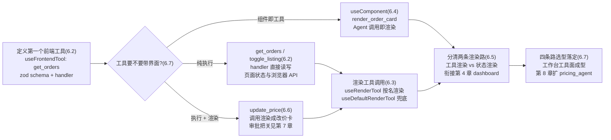
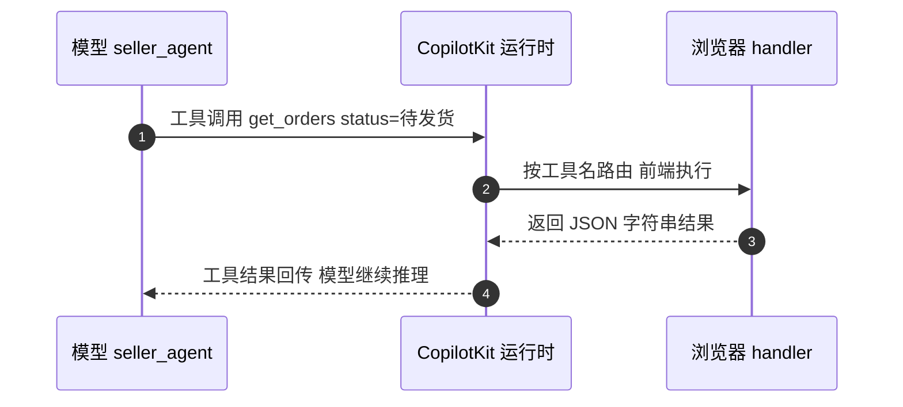
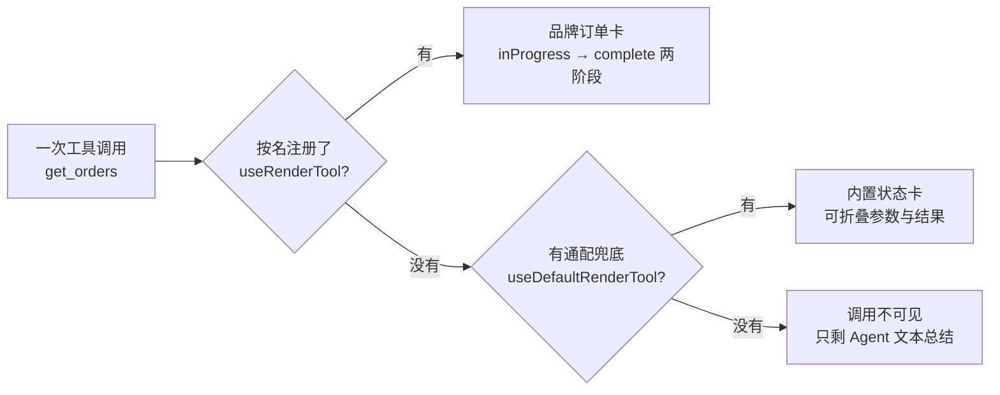
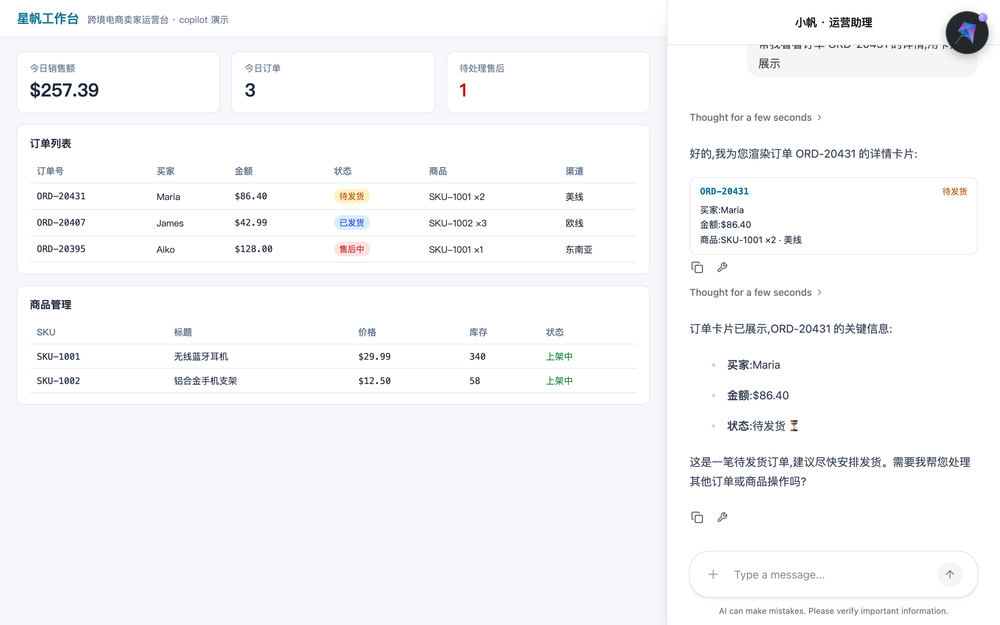
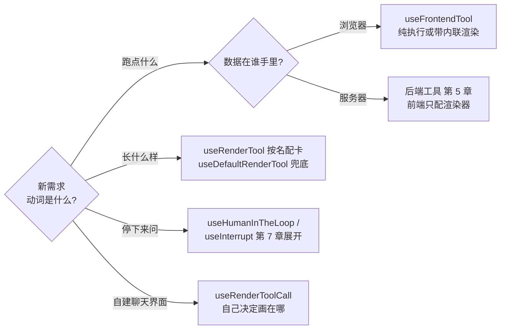

# 第 6 章 前端工具与生成式 UI

> 本章导读：第 5 章把星帆工作台的 copilot 换成了 LangGraph 后端 Agent `seller_agent`，它能查「ORD-20431 为什么还没发货」了——但回答落地的方式还是一句话文本，工具调用在聊天里要么看不见、要么是一坨裸 JSON。本章补上 Agent 与界面的最后两块拼图：一是**前端工具（frontend tool）**——在浏览器里执行的函数，`get_orders` 直接读页面上的订单状态，`update_price`、`toggle_listing` 直接改界面；二是**生成式 UI（Generative UI）**——让 Agent 的回答里直接长出订单卡片组件，而不是让用户自己对着一串 JSON 脑补。读完本章，你能：用 `useFrontendTool` 定义在浏览器里执行的工具；用 `useRenderTool` 与 `useDefaultRenderTool` 把任意工具调用渲染成体面的卡片；用 `useComponent` 把现成 React 组件注册成 Agent 可调用的工具；并在「纯执行 / 带渲染 / 仅渲染 / 组件即工具」四条路线里为每个需求选对那一条。



*本章操作流程图*

## 你什么时候需要它

三种典型处境，对应本章三条主线。

**Agent 需要操作界面本身**——改 React 状态、弹一个 toast、打开某个抽屉、读写 `localStorage`。这些事发生在用户的浏览器里，后端 Agent 够不着。看 6.2:`useFrontendTool` 把一个带 schema 的函数注册给 Agent，handler 在浏览器里执行，返回值回传给模型。

**Agent 调了工具，但聊天里的过程不可见、结果不体面**——预置组件不会替你画工具调用；没有渲染器时，用户只看到 Agent 最后的文本总结，中间调了什么、参数是什么一概不知。看 6.3：一行 `useDefaultRenderTool()` 先兜底，再用 `useRenderTool` 给重点工具换上品牌卡片。

**手里已经有一批做好的 React 组件，想让 Agent 直接用**——订单卡片、图表、状态徽章，组件只吃 props、不关心 CopilotKit。看 6.4:`useComponent` 把组件注册成工具，Agent 调用即在聊天里渲染，参数就是 props。

另外，Agent 执行到一半需要用户拍板（确认改价、选择方案）——这是交互型生成式 UI，React 里的原生做法是 `useInterrupt`，本章 6.6 只立骨架，完整实现连同 `useHumanInTheLoop` 审批在第 7 章。

前置：第 4 章的共享状态（`dashboard` 与 `useAgent`）、第 5 章接入的 `seller_agent`。本章代码继续落在 `starfish-console` 工程。

## 6.1 概述：前端工具是什么

官方文档给前端工具的定义一句话：**让 Agent 定义并调用完全在用户浏览器里执行的客户端函数**。handler 跑在前端，因此天然能拿到三样后端工具拿不到的东西：组件状态、浏览器 API（`localStorage`、`sessionStorage`、cookie），以及页面已引入的任何第三方 UI 库。这就是「Agent 伸手够进应用」的含义：更新 React state、触发动画、弹 toast、引导用户视线，都是同一个原语的应用。

同一个原语还支撑着生成式 UI 与人工介入（Human-in-the-Loop）两套交互模式——本章讲工具本体与生成式 UI，人工介入留给第 7 章。

### 6.1.1 与后端工具的分工

第 5 章的 `seller_agent` 里，查物流、查售后单这类工具定义在 LangGraph 图里，执行在后端，靠的是服务器的数据库与内部接口。前端工具是同一套工具机制的另一半，两者的分工：

| | 后端工具 | 前端工具 |
| --- | --- | --- |
| 定义位置 | LangGraph 节点 / Agent 代码（第 5 章） | React 组件树内，`useFrontendTool` |
| 执行位置 | 服务器 | 用户浏览器 |
| 能拿到什么 | 数据库、内部接口、密钥 | 组件状态、浏览器 API、第三方 UI 库 |
| 适合 | 查询与修改业务数据 | 操作界面：改状态、弹提示、跳转、动画 |
| 星帆工作台的例子 | 查「ORD-20431 的物流轨迹」 | `get_orders` 读页面订单列表 |
| 典型顾虑 | 鉴权、限流、数据脱敏 | 别把密钥和敏感逻辑放进浏览器 |

**分工的判断标准只有一条：这件事需要谁的上下文，就在谁那里执行。**「这单为什么没发货」要查仓库系统，后端；「帮我把待发货的订单筛出来」看的是用户眼前这个页面，前端。两者不互斥——同一个 Agent 里，`seller_agent` 的后端工具管数据，本章的前端工具管界面。

### 6.1.2 生成式 UI：Agent 决定屏幕上出现什么

生成式 UI（Generative UI）是 CopilotKit 提供的一组原语，让 **Agent 决定屏幕上出现什么**——从一个你写好的应用组件，到按目录编排的布局，再到 MCP 服务器随工具附带的沙箱界面。官方把它归为六种原语：

| 原语 | 做什么 | 本章覆盖 |
| --- | --- | --- |
| 组件即工具（Components as Tools） | 把应用组件注册成前端工具，Agent 调用后以内联组件渲染 | 6.4 |
| 工具调用渲染（Tool Call Rendering） | 把后端工具调用映射成自定义 UI 卡片，带实时状态与结果 | 6.3 |
| 状态渲染（State Rendering） | 订阅 Agent 流式状态，值一到就重渲染 | 6.5（衔接第 4 章） |
| 推理渲染（Reasoning） | 把模型推理 token 作为一等消息类型内联渲染 | 第 3 章 3.6 已涉及 |
| A2UI | Agent 发声明式 schema，前端按注册目录编排 | 不展开，见 6.7 说明 |
| MCP Apps | 内嵌 MCP 服务器随工具附带的 UI，沙箱 iframe 渲染 | 不展开，见第 8 章 |

按「谁来控制界面」看，这些原语落在一条光谱上：**受控（controlled）**——组件是你写的，Agent 只决定渲染哪个、传什么数据，可预测性最高；**声明式（declarative）**——Agent 发结构化描述，前端在你注册的目录里编排；**开放式（open-ended）**——界面在别处（如 MCP 服务器）发明，你负责沙箱。同一个应用、同一个运行时、同一条 AG-UI 协议（协议细节见第 8 章），选哪一种是**按功能逐个决定，不是按产品一次决定**。

本章主线是受控一端的三个 React hook；它们与「要不要界面」组合出四条路线，6.7 汇总成决策表。

### 6.1.3 v2 工具相关 hook 一览

CopilotKit v2 把「让 Agent 做事」和「渲染 Agent 做的事」分成两组 hook。先给全景，后面各节逐一展开：

| hook | 什么时候用 |
| --- | --- |
| `useFrontendTool` | 给 Agent 一个在浏览器里执行的工具（schema + handler），可选带内联界面 |
| `useFrontendTools` | 批量注册一组前端工具，数组随状态变化增删 |
| `useRenderTool` | 按名字为某个工具调用定制渲染，不定义工具本体 |
| `useDefaultRenderTool` | 为所有没有专属渲染器的工具调用提供通配渲染 |
| `useComponent` | 把 React 组件注册成命名工具（组件优先的生成式 UI） |
| `useRenderToolCall` | 无头界面下取渲染函数，自己决定工具调用画在哪里 |

**两组 hook 的边界要分清：`useFrontendTool` 与 `useComponent` 注册的是工具，Agent 可以调用；`useRenderTool`、`useDefaultRenderTool`、`useRenderToolCall` 只负责渲染工具调用，不定义工具。**渲染器可以配后端工具——前端只决定调用长什么样，handler 一行都不用写。

## 6.2 useFrontendTool：定义第一个前端工具

从 `get_orders` 开始。星帆工作台的订单列表页本来就有一份订单数据在 React 状态里——Agent 要回答「现在有多少待发货订单」，不需要新开接口，只需要能读到这份状态。

### 6.2.1 完整示例

在 Provider 之下的组件树里注册（我们放在 `src/copilot/tools.tsx`，随订单页一起挂载）：

```tsx
// src/copilot/tools.tsx
import { useFrontendTool } from "@copilotkit/react-core/v2";
import { z } from "zod";

const OrderStatus = z.enum(["待发货", "已发货", "已完成", "售后中"]);

const OrderSchema = z.object({
  orderId: z.string(),
  buyer: z.string(),
  amount: z.number(),
  status: OrderStatus,
});

export type Order = z.infer<typeof OrderSchema>;

export function FrontendTools({ orders }: { orders: Order[] }) {
  useFrontendTool({
    name: "get_orders",
    description:
      "查询星帆工作台当前订单列表,可按状态过滤。" +
      "回答任何订单相关问题前,先调用本工具获取真实数据。",
    parameters: z.object({
      status: OrderStatus.optional().describe(
        "按状态过滤,不传则返回全部订单"
      ),
    }),
    handler: async ({ status }) => {
      const result = status
        ? orders.filter((order) => order.status === status)
        : orders;
      return JSON.stringify(result);
    },
  });

  return null;
}
```

挂载在 App 里（第 3 章之后，聊天组件已是 `CopilotSidebar`，Provider 的 `agentId` 指向第 5 章的 `seller_agent`）：

```tsx
// src/App.tsx(节选)
import { FrontendTools } from "./copilot/tools";

<CopilotKitProvider runtimeUrl="http://localhost:8200/api/copilotkit" agentId="seller_agent">
  <FrontendTools orders={orders} />
  {/* 订单列表页 + CopilotSidebar */}
</CopilotKitProvider>
```

`useFrontendTool` 接收三样东西：**名字**（`get_orders`，Agent 看到的工具名）、**zod 参数 schema**（告诉模型该填什么参数）、**handler**（浏览器里真正执行的函数）。注册之后，一次调用的完整生命周期——schema 声明给模型、模型发起调用、handler 在浏览器执行、结果原路回传：



*图 6-1：前端工具一次调用的生命周期——handler 在浏览器执行，返回值回传给 Agent 作为工具结果*

两个写法要点，都来自第 4 章 mcp 书同源的手艺（工具描述与 schema 设计是通用功）：

1. **description 用任务语义写**——说「做什么、什么时候该用我」，不说「调用哪个函数」。`get_orders` 的描述里那句「回答任何订单相关问题前先调用本工具」，是在给模型立规矩。
2. **每个参数都配 `.describe()`**——schema 是模型填参的唯一依据，`status` 的枚举值直接决定了模型会填「待发货」而不是「pending」。

**验证点**：在工作台侧栏问「现在有多少待发货订单？」。观察 CopilotKit Inspector（或浏览器 Network 面板）能看到 `get_orders` 被调用、参数为空对象或 `{"status": "待发货"}`，Agent 的回答基于 handler 返回的真实订单数据（应有 `ORD-20431` 一单，金额 $86.40）。

### 6.2.2 副作用工具：update_price 与 toggle_listing

查询工具只读，操作工具要改界面。把商品管理页的两个操作也注册进来：

```tsx
// src/copilot/tools.tsx(追加)
import { updatePrice, toggleListing } from "../api/products";

export function ProductTools() {
  useFrontendTool({
    name: "update_price",
    description:
      "修改指定 SKU 的售价。属于敏感操作,调用前先向用户复述旧价与新价,确认意图。",
    parameters: z.object({
      sku: z.string().describe("SKU 编码,如 SKU-1001"),
      newPrice: z.number().describe("新售价(美元)"),
    }),
    handler: async ({ sku, newPrice }) => {
      await updatePrice(sku, newPrice);
      return `SKU ${sku} 的价格已更新为 ${newPrice}`;
    },
  });

  useFrontendTool({
    name: "toggle_listing",
    description: "上架或下架指定 SKU。下架后买家端立即不可见。",
    parameters: z.object({
      sku: z.string().describe("SKU 编码"),
      listed: z.boolean().describe("true 上架,false 下架"),
    }),
    handler: async ({ sku, listed }) => {
      await toggleListing(sku, listed);
      return `SKU ${sku} 已${listed ? "上架" : "下架"}`;
    },
  });

  return null;
}
```

两个注意点：

- **handler 里调用的是工作台既有的业务函数**（`updatePrice`、`toggleListing` 走你已有的请求层）。前端工具不是新开一条后端通道，而是给 Agent 一双操作现有界面的手。
- **`update_price` 的 description 里已经写了「先复述、再确认」**——但提示词约束只是劝说，不是闸门。真正的审批机制（`useHumanInTheLoop`，Agent 提出改价必须人工确认）在第 7 章加上；本章先把工具与它的界面做出来。

### 6.2.3 批量注册：useFrontendTools

`useFrontendTool` 一次注册一个工具，**不能在长度会变化的列表上循环调用**（每次渲染重跑 effect 会反复注册）。当工具集合来自状态、props 或后端响应时，用 `useFrontendTools`：它接收一个数组、对整个数组跑一次 effect，数组这一帧为空、下一帧有二十个条目都没问题：

```tsx
import { useFrontendTools } from "@copilotkit/react-core/v2";
import { useNavigate } from "react-router";

function ReportTools({ reports }: { reports: Report[] }) {
  const navigate = useNavigate();

  useFrontendTools(
    reports.map((report) => ({
      name: `open_${report.id}`,
      description: `打开「${report.title}」报表`,
      handler: async () => navigate(`/reports/${report.id}`),
    })),
    [navigate],
  );

  return null;
}
```

离开数组的工具被注销，加入的被注册，重渲染产生相等列表时不会重复注册。第二个参数用来传 handler 闭包捕获的值（如上面的 `navigate`）。星帆工作台的用法：物流看板为三条线路各注册一个 `open_lane_us` / `open_lane_eu` / `open_lane_sea` 跳转工具，线路配置从后端拉来，数组随配置变化。

### 6.2.4 LangGraph 侧：前端工具怎么到达 seller_agent

前端工具经 AG-UI 协议暴露给 Agent。对第 5 章的 LangGraph Agent，官方文档给出的映射是：

| LangGraph 侧 | 前端侧 | 行为 |
| --- | --- | --- |
| LLM 经 `bind_tools` 正常调用前端工具 | `useFrontendTool` / `useComponent` | 模型自己决定何时调用；handler 在浏览器执行 |
| `copilotkit_emit_tool_call(config, name, args)` | `useFrontendTool` | 图节点里手动触发前端 handler，不必等 LLM 决定 |
| `copilotkit_customize_config(config, emit_tool_calls=["ToolName"])` | — | 过滤哪些工具调用流向前端，屏蔽噪声 |

这里有一个值得记住的区分：**持久化工具调用**（LLM 生成的、存在 `state["messages"]` 里的消息）会进聊天历史、刷新页面后重放；**发射型工具调用**（`copilotkit_emit_tool_call`）是瞬时事件，立即触发前端 handler，但**不**写入聊天历史，除非你手动把消息加进 state。本章的 `get_orders` 属于前者——它要留在对话里，6.3 的渲染才有对象。

### 6.2.5 v1 遗留对照

老代码与旧教程里，这一节的角色由 `useCopilotAction` 承担。v2 的官方迁移表是**一对一替换：`useCopilotAction` → `useFrontendTool`**，同时包名从 `@copilotkit/react-core` 换到 `@copilotkit/react-core/v2`。概念上一脉相承（名字、参数、handler、render），所以旧代码迁移成本很低；但**新代码一律直接写 `useFrontendTool`**，本书后续不再出现 v1 名字。

## 6.3 工具调用的渲染：让过程可见、结果体面

工具注册好之后，先别急着加功能，在聊天里问一句「ORD-20431 的买家是谁」。这条调用最后画成什么，由渲染器的注册情况决定——没有任何渲染器时，调用直接坠入不可见的黑箱：



*图 6-2：一条工具调用的三种结局——专属卡、兜底卡、不可见。预置组件默认不画工具调用，渲染要自己装*

### 6.3.1 零配置兜底：useDefaultRenderTool

最简单的入口，无参调用：

```tsx
import { useDefaultRenderTool } from "@copilotkit/react-core/v2";

function ToolRendering() {
  useDefaultRenderTool();
  return null;
}
```

这会把 CopilotKit 内置的 `DefaultToolCallRenderer` 注册为 `*` 通配渲染器：每个工具调用画成一张整洁的状态卡——工具名、实时的「Running → Done」状态胶囊、可折叠的参数与结果。Agent 连续调用的多个工具会被折叠成一张「Used 3 tools」卡片，展开后每次调用一行。

想给兜底卡也换上品牌样式，传一个 `render`：

```tsx
useDefaultRenderTool({ render: BrandedToolCard, group: true });
```

`group: true` 让你自己的渲染器也参与默认的折叠分组；不加则你的卡片始终独立展示，并把前后的调用组隔开。

### 6.3.2 按名字渲染：useRenderTool

兜底卡解决「看得见」，解决不了「好看」。最有个性的做法是**一个工具名配一个渲染器**——把 `get_orders` 的调用画成品牌订单卡：

```tsx
// src/copilot/renderers.tsx
import { useRenderTool } from "@copilotkit/react-core/v2";
import { z } from "zod";

function OrderListCard({ orders, filter }: { orders: Order[]; filter?: string }) {
  return (
    <div className="order-list-card">
      {filter && <p>筛选条件:{filter}</p>}
      <ul>
        {orders.map((order) => (
          <li key={order.orderId}>
            {order.orderId} · {order.buyer} · ${order.amount} · {order.status}
          </li>
        ))}
      </ul>
    </div>
  );
}

export function OrderToolRenderer() {
  useRenderTool({
    name: "get_orders",
    parameters: z.object({
      status: z.string().optional(),
    }),
    render: ({ status, parameters, result }) => {
      if (status !== "complete") {
        return (
          <div className="tool-loading">
            正在查询订单
            {parameters.status ? `(状态:${parameters.status})` : ""}……
          </div>
        );
      }
      const orders: Order[] = JSON.parse(result);
      return <OrderListCard orders={orders} filter={parameters.status} />;
    },
  });

  return null;
}
```

渲染函数收到三样东西，这是**必须记牢的契约**：

| 入参 | 是什么 | 什么时候有值 |
| --- | --- | --- |
| `parameters` | Agent 发给工具的**输入参数**（已按 schema 解析） | 流式阶段就是**部分值**，随生成逐步补全 |
| `status` | 调用的实时状态 | 注册即有；从 `inProgress` 推进到 `complete` |
| `result` | 工具的返回值，**字符串** | 仅当 `status` 变为 `complete` |

两条文档明说的使用纪律：**参数还在流式生成时是残缺的，必填字段要等 `status` 离开 `inProgress` 再读**；**`result` 是字符串，工具返回 JSON 就先 `JSON.parse` 再读字段**。

`useRenderTool` 的 `name` 必须与 Agent 暴露的工具名一致，运行时靠这个名字把调用路由到你的组件。**渲染器可以配给后端工具**：给第 5 章 `seller_agent` 里定义的 `query_logistics` 之类后端工具配一个 `useRenderTool`，前端一行 handler 都不用写——这正是「渲染 hook 不定义工具」的分工。

**验证点**：再问一次「ORD-20431 的买家是谁」。这次聊天里应先出现「正在查询订单……」的加载卡，随后变成列出 `ORD-20431 · Maria · $86.40 · 待发货` 的订单卡。其他工具（`toggle_listing` 等）仍走 6.3.1 的兜底卡。

### 6.3.3 一个高频坑：「complete」不会替你填卡片

文档专门用一段警告这个错误，这里原样立此存照：**`parameters` 里装的是 Agent 发出的输入，`status` 变成 `complete` 时它不会变成工具的返回值**；返回值单独从 `result`（字符串）里来。

比如 `get_weather` 收到 `{ "location": "Paris" }`、返回 `{ "temperature": 22 }`：城市读 `parameters.location`，气温读解析后的 `result.temperature`。把 `temperature` 加进渲染器的 `parameters` schema 并不会让它凭空出现。卡片显示「已完成」却还在展示占位内容，第一件事就是检查那些内容是不是错从 `parameters` 里取的——**完成只代表工具返回了，不会替你填 props**。

### 6.3.4 分组与展示形态

Agent 常常一口气调好几个工具。调用行的整体展示形态由消息视图的 `toolCallDisplay` 控制：

```tsx
<CopilotChat messageView={{ toolCallDisplay: "line" }} />
```

| 形态 | 用户看到什么 |
| --- | --- |
| `"grouped"`（默认） | 一连串调用折叠成一张「Used 3 tools」卡，展开后每次调用一行 |
| `"line"` | 同样的分组，但收敛成一行安静的文字，如「思考了 4 秒」 |
| `"stacked"` | 最新调用叠在一串早先调用之上，展开成每次调用一张卡 |
| `"turn"` | Agent 公开干活，回复前的一切折叠成「工作了 9 秒」 |
| `"separate"` | 每次调用一张独立的卡 |

星帆工作台的选择：`get_orders` 有专属卡片，走 `"separate"` 最体面；次要工具靠兜底卡分组收纳。分组卡本身也可以换——`messageView.assistantMessage.toolCallsView.group` 插槽接收你的时间线组件（第 3 章插槽机制的直接应用）。

### 6.3.5 无头界面：useRenderToolCall

如果聊天界面是第 3 章 3.8 那样的自建无头界面，渲染责任完全在你：`useRenderToolCall()` 返回一个渲染函数，把任意工具调用画到你的布局里想放的位置。预置组件帮你画的时候，组件是 `CopilotChatToolCallsView`：

```tsx
import { CopilotChatToolCallsView } from "@copilotkit/react-core/v2";

<CopilotChatToolCallsView message={assistantMessage} messages={allMessages} />;
```

它会为每条助手消息里的工具调用找到同组的 `tool` 角色消息，一起交给注册好的渲染器（6.3.2 的 `useRenderTool`、6.4 的 `useComponent`，以及兜底的 `useDefaultRenderTool`，全部自动生效）。更细粒度的摆放才需要自己调 `renderToolCall({ toolCall })`，详见官方 Headless UI 指南。

## 6.4 组件即工具：useComponent

到 6.3 为止，工具和界面是两个东西：`get_orders` 是工具，`OrderListCard` 是渲染器，用 `useRenderTool` 把它们缝在一起。CopilotKit 还提供了更直接的形态：**把 React 组件本身注册成工具**——`useComponent`。

### 6.4.1 订单卡片上线

```tsx
// src/copilot/generative-ui.tsx
import { useComponent } from "@copilotkit/react-core/v2";
import { z } from "zod";

const OrderCardProps = z.object({
  orderId: z.string().describe("订单号,如 ORD-20431"),
  buyer: z.string().describe("买家称呼"),
  amount: z.number().describe("订单金额(美元)"),
  status: z
    .enum(["待发货", "已发货", "已完成", "售后中"])
    .describe("订单状态"),
});

function OrderCard({ orderId, buyer, amount, status }: z.infer<typeof OrderCardProps>) {
  return (
    <div className="order-card">
      <header>
        <strong>{orderId}</strong>
        <span className={`badge badge-${status}`}>{status}</span>
      </header>
      <p>
        买家 {buyer} · 金额 ${amount.toFixed(2)}
      </p>
    </div>
  );
}

export function GenerativeUI() {
  useComponent({
    name: "render_order_card",
    description: "在聊天里渲染一张订单卡片,用于向卖家展示单个订单的详情",
    parameters: OrderCardProps,
    render: OrderCard,
  });

  return null;
}
```

`useComponent` 接收名字、zod schema 和要渲染的组件。运行时把它注册成**一个前端工具**，Agent 可以发现并调用；schema 就是这个工具的参数定义——模型填的参数会原样作为 typed props 传给组件。组件本身是普通 React：只读 props，对 CopilotKit 一无所知，数据还可以随 Agent 填充而流式补全。

命名有一条官方建议：**传给 `useComponent` 的名字就是 Agent 看到的工具名，用动词开头**（如 `render_order_card`、`show_weather`），模型在用户要可视化时才靠得住地选中它。

**验证点**：问「把 ORD-20431 这单展示成卡片」。Agent 应调用 `render_order_card`，参数 `orderId: "ORD-20431"`、`buyer: "Maria"`、`amount: 86.4`、`status: "待发货"`，聊天里出现一张真正的订单卡片组件。

星帆工作台的实测效果——聊天流里出现的是 6.4.1 的 `OrderCard` 组件，不是文本：



*图 6-4：`useComponent` 的实测效果——Agent 调用 `render_order_card`，聊天里渲染出真正的订单卡片，Agent 随后用文本补充要点*

### 6.4.2 与工具渲染的分界

官方对两种形态的分界说得很清楚，整理成表：

| | 工具渲染（useRenderTool） | 组件即工具（useComponent） |
| --- | --- | --- |
| 本质 | 给一个**真实存在的工具调用**包上自定义 UI | **组件本身就是工具**，没有 handler |
| 执行 | 工具在后端（或前端 handler）真实执行 | 没有服务端执行、没有用户交互逻辑，只有渲染 |
| Agent 的角色 | 决定调工具、填参数，结果由工具产生 | 决定何时展示、填什么数据，CopilotKit 负责画 |
| 适合 | 给后端工具做操作透明化的品牌卡片 | 卡片、图表、表格、预览、状态摘要等展示型 UI |

规则：**要包一个真实工具，用 `useRenderTool`；要 Agent 直接「说出」一个组件，用 `useComponent`。**需要用户在组件上操作的（审批、选择），属于交互型生成式 UI，见 6.6 与第 7 章。

### 6.4.3 两个必须知道的细节

- **`parameters` 可以省，但省略有代价**——省略后工具以空参数 schema（`{ "type": "object", "properties": {} }`）对外广播，模型无参可填，组件渲染时一个 props 都拿不到。需要数据的组件，务必传 schema。
- **无头聊天里，注册了不等于画了**——预置聊天组件会替你画注册的组件；无头或自建聊天自己渲染消息列表，没人画工具调用，聊天会一直是空的。用 6.3.5 的 `CopilotChatToolCallsView`（或 `useRenderToolCall`）把调用画出来。

## 6.5 状态渲染与工具渲染：两条路怎么分工

第 4 章已经用过一种「界面跟着 Agent 变」的方式：`useAgent` 订阅 `dashboard` 状态，Agent 那边流式推进，页面数字跟着变——那叫**状态渲染（state rendering）**。本章的 6.3、6.4 是**工具渲染（tool rendering）**。两者都叫生成式 UI，但机制不同，选错会别扭：

| | 状态渲染（第 4 章） | 工具渲染（本章） |
| --- | --- | --- |
| 数据来源 | Agent 的**状态对象**（如 `dashboard`） | 一次具体的**工具调用**（参数 + 结果） |
| 更新方式 | 状态流式推进，值一到就重渲染，可以是逐 token 的 | 调用开始时出现，`complete` 时补上结果 |
| 界面归属 | **你的应用界面**（订单页、看板原地更新） | **聊天消息流**（内联在对话里） |
| 生命周期 | 与状态同在，刷新后是最新值 | 与消息同在，随对话历史重放 |
| 官方定位 | 订阅 Agent 流式状态并实时重渲染 | 把后端工具调用映射成带状态与结果的 UI 卡 |
| 典型场景 | 进度（「研究中……2/5」）、草稿随写随显、仪表盘 | 展示调了什么工具、参数、实时状态、最终结果 |

机制上的分野在数据通道：状态渲染的值从 Agent 状态流来（某些框架经中间件把工具参数边生成边推进 state key，直连 SDK 适配器则从流式循环里发 `STATE_SNAPSHOT` 事件）；工具渲染的值从**对话里的工具调用消息**来，前端渲染器按名字认领。

**本书立场：界面里的业务数据走状态渲染，对话里的过程与结果走工具渲染。**「待处理售后数」这个数字属于页面，放 `dashboard`（第 4 章）；「我查了订单、查到这些」属于对话，放订单卡（本章）。硬用工具渲染去更新页面，你得从消息流里捞数据再写回界面，徒增一层；硬用状态渲染做对话内的结果展示，又会把一次性结果做成常驻状态。两条路叠加使用才顺：Agent 调 `get_orders`（对话里出现订单卡，工具渲染），同时 `dashboard` 的「今日销售额」在页面上刷新（状态渲染）。

## 6.6 展示型与交互型生成式 UI

前面做的组件都是**只读的**：订单卡展示数据，用户看完继续聊。生成式 UI 的另一半是**交互型**：组件上有按钮，用户的决定要回到 Agent 手里——确认改价、选择方案、批准执行。

### 6.6.1 展示型：update_price 的改价卡

先给 `update_price` 的工具调用配上渲染。它是敏感操作，卡片要把参数亮出来让卖家看清：

```tsx
// src/copilot/renderers.tsx(追加)
function PriceChangeCard({ sku, newPrice, oldPrice }: {
  sku: string;
  newPrice: number;
  oldPrice?: number;
}) {
  return (
    <div className="price-change-card">
      <p>
        <strong>{sku}</strong> 改价:{oldPrice ?? "?"} → <strong>${newPrice}</strong>
      </p>
      <p className="hint">执行结果见下方状态</p>
    </div>
  );
}

useRenderTool({
  name: "update_price",
  parameters: z.object({
    sku: z.string(),
    newPrice: z.number(),
  }),
  render: ({ status, parameters, result }) => {
    if (status !== "complete") {
      return (
        <PriceChangeCard sku={parameters.sku} newPrice={parameters.newPrice} />
      );
    }
    return (
      <>
        <PriceChangeCard sku={parameters.sku} newPrice={parameters.newPrice} />
        <p className="result">{result}</p>
      </>
    );
  },
});
```

这张卡是**展示型**的：它让改价操作透明——改了哪个 SKU、从多少钱到多少钱、执行成功没有。参数流式生成时卡片先出现，`complete` 后补上结果行。

### 6.6.2 交互型：Agent 暂停，等人拍板

展示型卡片再漂亮，也只是「通知」。交互型的定义是：**Agent 暂停执行，等用户输入后才能继续**——审批流、确认对话框、需要人工判断的分支，都属于这一类。

React 里的原生做法是 `useInterrupt`：注册一个打断渲染器，Agent 暂停时组件内联挂进聊天、捕获用户的选择，然后带着这个输入恢复执行。它的完整契约——`enabled` 过滤、`handler` 预处理、`resolve` 回传、AG-UI 标准打断流与旧式流的差别——是第 7 章的主题。本章只立一个骨架：

```tsx
import { useInterrupt } from "@copilotkit/react-core/v2";

useInterrupt({
  agentId: "seller_agent",
  enabled: (event) => event.value.type === "approval",
  render: ({ event, resolve }) => (
    <PriceApproveCard
      content={event.value.content}
      onApprove={() => resolve({ code: "APPROVE" })}
      onCancel={() => resolve({ code: "CANCEL" })}
    />
  ),
});
```

工具级的审批还有另一把钥匙 `useHumanInTheLoop`：在某个工具调用上暂停，等用户批准、修改或补充输入。第 7 章会把 `update_price` 接上它，做成完整的受治理动作（governed action）。

**立场句要加粗：能展示不等于能放行。**6.6.1 的改价卡是给用户看的，不是闸门；真正的「Agent 提出改价 → 人工确认 → 才执行」需要打断机制，那是第 7 章的事。把「显示确认界面」与「拿到用户决定后继续执行」当成两个问题分开设计，是交互型生成式 UI 最重要的纪律。

### 6.6.3 组件带交互怎么办

`useComponent` 的定位是展示型（「没有 handler、没有用户交互、没有服务端执行」），组件上要放按钮时，官方的指引就是转向 Human-in-the-Loop 模式。一个折中是按钮只做**纯前端**的事（展开详情、切 tab），这类交互不需要 Agent 参与，照常写在组件里；按钮要**改变 Agent 的执行**（批准、否决、选择），就必须走打断/审批通道。判断标准与 6.1.1 一致：这件事要不要回到 Agent 那里。

## 6.7 选型决策：一个需求的四条路

本章的 hook 可以组合出四条路线。先上总表，再给决策流程。

### 6.7.1 四条路线对比

| 路线 | hook | 工具在哪执行 | 有没有界面 | 星帆工作台的例子 |
| --- | --- | --- | --- | --- |
| 纯执行 | `useFrontendTool`（不传 `render`） | 浏览器 | 无 | `get_orders`、`toggle_listing` |
| 定义时带渲染 | `useFrontendTool` + `render` | 浏览器 | 有，随工具注册 | 执行类工具想一步到位带内联 UI |
| 仅渲染 | `useRenderTool` / `useDefaultRenderTool` | 后端（或前端 handler） | 有，渲染器单独注册 | `update_price` 改价卡、后端工具品牌卡 |
| 组件即工具 | `useComponent` | 浏览器（渲染即全部） | 有，组件即工具 | `render_order_card` |

注意第二条与第三条的区别：第二条在**定义工具时**顺手给了界面（官方对 `useFrontendTool` 的描述是「可选带内联 UI」）；第三条**不定义工具**，只给调用画皮——所以它也能配后端工具。四条路都成立时，**本书立场：优先「纯执行 + 仅渲染」的组合**——工具定义与界面解耦，后端团队改工具不用动前端渲染，前端团队换卡片不用碰工具，和 6.3.2 的验证点演示的组装方式一致。「定义时带渲染」留给轻量的、界面跟工具强绑定的小场景。

### 6.7.2 决策流程

官方选型页的口诀是「从动词出发」（start with the verb）——先问 Agent 该干什么，再落到 hook，数据位置决定前端工具还是后端工具：



*图 6-3:「从动词出发」的选型决策——四个动词各对应一条路线*

对应到工作台的三个工具，落位是：`get_orders` 纯执行 + `useRenderTool` 订单卡；`update_price` 纯执行 + 改价卡，第 7 章加 `useHumanInTheLoop`；`toggle_listing` 纯执行 + 兜底卡；展示组件 `render_order_card` 走 `useComponent`。

### 6.7.3 超出受控光谱的路线，一句带过

本章讲的全是**受控**一端：组件你写，Agent 只选哪个、传什么。如果需求变成「让 Agent 按目录自由编排布局」，受控路线就不够了——官方的声明式方案是 A2UI（Agent 发声明式 schema，两种口味：动态 schema 由 LLM 生成、固定 schema 由你编写 Agent 只填数据）与 JSON Render（Agent 发 `{ root, elements }` 对象，经 `@json-render/react` 的类型化组件注册表渲染）；开放式一端是 MCP Apps（内嵌 MCP 服务器随工具附带的沙箱界面）。这几条与本章的 hook 不冲突，可以按功能混用；星帆工作台当前的需求（订单卡、改价卡）用受控路线足够，声明式路线等第 8 章扩 `pricing_agent` 子代理后再评估。

## 本章小结

1. **前端工具是 Agent 操作界面的出口**：handler 在浏览器里执行，直接够到组件状态、浏览器 API 与第三方库；判断标准是「需要谁的上下文，就在谁那里执行」，与第 5 章的后端工具分工而非互替。
2. **`useFrontendTool` 三件套**：名字 + zod schema + handler；返回值回传给模型；批量注册用 `useFrontendTools`；v1 的 `useCopilotAction` 与它一对一对应，新代码一律用 v2。
3. **工具调用默认不可见，渲染要自己装**：`useDefaultRenderTool()` 一行兜底；`useRenderTool` 按名配品牌卡，契约是流式的 `parameters`、`inProgress → complete` 的 `status`、字符串 `result`；「complete 不填 props」是最高频的坑。
4. **`useComponent` 把组件注册成工具**：schema 即参数定义、参数即 props，适合展示型 UI；参数 schema 别省略，无头聊天要用 `CopilotChatToolCallsView` 自己画。
5. **两条渲染路各管一摊**：界面里的业务数据走状态渲染（第 4 章 `dashboard`），对话里的过程与结果走工具渲染（本章）；叠加使用。
6. **选型从动词出发**：跑点什么 → `useFrontendTool`；长什么样 → 渲染 hook；停下来问 → `useHumanInTheLoop` / `useInterrupt`（第 7 章）；自建界面 → `useRenderToolCall`。展示不等于放行，审批在第 7 章。

## 验收清单

读到这里，你应该能：

- ☐ 为一个「读页面状态」的需求写完整的 `useFrontendTool` 注册（名字、zod schema、handler），并说出 handler 返回值去了哪里；
- ☐ 在工具集合随状态变化的场景里改用 `useFrontendTools`，并解释为什么不能在变长列表上循环调 `useFrontendTool`；
- ☐ 给后端工具配 `useRenderTool` 渲染器，正确处理流式参数、`status` 与 `JSON.parse(result)`，并说明「complete 但卡片是占位符」的原因；
- ☐ 用 `useComponent` 把一个纯 props 组件注册成工具，并说出它与 `useRenderTool` 在「本质」上的分界；
- ☐ 说出状态渲染与工具渲染的数据来源、界面归属差异，并为「页面数字刷新」与「对话内结果卡片」各选对一条；
- ☐ 面对一个新需求，沿「从动词出发」的流程在四条路线里选定一条并说明理由；
- ☐ 指出 6.6.1 改价卡为什么不构成审批，以及补上审批该用哪个 hook（第 7 章）。

## 参考速查

理解主线不依赖本节。工具相关 hook 与关键契约：

| 项 | 值 |
| --- | --- |
| `useFrontendTool` | `{ name, description, parameters(zod), handler, render? }`；handler 返回值即工具结果回传模型 |
| `useFrontendTools` | `{ (工具数组), [依赖] }`；数组增删即注册/注销，相等列表不重注册 |
| `useRenderTool` | `{ name, parameters, render }`；`name` 匹配工具名，路由到渲染器 |
| `useDefaultRenderTool` | 无参 = 内置通配卡；`{ render, group? }` = 自定义通配 |
| `useComponent` | `{ name, description?, parameters?, render }`；内部包装 `useFrontendTool`，handler 即渲染组件 |
| `useRenderToolCall()` | 无头界面取渲染函数；预置组件场景用 `CopilotChatToolCallsView` |
| render 契约 | `({ status, parameters, result })`；`parameters` 流式残缺；`status: inProgress → complete`；`result` 为字符串 |
| `toolCallDisplay` | `"grouped"`（默认）/ `"line"` / `"stacked"` / `"turn"` / `"separate"` |
| v1 → v2 | `useCopilotAction` → `useFrontendTool`（一对一）；包名 `@copilotkit/react-core/v2` |
| LangGraph 侧 | `bind_tools` 正常调用；`copilotkit_emit_tool_call` 瞬时触发（不入 messages）；`emit_tool_calls` 过滤 |

## 延伸阅读

- **第 7 章（人工介入）**——`update_price` 的下一站：用 `useHumanInTheLoop` 把改价升级成必须人工确认的受治理动作，`useInterrupt` 的完整契约也在那一章展开。
- **第 4 章（共享状态）**——状态渲染的那一半：`dashboard` 怎么订阅、状态怎么流式推进，与本章工具渲染拼成完整的生成式 UI。
- **第 3 章（预置组件与无头界面）**——6.3.5 的 `useRenderToolCall` 与 `CopilotChatToolCallsView` 落在你自建的聊天条里，插槽机制在 6.3.4 换分组卡时再次用到。
- **第 8 章（多 Agent 与生产化）**——AG-UI 协议是前端工具到达 Agent 的通道；扩出 `pricing_agent` 后，本章的四条路线要按 Agent 重新盘点。
- **官方 Generative UI 总览（concepts/generative-ui-overview.mdx）**——本章受控路线之外，声明式（A2UI、JSON Render）与开放式（MCP Apps）的全景与选型表。
