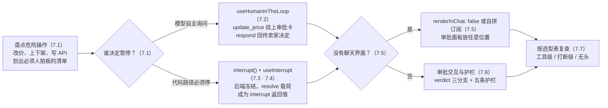

# 第 7 章 人工介入：让人回到决策回路

> 本章导读：第 6 章结束时，星帆工作台的 copilot 已经能调 `get_orders` 查订单、调 `update_price` 改价，回答里还会直接渲染订单卡片——但「改价」这件事有点不对劲：Agent 提出把 SKU-1001 从 $29.99 调到 $24.99，理由听起来头头是道，然后价格就真的变了。定价是卖家的责任，不是模型的权力。本章给星帆工作台装上刹车：CopilotKit 的人工介入（Human-in-the-Loop，HITL）机制让 Agent 在关键动作上暂停下来，把「要不要做」交还给人，拿到答复后再继续跑。我们会认识两类介入机制——工具级审批（`useHumanInTheLoop`）与打断恢复（`useInterrupt`），学会让 LangGraph 后端的 `interrupt()` 与前端渲染卡配合，处理没有聊天界面的无头场景，并给审批卡本身立一套交互设计与安全护栏。读完本章，你能：为 `update_price` 这样的危险前端工具挂上审批卡，并在打断、恢复与无头三种形态下完成一次「Agent 停下、人拍板、Agent 续跑」的完整闭环。



*本章操作流程图*

## 你什么时候需要它

三种典型处境，对应本章三条主线。

**Agent 能调一个有副作用的工具，而这个动作不该由模型说了算**——改价、上下架、退款、调任何写接口。第 6 章的 `update_price` 就是现成的例子：Agent 一句「建议调价」就能真的把价格改了。看 7.2 的 `useHumanInTheLoop`：把这类工具的调用变成一次审批，模型调它时弹出审批卡，卖家点「批准」才生效。

**暂停不是模型的主意，而是业务规则的要求**——支付类操作必须人工放行、工作流走到某个节点必须等人确认、缺一个只有用户才知道的输入。这是代码路径上的确定性检查点，看 7.3 与 7.4：后端在节点里调 `interrupt()` 把运行冻结，前端用 `useInterrupt` 渲染卡片、收集答案、恢复运行。

**触发审批的地方根本不在聊天窗口里**——物流看板上的审批面板、测试脚本里的按钮阵列、一个独立弹窗。看 7.5：`renderInChat: false` 让打断元素渲染在组件树任何位置，官方文档还给出了直接拼装底层原语的无头写法。

前置：第 6 章的 `update_price` 前端工具定义（本章的审批对象沿用第 6 章的它）；第 5 章接入的 LangGraph Agent `seller_agent`（7.4 的后端代码写在那里）。v2 的三个介入 Hook 都从 `@copilotkit/react-core/v2` 导入，与前面章节同源。

## 7.1 概述：为什么 Agent 需要刹车

第 6 章给了 Agent 一双手——前端工具让它能真的操作界面。能力越大，越需要回答一个问题：**哪些动作可以放手让它做，哪些必须有人点头才算数？** 官方文档对人工介入的定义是：让 Agent 在运行中途暂停，向用户收集输入、确认或选择，拿到答复后把答案折叠回自己的推理继续跑。它把一个自治工作流变成协作工作流——Agent 保住上下文，用户握住方向盘。

这层机制不是锦上添花，而是四类真实需求的出口（官方文档列举）：

| 需求 | 星帆工作台的对应场景 |
|------|---------------------|
| 质量把关 | 改价、上下架这类高危操作，落地前必须卖家确认 |
| 边界兜底 | Agent 对售后单 ORD-20395 的处理把握不足时，把决定交还给人 |
| 专家输入 | 退款方式、活动窗口这些模型不具备的业务知识，只有卖家知道 |
| 生产可靠性 | 面向真实流量的系统，需要比「模型说对就行」更稳的回路 |

### 7.1.1 两类介入机制

CopilotKit 提供两条互补的暂停路径。它们从外面看几乎一样——聊天停住、出现一个自定义组件、用户作答、运行恢复——但后端的接线方式完全不同，各有各的主场（官方文档对比表译述）：

| | `useHumanInTheLoop`（工具级审批） | `useInterrupt`（打断恢复） |
|---|---|---|
| 谁决定暂停 | **LLM**——它调用了注册在客户端的一个人工介入工具 | **graph**——节点代码里调用了 `interrupt(...)` |
| 后端形态 | 只是一个前端工具描述（Zod schema + `render`） | LangGraph Agent 里一次服务端 `interrupt()` 调用 |
| 暂停的性质 | 模型自主决定「该问问人」 | 代码路径确定性地要求人类答复 |
| 典型场景 | 模型想改价，弹卡请卖家批准 | 支付放行、工作流审批节点、缺必要输入 |

**选型的第一刀就切在「谁决定暂停」上：模型自己想问的，用工具级审批；业务规则规定必须停的，用打断。** 判断方法很朴素——把后端代码翻出来看：如果「要不要停下来问人」可以由模型自由裁量，走 `useHumanInTheLoop`；如果这条路径上「必须停下来」是写死的业务规则（不批就不能继续），走 `useInterrupt`。前者灵活，模型可以在它觉得没把握的任何时候发起询问；后者可靠，无论模型多自信都绕不过检查点。

两条路径都自带 `render`——CopilotKit 替你处理「什么时候展示卡片」的逻辑。而当你想绕开聊天界面、从组件树任意位置解决暂停时，7.5 的无头形态给两条路径各留了出口。

### 7.1.2 一次介入的完整生命周期

无论走哪条路径，一次人工介入都由同样的四幕构成：

1. **提案**——模型想调一个敏感工具，或后端节点走到 `interrupt()`；
2. **暂停**——运行在原地冻结，控制权交给前端注册的渲染逻辑；
3. **决策**——用户在自定义组件里批准、拒绝或补充输入；
4. **恢复**——用户的答复沿原路返回：工具级审批里它是工具结果，打断里它是 `interrupt()` 调用的返回值——Agent 从暂停点继续，就像那次询问只是普通函数调用。

第 4 章 4.7.1 的排除清单里有一条「Agent 应该停下来问人 → 第 7 章」，现在就是兑现它的时候。v1 遗留的对照只说一句：v1 时代这类需求靠 `useCopilotAction` 配合 `renderAndWait` 挂起等待，v2 把它拆成了本章的三个专用 Hook（`useHumanInTheLoop`、`useInterrupt` 与无头形态）——老项目迁移时按这个映射改写即可，本章不再展开 v1。

## 7.2 useHumanInTheLoop：给 update_price 装审批

工具级审批的思路：**把「申请做危险动作」本身做成一个人工介入工具**。模型调用它时，CopilotKit 把这次调用路由进你的 `render` 函数，渲染出审批卡；用户作答后调用 `respond`，答案作为工具结果回给模型，Agent 据此继续。星帆工作台的审批对象，就是第 6 章定义的 `update_price`——Agent 提出把 SKU-1001 改价到 $24.99，这一步必须卖家点头才算数。

### 7.2.1 注册审批工具

```tsx
// src/components/PriceChangeApproval.tsx
import { ToolCallStatus, useHumanInTheLoop } from "@copilotkit/react-core/v2";
import { z } from "zod";
import { applyPriceChange } from "../api/pricing";

// 参数 schema:模型填什么,审批卡就展示什么
const priceChangeSchema = z.object({
  sku: z.string().describe("要改价的商品编码，如 SKU-1001"),
  newPrice: z.number().describe("调整后的价格（美元）"),
  reason: z.string().describe("改价理由，会原样展示给卖家"),
});

export function PriceChangeApproval() {
  useHumanInTheLoop(
    {
      name: "update_price",
      description:
        "申请修改商品价格。调用后价格不会立即生效，" +
        "需要卖家在审批卡上批准；未获批准的申请会被拒绝。",
      parameters: priceChangeSchema,
      render: ({ args, status, respond }) => {
        // 只有「执行中」的调用才需要审批卡,历史回放直接不渲染
        if (status !== ToolCallStatus.Executing || !respond) {
          return null;
        }

        return (
          <section className="price-approval-card">
            <h3>改价审批</h3>
            <p>商品：{args.sku}</p>
            <p>新价：${args.newPrice}</p>
            <p>理由：{args.reason}</p>
            <div className="actions">
              <button
                onClick={() => {
                  // 本书立场:批准即执行——先落库再作答,保证「工具结果」
                  // 与「界面/数据状态」一致。官方文档只约定 respond 的
                  // 答案会成为工具结果,执行时机由你的业务决定。
                  applyPriceChange(args.sku, args.newPrice);
                  respond({
                    approved: true,
                    sku: args.sku,
                    newPrice: args.newPrice,
                  });
                }}
              >
                批准并生效
              </button>
              <button
                onClick={() =>
                  respond({
                    approved: false,
                    sku: args.sku,
                    message: "卖家拒绝了这次改价，请维持现价或给出新方案。",
                  })
                }
              >
                拒绝
              </button>
            </div>
          </section>
        );
      },
    },
    [], // 依赖数组:与 React Hook 一致,空数组即注册一次
  );

  return null; // 桥接组件本身不渲染任何东西
}
```

把它挂进 Provider 之内的任意组件层（与第 4 章上下文桥接组件同样的挂法）：

```tsx
// src/App.tsx —— 在 Provider 内注册审批工具
import { CopilotKitProvider, CopilotSidebar } from "@copilotkit/react-core/v2";
import { PriceChangeApproval } from "./components/PriceChangeApproval";

export default function App() {
  return (
    <CopilotKitProvider runtimeUrl="http://localhost:8200/api/copilotkit">
      <PriceChangeApproval />
      {/* 第 3 章落位的侧边栏与主视图 */}
      <CopilotSidebar />
    </CopilotKitProvider>
  );
}
```

这段代码里有三个设计决定值得展开。

**第一，`render` 里的 `status` 判断不是可省的样板。** 官方示例统一在 `status !== ToolCallStatus.Executing` 时返回 `null`——一次工具调用在消息历史里会存在很久（回滚、重放、翻旧对话都会重新渲染它），只有正在执行、等你作答的那一次才应该显示可点的审批卡。漏掉这个判断，历史消息里会浮着一堆点了没反应的按钮。

**第二，`respond` 的载荷就是 Agent 看到的工具结果。** 官方文档对机制的描述是：CopilotKit 把调用路由进 `render`，`respond` 携带用户的答案，模型把答案当工具结果继续推理。所以拒绝分支里那句 message 不是装饰——它会真的进入模型的上下文，Agent 下一轮就知道「这次申请被拒了，原因是什么」。**答案写给模型看，就像错误消息写给模型看（→ mcp 书第 6 章），说清发生了什么、下一步该怎么办。**

**第三，工具名的选择即策略。** 本章把工具命名为 `update_price`——沿用第 6 章的名字，语义从「直接改价」收窄为「申请改价，需审批」；而官方 governed-actions 文档的写法是另立一个 `approve_governed_action` 包裹工具，把真正的动作作为参数携带。两种都成立：**沿用原名的改法对用户透明，立审批工具的改法让「审批」与「执行」彻底分离。** 7.6 展开后一种写法。

**验证点**：对 Agent 说「把 SKU-1001 调到 $24.99」——聊天流里应出现审批卡而不是价格直接变化；点「批准并生效」，商品管理页的价格变成 $24.99，Agent 的后续回复应确认改价完成；再试一次并点「拒绝」，Agent 应说明申请被拒而不是重试到成功为止。

### 7.2.2 治理从参数开始：让模型把理由说清楚

`priceChangeSchema` 里那个必填的 `reason` 字段是刻意的。审批卡是给人看的，卖家点「批准」之前需要知道的不只是「改成多少钱」，还有「为什么改」——把 `reason` 做成模型的必答题，审批卡上就永远有这句理由可看。schema 的每一处约束，最终都会变成人在决策点能看到的信息（→ mcp 书第 6 章：约束写进结构）。

## 7.3 useInterrupt：Agent 发起的打断

第二类介入机制把暂停的责任从模型手里挪到代码手里：**后端在运行路径上调用 `interrupt(...)`，运行当场冻结，直到客户端带着答案恢复它。** 前端的接应者就是 `useInterrupt`——官方文档称它是这个契约的前端一半：订阅被暂停的运行、渲染你给它的组件、把用户的答案递回给 Agent。恢复时，`interrupt()` 调用「就像普通函数一样」返回用户给的载荷。

### 7.3.1 什么时候轮到它

官方文档给出的适用判据是：暂停是一个 **graph 强制的检查点（graph-enforced checkpoint）**——代码路径必须停下等人，而不是模型临时起意的询问。典型情形：

| 情形 | 星帆工作台对应 |
|------|---------------|
| 敏感动作（支付、不可逆写入）必须批准 | 退款执行前的放行节点 |
| 必需的状态只能从用户收集 | 售后处理缺退款方式，只有买家/卖家知道 |
| 工作流显式走到审批节点 | 大促改价要走「申报 → 审批 → 执行」流程 |
| 服务端契约就是 `interrupt(...)` + 载荷恢复 | 团队规范要求检查点在后端可见、可审计 |

反过来，模型自己决定「要不要问问用户」的场景，官方的建议明确：用 7.2 的 `useHumanInTheLoop`。

### 7.3.2 前端注册：render、resolve 与 cancel

最简形态的审批卡（官方文档示例的星帆化改写）：

```tsx
// src/components/ApprovalInterrupt.tsx
import { useInterrupt } from "@copilotkit/react-core/v2";

export function ApprovalInterrupt() {
  useInterrupt({
    render: ({ interrupt, resolve, cancel }) => (
      <div className="p-3 border rounded">
        <p>{interrupt?.message ?? "批准这个操作吗？"}</p>
        <div className="mt-2 flex gap-2">
          <button onClick={() => resolve({ approved: true })}>批准</button>
          <button onClick={() => cancel()}>取消</button>
        </div>
      </div>
    ),
  });
  return null;
}
```

`render` 的三个关键 props（官方文档的 Key props 表）：

| Prop | 作用 | 要点 |
|------|------|------|
| `agentId` | 订阅哪个 Agent 的打断 | 缺省按 `"default"` 处理；**与运行时注册的 Agent 名不一致，打断永远不会触发** |
| `render` | 渲染暂停时的卡片 | 接收 `{ event, interrupt, interrupts, resolve, cancel }` |
| `renderInChat` | 卡片渲染在哪 | `true` 时内嵌在聊天记录里——被暂停的助手回合与待续的后续之间 |

`resolve(payload)` 恢复运行——你传进去的载荷会被原样送回后端，成为对应的 `interrupt(...)` 调用的返回值。`cancel()` 的语义取决于打断走的是哪条传输通道（见 7.3.4）：标准流下它记录一个 `cancelled` 状态并提交恢复；遗留流下它只是关掉卡片、不恢复运行——**Agent 永远等不到答复**。

### 7.3.3 多种打断：用 type 标记、用 enabled 门控

同一个 graph 里如果不止一种打断（「问输入」与「请审批」并存），官方文档的模式是：**给每个打断的载荷打一个 `type` 字段，为每种形态各装一个 `useInterrupt`，用 `enabled` 谓词分流**：

```tsx
// 每种打断形态一个 Hook,enabled 保证各管各的
useInterrupt({
  agentId: "seller_agent",
  enabled: (event) => event.value.type === "ask",
  render: ({ event, resolve }) => (
    <AskCard question={event.value.content} onAnswer={resolve} />
  ),
});

useInterrupt({
  agentId: "seller_agent",
  enabled: (event) => event.value.type === "approval",
  render: ({ event, resolve }) => (
    <ApproveCard content={event.value.content} onAnswer={resolve} />
  ),
});
```

### 7.3.4 两条传输通道：标准流与遗留流

`useInterrupt` 支持两种打断传输，写 `render` 之前要先弄清自己的 Agent 走哪条（官方文档对照）：

| | 标准流（AG-UI 规范） | 遗留流（on_interrupt 自定义事件） |
|---|---|---|
| 暂停信号 | `RUN_FINISHED` 事件，`outcome.type === "interrupt"` | 名为 `on_interrupt` 的自定义事件 |
| 载荷位置 | 挂在 `interrupt` 对象上（`metadata`，或 JSON 编码进 `message`） | `event.value` |
| `render` 收到的 `interrupt` | 完整的 `Interrupt` 对象 | `null`,`interrupts` 为空数组 |
| `cancel()` 的行为 | 记录 `cancelled` 并提交恢复 | 仅关闭卡片，**不恢复运行** |
| `resolve` 的恢复机制 | 把响应累进 `resume` 数组提交 | 经 `forwardedProps.command` 走遗留恢复 |

标准流下 `Interrupt` 对象的形状是 `{ id, reason, message?, toolCallId?, responseSchema?, expiresAt?, metadata? }`。若两条信号同时出现（迁移期可能出现），标准流优先。**给 Loader 的建议朴素有效：先读你的桥接层用哪条通道，再决定从 `interrupt.metadata` 还是 `event.value` 取载荷——别猜。**

### 7.3.5 多个打断与自动放行

两个进阶形态，官方文档都给了完整模式。

**一次运行多个打断**：每个打断有自己的 `id`,`render` 通过 `interrupts` 数组拿到全部打开项；只有**每一个**都有了响应，运行才恢复。给每个打断单独调用 `resolve(payload, i.id)` 或 `cancel(i.id)`；省略 `id` 时默认作用于主打断（`interrupts[0]`）。批量退款一次挂起多个审批，就是这个形态。

**`handler` 预处理——有些打断根本不需要人**：当前用户本来就有权限时，弹卡是打扰。给 `useInterrupt` 传一个 `handler`，它在 `render` 之前运行，可以自己调 `resolve` 直接放行（卡片在恢复运行开始时卸载），也可以返回一个值作为 `render` 的 `result`:

```tsx
// src/components/RefundInterrupt.tsx —— 有权限时自动放行,没权限才弹卡
import { useInterrupt } from "@copilotkit/react-core/v2";

export function RefundInterrupt() {
  useInterrupt({
    agentId: "seller_agent",
    handler: async ({ event, resolve }) => {
      const dept = await lookupUserDepartment();
      if (event.value.accessDepartment === dept || dept === "admin") {
        resolve({ code: "AUTH_BY_DEPARTMENT" });
        return; // Agent 恢复运行,卡片不会出现
      }
      return { dept }; // 交给 render,弹卡请人处理
    },
    render: ({ result, event, resolve }) => (
      <RequestAccessCard
        dept={result?.dept}
        onRequest={() => resolve({ code: "REQUEST_AUTH" })}
        onCancel={() => resolve({ code: "CANCEL" })}
      />
    ),
  });
  return null;
}
```

**验证点**：让 `seller_agent` 跑到带 `interrupt()` 的节点——聊天流应停在审批卡上，且恢复前后端不再往下走；`resolve` 的载荷应原样出现在后端 `interrupt()` 的返回值处（在后端打印验证）；把前端 `agentId` 改成错误值重跑，观察「打断永不触发」——亲手触发一次 7.3.2 表里的坑。

## 7.4 LangGraph interrupt：后端冻结与前端恢复的完整闭环

7.3 讲的是前端怎么接；这一节把后端补齐，走通官方 LangGraph 集成文档的 interrupt 配合流程。核心机制一句话：**LangGraph 的节点在执行中途调用 `interrupt(...)`，整个运行在服务端冻结；客户端解决这个打断后，`interrupt()` 的返回值就是你提交的载荷，节点从这一行继续往下跑。**

### 7.4.1 后端：在节点里调用 interrupt

星帆的 `seller_agent` 处理售后单 ORD-20395 时，缺一个退款方式——这个信息只存在于卖家的脑子里，模型编不出来。在节点里打断等答案：

```python
# agent.py —— LangGraph 后端（改编自官方 interrupt-flow 文档示例）
from langchain_core.runnables import RunnableConfig
from langgraph.types import interrupt
from langchain_core.messages import SystemMessage
from langchain_openai import ChatOpenAI
from copilotkit import CopilotKitState


# Agent 的 state:继承 CopilotKitState 的全部属性
class AgentState(CopilotKitState):
    refund_method: str  # 退款方式,由卖家在打断卡片上提供


def chat_node(state: AgentState, config: RunnableConfig):
    if not state.get("refund_method"):
        # 打断并等待卖家答复;答复会成为 interrupt() 的返回值
        state["refund_method"] = interrupt(
            "ORD-20395 走哪条退款路？原路退回 / 退到余额 / 换货补发。"
        )

    # 跑到这里时,refund_method 已经有了
    system_message = SystemMessage(
        content=f"你是售后专员,本单退款方式为 {state.get('refund_method')}。"
    )

    response = ChatOpenAI(model="gpt-5.4").invoke(
        [system_message, *state["messages"]],
        config,
    )

    return {
        **state,
        "messages": response,
    }
```

TypeScript 版的后端等价写法（字段换驼峰，`StateSchema` 声明状态）:

```typescript
// agent-js/src/agent.ts —— TypeScript 版后端
import { interrupt } from "@langchain/langgraph";
import { SystemMessage } from "@langchain/core/messages";
import { ChatOpenAI } from "@langchain/openai";
import { StateSchema } from "@langchain/langgraph";
import { CopilotKitStateSchema } from "@copilotkit/sdk-js/langgraph";
import { z } from "zod";

export const AgentStateSchema = new StateSchema({
  refundMethod: z.string(),
  ...CopilotKitStateSchema.fields,
});
export type AgentState = typeof AgentStateSchema.State;

async function chat_node(state: AgentState, config: RunnableConfig) {
  const refundMethod =
    state.refundMethod ??
    interrupt("ORD-20395 走哪条退款路？原路退回 / 退到余额 / 换货补发。");

  const systemMessage = new SystemMessage({
    content: `你是售后专员，本单退款方式为 ${refundMethod}。`,
  });

  const response = await new ChatOpenAI({ model: "gpt-5.4" }).invoke(
    [systemMessage, ...state.messages],
    config,
  );

  return {
    ...state,
    refundMethod,
    messages: response,
  };
}
```

官方文档在这段代码旁标了两个要点，都是新手必踩的位置：

- **打断载荷要放「暂停时渲染 UI 所需的上下文」**——普通、可序列化的对象。它落在哪里取决于桥接：LangGraph 把它交给 `render` 的 `event.value`，而标准 AG-UI 打断把它带在 `interrupt` 的 `metadata` 或 `message` 上（7.3.4 的对照表）。**读你的桥接实际用的通道，不要假设。**
- **返回侧的契约完全由你定义**——客户端可以作为恢复载荷发任何东西；是工具（节点）代码赋予它含义。上面例子里 `interrupt()` 的返回值被直接当 `refund_method` 用，这个约定是本节代码定的，不是框架规定的。

另外有一个官方文档明说的默认行为值得知道：**LangGraph 的 Agent 默认对这次人机交互是「无感」的**——`interrupt()` 在它眼里只是一个返回了载荷的函数。若要 Agent 知情（把交互写进它的推理），官方文档给了专门的做法（make your agent aware of interruptions 一节）；对审批类场景，「无感」通常正是想要的——审批不该被模型的话术影响。

### 7.4.2 前端：渲染卡片并 resolve

前端用 `useInterrupt` 接应，给出表单卡片，把卖家的输入 `resolve` 回去：

```tsx
// src/components/RefundMethodCard.tsx —— 改编自官方 interrupt-flow 文档
import { useInterrupt } from "@copilotkit/react-core/v2";

export function RefundMethodCard() {
  useInterrupt({
    agentId: "seller_agent", // 必须与运行时注册的 Agent 名一致
    render: ({ event, resolve }) => (
      <div>
        <p>{event.value}</p>
        <form
          onSubmit={(e) => {
            e.preventDefault();
            resolve((e.target as HTMLFormElement).response.value);
          }}
        >
          <input type="text" name="response" placeholder="原路退回 / 退到余额 / 换货补发" />
          <button type="submit">提交</button>
        </form>
      </div>
    ),
  });
  return null;
}
```

官方文档对 `agentId` 的警告值得单独加粗：**`agentId` 必须与运行时注册的 Agent 匹配——省略时按 `"default"` 处理，ID 不匹配则打断永远不会触发。** 这也是本章最隐蔽的故障：前端代码全对，就一个字符串不一致，表现是「Agent 卡住了但什么都没弹出来」。

7.3.3 的 `enabled` 门控与 7.3.5 的 `handler` 预处理在这条完整链路上同样适用——LangGraph 集成文档的进阶示例正是用 `interrupt({ type: "approval", content: "please approve" })` 与 `interrupt({ type: "ask", content: "..." })` 两种载荷示范了双 Hook 分流，载荷结构里的 `type` 字段就是给 `enabled` 用的。

**验证点**：对 `seller_agent` 提出售后请求——运行应停在表单卡片；填写提交后，Agent 的回复应引用你填的退款方式（`interrupt()` 返回值生效）；在同一会话追问「刚才那单选的什么退款方式」，答案应来自已写入 state 的 `refund_method`——说明载荷真的落进了状态。

## 7.5 无头场景：没有聊天界面的审批

前两节的审批卡都通过 `render` 进了聊天记录。但官方文档明确指出 `render` 是「80% 的路径」——当你想把打断的解决从聊天面板里解放出来，放到组件树任何位置时，还有一条无头（headless）出路：**用与 `useInterrupt` 内部相同的原语，自己拼一个不依赖聊天的打断解决器。** 形态随你——按钮阵列、表单、弹窗、快捷键——全程不需要挂一个聊天组件。

### 7.5.1 什么时候离开聊天

官方文档列出的四种场景，星帆工作台占了前两种：

| 场景 | 说明 | 星帆对应 |
|------|------|---------|
| 测试与自动化 | 确定性、无需聊天窗口的按钮阵列，比「等 LLM 跑完才弹卡」的聊天面好驱动得多 | Playwright 冒烟脚本 |
| 非聊天界面 | 仪表盘、侧面板、检查器——要打断，不要聊天记录 | 物流看板上的审批面板 |
| 自定义流程控制 | 需要精确知道打断何时到达、何时解决，以便联动其他 UI | 审批期间冻结发货按钮 |
| 研究与调试 | 想看原始 AG-UI 事件，不要抽象层 | 排查桥接层问题 |

官方文档的原话很直白：如果只是想要「聊天里的一个选择卡」，直接用 `useInterrupt`，别绕路。

### 7.5.2 首选：renderInChat: false

最简的无头模式不需要任何手拼订阅——**还是 `useInterrupt`，加一个 `renderInChat: false`**:Hook 不再把元素发布进 `<CopilotChat>`，而是把打断元素直接返回，你把它放进组件树任何位置：

```tsx
// src/components/LogisticsApprovalPanel.tsx —— 改编自官方 headless 文档
import { useCopilotKit, useAgent, useInterrupt } from "@copilotkit/react-core/v2";

export function LogisticsApprovalPanel() {
  const { copilotkit } = useCopilotKit();
  const { agent } = useAgent({ agentId: "seller_agent" });

  const kickOff = (prompt: string) => {
    agent.addMessage({ id: crypto.randomUUID(), role: "user", content: prompt });
    void copilotkit.runAgent({ agent });
  };

  // renderInChat: false 时,Hook 返回打断元素本身而不是塞进聊天流
  const interruptElement = useInterrupt({
    renderInChat: false,
    render: ({ interrupt, resolve, cancel }) => (
      <div>
        <p>{interrupt?.message ?? "批准这个操作吗？"}</p>
        <div className="flex gap-2">
          <button onClick={() => resolve({ approved: true })}>批准</button>
          <button onClick={() => cancel()}>取消</button>
        </div>
      </div>
    ),
  });

  // 没有打断时是一个普通面板;有打断时整块换成审批卡
  if (interruptElement) {
    return interruptElement;
  }

  return (
    <button onClick={() => kickOff("检查今天的发货异常并处理。")}>
      启动发货巡检
    </button>
  );
}
```

`interrupt` 携带主 AG-UI `Interrupt` 对象；`resolve(payload)` 提交答复并恢复运行；两者都返回 `Promise<RunAgentResult | void>`——多个打断待响应时是 `void`，全部解决后才拿到结果。

### 7.5.3 自拼原语：useHeadlessInterrupt 模式

需要完全控制订阅时（测试夹具、自定义累计逻辑），官方文档展示了把 `useInterrupt` 内部用的两个公开原语直接拼起来的写法——文档示例里把它组装成名为 `useHeadlessInterrupt` 的自定义 Hook:

1. **`agent.subscribe({ onCustomEvent, onRunStartedEvent, onRunFinishedEvent, onRunFinalized, onRunFailed })`**——每个 `AbstractAgent` 都暴露的 AG-UI 事件订阅。标准打断到达于 `onRunFinishedEvent`（载荷 `{ outcome: { type: "interrupt", interrupts: [...] } }`）；遗留的 LangGraph 打断作为名为 `on_interrupt` 的自定义事件到达。
2. **`copilotkit.runAgent({ agent, resume })`**（标准）或 **`copilotkit.runAgent({ agent, forwardedProps: { command: { resume, interruptEvent } } })`**（遗留）——正是 `resolve()` / `cancel()` 内部用来恢复暂停运行的同一个调用。

拼装时官方文档特意列了三个容易漏的细节，直接抄录为工程检查项：

| 细节 | 为什么 |
|------|--------|
| 事件先存 ref,`onRunFinalized` 时才提交 React state | 运行只是「事件流里路过」时不能提前弹卡——要等运行真的暂停了 |
| `onRunStartedEvent` 清掉陈旧待决状态 | 新一轮运行必须从干净状态开始 |
| `onRunFailed` 丢弃暂存事件 | 传输抖动不能让 UI 卡在一个永远等不到答案的审批卡上 |

自拼 Hook 在界面上的用法与 7.5.2 同构——`pending` 有值就渲染审批面板，没值就渲染普通按钮：

```tsx
// 摘自官方 headless 文档的手拼用法(依赖上文组装的 useHeadlessInterrupt)
function HeadlessInterruptPanelRaw() {
  const { copilotkit } = useCopilotKit();
  const { agent } = useAgent({ agentId: "seller_agent" });
  const { pending, resolve } = useHeadlessInterrupt("seller_agent");

  const kickOff = (prompt: string) => {
    agent.addMessage({ id: crypto.randomUUID(), role: "user", content: prompt });
    void copilotkit.runAgent({ agent });
  };

  if (pending) {
    return (
      <div>
        <p>{pending.value.topic ?? "待审批操作"}</p>
        <button onClick={() => resolve({ approved: true })}>批准</button>
        <button onClick={() => resolve({ cancelled: true })}>取消</button>
      </div>
    );
  }

  return <button onClick={() => kickOff("检查今天的发货异常并处理。")}>启动发货巡检</button>;
}
```

**验证点**：在物流看板（不渲染任何聊天组件）触发一次会打断的任务——审批面板应在看板位置出现；批准后任务继续、面板消失；故意断网制造一次运行失败，确认面板不会残留（7.5.3 第三条检查项）。

## 7.6 审批交互设计：信封、三分支与护栏

机制讲完，这一节设计审批卡本身。官方 governed-actions 文档把这类界面称为**受治理动作（governed action）审批 UI**——在副作用发生之前，给用户一个明确的检查点，回答四个问题：Agent 想**做什么**、**为什么**做、哪个**规则/政策**给出了裁定、批准或拒绝之后**会发生什么**。

### 7.6.1 动作信封：审批载荷的标准形状

官方文档建议把审批载荷保持**小、可序列化、与具体厂商无关**——Agent 或后端可以把任何政策引擎的裁定附在动作上，只要 UI 收到的是同一个基本信封：

```ts
// 官方 governed-actions 文档的信封定义
type GovernedAction = {
  id: string;          // 动作唯一标识
  summary: string;     // 给人看的摘要
  tool: string;        // 将执行的工具
  reference: string;   // 政策/规则引用
  verdict: "allow" | "deny" | "require_approval";  // 政策裁定
  arguments: Record<string, unknown>;              // 精确参数
};
```

前端对三种裁定（verdict）的行为官方有明确规定，应确定性处理：

| Verdict | UI 行为 |
|---------|---------|
| `allow` | 直接执行，不再询问；可附审计备注 |
| `deny` | 不执行；展示原因或规则引用，请 Agent 选一条更安全的路 |
| `require_approval` | 渲染审批卡；仅当用户批准才执行 |

这个信封让审批卡可以脱离「改价」成为通用组件——任何写操作只要装进信封，同一张卡就能审。官方文档把它列为该模式的适用面：发邮件、改记录、建工单、发折扣、调任何写 API。星帆工作台的 `update_price`、`toggle_listing` 都可以走这一张卡。

### 7.6.2 三动作卡片与执行侧校验

官方 governed-actions 文档给出了两种接法：`useInterrupt` 版——运行时若支持暂停一次运行，就把审批建模为一次打断；`useHumanInTheLoop` 版——模型发起的暂停，把审批注册为人工介入工具。两版的卡片组件是同一个，三个动作齐全：

```tsx
// 官方 governed-actions 文档的审批卡(节选,星帆化命名)
function GovernedActionCard({
  action,
  onApprove,
  onReject,
  onBlock,
}: {
  action: GovernedAction;
  onApprove: () => void;
  onReject: () => void;
  onBlock: () => void;
}) {
  // 政策已裁定的分支无需人:allow 自动批准,deny 直接阻断
  useEffect(() => {
    if (action.verdict === "allow") onApprove();
    if (action.verdict === "deny") onBlock();
  }, [action.id, action.verdict]);

  const status =
    action.verdict === "allow"
      ? "政策已放行"
      : action.verdict === "deny"
        ? "政策已阻断"
        : "需要用户批准";

  return (
    <section className="rounded-lg border p-4 shadow-sm">
      <p className="text-sm font-medium">{status}</p>
      <h3 className="text-base font-semibold">{action.summary}</h3>
      <p>工具:{action.tool}</p>
      <p>规则引用:{action.reference}</p>
      {/* 官方要求:批准之前,精确展示动作参数 */}
      <pre>{JSON.stringify(action.arguments, null, 2)}</pre>

      {action.verdict === "require_approval" && (
        <div className="mt-4 flex gap-2">
          <button type="button" onClick={onApprove}>批准并执行</button>
          <button type="button" onClick={onReject}>拒绝</button>
        </div>
      )}
    </section>
  );
}
```

恢复侧的校验同样来自官方文档：**Agent 恢复后，只有当答复对同一个 `action.id` 与 `reference` 都是 `approved` 时才执行副作用**:

```ts
// 官方 governed-actions 文档的恢复侧契约
type ApprovalResponse = {
  approved: boolean;
  actionId: string;
  reference: string;
};

async function handleApproval(action: GovernedAction, response: ApprovalResponse) {
  if (
    response.approved &&
    response.actionId === action.id &&
    response.reference === action.reference
  ) {
    return executeSideEffect(action.tool, action.arguments);
  }

  return {
    skipped: true,
    reason: "用户未批准此动作。",
  };
}
```

至于「编辑参数」——卖家在批准前把 $24.99 改成 $26.99 再放行——官方文档的审批卡三动作里没有这个按钮，但在机制上完全成立：`respond` / `resolve` 的载荷就是你定义的契约，把修订后的参数随批准一起回传，恢复侧按修订值执行即可。**官方文档未覆盖这个交互，本书立场是：把它当「批准 + 修订载荷」实现，卡片上提供可编辑的参数区，不要发明第三种裁定状态。**

### 7.6.3 五条护栏

官方 governed-actions 文档收尾给出了五条推荐护栏，每条都值得进代码评审清单：

1. **政策检查放在服务端**，不能只在浏览器里——浏览器里的任何判断都可被绕过；
2. **用稳定的 `action.id` 与 `reference`**——防止审批被重放给另一个动作；
3. **批准之前精确展示动作参数**——`<pre>{JSON.stringify(action.arguments, null, 2)}</pre>` 这一行就是为此；
4. **`deny` 对该提案是终局**——不得在后续的 UI 回调里执行被拒的副作用；
5. **记录提案、裁定、用户决定与执行结果**——让动作可审计。

**把这五条读作一个原则：审批卡是政策执行的「最后一米」，不是政策本身。** 裁定在服务端，卡片只负责把裁定和人放在一起。第 8 章讲生产化时，审计日志这条会与部署、观测一起再收一次口。

**验证点**：给审批卡伪造一个 `reference` 不匹配的恢复载荷，确认 `handleApproval` 走进 `skipped` 分支；把 `verdict: "deny"` 的动作放在卡上，确认人点不了「批准」（按钮不渲染）且后端不会执行。

## 7.7 选型决策：哪种操作用哪种机制

全章收进一张决策表。判断顺序：先问「谁决定暂停」，再问「卡放哪」，最后问「要不要绕过聊天」:

| 你的处境 | 机制 | 关键配置 | 后端要求 |
|---------|------|---------|---------|
| 模型自主决定「该问问人」,UI 在聊天流里 | `useHumanInTheLoop` | `name` + `parameters` + `render({ args, status, respond })` | 无——纯前端工具描述 |
| 代码路径必须停：敏感动作、必缺输入、审批节点 | `useInterrupt` | 后端节点调 `interrupt(payload)`；前端 `render({ interrupt, resolve, cancel })` | LangGraph（或支持原生打断的运行时） |
| 同一 graph 有多种打断 | `useInterrupt` × N | 载荷打 `type` 字段，每个 Hook 用 `enabled` 门控 | 同上 |
| 有权限的人不该被打扰 | `useInterrupt` + `handler` | `handler` 内自行 `resolve` 放行 | 同上 |
| 审批 UI 不在聊天里 | `useInterrupt` + `renderInChat: false` | Hook 返回元素，放组件树任意位置 | 同上 |
| 测试夹具 / 完全自控订阅 | 自拼原语（文档示例的 `useHeadlessInterrupt` 模式） | `agent.subscribe` + `copilotkit.runAgent({ agent, resume })` | 同上 |
| 政策引擎先裁定、人只审 `require_approval` | 信封 + 上表任一机制 | `GovernedAction` 信封 + verdict 三分支 | 政策检查在服务端 |

两条反向排除，避免拿错锤子：

- **「只是想展示 Agent 在干什么」**——那是第 4 章的共享状态与流式渲染，不需要暂停运行；
- **「想让模型调用一个普通函数」**——那是第 6 章的 `useFrontendTool`，没有人的环节。**只有「暂停等人拍板」才进本章。**

一个团队级的落地建议：星帆工作台可以定一条纪律——**凡是名字里带写语义的前端工具（`update_price`、`toggle_listing` 以及第 8 章子代理的同类工具），注册时一律挂审批或打断，不给「先直通、出事再加卡」留后门。** 治理是注册时的决定，不是事故后的补丁；多 Agent 场景下这条纪律如何跨子代理执行，见第 8 章。

## 本章小结

1. **两类机制，一问定夺**:「谁决定暂停」——模型自主问用 `useHumanInTheLoop`（工具级审批），业务规则规定必须停用 `useInterrupt`（打断恢复）；前者灵活，后者绕不过。
2. **工具级审批三要点**:`status !== ToolCallStatus.Executing` 时不渲染卡片；`respond` 的载荷就是 Agent 看到的工具结果，拒绝时把原因写给模型；schema 里的必填 `reason` 决定审批卡上有没有理由可看。
3. **打断的契约**：后端 `interrupt(payload)` 冻结运行，前端 `resolve(payload)` 恢复——载荷原样成为 `interrupt()` 的返回值；`agentId` 与注册名不一致则打断永不触发；多种打断用 `type` + `enabled` 分流，多个打断逐一响应、全齐才恢复。
4. **无头不是新机制**:`renderInChat: false` 让打断元素渲染在任意位置；完全自控时拼 `agent.subscribe` 与 `copilotkit.runAgent({ agent, resume })`，并落实「等暂停再提交、新运行清状态、失败丢弃」三条细节。
5. **审批卡是政策执行的最后一米**:`GovernedAction` 信封 + verdict 三分支 + 执行侧校验（`actionId`、`reference` 都对上才执行）；五条护栏——政策在服务端、防重放、展示精确参数、deny 终局、全程审计。
6. **星帆工作台此刻的状态**:`update_price` 有了审批卡，`seller_agent` 能在缺输入时停下来问；物流看板能脱离聊天审操作。Agent 会干活，人也始终握着方向盘——多 Agent 化之后这套治理如何覆盖子代理，是第 8 章的事。

## 验收清单

读到这里，你应该能：

- ☐ 用「谁决定暂停」为一个待治理的操作选定 `useHumanInTheLoop` 或 `useInterrupt`，并说出两者在后端形态上的差异；
- ☐ 给第 6 章的 `update_price` 挂上审批卡：`status` 门控、批准与拒绝两分支、拒绝时向模型说明原因；
- ☐ 完成一次 LangGraph 打断闭环：后端节点 `interrupt(...)`、前端 `useInterrupt` 渲染表单、`resolve` 载荷原样回到后端并写入 state;
- ☐ 用 `type` 字段与 `enabled` 谓词分流两种打断，并解释 `agentId` 不匹配时会发生什么；
- ☐ 用 `renderInChat: false` 把审批面板搬到聊天之外，说出 `handler` 自动放行的适用条件；
- ☐ 说出 `GovernedAction` 信封的字段与 verdict 三分支的确定性 UI 行为，并复述五条护栏。

## 延伸阅读

- **第 6 章（前端工具与生成式 UI）**——本章审批的挂载对象：`useFrontendTool` 定义的 `update_price` 与工具渲染；审批卡本质上是「工具调用渲染」的一个安全特例。
- **第 5 章（接入后端 Agent）**——7.4 后端代码的安放处：`seller_agent` 的注册、Runtime 接线与 state 定义。
- **第 8 章（多 Agent、协议与生产化）**——`pricing_agent` 子代理出现后，审批与打断如何跨 Agent 生效；审计护栏与部署、观测的衔接。
- **官方文档 Human-in-the-Loop 系列（human-in-the-loop/ 及其子页）**——本章主素材；`useInterrupt` 的 enabled / handler / 多打断细节以其 useInterrupt 深读页为准。
- **官方文档 LangGraph Interrupt Flow（integrations/langgraph/human-in-the-loop/interrupt-flow.mdx）**——7.4 双端代码的原文出处；「让 Agent 知情」的进阶做法在那一页展开。

## 复核清单（发布前）

- [ ] 7.2 / 7.4 / 7.5 代码在第 5 章接入 `seller_agent` 后的 `starfish-console` 工程实测通过
- [ ] `useHumanInTheLoop` 第二参数（依赖数组）与 `ToolCallStatus` 的枚举值对照 v2 Hook reference 复核
- [ ] 标准流 / 遗留流的 `cancel()` 行为差异实测确认（7.3.4 表）
- [ ] `useHeadlessInterrupt` 官方示例片段（snippet region）与本书改写的差异核对
- [ ] v1 `renderAndWait` 迁移说法与官方迁移指南核对（本章 7.1.2 仅一笔带过）
