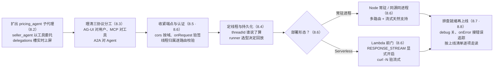

# 第 8 章 多 Agent、协议与生产化

> 本章导读：第 7 章结束时，星帆工作台的 copilot 已经是个像样的助手了——`seller_agent` 能查订单、`get_orders` 和 `update_price` 能操作界面、危险动作有审批卡把关。但它还是「一个人干活」：定价这种专业判断也由它顺手做了，外部数据源一个没接，而这一切只活在你自己的开发机上——内存 runner 一重启历史就没了，CORS 对所有来源敞开，谁拿到地址都能调。本章做两件事：先扩出专职定价的子代理 `pricing_agent`，让多 Agent 协作跑起来；再把 copilot 推上生产——理清 AG-UI、MCP、A2A 三个协议各管什么，收紧端点与认证，定好线程（thread）的持久化方案，选对部署形态，最后备好排查工具箱。前七章的能力在这一章装配出厂。读完本章，你能：用 supervisor 模式扩出子代理并让委托过程实时可见；为一个外部需求选对协议；把认证、线程归属、CORS 三道门按生产标准关严；按清单把星帆工作台部署上线。



*本章操作流程图*

## 你什么时候需要它

三种典型处境，对应本章三条主线。

**一个 Agent 不够用了**——定价要专业、选品要数据、客服要话术，全都塞进 `seller_agent` 的系统提示词里，它开始顾此失彼。看 8.2 的子代理（sub-agent）模式：supervisor 保留对话与全局视野，专业判断委托给各自的窄 Agent，委托过程还能实时画在界面上。

**要给外部 Agent 或外部工具开门**——商品数据在中台的 MCP 服务器上，或者合作方的 Agent 只说 A2A 协议。看 8.3 的协议全景：AG-UI 管 Agent 与用户界面，MCP 管 Agent 与工具数据，A2A 管 Agent 与 Agent——三件事不是三选一，是可以同时接的。

**要上线了**——从「我电脑上能跑」到「公司的卖家都能用」。看 8.4 到 8.8：线程历史不能重启就没，端点不能对全网敞开，认证要把人认出来，部署形态要按团队运维能力选，出了问题要有工具可查。

前置：第 5 章的三进程架构（前端、Runtime、`seller_agent` 服务）与 AgentRunner 概念；第 6 章的工具渲染 Hook；第 7 章的审批机制（本章不重复讲，多 Agent 下的治理在 8.8 收口）。

## 8.1 概述：生产化的四个缺口

前七章的星帆工作台是一个**能跑**的应用；「能跑」和「能上生产」之间隔着四个缺口。本章的每一节都在补其中一个：

| 缺口 | 表现 | 补在哪 |
|------|------|--------|
| **能力规模** | 所有专业判断挤在一个 Agent 里，提示词越长越失焦 | 8.2（子代理路由） |
| **互操作** | 外部工具与外部 Agent 各说各的协议，接一个写一套胶水 | 8.3（协议全景） |
| **边界安全** | CORS 全开、没有用户身份、线程历史谁拿到 id 就能读 | 8.5、8.6（认证与端点收紧） |
| **可运维** | 历史在内存里、出错没有日志、部署形态没想过 | 8.4（线程持久化）、8.6（部署）、8.7（排查） |

先给两个全局判断。**第一，选型上开源与商用不是二选一**：CopilotKit 的开源 SDK 与 TypeScript 运行时（MIT 许可）已经覆盖聊天、前端工具、共享状态、生成式 UI、任意 AG-UI 集成与本地 Inspector；CopilotKit Intelligence 是额外的商用服务层，adds AG-UI Streams（会话保存与跨设备续接）、User Memories、Automatic Learning、产品分析与渠道连接。星帆工作台全书走的是自托管开源路线——它能完整上生产，代价是自己负责持久化与按用户隔离；想要平台代管的线程存储与实时同步，再按需接入 Intelligence。**第二，部署形态没有默认答案**：同一套 Runtime 可以是同进程的一个 Next.js 路由、独立 Node 进程、一个 Lambda 函数或托管在 AWS AgentCore 上，8.6 会把四条路摆在一起选。

本章也是全书最后一次讲新机制。8.8 会把前七章攒下的能力列成一张清单——那张清单就是星帆工作台的出厂配置。

## 8.2 多 Agent 与子代理路由：扩出 pricing_agent

### 8.2.1 supervisor 模式：把子代理当工具

官方文档把子代理称为「规范的多 Agent 模式」：一个顶层 **supervisor**（监督者）LLM 编排一个或多个专业**子代理**——办法是把每个子代理暴露成一个工具。supervisor 决定什么时候委托、委托什么；子代理干完窄活，结果流回 supervisor 的下一步。

这个形态的本质与第 6 章的工具调用完全同构——**每个「工具」本身就是一个完整的 Agent**，有自己的系统提示词、（通常还有）自己的工具、记忆与模型。什么时候值得这么拆？官方给了三类：

| 场景 | 形态 | 星帆工作台的对应 |
|------|------|-----------------|
| 流水线 | 研究 → 写作 → 批判，各阶段要不同的提示词与温度 | 暂不需要 |
| 路由 + 专家 | 一个 Agent 分类请求，分派给对的专家 | **本章主线：定价委托** |
| 分而治之 | 问题能干净地拆成并行或串行的子问题 | 大促选品的批量评估（远景） |

官方对子代理边界的提醒值得抄在工位上：**每个子代理是一次隔离的 Agent 调用，有自己的模型、系统提示词与可选工具；它不与 supervisor 共享记忆或工具，supervisor 只能看到子代理返回的东西。** 反过来推：如果某个子代理必须知道完整的用户上下文才能干活，这说明拆分边界划错了。`pricing_agent` 的输入因此只有一个 `task` 字符串——「评估 SKU-1001 是否值得降到 $24.99，考虑当前库存 340 与美线时效」，它不需要也不应该看到 `dashboard` 或聊天记录。

### 8.2.2 委托工具：三件事一件不能少

supervisor 靠调工具来委托。官方文档规定每个委托工具是一个薄包装，必须做三件事：

1. **运行**——拿 `task` 字符串跑一遍子代理；
2. **记录**——把这次委托写进共享 agent state 的 `delegations` 槽，让界面能渲染实时日志；
3. **返回**——把子代理的最终消息作为工具结果交回去，supervisor 下一轮看到它。

官方文档给出的是模式与职责，具体实现随框架而变。下面是星帆工作台按这个模式写的版本（本书立场示例，依据官方模式与第 5 章的 `seller_agent` 工程编写，未实测；发布前按复核清单核对）：

```python
# seller-agent/pricing.py —— pricing_agent：只管定价的子代理
from dotenv import load_dotenv
from langchain_core.messages import SystemMessage
from langchain_openai import ChatOpenAI
from langgraph.checkpoint.memory import MemorySaver
from langgraph.graph import END, START, MessagesState, StateGraph

load_dotenv()


async def recommend(state: MessagesState):
    """定价节点：只依据 task 里的信息给建议，看不到主对话。"""
    model = ChatOpenAI(model="gpt-4.1-mini")
    system_message = SystemMessage(
        content=(
            "你是星帆工作台的定价专员 pricing_agent。"
            "只依据任务描述里的商品、价格与库存信息给出定价建议与理由，"
            "不讨论定价以外的事。"
        )
    )
    response = await model.ainvoke([system_message, *state["messages"]])
    return {"messages": response}


pricing_graph = (
    StateGraph(MessagesState)
    .add_node("recommend", recommend)
    .add_edge(START, "recommend")
    .add_edge("recommend", END)
    .compile(checkpointer=MemorySaver())
)
```

```python
# seller-agent/main.py —— supervisor 的委托工具（在 seller_agent 的图内注册）
import uuid

from langchain_core.messages import HumanMessage
from pricing import pricing_graph


def record_delegation(state: dict, task: str, summary: str) -> dict:
    """按官方要求把委托写进 delegations 槽：每条带稳定 id，按 id 合并。"""
    entry = {
        "id": f"dlg-{uuid.uuid4().hex[:8]}",
        "sub_agent": "pricing_agent",
        "task": task,
        "summary": summary,
        "status": "done",
    }
    merged = {d["id"]: d for d in state.get("delegations", [])}
    merged[entry["id"]] = entry
    return {"delegations": sorted(merged.values(), key=lambda d: d["id"])}


async def consult_pricing(state: MessagesState):
    """委托工具本体：运行、记录、返回，三件事各一行。"""
    task = state["messages"][-1].content  # supervisor 写好的任务描述

    # ① 运行：子代理只拿到 task 字符串
    result = await pricing_graph.ainvoke(
        {"messages": [HumanMessage(content=task)]}
    )
    summary = result["messages"][-1].content

    # ② 记录：进 delegations 槽，界面据此渲染实时日志
    # ③ 返回：作为工具结果交回 supervisor
    return {
        **record_delegation(state, task=task, summary=summary),
        "messages": [HumanMessage(content=f"[pricing_agent 建议] {summary}")],
    }
```

官方在这段模式旁边放了一个**加粗级警告**，值得原文照录展开：**给每条委托一个稳定 `id`，并按 `id` 合并新条目。** 原因在状态流动的方向上——客户端每一轮都会把自己持有的共享状态副本作为运行输入发回来（第 4 章讲过的双向同步），如果一个槽位无条件追加收到的条目（例如 LangGraph 的 `Annotated[list, operator.add]` reducer），客户端刚回显的条目会和 Agent 已有的拼在一起，**续跑一个线程时日志当场翻倍**。按 `id` 去重合并是唯一的解法，`record_delegation` 的全部逻辑就是在落实这一条。

### 8.2.3 前端：实时委托日志

`delegations` 槽为什么值得写？因为第 4 章的共享状态通道会把它的每次变化实时推到浏览器——supervisor 向子代理分派工作时，日志逐条长出来，用户看到的是一个可见的过程，而不是一根转不完的加载圈。官方给的前端订阅方式：

```tsx
// src/components/DelegationLog.tsx —— 依据官方 subagents 文档模式
import { UseAgentUpdate, useAgent } from "@copilotkit/react-core/v2";

type DelegationEntry = {
  id: string;
  sub_agent: string;
  task: string;
  summary: string;
  status: string;
};

export function DelegationLog() {
  // 两个更新时机都要订阅：状态变了要渲染新条目，
  // 运行状态变了要感知「委托进行中」
  const { agent } = useAgent({
    agentId: "seller_agent",
    updates: [
      UseAgentUpdate.OnStateChanged,
      UseAgentUpdate.OnRunStatusChanged,
    ],
  });

  const delegations =
    (agent.state as { delegations?: DelegationEntry[] }).delegations ?? [];

  if (delegations.length === 0) {
    return null;
  }

  return (
    <section className="delegation-log">
      <h3>定价委托记录</h3>
      {delegations.map((d) => (
        <article key={d.id}>
          <header>
            {d.sub_agent} · {d.status}
          </header>
          <p>{d.task}</p>
          <footer>{d.summary}</footer>
        </article>
      ))}
    </section>
  );
}
```

想更进一步，官方文档指了一条现成的路：用第 4 章的状态流式（state streaming）把**单个子代理的输出**逐 token 流进对应的日志条目里——每个委托卡片自己长出回答，而不是等干完才出现一行摘要。

还有一个第 7 章埋的尾巴在这里收口：**治理纪律跨子代理照样成立**。`pricing_agent` 若要真的执行改价，它的输出也应经过第 7 章的审批卡——审批挂在 `update_price` 这个前端工具上，不管这个提议是 supervisor 自己想的还是子代理建议的。**委托改变了「谁提议」，没有改变「谁批准」。**

**验证点**：对 `seller_agent` 说「评估一下 SKU-1001 降到 $24.99 值不值」——聊天应出现委托日志条目，`pricing_agent` 的建议以 `[pricing_agent 建议]` 前缀回到对话；连续委托两次后把线程续跑一轮，日志条数不应翻倍（8.2.2 的 id 合并生效）；在委托卡里追问与定价无关的事，子代理应拒答——上下文隔离在起作用。

## 8.3 协议全景：AG-UI、MCP、A2A 各管什么

### 8.3.1 三张地图合一张看

官方文档的定位句是：CopilotKit 与三个主要的 Agent 协议完全兼容——AG-UI、MCP、A2A。它们不是竞争关系，而是各管一段连接：

| 维度 | AG-UI | MCP | A2A |
|------|-------|-----|-----|
| 全称 | Agent User Interaction（代理与用户交互协议） | Model Context Protocol（模型上下文协议） | Agent2Agent（Agent 间协议） |
| 连接谁 | **Agent ↔ 用户界面** | **Agent ↔ 工具与数据** | **Agent ↔ Agent** |
| 出身 | CopilotKit 团队与多家框架伙伴共建的开放标准 | 开放标准 | Google 提出 |
| 形态 | 轻量、基于事件 | Agent 安全连接外部系统（工具、工作流、数据源） | 框架无关的分布式协作 |
| CopilotKit 的接法 | 原生协议——组件与 Runtime 都说 AG-UI | Agent 侧配置 `mcpServers` | `A2AMiddlewareAgent` 把 A2A Agent 暴露给 AG-UI 协调者 |
| 星帆的用法 | 全书主线 | 给 `seller_agent` 接商品库、物流等外部工具 | 将来接入平台方或合作方的 Agent |

官方文档另列了一组「Agent ↔ 生成式 UI」的声明式规格：A2UI（Google）、MCP Apps（MCP 生态）、Open-JSON-UI（OpenAI）——第 6 章已在光谱图里露过面，本章不展开。

关键的一条官方结论是：**这些协议可以混搭，而且 AG-UI 本身内含与 MCP、A2A 的握手。** 宿主 Agent 若经 MCP 或 A2A 连接子代理，它们的 UI 属性可以一路传播到面向用户的应用，同时保住完整的安全、策略与可观测控制。这就是全书第 1 章「协议先行」的兑现：星帆工作台从第 2 章起说的每一句「AG-UI」，都是在为今天同时接三种协议铺路。

### 8.3.2 MCP：给 seller_agent 接外部工具

第 6 章讲的前端工具长在浏览器里；MCP 工具长在服务器的 MCP 服务器上，Agent 通过协议去调。自托管运行时的接法是把服务器挂在 Agent 上（以内置 Agent 为例，`seller_agent` 所在框架的等价配置见各自文档）：

```ts
// 依据官方 mcp 文档的自托管配置——挂在 Agent 上,不是挂在 Runtime 上
import { BuiltInAgent } from "@copilotkit/runtime/v2";
import {
  CopilotRuntime,
  createCopilotRuntimeHandler,
} from "@copilotkit/runtime/v2";

const runtime = new CopilotRuntime({
  agents: {
    default: new BuiltInAgent({
      model: "openai/gpt-4o",
      mcpServers: [
        {
          type: "sse",
          url: "https://my-mcp-server.example.com/sse",
          headers: { Authorization: `Bearer ${process.env.MCP_API_KEY}` },
        },
      ],
    }),
  },
});
```

两个值得记住的运行细节，都来自官方文档：**Agent 在每次运行开始时为每个服务器打开一个客户端，运行结束时关闭——请求之间不缓存任何东西**；凭证（`MCP_API_KEY`）走服务端环境变量，与第 2 章以来「密钥只留在服务端」的纪律一脉相承。

接了 MCP 工具之后，界面上怎么呈现？官方 mcp 文档用一张表把服务器分成三类，每类的界面义务不同：

| 你的服务器…… | 用户该看到什么 | 要做什么 |
|--------------|----------------|----------|
| 只读数据、返回结果 | 不显示，或一行状态——结果属于 Agent 的回答 | 纯 MCP 工具，不需要渲染器 |
| 改动什么（写、发、删） | 即将发生什么，并给办法叫停 | 纯 MCP 工具 + 渲染器，不可逆的加审批 |
| 自带界面（表单、选择器、图表） | 界面本身 | MCP App（随服务器附带 UI 资源，沙箱 iframe 渲染） |

第二行与第三行的分界判据官方说得极准：**如果你上 MCP App 只是为了渲染一个确认按钮，你想要的是人工介入（第 7 章）**——审批是 CopilotKit 的关切，不是服务器提供的 UI。给所有无专属渲染器的工具调用一个兜底状态卡，用第 6 章学的通配渲染器一行搞定：

```tsx
import { useDefaultRenderTool } from "@copilotkit/react-core/v2";

useDefaultRenderTool({
  render: ({ name, status, parameters, result }) => (
    <McpToolCall status={status} name={name} args={parameters} result={result} />
  ),
});
```

### 8.3.3 A2A：经中间件接入外部 Agent

A2A Agent 之间自己会协作，但要说给前端听，还缺一段翻译。官方的方案是**A2A 中间件**：把一个 AG-UI 协调者包进 `A2AMiddlewareAgent`，中间件自动给它注入一个 `send_message_to_a2a_agent` 工具，协调者就能透明地和 A2A Agent 通信。以下结构照录官方 a2a 文档的示例（示例中的 research/analysis 两个 A2A Agent 属于官方演示，不是星帆的 Agent）：

```ts
// 依据官方 a2a 文档示例（Next.js App Router 形态）
import {
  CopilotRuntime,
  createCopilotRuntimeHandler,
  InMemoryAgentRunner,
} from "@copilotkit/runtime/v2";
import { HttpAgent } from "@ag-ui/client";
import { A2AMiddlewareAgent } from "@ag-ui/a2a-middleware";

const researchAgentUrl = process.env.RESEARCH_AGENT_URL || "http://localhost:9001";
const analysisAgentUrl = process.env.ANALYSIS_AGENT_URL || "http://localhost:9002";
const orchestratorUrl = process.env.ORCHESTRATOR_URL || "http://localhost:9000";

// 传给中间件的协调者必须是 AG-UI AbstractAgent 的实例——
// 手里有 URL 就用 HttpAgent 拿一个实例
const orchestrationAgent = new HttpAgent({ url: orchestratorUrl });

const a2aMiddlewareAgent = new A2AMiddlewareAgent({
  description: "Research assistant with 2 specialized agents: Research (LangGraph) and Analysis (ADK)",
  agentUrls: [researchAgentUrl, analysisAgentUrl],
  orchestrationAgent,
  // 领域指令:中间件会自动生成「怎么连 A2A Agent」的通用指令,
  // 这里的 instructions 是追加在后面的领域专用部分
  instructions: `You are a research assistant that orchestrates between 2 specialized agents.`,
});

const runtime = new CopilotRuntime({
  agents: {
    a2a_chat: a2aMiddlewareAgent, // 前端用这个 id 指向它
  },
  runner: new InMemoryAgentRunner(),
});
```

前端的呈现复用第 6 章的家当：用 `useFrontendTool` 给 `send_message_to_a2a_agent` 注册一个渲染器，参数 `agentName` 与 `task`，状态 `executing` 时画「发给谁、发了什么」，`complete` 时补上「收到回复」——协调者与 A2A Agent 之间的每一跳都可见。**A2A Agent 之间说 A2A，到前端这一段依然是 AG-UI——中间件补的正是这一段。**

### 8.3.4 AG-UI 中间件：可信侧的万能插口

8.2 的日志、8.3 的协议翻译，都指向同一个机制：**AG-UI 中间件**。它本质上是 AG-UI 协议在上游 `@ag-ui/client` 里定义的概念——每个 Agent 都暴露 `agent.use(middleware)`，中间件继承 `Middleware` 基类、实现 `run(input, next)`，可以记日志、上护栏、改写请求、重写事件流。对 CopilotKit 最要紧的一句官方定位：**中间件在 Copilot Runtime 内的服务端执行，处在客户端无法篡改的可信环境里**——这正是第 5 章消息裁剪（`TrimHistoryMiddleware`）与本章一切「服务端说了算」需求的机制地基：

```ts
// my-middleware.ts —— 官方 ag-ui-middleware 文档示例
import {
  Middleware,
  RunAgentInput,
  AbstractAgent,
  BaseEvent,
} from "@ag-ui/client";
import { Observable } from "rxjs";

export class LoggingMiddleware extends Middleware {
  run(input: RunAgentInput, next: AbstractAgent): Observable<BaseEvent> {
    return new Observable<BaseEvent>((subscriber) => {
      const sub = this.runNextWithState(input, next).subscribe({
        next: ({ event }) => {
          console.log("[agent event]", event.type);
          subscriber.next(event);
        },
        error: (err) => subscriber.error(err),
        complete: () => subscriber.complete(),
      });
      return () => sub.unsubscribe();
    });
  }
}
```

挂载点在注册之前（第 5 章 5.6 的规矩）：`agent.use(new LoggingMiddleware())`，然后才进 `agents` 注册表——Runtime 每次运行会克隆注册的 Agent，克隆体带着中间件走。此外 Runtime 还自带两个一等公民中间件，在 `CopilotRuntime` 上直接开启、不必逐个 Agent `.use()`：`a2ui`（对所有或部分注册 Agent 应用 `A2UIMiddleware`）与 `mcpApps`（从一处为所有 Agent 配置 MCP 服务器）。

**验证点**：能不查资料说出三句话——AG-UI 管的是「Agent 到界面」、MCP 管的是「Agent 到工具与数据」、A2A 管的是「Agent 到 Agent」；再补一句：AG-UI 与后两者有握手，三种连接可以同时存在。给星帆加一个「商品库查询」的 MCP 服务器时，先按 8.3.2 的三类表判断它是哪一类，再决定要不要渲染器。

## 8.4 线程生命周期与持久化：历史不能说没就没

### 8.4.1 一段对话的一生：四幕

每次 CopilotKit 会话都限定在一段**线程（thread）**里，由 `threadId` 标识。官方把客户端侧的完整生命周期讲成四幕：

1. **铸造（mint）**——聊天挂载且没有显式 `threadId` 时，客户端自己生成一个（UUID v4）；
2. **运行（run）**——消息与工具调用在这个 `threadId` 下流动；若配置了服务端存储（CopilotKit Intelligence，或一个会持久化的 AgentRunner），它们随发生随持久化，事后可回放；**没有任何持久化层的运行时，服务端什么都不留**；
3. **回灌（hydrate）**——聊天挂载时带着已知的 `threadId`，客户端连接并把该线程的持久化历史回放进界面；
4. **切换 / 新建**——你换到另一段线程（恢复其历史），或开一段新的（清空视图）。

第 3 章的 `<CopilotThreadsDrawer>` 与 `startNewThread()` 就是第 4 幕的预置实现；本节把幕后的规则补全。

### 8.4.2 threadId 谁说了算：优先级与重铸坑

不给 `threadId` 时，客户端按下面的优先级解析（高者胜）：

1. `<CopilotChat>` / `<CopilotChatConfigurationProvider>` 上的显式 `threadId` prop——**权威值**：它同时驱动历史回放并关闭欢迎屏；
2. 运行时覆盖——`setActiveThreadId(...)`、在线程列表里选中一行、`startNewThread()`；
3. 从父级配置 provider 继承的 `threadId`;
4. 非权威的 `threadId` 种子；
5. 否则，现铸一个 `randomUUID()`。

自己持有持久化方案时，官方推荐显式传 prop：

```tsx
import { CopilotChat } from "@copilotkit/react-core/v2";

// 你控制的 id:历史会为它回放,且跨组件重挂载保持稳定
<CopilotChat agentId="seller_agent" threadId={myThreadId} />
```

官方用警告框点名了自动铸造的坑，值得整段记住：**自动铸造的 id 跨重渲染稳定，但跨重挂载会重铸。** 后备 id 由 `useMemo` 算出——组件重挂载（React `key` 变了、父组件卸载重挂、开发期 StrictMode 的双挂载）都会产生**新 id，悄悄开一段新对话**。需要跨重挂存活的 id，就自己铸好再传 prop，或持久化后经 `setActiveThreadId` 恢复。**别依赖自动铸造来保连续性。**

### 8.4.3 两层持久化：CopilotKit 的线程与框架的检查点

这是本节最重要的一个概念区分。**CopilotKit 的线程与你的 Agent 框架自己的持久化是两个不同的层，只靠共享的 `threadId` 关联**（官方对照表转录）：

| 层 | 存什么 | 谁管 |
|----|--------|------|
| CopilotKit 线程 | 会话列表 + 完整 AG-UI 事件历史（消息、工具调用、状态），带实时同步 | CopilotKit Intelligence，经 `useThreads` |
| 框架原生持久化 | 框架内部的状态 / 检查点 | 你的 Agent，例如 LangGraph 的 `AsyncPostgresSaver` |

两个方向都容易想错。**给 LangGraph 挂 checkpointer 不会让 CopilotKit 冒出一张线程表**——它建的是 LangGraph 自己的检查点表；反过来，`useThreads` 的重命名 / 归档 / 删除只作用于平台线程，不会伸进 LangGraph（或 ADK 等）的存储，除非你的后端显式搭桥。桥就是 `threadId`：显式传给 CopilotKit 的 `threadId` 会作为 AG-UI `threadId` 转发给后端，框架可以直接拿它当（或映射到）自己的检查点 id。

落到星帆工作台的生产选型（本书立场，依据 5.4.3 与本节的官方事实组合）：

| 方案 | 线程历史存哪 | 得到什么 | 代价 |
|------|-------------|---------|------|
| `SqliteAgentRunner`（第 5 章） | Runtime 本机 SQLite 文件 | 单实例重启后历史还在；开箱即用 | 无跨实例共享；线程读取路由应答 `422`（它不存本地列表） |
| 自建 runner + 自有存储 | 你的数据库 | 完全掌控；线程归属自己做（8.5.4） | 自己实现 runner 四方法 |
| CopilotKit Intelligence（云托管或自托管） | 平台侧 | 线程列表、跨设备续接、实时同步、`<CopilotThreadsDrawer>` 可用 | 需要商用授权与 `identifyUser`（8.5.4） |

无论选哪个，后端这一半别忘了：`seller_agent` 的图在第 5 章挂的是 `MemorySaver()`，官方原话是生产要换持久 saver（例如 Postgres）——两层各自持久，`threadId` 把它们对上。历史已在框架侧存在的存量会话，官方另有导入通道（`npx copilotkit@latest import --source langgraph --dry-run` 先演练），把支持的消息、工具调用与时间戳复制进 Intelligence；**导入是复制内容，不是建立持续复制**，保持 `threadId` 与原生会话 id 的映射稳定即可。

### 8.4.4 切换、新建与自建线程 API

切换与新建的编程接口（第 3 章的抽屉内部用的就是它们）：

```tsx
import { useCopilotChatConfiguration } from "@copilotkit/react-core/v2";

function ThreadControls() {
  const config = useCopilotChatConfiguration();

  return (
    <>
      {/* 恢复一段已知会话(explicit 默认 true,回放历史) */}
      <button onClick={() => config?.setActiveThreadId(existingId, { explicit: true })}>
        打开会话
      </button>
      {/* 开一段全新会话(铸一个新的非显式 id) */}
      <button onClick={() => config?.startNewThread()}>新会话</button>
    </>
  );
}
```

`explicit: false` 的语义是「当作未知线程」，界面回欢迎屏。两个 setter 有一个共同的坑：**当 `threadId` 是 prop 控制时它们空转并告警**——prop 权威值与命令式 setter 二选一，别两个真理来源同时上。

还有一类需求：在用户发出第一条消息时，先经你自己的后端建线程（比如建一行数据库记录拿 id）再开始对话。官方指出的限制要记住：**内置 `<CopilotChat>` 的提交处理器是内部设置的，你传的 `onSubmitMessage` 会被丢弃**——所以推荐的姿势是「提前铸造」：在「新会话」动作里就调自己的 API 建线程，再把 id 交给 CopilotKit（`setActiveThreadId(id, { explicit: true })` 或渲染 `<CopilotChat threadId={id} />`）。确要在提交瞬间拦截，只能走无头组合（`CopilotChatInput` + 自己的提交处理器），并且**把 id 直接写到 agent 上**（`agent.threadId = id`）——`setActiveThreadId` 走 React 状态、下一次渲染才到 agent，紧接着发起的运行仍会用旧线程。v2 没有 `initialMessages` prop 也没有 `useCopilotChat`；消息经 `useAgent()` 读 `agent.messages`、用 `agent.setMessages(...)` / `agent.addMessage(...)` 改（v1 的同名能力仅存在于迁移对照语境，不作为主线）。

**验证点**：给聊天手动传一个固定 `threadId`，刷新页面——历史应回放（前提是 8.4.3 选了会持久化的方案；没配存储时 `connectAgent()` 返回空流、对话从空白开始，这不是客户端代码的错）；再把 prop 撤掉靠 `startNewThread()` 驱动，用 React `key` 强制一次重挂载——对话悄悄换新 id，这就是 8.4.2 的坑本尊。

## 8.5 认证：把「谁在用」钉进每一跳

### 8.5.1 用户身份走 headers，不走 properties

生产环境的第一问：每次 Agent 运行，怎么知道是谁在问？官方 auth 文档的答案从两条负面清单开始——**多租户数据、工具门控、审计计费、按角色变化的体验，这四类需求无一例外需要身份**；都不要的话，不开 Intelligence 的 TypeScript 运行时可以匿名跑。

前端只做一件事：把 token 放进 Provider 的 `headers` prop,CopilotKit 转发的每个请求都带上它：

```tsx
import { CopilotKitProvider } from "@copilotkit/react-core/v2";

<CopilotKitProvider
  runtimeUrl="http://localhost:8200/api/copilotkit"
  agentId="seller_agent"
  headers={{
    Authorization: `Bearer ${userToken}`,
  }}
>
```

官方在这里立了一条极易踩错的规矩，原文语义照录：**`properties` 不是认证通道。** `properties` 到 Agent 那里是 AG-UI 的 `forwardedProps`——运行载荷数据，不是请求头，没有任何东西把它变成 Bearer 凭证；认证用 `headers`。附带一条好消息：Agent 自身配置的服务端请求头在冲突时优先，所以服务间凭证不会被浏览器覆盖。

### 8.5.2 服务端验证：onRequest 与 FastAPI 依赖

Runtime 侧的验证钩子是 `onRequest`——它在**任何 Agent 代码之前**运行、拿到原始 `Request`，是读 `Authorization`、跑验证器、把未认证请求用 401 短路的正确位置：

```ts
import {
  CopilotRuntime,
  createCopilotRuntimeHandler,
} from "@copilotkit/runtime/v2";

const runtime = new CopilotRuntime({ agents: { default: myAgent } });

const handler = createCopilotRuntimeHandler({
  runtime,
  basePath: "/api/copilotkit",
  hooks: {
    onRequest: ({ request }) => {
      const authHeader = request.headers.get("authorization");
      if (!authHeader?.startsWith("Bearer ")) {
        throw new Response(
          JSON.stringify({ error: "unauthorized" }),
          { status: 401, headers: { "content-type": "application/json" } },
        );
      }
      const token = authHeader.slice("Bearer ".length);
      verifyJwt(token); // 你的验证逻辑
    },
  },
});
```

`seller_agent` 这一跳（Runtime → Agent）同样要验——`Authorization` 头会被转发到 Agent，自托管 FastAPI 没有托管认证可插，官方给的做法是把 `add_langgraph_fastapi_endpoint` 换成等价的自建路由：FastAPI 依赖验头，验证过的用户烤进按请求构造的 Agent 配置：

```python
# seller-agent/main.py —— 依据官方 auth 文档的自托管形态(节选改写)
from typing import Optional

from ag_ui.core.types import RunAgentInput
from ag_ui.encoder import EventEncoder
from copilotkit import LangGraphAGUIAgent
from fastapi import Depends, FastAPI, Header, HTTPException, Request
from fastapi.responses import StreamingResponse

from src.agent import graph
from src.auth import validate_your_token

app = FastAPI()


def current_user(authorization: Optional[str] = Header(default=None)) -> dict:
    if not authorization or not authorization.startswith("Bearer "):
        raise HTTPException(status_code=401, detail="Missing bearer token")
    return validate_your_token(authorization.removeprefix("Bearer ").strip())


@app.post("/")
async def run_agent(
    input_data: RunAgentInput,
    request: Request,
    user: dict = Depends(current_user),
):
    encoder = EventEncoder(accept=request.headers.get("accept"))

    # 每请求一个 Agent:已验证的身份只搭这一趟车,流式状态各请求隔离
    agent = LangGraphAGUIAgent(
        name="seller_agent",
        graph=graph,
        config={"configurable": {"auth_user": user}},
    )

    async def event_generator():
        async for event in agent.run(input_data):
            yield encoder.encode(event)

    return StreamingResponse(event_generator(), media_type=encoder.get_content_type())
```

节点里从 `config["configurable"]["auth_user"]` 读身份、不再重复验 token。只需要 401 门、节点不看身份的话，官方留了捷径：保留 `add_langgraph_fastapi_endpoint`，把依赖挂到应用上——`FastAPI(dependencies=[Depends(current_user)])`。

### 8.5.3 工具门控：身份的第一次变现

认证最常见的用途是让单个工具拒绝对的人跑。官方示例一行判角色：

```python
def delete_record(record_id: str, *, user: User):
    if "admin" not in user.permissions:
        raise PermissionError("admin role required")
    # 执行删除
```

它与第 7 章的人工介入是**串联关系，不是二选一**：先按身份门控，再弹确认卡，最后执行。`update_price` 在星帆的完整防线因此是三层——登录用户是卖家本人（本节）、卖家在审批卡上点头（第 7 章）、执行侧校验载荷（第 7 章 7.6.2）。

### 8.5.4 线程归属：threadId 不是秘密

认证解决了「你是谁」，还没解决「你能不能读别人的会话」。官方一句话定性：**`threadId` 是公共标识符，像 URL 里的数据库主键**——它在浏览器里穿行、进日志、顺序 id 还可以枚举；UUID 让猜中变得不现实，但「UUID」本身不是一道控制。授权必须是显式的归属检查，绝不能是「知道 id 即拥有」。

两条路线：

| Runtime | 谁来把线程圈到用户头上 |
|---------|------------------------|
| 配了 `intelligence` 的 `CopilotRuntime` | 大部分由运行时经 `identifyUser` 完成——但有三条路由你仍要自己守 |
| 其余一切（SSE 运行时、自定义存储、本地内存 runner） | **你自己** |

`identifyUser` 的三条官方纪律：**从服务端验证过的凭据推导 id**（直接读请求头或请求体里的用户 id，等于让每个调用者自报家门）；**id 要稳定**（它是线程挂靠的键，换了——比如从邮箱换成 subject 声明——这个用户的既有线程全部失联）；**401 从 `onRequest` 发**——`identifyUser` 不是认证门，部分路由根本不会调它，它抛错的表现还是 500。即便在 Intelligence 上，`threads/events` 与 `threads/state`（检查器背后的两条路由）也是**按 id 直读、不圈用户**的——用 `onBeforeHandler` 按 `route.threadId` 自查归属，没有归属记录就整条拒掉。

非平台路线（星帆的默认形态）要自己建归属表并逐路由执行：

```sql
-- 最小归属表:会话首次创建时写入一行
create table thread_owners (
  thread_id text primary key,
  user_id   text not null
);
create index on thread_owners (user_id);
```

```ts
// 处理器 hooks:onRequest 认人,onBeforeHandler 认线程
createCopilotRuntimeHandler({
  runtime,
  basePath: "/api/copilotkit",
  hooks: {
    onRequest: async ({ request }) => {
      const user = await verifyRequest(request);
      if (!user) throw new Response("Unauthorized", { status: 401 });
    },
    onBeforeHandler: async ({ request, route }) => {
      const user = await verifyRequest(request);

      // 直接带线程的路由:agent/stop、threads/update、threads/archive、
      // threads/messages、threads/events、threads/state
      if ("threadId" in route) {
        if (!(await userOwnsThread(user.id, route.threadId))) {
          throw new Response("Forbidden", { status: 403 });
        }
        return;
      }

      // agent/run 与 agent/connect 的线程在请求体里
      if (route.method === "agent/run" || route.method === "agent/connect") {
        // 克隆:处理器之后还要读原始 body
        const { threadId } = await request.clone().json();
        if (threadId && !(await userOwnsThread(user.id, threadId))) {
          throw new Response("Forbidden", { status: 403 });
        }
      }
    },
  },
});
```

默认 `InMemoryAgentRunner` 的现实要直视：它按 `threadId` 存在进程级 map 里、没有归属字段——`GET /threads` 列出进程里**每一段**线程，`POST /threads/clear` 一键全清（固定应答 `204`）。多于一个人用，这两条就得管起来。线程列表要服务端按归属表过滤——UI 上藏掉行不算数，底层路由还开着。

官方的安全清单收尾（逐条自检）：后端永远验 token，不信前端自述；每次读写都按已解析用户过滤；认证放 `onRequest`（唯一跑在每条路由上的钩子）；线程绑定用户（平台上是 `identifyUser` + 两条路由自查，平台外是逐路由归属检查）；日志里不落原始 token（记用户 id 或 `anonymous`）；生产上 HTTPS；token 过期由前端负责在到达 Agent 前轮换——CopilotKit 不代刷。

**验证点**：用两个账号各开一段线程，拿 A 的 `threadId` 冒充 B 请求 `threads/:threadId/messages`——应得 403（`onBeforeHandler` 生效）；把 `Authorization` 头去掉发一次对话——应得 401 且 Runtime 日志里看不到任何 Agent 执行痕迹；再确认日志里只有用户 id、没有 token 原文。

## 8.6 端点收紧与部署：从开发形态到生产形态

### 8.6.1 端点清单与 CORS 收紧

自托管 Runtime 在 `basePath`（星帆用 `/api/copilotkit`）下暴露一组 HTTP 路由。多路由模式（默认）的全集：

| 方法与路径 | 用途 |
|------------|------|
| `GET /info` | 运行时信息；前端启动时据此发现 Agent |
| `GET /inspector-metadata` | 检查器的可信项目上下文（Intelligence 运行时才有意义） |
| `POST /agent/:agentId/run` | 启动一次运行；响应是 AG-UI 事件的 SSE 流 |
| `POST /agent/:agentId/connect` | 重连已有线程（刷新页面、断线重连），同为 SSE 流 |
| `POST /agent/:agentId/stop/:threadId` | 停掉某线程上进行中的运行 |
| `POST /transcribe` | 语音输入的转写 |
| `GET /threads`、`GET /threads/:threadId/messages | events | state` | 线程列表与历史（8.5.4 的归属检查对象） |
| `POST /threads/clear` | 清空内存线程历史（8.5.4 点名的危险路由） |

前几章一直写的 `cors: true` 是**开发配置**——Express 与 Hono 适配器的默认 CORS 是全放开的（`origin: "*"`、全部标准方法与头），为的是本地零配置。生产要换成按域收紧，官方给的形态：

```ts
createCopilotExpressHandler({
  runtime,
  basePath: "/api/copilotkit",
  cors: {
    origin: "https://console.starfish.example.com",
    methods: ["GET", "POST", "OPTIONS"],
  },
});
```

（`createCopilotNodeListener` 同样接受该配置对象；想完全自理就传 `cors: false` 自己写中间件。）另一条生产前检查：Provider 与处理器的传输模式必须配对——省略 `useSingleEndpoint` 时客户端自动探测运行时实际服务的模式，**配错的表现是所有调用 404 而 `/info` 照样返回 200**，看似连着实则全断；拿不准就省略属性让它自己探测。

### 8.6.2 四种部署形态

同一套 Runtime 代码，四种安放方式（本书依据官方各部署页与 runtime-endpoints 文档整理对比）：

| | 同源 Next.js | 分离 SPA + Node 常驻（星帆开发形态） | Serverless（AWS Lambda） | 托管 AgentCore |
|----|--------------|-----------------------------------|--------------------------|----------------|
| 拓扑 | 前端与 Runtime 同进程，`runtimeUrl` 写相对路径 | 前端、Runtime、Agent 三进程，绝对 `runtimeUrl` | Runtime 打包成 Lambda 函数，前端指向 Function URL / API Gateway | 浏览器 → Runtime → AgentCore → 你的 Agent |
| CORS | 无跨域问题 | 必须：开发 `cors: true`，生产按域收紧 | 处理器 `cors` 按域；前门也可配 | Runtime 侧按域配置 |
| 流式 | 天然支持 | 天然支持 | **前门必须显式开流式**（8.6.3） | 由 Runtime 一跳承担 |
| 认证钩子 | `onRequest` / `onBeforeHandler` | 同左 | 同左（各前门行为一致） | 生产建议用户 JWT（如 Cognito）贯通 |
| 适合 | 官方快速开始形态，最少运维 | 已有 Vite/CRA 老项目的直接延伸 | 无服务器运维、流量弹性 | 不想自己管 Agent 的运行环境（SigV4/OAuth2 决定了浏览器不能直连） |

### 8.6.3 Lambda：流式是显式的，不是默认的

Runtime 是一个 Fetch 处理器，上 Lambda 无需服务器；唯一要小心的是**流式**——聊天响应走 SSE，一个会缓冲的前门会把实时对话变成「长时间静默 + 整段回复一次性砸下来」。官方的前门选型表：

| 前门 | 流式 SSE？ | 什么时候用 |
|------|-----------|-----------|
| Lambda Function URL（`InvokeMode: RESPONSE_STREAM`） | 是 | **默认选择**——浏览器与函数之间不夹任何东西 |
| API Gateway REST API（`responseTransferMode: STREAM`） | 是 | 需要 REST 生态：WAF、用量计划、自定义授权器 |
| API Gateway HTTP API | 否 | 缓冲：10 MB 响应上限、29 秒集成超时 |
| 应用负载均衡器（ALB） | 否 | 对 Lambda 目标没有流式通道 |

官方的警告直接决定成败：**两条流式前门默认都是缓冲的**——Function URL 默认 `BUFFERED`、REST 集成默认 `responseTransferMode: BUFFERED`，不改开关，聊天就表现为「卡住半天然后整包落地」。处理器的核心骨架（完整版含 `awslambda` 全局类型声明，见官方页）：

```ts
// src/handler.ts —— 依据官方 aws-lambda 文档(Function URL 路线,节选)
import { Readable } from "node:stream";
import { pipeline } from "node:stream/promises";
import {
  CopilotRuntime,
  createCopilotRuntimeHandler,
  BuiltInAgent,
} from "@copilotkit/runtime/v2";

// 模块作用域构造:warm 调用间复用,不逐请求重建
const runtime = new CopilotRuntime({
  agents: {
    default: new BuiltInAgent({ model: "openai/gpt-4o-mini" }),
  },
});

const copilotHandler = createCopilotRuntimeHandler({
  runtime,
  basePath: "/api/copilotkit",
  cors: true,
});

export const handler = awslambda.streamifyResponse(
  async (event, responseStream) => {
    const response = await copilotHandler(toFetchRequest(event));

    // 状态与头必须写在第一个字节之前
    const stream = awslambda.HttpResponseStream.from(responseStream, {
      statusCode: response.status,
      headers: Object.fromEntries(response.headers),
    });

    if (!response.body) {
      stream.end();
      return;
    }

    // Readable.fromWeb 把 Fetch 流桥到 Node 流,SSE 分片随产随达
    await pipeline(Readable.fromWeb(response.body as any), stream);
  },
);
```

运维要点打包成一张表（全部出自官方页）：

| 事项 | 要点 |
|------|------|
| Node 版本 | 响应流式需托管运行时 Node 20+（`@copilotkit/runtime` 要求 Node 20） |
| 超时 | 覆盖完整 Agent 运行——Lambda 默认 3 秒几乎必杀，上限 15 分钟 |
| 依赖打包 | `@copilotkit/runtime` 不在任何 AWS 托管层里，用 `NodejsFunction` / esbuild / 自带打包器 |
| 冷启动 | 聊天里肉眼可见；在意首 token 延迟就上预置并发 |
| 流式限额 | 首段（Lambda 6 MB / 网关 10 MB）不限速，之后 2 MB/s；流式计费按函数全程时长，客户端断开也不停 |
| 验收 | `curl -N` 打 run 端点应逐片打印 SSE；整包到达就是流式没开，或前面夹了缓冲层 |

### 8.6.4 AgentCore 与 LangSmith 平台：托管两条路

不想自己管 Lambda，官方给了两条托管路。**AWS Bedrock AgentCore**：给 AG-UI Agent 提供带认证、会话隔离与基础设施的服务器less 运行时，链路固定为「浏览器 → CopilotKit Runtime → AgentCore → 你的 Agent」——浏览器因 SigV4/OAuth2 无法直连 AgentCore，Runtime 这一跳因此不可省。接线要点：`HttpAgent` 指向 AgentCore 的 `/invocations` 端点、`Authorization` 头带服务端持有的令牌；runner 换成官方示范的 `AgentCoreRunner`（继承 `InMemoryAgentRunner`），补两个官方点名的洞——**未知线程**（页面加载时 `connect()` 先于任何 `run()`，runner 要回一段空的 `RUN_STARTED` / `MESSAGES_SNAPSHOT` / `RUN_FINISHED` 序列而不是报错）与**缺失的工具结果**（AgentCore 回放的历史只有工具调用没有结果，runner 要为每个历史调用合成空结果）。**LangSmith 平台**：把 LangGraph 或 ADK Agent 部署到 LangSmith 平台后按第 5 章路线 B 的 `LangGraphAgent` 接回，部署形态交给平台。

**验证点**：生产配置生效后，从白名单之外的域打开前端发一条消息——浏览器控制台应出现 CORS 拦截（收紧生效的物证）；Lambda 部署用 `curl -N` 看到事件逐片到达而不是一次到齐；`curl -s {runtimeUrl}/info` 通、匿名 run 被 401 拦下，才算端点关严。

## 8.7 排查工具箱：出问题时先拿哪件工具

### 8.7.1 Debug 模式：看事件管道

行为不对——事件丢了、状态没更新、工具没执行——第一件工具是 Runtime 的 debug 模式：`new CopilotRuntime({ agents: {...}, debug: true })`，产出结构化 Pino 日志（`copilotkit-debug` 标签）：每次运行谁发起、SSE 流何时开合、每个事件（类型、`messageId`、`toolCallId`、内容长度）逐一记录。要更细可以传对象：`debug: { events, lifecycle, verbose }`——`verbose` 默认关（避免日志泄 PII），要全量载荷显式打开。前端的 `debug={true}` 是独立开关，走的是 AG-UI 传输层；**最丰富的日志始终在服务端**。官方的用法警告：debug 模式日志量巨大，开发与排查用，**别带进生产**。

### 8.7.2 onError 与开发控制台：错误有人接

开发期把 `showDevConsole={true}` 打开，错误横幅直接浮在 UI 上（生产必须关——它把内部错误细节暴露给终端用户）。生产期靠程序化回调：Provider 级 `onError` 捕获全应用错误，`event.code` 给类型、`event.error` 给对象、`event.context` 给 `agentId`、`toolName` 等上下文，转发进 Sentry / Datadog 之类的追踪器；聊天级 `onError` 可以再按会话弹 toast（两者叠加触发，不互斥）。七个错误码一张表：

| 错误码 | 含义 |
|--------|------|
| `runtime_info_fetch_failed` | 够不着 Runtime 的 `/info` |
| `agent_connect_failed` | Agent 连接（线程初始化）失败 |
| `agent_run_failed` | 运行被拒（例如网络错误） |
| `agent_run_failed_event` | Agent 的 `onRunFailed` 订阅者被触发 |
| `agent_run_error_event` | Agent 发出了 `RUN_ERROR` 事件 |
| `tool_argument_parse_failed` | 工具调用参数不是合法 JSON |
| `tool_handler_failed` | 前端工具 handler 抛了异常 |

生产检查清单三行：`onError` 已接且转发追踪器；生产构建里 `showDevConsole` 为 `false`；`agent_run_failed`、`tool_handler_failed` 这类关键码配置了告警而不只是记日志。

### 8.7.3 AG-UI Event Inspector：逐事件看流

VS Code 扩展「AG-UI Event Inspector」把 Runtime 与客户端之间的每个事件实时显示成可过滤、可搜索、按类别着色的面板——比在 Agent 代码里撒 `console.log` 高效得多。它吃的是 Runtime 的 `GET {runtimeUrl}/cpk-debug-events` 端点，这个端点**只在 `NODE_ENV=development` 或显式 `debug: true` 时存在，其余一律 404**（未设 `NODE_ENV` 的裸 `node server.js` 默认不开——这是有意的安全默认）。它流式的是**全部线程的全部事件、含完整消息内容**——只开在开发环境。配了 Intelligence 的运行时不发 SSE 事件，要追它的运行用应用内 Inspector。事件分类速记：生命周期（`RUN_STARTED` / `RUN_FINISHED`）、错误（`RUN_ERROR`）、文本消息四件套、工具调用五件套、推理五件套、状态（`STATE_SNAPSHOT` / `STATE_DELTA`）、活动 UI（`ACTIVITY_SNAPSHOT` / `ACTIVITY_DELTA`）。

### 8.7.4 常见问题速查表

官方 common-issues 页的高频条目，按「现象 → 原因 → 修法」重排（与第 2 章排查表、5.3.5 首跑表互补）：

| 现象 | 原因 | 修法 |
|------|------|------|
| 聊天渲染正常，发消息永远没回应 | 跨源请求死在预检——CORS 没开（本地） | 开发环境 `cors: true`；生产按域配置（8.6.1） |
| `runtime_info_fetch_failed` | `runtimeUrl` 少斜杠 / 路径错 / 处理器没挂 | `curl` 直打 `/info` 核对 `basePath` |
| `Agent not found`（404） | URL 里的 `agentId` 没在注册表里 | `curl /info` 看键名；预置组件缺省找 `"default"` |
| 全新线程上 `connect` 404 | agentId 未注册，或自定义 runner 不认识「未运行过的线程」 | 补注册；runner 给未知线程回空三事件序列（8.6.4） |
| 单路由 / 多路由不匹配，全 404 但 `/info` 是 200 | Provider 与处理器传输模式配错对 | 省略 `useSingleEndpoint` 让客户端自动探测 |
| 内置 Agent 回空消息 | 模型字符串不受支持 / `prompt` 为空 / 前端工具 handler 抛错 | 逐项查；第三种的错误码是 `tool_handler_failed` |
| 注册的工具 Agent 从不调用 | 组件没挂载，或 `description` 缺触发语 | Inspector 的 Agents → Frontend Tools 面板核对；description 写清触发词 |
| Runtime 内存持续增长 | `InMemoryAgentRunner` 有界但重（默认 1000 线程 / 每线程 100 运行 / 约 512 MiB） | 调低界：`new InMemoryAgentRunner({ maxThreads: 200, maxBytes: 64 * 1024 ** 2 })`；日志出现逐出警告且历史不能丢，就换持久 runner |

**验证点**：亲手制造两种故障并各自用对工具——把 `useSingleEndpoint={true}` 钉到一个多路由处理器上复现「404 但 `/info` 200」，体会为什么配对问题要用 `/info` + 网络面板而不是肉眼；再开 `debug: true` 复现一次 `tool_handler_failed`，在 Pino 日志里找到对应事件序列。

## 8.8 星帆工作台上生产：上线走读

全书的收束点。把前面各节的决定按部署顺序串成一次走读——这份清单可以直接抄进星帆团队的上线评审。

**第一步，能力面定型（8.2）。** `seller_agent` 升任 supervisor，`pricing_agent` 以委托工具挂入；`delegations` 槽带稳定 id 合并，委托日志组件 `<DelegationLog />` 落在订单页侧栏。治理不变式随 Agent 扩容沿用：**凡写语义动作必过第 7 章的审批，无论提议来自哪个 Agent。**

**第二步，对外连接定界（8.3）。** AG-UI 仍是唯一的前端协议；商品库查询走 MCP（只读类，通配渲染器兜底）；A2A 留给将来接平台方 Agent——三协议并存，不需要改前端。

**第三步，持久化选型（8.4）。** `seller_agent` 的 `MemorySaver()` 换成持久 checkpointer（Postgres 一类）；CopilotKit 侧选 `SqliteAgentRunner` 起步（单实例、重启不丢），用户量上来了再评估 Intelligence 换跨设备续接与现成线程抽屉。`threadId` 映射进 checkpointer 的线程 id，两层各持久、一键对齐。

**第四步，安全三道门（8.5、8.6.1）。** Provider 挂 `headers` 传用户 token（不用 `properties`）；`onRequest` 验签发 401，Agent 服务用 FastAPI 依赖二次验证；归属表 + `onBeforeHandler` 把每条线程路由圈到用户；`threads/clear` 仅对运维放行；CORS 从 `cors: true` 换成 `origin: "https://console.starfish.example.com"`。

**第五步，形态与部署（8.6.2）。** 星帆是 Vite SPA，生产形态选「分离 SPA + Node 常驻」最平滑——开发期的三进程结构原样搬上服务器，前面挂反向代理终止 TLS；若运维倾向无服务器，Lambda 前门记得开 `RESPONSE_STREAM` 并用 `curl -N` 验收。

**第六步，可观测收尾（8.7）。** 生产构建 `debug` 关、`showDevConsole` 关；Provider `onError` 接公司错误追踪，`agent_run_failed` 与 `tool_handler_failed` 上告警；排查三件套（debug 日志、Event Inspector、common-issues 速查表）写进值机手册，只在开发与预发环境开。

到这里，把全书的能力清单摊开——这就是星帆工作台的出厂配置：

| 能力 | 来源章 | 出厂状态 |
|------|--------|---------|
| 会话界面与线程抽屉 | 第 3 章 | 侧边栏 + 设计规范对齐；线程抽屉待 Intelligence 授权后启用 |
| 状态共享与双向同步 | 第 4 章 | `dashboard` 发布为 agent context,Agent 改库存页面即变 |
| 后端 Agent | 第 5 章 | LangGraph `seller_agent`，持久 checkpointer，自存历史已配裁剪 |
| 前端工具与生成式 UI | 第 6 章 | `get_orders` / `update_price` / `toggle_listing` + 订单卡片渲染 |
| 人工介入 | 第 7 章 | `update_price` 审批卡；打断恢复闭环；无头审批面板 |
| 多 Agent | 第 8 章 | `pricing_agent` 子代理 + 实时委托日志 |
| 协议面 | 第 8 章 | AG-UI 主线，MCP 接商品库，A2A 预留 |
| 生产边界 | 第 8 章 | 认证、线程归属、CORS 按域、持久化、部署形态全部落位 |

## 本章小结

1. **生产化补四个缺口**：能力规模（子代理）、互操作（协议）、边界安全（认证与端点）、可运维（持久化、部署、排查）——本章每节对应一个。
2. **子代理即工具**：supervisor 把专业 Agent 暴露成工具，委托工具三件事——运行、记录、返回；`delegations` 槽必须带稳定 id 按 id 合并，否则续跑线程时日志翻倍；子代理只拿 `task` 字符串，上下文隔离是特性不是缺陷。
3. **三协议三段连接**：AG-UI 连用户、MCP 连工具数据、A2A 连 Agent，可混搭且 AG-UI 内含握手；AG-UI 中间件在 Runtime 可信侧执行，是一切「服务端说了算」的机制地基。
4. **线程四幕 + 两层持久化**：铸造、运行、回灌、切换；自动铸造的 id 跨重挂载会重铸；CopilotKit 线程与框架 checkpointer 是两层，`threadId` 是唯一的桥。
5. **认证三道门**：token 走 `headers` 不走 `properties`;401 由 `onRequest` 发（`identifyUser` 只命名、不拦人）；线程归属逐路由显式检查——`threadId` 是公共标识符，不是凭证。
6. **部署按形态定**：常驻进程天然流式；Lambda 必须显式开 `RESPONSE_STREAM` 并用 `curl -N` 验收；AgentCore 因认证体系决定了必须经 Runtime 中转。
7. **全书收束**：第 2 章，星帆的 copilot 刚刚「能聊」——`CopilotChat` 落进角落，看不见页面、连不上后端；第 8 章，它「能上生产」——看得见 `dashboard`、查得动订单、改得了价格、请得动人拍板、调得动子代理，而且历史丢不了、身份认得出、端点关得严。从 `CopilotKitProvider` 的一行 `runtimeUrl` 走到一张上线评审清单，这条路就是这本书。

## 验收清单

读到这里，你应该能：

- ☐ 为一个专业任务扩出子代理：委托工具完成「运行、记录、返回」三件事，`delegations` 槽按稳定 id 合并，并解释盲目追加为什么会让日志翻倍；
- ☐ 不查资料说出 AG-UI、MCP、A2A 各连接什么，并为「接商品库」「接合作方 Agent」分别选对协议；
- ☐ 说出 `threadId` 的解析优先级与「重挂载重铸」坑，并为你选的持久化方案回答「重启之后历史从哪回来」；
- ☐ 搭起认证链路：前端 `headers` 传 token、`onRequest` 发 401、归属表加 `onBeforeHandler` 圈线程，并说明为什么 `properties` 与 `identifyUser` 都不是认证门；
- ☐ 为你的部署形态配好 CORS 与流式：说出 Lambda 前门默认缓冲的后果与验收命令；
- ☐ 按 8.8 的六步走读逐项检查一个待上线的 copilot 应用，并指出它缺了哪几道门。

## 延伸阅读

- **第 5 章（接入后端 Agent）**——本章线程与部署的地基：两跳地址、AgentRunner 选型、消息裁剪中间件都在那里立起来的；8.4 的 runner 选型是 5.4.3 的续篇。
- **第 3 章（预置组件与自定义聊天界面）**——`<CopilotThreadsDrawer>` 的后端故事：8.4 的线程生命周期与 Intelligence 授权讲清了它为什么「零接线但有前提」。
- **第 6 章（前端工具与生成式 UI）**——MCP 工具的通配渲染器与 A2A 消息的界面呈现，用的全是那一章的 `useRenderTool` 家当；扩出 `pricing_agent` 后该章承诺的四路线盘点在 8.2 兑现。
- **官方文档 Agentic Protocols 系列（agentic-protocols/ 及其子页）**——本章 8.3 的素材源；AG-UI（ag-ui.com）、A2A（a2a-protocol.org）、MCP（modelcontextprotocol.io）三个协议的官网各有更深的规范文本。
- **（→ agentscope-java 书）**——若星帆的下一个 Agent（比如客服侧）长在 Java 技术栈上，Agent 本体的搭建方法在那本书；对接层依然以本章讲清的 AG-UI 协议为准，包一层端点后走 `HttpAgent` 即可。

## 复核清单（发布前）

- [ ] 8.2 的 `consult_pricing` 委托实现（官方只给模式未给完整代码）在第 5 章 `seller_agent` 工程上实测，重点验证续跑线程时日志不翻倍
- [ ] 8.3.3 A2A 示例与官方 a2a.mdx 的参数表逐项核对（`description` / `agentUrls` / `orchestrationAgent` / `instructions`）
- [ ] 8.4 线程 API（`setActiveThreadId` 的 `explicit` 语义、`agent.threadId` 直写时机）对照 threads-lifecycle 实文复核
- [ ] 8.5.4 `onBeforeHandler` 的路由清单与 runtime-endpoints 文档的 `route.threadId` 列表核对
- [ ] 8.6.3 Lambda 运维数字（Node 20、6 MB / 10 MB、2 MB/s、15 分钟）与官方 aws-lambda.mdx 原文核对
- [ ] 8.7.4 速查表逐条与 common-issues.mdx 原文核对措辞
