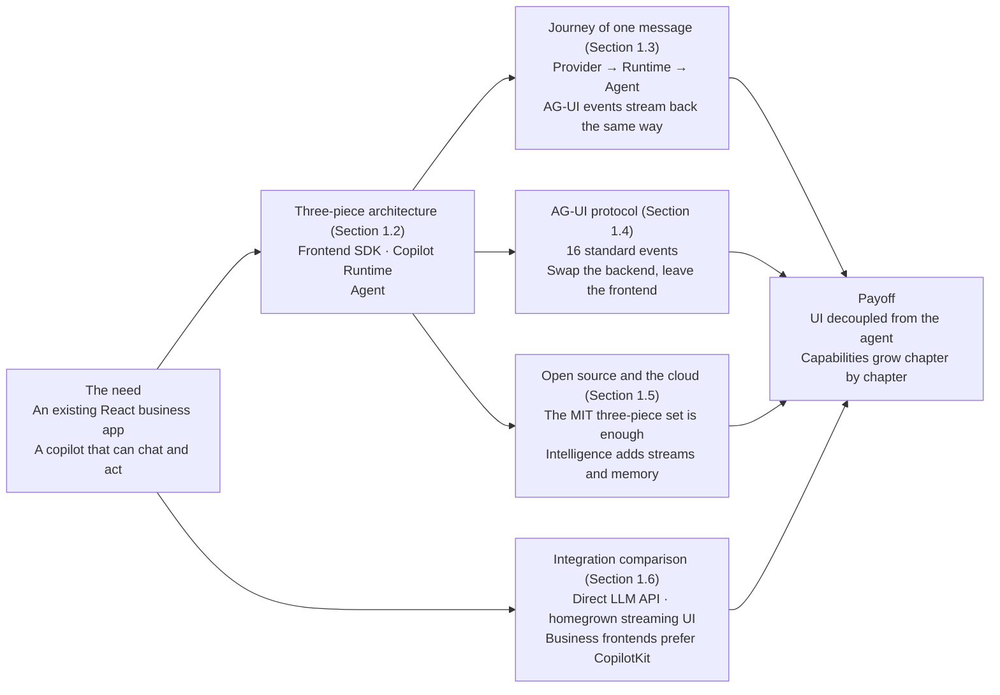
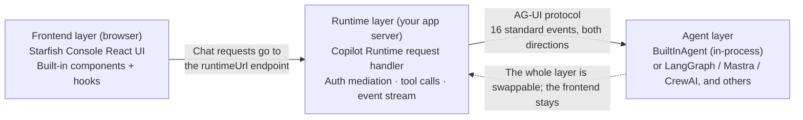
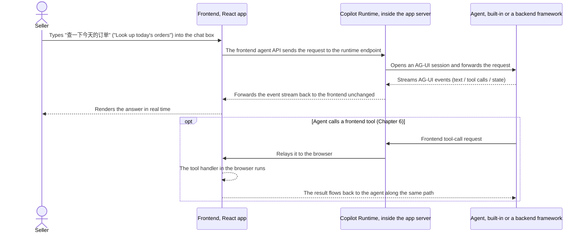
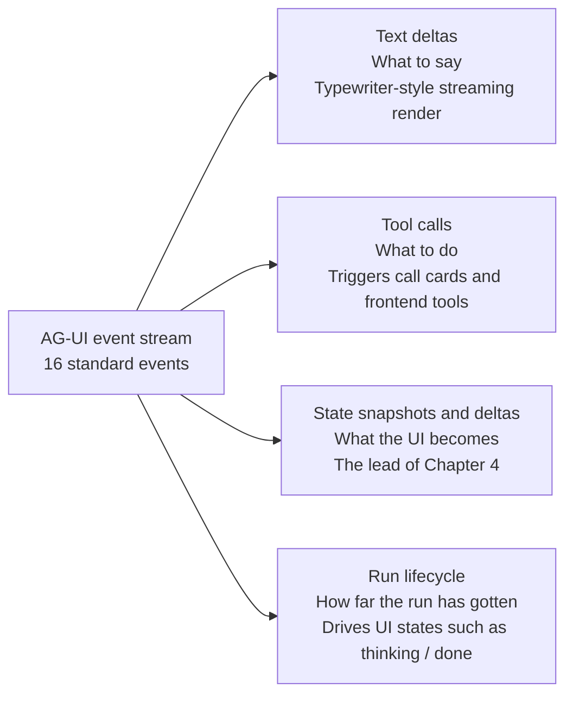
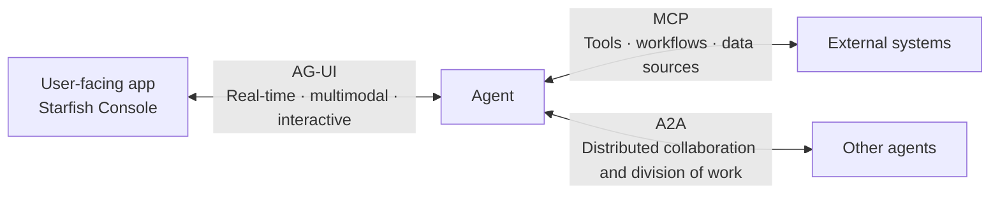
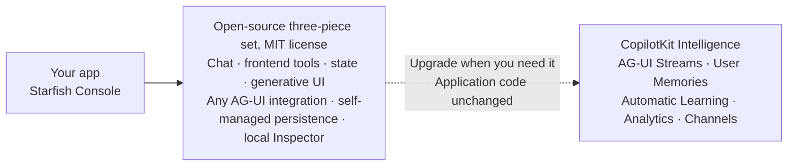
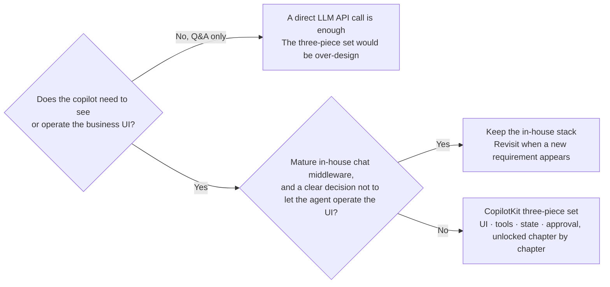

# Chapter 1 Getting to know CopilotKit

> Chapter guide: Starfish Console (星帆工作台) is an ordinary React seller-operations console. An order list, product management, a logistics board: the screens are all there, and none of it is intelligent. The product manager's request is one sentence: "Let sellers ask the system directly, and let the system act for them." Calling a large-model API directly and building a chat page from scratch means writing your own streaming renderer, inventing a frontend tool protocol, and maintaining the connection to the backend agent yourself. Each of those is a real piece of engineering, and every model or framework swap can force a rewrite. CopilotKit turns them into an assemblable three-piece set: a frontend SDK, Copilot Runtime, and an agent, joined by the open Agent User Interaction (AG-UI) protocol. This chapter does not implement anything. Its job is the panorama: what each of the three pieces owns, how one message flows from the input box to the agent and back, where open source ends and the cloud begins, and why a business frontend should prefer CopilotKit to a direct API call. By the end, you can point at Starfish Console and say where the copilot should live, where its capabilities come from, and where the boundary is.



*Figure: map of this chapter*

## When you need it

Three typical situations, and three ways to read this chapter.

**You already have a React business app, and you want an assistant that can chat and act.** Start at Section 1.1 and read through Section 1.3 in order. Those three sections answer what CopilotKit is, which pieces it is made of, and how one message flows. They are the foundation for every later chapter.

**You are worried about paying, or about handing data over.** Go straight to Section 1.5. The conclusion first: building a working agentic app needs only the open-source three-piece set (MIT license). You do not need any CopilotKit hosted service. The Intelligence platform adds cross-device sessions, memory, and operational analytics.

**In a technology-choice meeting someone asks "why not call the model API directly?"** Go straight to Section 1.6. That section puts a direct API call, a homegrown streaming chat layer, and CopilotKit in one table, and gives our recommendation on the choice.

**You want to understand the whole picture before you decide to build.** Focus on Section 1.2 and Section 1.3. One architecture diagram and one sequence diagram show how the three pieces work together. Then turn to Chapter 2 and build, with the map already in your head.

Prerequisite: none. This chapter assumes nothing. You do not need to have used CopilotKit, and you do not need to know any agent orchestration framework. Our running example, Starfish Console, is still an ordinary React app with no intelligence (React 18 + Vite + TypeScript, project name `starfish-console`). This chapter only draws the map. It does not build.

## 1.1 Overview

Start with the most basic question: what problem does CopilotKit solve?

In one sentence: **CopilotKit embeds the copilot in the app you already have. It does not move your users into a newly built chat page.** The official architecture docs describe it as a three-layer stack — frontend, runtime, and agent — connected by the open AG-UI event protocol, and they say explicitly that the runtime lives **in your own application server**. Between your UI and the agent there is only a wire format you can inspect. That sentence holds CopilotKit's whole character. It is an integration layer, not a hosting layer. The interface is yours, the server is yours, and every hop the data passes through is one you can see.

Split the "console copilot" requirement open and it is not one thing. It is five things combined:

| Piece | What it requires | What you build yourself with no toolchain |
|------|-----------|------------------------|
| A chat window | UI, input box, message stream, loading state | The full set of components and interaction details |
| A streaming answer | Word-by-word rendering, resume after an interrupt | Parsing and rendering a streaming response |
| The agent sees business data | UI state is published to the agent with the request | A context-injection protocol of your own |
| The agent operates the UI | The frontend exposes tools the agent can call | A tool-call and result protocol of your own |
| A person signs off on critical actions | Dangerous actions pause and wait for confirmation | An approval interaction and state machine of your own |

CopilotKit's approach is to hand the right-hand column of each row a ready-made answer. The first three rows come from the frontend SDK and the built-in components. The fourth row is carried by AG-UI events. The fifth row has pause semantics built into the protocol (Chapter 7). **Evaluating an AI integration framework is evaluating how much of that right-hand column is already filled in.**

For a frontend engineer, it gives you three concrete things:

1. **A chat UI.** The built-in components `CopilotChat`, `CopilotSidebar`, and `CopilotPopup` work out of the box. If you want to customize everything, the headless API lets you build the UI yourself. You can also mix the two.
2. **State and tool APIs.** Framework-native APIs, in the shape of React hooks, so the agent can read UI data, call frontend tools, and stream state changes back into the UI.
3. **Runtime and agent access.** A request handler mounted in your application server, with any AG-UI-compatible agent behind it: the built-in `BuiltInAgent`, or an agent built with LangGraph, Mastra, CrewAI, Pydantic AI, or a similar framework.

The second and third items run through the whole book, unlocked chapter by chapter:

| Capability you want | CopilotKit's counterpart | Where to go deeper |
|-----------|--------------------|---------|
| A chat window in a corner of the console | Built-in components, once a Provider wraps the app | Chapters 2 and 3 |
| The chat window aligned with Starfish Console's design spec | Headless API and style customization | Chapter 3 |
| The agent can answer "how much sold today" | UI state published to the agent | Chapter 4 |
| The agent can look up "why ORD-20431 has not shipped" | A backend agent integrated with Copilot Runtime | Chapter 5 |
| The answer renders an order card directly | Frontend tools and generative UI | Chapter 6 |
| A price change must be confirmed by a person | Human in the loop (HITL) and approval | Chapter 7 |
| Multi-agent collaboration, and production | Protocols, threads, and deployment | Chapter 8 |

How thin is the integration shell? Here is a minimal **Example** (Chapter 2 runs it line by line; this is only to build the intuition):

```tsx
// Example: the Provider wraps the existing app, and the business UI stays inside unchanged
import { CopilotKitProvider } from "@copilotkit/react-core/v2";
import "@copilotkit/react-core/v2/styles.css";

<CopilotKitProvider runtimeUrl="/api/copilotkit" agentId="default">
  {/* Every page Starfish Console already has */}
</CopilotKitProvider>
```

One Provider component, two props. `runtimeUrl` points at the runtime endpoint mounted in the application server. `agentId` names which agent receives the conversation (Starfish Console starts with the built-in `default`, and Chapter 5 swaps in a `seller_agent` you build). Business code does not need a rewrite. The existing page tree stays inside the Provider as it is. That is the literal meaning of embed. **CopilotKit is not "another chat product". It connects agent capability to the UI you already have.** That is also why every example in this book starts from a page Starfish Console already has.

## 1.2 The three-piece architecture

The official architecture docs summarize CopilotKit as a three-layer stack, with the AG-UI event protocol connecting the layers. First, what each piece owns:



*Figure 1-2: The three-piece architecture. Each layer has its own job, the AG-UI protocol connects them, and the agent layer can be replaced as a whole.*

The three layers at a glance:

| Layer | Form | Core responsibility | What you control |
|----|------|---------|-----------|
| Frontend | Hooks and built-in components from `@copilotkit/react-core/v2` | Connect the UI to the running agent; render the event stream | What the UI looks like, and which data and tools it exposes |
| Runtime | `@copilotkit/runtime/v2`, a request handler mounted in your app server | Mediate authentication and tool calls, and forward the work to the agent over AG-UI | Where it is deployed, the auth policy, and which agent it connects to |
| Agent | `BuiltInAgent`, or any AG-UI-compatible backend | Run prompts, call tools, emit state, and stream events back | Which framework, which model, and which business logic |

### 1.2.1 The frontend layer: a framework-native SDK and components

The frontend layer is the app you are already writing: Starfish Console's React UI. At this layer CopilotKit provides framework-native state and tool APIs, plus the built-in chat components (`CopilotChat`, `CopilotSidebar`, `CopilotPopup`). You pick one of three paths:

| Path | What you do | Fits |
|------|------|------|
| Built-in chat UI | Mount a built-in component and get a complete chat experience | Ship quickly, tune styles later |
| Headless, build your own | Build the whole UI with the headless API | When you must match your own design spec |
| Mix the two | Built-in for the main UI, custom for parts | The usual incremental migration |

The third path is the one Starfish Console walks. Chapter 2 hangs a chat window in the corner with a built-in component. Chapter 3 moves it into a sidebar and brings it in line with the console's design spec.

Two things in this layer are easy to tangle, so separate their jobs:

| | Built-in components | Headless API | Hooks (`useAgent` and others) |
|--|---------|--------------|----------------------|
| What you get | A finished chat UI | Building blocks for a UI, no finished product | The wiring for data and behavior |
| What you control | Theme and layout parameters | All of the DOM and the styles | Which data, tools, and state you expose |
| Typical use | A few lines to mount it in the app | Match your own design spec | Neither the built-in path nor a custom UI can do without them |

The three are not a pick-one choice. Built-in components run on the hooks too. Headless means you replace the component layer with your own. The hooks stay the foundation. **The part of the UI that "looks like chat" is replaceable. The part that "stays connected to the agent" is one and the same.**

The v2 React hooks are grouped by capability. Later chapters bring them on one by one:

| API | What it does | Where to go deeper |
|-----|--------|---------|
| `useAgent` | Subscribe to agent state, and read or write it | Chapter 4 |
| `useAgentContext` | Publish UI data to the agent as lightweight context | Chapter 4 |
| `useFrontendTool` / `useComponent` | Define a frontend tool; register a React component as a component-as-tool | Chapter 6 |
| `useRenderTool` / `useDefaultRenderTool` / `useRenderToolCall` / `useRenderedMessages` | Control how a tool call renders in the UI | Chapter 6 |
| `useHumanInTheLoop` / `useInterrupt` / `useHeadlessInterrupt` | HITL: pause, approve, and resume | Chapter 7 |

The official SDK also covers Angular and Vue. This book focuses on React. **Choosing React as the main line is a narrative focus. It is not a capability boundary.** The three-piece architecture and the AG-UI protocol are identical across frameworks.

### 1.2.2 The runtime layer: a request handler that lives on your server

Copilot Runtime is a request handler mounted in your application server. It receives requests from the frontend, mediates authentication and tool calls, and forwards the work to the agent over AG-UI. Hosts the official docs list:

| Host | Notes |
|------|------|
| Next.js (App Router) | The most natural home for a full-stack React project |
| Express / Hono | Traditional Node servers |
| Bun / Deno | Alternative server runtimes |
| Cloudflare Workers | Edge deployment |

If you do not want a separate agent process yet, there is a framework-agnostic path: instantiate a `BuiltInAgent` directly inside the runtime, and run the agent loop in the same process as the app. That is how Starfish Console starts in Chapter 2. One server process holds two of the three pieces.

On the path of one request, the official architecture docs give the runtime three jobs. Each one is worth remembering on its own:

1. **Receive the request and mediate authentication.** The frontend never touches the agent directly. The auth policy converges on the server side.
2. **Open an AG-UI session and forward the work to the agent.** Who the agent is, and where it is, is decided by the runtime configuration. The frontend does not know.
3. **Stream events back and relay tool calls.** Events the agent emits flow to the frontend as they are. When the agent wants to call a frontend tool, the runtime relays the request into the browser and brings the result back.

Those three jobs make the runtime the only node on the chain that "knows everything". That is why putting it on your own server matters (the next subsection expands this).

**Copilot Runtime living on your own server is the essential difference between CopilotKit and a hosted chat service.** Chat requests, tool calls, and the event stream all pass through your own backend, and the choice of agent is yours. That is what the official line means by "only an inspectable wire format between the UI and the agent": on your own server you can print, inspect, and intercept that stream. In code it is an instantiable `CopilotRuntime` class, wired in through a thin adapter for each host. Chapter 5 covers the configuration.

### 1.2.3 The agent layer: a replaceable brain

The agent layer is the part that actually thinks and acts. The official description of its job is four verbs, and each verb is a real investment on the backend:

- **Run prompts.** The system prompt, the business rules, and seller preferences (the run context in Section 1.3.2) take effect here.
- **Call tools.** Backend tools (look up logistics, change inventory) and frontend tools (Chapter 6) are both in its call range.
- **Produce state.** The agent side keeps a state the frontend can subscribe to. Updates to the `dashboard` numbers travel this road (Chapter 4).
- **Stream events back.** All of the above leaves as AG-UI events. The frontend recognizes events. It does not recognize frameworks.

The four verbs are a capability list at the protocol level. They do not depend on which framework implements them. That is why you can swap rows in the table below at will:

| Choice | Notes | When it fits |
|------|------|---------|
| `BuiltInAgent` (built-in agent) | An in-process agent loop. Supports OpenAI, Anthropic, Google, and other models | Starting out, prototypes, or when you do not need an external framework |
| LangGraph / Mastra / CrewAI / Pydantic AI / Microsoft Agent Framework | Each framework connects through an AG-UI adapter | When you need orchestration or a complex business flow |
| Custom implementation | Any AG-UI-compatible backend | When you already have an in-house agent |

**The choice of agent layer is reversible.** Start with the built-in agent. When the business gets complicated, swap in a LangGraph-orchestrated `seller_agent`. The frontend does not change a line. Section 1.4's AG-UI protocol is what guarantees that "no change", and it is the premise that makes Starfish Console's evolution hold: built-in in Chapter 2, switch frameworks in Chapter 5, add a subagent in Chapter 8.

### 1.2.4 What the layers give Starfish Console

Map the three pieces onto Starfish Console and the division of labor is this:

- **The frontend layer** is in the browser. Built-in components provide the chat window. `useAgentContext` publishes `dashboard` data (Chapter 4). Frontend tools let the agent call `get_orders` and `update_price` (Chapter 6).
- **The runtime layer** is in `starfish-console`'s own application server. It handles authentication and tool relay. From Chapter 5 on, it forwards requests to LangGraph's `seller_agent`.
- **The agent layer** starts as the built-in `default` and grows into `seller_agent`. Chapter 8 then adds a `pricing_agent` subagent.

**Each layer evolves on its own, and none of them lock the others. That is the real payoff of the three-piece architecture, and it is why this book organizes chapters by layer.** Which layer each chapter moves, in one table:

| Chapter | Layer it mainly moves | In other words |
|------|-----------|---------|
| Chapter 2 | Connect all three layers | A minimal system that runs |
| Chapter 3 | Frontend layer | UI and styles |
| Chapter 4 | Frontend layer + the agent layer's data plane | Publish and subscribe to state |
| Chapter 5 | Runtime layer + agent layer | Swap the brain, configure the runtime |
| Chapter 6 | Frontend layer + the agent layer's action plane | Frontend tools and rendering |
| Chapter 7 | The whole chain | Put a person on the action |
| Chapter 8 | Runtime layer + protocol + deployment | Multi-agent, and production |

## 1.3 The journey of one message

Architecture is static. A message moves. Follow one message from the input box to the render, and how the three pieces cooperate is obvious.

### 1.3.1 The sequence diagram and the seven steps

The official architecture docs give the full request flow. Drawn as a sequence diagram:



*Figure 1-3: The journey of one message. The outbound leg is the request and the event stream. A frontend tool call is the only return leg.*

Check it cell by cell against the seven steps in the official docs:

| Step | What happens | What it corresponds to in Starfish Console |
|----|---------|---------------------|
| 1 | The user sends a message in the frontend app | The seller types "查一下今天的订单" ("Look up today's orders") in the sidebar |
| 2 | The frontend agent API sends the request to the runtime endpoint | The request hits `/api/copilotkit`, the path `runtimeUrl` points at |
| 3 | The runtime opens an AG-UI session with the configured agent | The runtime finds the agent that `agentId` names |
| 4 | The agent streams out text, tool calls, and state updates as AG-UI events | `default` (or `seller_agent` from Chapter 5 on) starts working |
| 5 | The runtime streams events back to the frontend, and the frontend renders them live | The answer appears in the chat window word by word |
| 6 | If the agent calls a frontend tool: the runtime relays the request, the handler in the browser runs, and the result streams back to the agent | Chapter 6's `get_orders` looks the orders up in the browser |
| 7 | Threads, persistence, and real-time sync (once configured) are mediated on the CopilotKit Intelligence side | This comes up only when you take it to production in Chapter 8 |

Worth pointing out: by the end of Chapter 2 in Starfish Console, steps 2 through 5 are all running. At that point the console copilot "can chat, and it cannot see the page". Step 6 waits until frontend tools land in Chapter 6. Step 7 is optional, and Chapter 8 comes back to it.

Walk the first five steps again in Starfish Console's terms. The seller types "查一下今天的订单" ("Look up today's orders") in the sidebar. That message does not enter any business component in the browser. The frontend agent API sends it to `/api/copilotkit` (step 2). The runtime receives it on its own server, confirms the request is legitimate, finds the `default` agent that `agentId` points at, and opens an AG-UI session to hand the work over (step 3). The agent loop starts turning. It decides to answer with a sentence first, then call an order lookup. Text-delta events, tool-call events, and state-update events flow into the runtime one after another (step 4). The runtime does not process them and does not interpret them. It forwards the event stream back to the frontend unchanged (step 5). The answer surfaces in the chat window word by word. All of it happens in a few hundred milliseconds to a few seconds.

Notice that the frontend's "ignorance" on this journey is designed. It does not know whether the agent is built-in or LangGraph. It does not know which vendor the model comes from. It does not know how many subagents sit behind it. **The frontend recognizes only AG-UI events. That ignorance is the decoupling point Section 1.4 opens up.**

### 1.3.2 What else rides along: run context

A message is more than the question text. On every run the frontend can publish "run context": the tone, the reply length, and the level of expertise the seller picked in a settings panel. The official name for this is agent config: a typed configuration object the frontend holds. The agent reads it on every run and rebuilds the system prompt. On the React side you publish it with `useAgentContext` (**Example**; Chapter 4 develops it):

```tsx
// Example: publish the preferences chosen on the UI to the agent with every run
useAgentContext({
  // "Seller reply preferences"
  description: "卖家回复偏好",
  value: { tone: "professional", language: "zh-CN" },
});
```

How it travels on the agent side depends on the runtime architecture. An agent that lives behind the runtime reads it from agent state on every run. The built-in agent in the same process as the runtime receives it directly as a forwarded property. Same configuration, two ways to wire it. The official docs draw a clear line, so you can judge which road a value should take:

- If the values are a "channel" the user adjusts occasionally (a settings panel, a dropdown), use agent config.
- If they are "content" the agent should write back (notes, documents, plans), use shared state. In Starfish Console, `dashboard` numbers changing with the conversation is the second kind. That is Chapter 4's subject.

Hold the two data directions against each other:

| | Agent config (channel) | Shared state (content) |
|--|--------------------|----------------|
| Who writes | The frontend (the user adjusts it in the UI) | The agent and the frontend, both ways |
| Typical examples | Tone, expertise, reply language | `dashboard` numbers, drafts, plans |
| Frontend API | `useAgentContext` | `useAgent` (Chapter 4) |
| Starfish Console scenario | The seller picks a "正式/轻松" ("formal / casual") reply style | The agent changes inventory, and the page follows |

### 1.3.3 Frontend tools: the only return leg in the journey

The main direction of the seven steps is "agent → frontend". Only step 6 reverses it. The agent names a tool that lives in the browser, the runtime relays the request in, your React handler runs, and the result streams back. That gives the agent a hand that can "operate the UI". Chapter 6's `get_orders` and `update_price` both depend on this loop. **Keep the direction straight. Everything else is an "event" the agent streams to the frontend. Only a frontend tool is the frontend being called by the agent and "sending the result back".** HITL in Chapter 7 (pause on a critical action and wait for a person to decide) travels this same two-way channel.

## 1.4 The AG-UI protocol: why the middle needs a standard

### 1.4.1 A world without a standard protocol

The bridge between the three pieces is AG-UI. The official definition: AG-UI is a lightweight, event-based protocol that standardizes how an AI agent connects to a user-facing application. It is an open standard, written by the CopilotKit team together with partners from several agent frameworks.

Why does it need to exist? Think the other way. Without a standard protocol, every frontend and every agent framework needs its own custom pipe: a custom WebSocket message format, a streaming parser that differs by vendor, and a rewrite every time you connect a new framework. The frontend team is stuck maintaining a pile of dialects only they can read. Those dialects have three long-term costs:

- **Integration cost.** Every time you switch agent frameworks, the middle layer between frontend and backend is rewritten.
- **Maintenance cost.** A custom format has no community evolution. Edge cases (disconnects, reordering, timeouts) are yours to patch.
- **Lock-in cost.** The deeper the frontend couples to that framework's implementation details, the less you dare to switch.

The official docs position AG-UI as the replacement for all of that: **one carrier for every round trip between the frontend and the AI agent, in place of custom WebSocket formats and text parsing.**

### 1.4.2 Four properties that matter

| Property | What it means | The direct benefit to you |
|------|------|---------------|
| Event-driven | 16 standard event types: text deltas, tool calls, state snapshots and deltas, run lifecycle | Every interaction has the same shape, so render logic can be reused |
| Bidirectional | The user sends input, the agent replies, the agent can pause and wait for HITL, and the frontend can expose frontend tools for the agent to call | "The agent operates the UI" and "a person reviews the agent" both have a place in the protocol |
| Transport-agnostic | SSE, WebSocket, and webhooks all work | You are not tied to one push technology |
| Framework-agnostic | Every supported integration ships a thin AG-UI adapter | Swapping the backend is one line of runtime configuration |

The last of the four carries the most engineering weight. Framework-agnostic is not piled up by "supporting many frameworks". It comes from **converging the adaptation into a thin adapter on the agent side**. Every integration speaks AG-UI, and the frontend and the runtime recognize only the protocol. "Swap the backend" drops from "rewrite the frontend" to "change one line of runtime configuration", and several backends can run in parallel. When Starfish Console switches to `seller_agent` in Chapter 5, the chat window and all of the UI code stay untouched.

Do not treat the other two as filler. Transport-agnostic means that when you use SSE today and WebSocket tomorrow, the event semantics stay the same and the frontend render code does not move. Bidirectional means the protocol left room, from the start, for "the agent pauses and waits for a person" and "the agent calls a tool in the browser". The capabilities in Chapters 6 and 7 are not patches. They are native design in the protocol.

### 1.4.3 Of the 16 events, the four kinds you meet first

Of the 16 events, four kinds show up first. They alternate in one event stream, and each kind owns one job:



*Figure 1-4: The four lead categories in an AG-UI event stream. Together they carry everything the chat window needs in order to render.*

The full list of 16 events is in the official AG-UI docs. Chapter 8 comes back to the protocol and walks the whole event picture. For now, take one intuition with you: **everything the frontend needs in order to render the chat window is in these four kinds of events.**

### 1.4.4 The protocol map: AG-UI is not an island

Zoom out one more level. The official docs split the agent world's protocols into pieces, and CopilotKit is compatible with all of them. The agent sits in the middle, and each of the three kinds of connection belongs to one protocol. AG-UI is the Agent User Interaction protocol, MCP is the Model Context Protocol, and A2A is Agent to Agent:



*Figure 1-5: Protocol map of the agent world. AG-UI covers human–agent interaction, MCP covers tools and data, and A2A covers collaboration between agents.*

There is also a set of generative UI specifications: A2UI (Google), MCP Apps (the MCP ecosystem), and Open-JSON-UI (OpenAI). CopilotKit supports all of them (Chapter 6 develops this). These protocols can be **used directly, and they can be combined**. AG-UI has a "handshake" with MCP and A2A. If your host agent connects to a subagent through MCP or A2A, the subagent's UI properties can pass all the way through to the user-facing app, while the full security, policy, and observability controls stay in place. That is the protocol basis for the multi-agent scenarios in Chapter 8.

One sentence in the official docs is worth putting on the team wiki homepage (paraphrased): **"The future of agents does not belong to any one company or one platform. It is an agentic ecosystem connected by protocols."** As an engineering decision, that sentence means this: **the contract is the protocol, not an SDK lock-in. You can replace the agent layer as a whole without rewriting the frontend. You can run several agent backends in parallel. You can connect anything AG-UI-compatible: MCP servers, A2UI components, and the agent platforms from Oracle, Google, and AWS.** Starfish Console swaps the built-in agent for LangGraph in Chapter 5 and adds a subagent in Chapter 8. Both moves rest on this decoupling point.

## 1.5 The boundary between open source and the cloud

The line between CopilotKit's open-source part and its cloud service (Intelligence) is clear. The official statement: the open-source SDK and the TypeScript runtime connect the frontend to the agent, and **they do not need any CopilotKit service**. On top of that, CopilotKit Intelligence provides five platform capabilities: AG-UI Streams, User Memories, Automatic Learning, Product Analytics, and Channels.

### 1.5.1 What is in the open-source core

| Piece | Contents | Notes |
|------|------|------|
| Frontend SDK | `@copilotkit/react-core` (v2 is imported from the `/v2` subpath) | Hooks and built-in components: chat, tools, state, threads, generative UI |
| Runtime | `@copilotkit/runtime` (v2 is the `/v2` subpath) | A request handler mounted in the app server; thin adapters for Express, Hono, Bun, Deno, and Cloudflare Workers |
| AG-UI protocol | An open standard | 16 standard events, transport-agnostic |
| Built-in agent | `BuiltInAgent` | An in-process agent loop. Supports OpenAI, Anthropic, Google, and other models, with no external framework |
| Integrations | LangGraph (Python / TypeScript / FastAPI), Mastra, CrewAI, Pydantic AI, Microsoft Agent Framework, AWS Strands, Google ADK, and others | First-party adapters |
| Generative UI primitives | Tool rendering, state rendering, the headless API, framework-native themes | Chapter 6's subject |

The open-source part is MIT-licensed. It can run on any host, on any cloud, with any large-model provider. **Self-managed persistence is always an option.** LangGraph's checkpointer, ADK's session service, and the app's own storage can all save conversation history. Storage and UI integration stay entirely yours. They do not pass through any CopilotKit service.

### 1.5.2 Which capabilities need Intelligence

The official capability boundary splits into two sides in one figure. The solid-line side is open source. The dashed-line side is what needs Intelligence:



*Figure 1-6: The boundary between open source and the cloud. The MIT-licensed three-piece set is enough with no dependency on a CopilotKit service. The five platform capabilities on the right are added when you need them.*

The five Intelligence capabilities, one sentence each:

| Capability | In one sentence | When Starfish Console needs it |
|------|--------|-------------------|
| AG-UI Streams | Save the session, the UI, and the input; reopen across devices; reconnect an active run after a disconnect | The seller continues, on a phone, a conversation that started on a computer |
| User Memories | Keep facts beyond a single session (two scopes: user and project) | Remember "这个卖家主推美线" ("This seller's main lane is the US") |
| Automatic Learning | Turn real usage into skills a person can review and then publish (Skill delivery sends them to the agent) | Settle frequent questions into formal skills |
| Product Analytics | Understand how users use your agent and your tools | Operations wants copilot usage data |
| Channels | Connect an existing agent to Slack or Microsoft Teams (cloud-hosted; the open-source Channels SDK can also run a runner you host yourself) | Reach sellers on channels outside the console |

### 1.5.3 Cloud-hosted and self-hosted: the same code

Intelligence has two deployments. **Cloud-hosted:** register, get an API key, point the runtime at it, and run zero platform operations. **Self-hosted:** run it on your own infrastructure (Kubernetes with a Helm chart, AWS with an ECS bundle), and you operate the service and its dependencies. **Application code is identical under both deployments. You only swap the platform endpoint and the credentials.** Choose cloud-hosted today and move to self-hosted tomorrow, and the frontend SDK and the runtime API do not change a line.

### 1.5.4 Two boundaries that are easy to miss

**First, the runtime language differs.** The TypeScript runtime is the default, the most complete implementation, and the only runtime that works without Intelligence. The Python, Go, Ruby, and C#/.NET runtimes need cloud-hosted or self-hosted Intelligence. Their source is open too. The difference is the service they depend on. This book and Starfish Console use the TypeScript runtime, which lands on the "zero Intelligence dependency" side.

**Second, Inspector has two faces.** Inspector (the development-time debugging tool) is available by default in development builds of React, Vue, and Angular browser apps. Live AG-UI events, tools, state, and connection debugging: those local panels do not need Intelligence. Its Rich Threads and Automatic Learning panels need the matching Intelligence service before there is data to look at. Local debugging during development costs nothing. The platform-level panels are where payment comes in.

### 1.5.5 What Starfish Console keeps and what it adds

Take the boundary above and walk Starfish Console's requirements one by one:

| Starfish Console's requirement | Is the open-source three-piece set enough? | Basis |
|-----------|---------------|------|
| A chat window, and streaming answers | Enough | Built-in components and hooks are in the open-source SDK |
| The agent looks up orders and changes prices | Enough | Frontend tools and AG-UI integration are open-source capabilities |
| A person approves before a price change | Enough | Pause semantics are in the protocol (Chapter 7) |
| Conversation history is saved | Enough (you manage it) | Self-managed persistence is an option the official docs list explicitly |
| The seller switches devices and continues the chat | Not enough | Reopening across devices, and reconnecting after a disconnect, belong to AG-UI Streams |
| Operations wants usage data | Not enough | That belongs to Product Analytics |

Our recommendation: **the Starfish Console main line depends only on the open-source three-piece set, end to end.** The built-in agent in Chapter 2, shared state in Chapter 4, frontend tools in Chapter 6, and HITL in Chapter 7: none of them needs an Intelligence credential. **Use the open-source part fully, then add the cloud when you need it.** When the console needs cross-device resume, long-term memory, or operational analytics (Chapter 8), add Intelligence, and you do not have to change application code.

## 1.6 CopilotKit compared with other integration paths (our recommendation)

> This section is original. The official docs have no dedicated comparison article. The factual boundary follows architecture.mdx and ag-ui.mdx. The choice is this book's view.

### 1.6.1 Three paths

A business frontend that wants a copilot usually faces three paths:

- **Path A, call the large-model API directly.** The frontend (or a backend you build) calls the model service's chat endpoint, assembles the prompt, parses the response, and draws the UI.
- **Path B, a homegrown streaming chat layer.** On top of A, you implement a streaming protocol, a message format, and a tool-call convention yourself. Teams often call this "a homegrown lightweight agent gateway plus a chat component".
- **Path C, CopilotKit.** The three-piece set plus AG-UI. The chat UI, streaming render, the tool loop, and state sync are ready-made protocol and components.

Each path has a typical profile. Teams on path A have usually just finished a demo and have not yet thought about "the agent has to operate the UI". The distance from demo to product is the whole list of catch-up work. Teams on path B were burned by A and then invested seriously. What they built often works, but every new framework and every new kind of interaction means cutting into the middle layer, and that investment cannot be moved. Teams on path C treat "how the UI and the agent connect" as a solved problem, and spend the engineering budget on their own business logic.

### 1.6.2 Dimension by dimension

| Dimension | A Direct LLM API | B Homegrown streaming chat layer | C CopilotKit |
|------|---------------|------------------|--------------|
| Chat UI | Build it yourself | Build it yourself, including streaming render | Three layouts of built-in components, or a headless UI you build |
| Frontend/backend event contract | None (you define it) | A custom format, and you maintain the parser | AG-UI standard events, 16 of them |
| Agent integration | Wrap each vendor's model API yourself | Integrate each framework yourself | A thin adapter per framework; one config line to swap the backend |
| Tool calls that reach frontend components | No such concept; you design the protocol | A custom format and text parsing | AG-UI events carry the frontend tool loop natively |
| UI state sync | You poll, or you invent another protocol | A custom WebSocket format | State snapshot and delta events; the UI and the agent stay in sync |
| HITL and approval | Build it yourself | Build it yourself | Pause and resume semantics built into the protocol (Chapter 7) |
| Swap the model or the agent framework | Frontend logic changes with it | The middle layer changes with it | Replace the agent layer as a whole; the frontend stays |
| Cost of each added capability | A new project | A new project | Built into the platform, unlocked chapter by chapter |

### 1.6.3 Decision tree

Draw the criteria above as a decision tree, and you can project it in the choice meeting:



*Figure 1-7: Decision tree for the integration path. First ask whether it must operate the UI, then ask whether an in-house stack already exists.*

### 1.6.4 Fairness and the conclusion

A note on the fairness of this table. Path A is not empty-handed. **If all you need is a pure Q&A box that never touches business data and never calls a tool (a FAQ bot on a static site, for example), a direct API call is lighter, and bringing in the three-piece set is over-design.** Path B also has room to stay. A team that already has mature in-house chat middleware, and that has decided it will not let "the agent operate the UI", is reasonable to keep what it built.

Starfish Console is not in those exceptions. Its requirement list is: the agent has to see the `dashboard` numbers (state sync), look up orders (a backend agent), render order cards inside the answer (frontend tools and generative UI), and get a person's confirmation before a price change (approval). **The criterion in one sentence: as soon as the copilot has to "see or operate your business UI", the cost of a direct API call and of a homegrown path rises linearly with the feature list, while CopilotKit made those capabilities into protocol and components you take as you need them.** Our recommendation: **when a business frontend adds a copilot, prefer CopilotKit. Consider a direct API call only for a pure Q&A scenario.**

The next step after the choice is not more argument. It is a check. Chapter 2 spends twenty minutes in Starfish Console and actually runs the first of the three requests: a window that can chat. The basis in your hands then goes from this table to a run you did yourself.

## Chapter summary

1. **CopilotKit is an integration layer, not a hosting layer.** It embeds the copilot in an existing React app. Copilot Runtime lives in your own application server. Between the UI and the agent there is only a wire format you can inspect.
2. **The three pieces each have a job.** The frontend SDK owns the UI and the hooks. `CopilotRuntime` owns authentication, tool relay, and forwarding the event stream. The agent owns thinking and acting. Layers can be replaced independently.
3. **One message, seven steps.** Input, then the runtime endpoint, then an AG-UI session, then events streaming back, then a live render. A frontend tool call is the only "return leg". Threads and sync, which belong to Intelligence, are the optional step 7.
4. **AG-UI is the decoupling point.** 16 standard events, bidirectional, transport-agnostic, framework-agnostic. Swapping the agent backend is one line of runtime configuration. Starfish Console's evolution from the built-in agent to LangGraph depends on it.
5. **Open source is enough.** The MIT-licensed three-piece set covers chat, tools, state, generative UI, and the local Inspector. AG-UI Streams, User Memories, Automatic Learning, Product Analytics, and Channels are what need Intelligence, and cloud-hosted and self-hosted use the same application code.
6. **Our recommendation:** prefer CopilotKit when the copilot has to "see or operate the business UI". A pure Q&A box is lighter as a direct API call.

→ The map is in place. **Chapter 2** turns that map into a running system: twenty minutes to mount `CopilotKitProvider`, the built-in agent, and the first chat window in Starfish Console.

## Checklist

By the time you reach here, you should be able to:

- ☐ Point at Starfish Console and say where each of the three pieces is deployed: the frontend SDK in the browser, `CopilotRuntime` on your own application server, and the agent in-process (`BuiltInAgent`) or on a separate backend;
- ☐ Draw the seven-step journey of one message from the input box to the render, and point out which step a frontend tool call happens on, and why the direction reverses;
- ☐ Name AG-UI's four properties (event-driven, bidirectional, transport-agnostic, framework-agnostic), and explain which one "swap the agent backend without changing the frontend" depends on;
- ☐ Group common capabilities (chat, frontend tools, generative UI, the local Inspector, self-managed persistence) apart from capabilities that need Intelligence (AG-UI Streams, User Memories, Automatic Learning, Product Analytics, Channels);
- ☐ State how the TypeScript runtime differs from the other language runtimes (Python, Go, Ruby, C#/.NET) in its dependency on Intelligence;
- ☐ For Starfish Console, give a reason and a criterion among the three paths "direct LLM API / homegrown streaming chat layer / CopilotKit";
- ☐ Explain to the team why Starfish Console's copilot "can chat, and it cannot see the page" is only the midpoint of Chapter 2, not the final shape.

## Quick reference

The main line does not depend on this section. This section is a glossary of the book's core v2 APIs. Look terms up as you read.

| Term | What it is | Where to go deeper |
|------|--------|---------|
| `CopilotKitProvider` | The frontend Provider component. Props: `runtimeUrl` (the runtime endpoint), `agentId` (the default agent) | Chapter 2 |
| `useAgent` | The hook that subscribes to agent state and reads or writes it | Chapter 4 |
| `useAgentContext` | Lightweight context publishing (agent config, for example) | Chapter 4 |
| `useFrontendTool` / `useComponent` | Define a frontend tool; a component as a tool | Chapter 6 |
| `useRenderTool` / `useDefaultRenderTool` / `useRenderToolCall` / `useRenderedMessages` | Hooks related to rendering tool calls | Chapter 6 |
| `useHumanInTheLoop` / `useInterrupt` / `useHeadlessInterrupt` | HITL: approval, interrupt, and headless interrupt | Chapter 7 |
| `CopilotRuntime` | The runtime class. Instantiate it when you run your own server | Chapter 5 |
| `BuiltInAgent` | The in-process built-in agent. Supports multiple model vendors | Chapter 2 |
| `createCopilotNodeListener` | The Node-side adapter | Chapter 5 |
| AG-UI | The open protocol of 16 standard events | Chapter 8 |

## Further reading

- **Chapter 2 (Quick start: a first copilot in twenty minutes)** — this chapter's panorama lands as a system that runs: the Provider, the built-in agent, and the first chat window. The official quickstart, using the built-in agent, can be running in about ten minutes.
- **Chapter 8 (Multi-agent, protocols, and production)** — the full AG-UI event picture, the A2A/MCP handshake, the thread lifecycle, and the Intelligence deployment decision. The threads left open in Sections 1.4 and 1.5 close there.
- **Chapter 6 (Frontend tools and generative UI)** — the spectrum of the six generative UI primitives (component-as-tool, tool-call rendering, state rendering, reasoning, A2UI, MCP Apps), from "author control" to "declarative" to "open".
- **Chapter 5 (Connecting a backend agent: Runtime and framework integration)** — when the agent layer swaps the built-in agent for LangGraph or another framework, how the runtime is configured and how `seller_agent` is registered.
- **The official Architecture and AG-UI documents** — the section-by-section basis of this chapter. The AG-UI site, ag-ui.com, shows the whole protocol ecosystem.
