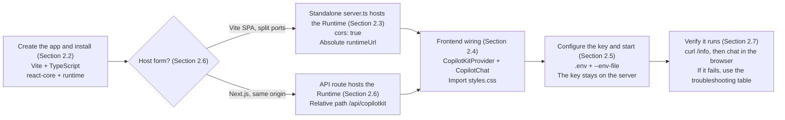
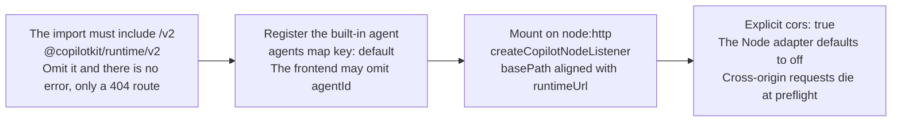
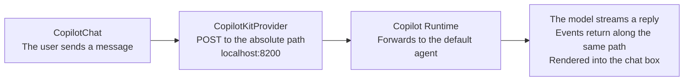
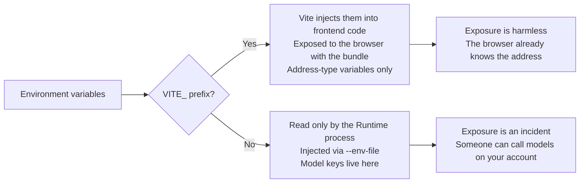

# Chapter 2 Quick start: a first copilot in twenty minutes

> Chapter guide: Starfish Console (星帆工作台) is, right now, an ordinary React app. An order list, product management, a logistics board, and not one word of it has anything to do with AI. The goal of this chapter is concrete: put a copilot that can chat into a corner of this console. The user opens the input box, types a sentence, and the answer streams back from the model. To get there we stand up the minimal architecture from Chapter 1. The frontend gets `CopilotKitProvider` and a chat component. A second process runs Copilot Runtime. Inside it we register a built-in agent. Twenty minutes from now you will have typed two start commands, a complete `server.ts`, and a stretch of frontend wiring, and you will know how to use `curl` to confirm the Runtime is alive before you open a browser. Keep the bar where it is. At this moment the copilot can only talk. It cannot see the orders page, and it does not know how much sold today. That gap is what shared state in Chapter 4 fills. By the end of this chapter you can: run one complete conversation in any React app; say what the two processes, "frontend + Copilot Runtime", each own; and put the model key where it belongs.



*Operational flowchart for this chapter*

## When you need it

Three typical situations, and three ways to use this chapter.

**I am starting a new React project, and I want CopilotKit from the first line.** Follow Section 2.2, then Section 2.3, then Section 2.4. That is this chapter's main line: create the app from scratch with Vite and TypeScript, run Copilot Runtime as its own process, and wire the frontend so it can chat.

**I already have a Vite SPA, or an old Create React App project, and I do not want to move to Next.js.** Focus on Section 2.3 and Section 2.6. An SPA has no server of its own, so the Runtime has to be its own process. That brings two hard rules: `cors: true`, and an absolute `runtimeUrl`. These two are the easiest pitfalls in this chapter, and they are the only essential difference between the SPA case and the official Next.js quickstart.

**I only want to see it work, and I do not want to touch my own project.** Follow Section 2.2, create a throwaway directory, get it running, and delete it when you are done. Or, if you are on Next.js, go straight to the same-origin path in Section 2.6. One API route mounts the Runtime, and you do not start a separate process.

Prerequisite: the architecture diagram from Chapter 1 (how the frontend, Copilot Runtime, and agent layers connect); an OpenAI API key (or another model provider, which Chapter 5 covers); Node.js 20.6 or later (for the `--env-file` flag); React 18 or later.

## 2.1 Overview: why "frontend + Copilot Runtime" is two processes

Chapter 1 said the browser in CopilotKit's architecture never talks to the model directly. Copilot Runtime sits in between. It keeps the model key for you, forwards chat requests, and at the protocol layer turns model output into an event stream the frontend can consume. On a development machine, the physical form of that fact is one question: **which process does the Runtime's code run in?**

The official quickstart assumes Next.js. It is a frontend framework and it brings its own server, so an API route is the natural place to mount the Runtime. Frontend and backend share an origin, and one project is done on one port. Starfish Console is a single-page app on React 18 and Vite. The Vite dev server only serves static assets. Server code has nowhere to live. So this chapter's architecture is two processes:

| Process | Port (default) | Responsibility | Where the code lives |
|------|------------|------|---------|
| React app (Vite dev server) | `5173` | Render the console UI. `CopilotKitProvider` sends chat requests to the Runtime | `src/App.tsx` and the rest |
| Copilot Runtime (standalone Node process) | `8200` | Host the Runtime HTTP endpoint, register the agent, keep the model key | `server.ts` |

Two processes, two ports, two origins. That split is the root of every special setting in this chapter:

- The browser sends from `localhost:5173` to `localhost:8200`. That is cross-origin, so the Runtime must turn CORS (Cross-Origin Resource Sharing) on explicitly. The Node adapter does **not** turn it on by default.
- The relative path `/api/copilotkit` resolves, in an SPA, to `5173` itself, and nothing is there. So `runtimeUrl` has to be the full `http://localhost:8200/api/copilotkit`.
- The model key should appear only in the Runtime process's environment. It should never appear in frontend code.

On the agent layer, the smallest choice is CopilotKit's own built-in agent. It calls the model directly, with no external framework, and it supports the full set of CopilotKit capabilities, including tools and generative UI. For the goal of getting something running, it is the shortest path. It plays Starfish Console's copilot until Chapter 5. The comparison table at the end of this chapter (Section 2.6) puts the two host paths side by side. If you are on Next.js, you can read only Section 2.4 and Section 2.6 and skip the standalone process.

## 2.2 Create the app and install CopilotKit

### 2.2.1 Create the Vite app

If Starfish Console does not exist yet, create one from scratch with the official scaffold (an existing project can skip to Section 2.2.2 and install the packages in place):

```bash
npm create vite@latest my-copilot-app -- --template react-ts
cd my-copilot-app
npm install
```

That generates a minimal React 18 + TypeScript project. An existing Create React App project is handled the same way. The only difference is the start command at the end (CRA uses `npm start`, Vite uses `npm run dev`).

**Check:** when the commands finish, the directory has `src/main.tsx`, `src/App.tsx`, and `package.json`, and `npm run dev` shows `Local: http://localhost:5173/`. The project-name convention for our running example is `starfish-console`. You can replace `my-copilot-app` in the command above with that name.

### 2.2.2 Install the two packages

Install the frontend package and the Runtime package together, then add the dev dependencies `server.ts` will need:

```bash
npm install @copilotkit/react-core @copilotkit/runtime
npm install -D tsx typescript @types/node
```

The two packages own opposite ends. `@copilotkit/react-core` provides the frontend components and hooks. `@copilotkit/runtime` provides the Runtime itself. `tsx` runs the TypeScript `server.ts` directly. `@types/node` supplies Node's type definitions.

**Watch the TypeScript module-resolution setting.** CopilotKit's `/v2` subpath is published through the package `exports` map. TypeScript's old `"moduleResolution": "node"` (node10) does not recognize it. Type-checking reports `Cannot find module '@copilotkit/react-core/v2'`, even though the code actually runs. Open `tsconfig.json` and confirm (or change it to):

```jsonc
{
  "compilerOptions": {
    "moduleResolution": "bundler",
    "module": "esnext"
  }
}
```

Set `module` as well only when it is `commonjs` or unset. A project from `npm create vite` is already `bundler`. You usually leave it alone.

**Check:** `package.json` lists `@copilotkit/react-core` and `@copilotkit/runtime` under `dependencies`, and `tsx` under `devDependencies`.

## 2.3 Start Copilot Runtime: the built-in agent and server.ts

### 2.3.1 Register a built-in agent

An SPA has no server of its own, so the Runtime needs a separate process to live in. At the project root (level with `package.json`), create `server.ts`:

```ts
// server.ts
import { createServer } from "node:http";
import { BuiltInAgent, CopilotRuntime } from "@copilotkit/runtime/v2";
import { createCopilotNodeListener } from "@copilotkit/runtime/v2/node";

const runtime = new CopilotRuntime({
  agents: {
    default: new BuiltInAgent({
      model: "openai:gpt-5-mini",
      prompt: "You are a helpful assistant for a React app.",
    }),
  },
});

const port = 8200;

createServer(
  createCopilotNodeListener({
    runtime,
    basePath: "/api/copilotkit",
    cors: true,
  }),
).listen(port, () => {
  console.log(
    `Copilot Runtime listening at http://localhost:${port}/api/copilotkit`,
  );
});
```

Take it apart line by line. This file of about twenty lines holds four key decisions, strung from the import to the listen. Look at the figure, then read the code again:



*Figure 2-1: Four key decisions in server.ts. Import, register, mount, and allow cross-origin.*

The last link, `cors: true`, is the most important line in the chapter. The next subsection takes it on its own. `BuiltInAgent`'s `model` uses the `"provider:model"` string format, and `prompt` is its system prompt.

### 2.3.2 Why `cors: true` cannot be omitted

Your app is on `localhost:5173` and the Runtime is on `localhost:8200`. The browser counts a different port as a different origin, and any cross-origin request is preceded by a preflight. CORS on `createCopilotNodeListener` and `createCopilotRuntimeHandler` **defaults to off**. Leave out `cors: true` and every browser request dies at the preflight. What you see is a chat box that renders perfectly, and a message that never gets a reply. The official docs name this "the most common reason the chat renders and then does not respond".

The default is not even consistent. The Express and Hono adapters default to open CORS (`origin: "*"`). The Node adapter defaults to closed. Do not trust muscle memory. Trust this explicit line. Before production, `cors` can also take a configuration object and tighten by origin (the full configuration is in Chapter 8):

```ts
createCopilotNodeListener({
  runtime,
  basePath: "/api/copilotkit",
  cors: {
    origin: "https://app.example.com",
    methods: ["GET", "POST", "OPTIONS"],
  },
});
```

### 2.3.3 Verify with curl before you start

`server.ts` reads the model key from `process.env` (the next section configures it). Once that is in place, start it:

```bash
npx tsx --env-file=.env server.ts
```

`Copilot Runtime listening at http://localhost:8200/api/copilotkit` means the process is up. "The process is up" is not "it is ready". The official docs are explicit: **before you open a browser**, confirm the Runtime can actually serve:

```bash
curl --fail --silent --show-error http://localhost:8200/api/copilotkit/info
```

`/info` is the Runtime's self-description endpoint. It returns the list of registered agents. Wait until this command succeeds, and until the returned JSON shows the `default` agent, and only then open the frontend.

**Why be this strict.** If some dev script starts both processes together, "Vite is already listening" does not mean "the Runtime is already ready". Opening the page too early leaves its first Runtime connection in a bad state. If that already happened, refresh the page after `/info` succeeds. The habit still applies in Chapter 5, when you connect an agent you built.

**Check:** the terminal prints the listen log, and `curl /info` returns JSON that includes `default`.

## 2.4 Frontend wiring: Provider, chat component, and styles

The frontend does exactly three things: import the styles, wrap with the Provider, and place the chat component.

### 2.4.1 Import the styles

Import the package's own stylesheet once, in the app entry `src/main.tsx`. It is self-contained. The chat component renders correctly with no other CSS:

```tsx
// src/main.tsx
import React from "react";
import ReactDOM from "react-dom/client";
import App from "./App";
import "@copilotkit/react-core/v2/styles.css";

ReactDOM.createRoot(document.getElementById("root")!).render(
  <React.StrictMode>
    <App />
  </React.StrictMode>,
);
```

Leaving this line out does not throw. The component still appears. It just has no styles, and a large block of unformatted DOM sits bare on the page. Chapter 3 comes back to this stylesheet when it covers a custom look.

### 2.4.2 The Provider and the chat component

`CopilotKitProvider` talks to the Runtime. `CopilotChat` is a chat panel that fills the height you give it. Below is Starfish Console's `src/App.tsx`. The only difference from the official example is a small order list beside the chat box, to remind you this is "a copilot that grew inside a business app":

```tsx
// src/App.tsx
import { CopilotKitProvider, CopilotChat } from "@copilotkit/react-core/v2";

const orders = [
  // "Awaiting shipment"
  { id: "ORD-20431", buyer: "Maria", amount: "$86.40", status: "待发货" },
  // "Shipped"
  { id: "ORD-20407", buyer: "Liam", amount: "$42.00", status: "已发货" },
  // "In after-sales"
  { id: "ORD-20395", buyer: "Emma", amount: "$128.50", status: "售后中" },
];

export default function App() {
  return (
    <CopilotKitProvider runtimeUrl="http://localhost:8200/api/copilotkit">
      <div style={{ display: "flex", height: "100vh" }}>
        <main style={{ flex: 1, padding: 24 }}>
          {/* "Starfish Console" */}
          <h1>星帆工作台</h1>
          <ul>
            {orders.map((o) => (
              <li key={o.id}>
                {o.id} · {o.buyer} · {o.amount} · {o.status}
              </li>
            ))}
          </ul>
        </main>
        <div style={{ width: 380 }}>
          <CopilotChat />
        </div>
      </div>
    </CopilotKitProvider>
  );
}
```

The architecture is complete here. One message leaves the chat box, goes around, and comes back to the chat box:



*Figure 2-2: The full path of one message. Two frontend components, the Runtime, and the model.*

**Layout note:** `CopilotChat` is a full-height chat panel. Swap it for `CopilotSidebar` (a collapsible sidebar) or `CopilotPopup` (a floating window) and the props are identical. In Chapter 3, Starfish Console moves the chat from the panel into the sidebar. When that happens, you change one component name.

### 2.4.3 When to write `agentId`

The agent key this chapter's Runtime registers is `default`, and the built-in components look for that by default, so the code above does not write `agentId`. When the registered key is not `default` (for example `sample_agent` in the official integration quickstart), put it on the Provider:

```tsx
<CopilotKitProvider
  runtimeUrl="http://localhost:8200/api/copilotkit"
  agentId="sample_agent"
>
  <CopilotChat />
</CopilotKitProvider>
```

One easy mix-up, settled here. The prop name on `CopilotKitProvider` is `agentId`. The `agent` prop in examples of the v1 leftover component `<CopilotKit>` is **not** a Provider prop. This book uses the v2 API throughout. The v1 leftover API appears only in a migration context (Chapter 8 ends with a summary).

**Check:** `npm run dev`, open `http://localhost:5173`. The order list is on the left, and a chat panel with an input box is on the right. Send `Can you tell me a joke?`, and the answer streams back. You can also ask "我的订单 ORD-20431 到哪了？" ("Where is my order ORD-20431?"). It will politely tell you it knows nothing. That is not a failure. It is the boundary of this chapter's architecture: the copilot can talk, and it cannot see the page. Remember that experience. Shared state in Chapter 4 fills exactly this gap.

The full project for our running example is in the repo at `books/copilotkit/demo/starfish-console/`. Wire the model channel as in Section 2.6 and you can rerun it. Below is the first conversation after it ran (the question was "介绍一下你自己" ("Introduce yourself")):


*Figure 2-4: The first conversation after the copilot is connected (confirmed in testing, `@copilotkit/react-core` 1.83.0). "Thought for a few seconds" is the model's reasoning fold, and the reply streams back.*

## 2.5 Environment variables and key safety

### 2.5.1 `.env` and `--env-file`

The Runtime process needs the model key. At the project root (level with `server.ts`), create `.env`:

```dotenv
OPENAI_API_KEY=sk-...
```

Keep that file out of version control. Add one line to `.gitignore`:

```gitignore
.env
```

Why `.env`, and why not leave it to Vite? **A standalone Node process does not load `.env` automatically.** Vite loads `.env` for the frontend, and that has nothing to do with the `server.ts` process. So the official docs add the `--env-file` flag to `tsx` (native in Node.js 20.6+), and inject the file into the environment before the Runtime's imports run:

```bash
npx tsx --env-file=.env server.ts
```

Two practical details. First, `--env-file` does not override a same-named variable that already exists in the shell. An exported `OPENAI_API_KEY` wins. If you want `.env` to win the other way during local development, install `dotenv` and load it explicitly before `server.ts` constructs the agent:

```bash
npm install dotenv
```

```ts
// server.ts — add this at the very top
import { config } from "dotenv";

config({
  path: new URL("./.env", import.meta.url),
  override: true,
});
```

`path` points at the `.env` next to `server.ts`. Use `override: true` only when "this file should beat the environment inherited from the shell". Without it, an old key exported in the shell keeps winning. The mild case is requests hitting the wrong project. The severe case is a model authentication error you cannot trace. Second, if the CopilotKit CLI once wrote `.env` in the parent directory, point `--env-file` at that file.

### 2.5.2 The `VITE_` boundary: server keys must not cross it

Vite has its own environment-variable mechanism. Only variables that start with `VITE_` are injected into frontend code, and **that means they are exposed to the browser with the frontend bundle**. So the discipline is one line:

> Server keys (model keys, Runtime keys) **never go into a `VITE_` variable, and never go into frontend code**. They belong only to the Runtime process that `server.ts` lives in.

The positive example is the one worth writing down. The frontend does need one environment variable: the host and port of `runtimeUrl`, so production can point the frontend at the deployed Runtime without a code change:

```dotenv
# .env — Vite reads this and injects it into the frontend
VITE_COPILOT_RUNTIME_URL=http://localhost:8200/api/copilotkit
```

```tsx
// src/App.tsx — read it from the environment variable instead
<CopilotKitProvider
  runtimeUrl={import.meta.env.VITE_COPILOT_RUNTIME_URL}
>
```

Draw the boundary of the two paths and it is obvious. The key stays on the server. The address stays outside the server. This book does not repeat the boundary. Production deployment (Chapter 8) stacks authentication and a tightened CORS on top of it:



*Figure 2-3: Two paths for keys and addresses. `VITE_` goes to the frontend. Keys stay on the server.*

**Check:** after you restart the Runtime, `curl /info` still succeeds. Deliberately put a wrong key in `.env` and restart. On startup, or on the first conversation, you get a model authentication error. That confirms this process is the one reading the key.

## 2.6 Two host forms: Next.js on the same origin, and a Vite SPA on split ports

This chapter's main line is the Vite SPA. As Section 2.1 said, the official quickstart's default form is Next.js. The components, hooks, and styles are identical in the two forms. The only fork is "where the Runtime runs". Put the two paths side by side, and later you can place any official page at once:

| | Next.js, same origin | Vite SPA, split ports |
|------|-------------|------------------|
| Where the Runtime lives | An API route (`route.ts`) | A standalone `server.ts` process |
| How it is mounted | `createCopilotRuntimeHandler` | `createCopilotNodeListener` |
| Ports | The same port as the app | App `5173` + Runtime `8200` |
| `runtimeUrl` | Relative path `/api/copilotkit` | Absolute path `http://localhost:8200/api/copilotkit` |
| CORS | Same origin, not needed | Must be `cors: true` (default off) |
| How the key is loaded | `.env` (read by the framework or the process) | `.env` + `--env-file` (the process does not read it on its own) |

### 2.6.1 The Next.js same-origin path

After `npx create-next-app@latest my-copilot-app` creates the project and you install the same two packages, the Runtime mounts on one catch-all route:

```ts
// app/api/copilotkit/[[...slug]]/route.ts
import {
  CopilotRuntime,
  createCopilotRuntimeHandler,
} from "@copilotkit/runtime/v2";
import { BuiltInAgent } from "@copilotkit/runtime/v2";

const builtInAgent = new BuiltInAgent({
  model: "openai:gpt-5.4-mini",
});

const runtime = new CopilotRuntime({
  agents: { default: builtInAgent },
});

const handler = createCopilotRuntimeHandler({
  runtime,
  basePath: "/api/copilotkit",
});

export const GET = handler;
export const POST = handler;
export const PATCH = handler;
export const DELETE = handler;
```

Wrap the Provider in `app/providers.tsx`. `app/layout.tsx` is a server component, so it cannot hold the Provider directly. It renders this client file instead:

```tsx
// app/providers.tsx
"use client";

import { CopilotKitProvider } from "@copilotkit/react-core/v2";

export function Providers({ children }: { children: React.ReactNode }) {
  return (
    <CopilotKitProvider runtimeUrl="/api/copilotkit">
      {children}
    </CopilotKitProvider>
  );
}
```

```tsx
// app/layout.tsx
import { Providers } from "./providers";
import "@copilotkit/react-core/v2/styles.css";
import "./globals.css";

// ...

export default function RootLayout({ children }: { children: React.ReactNode }) {
  return (
    <html lang="en">
      <body>
        <Providers>
          {children}
        </Providers>
      </body>
    </html>
  );
}
```

Two paired differences. Here `runtimeUrl` is a **relative path**, and that holds only because Next.js serves the app and the Runtime on the same origin. The `styles.css` import moved from the entry file to the layout. Nothing else differs. Put a `CopilotSidebar` on the page and it can chat:

```tsx
// app/page.tsx
"use client";

import { CopilotSidebar } from "@copilotkit/react-core/v2";

export default function Page() {
  return (
    <main>
      <h1>Your App</h1>
      <CopilotSidebar />
    </main>
  );
}
```

### 2.6.2 A choice warning from the official docs

The official docs have an important warning for "people who already have an agent", and this chapter relays it early. **Do not let BuiltInAgent stand in for an agent you already have, just because it is simple.** `BuiltInAgent` is CopilotKit's own agent, and it calls the model directly. Register it as `default` and the thing you chat with is it, not the LangGraph, CrewAI, Mastra, ADK, or Pydantic AI agent you wrote. It replaces your agent. It does not connect your agent. The right approach when you already have an agent is to copy this chapter's frontend steps and swap the Runtime wiring for the registration from that framework's quickstart. That is Chapter 5's main line. The other way around: if your use case is "chat + tools", and you do not need fine control of the agent loop, the built-in agent is an endpoint the official docs accept.

### 2.6.3 The general formula for bringing a framework quickstart into an SPA

Read the table in Section 2.6.1 the other way and you get a general conclusion. Any integration quickstart (LangGraph and the rest) that hands you a Next.js route, when you move it into an SPA, **keeps** two things from this page — the `server.ts` host and the absolute `runtimeUrl` — and **replaces** its route-registration block. In other words, this chapter has already covered everything that is specific to an SPA. Later chapters (tools, state, and human in the loop) are written identically in Vite and in Next.js.

## 2.7 First-run troubleshooting: symptom → cause → fix

Almost everyone who runs this the first time stops on a row or two of the table below. Match on "the symptom you see":

| Symptom | Cause | Fix |
|------|------|------|
| The chat box renders fine, but a sent message vanishes. The console shows CORS or a preflight failure | The Node adapter's CORS defaults to off. The SPA's cross-origin request dies at preflight | Add `cors: true` in `createCopilotNodeListener`, and restart the Runtime |
| The request 404s, and it hit `5173` itself | `runtimeUrl` was written as the relative path `/api/copilotkit`. The same-origin assumption does not hold in an SPA | Change it to the absolute path `http://localhost:8200/api/copilotkit` (injected through a `VITE_` environment variable) |
| On page load, `POST /agent/default/connect` returns 404, body `{"error":"Agent not found","message":"Agent 'default' does not exist"}` | The `agentId` in the URL is not registered. Built-in components look for an agent named `default` by default | Register with `default` as the key in the `agents` map (or pass `agentId` explicitly on the frontend), then confirm it appears with `curl /info` |
| The chat component appears with no styles, a lump of unformatted DOM | The app entry forgot the stylesheet | Import `@copilotkit/react-core/v2/styles.css` in `src/main.tsx` |
| TypeScript reports `Cannot find module '@copilotkit/react-core/v2'`, but the app runs | `tsconfig.json` uses the old `moduleResolution: node`, which does not recognize `exports` subpaths | Change it to `"moduleResolution": "bundler"`. When `module` is `commonjs` or unset, also set `"esnext"` |
| A model authentication error, or a message that the key is not configured | `.env` was not read by the Runtime process (Vite reads its own, and that cannot save `server.ts`); or an old key in the shell overrides `.env` | Start with `npx tsx --env-file=.env server.ts`. When `.env` must win, use dotenv's `override: true` |
| The Runtime does not respond at all. `curl` connection refused | The process is not up, or the port is wrong | Read the startup log. The listen address is `http://localhost:8200/api/copilotkit` |

Three extra notes, for the questions that come up often and sit outside the table:

**About `localhost`.** If the connection problem is strange, try replacing `localhost` in the URL with `0.0.0.0` or `127.0.0.1`. That is the first troubleshooting suggestion in the official quickstart.

**About the double role of `/info`.** It is your debug probe, and it is the agent-discovery endpoint the frontend hits at startup. If the frontend reports `runtime_info_fetch_failed`, that `curl` failed. Fix that first, then worry about chat.

**About opening too early.** If the page opens before `/info` succeeds, the first connection lands in a bad state. Refresh the page. You do not need to restart any process.

## Chapter summary

1. **Two processes are the minimal architecture.** The frontend (Vite, `5173`) owns the UI. The Runtime (a standalone Node process, `8200`) owns the endpoint, agent registration, and the key. Every special SPA setting follows from the split: `cors: true`, an absolute `runtimeUrl`, and `--env-file`.
2. **Four things on the Runtime side.** Import from `@copilotkit/runtime/v2`. Register a `BuiltInAgent` in `CopilotRuntime`'s `agents` map. Mount `createCopilotNodeListener` on `node:http`. Turn `cors: true` on explicitly.
3. **Three things on the frontend side.** Import `styles.css` once. Wrap the app in `CopilotKitProvider` with an absolute `runtimeUrl`. Place `CopilotChat` (or Sidebar / Popup; the props are the same) in the layout. When the agent key is `default`, `agentId` can be omitted.
4. **Key discipline.** Server keys travel only through `.env` plus `--env-file`. They do not go into `VITE_`, and they do not go into frontend code. A variable with the `VITE_` prefix is necessarily exposed to the browser. Put only information that is harmless to expose, such as an address.
5. **Verification order.** `curl /info` succeeds and includes `default`, and only then do you open the browser. If you opened it too early, refresh.
6. **Where Starfish Console stands right now.** The copilot sits in the right-hand column of the console. It can chat, and it cannot answer "ORD-20431 发货了吗" ("Has ORD-20431 shipped?"). It still cannot see the page. Giving it that view is Chapter 4's job. Chapter 3, in between, first settles what the chat UI looks like and how to align it with the console's design spec.

## Checklist

By the time you reach here, you should be able to:

- ☐ In a Vite + TypeScript project, finish install, `server.ts`, and frontend wiring from scratch, and run one streaming conversation;
- ☐ Say which problem `cors: true` addresses and which problem an absolute `runtimeUrl` addresses, and explain why the Next.js same-origin path needs neither;
- ☐ Explain what the `VITE_` prefix means, and give a reason why `VITE_COPILOT_RUNTIME_URL` may enter the frontend while `OPENAI_API_KEY` may not;
- ☐ Use `curl` to confirm the Runtime is ready before you open a browser, and name `/info`'s other role in the frontend startup flow;
- ☐ Against the troubleshooting table, trace "the chat box is fine but never replies" to CORS, and trace an `Agent not found` 404 to the registration key;
- ☐ State the boundary of `BuiltInAgent`: it is CopilotKit's own agent, and registering `default` means it takes over the chat. A case that already has a framework agent should wait for Chapter 5.

## Quick reference

The main line does not depend on this section. Come back and match against it after you have it running. That is faster than hunting through the chapter.

**Commands and files** (in the order you do them):

| Step | Command or action | Notes |
|------|----------|------|
| Create the app | `npm create vite@latest my-copilot-app -- --template react-ts` | Skip if the project already exists |
| Install packages | `npm install @copilotkit/react-core @copilotkit/runtime` | Frontend and Runtime together |
| Dev dependencies | `npm install -D tsx typescript @types/node` | `tsx` is what runs `server.ts` |
| Key file | Write `OPENAI_API_KEY=sk-...` in `.env`, and add it to `.gitignore` | Level with `server.ts` |
| Start the Runtime | `npx tsx --env-file=.env server.ts` | Node.js 20.6+ supports `--env-file` |
| Confirm it is ready | `curl --fail --silent --show-error http://localhost:8200/api/copilotkit/info` | Open the browser only after it succeeds and includes `default` |
| Start the frontend | `npm run dev` | Vite defaults to `5173`. To change the port, `npm run dev -- --port 3000` (Vite does not read the `PORT` environment variable) |

**Key settings:**

| Name | Where | Value and role |
|------|------|---------|
| `CopilotRuntime` / `BuiltInAgent` | `@copilotkit/runtime/v2` | The Runtime itself and the built-in agent. The `/v2` is required |
| `createCopilotNodeListener` | `@copilotkit/runtime/v2/node` | The Node adapter. Mounts on `node:http` |
| `basePath` | Adapter config | `/api/copilotkit`, the same path as the frontend `runtimeUrl` |
| `cors: true` | Adapter config | The Node adapter defaults to off. An SPA must turn cross-origin on explicitly |
| `agents` map key | `new CopilotRuntime({ agents: {...} })` | When it is `default`, the frontend may omit `agentId` |
| `runtimeUrl` | `CopilotKitProvider` | An SPA uses an absolute path. Next.js on the same origin uses `/api/copilotkit` |
| `agentId` | `CopilotKitProvider` | Required when the registered key is not `default`. `agent` is a v1 prop. Do not mix them |
| `model` | `BuiltInAgent` | `"provider:model"` format, for example `openai:gpt-5-mini` |
| `VITE_` prefix | Vite environment variables | Injected into the frontend and exposed with the bundle. Addresses only, never keys |

## Further reading

- **Chapter 3 (Built-in components and a custom chat UI)** — this chapter's `CopilotChat` is only the plainest form. The sidebar, the popup, style customization, and controlled chat are all there. Starfish Console's copilot moves into the sidebar and lines up with the design spec.
- **Chapter 5 (Connecting a backend agent: Runtime and framework integration)** — the alternative to `BuiltInAgent`: registering a framework agent such as LangGraph, and integrating the Runtime with the framework. The "replace versus connect" warning in Section 2.6.2 is developed in that chapter.
- **Official docs, Runtime HTTP endpoints (backend/runtime-endpoints.mdx)** — this chapter used only the `/info` route. The full list of `/connect`, the thread routes, and the auth hooks (`hooks`) is worth reading straight through before you go live.
- **Official docs, React SPA (frontends/react-spa.mdx)** — the source material for this chapter's main line, and the most authoritative page for the SPA case. It is also the entrance to the claim that "the rest of the React docs apply in Vite as written".
- **Official docs, Model Selection (integrations/built-in-agent/model-selection.mdx)** — the full list of `"provider:model"` strings: the OpenAI, Anthropic, and Google model names and how to write them.
