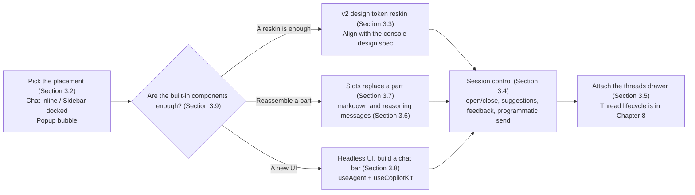
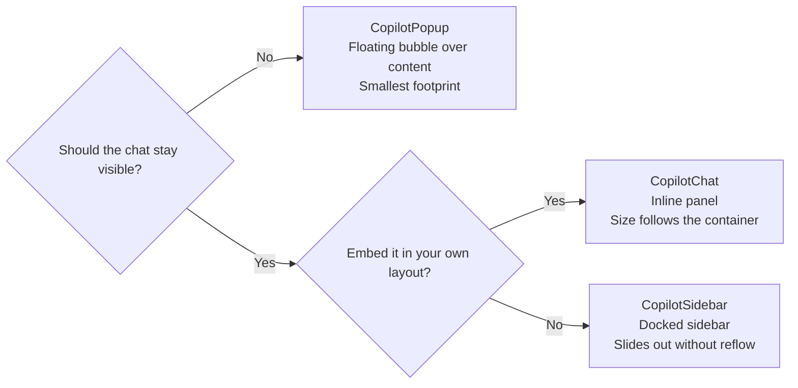
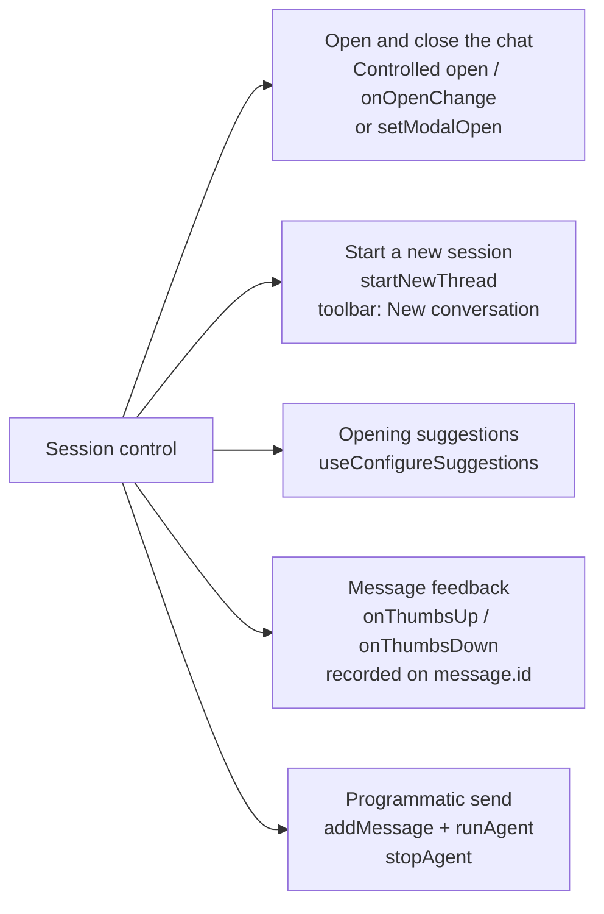
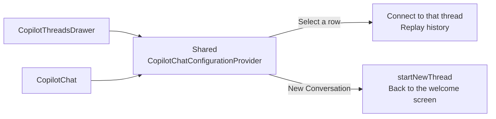
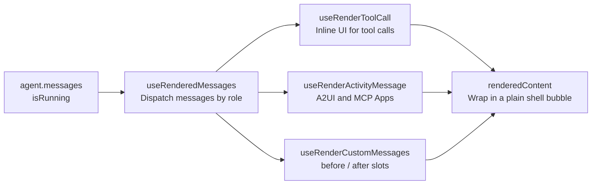
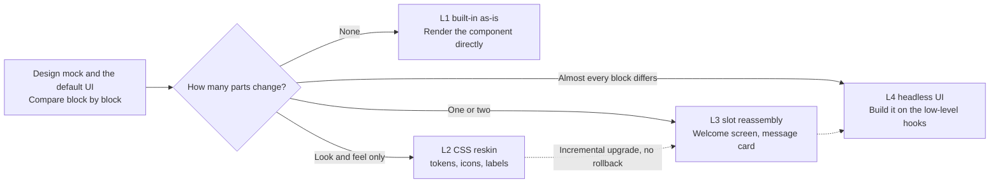

# Chapter 3 Built-in components and a custom chat UI

> Chapter guide: At the end of Chapter 2 the chat window landed in a corner of Starfish Console (星帆工作台). It could already chat. Two problems showed up immediately. The popup sat on the order list, so a seller was blocked halfway through a reply. The colors and the corner radius clashed with the console's design spec. This chapter covers what the chat UI looks like and how to change it. First pick the right placement among the three layout components and move the popup into a sidebar. Then align the colors with the design spec using v2 design tokens. Then go deeper, layer by layer: slots replace the welcome screen and the message card, markdown and reasoning messages get a fine tune, and the low-level hooks of the headless UI build a minimal chat bar. By the end of this chapter you can: pick the right chat layout for any business screen; customize by stepping along the four-level ladder "built-in → reskin → slots → headless" without tearing the work down and starting over; and control from code whether the chat is open, plus feedback, suggestions, and sending.



*Operational flowchart for this chapter*

## When you need it

Three typical situations, and three main lines in this chapter.

**The chat window is in the wrong place and covers business content.** See Section 3.2. The three layout components (CopilotChat / CopilotSidebar / CopilotPopup) are three shells on the same primitive. Swapping the component swaps the placement. The business logic does not change by a single line.

**The style clashes with the design spec, and the product designer handed over a color spec.** See Section 3.3 (a CSS token reskin). Changing only color, radius, or type does not touch any component. When the welcome screen, the message bubble, or another piece of structure has to be replaced, move on to Section 3.7 (slots).

**You need to drive the copilot from outside the chat window.** Your own button opens and closes the chat, the toolbar starts a new session, and the order page triggers an analysis in one click: see Section 3.4 (session control and programmatic send). When what you are building is a talking interface such as a dashboard or a canvas, and a chat window is the wrong shape: go straight to Section 3.8 (headless UI).

One more pair. The user asks "昨天的对话去哪了" ("Where did yesterday's conversation go"): see Section 3.5 (the threads drawer). To fine-tune how markdown in a reply looks, and how the "Thinking..." card looks: see Section 3.6.

Prerequisite: the smallest runnable copilot from Chapter 2 (`CopilotKitProvider` plus one built-in component). This chapter does not touch the backend. Where agent capability comes from is Chapter 5.

## 3.1 Overview: the component system and the customization ladder

CopilotKit's UI layer splits into four layers by how much you write and how much CopilotKit handles:

| Layer | What you write | What CopilotKit handles | Section |
|----|---------|---------------|---------|
| Built-in components | One component declaration | Layout, streaming output, tool-call rendering, and suggestions, all included | Section 3.2 |
| Style customization | CSS variable overrides | Component structure stays. Only color and look change | Section 3.3 |
| Slots | Replace individual child components | The message pipeline, state management, and scroll behavior stay | Section 3.6, Section 3.7 |
| Headless UI | You write all of the UI | Transport, message management, streaming, and tool-call dispatch | Section 3.8 |

The official docs call these four levels the **customization ladder**, and they write it as a design principle: **you never have to throw the built-in components away for the sake of appearance**. From the second level on, each level is incremental. In the same app you can use CSS variables, a custom welcome-screen slot, and a headless tool-call renderer together. You step down a level only when the requirement has grown that far. This book takes that principle as the selection baseline for this chapter: **stay on the higher rung, and go deeper only after that rung is confirmed insufficient**.

### Three layout components, one primitive

`CopilotChat`, `CopilotSidebar`, and `CopilotPopup` are three built-in chat UIs. The last two are thin wrappers on the same primitive. They differ only in layout. The division of labor in one sentence: `CopilotChat` is an inline panel (where it sits and how large it is are decided by your layout), `CopilotSidebar` is a docked sidebar (it slides out from the edge of the app and does not squeeze the main content), and `CopilotPopup` is a floating bubble (it overlays the page). Selection details and code are in Section 3.2.

### Import paths and the v1 leftover

The whole book is on v2. UI code imports from `@copilotkit/react-core/v2`, and the stylesheet is imported once:

```tsx
import { CopilotKitProvider, CopilotSidebar } from "@copilotkit/react-core/v2";
import "@copilotkit/react-core/v2/styles.css";
```

Two version pitfalls that are easy to hit, recorded here first:

| Pitfall | What you see | Fix |
|----|------|------|
| `@copilotkit/react-ui` also exports `CopilotChat` / `CopilotSidebar` / `CopilotPopup` under the same names | Importing from the wrong package hands you the v1 leftover components | Stick to `@copilotkit/react-core/v2` |
| The provider component name is written two ways in the official docs | Pages such as `chat` write `<CopilotKit>`. The threads drawer page writes `<CopilotKitProvider>` | This book uses `CopilotKitProvider` throughout (props `runtimeUrl` and `agentId`), consistent with the backend connection in Chapter 5. Both live in the v2 package. Our recommendation: treat `CopilotKitProvider` as the one to use |

`CopilotSidebar` and `CopilotPopup` each have their own `defaultOpen`, a `header` slot, and a `toggleButton` slot. The other props (such as `agentId`, `labels`, and the message slots) match `CopilotChat`, because each of them is a `CopilotChat` wrapped in a shell.

## 3.2 Three layout components: put the chat window in the right place

Chapter 2 hung the chat window on Starfish Console with `CopilotPopup`: the seller clicks the bubble in the lower right, and a small window pops up. The problem followed. While the seller checks the order list, the popup covers the amount column. The small window's style also fails to match the console's design spec. This chapter starts by solving where it sits. How do you pick among the three shells? Look only at the relationship between the chat and the business UI. See Figure 3-1.



*Figure 3-1: How to choose among the three layout components. Starfish Console's move from Popup to Sidebar follows this decision*

### CopilotChat: the inline panel

`CopilotChat` is the base built-in chat UI. It renders in any container you place it in, and its size follows the container. Typical uses: a full chat that fills the container, or a standalone `/chat` route. Use it when you want the most layout freedom, and you do not want a docked shell or a launcher button.

```tsx
// frontend/src/chat/AssistantPane.tsx —— Starfish Console: inline assistant panel beside the order detail page
import { CopilotKitProvider, CopilotChat } from "@copilotkit/react-core/v2";
import "@copilotkit/react-core/v2/styles.css";

export function AssistantPane() {
  return (
    <CopilotKitProvider runtimeUrl="/api/copilotkit">
      <div style={{ height: "100%", minHeight: 480 }}>
        <CopilotChat agentId="default" />
      </div>
    </CopilotKitProvider>
  );
}
```

### CopilotSidebar: the docked sidebar (Starfish Console's migration target)

`CopilotSidebar` docks at the edge of the app, wraps the main content, and slides the chat out on demand. It fits an in-app copilot that stays available, can collapse, and can be summoned at any time without taking over the view. The official docs stress how it renders: the sidebar and the main content are **sibling nodes**, so sliding it out does not cause a page reflow.

Moving Starfish Console's popup to a sidebar changes only the component name and the layout:

```tsx
// frontend/src/App.tsx —— the chat window moved from a popup to a sidebar
import { CopilotKitProvider, CopilotSidebar } from "@copilotkit/react-core/v2";
import "@copilotkit/react-core/v2/styles.css";
import { OrderList } from "./pages/OrderList";

export default function App() {
  return (
    <CopilotKitProvider runtimeUrl="/api/copilotkit">
      <div style={{ display: "flex", height: "100dvh" }}>
        <main style={{ flex: 1 }}>
          <OrderList />
          <CopilotSidebar defaultOpen={true} agentId="default" />
        </main>
      </div>
    </CopilotKitProvider>
  );
}
```

`defaultOpen={true}` expands the sidebar on first render. `agentId="default"` points at the built-in agent configured in Chapter 2. Switching to a backend agent you build yourself is Chapter 5.

### CopilotPopup: the floating bubble

`CopilotPopup` is the lightest way to add a copilot to an existing app: a corner bubble that opens a chat window over the page content, squeezing no layout and reflowing none. Chapter 2's Starfish Console is this component. The scenarios it fits: an assistant with the smallest footprint, opened for short, direct, task-shaped conversations.

```tsx
// The Chapter 2 shape: a chat bubble in the corner
import { CopilotKitProvider, CopilotPopup } from "@copilotkit/react-core/v2";
import "@copilotkit/react-core/v2/styles.css";

export function AppWithPopup() {
  return (
    <CopilotKitProvider runtimeUrl="/api/copilotkit">
      <OrderList />
      <CopilotPopup
        defaultOpen={false}
        // "问点订单上的事……" ("Ask something about an order...")
        labels={{ chatInputPlaceholder: "问点订单上的事……" }}
      />
    </CopilotKitProvider>
  );
}
```

### How the three compare

| | CopilotChat | CopilotSidebar | CopilotPopup |
|----|------------|----------------|--------------|
| Form | Inline panel | Docked sidebar; slides out without reflow | Floating bubble; overlays content |
| Layout cost | Occupies the container you give it | Sits beside the main content when open | Takes no layout; it floats |
| Fits | A dedicated page, an inline panel, a `/chat` route | A resident copilot, looking and chatting at once | Smallest footprint, occasional questions |
| Props and slots of its own | — | `defaultOpen`, `header`, `toggleButton` | `defaultOpen`, `header`, `toggleButton` |
| Starfish Console placement | Analysis panel beside the logistics board | **Primary chat on the order and product pages** (this chapter's migration target) | Hung in the corner for now (the Chapter 2 shape) |

One table of the props they share (from the official `CopilotChat` props table; the other two accept the same slots and copy as `CopilotChat`, plus a few shell props):

| Prop | Role |
|------|------|
| `agentId` | The agent id the chat connects to. It must match an agent configured on Copilot Runtime |
| `labels` | User-visible copy: title, placeholder, welcome text, disclaimer |
| `messageView` | Message list slot (see Section 3.7) |
| `input` | Input area slot (the input box, the send button, the disclaimer) |
| `scrollView` | Scroll container slot (a custom scroll fade, and similar) |
| `suggestionView` | Slot for the suggestion pills under a message |
| `welcomeScreen` | Empty-state welcome screen slot. Pass `false` to turn it off |

A practical reminder: the three components are wrappers on the same primitive, so **pick the placement first, then talk about customization**. The style, slots, and control mechanisms that follow apply to all three. Business code stays put during a migration.

The sidebar and the popup as they actually sit in Starfish Console (from the hands-on run; the same business screen, with only the layout component swapped):


*Figure 3-6: `CopilotSidebar`. Resident and collapsible. It fits a console where the seller looks at orders and asks at the same time*


*Figure 3-7: `CopilotPopup`. Summoned on demand. It fits an entry point where screen space is tight or use is infrequent*

## 3.3 Style customization: align with the design spec using design tokens

The chat window is in the right place. Next, make it look like it belongs. v2 components are built on Tailwind v4 and the shadcn/ui token system. They read a set of CSS color variables scoped on the `[data-copilotkit]` root element. The official docs say the values use the `oklch` color space so perceived lightness stays consistent across hues. Any legal CSS color also works, including `hsl()`, `rgb()`, and hex. **A reskin is therefore a matter of overriding a few CSS variables, and every component follows automatically.**

### Starfish Console's theme file

The console's design spec is: brand blue as the primary color, a light UI, a uniform 10px radius, and dark mode. On the chat window, that is one theme CSS file:

```css
/* frontend/src/theme.css —— Starfish Console: chat UI tokens aligned to the design spec */
[data-copilotkit] {
  --primary: oklch(0.55 0.22 264);        /* Brand blue: primary buttons and the interactive color */
  --primary-foreground: oklch(0.99 0 0);  /* Text on the primary color */
  --background: oklch(1 0 0);             /* Surface background */
  --foreground: oklch(0.145 0 0);         /* Body text */
  --muted: oklch(0.97 0 0);               /* Muted background (cards, panels) */
  --border: oklch(0.922 0 0);             /* Dividers and strokes */
  --radius: 0.625rem;                     /* Global radius; --radius-sm/md/lg/xl derive from it */
}

/* Dark mode is switched by a .dark ancestor */
.dark [data-copilotkit] {
  --background: oklch(0.145 0 0);
  --foreground: oklch(0.985 0 0);
  --border: oklch(0.269 0 0);
}
```

Import this CSS from a page module. The bundler carries it along with the route. The v2 tokens the official docs list as the ones overridden most often:

| Token | Role |
|-------|------|
| `--background` / `--foreground` | Base surface background and primary text color |
| `--primary` / `--primary-foreground` | Emphasis and action color, and the text on it |
| `--secondary` / `--secondary-foreground` | Secondary surfaces (cards, panels) and their text |
| `--muted` / `--muted-foreground` | Muted background and muted text |
| `--accent` / `--accent-foreground` | Hover and active state, and their text |
| `--border` / `--input` / `--ring` | Divider stroke, input stroke, focus ring |
| `--destructive` / `--destructive-foreground` | Error and danger color, and their text |
| `--card` / `--popover` (including `-foreground`) | Overlay surface background and its text |
| `--sidebar-*` | The sidebar's own set: background, text, stroke, and focus ring |
| `--radius` | Base radius. `--radius-sm/md/lg/xl` derive from it |

The full token set (popover, accent, destructive, chart, and sidebar variants) lives in `@copilotkit/react-core/v2/styles.css`. When you override, write against that file.

### Icons and copy

Beyond color, two kinds of light customization go through component props. Icons use the `icons` prop. Copy uses the `labels` prop. Usable keys include `welcomeMessageText`, `modalHeaderTitle`, `chatInputPlaceholder`, and `chatDisclaimerText`, all from the official docs examples:

```tsx
import { CopilotChat } from "@copilotkit/react-core/v2";

export function Chat() {
  return (
    <CopilotChat
      icons={{ openIcon: <SfOpenIcon />, closeIcon: <SfCloseIcon /> }}
      labels={{
        // "你好,我是星帆助理,订单与商品都可以问我。" ("Hi, I am the Starfish assistant. Ask me about orders and products.")
        welcomeMessageText: "你好,我是星帆助理,订单与商品都可以问我。",
        // "星帆助理" ("Starfish assistant")
        modalHeaderTitle: "星帆助理",
        // "问点订单上的事……" ("Ask something about an order...")
        chatInputPlaceholder: "问点订单上的事……",
        // "AI 回复可能不准确,请核对后操作。" ("AI replies may be inaccurate. Check before you act.")
        chatDisclaimerText: "AI 回复可能不准确,请核对后操作。",
      }}
    />
  );
}
```

### The v1 leftover: stay on the v2 variable system

The official CSS docs also record a set of `--copilot-kit-*` variables (such as `--copilot-kit-primary-color`) and a set of `.copilotKit*` class names (such as `.copilotKitMessages` and `.copilotKitButton`). These variables style the **v1 component CSS (`@copilotkit/react-ui`)**, the same family as the import pitfall in Section 3.1. v2 components read the shadcn tokens in this section. With the whole book on v2, these variables and class names show up only while you maintain v1 leftover code. New code uses the `[data-copilotkit]` tokens.

## 3.4 Session control: open and close, feedback, and programmatic send

With placement and style settled, the requirement turns to interaction control. The things Starfish Console wants (open and close the chat, start a new session, seed opening suggestions, collect thumbs up and thumbs down, and trigger an analysis without the input box) are grouped in Figure 3-2. This section lands each one.



*Figure 3-2: Five kinds of session control. Open and close, and sessions, go through the configuration context. Feedback goes through the message slot. Send goes through the Copilot Runtime handle*

### Controlled open state: open and onOpenChange

`CopilotSidebar` and `CopilotPopup` support the standard controlled mode. Pass `open` and `onOpenChange`, and the single source of truth for the open state is your state:

```tsx
import { useState } from "react";
import { CopilotSidebar } from "@copilotkit/react-core/v2";

function Layout() {
  const [chatOpen, setChatOpen] = useState(false);

  return (
    <>
      <nav>
        {/* "问助理" ("Ask the assistant") */}
        <button onClick={() => setChatOpen(true)}>问助理</button>
      </nav>
      <CopilotSidebar open={chatOpen} onOpenChange={setChatOpen} />
    </>
  );
}
```

The button lives outside the sidebar. That is the value of controlled mode: **opening the chat does not require rendering anything inside the chat subtree**. Since `open` is the source of truth, you can also tie it to the route, a shortcut, or any existing state.

One detail that is easy to misread, and that the official docs call out: what `onOpenChange` reports is a **request**. Writing the new value back to `open` is what applies the change. Leave the new value unwritten, and the UI stays where it is. That is exactly what makes a conditional allow possible, for example blocking an open request when the user is not signed in. You can also pass only `onOpenChange` and omit `open`: the UI keeps managing itself, and you only receive the notification.

The uncontrolled counterpart is the starting point `defaultOpen`. When both are passed, `open` wins, consistent with the React controlled and uncontrolled convention.

### The chat configuration context: setModalOpen and startNewThread

If you do not want to lift the open state into your own component, the open state also lives in the **chat configuration context**. Read it with `useCopilotChatConfiguration()`:

```tsx
import { useCopilotChatConfiguration } from "@copilotkit/react-core/v2";

function OpenChatButton() {
  const config = useCopilotChatConfiguration();

  // setModalOpen exists only when a provider in the tree owns modal state
  // (the built-in CopilotPopup / CopilotSidebar create one automatically)
  if (!config?.setModalOpen) return null;

  return (
    // "问助理" ("Ask the assistant")
    <button onClick={() => config.setModalOpen(true)}>问助理</button>
  );
}
```

Reading `config.isModalOpen` also lets you build a toggle: `config.setModalOpen(!config.isModalOpen)`. Note the boundary of this capability. `setModalOpen` and `isModalOpen` are defined only when a provider in the tree owns modal state. The built-in `CopilotPopup` and `CopilotSidebar` create one automatically. If you assemble the chat UI yourself the way Section 3.8 does, wrap the relevant subtree in `<CopilotChatConfigurationProvider isModalDefaultOpen={false}>` so the modal state exists.

The same context also provides `startNewThread()`: it gives the chat a new thread id and returns to the welcome screen. In effect that clears the current chat window and starts a new session. Starfish Console wires it to a toolbar button:

```tsx
import {
  CopilotKitProvider,
  CopilotChatConfigurationProvider,
  CopilotChat,
  useCopilotChatConfiguration,
} from "@copilotkit/react-core/v2";
import "@copilotkit/react-core/v2/styles.css";

function NewConversationButton() {
  const configuration = useCopilotChatConfiguration();

  return (
    <button type="button" onClick={() => configuration?.startNewThread()}>
      {/* "新对话" ("New conversation") */}
      新对话
    </button>
  );
}

export default function App() {
  return (
    <CopilotKitProvider runtimeUrl="/api/copilotkit">
      <CopilotChatConfigurationProvider>
        <div style={{ display: "flex", flexDirection: "column", height: "100dvh" }}>
          <header>
            <NewConversationButton />
          </header>
          <CopilotChat />
        </div>
      </CopilotChatConfigurationProvider>
    </CopilotKitProvider>
  );
}
```

Two wiring points from the official docs. The button must sit in the same `<CopilotChatConfigurationProvider>` as the chat, or `useCopilotChatConfiguration()` returns `null` and a click does nothing. A new session appears in the thread list only after the first run. An empty thread does not take a row.

### Opening suggestions: useConfigureSuggestions

When the chat window is empty, a new user often does not know what to ask. The built-in components overview in the official docs introduces `useConfigureSuggestions`: the moment the user arrives, seed the chat with a set of opening suggestions that fit the current context. The official example is the single line "Write a sonnet". On Starfish Console, mounting the order page seeds a suggestion such as "帮我看看今天待发货的订单" ("Help me look at the orders waiting to ship today"), so the seller can start with no typing.

The official docs show this hook as a snippet. The material for this chapter does not include a full parameter signature, so this book leaves the props shape to the official reference page. **Inferred**. Conceptually it pairs with the `suggestionView` slot in Section 3.7. One decides **where the suggestions come from** (the data). The other decides **what the suggestions look like** (the rendering).

### Message feedback: thumbs up / down

In v2, thumbs up and thumbs down on an assistant message are added by passing `onThumbsUp` and `onThumbsDown` to the **assistant message slot**. When Automatic Learning collection is not connected, the buttons render only if you provide a handler, or a custom thumbs slot:

```tsx
import { CopilotSidebar } from "@copilotkit/react-core/v2";

export function Chat() {
  return (
    <CopilotSidebar
      messageView={{
        assistantMessage: {
          onThumbsUp: (message) =>
            analytics.track("feedback", { messageId: message.id, value: "up" }),
          onThumbsDown: (message) =>
            analytics.track("feedback", { messageId: message.id, value: "down" }),
        },
      }}
    />
  );
}
```

Each handler receives the full assistant `message`, so feedback can be recorded against a specific reply by `message.id`. The `messageView` slot is also available on `CopilotPopup` and `CopilotSidebar` (they wrap `CopilotChat`). Button copy comes from the chat labels. `assistantMessageToolbarThumbsUpLabel` defaults to `"Good response"`, and `assistantMessageToolbarThumbsDownLabel` defaults to `"Bad response"`. Override them when you need to.

### Programmatic send: drive a run without the input box

The last kind of control goes one step further: hand one agent run to code. A button, a form, or a shortcut all work. The standard pattern on the official programmatic-control page is three steps. Append a user message with `agent.addMessage(...)` (it only joins the list; it does not run), start the run with `copilotkit.runAgent({ agent })`, and cancel an in-flight run with `copilotkit.stopAgent({ agent })` when you need to:

```tsx
import { useAgent, useCopilotKit } from "@copilotkit/react-core/v2";

export function AgentTrigger({ agentId }: { agentId: string }) {
  const { agent } = useAgent({ agentId });
  const { copilotkit } = useCopilotKit();

  const run = async () => {
    if (agent.isRunning) return;

    agent.addMessage({
      id: crypto.randomUUID(),
      role: "user",
      // "总结今天的销售数据" ("Summarize today's sales")
      content: "总结今天的销售数据",
    });

    try {
      await copilotkit.runAgent({ agent });
    } catch (error) {
      // "CopilotKit runAgent 失败:" ("CopilotKit runAgent failed:")
      console.error("CopilotKit runAgent 失败:", error);
    }
  };

  return (
    <>
      {/* "让助理分析" ("Have the assistant analyze") */}
      <button onClick={run} disabled={agent.isRunning}>让助理分析</button>
      <button onClick={() => copilotkit.stopAgent({ agent })} disabled={!agent.isRunning}>
        {/* "停止" ("Stop") */}
        停止
      </button>
    </>
  );
}
```

Both `copilotkit.runAgent({ agent })` and the lower-level `agent.runAgent(options)` on the agent instance can start a run, and they sit at different layers. The former is the **recommended default**. It orchestrates the full lifecycle: it runs frontend tools, handles follow-up runs, and routes errors into the subscription system. The latter only sends the request to Copilot Runtime. It does not run frontend tools, and it does not chain follow-up runs. Use the former unless you explicitly want low-level control.

Of the same three primitives, `agent.subscribe(subscriber)` remains: a low-level AG-UI event subscription (it returns `{ unsubscribe }`). It can listen to `onRunStartedEvent`, `onRunFinalized`, `onRunFailed`, `onCustomEvent`, and the various streaming deltas, for a progress UI or for instrumentation. Its combination with interrupt resume waits for Chapter 7, which is where that combination belongs.

## 3.5 History and threads: CopilotThreadsDrawer

The seller's new problem: something asked yesterday should continue today. That needs a **thread**, a conversation that can be persisted and switched. Beside the built-in components, the project provides a drop-in thread switcher, `<CopilotThreadsDrawer>`: list, switch, create, archive, and delete threads, and **you do not wire any "current thread" state**. Put it next to the chat and it connects on its own.

```tsx
import {
  CopilotKitProvider,
  CopilotChatConfigurationProvider,
  CopilotChat,
  CopilotThreadsDrawer,
} from "@copilotkit/react-core/v2";
import "@copilotkit/react-core/v2/styles.css";

export default function Page() {
  return (
    <CopilotKitProvider runtimeUrl="/api/copilotkit">
      <CopilotChatConfigurationProvider>
        <div style={{ display: "flex", height: "100dvh" }}>
          <CopilotThreadsDrawer />
          <CopilotChat />
        </div>
      </CopilotChatConfigurationProvider>
    </CopilotKitProvider>
  );
}
```

That is the whole integration. The mechanism is in Figure 3-3: the drawer and the chat share one `<CopilotChatConfigurationProvider>`. Selection and creation are both carried by the shared configuration, with zero wiring. A hand-written sidebar has to maintain `threadId` state itself and pass callbacks between the list and the chat. What `<CopilotSidebar>` and `<CopilotPopup>` render internally is `CopilotChat`, and they host the drawer the same way.



*Figure 3-3: Where the threads drawer gets its data. It shares the configuration context with the chat, so no "current thread" state is wired*

Four things you must know before using it:

| Item | Notes |
|------|------|
| Depends on CopilotKit Intelligence | The official docs are explicit: thread storage and sync happen on the server. Cloud-hosted projects use `CPK_INTELLIGENCE_API_KEY`. A self-hosted deployment passes Copilot Runtime the `licenseToken` option, or the `COPILOTKIT_LICENSE_TOKEN` environment variable. Without a valid license the drawer shows a locked view with an Upgrade link and does not issue thread requests |
| Shows threads for only one agent | agentId resolution order: the drawer's own `agentId`, then the nearest `CopilotChatConfigurationProvider`'s `agentId`, then `CopilotKitProvider`'s `agentId`, then `"default"`. To list another agent's threads, pass `<CopilotThreadsDrawer agentId="…" />` explicitly |
| No launcher button on desktop | Only a mobile viewport has a launcher button that opens the drawer from the chat header. On desktop the drawer is a resident panel. "No launcher button on desktop" is the design |
| A way out for a custom thread UI | The same data and actions are exposed headlessly through the `useThreads` hook (the official docs call this Headless Threads). The built-in drawer's inline menu only archives and deletes. A rename requires a UI you build yourself |

There are few configurable items: `label` (the accessible name, default `"Threads"`), `recentLabel` (the list title, default `"Recent Conversations"`), `limit` (the page size; "Load more" appears when more threads exist), `onThreadSelect` / `onNewThread` (an escape hatch that takes over selection), and `renderRow` (custom row content). Customization goes through three limited channels: native `slot` attribute projection (`header`, `empty`, `footer`, and similar), `renderRow`, and CSS `::part()` together with the `--cpk-drawer-*` tokens. The drawer renders inside a shadow root. That encapsulation boundary is intentional.

The thread lifecycle (creation, what archive means, isolation by signed-in user, and sync across devices) is developed in Chapter 8. This section stops at "it works".

## 3.6 Markdown and reasoning-message customization

The assistant's reply arrives as markdown. The default rendering is already in good shape, and Starfish Console's design spec still has requirements for link style. The product also wants the model's thinking process (reasoning models such as o1) to look more on-brand. This section covers two targeted fine tunes: markdown rendering, and the reasoning-message card.

### The markdownRenderer slot: three layers of customization

Markdown rendering for an assistant message goes through the `markdownRenderer` slot. The default implementation is a thin wrapper around Streamdown, a markdown renderer designed for text that is still streaming in. The path in is a drill-down from the chat component, layer by layer:

```tsx
<CopilotChat
  messageView={{
    assistantMessage: {
      markdownRenderer: {
        /* omitted */
      },
    },
  }}
/>
```

**Layer one: replace a single HTML tag** (the route the official docs recommend first). The slot forwards props to Streamdown. Pass a `components` map and you swap the render component for one tag:

```tsx
import { CopilotChat } from "@copilotkit/react-core/v2";

export function Chat() {
  return (
    <CopilotChat
      messageView={{
        assistantMessage: {
          markdownRenderer: {
            components: {
              a: ({ node, children, ...props }) => (
                <a {...props} className="sf-link">{children}</a>
              ),
            },
          },
        },
      }}
    />
  );
}
```

Writing this map has three pitfalls the official docs name:

1. **Destructure `node` away.** Each component receives a `node` prop, the parsed syntax-tree node. Spreading it straight onto the element writes the literal `node="[object Object]"` into the HTML. Destructure it out first, as the sample above does, and the prop never reaches the DOM.
2. **Spread the remaining props.** The remaining props come from the **sanitized document**, already distinct from the model's raw output. Links already carry `target="_blank" rel="noopener noreferrer"` (the renderer's link hardening is already applied). Rebuilding the element by hand drops that safety handling.
3. **You are replacing the default component.** The default component carries Streamdown's own class names and `data-streamdown` attributes. If your component leaves those out, existing CSS aimed at `[data-streamdown="link"]` no longer matches.

**Layer two: style the whole block.** When you only want to change the overall look, pass a class-name string. It merges onto the markdown container: `markdownRenderer: "text-sm leading-7"`.

**Layer three: replace the renderer entirely.** Pass a component in place of an object. The component receives only a `content` prop (the raw markdown). The official reminder: take this route only when you want to swap the markdown engine. What Streamdown is doing is real work: streaming a half-finished render without a flicker or a break, math and syntax highlighting, and **sanitizing HTML the model generated**. `content` is the raw model output. Whatever way you render it has to face that safely.

There is also a **hard line**: custom tags are unsupported. The type layer accepts only real HTML tag names, and a custom key fails to compile. At runtime the renderer sanitizes against the standard HTML element allowlist first. Unknown tags are stripped and the text is kept. A component you registered for that tag is never called. The right path for a richer non-text UI inside the conversation is generative UI. The agent calls a tool, and you render a React component for that tool call (Chapter 6). Turning sanitization off to force a custom tag through throws away the check the renderer exists to perform.

### Reasoning messages: available by default, and the style can be replaced

Reasoning models (such as OpenAI's o1, o3, and o4-mini) emit **reasoning tokens**, the internal thinking trace before the final answer. CopilotKit packs them into a collapsible reasoning card with no configuration. While reasoning is in progress the card shows "Thinking…" and a pulse indicator, and it expands on its own so you can follow along in real time. When reasoning ends, the card collapses to "Thought for X seconds". The content renders as markdown. You can expand it again at any time and look back.

The card is made of three child components, and each one can be replaced through the `messageView` slot:

| Child | Slot prop | Responsibility |
|--------|--------|------|
| `Header` | `header` | The clickable title bar: icon, copy, and the expand chevron |
| `Content` | `contentView` | The reasoning text area (markdown) |
| `Toggle` | `toggle` | The wrapper that animates expand and collapse |

The props a custom Header receives are worth listing in full, because localized copy needs them: `isOpen` (whether it is currently expanded), `label` (while streaming, `labels.reasoningMessageThinkingLabel`, default `"Thinking…"`; after it ends, `"Thought for X seconds"`), `hasContent` (whether reasoning text has arrived), `isStreaming` (whether reasoning is still flowing in), `elapsedSeconds` (seconds already elapsed), and `onClick` (the toggle handler, present only when `hasContent` is true).

Starfish Console's approach: keep the default behavior, and replace only the title bar with Chinese brand copy.

```tsx
import { CopilotChat } from "@copilotkit/react-core/v2";
import "@copilotkit/react-core/v2/styles.css";

function SfReasoningHeader({
  isOpen,
  label,
  hasContent,
  isStreaming,
  ...props
}: React.ButtonHTMLAttributes<HTMLButtonElement> & {
  isOpen?: boolean;
  label?: string;
  hasContent?: boolean;
  isStreaming?: boolean;
}) {
  return (
    <button
      className="flex w-full items-center gap-2 px-3 py-2 text-sm font-medium"
      {...props}
    >
      {/* "思考中" ("Thinking") / "已思考" ("Done thinking") */}
      {isStreaming ? "思考中" : "已思考"}
      <span>{label}</span>
      {/* "收起" ("Collapse") / "展开" ("Expand") */}
      {hasContent && <span className="ml-auto text-xs">{isOpen ? "收起" : "展开"}</span>}
    </button>
  );
}

export function Chat() {
  return (
    <CopilotChat
      messageView={{ reasoningMessage: { header: SfReasoningHeader } }}
    />
  );
}
```

There is also a lighter route. The built-in `CopilotChatReasoningMessage` supports a render prop. It hands you the pre-rendered `header`, `contentView`, and `toggle` elements to rearrange, so you do not reimplement the child components. It fits the case where the layout changes and the parts stay.

## 3.7 Slots: replace child components one by one

Section 3.3 changed color, and Section 3.6 fine-tuned the rendering of two kinds of messages. When the requirement becomes "replace the welcome screen with a guidance card" or "add a business marker to the assistant reply", slots are the tool. A slot is a **named child component** inside the chat component, and each one can be replaced on its own. The official docs stress two points. Slots are **recursive**, so you can drill down to any depth. The three strengths of customization can be mixed per slot.

### Three strengths of replacement

| Strength | What you pass | Effect |
|------|--------|------|
| Tailwind class | A string | Merges with the default component's class names. The lightest style tweak |
| Prop override | An object | Overrides some of the default component's props (class names, events, `data-testid`, and similar) |
| Custom component | A React component | Replaces that slot completely. The component receives the same props as the default |

```tsx
import { CopilotChat } from "@copilotkit/react-core/v2";

// Tier 1: a class string
<CopilotChat
  messageView="bg-gray-50 dark:bg-gray-900 p-4"
  input="border-2 border-blue-400 rounded-xl"
/>;

// Tier 2: prop overrides
<CopilotChat
  messageView={{
    className: "my-custom-messages",
    "data-testid": "message-view",
  }}
  input={{ autoFocus: true }}
/>;
```

### The root-level slot list

| Slot | Responsibility |
|----|------|
| `messageView` | The message list container |
| `scrollView` | The scroll container (including auto-scroll behavior) |
| `input` | The input area (text box, send and voice controls) |
| `suggestionView` | Suggestion pills under a message |
| `welcomeScreen` | The initial empty-state screen. Pass `false` to turn it off |

`CopilotSidebar` and `CopilotPopup` add two slots: `header` (the header bar) and `toggleButton` (the open and close button).

### Nested drill-down and the tool-call container

Recursion means you can drill two or three levels. The `assistantMessage` slot inside `messageView` itself holds child slots such as `toolbar`, `copyButton`, `toolCallsView`, and `markdownRenderer` (see Section 3.6). Starfish Console's requirement: add a dashed frame around the tool-call display, and **keep** the tool renderers that are already registered. Wrap the default `CopilotChatToolCallsView`. There is no rendering logic to rewrite:

```tsx
import {
  CopilotChat,
  CopilotChatToolCallsView,
  type CopilotChatToolCallsViewProps,
} from "@copilotkit/react-core/v2";

const CustomToolCallsView = (props: CopilotChatToolCallsViewProps) => (
  <div className="rounded-lg border border-dashed p-2">
    <CopilotChatToolCallsView {...props} />
  </div>
);

export function Chat() {
  return (
    <CopilotChat
      messageView={{
        assistantMessage: { toolCallsView: CustomToolCallsView },
      }}
    />
  );
}
```

A tool-call card has four states: in progress, complete, expanded, and failed. The official docs provide Storybook stories so you can inspect each state. To change how calls are **grouped** (one card, one line of text, a stack, or one summary per turn) without writing a component, set `toolCallDisplay` on the message view. The details are developed with generative UI in Chapter 6.

### labels: the copy switch outside the slot system

All user-visible copy goes through the `labels` prop. It is a standalone convenience prop on the three chat components, and it **sits outside the slot system**:

```tsx
<CopilotChat
  labels={{
    // "问什么都可以……" ("Ask anything...")
    chatInputPlaceholder: "问什么都可以……",
    // "今天我能帮你什么?" ("What can I help you with today?")
    welcomeMessageText: "今天我能帮你什么?",
    // "AI 回复可能不准确。" ("AI replies may be inaccurate.")
    chatDisclaimerText: "AI 回复可能不准确。",
  }}
/>
```

Rule of thumb: change **words** with `labels`, change **shape** with slots, and change **color** with the tokens in Section 3.3. Three jobs, three layers, and they stay separate.

## 3.8 Headless UI: build a minimal chat bar yourself

The last rung of the ladder. When slots cannot cover it either (the layout is entirely different, the chat has to sit inside a UI that already has its own interaction pattern, or what you are building is a dashboard, a canvas, or an inspector and a chat window is the wrong shape, while you still want to talk to the agent), use the headless UI: **you bring all of the UI, and CopilotKit handles transport, message management, tool-call rendering, and streaming**. There is no `<CopilotChat>` and no slot override. Your components sit on the low-level hooks.

### Three core hooks

The official docs point out that headless mode stands on three hooks, the same ones `<CopilotChat>` uses internally:

| Hook | Provides |
|------|------|
| `useAgent({ agentId })` | The current session: `messages`, `isRunning`, and the run-state object |
| `useCopilotKit()` | The Copilot Runtime handle, used to call `copilotkit.runAgent({ agent })` |
| `useRenderToolCall()` | A render function that draws any registered tool call as inline UI |

### A minimal chat bar

Starfish Console's logistics board wants a mini chat bar embedded at the bottom of a panel, with no popup and no sidebar. **Example**. The bar below is hand-written with the three core hooks, rewritten from the official docs' description of the short version, and it is **not confirmed in testing**. Field names for tool calls on the message object follow the official type definitions:

```tsx
import { useState } from "react";
import {
  useAgent,
  useCopilotKit,
  useRenderToolCall,
} from "@copilotkit/react-core/v2";

export function MiniChat({ agentId }: { agentId: string }) {
  const { agent } = useAgent({ agentId });
  const { copilotkit } = useCopilotKit();
  const renderToolCall = useRenderToolCall();
  const [draft, setDraft] = useState("");

  const send = async () => {
    const content = draft.trim();
    if (!content || agent.isRunning) return;
    setDraft("");
    agent.addMessage({ id: crypto.randomUUID(), role: "user", content });
    await copilotkit.runAgent({ agent });
  };

  return (
    <div className="sf-minichat">
      <div className="sf-minichat-messages">
        {agent.messages.map((message) => (
          <div
            key={message.id}
            className={message.role === "user" ? "sf-row sf-row-user" : "sf-row"}
          >
            {message.content}
          </div>
        ))}
        {/* "助理思考中……" ("The assistant is thinking...") */}
        {agent.isRunning && <div className="sf-row">助理思考中……</div>}
      </div>
      <div className="sf-minichat-composer">
        <input
          value={draft}
          onChange={(event) => setDraft(event.target.value)}
          // "问物流看板……" ("Ask the logistics board...")
          placeholder="问物流看板……"
        />
        {/* "发送" ("Send") */}
        <button onClick={send} disabled={agent.isRunning}>发送</button>
      </div>
    </div>
  );
}
```

The message list is one `.map()` over `agent.messages`: user messages align to the right, and assistant messages render the streaming text. The official short version also draws each tool call on an assistant message as inline UI through `renderToolCall({ toolCall })`. It looks up the sibling message with role `tool`, associates it by `toolCallId`, and hands both to the renderer. The sample above leaves that out for brevity. The wiring is the same family as `AgentTrigger` in Section 3.4.

### The full pipeline and useRenderedMessages

The cost of the short version, stated plainly in the official docs: **you only get text and tool calls**. Reasoning messages, activity messages (A2UI and MCP Apps), and custom before and after slots do not appear unless you wire them yourself. At the center of the official full example is a hand-written composite hook, `useRenderedMessages(messages, isRunning)`. It returns the same message list, and each message gains a `renderedContent: ReactNode` field. It is a hand replica of the render pipeline inside `<CopilotChatMessageView>`, fed by three lower-level hooks (Figure 3-4):



*Figure 3-4: The useRenderedMessages render pipeline. Three low-level hooks feed it, and you write all of the shell styling*

The three low-level hooks each own one path. Tool-call renderers register by name (`useRenderTool` / `useComponent`, with `useDefaultRenderTool` as the fallback). Activity rendering covers A2UI and MCP Apps in the current agent's scope. Custom messages read the `renderCustomMessage` hook registered on the active `CopilotChatConfigurationProvider`, and they produce slots before and after each message. A plain-shell bubble component receives only `renderedContent`, wraps it in style, and imports no chat primitive. The result is a UI aligned line by line with the built-in component pipeline, with the appearance fully under your control. The full code for this layer is in the official headless example. After Chapter 6 covers tool-renderer registration (`useRenderTool` / `useComponent`), this pipeline reaches its full strength.

### When you really need to go down to this layer

The official docs are equally explicit about where headless applies and what it costs. Use headless when the slot system is not enough and the layout has to be entirely different; when the chat has to sit inside a UI that already has an interaction pattern; when you are building a **non-chat surface** and still talking to the agent (you want `useRenderToolCall` or `useRenderActivityMessage` on their own); and when you want to render generative UI primitives outside the chat. The reminder at the end of the official docs is worth copying down. Slots are often already enough, and a full headless UI costs much more. A reskin on its own is one line of tokens in Section 3.3.

## 3.9 Choosing a custom UI

Every technique in this chapter's material fits in one four-level comparison, Levels 1–4 of the official customization ladder:

| Level | What you do | Size of the change | Official capability you keep | Typical trigger |
|------|--------|--------|---------------|-------------|
| L1 built-in as-is | Render the component directly | None | All of it: streaming, tool calls, suggestions | A validation period, internal tools |
| L2 CSS reskin | Override `[data-copilotkit]` tokens, icons, and labels | Small (CSS only, plus a few props) | Every function. Only the look changes | The design spec constrains color, and dark mode |
| L3 slot reassembly | Replace individual child components (the welcome screen, the message card, the input area, and so on) | Medium | The message pipeline, state management, and streaming stay | Brand one part, add a business marker |
| L4 headless UI | Build the entire UI on the low-level hooks | Large | Transport, message management, and tool-call dispatch. Rendering is entirely your responsibility | A non-chat surface, an entirely different layout |

Two decision aids go into one figure. Compare the design mock with the default UI block by block, count the parts that have to change, and land on a level by what changes. Every level past L1 is incremental. CSS variables, a custom welcome-screen slot, and a headless tool-call renderer can mix freely in the same app. Stop at L2 today and raise one part to L3 tomorrow, with no existing work to roll back.



*Figure 3-5: The four-level selection. Locate the level by what changes, and upgrade by stepping up the ladder*

Starfish Console's placement decision: the order and product pages use **L2 plus a local L3**. The sidebar is the placement, design tokens line up with the design spec, the welcome screen becomes a business guidance card, and thumbs feedback is wired to analytics. The logistics board tries one L4 mini chat bar. A full L4 takeover waits. After generative UI lands in Chapter 6, order cards have to render directly inside replies, and tool-call rendering is the main field of customization then. Until that chapter, the built-in pipeline keeps doing the messy work.

## Chapter summary

1. **Three layout components, one primitive.** `CopilotChat` (inline), `CopilotSidebar` (docked), and `CopilotPopup` (floating) differ only in the shell. Starfish Console's migration is a change of component name. Import from `@copilotkit/react-core/v2`, and use `CopilotKitProvider` for the provider throughout.
2. **A reskin is a matter of CSS variables.** v2 reads the shadcn tokens (oklch) on `[data-copilotkit]`, and dark mode hangs on `.dark [data-copilotkit]`. `--copilot-kit-*` and `.copilotKit*` are the v1 leftover. New code leaves them alone.
3. **Three paths for session control.** Controlled `open` / `onOpenChange` (what it reports is a request). `setModalOpen` and `startNewThread` from `useCopilotChatConfiguration` (equivalent to clearing the window and starting a new session). Programmatic `addMessage` + `runAgent` + `stopAgent` (prefer `copilotkit.runAgent` over the lower-level `agent.runAgent`).
4. **The threads drawer needs zero wiring, and it has preconditions.** `CopilotThreadsDrawer` needs a shared `CopilotChatConfigurationProvider` and a CopilotKit Intelligence license. It shows one agent's threads at a time. The lifecycle is in Chapter 8.
5. **Fine tuning has targeted tools.** Markdown goes through the `markdownRenderer` slot (drop `node`, spread the remaining props, replace the default outright, and treat custom tags as the hard line). The reasoning card is available by default, and the three child slots `header`, `contentView`, and `toggle` can be swapped.
6. **Slots are recursive, with three strengths.** A class string, then a props object, then a custom component. You can drill to any depth. `labels` sits outside the slot system.
7. **Headless is the last level.** `useAgent` + `useCopilotKit` + `useRenderToolCall` hold up a UI you build yourself. `useRenderedMessages` reproduces the built-in render pipeline. Slots are often already enough.

→ The UI is in place, and it still cannot see the page. Chapter 4 hands `dashboard` to the agent with shared state, so "今天卖了多少钱" ("How much did we sell today") has an answer.

## Checklist

By the time you reach here, you should be able to:

- ☐ State the division of labor among the three layout components, and migrate Chapter 2's popup chat to `CopilotSidebar`, with zero changes to the business code.
- ☐ Use v2 design tokens to change the chat UI's primary color to the design-spec color, and state which selector dark mode should override.
- ☐ Open the chat from the console's own button with controlled `open` / `onOpenChange`, and explain why what `onOpenChange` reports is a "request", still short of a "result".
- ☐ Wire thumbs feedback onto assistant messages, and state which field the feedback data hangs on.
- ☐ Complete one programmatic send: `addMessage` appends, `runAgent` starts, and `stopAgent` interrupts. State how that differs in layer from `agent.runAgent`.
- ☐ Given a design mock, judge which of L1 through L4 the customization should stop at, by "change the look / change the parts / change the surface".

## Quick reference

The main line does not depend on this section. What follows is a concentrated lookup of this chapter's API.

**Root-level slots** (`CopilotChat` has all of them; `CopilotSidebar` / `CopilotPopup` add the last two rows):

| Slot | Responsibility |
|----|------|
| `messageView` | The message list (drill-down: `assistantMessage` → `toolbar` / `copyButton` / `toolCallsView` / `markdownRenderer`; `reasoningMessage` → `header` / `contentView` / `toggle`) |
| `scrollView` | The scroll container |
| `input` | The input area (drill-down: `disclaimer`) |
| `suggestionView` | Suggestion pills |
| `welcomeScreen` | The welcome screen. Pass `false` to turn it off |
| `header` | The header bar (sidebar and popup only) |
| `toggleButton` | The open and close button (sidebar and popup only) |

**Common v2 design tokens** (override them on `[data-copilotkit]`; dark mode on `.dark [data-copilotkit]`): `--primary` / `--primary-foreground`, `--background` / `--foreground`, `--muted` / `--muted-foreground`, `--border` / `--input` / `--ring`, `--radius`.

**Session-control API**:

| API | Role |
|-----|------|
| `open` / `onOpenChange` / `defaultOpen` | Controlled open state. When both are passed, `open` wins |
| `useCopilotChatConfiguration()` → `setModalOpen` / `isModalOpen` | Context-style open state. Present only when some owner of modal state exists in the tree |
| `useCopilotChatConfiguration()` → `startNewThread()` | A new thread, and back to the welcome screen. Must be inside `CopilotChatConfigurationProvider` |
| `messageView.assistantMessage.onThumbsUp` / `onThumbsDown` | Message feedback. The callback receives the whole `message` |

**Programmatic control**:

| API | Role |
|-----|------|
| `useAgent({ agentId })` | The session handle: `messages`, `isRunning` |
| `agent.addMessage({ id, role, content })` | Append a message. Does not trigger a run |
| `copilotkit.runAgent({ agent })` | The recommended entry. Orchestrates frontend tools, follow-up runs, and the subscription lifecycle |
| `copilotkit.stopAgent({ agent })` | Cancel an in-flight run |
| `agent.subscribe(subscriber)` | Low-level AG-UI event subscription. Returns `{ unsubscribe }` |

**Testing status.** The code in Sections 3.2–3.5 and Section 3.7 is taken directly from the official docs examples, or only lightly edited. The Starfish Console button cases in Section 3.4, the Chinese header in Section 3.6, and `MiniChat` in Section 3.8 are rewritten from the source material and are not confirmed in testing. The official reference and the type definitions are the authority.

## Further reading

- **Chapter 2 (Quick start: a first copilot in twenty minutes)** — how a built-in component first landed in Starfish Console. This chapter's migration starts there.
- **Chapter 4 (Shared state: let the agent see and operate your UI)** — once the UI is in place, let the agent see `dashboard`. The chat window from this chapter, together with the state from Chapter 4, is what makes a business assistant.
- **Chapter 6 (Frontend tools and generative UI)** — renderer registration behind `toolCallsView` (`useRenderTool` / `useComponent`), and the right path after custom markdown tags are blocked.
- **Chapter 7 (Human in the loop: put the person back in the decision)** — the setup left in Section 3.4: `agent.subscribe` combined with interrupt resume, so a key operation goes back to a person for review.
- **Chapter 8 (Multi-agent, protocols, and production)** — the thread lifecycle, isolation by user, and deployment. The backend story of `CopilotThreadsDrawer` finishes there.
