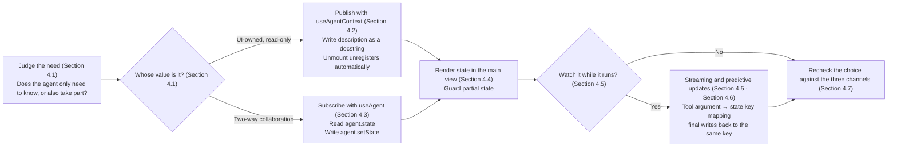
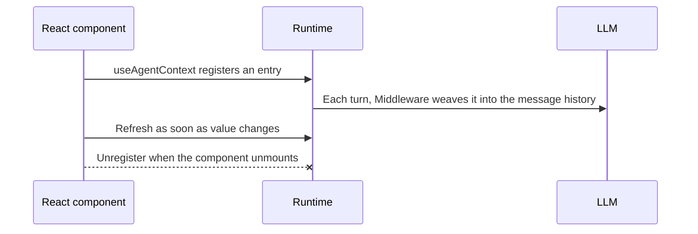
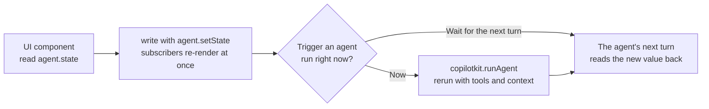
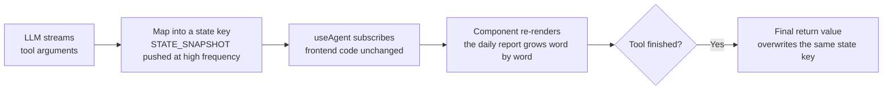
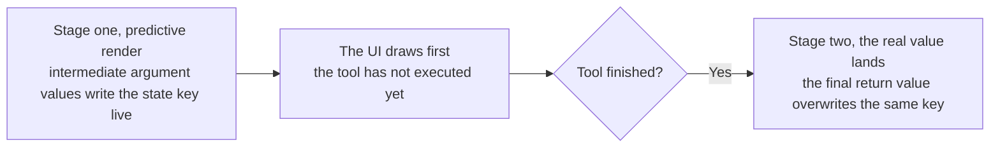

# Chapter 4 Shared state: let the agent see and operate your UI

> Chapter guide: At the end of Chapter 3, a copilot that can hold a conversation sits in the sidebar of Starfish Console (星帆工作台), but it still "cannot see" the page. Ask it "今天卖了多少钱" ("How much did we sell today"), and the best it can do is apologize politely. This chapter supplies that view. Hand the agent today's sales, the order count, and the pending after-sales count from the dashboard, so it can answer what you ask. Then go further: turn business state such as inventory into a workspace the agent and the UI edit together. The agent changes the stock, and the number on the page changes at once. You check an item off in the UI, and the agent knows on its next turn. To get there we meet two hooks (`useAgentContext` and `useAgent`), three directions state can flow, and the streaming technique that lets a long task "render while it runs". By the end of this chapter, you can pick the right publish channel for a piece of page state, and complete one two-way sync and one streaming render yourself.



*Figure: flowchart for this chapter*

## When you need it

Three typical situations, one for each of the three channels in this chapter.

**I only need the agent to "know" what is on the page.** The seller who is logged in, the product being viewed, today's numbers on the dashboard. These values belong to the UI. The agent only needs to read them, and it must not write them. Go straight to `useAgentContext` in Section 4.2: one call publishes one value, unmount unregisters it automatically, and the agent sees it on every turn.

**I need the agent and the user to share one set of state and push each other along.** The agent writes a restock list, and the UI renders it. The user checks an item off in the UI, and the agent knows on its next turn. This is the home ground of shared state. See `useAgent` in Section 4.3: read `agent.state`, write `agent.setState`. Section 4.4 renders that state in the main view, outside the chat box.

**I need the user to watch the agent work.** The agent spends tens of seconds writing a daily operations report. By default the user stares at a spinner. Streaming state updates let the text grow one word at a time. See Section 4.5 and Section 4.6: the backend makes one "tool argument → state key" mapping, and the frontend subscription code is identical to ordinary shared state.

Prerequisite: the two processes from Chapter 2, "frontend + Copilot Runtime", and the `CopilotSidebar` placed in Chapter 3. The agent in this chapter is still the `default` registered in Chapter 2. The full loop in which "the agent writes state on its own" needs a backend agent that speaks the state protocol (LangGraph's `seller_agent`). How to connect it is Chapter 5. This chapter finishes all of the frontend wiring first.

## 4.1 Overview: two layers, one spectrum

In the architecture from Chapter 2, chat content travels one road: user message → Copilot Runtime → agent → reply. Business data on the UI never joins that road. Shared state upgrades the one-way street into a two-way road. The official docs define it as "building a two-way connection between your UI and the agent's execution". Concretely, it can do three things:

| Capability | What it does |
|------|------|
| Show progress | Show the agent's current progress and intermediate results |
| Input in the other direction | Update the agent's state through UI interaction |
| Respond live | When state changes, every subscribed component in the app re-renders at once |

### 4.1.1 Two layers: agent context and shared state

CopilotKit v2 actually provides **two layers** of channel. Telling them apart is the most important decision in this chapter:

| | Agent context | Shared state |
|------|---------------------------|--------------------------|
| Hook | `useAgentContext` | `useAgent` |
| Direction | One way: UI → agent | Two ways: agent ↔ UI |
| Can the agent write back | No. There is no setter, and no tool that can change it | Yes. Tool calls and node transitions both change the state |
| Who owns the value | The UI (user identity, the selected record, a page snapshot) | Both sides (a document draft, a task list, execution progress) |
| Lifecycle | Registered when the component mounts, unregistered automatically on unmount | Lives on the agent instance, and continues with the thread |
| Where the agent sees it | Injected into the model's message history on every turn | Takes part in execution as the agent's state |
| In one sentence | "Props for the agent" | "A workspace the two of you edit together" |

**The first cut of the choice is here. If the value belongs to the UI and the agent only reads it, use agent context. Move up to shared state only when both sides must read and write.** The test is plain. Ask "if the agent changed this value, would that be an incident?" Today's sales rewritten as 9999 by the agent is an incident, so it goes through context. A restock list the agent adds to and deletes from is the point of the feature, so it goes through shared state.

Inside shared state there are two further capabilities. **State streaming** writes the generation of a tool argument into a state key as it happens (Section 4.5). **Predictive state updates** is what LangGraph calls the same mechanism, with the stress on "the tool has not finished, and the UI renders from the prediction first" (Section 4.6). They leave the choice alone. They change how smooth the experience is.

### 4.1.2 The source of state is the backend agent

One fact is easy to get wrong, so state it first: **`agent.state` is not frontend state. Its source is defined in the backend agent.** The frontend only subscribes and writes back. In the official docs, every complete shared-state example defines state on the backend agent's state structure. Take LangGraph (the Python version; `seller_agent` in Chapter 5 is written this way):

```python
# agent.py — LangGraph backend: the agent's state definition
from copilotkit import CopilotKitState

class AgentState(CopilotKitState):
    dashboard: dict      # dashboard snapshot (the same data Section 4.2 publishes as context)
    restock: dict        # restock list (the workspace Sections 4.3 and 4.4 edit both ways)
    report: str          # daily operations report (the target key Section 4.5 streams into)
```

LangGraph state moves from node to node, and passing a node may update it once. The `agent.state` the frontend subscribes to is the live projection of that backend state. The TypeScript state definition (`StateSchema` + `CopilotKitStateSchema.fields`) and the full Copilot Runtime wiring are in Chapter 5.

What about the built-in agent registered in Chapter 2 (`BuiltInAgent`)? **Every shared-state example in this chapter's official source material targets a backend agent. There is no example that pairs the built-in agent with shared state. The official positioning of `BuiltInAgent` is also the shortest path: "chat + tools".** Our recommendation: the frontend wiring in Sections 4.2–4.4 can go into Starfish Console now. It does not depend on the shape of the backend. For the two experiences "the agent writes state on its own" and "streaming updates", wait until Chapter 5 connects `seller_agent` before you accept them. The frontend code from this chapter does not change a character, and it benefits directly.

## 4.2 useAgentContext: let the agent "know" the page

Agent context covers the most common requirement, and the one most often over-designed: **the agent only needs to know what the UI looks like right now. It does not need to take part in changing it.** The dashboard on the Starfish Console home page is the typical case. Today's sales, the order count, and the pending after-sales count belong to the business UI. Once the agent has them, it can answer "今天卖了多少钱" ("How much did we sell today"), and it must not be able to change those numbers into something else.

### 4.2.1 Basic usage: one call publishes one value

`useAgentContext({ description, value })` publishes one value per call. Publish the dashboard snapshot to the agent:

```tsx
// src/pages/DashboardPage.tsx
import { useState } from "react";
import { useAgentContext } from "@copilotkit/react-core/v2";

type Dashboard = {
  salesToday: number;        // today's sales (USD)
  orderCount: number;        // today's order count
  pendingAfterSales: number; // pending after-sales count
};

export default function DashboardPage() {
  const [dashboard] = useState<Dashboard>({
    salesToday: 1284.5,
    orderCount: 47,
    pendingAfterSales: 3,
  });

  useAgentContext({
    description:
      // "Starfish Console dashboard snapshot: today's sales (USD), today's order count, and the pending after-sales count."
      "星帆工作台仪表盘快照：今日销售额（美元）、今日订单数、待处理售后单数。",
    value: dashboard,
  });

  // UI: 今日概览 = "Today's overview"; 销售额 = "Sales"; 订单 N 单 = "N orders"; 待处理售后 N 单 = "N pending after-sales"
  return (
    <main>
      <h2>今日概览</h2>
      <p>销售额 ${dashboard.salesToday}</p>
      <p>订单 {dashboard.orderCount} 单</p>
      <p>待处理售后 {dashboard.pendingAfterSales} 单</p>
    </main>
  );
}
```

Per the official docs, this one call registers a dynamic context entry in Copilot Runtime. Refresh, unregister, and inject all happen automatically with the component lifecycle. Drawn as a sequence:



*Figure 4-1: A context entry is registered when the component mounts, refreshed when the value changes, and unregistered on unmount. Every turn injects it into the model.*

**Check:** After both processes are up, ask in the chat box "今天卖了多少钱？" ("How much did we sell today?"). The agent's answer should contain `$1284.5`, or the Chinese wording of that amount. Then change `salesToday` to another number and save (Vite hot reload re-renders), and ask again. The answer follows. If it cannot answer, go back to the pitfall table in Section 4.7.3 and look up the context-injection row.

Below is Starfish Console confirmed in testing. The agent has no backend data source. All three numbers in the answer come from UI state published by `useAgentContext`, and they match the dashboard on the left exactly:


*Figure 4-5: `useAgentContext` confirmed in testing (built-in agent). The numbers in the answer match the dashboard on the left item by item, down to the order id and the buyer on the after-sales ticket.*

### 4.2.2 description is parameter documentation written for the agent

`description` is not a comment. It is a label the agent sees on every turn. The official docs recommend **writing it as the parameter's docstring**. It decides whether, once the agent is holding a lump of JSON, it knows what to do with it. The gap between the two styles:

```ts
// Weak: it states neither the structure nor the units
description: "dashboard"

// Strong: it states what each item is, and what the unit is
// "Starfish Console dashboard snapshot: today's sales (USD), today's order count, and the pending after-sales count."
description:
  "星帆工作台仪表盘快照：今日销售额（美元）、今日订单数、待处理售后单数。",
```

This is the same craft as writing a tool description (→ the MCP book, Chapter 6): `description` is what the model matches on. The weak version has a concrete consequence. The user asks "今天生意怎么样" ("How is business today"), the agent looks at a pile of unlabeled numbers, and it can only talk in generalities, or invent what the fields mean.

### 4.2.3 Where the value comes from: plug in the state you already have

`useAgentContext` does not care where `value` comes from. Legal sources listed in the official docs include local `useState`, React Context, Redux, and a query cache. The only requirement is that **the value's identity stay stable enough for React to avoid a render loop**. Do not mint a new reference on every render (for example an object literal written in the component body and passed straight in). Hold the reference steady with state or with memo. In the real Starfish Console project, `dashboard` most likely comes from the cache of a data request. The writing is the same:

```tsx
// Swap the source for any state library; the pattern stays the same
import { useAgentContext } from "@copilotkit/react-core/v2";
import { useDashboardQuery } from "../api/dashboard";

export function DashboardContextBridge() {
  const { data } = useDashboardQuery();

  useAgentContext({
    // "Starfish Console dashboard snapshot: today's sales (USD), today's order count, and the pending after-sales count."
    description: "星帆工作台仪表盘快照：今日销售额（美元）、今日订单数、待处理售后单数。",
    value: data ?? null,
  });

  return null; // the bridge component renders nothing
}
```

The "bridge component" pattern is worth keeping. Publishing context and rendering the UI can be fully decoupled: a component that renders nothing, whose only job is to push data to the agent.

### 4.2.4 Read-only is designed in, not agreed by convention

The official docs put the safety of this channel in one accurate sentence: the agent **cannot see a setter, and it has no tool that can modify these values**, so "a confused LLM wants to update them" cannot happen in the mechanism. That is more reliable than reminding it in the prompt not to change them. The constraint sits in the mechanism, not in the persuasion.

So the test for when `useAgentContext` applies condenses to one sentence: **the value is an input, not a field.** User identity, feature flags, the selected record, scroll position: they are parts of "the context object handed to the agent on every turn", and they are not parts of "the workbench the two of you edit together". The moment you find that the agent should be able to change the value too, switch to shared state in Section 4.3.

## 4.3 useAgent: subscribe to and write shared state

`useAgent` opens the shared-state channel. It returns an `agent` object. `agent.state` is the current shared state, and `agent.setState` writes a new value back. The official docs stress two things. **`agent.state` is an ordinary object.** Read it the way you read any React state. **A write from the UI really does pull the model along.** The agent reads the new value back on its next turn.

### 4.3.1 Read: the component subscribes to agent.state

Subscribe to inventory state on the product management page:

```tsx
// src/pages/InventoryPage.tsx
import { useAgent } from "@copilotkit/react-core/v2";

type InventoryState = {
  stock: Record<string, number>; // SKU code → stock
};

export default function InventoryPage() {
  // No argument: connect to the agent named default (the one registered in Chapter 2)
  const { agent, isReady } = useAgent();
  const state = (agent.state ?? {}) as Partial<InventoryState>;

  // UI: 商品库存 = "Product inventory"; 蓝牙耳机 = "Bluetooth earphones"; 手机支架 = "phone stand"; 库存 = "stock"; 正在连接 Agent… = "Connecting to the agent…"
  return (
    <main>
      <h2>商品库存</h2>
      <ul>
        <li>
          SKU-1001 蓝牙耳机 —— 库存 {state.stock?.["SKU-1001"] ?? "…"}
        </li>
        <li>
          SKU-1002 手机支架 —— 库存 {state.stock?.["SKU-1002"] ?? "…"}
        </li>
      </ul>
      {!isReady && <p>正在连接 Agent…</p>}
    </main>
  );
}
```

Per the official docs, **every time the agent modifies its state, for example through a tool call, this hook fires, and your component re-renders with the new value**. That is the whole implementation of "the agent changes stock, and the number on the page changes with it". No polling, and no manual subscription. The React render pipeline does the sync itself.

During a run, `agent.state` may be **partial**. Once the streaming updates in Section 4.5 are on, state arrives one half at a time. The official examples therefore always fall back with `?? {}`, and give each field a default at render time. Build that habit from the first component.

### 4.3.2 Write: agent.setState and "takes effect next turn"

The same `agent` object exposes `setState`. Call it from a UI event and the new value is pushed into shared state. The agent reads it back on **its next turn**. Add a "盘点校正" ("stocktake correction") button to the inventory page:

```tsx
// src/pages/InventoryPage.tsx — append the write logic
import { useAgent } from "@copilotkit/react-core/v2";

type InventoryState = {
  stock: Record<string, number>;
};

export default function InventoryPage() {
  const { agent } = useAgent();
  const state = (agent.state ?? {}) as Partial<InventoryState>;

  const correctStock = (sku: string, counted: number) => {
    agent.setState({
      ...(agent.state ?? {}),
      stock: {
        ...(agent.state?.stock ?? {}),
        [sku]: counted,
      },
    });
  };

  // UI: 商品库存 = "Product inventory"; 手机支架 = "phone stand"; 库存 = "stock"; 盘点校正：SKU-1002 实存 55 = "Stocktake correction: SKU-1002, 55 on hand"
  return (
    <main>
      <h2>商品库存</h2>
      <p>SKU-1002 手机支架 —— 库存 {state.stock?.["SKU-1002"] ?? "…"}</p>
      <button onClick={() => correctStock("SKU-1002", 55)}>
        盘点校正：SKU-1002 实存 55
      </button>
    </main>
  );
}
```

The timing of read, write, taking effect, and rerun draws one loop. Note the official wording: **a write shows up immediately on every subscribed component, but the agent reads it on the next run**. That is what "two-way" actually means:



*Figure 4-2: The read/write loop. A write takes effect at once. By default the agent reads it back on the next turn. An important choice can rerun immediately.*

**Check:** After you click the button, other components on the page that subscribe to the same state (for example the board built in Section 4.4) change their numbers at once. Then ask in the chat box "现在 SKU-1002 的库存是多少" ("What is the stock of SKU-1002 now"). The agent's answer on the next turn should contain 55.

### 4.3.3 When a write should trigger a run immediately: copilotkit.runAgent

Sometimes you do not want to wait for the agent's next turn. The right-hand branch of Figure 4-2 is the official approach: after writing the state, rerun by hand.

```tsx
// src/pages/InventoryPage.tsx — append
import { useAgent, useCopilotKit } from "@copilotkit/react-core/v2";

export function InventoryQuickActions() {
  const { agent } = useAgent();
  const { copilotkit } = useCopilotKit();

  const correctAndConsult = (sku: string, counted: number) => {
    agent.setState({
      ...(agent.state ?? {}),
      stock: { ...(agent.state?.stock ?? {}), [sku]: counted },
    });
    // Rerun the agent immediately with the updated state
    copilotkit.runAgent({ agent });
  };

  // UI: 校正并请 Agent 复核 = "Correct, and ask the agent to review"
  return (
    <button onClick={() => correctAndConsult("SKU-1002", 55)}>
      校正并请 Agent 复核
    </button>
  );
}
```

The official docs call this out: **run through the `copilotkit` entry, and frontend tools and context come along on that run. Frontend tool calls execute as usual.** Calling the low-level run method on the agent object directly does not get this orchestration (Section 3.7 of Chapter 3 already stated the same priority when it covered programmatic control). The `copilotkit` object returned by `useCopilotKit` is the orchestration entry for the whole frontend. Frontend tools in Chapter 6, and human in the loop (HITL) in Chapter 7, both pass through it.

## 4.4 Render the agent's work inside the UI

Up through Section 4.3, every subscription lives inside a business page. The official docs spend a page on one pattern: **`useAgent` works in any component inside the Provider. It does not have to sit next to the chat box.** You can subscribe to `agent.state` in the main view, on a canvas, on a map, or in a table, and render it as the lead of the application. Chat is one more consumer, off to the side.

### 4.4.1 The pattern: the main view and the sidebar share the same agent

Build a "补货看板" ("restock board") for Starfish Console. The agent keeps a restock list in shared state, and the board renders it as the content of the main view:

```tsx
// src/components/RestockBoard.tsx
import { useEffect } from "react";
import { useAgent } from "@copilotkit/react-core/v2";

type RestockState = {
  title: string;
  items: { id: string; label: string; done: boolean }[];
};

// UI-owned initial state: before the agent has written state, the board still has something to show
const INITIAL_RESTOCK_STATE: RestockState = {
  // "Today's restock list"
  title: "今日补货清单",
  items: [
    {
      id: "sku-1002",
      // "Phone stand (SKU-1002, stock 58, below the threshold)"
      label: "手机支架（SKU-1002，库存 58，低于阈值）",
      done: false,
    },
  ],
};

export function RestockBoard() {
  const { agent, isReady } = useAgent();
  const state = (agent.state ?? {}) as Partial<RestockState>;

  useEffect(() => {
    if (!isReady) return;

    const current = (agent.state ?? {}) as Partial<RestockState>;
    const updates: Partial<RestockState> = {};

    if (current.title === undefined) {
      updates.title = INITIAL_RESTOCK_STATE.title;
    }
    if (current.items === undefined) {
      updates.items = INITIAL_RESTOCK_STATE.items;
    }

    if (Object.keys(updates).length > 0) {
      agent.setState({ ...(agent.state ?? {}), ...updates });
    }
  }, [agent, isReady, state.title, state.items]);

  // Fallback title 补货清单 = "Restock list"
  return (
    <main className="board">
      <h2>{state.title ?? "补货清单"}</h2>
      <ul>
        {(state.items ?? []).map((item) => (
          <li key={item.id} data-done={item.done}>
            {item.label}
          </li>
        ))}
      </ul>
    </main>
  );
}
```

Put it in the same layout as the sidebar from Chapter 3:

```tsx
// src/App.tsx — the main view and the chat are two consumers of the same agent
import { CopilotKitProvider, CopilotSidebar } from "@copilotkit/react-core/v2";
import { RestockBoard } from "./components/RestockBoard";

export default function App() {
  // 星帆工作台 = "Starfish Console"
  return (
    <CopilotKitProvider runtimeUrl="http://localhost:8200/api/copilotkit">
      <div style={{ display: "flex", height: "100vh" }}>
        <div style={{ flex: 1, padding: 24 }}>
          <h1>星帆工作台</h1>
          <RestockBoard />
        </div>
        <div style={{ width: 380 }}>
          <CopilotSidebar />
        </div>
      </div>
    </CopilotKitProvider>
  );
}
```

The official docs make a claim about this layout that is worth quoting: **the board and the sidebar both call `useAgent()` for the same `agentId`, so they share the same agent instance and the same state object. Reading `agent.state` has nothing chat-specific in it. The sidebar is not special.** That sentence is the worldview of the whole shared-state chapter. The chat panel is one consumer of the agent. Your main view is another consumer, at the same level.

### 4.4.2 Who owns the initial state: the UI, or the backend

`INITIAL_RESTOCK_STATE`, this UI-owned initial state, is a careful piece of the official example. Two points:

- **It gives the board content before the agent writes state.** A blank board feels broken to the user. A preset initial list feels like a product.
- **When filling in, write only the fields that are `undefined`, and keep the rest of the state.** The three checks in the `useEffect` above are that logic. Not one character the agent has already written gets overwritten.

Initial state can also belong to the backend (for example, the agent's state definition carries defaults). The official docs say: when the backend owns the initial state, define it in that framework's shared-state setup. The LangGraph approach is in Chapter 5.

### 4.4.3 Write back from the main view: the same two-way channel

The board does not have to be a read-only mirror. The same `agent.setState` works in an event handler on the main view. Check off one restock task:

```tsx
// src/components/RestockBoard.tsx — append
function toggleItem(id: string) {
  agent.setState({
    ...(agent.state ?? {}),
    items: (agent.state?.items ?? []).map((it) =>
      it.id === id ? { ...it, done: !it.done } : it,
    ),
  });
}
```

Turn the `<li>` into a button with `onClick={() => toggleItem(item.id)}`. The official summary: this is the same two-way channel as Section 4.3. The only difference is that the read and the write happen on the application's main surface, outside the chat.

### 4.4.4 Two engineering details: the partial guard and throttling

The official docs close with three tips. The first two are engineering you should follow at once:

| Detail | What to do | The problem it targets |
|------|------|-----------|
| Partial guard | Treat `agent.state` as an object that may be incomplete, and give each field a default | Halfway through a streaming update, a half-built state crashes the render outright |
| High-frequency throttle | `useAgent({ throttleMs })` limits how often the UI re-renders | A streaming run makes a heavy canvas re-render too many times a second |
| Target one agent among several | `useAgent({ agentId: "research-agent" })` | When there is more than one agent, the default connection is `default` |

**Check:** In the sidebar, tell the agent "把手机支架加进补货清单" ("Add the phone stand to the restock list"). This needs the Chapter 5 backend agent to support writing state. The board's list gains a row at once. The other way: click a list item on the board and check it done, then ask the agent "补货清单还剩几项没做" ("How many items are still undone on the restock list"). The answer should match the new state.

## 4.5 Streaming state updates: render the numbers as they change

### 4.5.1 Why the default behavior stalls

The default behavior the official docs point out: **agent state updates only between backend checkpoints.** A tool call that runs for a long time (writing a whole document, drafting a long email) is, from the UI's side, one large lump at the end. The docs' own wording is vivid. For an agent-native application this "feels broken". The user stares at a spinner, and what they expect is to watch the output take shape a little at a time.

**State streaming** writes the generation of some tool argument into a named state key as it happens (the whole chain is Figure 4-3 in Section 4.5.3). Subscribe on the frontend with `useAgent`, and you watch the answer grow one word at a time.

When is it worth turning on? The official docs give three typical shapes. The output is long text, or a structured value that keeps growing:

| Agent shape | What streams | What grows in the state key |
|-----------|-----------|-------------------|
| Collaborative writing agent | A document | The `document` string grows word by word |
| Research agent | A list of findings | The `findings` array gains one entry at a time |
| Planning agent | A step-by-step plan | The `plan` structure fills in step by step |

The matching Starfish Console scenario is **today's operations report**. Have the agent write the report, and let the board lay it out as it arrives. Without streaming, the user stares at the chat box and waits out more than ten seconds.

### 4.5.2 The mapping rule: one tool argument → one state key

The backend pattern is always the same one (Chapter 5 lays out the full backend wiring; the rules come first here): **map one streaming tool argument onto one shared-state key**. The official docs give three rules you have to hit:

1. **The state key must exist in the agent's state definition.** If the mapping target is written as `report`, the agent's state really has to contain a `report` key.
2. **The tool name and the argument name must match that LLM-facing tool call character for character.** The docs' example has the form `write_document.document` (the `document` argument of the tool `write_document`).
3. **When the tool call finishes, its final return value is written into the same key.** The half-finished pieces from the stream are replaced, in the end, by the tool's authoritative return value.

The third rule is the easiest to skip, and the most reassuring. **A streamed half-finished piece is not the final value. It is a prediction. When the tool finishes, the real value overwrites the prediction.** That is where the name "predictive state updates" in the next section comes from.

### 4.5.3 The frontend subscription: identical to ordinary shared state

The frontend has nothing new. At the protocol layer, a streaming update is an ordinary state update that simply arrives densely. The whole chain, from the backend emit to the frontend render:



*Figure 4-3: The streaming chain. The frontend only does the subscription from Section 4.3. The tool's final return value closes out the half-finished piece.*

```tsx
// src/pages/ReportPage.tsx
import { useAgent } from "@copilotkit/react-core/v2";

type ReportState = {
  report: string; // today's operations report; it grows word by word as it is generated
};

export default function ReportPage() {
  const { agent, isRunning } = useAgent();
  const state = (agent.state ?? {}) as Partial<ReportState>;

  // 今日运营日报 = "Today's operations report"; ● 直播中 = "● live"; · 已保存 = "· saved"
  // 尚无日报——去右侧让 Agent 写一份。 = "No daily report yet — go to the right and have the agent write one."
  return (
    <main>
      <h2>
        今日运营日报 {isRunning ? "● 直播中" : "· 已保存"}
      </h2>
      <article style={{ whiteSpace: "pre-wrap" }}>
        {state.report ?? "尚无日报——去右侧让 Agent 写一份。"}
      </article>
    </main>
  );
}
```

Two pieces the official docs name: `useAgent` together with `OnStateChanged` gives you a reactive `agent.state`. For a "直播中 / 已完成" ("live / finished") indicator, add `OnRunStatusChanged`. Without an indicator, the boolean `agent.isRunning` is enough. The code above uses that. For a reader curious about the mechanism underneath: a framework that uses the SDK adapter directly parses the half-built tool arguments inside its own streaming loop, and emits a `STATE_SNAPSHOT` event whenever the mapped value changes. That is what state streaming actually is at the AG-UI protocol layer. The protocol detail is in Chapter 8.

**Check:** With the streaming mapping configured on the backend (after Chapter 5 connects `seller_agent`), have the agent write the daily report. The `report` content on the page should grow word by word, and it should not appear all at once at the end. After generation finishes, the content stops jittering (the final return value has overwritten the half-finished piece).

## 4.6 Predictive state updates: the UI moves before the tool finishes

### 4.6.1 Why it is called "predictive"

"Predictive state updates" comes from the LangGraph integration docs. Together with the state streaming in Section 4.5, they are **two sides of the same mechanism**. Section 4.5 tells it from the angle of how state flows. This section tells it from LangGraph's execution model, and it gives three concrete ways for the backend to emit an update.

Take the official definition of the problem first: **LangGraph state updates only between node transitions, so the updates are discontinuous. Inside a single node the work often runs for many seconds, and it contains substeps the user cares about.** What an agent-native application has to do is reflect what the agent is doing to the user as continuously as it can. The official docs list three payoffs, worth copying in full:

| Payoff | What it means |
|------|------|
| Hold attention | Avoid a long stretch with only a loading indicator |
| Build trust | Let the user see what the agent is doing |
| Support a change of course | The user can correct course midway. This connects back to Section 4.3: the place a correction lands is `agent.setState` |

### 4.6.2 Approach one: emit by hand with copilotkit_emit_state

Emitting state updates by hand inside a long task gives the finest control. **Example.** Not confirmed in testing in this chapter. The official example simulates a task that executes step by step, and emits once per step (Python):

```python
# agent.py — LangGraph backend: emit by hand
import asyncio
from copilotkit.langgraph import copilotkit_emit_state

async def chat_node(state: AgentState, config):
    steps = [
        "Analyzing input data...",
        "Identifying key patterns...",
        "Generating recommendations...",
        "Formatting final output...",
    ]
    for step in steps:
        state["observed_steps"] = state.get("observed_steps", []) + [step]
        await copilotkit_emit_state(config, state)  # emit once per step
        await asyncio.sleep(1)
```

The TypeScript equivalent is `copilotkitEmitState(config, state)` from `@copilotkit/sdk-js/langgraph`, called at the same moments. The observer on the frontend is still the subscription from Section 4.3, reading the key `observed_steps`:

```tsx
// ui/app/page.tsx — the observer side of the official docs example
import { useAgent } from "@copilotkit/react-core/v2";

export function AgentProgress() {
  const { agent } = useAgent({ agentId: "sample_agent" });
  const observedSteps = (agent.state.observed_steps as string[]) ?? [];

  return (
    <div>
      <h1>Agent Progress</h1>
      <ul>
        {observedSteps.map((step, i) => (
          <li key={i}>{step}</li>
        ))}
      </ul>
    </div>
  );
}
```

### 4.6.3 Approach two: map tool arguments with emitIntermediateState

The mapping rule from Section 4.5, landed on LangGraph's configuration layer, is `emitIntermediateState`. Wrap one configuration layer around the node that calls the model (`copilotkit_customize_config` in Python, `copilotkitCustomizeConfig` in TypeScript). **Example.** Not confirmed in testing in this chapter.

```python
# agent.py — Python: declare which argument of which tool maps to which state key
from copilotkit.langgraph import copilotkit_customize_config

async def chat_node(state: AgentState, config):
    streaming_config = copilotkit_customize_config(
        config,
        emit_intermediate_state=[
            {
                "state_key": "observed_steps",
                "tool": "step_progress_tool",
                "tool_argument": "steps",
            },
        ],
    )
    # Call the tool-bound model with streaming_config…
```

```ts
// agent-js/src/agent.ts — TypeScript: field names switch to camelCase
const streamingConfig = copilotkitCustomizeConfig(config, {
  emitIntermediateState: [
    {
      stateKey: "observed_steps",
      tool: "StepProgressTool",
      toolArgument: "steps",
    },
  ],
});
```

The configuration means two stages in order, predict and then land. It is also the optimistic UI named at the start of this section:



*Figure 4-4: Two stages. The UI first renders from the predicted tool arguments. After the tool finishes, the real value overwrites the prediction (rule 3 in Section 4.5.2).*

### 4.6.4 Approach three: StateStreamingMiddleware on a prebuilt agent

If you are using LangGraph's prebuilt agent (such as `create_agent`) and not a hand-written custom graph, you do not emit by hand, and you do not touch `RunnableConfig`. Pass the streaming middleware in as a middleware. Each `StateItem` is one "tool argument → state key" mapping, the same idea as approach two (Python). **Example.** Not confirmed in testing in this chapter.

```python
# agent.py — prebuilt agent: the middleware approach
from copilotkit import (
    CopilotKitMiddleware,
    StateStreamingMiddleware,
    StateItem,
)

graph = create_agent(
    model="openai:gpt-5.4",
    tools=[step_progress_tool],
    middleware=[
        CopilotKitMiddleware(),
        StateStreamingMiddleware(
            StateItem(state_key="observed_steps",
                      tool="step_progress_tool",
                      tool_argument="steps")
        ),
    ],
    system_prompt="You are a task performer. Report your steps using step_progress_tool.",
    state_schema=AgentState,
)
```

On the TypeScript side this is `stateStreamingMiddleware(stateItem({...}))` from the package `@copilotkit/sdk-js/langgraph-middlewares`. Put the three approaches side by side and the choice is clear:

| Approach | When it fits | Grain of control |
|------|------|---------|
| Manual `copilotkit_emit_state` | A long task inside a custom graph, when you want to emit from any point | Finest: emit from wherever the run has reached |
| `emitIntermediateState` mapping | A custom graph, when you want tool arguments to stream into state declaratively | Medium: automatic from the mapping, with no per-point call |
| `StateStreamingMiddleware` | A prebuilt agent, when you cannot change the graph's internal code | Medium: declarative, with the configuration sitting in the middleware layer |

### 4.6.5 The hard rule: the node return value is the single source of truth

The official docs add a separate Important Note for predictive state updates, in a tone that is rarely this heavy, and it is worth restating in full: **When a LangGraph node finishes executing, the state it returns becomes the single source of truth. Intermediate state updates are good for live feedback, but any change you want to keep must be included explicitly in the node's final returned state. Otherwise, when the node completes, those changes are overwritten.**

As an engineering habit: the state key used for streaming or for prediction also has to be written in the node's return dict (or you make sure the tool's return value writes it, as rule 3 in Section 4.5.2 says). **Treat intermediate updates as the presentation layer, and the node return value as the data layer. Keep the two apart.**

**Check:** While the task runs, the step list appears one entry at a time (the prediction is in effect). After the task ends, the list settles on what the tool finally wrote, and it does not roll back (the real value has replaced the prediction). Then leave that key out of the node return value on purpose and rerun, and watch the step list get wiped after the task ends. Triggering the Section 4.6.5 pitfall yourself sticks better than reading it three times.

## 4.7 Choosing a channel, and a pitfall lookup

### 4.7.1 Three channels, one table

Everything in this chapter fits in one decision table. Ask about direction first, then about shape:

| What you need | Channel | What to use | Frontend action | Backend requirement |
|---------|------|--------|---------|---------|
| The agent reads the UI and never writes | Agent context | `useAgentContext` | One call per value, with a solid `description` | The backend weaves the context into the message history |
| The agent and the UI read and write the same state | Shared state | `useAgent` | Subscribe to `agent.state`, write `agent.setState` | The agent's state definition (Chapter 5) |
| A long task renders while it runs | State streaming / predictive updates | The frontend stays the same: still `useAgent` | Same as above, plus a partial guard and throttling | A tool-argument → state-key mapping (Section 4.5.2 / Section 4.6) |

Then a reverse exclusion list. These requirements sit outside this chapter's channels. Do not take a detour through here:

- "The agent should **execute** some function in my application" → that is the frontend tool `useFrontendTool` (Chapter 6).
- "Some tool call of the agent should **grow into** a component" → that is a render hook: `useRenderTool`, `useComponent`, `useDefaultRenderTool` (Chapter 6).
- "The agent should **stop and ask a person**" → `useHumanInTheLoop` / `useInterrupt` (Chapter 7).
- "I want to **build** the whole chat UI myself" → the headless UI backed by `useRenderToolCall` (covered in Section 3.8 of Chapter 3).

The official docs sum up the rule for choosing a v2 hook in one sentence: **start from the verb.** What the agent should run → a tool hook. What it should grow into → a render hook. Where it should stop and ask → a HITL hook. What it should know or share → the two hooks in this chapter. Get the verb right, and the hook follows.

### 4.7.2 Hook lookup for this chapter

| Hook / object | Package | One-line job |
|-------------|--------|-----------|
| `useAgentContext({ description, value })` | `@copilotkit/react-core/v2` | Publish one read-only context entry from the UI to the agent; unregister on unmount |
| `useAgent()` / `useAgent({ agentId })` | `@copilotkit/react-core/v2` | Connect to an agent (`default` by default) and subscribe to its state |
| `useAgent({ throttleMs })` | `@copilotkit/react-core/v2` | Same as above, rate-limiting high-frequency re-renders |
| `agent.state` | Return value of `useAgent` | Ordinary React data. It may be partial, so fall back when you read it |
| `agent.setState(obj)` | The `agent` object | Write back to shared state. The agent reads it on the next turn |
| `agent.isRunning` | The `agent` object | Whether a run is in flight. The streaming indicator uses it |
| `copilotkit.runAgent({ agent })` | `useCopilotKit()` | The full rerun entry, carrying frontend tools and context |

### 4.7.3 Pitfall lookup: symptom → cause → fix

| Symptom | Cause | Fix |
|------|------|------|
| You ask "今天卖了多少钱" ("How much did we sell today"), and the agent cannot answer or invents numbers | Context was never published, or `description` does not state the structure and the units | Check that `useAgentContext` is called inside the Provider; rewrite `description` as in Section 4.2.2 |
| Publishing context sends the page into an infinite re-render | `value` is a new reference on every render, and the unstable identity triggers a refresh loop | Hold the value's reference with state or memo (the stable-identity requirement in Section 4.2.3) |
| After you leave the page, the agent still "remembers" that page's data | The behavior you expected is the reverse of what you built. Persistence of this kind belongs to shared state. Context should disappear on unmount | That value should go through `useAgentContext`, not through shared state |
| A UI component does not update when the agent does | The `agentId` passed to `useAgent` does not match the key the backend registered (the default connects only to `default`) | Align `agentId`, or use `default` as the key on the backend (the same family of problem as Section 2.4.3 of Chapter 2) |
| During streaming the page occasionally goes blank, or throws on `undefined` | Partial state hits a render that has no guard | Use `??` with a default on each field, and always treat `agent.state` as possibly incomplete (Section 4.4.4) |
| A streaming canvas re-renders dozens of times a second, and the page runs hot | High-frequency `STATE_SNAPSHOT` events reach the render layer directly | Rate-limit with `useAgent({ throttleMs })` (Section 4.4.4) |
| After the task ends, the step list is wiped or rolls back | The node's final return value did not include that state key, so completion overwrote the intermediate updates | Follow Section 4.6.5: a change you want to keep must be written into the state the node returns |
| Tool arguments do not stream into the state key | The tool name or the argument name does not match the mapping config, or the state key is not in the state definition | Check the two "character for character" rules in Section 4.5.2, word for word |

## Chapter summary

1. **Two layers, and the first cut.** Agent context (`useAgentContext`) is a one-way, read-only channel from the UI to the agent: "props for the agent". Shared state (`useAgent`) is a two-way workspace. The test in one sentence: if the agent changed the value, would that be an incident?
2. **Three behaviors of context you can count on.** Refresh when the value changes, unregister on unmount, and inject into the model's message history on every turn. Write `description` as a docstring. The constraint sits in the mechanism, not in the persuasion.
3. **Shared state is ordinary React data.** Read `agent.state`, write `agent.setState`. A write shows up at once on every subscribed component, and the agent reads it back on the next turn. To trigger a run immediately, call `copilotkit.runAgent({ agent })`.
4. **The sidebar is not special.** `useAgent` works in any component inside the Provider. The main view and the chat are two consumers of the same agent, at the same level. UI-owned initial state fills only the fields that are `undefined`.
5. **Streaming and prediction are two names for one mechanism.** The backend maps one tool argument onto one state key, and the frontend subscription code stays the same. On the LangGraph side, pick among three ways to emit (emit by hand, the `emitIntermediateState` mapping, `StateStreamingMiddleware`) by how fine the control needs to be. The node return value is the single source of truth.
6. **Where Starfish Console stands now.** The agent answers the dashboard numbers readily (context). The restock board and the agent edit the list together (shared state). The daily report shows up as it is written (streaming). The gap where the agent could not see the page is closed. The agent that writes state is still the built-in agent from Chapter 2. The backend agent that can actually look up "ORD-20431 为什么还没发货" ("Why hasn't ORD-20431 shipped yet"), `seller_agent`, is the lead of Chapter 5.

## Checklist

By the time you have read this far, you should be able to:

- ☐ For a piece of page state, use "if the agent changed it, would that be an incident?" to decide whether it goes through agent context or shared state, and say how the two channels differ in direction and in lifecycle.
- ☐ Publish a dashboard snapshot to the agent with `useAgentContext`, write a `description` that includes the structure and the units, and explain why the agent no longer sees it after the component unmounts.
- ☐ Complete one two-way sync: the frontend writes with `agent.setState`, other subscribed components change at once, and the agent reads the value back on the next turn. When you need the write to trigger a run immediately, switch to `copilotkit.runAgent({ agent })`.
- ☐ Render `agent.state` into a main-view component, and put in place both the initial-state fill that writes only `undefined` fields and the partial guard.
- ☐ State the mapping rule for state streaming (tool argument → state key) and how it relates to "the final return value overwrites the half-finished piece", and explain what the word "predictive" means in "predictive state updates".
- ☐ Name the scenario each of the three LangGraph emit approaches fits, and restate what the hard rule "the node return value is the single source of truth" means in engineering terms.

## Further reading

- **Chapter 5 (Connecting a backend agent)** — the source of `agent.state`: the state definition of the LangGraph `seller_agent`, the Copilot Runtime wiring, and the full backend configuration of the streaming mapping. The frontend code from this chapter benefits directly there.
- **Chapter 6 (Frontend tools and generative UI)** — where the exclusion list in Section 4.7.1 actually belongs. `useFrontendTool` defines a tool, and `useRenderTool` / `useComponent` render a tool call. The full form of the agent operating the UI is in that chapter.
- **Chapter 7 (Human in the loop)** — the governance layer on top of the two-way channel. Once the agent can write the UI, which writes should stop and wait for a person to decide.
- **Official docs, Shared State (shared-state.mdx and its child pages)** — the main source material for this chapter. The full signature and options of `useAgent` are on the `useAgent` page of the official hook reference.
- **Official docs, Which Hook for Which Job (concepts/which-hook.mdx)** — the selection map for every v2 hook, and the original home of the "start from the verb" rule. Worth printing and putting on the wall.

## Review list (before publication)

- [ ] Sections 4.2–4.4 code confirmed in testing in the Chapter 2 project (`starfish-console`)
- [ ] Context injection from `useAgentContext` into the built-in agent (`default`) confirmed in testing (the recommendation sentence in Section 4.1.2 is revised along with that)
- [ ] The Section 4.5 and Section 4.6 backend examples confirmed in testing and written back after Chapter 5 connects `seller_agent`
- [ ] The exact signatures of `OnStateChanged` / `OnRunStatusChanged` checked against the v2 hook reference, and a note added
