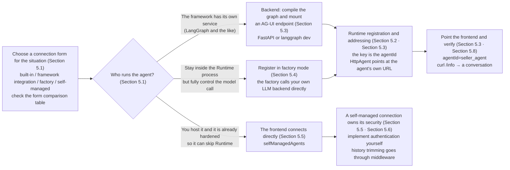
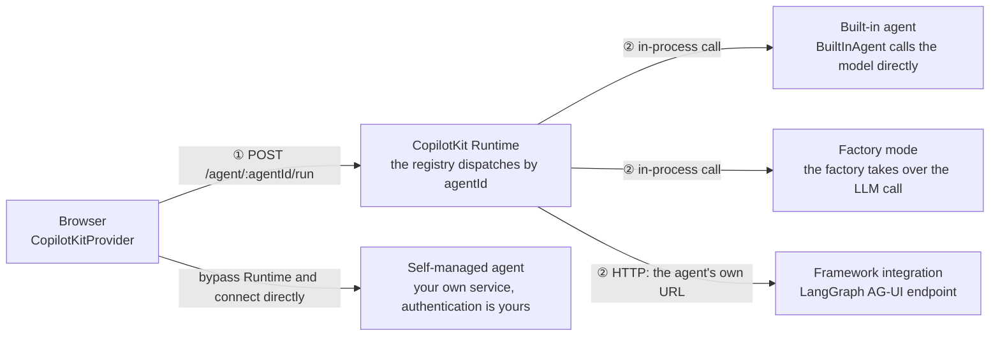
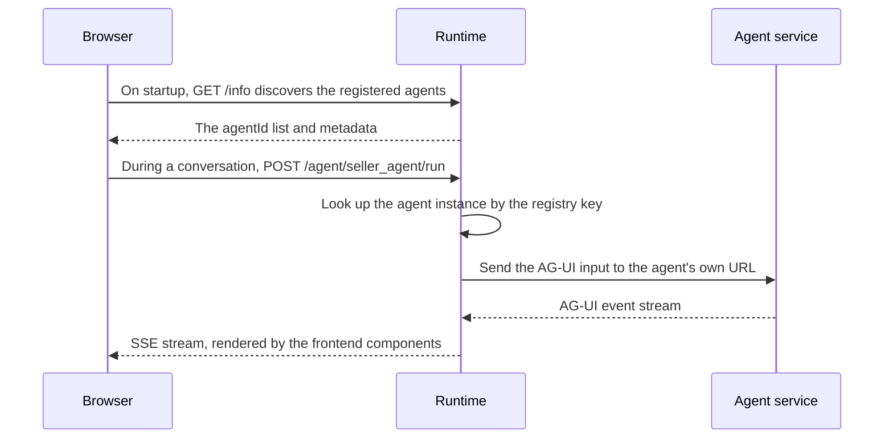
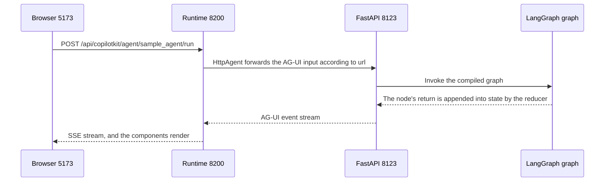
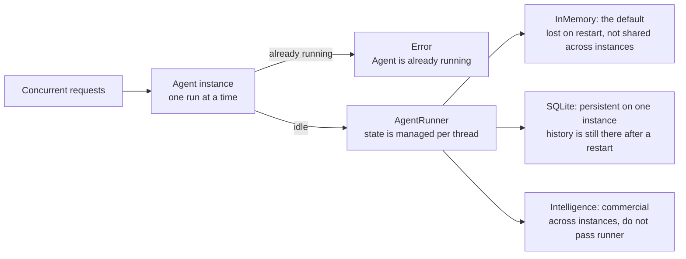
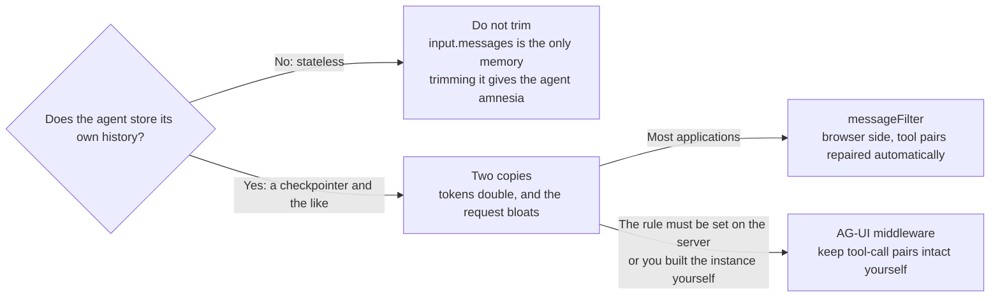

# Chapter 5 Connecting a backend agent: Runtime and framework integration

> Chapter guide: In the Starfish Console (星帆工作台) of Chapter 4, the copilot can already see `dashboard` state, but behind it is still the built-in agent from Chapter 2: a chat-only stand-in that calls the model directly and has no source of business data. Ask it "ORD-20431 为什么还没发货" ("Why hasn't ORD-20431 shipped yet?"), and the best it can do is politely admit that it does not know. This chapter replaces that built-in agent with a LangGraph agent that actually lives on the backend: `seller_agent`. To get there, we spell out Copilot Runtime, the middle layer that Chapter 1 passed over in a single figure: what the unified endpoint, the agents registry, and AG-UI protocol conversion each do. We set the three connection forms (framework integration, factory mode, and self-managed agents) side by side so you can choose. Then, following the official LangGraph quickstart, we connect three pieces of code in one pass: the backend graph, the Runtime registration, and the frontend wiring. Last, we walk the full Starfish Console migration. By the end of this chapter you can register an agent from any framework into Runtime and point the frontend at it, write a factory registration for a custom LLM backend that does not go through a framework, and decide whether your agent should trim the conversation history that gets forwarded.



*Flowchart of the steps in this chapter*

## When you need it

Three typical situations, matching the three ways this chapter is used.

**You already have a framework agent, or you plan to write one (LangGraph, CrewAI, ADK, and the rest), and you want the console's copilot to be talking to that agent.** This is the main line of the chapter. Follow Section 5.1 → Section 5.2 → Section 5.3 → Section 5.8. The core move is to turn the framework agent into an HTTP service, then register it into Runtime's agents registry with a wrapper.

**The agent logic is written inside the Runtime process, in TypeScript. You do not want an external framework, but the built-in agent's simple mode is not enough.** Read factory mode in Section 5.4. `BuiltInAgent` lets you supply a factory function and decide for yourself how the model is called and how tools are wired. CopilotKit only handles the protocol and the lifecycle. Where a thread is stored is in the same section (AgentRunner).

**Your agent service is already live on its own and manages its own security (or it stores the conversation history itself).** Read Section 5.5 (self-managed agents and a local direct connection) and Section 5.6 (trimming message history). The first covers how to let the frontend bypass Runtime and connect straight to your agent. The second covers what goes wrong, and how to trim, when the agent stores history itself and CopilotKit's default of "forwarding the whole conversation on every run" kicks in.

Prerequisites: the minimal architecture from Chapter 2 (two processes, the frontend and Runtime, and the habit of checking with `curl /info`), plus shared state and `useAgentContext` from Chapter 4 (this chapter comes back to them when it covers how configuration is passed to the backend agent). You do not need to have used LangGraph. Section 5.3 starts from what a graph is.

## 5.1 Overview: what Runtime does in the middle, and where an agent connects

Chapter 2 already uses Runtime, but only its thinnest face: hosting an HTTP endpoint and forwarding chat requests. The official full definition is "the backend layer that connects a frontend application with AI agents", and the docs list it as the **recommended way** to use CopilotKit. This chapter is about connecting a real backend agent, so lay out everything this layer is responsible for first:

| Responsibility | Official wording | What it means for you |
|------|------------|-----------|
| **Unified endpoint** | The frontend only knows `runtimeUrl`. When several agents are registered, Runtime discovers them and routes among them automatically (agent routing) | The frontend does not need to know which process or which port each agent lives on |
| **Registry and addressing** | The keys of `new CopilotRuntime({ agents: {...} })` are the `agentId` values. `POST /agent/:agentId/run` dispatches by id | "Who the frontend is chatting with" is decided by this one mapping in the registry |
| **Keys and secure defaults** | Runtime runs on your server, and agent communication stays on the server. By default it blocks unauthenticated access to agent endpoints | Model keys and service-to-service credentials appear only in the server process |
| **Protocol conversion** | Agent output is translated into an AG-UI event stream. The `run` route returns an SSE (Server-Sent Events) stream | Frontend components consume one set of events. They do not care which framework the agent uses |
| **Server-side middleware** | AG-UI middleware (`agent.use`) runs in a trusted environment on the server. The client cannot tamper with it | Logging, guardrails, and request rewriting all hang on the trusted side |
| **Threads and persistence** | Where a thread is stored is decided by the AgentRunner (Section 5.4.3) | "Is the history still there after a refresh?" is answered by the runner you picked |

After this chapter, the full path of one request forks by the four connection forms. The AG-UI event stream flows back the same way in every case. The figure leaves that return path out:



*Figure 5-1: Request paths of the four connection forms. Hops ① and ② are different addresses, and the direction of ② is decided by the form.*

**① and ② are two different addresses.** The official docs put this in a warning box on purpose, and it is the most common source of errors in this chapter (Section 5.2.2 expands on it).

### 5.1.1 The four connection forms

"Connecting an agent" is not one path in the official docs. It is four. The choice forks on a single question: **who drives the agent's loop**.

| Form | Where the agent loop runs | How you register it | Fits | Where this chapter lands it |
|------|--------------|---------|------|---------|
| Built-in agent (Chapter 2) | CopilotKit's own `BuiltInAgent`, which calls the model directly | `agents: { default: new BuiltInAgent({ model, prompt }) }` | Chat plus tools, with no need to build your own agent loop | Already covered. This chapter replaces it |
| Framework integration (this chapter's main line) | A separate framework service (a LangGraph service that exposes an AG-UI endpoint) | Wrap it and register with `HttpAgent` (generic) or `LangGraphAgent` (the LangSmith route) | You already have, or you need, the framework's orchestration (a graph, checkpoints, interrupts) | Section 5.3 |
| Factory mode | Still inside the Runtime process, but a factory you write takes over the model call | `new BuiltInAgent({ type, factory })` | You want full control of the LLM call and of tool wiring, or you are not using a framework | Section 5.4 |
| Self-managed agents | A service you host yourself. The frontend connects directly and does not go through Runtime | The `selfManagedAgents` map on the frontend Provider | Enterprise scenarios: the endpoint is already hardened and authenticates on its own | Section 5.5 |

One contrast is easy to mix up, so it is stated here: **the built-in agent replaces your agent, and framework integration connects your agent.** Section 2.6.2 quoted this official warning. This chapter is the direct answer to it. `BuiltInAgent` itself supports the full set of CopilotKit capabilities, including tools, generative UI, and shared state. If your use case is "chat plus tools" and you do not need fine control of the agent loop, it is still a reasonable place to stop, and the official docs accept it. You do not need to bring in a framework just so the setup looks more advanced.

**For a real product, follow the fork in Figure 5-1.** If you need framework capabilities (multi-step orchestration, checkpoints, and human in the loop expressed inside the graph), take framework integration. If you do not want a framework but you do want a custom model call, take factory mode. Consider a self-managed direct connection only when the agent service already exists on its own and its security is self-contained. The three forms that go through a hosted Runtime share every Runtime capability. A direct connection is the exception, and it is not the default.

### 5.1.2 How this chapter splits the work with the chapters around it

This chapter only answers where the agent comes from, how it is registered into Runtime, and how the frontend points at it. Once the agent is connected, its **operating outlets on the frontend** (tool calls, and rendering generative UI components) are in Chapter 6. How a LangGraph **interrupt becomes human in the loop** is in Chapter 7. **Thread persistence, authentication, and taking multiple agents to production** are in Chapter 8. Section 5.4.3 covers runner selection far enough to be usable. The depth is left to Chapter 8.

**Check:** you can answer, in one sentence, who is driving the conversation loop behind your copilot. The Chapter 2 answer is `BuiltInAgent`. After this chapter, the answer should be a concrete name, such as `seller_agent`.

## 5.2 The agents registry and agentId: how Runtime addresses an agent

### 5.2.1 The registry: the key is the agentId

The registry is the `agents` map in the `CopilotRuntime` constructor:

```ts
import { CopilotRuntime } from "@copilotkit/runtime/v2";

const runtime = new CopilotRuntime({
  agents: {
    // The key is the agentId. The frontend addresses the agent by it.
    default: builtInAgent,     // "default" is privileged; see below
    seller_agent: httpAgent,   // Other agents are pointed at explicitly by agentId
  },
});
```

Three addressing rules, all visible in one sequence diagram. `/info` is the registry's window to the outside. `agentId` is also a segment of the HTTP route. An agent registered under the name `"default"` gets a privilege: built-in components can omit `agentId`.



*Figure 5-2: Two-hop addressing by agentId. If the route segment is not in the registry, you get the `Agent not found` 404 from Chapter 2.*

The `/info` habit from debugging in Chapter 2 still holds. The response from `curl http://localhost:8200/api/copilotkit/info` has to contain the key you registered, or the frontend cannot point at it.

### 5.2.2 Two registration mistakes the official docs name

When you register an external framework agent into `agents`, the official docs name "the two sources of most failures" in a warning box. The wording is recorded here, then expanded.

**Mistake one: passing the framework's own SDK client in as the agent.** The `agents` map accepts AG-UI `AbstractAgent` instances. The framework's own SDK client (the LangGraph client, the CrewAI client, and the rest) is not one of those. Pass the `@ag-ui/<framework>` wrapper for that framework, or a plain `HttpAgent`. The wrapper translates the framework's calls into the AG-UI protocol. That is the "protocol conversion" responsibility showing up at registration.

**Mistake two: writing the external agent's URL as `/api/copilotkit`.** Look back at the path diagram in Section 5.1. `/api/copilotkit` is the address of the **browser → Runtime** hop. **Runtime → agent** is another hop, and it uses the agent's own server or deployment address. The two addresses are different. Mixing them up looks like this: `/info` is completely fine (the first hop is fine), but the moment a conversation starts it cannot connect (the second hop hit the wrong place). The official docs call this out: **every integration guide states the exact URL of that framework's service, including any required suffix.** Find that line before you connect a framework.

A preview of how Starfish Console writes it (Section 5.8 expands it in full):

```ts
import { HttpAgent } from "@ag-ui/client";

const runtime = new CopilotRuntime({
  agents: {
    seller_agent: new HttpAgent({
      // Points at the LangGraph agent's own FastAPI service — not /api/copilotkit
      url: process.env.SELLER_AGENT_URL || "http://localhost:8123",
    }),
  },
});
```

### 5.2.3 The second question past registration: how run configuration reaches the agent

Registration answers which agent. The other half is how to call it. Preferences the user can tune, such as tone, how technical the reply should be, and reply length, do not belong mixed into the chat input. The official agent-config docs give two channels, split by how the agent runs:

| Agent form | Configuration channel | Where the agent reads it |
|-----------|---------|---------------|
| A framework agent that lives behind Runtime (this chapter's main line) | The frontend publishes typed configuration as agent context with `useAgentContext` (Chapter 4). It arrives with the context on every run | Read the latest configuration from the current run's context, and rebuild the system prompt |
| An in-process agent (factory mode, Section 5.4) | The frontend Provider's `properties` prop passes a typed object | The factory function reads it from `input.forwardedProps` |

The two channels feel the same to the user. The wiring is different. The main line of this book (framework integration) takes the first channel. Chapter 4's `useAgentContext` applies as written, and no new knowledge is required. The code and the security rule for the second channel (`forwardedProps` holds only non-sensitive preferences the browser is allowed to control, and it **must not** carry credentials, tenant identity, or authorization) are covered with factory mode in Section 5.4.1.

**Check:** after you add a second agent to the registry, the `curl /info` response shows both keys. Change one of those keys without changing the frontend `agentId`, and the frontend receives `Agent not found` when it connects. Producing that 404 yourself sticks better than memorizing the rule.

## 5.3 LangGraph integration: registering seller_agent into Runtime

This is the main line of the chapter. LangGraph is the agent-orchestration framework in the LangChain family. You write the agent as a **graph**. A node is a step (one model call, one data lookup). An edge decides the direction. Every node shares one state object. You do not need to know LangGraph first. This section uses only six APIs, and each one is explained line by line.

### 5.3.1 Two routes to a service

For CopilotKit to connect a LangGraph agent, the agent first has to become an AG-UI endpoint that can receive HTTP requests. The official quickstart gives two routes. See the fork clearly before you write code:

| | Route A: self-hosted FastAPI | Route B: LangGraph API server (the LangSmith route) |
|---|---|---|
| Language | Python only | Both Python and TypeScript |
| What hosts the service | Your own FastAPI plus uvicorn process | The API server started by `langgraph dev` (the LangGraph CLI) |
| Persistence | You attach a checkpointer yourself when you call `compile()` | The platform injects it at runtime. Attaching one yourself is **forbidden** (see the pitfall in Section 5.3.3) |
| Extra dependencies | `ag-ui-langgraph`, `fastapi`, `uvicorn`, `copilotkit` | `@langchain/langgraph-cli` (TypeScript) or the Python `langgraph-cli`. An existing agent needs a LangSmith API key |
| Registration on the Runtime side | `HttpAgent` | `LangGraphAgent` |
| Fits | A backend service you already own, when you do not want an external platform | You want the LangGraph platform's deployment and persistence directly |

**The main line of this book takes route A.** Starfish Console's backend is a service we own. Route A depends on no external platform, and the three process boundaries (agent, Runtime, and frontend) are the easiest to see. Route B is given with every material difference, so you can switch when you need to.

### 5.3.2 Route A: self-hosted FastAPI

**Step one, install.** In the agent project directory (this book uses `seller-agent/`):

```bash
uv add langgraph langchain-openai langchain-core python-dotenv
uv add ag-ui-langgraph fastapi uvicorn copilotkit
```

The first line is LangGraph itself, plus model access. The second line belongs to route A. `ag-ui-langgraph` exposes the graph as an AG-UI endpoint, and `copilotkit` provides the `LangGraphAGUIAgent` wrapper (the "pass the wrapper, and do not pass the SDK client" rule from Section 5.2.2). If your project pins exact versions, note that `uv add` rewrites the lockfile. The official reminder for that case is to write the dependencies into the dependency file by hand, so other pinned versions are not pulled along.

**Step two, write the graph.** Start with the official minimal example, a graph with a single node:

```python
# seller-agent/main.py
from dotenv import load_dotenv
from langchain_core.messages import SystemMessage
from langchain_openai import ChatOpenAI
from langgraph.graph import END, START, MessagesState, StateGraph
from langgraph.checkpoint.memory import MemorySaver
import uvicorn

load_dotenv()

async def mock_llm(state: MessagesState):
    model = ChatOpenAI(model="gpt-4.1-mini")
    system_message = SystemMessage(content="You are a helpful assistant.")
    response = await model.ainvoke(
        [
            system_message,
            *state["messages"],
        ]
    )
    return {"messages": response}


graph = StateGraph(MessagesState)
graph.add_node(mock_llm)
graph.add_edge(START, "mock_llm")
graph.add_edge("mock_llm", END)
graph = graph.compile(
    checkpointer=MemorySaver()
)
```

Taking this twenty-line file apart, line by line:

1. **`MessagesState` is LangGraph's preset state type.** It has a single field, `messages`, and a reducer with "append" semantics. Each `{"messages": ...}` a node returns is **appended** to the state. It does not overwrite the state. That is how conversation history flows between nodes.
2. **`StateGraph(MessagesState)` builds the graph, and `add_node` registers a node.** The function name, or the name you pass, is the node name.
3. **`add_edge(START, "mock_llm")` and `add_edge("mock_llm", END)` set the direction.** Every run enters at START, passes through one node, and leaves at END.
4. **`compile(checkpointer=MemorySaver())` compiles a runnable graph and attaches a checkpointer.** On route A this is **required**. It is not optional. `ag-ui-langgraph` reads thread state through `graph.aget_state(...)`. A graph with no checkpointer throws `ValueError: No checkpointer set` immediately. `MemorySaver()` stores state in process memory. That is enough for local development. Production should switch to a persistent saver (the official wording is: for example, Postgres).

**Step three, mount the AG-UI endpoint and start it.** Continue in the file above:

```python
# seller-agent/main.py (continued)
from ag_ui_langgraph import add_langgraph_fastapi_endpoint
from copilotkit import LangGraphAGUIAgent
from fastapi import FastAPI

app = FastAPI()

add_langgraph_fastapi_endpoint(
    app=app,
    agent=LangGraphAGUIAgent(
        name="sample_agent",
        description="An example agent to use as a starting point for your own agent.",
        graph=graph,
    ),
    path="/",
)

def main():
    """Run the uvicorn server."""
    uvicorn.run(
        "main:app",
        host="0.0.0.0",
        port=8123,
        reload=True,
    )

if __name__ == "__main__":
    main()
```

Three points matter. The `name` argument of `LangGraphAGUIAgent` **is this agent's public name**. In the next subsection it becomes the `agentId` in the Runtime registry. `path="/"` means the endpoint is mounted at the root of the service. uvicorn's port is fixed at `8123`. **The URL on the Runtime side has to match it.** Change both ends together. The official docs emphasize that alignment. Start it:

```bash
uv run main.py
```

The agent service is ready at `http://localhost:8123`. It is now a standard AG-UI endpoint. You can skip CopilotKit and connect any AG-UI client to it directly. That is what "open protocol" means. AG-UI is the open protocol a frontend and an agent use to talk, introduced in Chapter 1. Runtime is only its most common consumer.

### 5.3.3 Route B: the LangGraph API server and LangGraphAgent

If your agent is already deployed on the LangGraph platform, or you want to start the service with the official CLI, take route B. The example is a TypeScript agent. The Python differences come after it:

```ts
// seller-agent/src/agent.ts
import { SystemMessage } from "@langchain/core/messages";
import { ChatOpenAI } from "@langchain/openai";
import {
  END,
  MessagesAnnotation,
  START,
  StateGraph,
} from "@langchain/langgraph";

async function mockLlm(state: typeof MessagesAnnotation.State) {
  const model = new ChatOpenAI({ model: "gpt-4.1-mini" });
  const response = await model.invoke([
    new SystemMessage("You are a helpful assistant."),
    ...state.messages,
  ]);
  return { messages: response };
}

export const graph = new StateGraph(MessagesAnnotation)
  .addNode("mock_llm", mockLlm)
  .addEdge(START, "mock_llm")
  .addEdge("mock_llm", END)
  .compile();
```

The first contrast with route A runs the other way: **do not pass a checkpointer to `compile()`.** The LangGraph API server injects persistence itself at runtime. Compile one in yourself, and `langgraph dev` refuses to load the graph (the error says `persistence is handled automatically by the platform` outright). An already deployed graph simply ignores it. **Two routes, two opposite rules.** Route A must attach one (without it, you get `ValueError: No checkpointer set`). Route B must not attach one (`langgraph dev` refuses to load the graph, and a deployed graph ignores the checkpointer). This is the easiest pitfall to hit in the LangGraph integration. The symptoms and the fixes are in the troubleshooting table in Section 5.3.5.

The TypeScript route also needs a `langgraph.json` that declares the graph and the entry point:

```json
{
  "node_version": "20",
  "dependencies": ["."],
  "graphs": {
    "sample_agent": "./src/agent.ts:graph"
  },
  "env": ".env"
}
```

The key `sample_agent` under `graphs` is the **graphId**. The value is `<file>:<export name>`. It has to point exactly at the `export const graph` constant in the code. If the names do not match, the CLI reports `graph is nullish`. Start the service:

```bash
npx @langchain/langgraph-cli dev --port 8123 --no-browser
```

**`--port 8123` is not decoration.** A bare `langgraph dev`, whether the Python CLI or the TypeScript CLI, defaults to port **2024**. The official warning is explicit. Either pin the port at 8123 with the flag so it lines up with the URL on the Runtime side, or drop the flag and change the Runtime-side URL to `http://localhost:2024`. **The two sides have to agree.** Otherwise Runtime cannot reach the agent, and the only clue is a connection error.

Registration on the Runtime side switches to a different wrapper (the official Next.js example, as written):

```ts
// app/api/copilotkit/[[...slug]]/route.ts — route B
import {
  CopilotRuntime,
  createCopilotRuntimeHandler,
} from "@copilotkit/runtime/v2";
import { LangGraphAgent } from "@copilotkit/runtime/langgraph";

const runtime = new CopilotRuntime({
  agents: {
    sample_agent: new LangGraphAgent({
      deploymentUrl: process.env.LANGGRAPH_DEPLOYMENT_URL || "http://localhost:8123",
      graphId: "sample_agent",
      langsmithApiKey: process.env.LANGSMITH_API_KEY || "",
    }),
  },
});

const handler = createCopilotRuntimeHandler({
  runtime,
  basePath: "/api/copilotkit",
});

export const GET = handler;
export const POST = handler;
export const PATCH = handler;
export const DELETE = handler;
```

`LangGraphAgent` is imported from `@copilotkit/runtime/langgraph` (there is no `/v2` prefix; this is the import path in the official source). The three parameters each cover one hop. `deploymentUrl` points at the LangGraph API server. `graphId` matches the key in `langgraph.json`. `langsmithApiKey` is required when you connect an agent that already exists. If Starfish Console takes route B, move this registration into `server.ts` using the general formula from Section 2.6.3.

### 5.3.4 Runtime registration and the frontend wiring (route A)

Back to the main line. Route A's registration on the Runtime side adds only a wrapper on top of the built-in agent. Here it is written into `server.ts` in Starfish Console's SPA shape. The host is identical to Chapter 2:

```ts
// server.ts — register sample_agent (for the demo; Section 5.8 swaps it for seller_agent)
import { createServer } from "node:http";
import { CopilotRuntime } from "@copilotkit/runtime/v2";
import { HttpAgent } from "@ag-ui/client";
import { createCopilotNodeListener } from "@copilotkit/runtime/v2/node";

const runtime = new CopilotRuntime({
  agents: {
    sample_agent: new HttpAgent({
      url: process.env.SAMPLE_AGENT_URL || "http://localhost:8123",
    }),
  },
});

const port = 8200;

createServer(
  createCopilotNodeListener({
    runtime,
    basePath: "/api/copilotkit",
    cors: true,
  }),
).listen(port, () => {
  console.log(
    `Copilot Runtime listening at http://localhost:${port}/api/copilotkit`,
  );
});
```

Set this next to Chapter 2's `server.ts` and only two lines have changed. `HttpAgent` (from `@ag-ui/client`; you need `npm install @ag-ui/client`) replaces `BuiltInAgent`, and the registry key changes from `default` to `sample_agent`. `createCopilotNodeListener`, `basePath`, and `cors: true` all stay exactly as they were. **What you already know about the SPA does not grow just because the agent changed.**

The host in the official quickstart is Next.js, with the frontend and Runtime on the same origin, and it has one fewer line than the SPA. `runtimeUrl` is the relative path `/api/copilotkit`, and the Provider explicitly sets `useSingleEndpoint={false}` so it pairs with the multi-route catch-all handler. When the SPA's Provider omits that prop, it probes Runtime's transport on its own, so Starfish Console's Provider can stay as it was in Chapter 2.

The frontend changes in one place, `agentId`:

```tsx
// src/App.tsx (excerpt)
<CopilotKitProvider
  runtimeUrl="http://localhost:8200/api/copilotkit"
  agentId="sample_agent"
>
```

The key is no longer `default`, so `agentId` goes from something you can omit to something you must write (the rule is in Section 5.2.1). Styles, the chat component, and the shared-state hooks stay untouched.

Once the three pieces of code (the agent service, the Runtime registration, and the frontend wiring) are connected, the full data flow looks like this. Each message is one hop:



*Figure 5-3: The three-process data flow of route A. Each of the three ports guards one hop, and the event stream returns along the same path.*

One default is worth knowing. The official quickstart configures Runtime with `intelligence` and `identifyUser` (CopilotKit's commercial persistence and user identification; the parameter is a project API key). **Drop those two, and Runtime falls back to SSE mode plus an in-memory runner.** Chat still works. Thread persistence and the debug inspector are unavailable. The main line of this book is the self-hosted route, which is the shape in use since Chapter 2. The full discussion of threads and production is in Chapter 8.

**Check:** start the three processes in order. `uv run main.py` (8123), then `npx tsx --env-file=.env server.ts` (8200), then `npm run dev` (5173). The response from `curl http://localhost:8200/api/copilotkit/info` includes `sample_agent`. Then open the browser and send `Can you tell me a joke?`.

### 5.3.5 First-run troubleshooting for the LangGraph integration

| Symptom | Cause | Fix |
|------|------|------|
| Runtime is up and `/info` is fine, but a conversation immediately hits a connection error | The Runtime → agent hop is down: the agent service is not running, or the URL or the port does not match | First `curl http://localhost:8123` to confirm the agent is alive. Check the registered URL against the uvicorn port |
| The agent was started with `langgraph dev`, and Runtime cannot connect no matter what | A bare `langgraph dev` defaults to port **2024**, while Runtime points at 8123 | Pin the port with `--port 8123`, or change the Runtime-side URL to 2024. The two sides have to match |
| The agent was started with the TypeScript CLI, and `http://127.0.0.1:8123` cannot connect | `@langchain/langgraph-cli` defaults its host to `localhost`, and on a dual-stack machine that binds only the IPv6 address `::1` | Use `http://localhost:8123` or `http://[::1]:8123`. For IPv4, bind explicitly with `--host 127.0.0.1` |
| `langgraph dev` reports `ValueError: ... includes a custom checkpointer` | The route B graph called `compile(checkpointer=...)` itself | Delete the checkpointer. Persistence is injected by the platform |
| The FastAPI version throws `ValueError: No checkpointer set` at runtime | The route A graph did not attach a checkpointer in `compile()` | Add `checkpointer=MemorySaver()` (swap in a persistent saver for production) |
| `graph is nullish` | The `<file>:<export name>` in `langgraph.json` does not match the name of the constant exported in the code | Change it to the actual name of `export const graph` |

## 5.4 A custom agent and AgentRunner: two controls that do not need a framework

Framework integration hands the agent loop to the framework. This section covers two control points you keep: **the model call** (factory mode) and **thread storage** (AgentRunner). Neither one requires an agent framework.

### 5.4.1 Factory mode: you decide how the model is called

`BuiltInAgent` has two modes. Simple mode, which Chapter 2 used, is finished once you pass a model string. **Factory mode** lets you supply a factory function that takes over the whole LLM call. CopilotKit only turns the returned stream into AG-UI events, manages the lifecycle, and connects the agent into Runtime. The official comparison:

| | Simple mode | Factory mode |
|---|---|---|
| Setup | Pass a model string | You own the LLM call and the stream |
| Model resolution | Built in (strings such as `"openai/gpt-4o"`) | You set the model up yourself |
| Tools, MCP, and state tools | Wired automatically | You wire them inside the factory |
| Supported backends | The Vercel AI SDK only | Any of them: the AI SDK, TanStack AI, or a custom backend |
| Fits | A quick setup, and a standard scenario | Full control, or a non-standard backend |

The official advice is blunt. If simple mode is enough, do not use factory mode. Factory mode exists for control that simple mode cannot give you. A complete example of an AI SDK backend (the official source, with the host changed to the shape of Starfish Console's `server.ts`):

```ts
// server.ts — factory mode: an AI SDK backend
import { createServer } from "node:http";
import {
  CopilotRuntime,
  BuiltInAgent,
  InMemoryAgentRunner,
  convertMessagesToVercelAISDKMessages,
} from "@copilotkit/runtime/v2";
import { streamText } from "ai";
import { openai } from "@ai-sdk/openai";
import { createCopilotNodeListener } from "@copilotkit/runtime/v2/node";

const agent = new BuiltInAgent({
  type: "aisdk",
  factory: ({ input, abortSignal }) =>
    streamText({
      model: openai("gpt-4o"),
      messages: convertMessagesToVercelAISDKMessages(input.messages),
      abortSignal,
    }),
});

const runtime = new CopilotRuntime({
  agents: { default: agent },
  runner: new InMemoryAgentRunner(),
});

createServer(
  createCopilotNodeListener({
    runtime,
    basePath: "/api/copilotkit",
    cors: true,
  }),
).listen(8200);
```

The most useful part of the context the factory receives (`BuiltInAgentFactoryContext`) is `input`, a complete AG-UI `RunAgentInput`. Its fields include `messages` (the conversation), `tools` (tool definitions registered on the frontend), `state` (shared state), `context` (context published by `useAgentContext`), `threadId`, `runId`, and `forwardedProps` (run configuration passed in by the Provider). Lifecycle events (`RUN_STARTED` / `RUN_FINISHED`), stream conversion, error handling, and cancellation are all handled by CopilotKit. **Your factory does not need to emit any lifecycle event.**

One pitfall you have to remember: the `abortController` the factory receives is for backends such as TanStack AI that **require the full controller**. Hand it over and let the backend own it. **Do not call `.abort()` yourself inside the factory.** That bypasses CopilotKit cancelling the run, and the run never gets its cleanup. To cancel on purpose, call `abortRun()` on the agent. Wherever something accepts a signal (the AI SDK, `fetch`, a custom backend), pass `abortSignal`.

`type` has three values. `"aisdk"` is the Vercel AI SDK, and it returns the result of `streamText`. `"tanstack"` is TanStack AI, and it returns the result of `chat()` and needs `abortController`. `"custom"` is an async generator that yields AG-UI events directly, which means you write the protocol stream yourself. The full event types are in the official AG-UI events reference. The first two come with conversion functions you can use as they are:

| Helper | What it does |
|---------|------|
| `convertMessagesToVercelAISDKMessages(messages)` | AG-UI messages → the AI SDK's `ModelMessage[]` |
| `convertToolsToVercelAITools(tools)` | Tools defined on the frontend (JSON Schema) → the AI SDK's `ToolSet` |
| `convertToolDefinitionsToVercelAITools(tools)` | Definitions from `defineTool()` (Standard Schema) → the AI SDK's `ToolSet` |
| `convertInputToTanStackAI(input)` | `RunAgentInput` → `{ messages, systemPrompts }`. It handles system and developer messages, context, and state on its own |
| `resolveModel(spec)` | A string such as `"openai/gpt-4o"` → an AI SDK model instance |

`convertToolsToVercelAITools(input.tools)` deserves a mark. **Factory mode does not wire tools automatically.** Once the frontend tools from Chapter 6 are in factory mode's hands, this line is what converts them and hands them to the model. Simple mode and the framework-integration route do not have this step. This is where "simple mode wires them automatically, and the factory wires them itself" shows up in the code.

`input.state` and `input.context` work the same way. Shared state and context do not enter the prompt on their own. The official example concatenates them by hand: walk `input.context` and push each `description: value` into the system section, serialize `input.state` into an `Application State:` section, then `unshift` a system message. The state visibility that Chapter 4 got for free on simple mode and on the framework route is explicit work in factory mode.

One more rule for `forwardedProps`, the second channel from Section 5.2.3. It arrives through the `properties` prop on the frontend Provider, and it is the right place for preferences that are non-sensitive and under the browser's control. The official example uses it to pass a model choice and a temperature, and **every value has to be checked against the backend's own bounds** before it is allowed to affect execution. Credentials, tenant identity, authorization, and an unrestricted choice of model must not travel this channel.

### 5.4.2 One built-in agent instance runs only one turn at a time

A `BuiltInAgent` instance registered at module scope **refuses a second concurrent run on itself**. The error text is `Agent is already running. Call abortRun() first or create a new instance.` Local development does not notice. The moment more than one person is using the service, the second concurrent request is the one that fails. The official fix follows the architecture. **Per-thread state lives in the runner.** The agent does not hold it, so give each concurrent run its own instance. Construct the agent inside the request. A single shared instance at module scope is what refuses the second run. Serializing by user is the other fix. In factory mode the agent is constructed inside the request anyway, so this is not a problem there.

### 5.4.3 AgentRunner: where a thread is stored, and whether it is lost

Runtime delegates "start a run, reconnect a thread, stop a run" to an **AgentRunner** (the agent executor). It is an abstract class, and its four methods line up with Runtime's HTTP routes:

```ts
import type { Observable } from "rxjs";
import type { BaseEvent } from "@ag-ui/client";

abstract class AgentRunner {
  // Start a run. Returns an AG-UI event stream.
  abstract run(request: AgentRunnerRunRequest): Observable<BaseEvent>;
  // Reconnect to an existing thread's stream (a page refresh, or a reconnect after a drop).
  abstract connect(request: AgentRunnerConnectRequest): Observable<BaseEvent>;
  // Whether this thread is currently running.
  abstract isRunning(request: AgentRunnerIsRunningRequest): Promise<boolean>;
  // Stop the run in progress on this thread.
  abstract stop(request: AgentRunnerStopRequest): Promise<boolean | undefined>;
}
```

`runner` is configured once on `CopilotRuntime`, and it applies to **every** registered agent. Omit it, and the default is `InMemoryAgentRunner`. One table for the choice. TelemetryAgentRunner is leftover wrapper behavior. `@copilotkit/runtime/v2` does not include it. Knowing that is enough:

| Runner | Imported from | Use |
|--------|-------|------|
| `InMemoryAgentRunner` | `@copilotkit/runtime/v2` | The default. Threads live in process memory: local development, a single-instance deployment, or a base class to extend |
| `SqliteAgentRunner` | `@copilotkit/sqlite-runner` | First-party file persistence: history is still there after a single-instance restart. It needs the `better-sqlite3` peer dependency and a real `dbPath` (not `:memory:`) |
| `IntelligenceAgentRunner` | `@copilotkit/runtime/v2` | The CopilotKit Intelligence commercial backend: persistence across instances. Used automatically when Intelligence is running. **Passing `runner` again is not allowed** (passing it is a type error, and bypassing the types is also rejected at construction time) |

Two hard facts about the in-memory runner decide when you have to switch. **A restart drops the history** (it lives only in process memory), and **instances do not share it** (horizontal scaling simply stops working). It is bounded by default, so it will not eat heap memory without a limit. Three parameters set the ceilings. `maxThreads` defaults to 1000, and past that limit the least recently used thread is evicted as a whole. `maxRunsPerThread` defaults to 100, and the oldest run is evicted. `maxBytes` defaults to 512 MiB, a total cap across threads. Whichever limit is reached first takes effect. A thread that holds an active run is never evicted. Another practical option is the concurrency behavior. By default a second `run()` on the same thread throws `Thread already running`. Pass `onConcurrentRun: "supersede"` and it aborts the run that is in flight and lets the new run take its place. Partial output from the run that was superseded is discarded. The default in-memory runner is enough for local development of Starfish Console. Choosing for production, between SQLite and shared storage, is a Chapter 8 topic. Here you only need to know where the line is.

The concurrency limit from Section 5.4.2 and the runner choice, seen together:



*Figure 5-4: The agent concurrency model and the thread-storage choice. Concurrency is constrained at the instance, and persistence is constrained at the runner.*

**Check:** say which process, and which store inside that process, holds a thread's conversation history right now. With the default runner the answer is "in the Runtime process's memory, and a restart wipes it". If that sentence comes out without stopping to think, Section 5.4.3 is done.

## 5.5 Self-managed agents: a direct connection that bypasses Runtime

Everything in the previous four sections happens on the hosted path, frontend → Runtime → agent. The official docs also leave a path that **does not go through Runtime**: hand an AG-UI agent instance directly to the frontend Provider. The path splits into a production option and a development option, and picking the wrong one costs differently.

**The production option is `selfManagedAgents`.** The official docs define it as a supported configuration, used to connect an AG-UI-compatible backend that you host yourself and have already hardened (for example an `HttpAgent` that points at your own service). Note the official positioning. It belongs to CopilotKit's Enterprise Intelligence layer, and **production use requires a commercial license**. Usage:

```tsx
import { HttpAgent } from "@ag-ui/client";
import { CopilotKitProvider } from "@copilotkit/react-core/v2";

const supportAgent = new HttpAgent({
  url: "https://agents.example.com/support",
});

<CopilotKitProvider selfManagedAgents={{ "support-agent": supportAgent }}>
  <YourApp />
</CopilotKitProvider>
```

The map's key is an `agentId` as well. Chat components and the frontend agent API address the agent by that key. Because the request no longer passes through Runtime, **Runtime's server-side authentication, middleware, and routing do not apply.** Your agent endpoint has to authenticate and authorize every request itself. It can coexist with `runtimeUrl`. Agents that Runtime discovers and self-managed agents merge into the same client registry, and each is addressed by `agentId`. On a key collision, `selfManagedAgents` wins. The merge is equivalent to `{ ...agents discovered at runtime, ...selfManagedAgents }`.

**The development option is `agents__unsafe_dev_only`.** The map has the same shape, and the name is deliberately loud. Use it only for local development and prototyping, when you are connecting an agent on your machine and do not yet want to start a Runtime for it. The official docs are explicit: **do not take it to production.** To go self-managed, switch to `selfManagedAgents` (once you have hardened the endpoint), or move the agent back behind Runtime.

(The `CopilotKitProvider` in the example is this book's uniform spelling. Those two pages of the official docs present the same props with the `<CopilotKit>` component from inside the v2 package. Chapter 3 already explained how the two relate, and our recommendation.)

Why is Runtime still the default route? The official comparison is transcribed below. Each of the five differences is something the hosted path buys:

| | Through Runtime | Direct connection |
|---|---|---|
| Authentication | Secure defaults are provided | You handle it |
| AG-UI middleware | Runs on the server | Unavailable |
| Agent routing | Automatic | Manual |
| Ecosystem features | Fully supported | Limited |
| Official support | Supported | Not supported (the development option) |

**Check:** you can say why `agents__unsafe_dev_only` has a loud name and `selfManagedAgents` has a formal one. The first is a development channel the official docs named so you will not take it to production. The second is a supported production channel that requires you to own the security yourself, and it sits inside the enterprise license.

## 5.6 Message history: what CopilotKit forwards, and when to trim

One default that runs through this chapter now deserves a section of its own. **CopilotKit forwards the entire conversation on every run.** The frontend holds the full chat record, and every run carries it to your agent as `input.messages`. A stateless agent needs that. The forwarded record is its only memory of the conversation.

The `seller_agent` this chapter connects stores its own history. On the FastAPI route, the graph attaches a checkpointer at `compile()` (Section 5.3.2), so the agent already keeps the conversation. The official docs name four kinds of backend that store their own history: a LangGraph checkpointer, Mastra memory, the AWS Strands `SessionManager`, and the Microsoft Agent Framework chat-history provider. The conversation then exists in **two copies**. Whether to trim, and where, is a fork the figure settles:



*Figure 5-5: Deciding whether to trim message history. Do not trim a stateless agent. When the agent stores its own history, pick the channel by which side owns the rule.*

Two symptoms, with one more detail. Duplicated history can also split a tool call from its tool result. When the stored history ends on a dangling tool call and the forwarded copy is appended after it, the call is no longer followed immediately by its result, and Anthropic rejects the run outright. Request bloat shows up as a request body that grows with the conversation. A long thread raises the latency of every turn, and a proxy may reject the request with HTTP 413.

### 5.6.1 On the browser: `messageFilter` is the answer for most applications

The `messageFilter` prop on the frontend Provider decides which messages go on the wire for each run. Return the ones to send:

```tsx
// src/App.tsx — seller_agent stores its own history, so forward only the last turn
<CopilotKitProvider
  runtimeUrl="http://localhost:8200/api/copilotkit"
  agentId="seller_agent"
  messageFilter={(messages) => messages.slice(-1)}
>
```

This is the shortest official fix for both symptoms, and **even a blunt rule is safe here.** Before the request goes out, CopilotKit repairs a tool-call pair that was split apart. A forwarded tool result gets its call put back in front of it, and a forwarded call gets its result put back, so `slice(-1)` cannot leave a call that is waiting for approval hanging alone on the wire. Four things it does not touch. Rendering of the chat UI: the UI still shows the full record. Instances passed in through `selfManagedAgents`: those are your objects, and they use the middleware below. The Intelligence runtime: it is the archive of the thread, and the client is not allowed to truncate it. Suggestion runs: they run on a brand-new thread, and the messages sent along with them are already their only context. The failure behavior is also easy to live with. If the filter throws, or if it returns something that is not an array, CopilotKit warns and falls back to sending the full history. Trimming is an optimization. A bug in it should not take the run down. One engineering detail: give the filter a stable reference (`useCallback` in React). An inline arrow function registers again on every render. That is harmless, and it is unnecessary.

### 5.6.2 On the Runtime side and on an instance you built: middleware

`messageFilter` cannot reach two paths. One is trimming inside Runtime, when the trimming rule has to be decided on the server. The other is trimming an agent instance you passed in yourself. These two paths **have no automatic repair channel.** The filter has to keep tool calls and their results in pairs. Put the function that selects messages into an AG-UI middleware, and attach that middleware to the agent:

```ts
// trim-history.ts — skeleton; the full selection function is in the official message-history docs
import {
  Middleware,
  type AbstractAgent,
  type Message,
  type RunAgentInput,
} from "@ag-ui/client";

/** Keep the last turn, plus the tool calls answered by the forwarded tool results. */
export function lastTurnOnly(messages: Message[]): Message[] {
  // The official docs give the full implementation: find the last user message,
  // collect the tool calls after it that a result answers and pull those calls back,
  // and place each pulled-back call immediately before the result that answers it,
  // because model providers require that "a call is answered by the message that follows it".
}

/** Rewrite the messages of one run. Leave the stored record itself unchanged. */
export class TrimHistoryMiddleware extends Middleware {
  constructor(private readonly trim: (messages: Message[]) => Message[]) {
    super();
  }

  run(input: RunAgentInput, next: AbstractAgent) {
    return this.runNext({ ...input, messages: this.trim(input.messages) }, next);
  }
}
```

The mount point is before registration:

```ts
// server.ts — trim inside Runtime
import { HttpAgent } from "@ag-ui/client";
import { CopilotRuntime } from "@copilotkit/runtime/v2";
import { lastTurnOnly, TrimHistoryMiddleware } from "./trim-history";

const agent = new HttpAgent({ url: process.env.AGENT_URL! });
agent.use(new TrimHistoryMiddleware(lastTurnOnly));

const runtime = new CopilotRuntime({
  agents: { default: agent },
});
```

`.use()` is defined on `AbstractAgent`, so this one call before registration covers every run, whichever framework is wrapped. On each run, Runtime clones the registered agent, and the clone carries the middleware with it. An instance you built yourself, on the `selfManagedAgents` path, uses the same middleware. The filtered messages become the HTTP request body directly, and the record on the UI stays complete.

How to choose between the two trimming paths:

| | `messageFilter` (browser) | Middleware (server, or an instance you built) |
|---|---|---|
| Tool-call pairs | **Repaired automatically.** Even a blunt rule is safe | You keep them paired yourself (`lastTurnOnly` already does this) |
| Shrinks the request body the browser sends | Yes | No (the browser still sends the full history; trimming happens inside Runtime) |
| Applies to | Agents discovered by Runtime | Agents registered inside Runtime, and instances you built |
| What happens on an error | A warning, then a fallback to sending the full history | There is no fallback. You have to get it right yourself |

Finally, remember the three things trimming does **not** change: the full rendering of the chat UI, Runtime's persistence of thread events, and `input.state` / `input.tools` / `input.context`. The only thing rewritten is the message list.

**Check:** after you connect `seller_agent`, ask it three questions and then a fourth, and open the browser's network panel on the run request body. With `messageFilter` set, the number of messages in the request no longer grows with the number of turns. That is the evidence that "the agent stores its own history, and only the last turn is forwarded" is in effect.

## 5.7 The other frameworks at a glance

Beyond LangGraph, the official integration catalog has another set of frameworks. Connecting them has the same shape as this chapter: **the framework service exposes an AG-UI endpoint, a wrapper (or `HttpAgent`) is registered into the agents registry, and the frontend `agentId` points at it.** The one-sentence column below is taken from the official description on each framework's integration page. Scan it once when you are choosing:

| Framework | The official one sentence | Notes |
|------|-----------|------|
| LangGraph | Hand your LangGraph agent to the user | This chapter's main line. The official quickstart gives both a Python route and a TypeScript route |
| Built-in Agent | Use CopilotKit's built-in agent with any model | Covered in Chapter 2. The official warning: it replaces your agent |
| CrewAI | Hand CrewAI's Flow-style agents to the user through AG-UI | Flow-style (the crewai-flows catalog) |
| AG2 | Hand an AG2 agent to the user through AG-UI | |
| ADK | Turn an ADK agent into an agent-native application | |
| Pydantic AI | Hand a Pydantic AI agent to the user through AG-UI | |
| Mastra | Hand a Mastra agent to the user through AG-UI | |
| LlamaIndex | Hand a LlamaIndex agent to the user through AG-UI | |
| A2A | Turn an A2A agent into an agent-native application | A2A is a protocol between agents. CopilotKit connects those agents by listing them in the integration catalog |
| Microsoft Agent Framework | Hand a Microsoft Agent Framework agent to the user through AG-UI | |
| Claude SDK | Run the Claude Agent SDK's Python and TypeScript agents behind CopilotKit | The official docs split this into two quickstart pages, claude-sdk-python and claude-sdk-typescript |
| Deep Agents | Hand Deep Agents to the user through AG-UI | |
| Agno | Hand an Agno agent to the user through AG-UI | |
| Agent Spec | Configure Agent Spec together with AG-UI and connect the CopilotKit UI, including the install steps for each adapter | Aimed at a portable description of an agent spec |

Three notes on how to choose. First, **almost every difference among these integrations is in how the backend is written and how it is exposed.** Once the AG-UI endpoint is ready, Runtime registration, frontend wiring, shared state, tools, and human in the loop play out the same way no matter which framework you used. That is what Chapter 1 means by "protocol first". Second, LangGraph gives both a Python route and a TypeScript route in the official quickstart, and the Claude SDK is split into a Python page and a TypeScript page. Apart from those, each framework's language support is whatever its own quickstart page says. This book does not assert it on their behalf. Third, if the body of your backend agent lives on a **Java stack**, building the agent itself can follow the "星帆出海" ("Starfish Overseas") system in the agentscope-java book (→ agentscope-java). The connection layer still follows the AG-UI protocol this book spells out. AgentScope is not in the list above. Do not expect the official CopilotKit docs to connect it directly. The workable path is to wrap your Java service in an AG-UI endpoint and then use `HttpAgent`.

**Check:** when you connect a new framework's agent to CopilotKit, find three things first. Its AG-UI wrapper, or the way it exposes an endpoint. The exact URL of its service, including the suffix. Whether the official catalog already has an integration page for it. Once all three are in hand, replay this chapter's flow as written.

## 5.8 Migrate Starfish Console: from the built-in agent to seller_agent

The main line lands in the project. The goal is to take down the built-in agent registered in Chapter 2 and replace it with LangGraph's `seller_agent`. It can look up order data on the backend (an in-memory mock in the demo, a database in a real project) and answer questions that have to land on data, such as "ORD-20431 为什么还没发货" ("Why hasn't ORD-20431 shipped yet?").

### 5.8.1 The directory and the processes after the migration

```text
starfish-console/
├── server.ts            # Runtime process (8200) — evolved: registers seller_agent
├── src/App.tsx          # Frontend (5173) — change only the agentId line
├── .env                 # Runtime-side variables (SELLER_AGENT_URL and the rest)
└── seller-agent/        # Added: the LangGraph agent service (8123)
    ├── main.py
    └── .env             # Agent-side key: OPENAI_API_KEY
```

The process count goes from two to three, and the key follows the model call. **In the built-in-agent days, the model key belonged to the Runtime process. After framework integration, the model call happens inside the agent service, and the key moves with it into `seller-agent/.env`.** The rule that a server-side key stays only in a server process has not changed. What changed is which process counts as the server. The two `.env` files each cover their own side, and both go into `.gitignore`.

### 5.8.2 The seller_agent graph

Initialize and install inside `seller-agent/` (the dependencies from Section 5.3.2, installed in one go):

```bash
uv init seller-agent
cd seller-agent
uv add langgraph langchain-openai langchain-core python-dotenv \
  ag-ui-langgraph fastapi uvicorn copilotkit
```

`main.py` expands the minimal graph from Section 5.3.2 into two nodes. One is a **deterministic lookup node**: it does not call a model, and a plain regular expression pulls the order id out of the conversation and looks the order up. The other is an **answer node**: it calls the model with a system prompt. The data is the orders from our running example:

```python
# seller-agent/main.py
import re

from dotenv import load_dotenv
from ag_ui_langgraph import add_langgraph_fastapi_endpoint
from copilotkit import LangGraphAGUIAgent
from fastapi import FastAPI
from langchain_core.messages import SystemMessage
from langchain_openai import ChatOpenAI
from langgraph.checkpoint.memory import MemorySaver
from langgraph.graph import END, START, MessagesState, StateGraph
import uvicorn

load_dotenv()

# Demo data, from the same source as the frontend order list and our running example.
# In a real project, replace this function body with a database or middle-platform query.
# Status values: "待发货" ("awaiting shipment"), "已发货" ("shipped"), "售后中" ("in after-sales").
# ORD-20431 reason: "华南仓拣货中，美线时效 9-12 天" ("picking in the South China warehouse; US-line transit is 9-12 days").
ORDERS = {
    "ORD-20431": {
        "buyer": "Maria",
        "amount": "$86.40",
        "status": "待发货",
        "reason": "华南仓拣货中，美线时效 9-12 天",
    },
    "ORD-20407": {"buyer": "Liam", "amount": "$42.00", "status": "已发货", "reason": ""},
    "ORD-20395": {"buyer": "Emma", "amount": "$128.50", "status": "售后中", "reason": ""},
}


# Deterministic node: pull an order id from the latest user message and look it up locally.
# No model call, so the lookup stays stable and testable. If no order id is found, pass the turn through unchanged.
def fetch_order(state: MessagesState):
    """确定性节点：从最近一条用户消息里抓订单号，查本地数据。

    不经模型，保证查询结果稳定可测；抓不到订单号就原样放行。
    """
    order_id = None
    for message in reversed(state["messages"]):
        if message.type == "human":
            matched = re.search(r"ORD-\d+", str(message.content))
            if matched:
                order_id = matched.group(0)
            break

    if order_id is None:
        return {"messages": []}

    order = ORDERS.get(order_id)
    if order is None:
        # "[内部查询结果] 未找到订单 {id}" ("[internal lookup result] order {id} was not found")
        note = f"[内部查询结果] 未找到订单 {order_id}"
    else:
        # "[内部查询结果] 订单 {id}：买家 …，金额 …，状态 …，…"
        # ("[internal lookup result] order {id}: buyer …, amount …, status …, …")
        note = (
            f"[内部查询结果] 订单 {order_id}：买家 {order['buyer']}，"
            f"金额 {order['amount']}，状态 {order['status']}，{order['reason']}"
        )
    return {"messages": [SystemMessage(content=note)]}


# Answer node: call the model from the system prompt and the conversation, which may include a lookup result.
async def answer(state: MessagesState):
    """回答节点：基于系统提示词与（可能包含查询结果的）对话调模型。"""
    model = ChatOpenAI(model="gpt-4.1-mini")
    # "你是星帆工作台的卖家助手 seller_agent。" ("You are seller_agent, the seller assistant for Starfish Console.")
    # "回答要基于消息里的[内部查询结果]；没有查询结果时直接凭对话回答。"
    # ("Base the answer on the [internal lookup result] in the messages. If there is no lookup result, answer from the conversation.")
    system_message = SystemMessage(
        content=(
            "你是星帆工作台的卖家助手 seller_agent。"
            "回答要基于消息里的[内部查询结果]；没有查询结果时直接凭对话回答。"
        )
    )
    response = await model.ainvoke([system_message, *state["messages"]])
    return {"messages": response}


graph = StateGraph(MessagesState)
graph.add_node("fetch_order", fetch_order)
graph.add_node("answer", answer)
graph.add_edge(START, "fetch_order")
graph.add_edge("fetch_order", "answer")
graph.add_edge("answer", END)
graph = graph.compile(checkpointer=MemorySaver())

app = FastAPI()

add_langgraph_fastapi_endpoint(
    app=app,
    agent=LangGraphAGUIAgent(
        name="seller_agent",
        # "星帆工作台卖家助手：可查询订单状态与未发货原因。"
        # ("Starfish Console seller assistant: can look up order status and why an order has not shipped.")
        description="星帆工作台卖家助手：可查询订单状态与未发货原因。",
        graph=graph,
    ),
    path="/",
)


def main():
    uvicorn.run("main:app", host="0.0.0.0", port=8123, reload=True)


if __name__ == "__main__":
    main()
```

Set this next to the minimal graph in Section 5.3.2 and only four things differ. `add_node` is given an explicit node name. The edges `START → fetch_order → answer → END` form a fixed pipeline (a real agent would add conditional edges and a tool loop here; this book does not develop LangGraph itself). The `SystemMessage` returned by `fetch_order` is **appended** into the conversation by the reducer, and it becomes the lookup result that `answer` can see. `LangGraphAGUIAgent(name="seller_agent", ...)` sets the name to `seller_agent`, and that name immediately becomes the registry key.

The `.env` file, and how to start:

```dotenv
# seller-agent/.env
OPENAI_API_KEY=sk-...
```

```bash
uv run main.py    # Agent service ready at http://localhost:8123
```

### 5.8.3 How server.ts and the frontend evolve

The fully evolved `server.ts`, comparable line by line with Chapter 2:

```ts
// server.ts — Chapter 5: the built-in agent is replaced by LangGraph's seller_agent
import { createServer } from "node:http";
import { CopilotRuntime } from "@copilotkit/runtime/v2";
import { HttpAgent } from "@ag-ui/client";
import { createCopilotNodeListener } from "@copilotkit/runtime/v2/node";

const runtime = new CopilotRuntime({
  agents: {
    seller_agent: new HttpAgent({
      // Points at the agent's own server (the second hop), not /api/copilotkit (the first hop)
      url: process.env.SELLER_AGENT_URL || "http://localhost:8123",
    }),
  },
});

const port = 8200;

createServer(
  createCopilotNodeListener({
    runtime,
    basePath: "/api/copilotkit",
    cors: true,
  }),
).listen(port, () => {
  console.log(
    `Copilot Runtime listening at http://localhost:${port}/api/copilotkit`,
  );
});
```

The frontend changes by one line:

```tsx
// src/App.tsx — agentId changes from the optional default to the explicit seller_agent;
// the reason for messageFilter is in Section 5.6: seller_agent attaches a checkpointer and stores its own history
<CopilotKitProvider
  runtimeUrl="http://localhost:8200/api/copilotkit"
  agentId="seller_agent"
  messageFilter={(messages) => messages.slice(-1)}
>
```

Set the two generations of `server.ts` side by side and the shape of the migration is obvious:

| | Chapter 2 (built-in) | Chapter 5 (framework integration) |
|---|---|---|
| How you register | `default: new BuiltInAgent({ model, prompt })` | `seller_agent: new HttpAgent({ url })` |
| Who drives the conversation loop | `BuiltInAgent` inside the Runtime process | The graph inside the LangGraph service (8123) |
| Where the model key lives | The Runtime process's `.env` | `seller-agent/.env` |
| Frontend `agentId` | Optional (it defaults to `default`) | Required, and it must be `seller_agent` |
| Process count | 2 (frontend plus Runtime) | 3 (frontend, Runtime, and the agent service) |
| Can it answer "ORD-20431 为什么还没发货" ("Why hasn't ORD-20431 shipped yet?") | No (there is no data source) | Yes (the lookup node lands on backend data) |

### 5.8.4 Start in order, and check the result

Three processes. The order is the dependency order:

```bash
# 1) Agent service
cd seller-agent && uv run main.py

# 2) Runtime (curl first, then open the browser — the Chapter 2 habit)
npx tsx --env-file=.env server.ts
curl --fail --silent --show-error http://localhost:8200/api/copilotkit/info
# The returned JSON must contain seller_agent

# 3) Frontend
npm run dev
```

Open `http://localhost:5173` and ask the copilot: **"ORD-20431 为什么还没发货？"** ("Why hasn't ORD-20431 shipped yet?"). That is the question it admitted, at the end of Chapter 2, that it knew nothing about. The answer now comes from the lookup node: the order is being picked in the South China warehouse, and US-line transit is 9-12 days. That is the line between "it can talk" and "it understands the business". Ask one more sentence that carries no order id, and confirm the agent can still hold a normal conversation when there is no lookup result (the branch where `fetch_order` passes the turn through unchanged).

The boundary at this point should be stated clearly. `seller_agent` can already **look up**, but it still cannot **operate** on the UI. The order card is not rendered inside the answer, and there is no action that changes a price. The agent's operating outlets on the frontend (frontend tools such as `get_orders` and `update_price`, and generative UI) are Chapter 6. Human approval of `update_price` is Chapter 7. Thread persistence, multiple agents, and deployment are Chapter 8.

## Chapter summary

1. **Five things Runtime does:** a unified endpoint and agent routing, registry addressing, keys and secure defaults, AG-UI protocol conversion, and server-side middleware. The two hop addresses (browser → Runtime, and Runtime → agent) have to be kept apart.
2. **The registry is the addressing.** The key of the `agents` map is the `agentId`, and it is also the route segment of `POST /agent/:agentId/run`. `default` gets the privilege of omitting `agentId` on the frontend. When you register an external agent, pass a wrapper (`HttpAgent` or `@ag-ui/<framework>`), not an SDK client, and point the URL at the agent's own service.
3. **Framework integration in three stages.** The framework service exposes an AG-UI endpoint (on the FastAPI route you attach a checkpointer yourself; on the LangGraph API server route attaching one is forbidden). Runtime registers it with `HttpAgent` (or `LangGraphAgent`). The frontend `agentId` points at the registry key. Starfish Console's `seller_agent` takes exactly this path.
4. **Two kinds of control that do not need a framework.** Factory mode takes over the model call (you wire tools, state, and context yourself, and `forwardedProps` holds only non-sensitive preferences). AgentRunner decides where the thread is stored (in memory by default, SQLite for persistence on a single instance, Intelligence across instances).
5. **A direct connection is the exception.** `selfManagedAgents` is the production option under an enterprise license. `agents__unsafe_dev_only` belongs only to local development. Bypass Runtime, and you own authentication yourself, and you lose server-side middleware.
6. **An agent that stores its own history has to be trimmed.** When the agent stores the conversation itself (a LangGraph checkpointer, and the like), use `messageFilter` to forward only the last turn. The browser side has a channel that repairs tool-call pairs automatically. The server side uses middleware. Do not trim a stateless agent. Starfish Console's copilot can now look up "ORD-20431 为什么还没发货" ("Why hasn't ORD-20431 shipped yet?"). Its operating outlets on the UI are in Chapter 6.

## Checklist

By the time you reach here, you should be able to:

- ☐ State that "browser → Runtime" and "Runtime → agent" are two different addresses, and explain which hop breaks if `HttpAgent`'s `url` is written as `/api/copilotkit`;
- ☐ Expose a LangGraph graph as an AG-UI endpoint along both the FastAPI route and the `langgraph dev` route, and state the opposite checkpointer requirements of the two routes;
- ☐ Finish one three-process check: the agent service is ready, `curl /info` shows the new agentId, and the frontend points at it with `agentId` and completes a conversation;
- ☐ Write a `BuiltInAgent` factory for a custom LLM backend: pass `abortSignal`, wire the frontend tools with a conversion function, and say why you must not call `.abort()` yourself inside the factory;
- ☐ Decide whether the agent you connected stores its own conversation history, and from that decide whether to set `messageFilter` or to leave the history untrimmed, and explain why a tool call and its result have to be forwarded as a pair;
- ☐ State where `selfManagedAgents` applies and where `agents__unsafe_dev_only` applies, and which Runtime capabilities stop applying after a direct connection.

## Quick reference

You do not need this section to follow the main line. Come back to it when you are doing the work.

**Registration and connection:**

| Name | Where | What it does |
|------|------|------|
| `agents` map | `new CopilotRuntime({ agents })` | The key is the `agentId`. `default` lets the frontend omit `agentId` |
| `HttpAgent` | `@ag-ui/client` | A generic AG-UI HTTP wrapper. `url` points at the agent's own service address |
| `LangGraphAgent` | `@copilotkit/runtime/langgraph` | Specific to the LangGraph API server route. Parameters: `deploymentUrl`, `graphId`, `langsmithApiKey` |
| `LangGraphAGUIAgent` | The Python package `copilotkit` | The wrapper for the FastAPI route. `name` becomes the `agentId`, and `graph` is the compiled graph |
| `add_langgraph_fastapi_endpoint` | The Python package `ag_ui_langgraph` | Mounts the graph endpoint on a FastAPI app. `path="/"`, and the port lines up with the Runtime-side URL |
| `BuiltInAgent({ type, factory })` | `@copilotkit/runtime/v2` | Factory mode. `type` is `aisdk`, `tanstack`, or `custom` |
| `runner` | `new CopilotRuntime({ runner })` | Defaults to `InMemoryAgentRunner`. For persistence, switch to `SqliteAgentRunner` (`@copilotkit/sqlite-runner`) |
| `messageFilter` | The frontend Provider | Trims messages on each run. Return the array of messages to send |
| `selfManagedAgents` | The frontend Provider | A production direct connection (enterprise license). It can coexist with `runtimeUrl`, and it wins on a key collision |
| `agents__unsafe_dev_only` | The frontend Provider | A direct connection for local development. Do not take it to production |

**Commands (the LangGraph route A main line):**

| Step | Command | Notes |
|------|------|------|
| Create the agent project | `uv init seller-agent` | Python |
| Install dependencies | `uv add langgraph langchain-openai langchain-core python-dotenv` | A project that pins versions adds the dependencies by hand |
| Route A only | `uv add ag-ui-langgraph fastapi uvicorn copilotkit` | |
| Start the agent service | `uv run main.py` | uvicorn on 8123 (lines up with the Runtime-side URL) |
| Start the agent on route B | `npx @langchain/langgraph-cli dev --port 8123 --no-browser` | A bare `langgraph dev` defaults to **2024** |
| Install the Runtime-side wrapper | `npm install @ag-ui/client` | The package that contains `HttpAgent` |
| Confirm it is ready | `curl --fail --silent --show-error http://localhost:8200/api/copilotkit/info` | The response must contain the newly registered `agentId` |

**Version crosswalk.** This entire chapter is based on v2 (`@copilotkit/runtime/v2` and `CopilotKitProvider`). The v1 legacy endpoint factories mentioned in the official docs (`copilotRuntimeNextJSAppRouterEndpoint`, `copilotRuntimeNodeHttpEndpoint`, `copilotRuntimeNodeExpressEndpoint`, and `copilotRuntimeNestEndpoint`, imported from the root of the `@copilotkit/runtime` package) correspond in v2 to `createCopilotRuntimeHandler` and `createCopilotExpressHandler` (`@copilotkit/runtime/v2/express`). The v1 legacy APIs appear only in this crosswalk. New projects use the v2 handlers throughout.

## Further reading

- **Chapter 6 (Frontend tools and generative UI).** This chapter's `seller_agent` can look things up and can answer, but its hands on the UI (`get_orders` and `update_price`) and the rendering of the order card are both in Chapter 6. The `convertToolsToVercelAITools` left in the factory-mode section is where that requirement is met.
- **Chapter 7 (Human in the loop: put the person back in the decision).** How a LangGraph interrupt becomes one approval on the UI. `update_price` gains a human confirmation there.
- **Chapter 8 (Multi-agent, protocols, and production).** The production choice for AgentRunner (SQLite and shared storage), thread persistence, authentication, and the license context of `selfManagedAgents` all come together there.
- **Official docs, LangGraph Quickstart (`integrations/langgraph/quickstart.mdx`).** The source material for Section 5.3 and Section 5.8. The guide for deploying to AWS Bedrock AgentCore is also at the end of that page.
- **Official docs, Message history (`backend/message-history.mdx`).** The full implementation of `lastTurnOnly`, and the assertion test for "two tool calls in one turn", are worth copying into your project in full, as a template.
