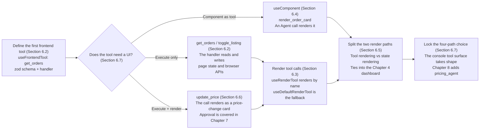
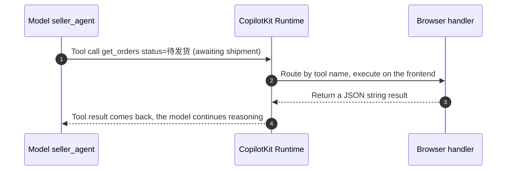
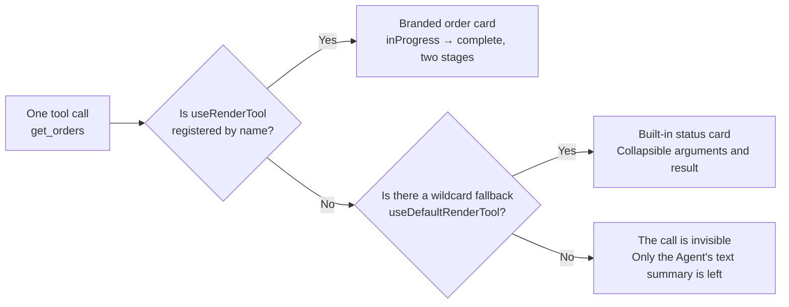
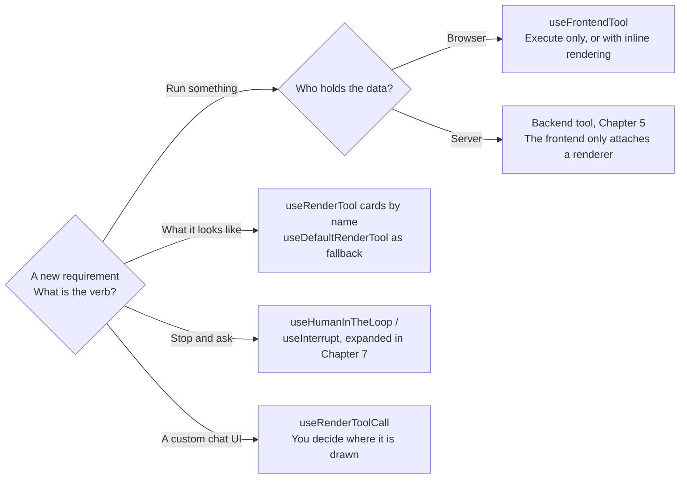

# Chapter 6 Frontend tools and generative UI

> Chapter guide: Chapter 5 replaced the copilot in Starfish Console (星帆工作台) with the LangGraph backend Agent `seller_agent`. It can look up "ORD-20431 为什么还没发货" ("Why hasn't ORD-20431 shipped yet"). The answer still lands as one sentence of text, and a tool call in the chat is either invisible or a lump of raw JSON. This chapter supplies the last two pieces between the Agent and the UI. One is the **frontend tool**: a function that runs in the browser. `get_orders` reads the order state on the page. `update_price` and `toggle_listing` change the UI directly. The other is **generative UI**: an order-card component grows inside the Agent's answer, so the user does not have to reconstruct a string of JSON by eye. By the end of this chapter, you can: define a tool that runs in the browser with `useFrontendTool`; render any tool call as a proper card with `useRenderTool` and `useDefaultRenderTool`; register a finished React component as a tool the Agent can call with `useComponent`; and, for each requirement, pick the right one of the four paths: execute only, with rendering, render only, and component as tool.



*Figure: flow for this chapter*

## When you need it

Three typical situations, and three main lines through this chapter.

**The Agent needs to operate the UI itself** — change React state, pop a toast, open a drawer, read and write `localStorage`. Those things happen in the user's browser. A backend Agent cannot reach them. See Section 6.2: `useFrontendTool` registers a function with a schema for the Agent. The handler runs in the browser, and the return value goes back to the model.

**The Agent called a tool, but the process is invisible in the chat and the result looks rough** — built-in components will not draw tool calls for you. With no renderer, the user only sees the Agent's final text summary, and has no way to tell what was called in between or what the arguments were. See Section 6.3: one line of `useDefaultRenderTool()` covers the fallback first, then `useRenderTool` swaps in a branded card for the tools that matter.

**You already have a set of finished React components, and you want the Agent to use them directly** — order cards, charts, status badges. The component only consumes props and does not know about CopilotKit. See Section 6.4: `useComponent` registers the component as a tool. An Agent call renders it in the chat, and the arguments are the props.

Separately, the Agent may need the user to decide halfway through (confirm a price change, pick a plan). That is interactive generative UI. The native React approach is `useInterrupt`. Section 6.6 of this chapter only sets up the skeleton. The full implementation, including `useHumanInTheLoop` approval, is in Chapter 7.

Prerequisites: shared state from Chapter 4 (`dashboard` and `useAgent`), and the `seller_agent` connected in Chapter 5. The code in this chapter continues to land in the `starfish-console` project.

## 6.1 Overview: what a frontend tool is

The official docs define a frontend tool in one sentence: **let the Agent define and call client functions that run entirely in the user's browser**. The handler runs on the frontend, so it can reach three things a backend tool cannot: component state, browser APIs (`localStorage`, `sessionStorage`, `cookie`), and any third-party UI library the page already imports. That is what "the Agent reaches into the application" means. Updating React state, triggering an animation, popping a toast, and guiding the user's eye are all uses of the same primitive.

The same primitive also supports generative UI and human in the loop (HITL). This chapter covers the tool itself and generative UI. HITL is left to Chapter 7.

### 6.1.1 How the work splits with backend tools

In Chapter 5's `seller_agent`, tools such as a logistics lookup and an after-sales ticket lookup are defined in the LangGraph graph and run on the backend, against the server's database and internal APIs. A frontend tool is the other half of the same tool mechanism. The split:

| | Backend tool | Frontend tool |
| --- | --- | --- |
| Where it is defined | LangGraph node / Agent code (Chapter 5) | Inside the React component tree, `useFrontendTool` |
| Where it runs | The server | The user's browser |
| What it can reach | Database, internal APIs, secrets | Component state, browser APIs, third-party UI libraries |
| Fits | Querying and changing business data | Operating the UI: change state, pop a notice, navigate, animate |
| Starfish Console example | Look up "ORD-20431 的物流轨迹" ("the logistics trace for ORD-20431") | `get_orders` reads the order list on the page |
| Typical concern | Auth, rate limits, data masking | Keep secrets and sensitive logic out of the browser |

**The split has one test: whichever side holds the context the job needs is the side that runs it.** "这单为什么没发货" ("Why hasn't this order shipped") has to query the warehouse system, so it is the backend. "帮我把待发货的订单筛出来" ("Filter the orders that are awaiting shipment for me") looks at the page in front of the user, so it is the frontend. The two can sit together. In the same Agent, `seller_agent`'s backend tools own the data, and this chapter's frontend tools own the UI.

### 6.1.2 Generative UI: the Agent decides what appears on screen

Generative UI is a set of CopilotKit primitives that let **the Agent decide what appears on the screen** — from an application component you wrote, to a layout composed from a catalog, to a sandboxed UI that an MCP server attaches to a tool. The official docs group them into six primitives:

| Primitive | What it does | Covered in this chapter |
| --- | --- | --- |
| Components as tools | Register an application component as a frontend tool. After the Agent calls it, it renders as an inline component | Section 6.4 |
| Tool call rendering | Map a backend tool call to a custom UI card, with live status and a result | Section 6.3 |
| State rendering | Subscribe to the Agent's streaming state, and re-render as soon as a value arrives | Section 6.5 (ties into Chapter 4) |
| Reasoning | Render model reasoning tokens inline as a first-class message type | Already covered in Section 3.6 |
| A2UI | The Agent sends a declarative schema, and the frontend composes it from a registered catalog | Not developed here; see the note in Section 6.7 |
| MCP Apps | Embed the UI an MCP server attaches to a tool, rendered in a sandboxed iframe | Not developed here; see Chapter 8 |

Read by "who controls the UI", these primitives sit on a spectrum. **Controlled**: you write the component, and the Agent only decides which one to render and what data to pass. That end is the most predictable. **Declarative**: the Agent sends a structured description, and the frontend composes it inside the catalog you registered. **Open-ended**: the UI is invented somewhere else (an MCP server, for example), and you are responsible for the sandbox. The same application, the same Copilot Runtime, the same AG-UI protocol (protocol detail is in Chapter 8). Which primitive you pick is a per-feature decision. Each feature gets its own choice.

This chapter's main line is the three React hooks at the controlled end. Combined with "does it need a UI", they produce four paths. Section 6.7 collects them into a decision table.

### 6.1.3 A tour of the v2 tool hooks

CopilotKit v2 splits "let the Agent do something" and "render what the Agent did" into two groups of hooks. Here is the whole set. Later sections take them one by one:

| Hook | When to use it |
| --- | --- |
| `useFrontendTool` | Give the Agent a tool that runs in the browser (schema + handler), optionally with an inline UI |
| `useFrontendTools` | Register a set of frontend tools in bulk. The array grows and shrinks as state changes |
| `useRenderTool` | Customize rendering for one tool call by name. This does not define the tool itself |
| `useDefaultRenderTool` | Provide a wildcard renderer for every tool call that has no dedicated renderer |
| `useComponent` | Register a React component as a named tool (component-first generative UI) |
| `useRenderToolCall` | Under a headless UI, take the render function and decide for yourself where the tool call is drawn |

**The boundary between the two groups has to stay clear. `useFrontendTool` and `useComponent` register tools, and the Agent can call them. `useRenderTool`, `useDefaultRenderTool`, and `useRenderToolCall` only render tool calls. They do not define a tool.** A renderer can be attached to a backend tool. The frontend only decides what the call looks like. You do not write a line of handler.

## 6.2 useFrontendTool: define the first frontend tool

Start with `get_orders`. The order-list page in Starfish Console already keeps a copy of the order data in React state. When the Agent has to answer "现在有多少待发货订单" ("How many orders are awaiting shipment right now"), it does not need a new API. It only needs to read that state.

### 6.2.1 A complete example

Register it in the component tree under the Provider (we put it in `src/copilot/tools.tsx`, mounted together with the order page):

```tsx
// src/copilot/tools.tsx
// Gloss: "待发货" ("awaiting shipment"), "已发货" ("shipped"), "已完成" ("completed"), "售后中" ("in after-sales").
// Gloss: "查询星帆工作台当前订单列表,可按状态过滤。" ("Look up the current order list in Starfish Console. Filtering by status is allowed.")
// Gloss: "回答任何订单相关问题前,先调用本工具获取真实数据。" ("Before answering any order question, call this tool first to get the real data.")
// Gloss: "按状态过滤,不传则返回全部订单" ("Filter by status. Omit it to return every order.")
import { useFrontendTool } from "@copilotkit/react-core/v2";
import { z } from "zod";

const OrderStatus = z.enum(["待发货", "已发货", "已完成", "售后中"]);

const OrderSchema = z.object({
  orderId: z.string(),
  buyer: z.string(),
  amount: z.number(),
  status: OrderStatus,
});

export type Order = z.infer<typeof OrderSchema>;

export function FrontendTools({ orders }: { orders: Order[] }) {
  useFrontendTool({
    name: "get_orders",
    description:
      "查询星帆工作台当前订单列表,可按状态过滤。" +
      "回答任何订单相关问题前,先调用本工具获取真实数据。",
    parameters: z.object({
      status: OrderStatus.optional().describe(
        "按状态过滤,不传则返回全部订单"
      ),
    }),
    handler: async ({ status }) => {
      const result = status
        ? orders.filter((order) => order.status === status)
        : orders;
      return JSON.stringify(result);
    },
  });

  return null;
}
```

Mount it in App (after Chapter 3 the chat component is `CopilotSidebar`, and the Provider's `agentId` points at Chapter 5's `seller_agent`):

```tsx
// src/App.tsx (excerpt)
import { FrontendTools } from "./copilot/tools";

<CopilotKitProvider runtimeUrl="http://localhost:8200/api/copilotkit" agentId="seller_agent">
  <FrontendTools orders={orders} />
  {/* Order list page + CopilotSidebar */}
</CopilotKitProvider>
```

`useFrontendTool` takes three things: a **name** (`get_orders`, the tool name the Agent sees), a **zod parameter schema** (tells the model which arguments to fill), and a **handler** (the function that actually runs in the browser). After registration, one call has a full lifecycle. The schema is declared to the model, the model starts the call, the handler runs in the browser, and the result travels back the same way:



*Figure 6-1: Lifecycle of one frontend-tool call. The handler runs in the browser, and the return value goes back to the Agent as the tool result.*

Two writing points. Both come from the same craft as Chapter 4 of the mcp book (tool descriptions and schema design are general craft):

1. **Write the description in task semantics.** Say what it does and when to use it. Leave "which function gets called" out of the description. The sentence in the `get_orders` description, "回答任何订单相关问题前先调用本工具" ("call this tool before answering any order question"), is a rule you are setting for the model.
2. **Give every parameter a `.describe()`.** The schema is the only basis the model has for filling arguments. The enum values of `status` are what make the model fill "待发货" ("awaiting shipment") where it would otherwise fill "pending".

**Checkpoint:** In the Starfish Console sidebar, ask "现在有多少待发货订单？" ("How many orders are awaiting shipment right now?"). In the CopilotKit Inspector (or the browser Network panel) you should see `get_orders` called, with arguments that are an empty object or `{"status": "待发货"}`. The Agent's answer is based on the real order data the handler returned (there should be one order, `ORD-20431`, amount $86.40).

### 6.2.2 Side-effect tools: update_price and toggle_listing

A query tool is read-only. An operation tool has to change the UI. Register the two operations from the product management page as well:

```tsx
// src/copilot/tools.tsx (append)
// Gloss: "修改指定 SKU 的售价。属于敏感操作,调用前先向用户复述旧价与新价,确认意图。" ("Change the selling price of a given SKU. This is a sensitive operation. Before calling, restate the old price and the new price to the user and confirm the intent.")
// Gloss: "SKU 编码,如 SKU-1001" ("SKU code, for example SKU-1001"); "新售价(美元)" ("new selling price (USD)").
// Gloss: return `SKU ${sku} 的价格已更新为 ${newPrice}` ("The price of SKU ${sku} has been updated to ${newPrice}").
// Gloss: "上架或下架指定 SKU。下架后买家端立即不可见。" ("List or unlist a given SKU. After unlisting, it is immediately invisible on the buyer side.")
// Gloss: "true 上架,false 下架" ("true lists it, false unlists it"); return `SKU ${sku} 已上架/已下架` ("SKU ${sku} is now listed / unlisted").
import { updatePrice, toggleListing } from "../api/products";

export function ProductTools() {
  useFrontendTool({
    name: "update_price",
    description:
      "修改指定 SKU 的售价。属于敏感操作,调用前先向用户复述旧价与新价,确认意图。",
    parameters: z.object({
      sku: z.string().describe("SKU 编码,如 SKU-1001"),
      newPrice: z.number().describe("新售价(美元)"),
    }),
    handler: async ({ sku, newPrice }) => {
      await updatePrice(sku, newPrice);
      return `SKU ${sku} 的价格已更新为 ${newPrice}`;
    },
  });

  useFrontendTool({
    name: "toggle_listing",
    description: "上架或下架指定 SKU。下架后买家端立即不可见。",
    parameters: z.object({
      sku: z.string().describe("SKU 编码"),
      listed: z.boolean().describe("true 上架,false 下架"),
    }),
    handler: async ({ sku, listed }) => {
      await toggleListing(sku, listed);
      return `SKU ${sku} 已${listed ? "上架" : "下架"}`;
    },
  });

  return null;
}
```

Two things to watch:

- **What the handler calls is an existing business function of the console** (`updatePrice` and `toggleListing` go through the request layer you already have). A frontend tool does not open a new backend channel. It gives the Agent a pair of hands on the UI that already exists.
- **The `update_price` description already says "先复述、再确认" ("restate first, then confirm").** A prompt constraint is only persuasion. The gate is a separate mechanism. The real approval mechanism (`useHumanInTheLoop`: a price change the Agent proposes has to be confirmed by a person) is added in Chapter 7. This chapter first builds the tool and its UI.

### 6.2.3 Registering in bulk: useFrontendTools

`useFrontendTool` registers one tool at a time. **You cannot call it in a loop over a list whose length changes** (the effect re-runs on every render and registers again and again). When the tool set comes from state, props, or a backend response, use `useFrontendTools`. It takes an array and runs one effect over the whole array. An empty array on this frame and twenty entries on the next frame are both fine:

```tsx
// Gloss: the description template means "Open the report titled ${report.title}". The Chinese string below is unchanged.
import { useFrontendTools } from "@copilotkit/react-core/v2";
import { useNavigate } from "react-router";

function ReportTools({ reports }: { reports: Report[] }) {
  const navigate = useNavigate();

  useFrontendTools(
    reports.map((report) => ({
      name: `open_${report.id}`,
      description: `打开「${report.title}」报表`,
      handler: async () => navigate(`/reports/${report.id}`),
    })),
    [navigate],
  );

  return null;
}
```

A tool that leaves the array is unregistered. A tool that joins it is registered. A re-render that produces an equal list does not register twice. The second argument passes values the handler closures capture (such as `navigate` above). The Starfish Console use: the logistics board registers one jump tool for each of three lanes, `open_lane_us` / `open_lane_eu` / `open_lane_sea`. The lane configuration is pulled from the backend, and the array changes with that configuration.

### 6.2.4 On the LangGraph side: how a frontend tool reaches seller_agent

Frontend tools are exposed to the Agent over the AG-UI protocol. For the LangGraph Agent from Chapter 5, the official docs give this mapping:

| LangGraph side | Frontend side | Behavior |
| --- | --- | --- |
| The LLM calls the frontend tool normally through `bind_tools` | `useFrontendTool` / `useComponent` | The model decides when to call; the handler runs in the browser |
| `copilotkit_emit_tool_call(config, name, args)` | `useFrontendTool` | A graph node triggers the frontend handler manually, without waiting for the LLM to decide |
| `copilotkit_customize_config(config, emit_tool_calls=["ToolName"])` | — | Filter which tool calls stream to the frontend, and hide the noise |

One distinction is worth remembering. **Persistent tool calls** (messages the LLM generated, stored in `state["messages"]`) enter the chat history and replay after a page refresh. **Emitted tool calls** (`copilotkit_emit_tool_call`) are transient events. They trigger the frontend handler immediately, and they are **not** written into the chat history unless you add the message to state yourself. This chapter's `get_orders` is the first kind. It has to stay in the conversation, or the rendering in Section 6.3 has nothing to attach to.

### 6.2.5 The v1 legacy comparison

In old code and old tutorials, this section's role was `useCopilotAction`. The official v2 migration table is a **one-to-one replacement: `useCopilotAction` → `useFrontendTool`**, and the package name changes from `@copilotkit/react-core` to `@copilotkit/react-core/v2`. The concept is the same line (name, parameters, handler, render), so migrating old code costs very little. **New code writes `useFrontendTool` directly.** The v1 name does not appear again in the rest of this book.

## 6.3 Rendering tool calls: make the process visible and the result presentable

Once the tools are registered, hold off on adding features. Ask in the chat "ORD-20431 的买家是谁" ("Who is the buyer on ORD-20431?"). What that call is finally drawn as depends on which renderers are registered. With no renderer at all, the call drops straight into an invisible black box:



*Figure 6-2: Three endings for one tool call: a dedicated card, a fallback card, or invisible. Built-in components do not draw tool calls by default. You install the rendering yourself.*

### 6.3.1 A zero-config fallback: useDefaultRenderTool

The simplest entry is a call with no arguments:

```tsx
import { useDefaultRenderTool } from "@copilotkit/react-core/v2";

function ToolRendering() {
  useDefaultRenderTool();
  return null;
}
```

This registers CopilotKit's built-in `DefaultToolCallRenderer` as the `*` wildcard renderer. Each tool call is drawn as a tidy status card: the tool name, a live "Running → Done" status pill, and collapsible arguments and result. Several tools the Agent calls in a row collapse into one "Used 3 tools" card. Expand it and each call is one line.

To put brand styling on the fallback card too, pass a `render`:

```tsx
useDefaultRenderTool({ render: BrandedToolCard, group: true });
```

`group: true` lets your own renderer join the default collapsed grouping. Leave it off, and your card is always shown on its own, and it splits the call groups before and after it.

### 6.3.2 Render by name: useRenderTool

A fallback card solves "you can see it". It leaves "it looks right" unsolved. The most distinctive approach is **one renderer per tool name**. Draw the `get_orders` call as a branded order card:

```tsx
// src/copilot/renderers.tsx
// Gloss: "筛选条件:" ("Filter:").
// Gloss: "正在查询订单" ("Looking up orders"); "(状态:…)" ("(status: …)").
import { useRenderTool } from "@copilotkit/react-core/v2";
import { z } from "zod";

function OrderListCard({ orders, filter }: { orders: Order[]; filter?: string }) {
  return (
    <div className="order-list-card">
      {filter && <p>筛选条件:{filter}</p>}
      <ul>
        {orders.map((order) => (
          <li key={order.orderId}>
            {order.orderId} · {order.buyer} · ${order.amount} · {order.status}
          </li>
        ))}
      </ul>
    </div>
  );
}

export function OrderToolRenderer() {
  useRenderTool({
    name: "get_orders",
    parameters: z.object({
      status: z.string().optional(),
    }),
    render: ({ status, parameters, result }) => {
      if (status !== "complete") {
        return (
          <div className="tool-loading">
            正在查询订单
            {parameters.status ? `(状态:${parameters.status})` : ""}……
          </div>
        );
      }
      const orders: Order[] = JSON.parse(result);
      return <OrderListCard orders={orders} filter={parameters.status} />;
    },
  });

  return null;
}
```

The render function receives three things. This is **a contract you have to remember**:

| Argument | What it is | When it has a value |
| --- | --- | --- |
| `parameters` | The **input arguments** the Agent sent to the tool (already parsed against the schema) | During streaming they are **partial values**, filled in as generation proceeds |
| `status` | The live status of the call | Present from registration; it advances from `inProgress` to `complete` |
| `result` | The tool's return value, a **string** | Only once `status` becomes `complete` |

Two disciplines the docs state outright. **While arguments are still streaming they are incomplete. Wait until `status` has left `inProgress` before you read a required field.** **`result` is a string. When the tool returns JSON, `JSON.parse` it before you read fields.**

The `name` on `useRenderTool` must match the tool name the Agent exposes. The runtime routes the call to your component by that name. **A renderer can be attached to a backend tool.** Attach a `useRenderTool` to a backend tool such as `query_logistics`, defined inside Chapter 5's `seller_agent`, and the frontend writes no handler at all. That is the split behind "a render hook does not define a tool".

**Checkpoint:** Ask again, "ORD-20431 的买家是谁" ("Who is the buyer on ORD-20431?"). This time the chat should first show a loading card, "正在查询订单……" ("Looking up orders…"), and then an order card listing `ORD-20431 · Maria · $86.40 · 待发货` ("awaiting shipment"). Other tools (`toggle_listing` and the rest) still go through the fallback card from Section 6.3.1.

### 6.3.3 A frequent pitfall: "complete" will not fill the card for you

The docs spend a warning on this mistake. Record it here as they state it. **What sits in `parameters` is the input the Agent sent. When `status` becomes `complete`, `parameters` does not turn into the tool's return value.** The return value comes separately from `result` (a string).

Take `get_weather`. It receives `{ "location": "Paris" }` and returns `{ "temperature": 22 }`. Read the city from `parameters.location`. Read the temperature from the parsed `result.temperature`. Adding `temperature` to the renderer's `parameters` schema will not make it appear out of nowhere. When a card shows "已完成" ("complete") and is still showing placeholder content, the first thing to check is whether that content was read from `parameters` by mistake. **Complete only means the tool returned. It will not fill your props for you.**

### 6.3.4 Grouping and display shape

The Agent often calls several tools in one breath. The overall display shape of the call lines is controlled by `toolCallDisplay` on the message view:

```tsx
<CopilotChat messageView={{ toolCallDisplay: "line" }} />
```

| Shape | What the user sees |
| --- | --- |
| `"grouped"` (default) | A run of calls collapses into one "Used 3 tools" card. Expand it and each call is one line |
| `"line"` | The same grouping, pulled into one quiet line of text, such as "思考了 4 秒" ("Thought for 4 seconds") |
| `"stacked"` | The latest call sits on top of a stack of earlier calls, and expands into one card per call |
| `"turn"` | The Agent works in the open. Everything before the reply collapses into "工作了 9 秒" ("Worked for 9 seconds") |
| `"separate"` | Each call is its own card |

Starfish Console's choice: `get_orders` has a dedicated card, and `"separate"` is the most presentable. Secondary tools are collected by the fallback card's grouping. The group card itself can be replaced. The `messageView.assistantMessage.toolCallsView.group` slot takes your timeline component (a direct use of the slot mechanism from Chapter 3).

### 6.3.5 Headless UI: useRenderToolCall

If the chat UI is a headless UI you built yourself, as in Section 3.8, the rendering responsibility is entirely yours. `useRenderToolCall()` returns a render function, and you draw any tool call wherever you want it in your layout. When a built-in component draws it for you, that component is `CopilotChatToolCallsView`:

```tsx
import { CopilotChatToolCallsView } from "@copilotkit/react-core/v2";

<CopilotChatToolCallsView message={assistantMessage} messages={allMessages} />;
```

For each tool call inside an assistant message, it finds the `tool`-role message in the same group and hands them together to the registered renderers. The `useRenderTool` from Section 6.3.2, the `useComponent` from Section 6.4, and the fallback `useDefaultRenderTool` all take effect automatically. Finer placement means calling `renderToolCall({ toolCall })` yourself. See the official Headless UI guide.

## 6.4 Component as tool: useComponent

Up through Section 6.3, the tool and the UI are two things. `get_orders` is the tool, `OrderListCard` is the renderer, and `useRenderTool` stitches them together. CopilotKit also offers a more direct shape: **register the React component itself as a tool**, `useComponent`.

### 6.4.1 The order card goes live

```tsx
// src/copilot/generative-ui.tsx
// Gloss: "订单号,如 ORD-20431" ("order id, for example ORD-20431"); "买家称呼" ("how the buyer is addressed"); "订单金额(美元)" ("order amount (USD)"); "订单状态" ("order status").
// Gloss: status enum "待发货" / "已发货" / "已完成" / "售后中" ("awaiting shipment" / "shipped" / "completed" / "in after-sales").
// Gloss: "买家 {buyer} · 金额 ${amount}" ("Buyer {buyer} · amount ${amount}").
// Gloss: "在聊天里渲染一张订单卡片,用于向卖家展示单个订单的详情" ("Render an order card in the chat, to show the seller the detail of a single order").
import { useComponent } from "@copilotkit/react-core/v2";
import { z } from "zod";

const OrderCardProps = z.object({
  orderId: z.string().describe("订单号,如 ORD-20431"),
  buyer: z.string().describe("买家称呼"),
  amount: z.number().describe("订单金额(美元)"),
  status: z
    .enum(["待发货", "已发货", "已完成", "售后中"])
    .describe("订单状态"),
});

function OrderCard({ orderId, buyer, amount, status }: z.infer<typeof OrderCardProps>) {
  return (
    <div className="order-card">
      <header>
        <strong>{orderId}</strong>
        <span className={`badge badge-${status}`}>{status}</span>
      </header>
      <p>
        买家 {buyer} · 金额 ${amount.toFixed(2)}
      </p>
    </div>
  );
}

export function GenerativeUI() {
  useComponent({
    name: "render_order_card",
    description: "在聊天里渲染一张订单卡片,用于向卖家展示单个订单的详情",
    parameters: OrderCardProps,
    render: OrderCard,
  });

  return null;
}
```

`useComponent` takes a name, a zod schema, and the component to render. The runtime registers it as **a frontend tool**. The Agent can discover it and call it. The schema is that tool's parameter definition. The arguments the model fills are passed to the component as typed props, unchanged. The component itself is ordinary React. It only reads props, it knows nothing about CopilotKit, and the data can fill in as a stream while the Agent fills the arguments.

There is one official suggestion on naming. **The name you pass to `useComponent` is the tool name the Agent sees. Start it with a verb** (such as `render_order_card` or `show_weather`). The model then reliably picks it when the user wants a visualization.

**Checkpoint:** Ask "把 ORD-20431 这单展示成卡片" ("Show order ORD-20431 as a card"). The Agent should call `render_order_card` with `orderId: "ORD-20431"`, `buyer: "Maria"`, `amount: 86.4`, and `status: "待发货"` ("awaiting shipment"). A real order-card component appears in the chat.

The hands-on result in Starfish Console: what shows up in the chat stream is the `OrderCard` component from Section 6.4.1:


*Figure 6-4: `useComponent`, confirmed in testing. The Agent calls `render_order_card`, a real order card renders in the chat, and the Agent then adds the key points in text.*

### 6.4.2 The boundary with tool rendering

The official boundary between the two shapes is clear. Collected into a table:

| | Tool rendering (`useRenderTool`) | Component as tool (`useComponent`) |
| --- | --- | --- |
| What it is | Wrap a custom UI around a **tool call that really exists** | **The component itself is the tool**. There is no handler |
| Execution | The tool really runs, on the backend (or in a frontend handler) | No server-side execution and no user-interaction logic. Rendering is the whole of it |
| The Agent's role | Decide to call the tool and fill the arguments. The result is produced by the tool | Decide when to show it and what data to fill. CopilotKit does the drawing |
| Fits | A branded card that makes a backend tool's operation transparent | Display UI: cards, charts, tables, previews, status summaries |

The rule: **to wrap a real tool, use `useRenderTool`. For the Agent to "say" a component directly, use `useComponent`.** Anything the user operates on the component (approval, a choice) is interactive generative UI. See Section 6.6 and Chapter 7.

### 6.4.3 Two details you have to know

- **`parameters` can be omitted, and omitting it has a cost.** After you omit it, the tool is broadcast with an empty parameter schema (`{ "type": "object", "properties": {} }`). The model has no arguments to fill, and the component receives no props when it renders. A component that needs data must be given a schema.
- **In a headless chat, registered does not mean drawn.** A built-in chat component draws the registered components for you. A headless or custom chat renders the message list itself. With nobody drawing the tool call, the chat stays empty. Use `CopilotChatToolCallsView` from Section 6.3.5 (or `useRenderToolCall`) to draw the call.

## 6.5 State rendering and tool rendering: how the two paths split the work

Chapter 4 already used one way for the UI to follow the Agent. `useAgent` subscribes to `dashboard` state, the Agent streams progress, and the numbers on the page change with it. That is **state rendering**. Section 6.3 and Section 6.4 of this chapter are **tool rendering**. Both are called generative UI, and the mechanisms differ. Pick the wrong one and the result feels awkward:

| | State rendering (Chapter 4) | Tool rendering (this chapter) |
| --- | --- | --- |
| Where the data comes from | The Agent's **state object** (such as `dashboard`) | One concrete **tool call** (arguments + result) |
| How it updates | State streams forward, and a value re-renders as soon as it arrives. It can be token by token | It appears when the call starts, and the result is filled in at `complete` |
| Where the UI belongs | **Your application UI** (the order page and the board update in place) | **The chat message stream** (inline in the conversation) |
| Lifecycle | It lives with the state. After a refresh it is the latest value | It lives with the message. It replays with the conversation history |
| Official placement | Subscribe to the Agent's streaming state and re-render live | Map a backend tool call to a UI card that carries status and a result |
| Typical use case | Progress ("研究中……2/5", "Researching… 2/5"), a draft that appears as it is written, a dashboard | Show which tool was called, the arguments, the live status, and the final result |

The split in the mechanism is the data channel. Values for state rendering come from the Agent state stream (some frameworks push tool arguments into a state key through middleware as they are generated; a direct SDK adapter sends `STATE_SNAPSHOT` events from the streaming loop). Values for tool rendering come from **the tool-call messages in the conversation**. The frontend renderer claims them by name.

**Our recommendation: business data in the UI goes through state rendering, and the process and the result in the conversation go through tool rendering.** The number "待处理售后数" ("open after-sales count") belongs to the page, so it goes in `dashboard` (Chapter 4). "我查了订单、查到这些" ("I looked up the orders, and this is what I found") belongs to the conversation, so it goes on an order card (this chapter). Force tool rendering to update the page, and you have to fish data out of the message stream and write it back into the UI, which adds a layer for nothing. Force state rendering to show a one-off result inside the conversation, and a one-off result becomes resident state. The two paths stack cleanly. The Agent calls `get_orders` (an order card appears in the conversation: tool rendering), and at the same time "今日销售额" ("today's sales") on `dashboard` refreshes on the page (state rendering).

## 6.6 Display generative UI and interactive generative UI

The components built so far are **read-only**. The order card shows data, the user looks, and the chat continues. The other half of generative UI is **interactive**: the component has buttons, and the user's decision has to get back to the Agent, to confirm a price change, pick a plan, or approve an execution.

### 6.6.1 Display: the price-change card for update_price

First, attach a renderer to the `update_price` tool call. It is a sensitive operation. The card has to put the arguments in the open so the seller can see them clearly:

```tsx
// src/copilot/renderers.tsx (append)
// Gloss: "{sku} 改价:{oldPrice} → ${newPrice}" ("{sku} price change: {oldPrice} → ${newPrice}").
// Gloss: "执行结果见下方状态" ("The execution result is in the status below").
function PriceChangeCard({ sku, newPrice, oldPrice }: {
  sku: string;
  newPrice: number;
  oldPrice?: number;
}) {
  return (
    <div className="price-change-card">
      <p>
        <strong>{sku}</strong> 改价:{oldPrice ?? "?"} → <strong>${newPrice}</strong>
      </p>
      <p className="hint">执行结果见下方状态</p>
    </div>
  );
}

useRenderTool({
  name: "update_price",
  parameters: z.object({
    sku: z.string(),
    newPrice: z.number(),
  }),
  render: ({ status, parameters, result }) => {
    if (status !== "complete") {
      return (
        <PriceChangeCard sku={parameters.sku} newPrice={parameters.newPrice} />
      );
    }
    return (
      <>
        <PriceChangeCard sku={parameters.sku} newPrice={parameters.newPrice} />
        <p className="result">{result}</p>
      </>
    );
  },
});
```

This card is the **display** kind. It makes the price change transparent: which SKU changed, from what price to what price, and whether execution succeeded. The card appears while the arguments are still streaming. After `complete`, a result line is filled in.

### 6.6.2 Interactive: the Agent pauses and waits for a person to decide

However presentable a display card is, it is only a notice. The definition of interactive is: **the Agent pauses execution, and it can continue only after user input**. Approval flows, confirmation dialogs, and branches that need a human judgment all belong here.

The native React approach is `useInterrupt`. Register an interrupt renderer. When the Agent pauses, the component mounts inline in the chat, captures the user's choice, and then resumes execution with that input. Its full contract — `enabled` filtering, `handler` preprocessing, `resolve` sending the value back, and the difference between the AG-UI standard interrupt stream and the legacy stream — is the subject of Chapter 7. This chapter only sets up a skeleton:

```tsx
import { useInterrupt } from "@copilotkit/react-core/v2";

useInterrupt({
  agentId: "seller_agent",
  enabled: (event) => event.value.type === "approval",
  render: ({ event, resolve }) => (
    <PriceApproveCard
      content={event.value.content}
      onApprove={() => resolve({ code: "APPROVE" })}
      onCancel={() => resolve({ code: "CANCEL" })}
    />
  ),
});
```

Tool-level approval has another key, `useHumanInTheLoop`. Pause on a tool call and wait for the user to approve, edit, or add input. Chapter 7 connects `update_price` to it and makes a complete governed action.

**Bold this line: being able to display a change does not clear it to run.** The price-change card in Section 6.6.1 is for the user to look at. The gate is the interrupt, which this card does not include. A real "the Agent proposes a price change, a person confirms, and only then does it execute" needs the interrupt mechanism. That is Chapter 7. Treat "show a confirmation UI" and "continue execution after you have the user's decision" as two separate design problems. That is the most important discipline of interactive generative UI.

### 6.6.3 What if the component itself is interactive

`useComponent` is positioned as display-only ("no handler, no user interaction, no server-side execution"). When you need to put buttons on the component, the official guidance is to turn to the HITL pattern. One compromise: the button does something **purely on the frontend** (expand details, switch a tab). That kind of interaction does not need the Agent, and you write it in the component as usual. A button that **changes the Agent's execution** (approve, reject, choose) has to go through the interrupt or approval channel. The test matches Section 6.1.1: does this have to go back to the Agent?

## 6.7 Choosing a path: four routes for one requirement

The hooks in this chapter combine into four routes. The summary table comes first, then the decision flow.

### 6.7.1 Comparing the four routes

| Route | Hook | Where the tool runs | Is there a UI | Starfish Console example |
| --- | --- | --- | --- | --- |
| Execute only | `useFrontendTool` (no `render` passed) | Browser | No | `get_orders`, `toggle_listing` |
| Render at definition time | `useFrontendTool` + `render` | Browser | Yes, registered with the tool | An executing tool that should carry inline UI in one step |
| Render only | `useRenderTool` / `useDefaultRenderTool` | Backend (or a frontend handler) | Yes, the renderer is registered on its own | The `update_price` price-change card, branded cards for backend tools |
| Component as tool | `useComponent` | Browser (rendering is the whole of it) | Yes, the component is the tool | `render_order_card` |

Note the difference between the second route and the third. The second hands you a UI **while you are defining the tool** (the official description of `useFrontendTool` is "optionally with inline UI"). The third **does not define a tool**. It only draws a skin on the call, so it can also be attached to a backend tool. When all four routes are viable, **Our recommendation: prefer the combination of "execute only + render only".** The tool definition and the UI stay decoupled. The backend team can change the tool without touching the frontend renderer, and the frontend team can swap the card without touching the tool. That matches the assembly the checkpoint in Section 6.3.2 demonstrates. "Render at definition time" is reserved for small use cases that are light, and where the UI is tightly bound to the tool.

### 6.7.2 The decision flow

The motto on the official selection page is "从动词出发" ("start with the verb"). First ask what the Agent should do, then land on a hook. Where the data lives decides frontend tool or backend tool:



*Figure 6-3: The "start with the verb" selection. Each of the four verbs maps to one route.*

Applied to the console's three tools, the landing is: `get_orders` is execute only, plus a `useRenderTool` order card; `update_price` is execute only, plus a price-change card, and Chapter 7 adds `useHumanInTheLoop`; `toggle_listing` is execute only, plus the fallback card; the display component `render_order_card` takes `useComponent`.

### 6.7.3 Routes past the controlled end of the spectrum, in one sentence

Everything this chapter covers is the **controlled** end. You write the component, and the Agent only picks which one and what to pass. If the requirement becomes "let the Agent freely compose a layout from a catalog", the controlled route is no longer enough. The official declarative options are A2UI (the Agent sends a declarative schema, in two flavors: a dynamic schema generated by the LLM, and a fixed schema you write while the Agent only fills data) and JSON Render (the Agent sends a `{ root, elements }` object, rendered through the typed component registry of `@json-render/react`). The open-ended end is MCP Apps (a sandboxed UI that an embedded MCP server attaches to a tool). These do not conflict with this chapter's hooks. You can mix them by feature. Starfish Console's current requirements (the order card, the price-change card) are covered by the controlled route. Revisit the declarative route after Chapter 8 adds the `pricing_agent` subagent.

## Chapter summary

1. **A frontend tool is the Agent's way out onto the UI.** The handler runs in the browser and reaches component state, browser APIs, and third-party libraries directly. The test is "whichever side holds the context, that side runs it". It splits the work with Chapter 5's backend tools, and it does not replace them.
2. **The `useFrontendTool` trio:** name + zod schema + handler. The return value goes back to the model. Bulk registration uses `useFrontendTools`. v1's `useCopilotAction` maps onto it one to one. New code uses v2 throughout.
3. **A tool call is invisible by default. You install the rendering yourself.** One line of `useDefaultRenderTool()` is the fallback. `useRenderTool` attaches a branded card by name. The contract is streaming `parameters`, a `status` of `inProgress → complete`, and a string `result`. "complete does not fill props" is the most frequent pitfall.
4. **`useComponent` registers a component as a tool.** The schema is the parameter definition, and the parameters are the props. It fits display UI. Do not omit the parameter schema. A headless chat has to draw the call itself with `CopilotChatToolCallsView`.
5. **The two render paths each own one job.** Business data in the UI goes through state rendering (the Chapter 4 `dashboard`). Process and result in the conversation go through tool rendering (this chapter). Use them stacked.
6. **Selection starts from the verb.** Run something, and you want `useFrontendTool`. Decide what it looks like, and you want a render hook. Stop and ask, and you want `useHumanInTheLoop` / `useInterrupt` (Chapter 7). A UI you built yourself wants `useRenderToolCall`. Display is not clearance. Approval is in Chapter 7.

## Checklist

By the time you have read this far, you should be able to:

- ☐ Write a complete `useFrontendTool` registration for a "read page state" requirement (name, zod schema, handler), and say where the handler's return value goes;
- ☐ Switch to `useFrontendTools` when the tool set changes with state, and explain why you cannot loop `useFrontendTool` over a list whose length changes;
- ☐ Attach a `useRenderTool` renderer to a backend tool, handle streaming arguments, `status`, and `JSON.parse(result)` correctly, and explain why a card can be "complete" and still be a placeholder;
- ☐ Register a props-only component as a tool with `useComponent`, and state the boundary with `useRenderTool` in terms of what each one actually is;
- ☐ State the difference in data source and UI ownership between state rendering and tool rendering, and pick the right path for "a number on the page refreshes" and for "a result card inside the conversation";
- ☐ Faced with a new requirement, follow the "start with the verb" flow, pick one of the four routes, and give the reason;
- ☐ Point out why the Section 6.6.1 price-change card does not amount to approval, and which hook supplies the approval (Chapter 7).

## Quick reference

The main line does not depend on this section. Tool hooks and the key contract:

| Item | Value |
| --- | --- |
| `useFrontendTool` | `{ name, description, parameters (zod), handler, render? }`. The handler's return value is the tool result sent back to the model |
| `useFrontendTools` | `{ (tool array), [dependencies] }`. Adding or removing an array entry registers or unregisters. An equal list does not re-register |
| `useRenderTool` | `{ name, parameters, render }`. `name` matches the tool name and routes to the renderer |
| `useDefaultRenderTool` | No arguments = the built-in wildcard card. `{ render, group? }` = a custom wildcard |
| `useComponent` | `{ name, description?, parameters?, render }`. Internally it wraps `useFrontendTool`, and the handler is "render the component" |
| `useRenderToolCall()` | Take the render function for a headless UI. In a built-in-component use case, use `CopilotChatToolCallsView` |
| render contract | `({ status, parameters, result })`. `parameters` is incomplete while streaming. `status` goes from `inProgress` to `complete`. `result` is a string |
| `toolCallDisplay` | `"grouped"` (default) / `"line"` / `"stacked"` / `"turn"` / `"separate"` |
| v1 to v2 | `useCopilotAction` → `useFrontendTool` (one to one). Package name `@copilotkit/react-core/v2` |
| LangGraph side | `bind_tools` calls normally. `copilotkit_emit_tool_call` fires transiently (it does not enter messages). `emit_tool_calls` filters |

## Further reading

- **Chapter 7 (human in the loop).** The next stop for `update_price`: use `useHumanInTheLoop` to upgrade a price change into a governed action that a person must confirm. The full `useInterrupt` contract is developed in that chapter too.
- **Chapter 4 (shared state).** The other half, state rendering: how `dashboard` is subscribed, and how state streams forward. Together with this chapter's tool rendering, that is the whole of generative UI.
- **Chapter 3 (built-in components and a headless UI).** The `useRenderToolCall` and `CopilotChatToolCallsView` from Section 6.3.5 land in the chat strip you built yourself. The slot mechanism is used again in Section 6.3.4 when you replace the group card.
- **Chapter 8 (multi-agent, protocols, and production).** The AG-UI protocol is the channel that carries a frontend tool to the Agent. After `pricing_agent` is added, this chapter's four routes have to be inventoried again, per Agent.
- **Official Generative UI overview (concepts/generative-ui-overview.mdx).** Beyond this chapter's controlled route: the full picture and the selection table for declarative (A2UI, JSON Render) and open-ended (MCP Apps).
