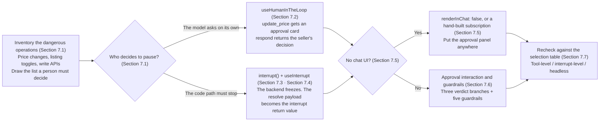
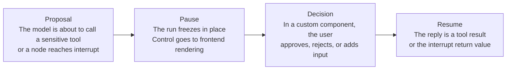
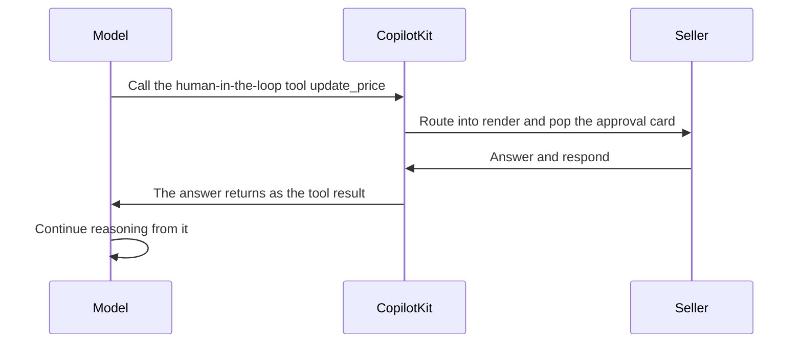
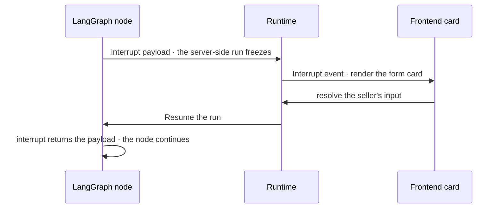
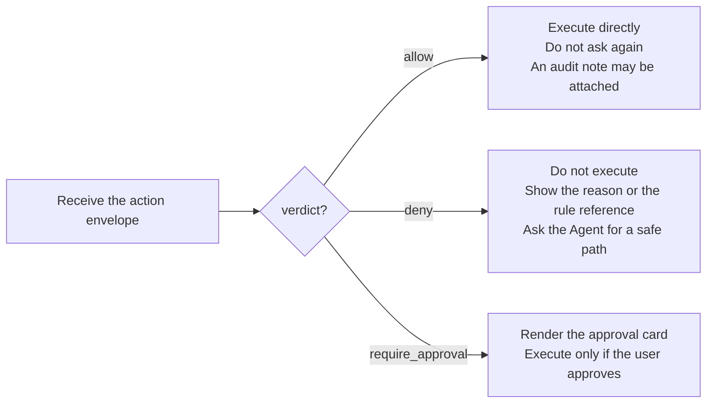

# Chapter 7 Human in the loop: put the person back in the decision

> Chapter guide: By the end of Chapter 6, the copilot in Starfish Console (星帆工作台) can call `get_orders` to look up orders and `update_price` to change a price, and the answer renders an order card directly. The "price change" itself is off. The Agent proposes moving SKU-1001 from $29.99 to $24.99, the reason sounds thorough, and then the price really does change. Pricing is the seller's responsibility. The power to set a price stays with the seller. This chapter fits Starfish Console with a brake. CopilotKit's human in the loop (HITL) mechanism makes the Agent pause on a critical action, hand "whether to do it" back to a person, and continue only after it has the reply. We will meet two kinds of intervention: tool-level approval (`useHumanInTheLoop`) and interrupt-and-resume (`useInterrupt`). You will learn to pair a LangGraph backend `interrupt()` with a frontend render card, handle the headless case where there is no chat UI, and set interaction design and safety guardrails for the approval card itself. By the end of this chapter, you can: hang an approval card on a dangerous frontend tool such as `update_price`, and close one full loop of "the Agent stops, a person decides, the Agent continues" in the interrupt form, the resume form, and the headless form.



*Figure: flow for this chapter*

## When you need it

Three typical situations, and three main lines through this chapter.

**The Agent can call a tool that has a side effect, and that action should not be the model's to decide** — a price change, listing or unlisting, a refund, any write API. Chapter 6's `update_price` is the ready-made example. One sentence from the Agent, "建议调价" ("I suggest a price change"), and the price really changes. See `useHumanInTheLoop` in Section 7.2. Turn a call to this kind of tool into an approval. When the model calls it, an approval card pops, and it takes effect only after the seller clicks "批准" ("Approve").

**The pause is not the model's idea. It is required by a business rule** — a payment operation must be cleared by a person, a workflow reaches a node that must wait for confirmation, or an input is missing that only the user knows. That is a deterministic checkpoint on the code path. See Section 7.3 and Section 7.4. The backend calls `interrupt()` inside the node and freezes the run. The frontend renders a card with `useInterrupt`, collects the answer, and resumes the run.

**The place that triggers approval is not inside the chat window at all** — an approval panel on the logistics board, a button array in a test script, a standalone dialog. See Section 7.5. `renderInChat: false` renders the interrupt element anywhere in the component tree. The official docs also give a headless form that assembles the underlying primitives directly.

Prerequisites: the `update_price` frontend tool defined in Chapter 6 (the approval target in this chapter is that same tool); the LangGraph Agent `seller_agent` connected in Chapter 5 (the Section 7.4 backend code is written there). All three v2 intervention hooks are imported from `@copilotkit/react-core/v2`, the same place as the earlier chapters.

## 7.1 Overview: why an Agent needs a brake

Chapter 6 gave the Agent a pair of hands. Frontend tools let it actually operate the UI. The more it can do, the more one question has to be answered: **which actions can be left to it, and which ones count only after a person nods?** The official definition of human in the loop is: let the Agent pause in the middle of a run, collect input, confirmation, or a choice from the user, and after the reply arrives fold the answer back into its own reasoning and continue. It turns an autonomous workflow into a collaborative one. The Agent keeps the context. The user holds the wheel.

This layer is the outlet for four real requirements (listed in the official docs):

| Requirement | Matching scenario in Starfish Console |
|------|---------------------|
| Quality control | High-risk operations such as a price change or a listing toggle must be confirmed by the seller before they land |
| A boundary backstop | When the Agent is unsure how to handle after-sales ticket ORD-20395, it hands the decision back to a person |
| Expert input | A refund method, a campaign window: business knowledge the model does not have, and only the seller knows |
| Production reliability | A system facing real traffic needs a loop sturdier than "the model said so, so it is fine" |

### 7.1.1 Two kinds of intervention

CopilotKit provides two complementary pause paths. From the outside they look almost the same. The chat stops, a custom component appears, the user answers, the run resumes. The backend wiring is completely different, and each has its own home ground (rendered from the official comparison table):

| | `useHumanInTheLoop` (tool-level approval) | `useInterrupt` (interrupt and resume) |
|---|---|---|
| Who decides to pause | **The LLM**. It called a human-in-the-loop tool registered on the client | **The graph**. Node code called `interrupt(...)` |
| Backend shape | Only a frontend tool description (a Zod schema + `render`) | One server-side `interrupt()` call inside the LangGraph Agent |
| Nature of the pause | The model decides on its own that "it should ask a person" | The code path deterministically requires a human reply |
| Typical scenario | The model wants to change a price, and a card asks the seller to approve | Payment clearance, a workflow approval node, a required input that is missing |

**The first cut in selection is "who decides to pause". When the model wants to ask on its own, use tool-level approval. When a business rule says the path must stop, use an interrupt.** The test is plain. Open the backend code and look. If "whether to stop and ask a person" can be left to the model's discretion, take `useHumanInTheLoop`. If "must stop" on this path is a business rule written into the code (without approval it cannot continue), take `useInterrupt`. The first is flexible. The model can start an ask whenever it feels unsure. The second is reliable. However confident the model is, it cannot route around the checkpoint.

Both paths bring their own `render`. CopilotKit handles the "when to show the card" logic for you. When you want to step outside the chat UI and resolve the pause from anywhere in the component tree, the headless form in Section 7.5 leaves an exit on each path.

### 7.1.2 The full lifecycle of one intervention

Whichever path you take, one human-in-the-loop pass is the same four acts:



*Figure 7-1: The four-act lifecycle shared by both intervention mechanisms. The Agent continues from the pause point, as if that ask had been an ordinary function call.*

The exclusion list in Section 4.7.1 has an item, "the Agent should stop and ask a person → Chapter 7". This is where that requirement is met. The v1 legacy comparison is one sentence. In the v1 era this requirement hung a wait on `useCopilotAction` together with `renderAndWait`. v2 splits it into the three dedicated hooks in this chapter (`useHumanInTheLoop`, `useInterrupt`, and the headless form). When an old project migrates, rewrite along that mapping. This chapter does not develop v1 any further.

## 7.2 useHumanInTheLoop: put an approval on update_price

The idea of tool-level approval: **make "apply to do a dangerous action" itself a human-in-the-loop tool**. The approval target in Starfish Console is the `update_price` defined in Chapter 6. The Agent proposes changing SKU-1001 to $24.99, and that step counts only after the seller nods. The whole loop: the model starts the call, CopilotKit routes it into your `render` function and pops the card, the seller answers and calls `respond`, and the answer goes back to the model as the tool result:



*Figure 7-2: The tool-level approval loop: the call, the approval card, respond, the tool result.*

### 7.2.1 Register the approval tool

```tsx
// src/components/PriceChangeApproval.tsx
import { ToolCallStatus, useHumanInTheLoop } from "@copilotkit/react-core/v2";
import { z } from "zod";
import { applyPriceChange } from "../api/pricing";

// Parameter schema: whatever the model fills in is what the approval card shows
// Gloss: "要改价的商品编码，如 SKU-1001" ("the product code to reprice, for example SKU-1001")
// Gloss: "调整后的价格（美元）" ("the price after the change (USD)")
// Gloss: "改价理由，会原样展示给卖家" ("the reason for the change, shown to the seller as written")
const priceChangeSchema = z.object({
  sku: z.string().describe("要改价的商品编码，如 SKU-1001"),
  newPrice: z.number().describe("调整后的价格（美元）"),
  reason: z.string().describe("改价理由，会原样展示给卖家"),
});

export function PriceChangeApproval() {
  useHumanInTheLoop(
    {
      name: "update_price",
      description:
        "申请修改商品价格。调用后价格不会立即生效，" +
        "需要卖家在审批卡上批准；未获批准的申请会被拒绝。",
      parameters: priceChangeSchema,
      render: ({ args, status, respond }) => {
        // Only a call that is "executing" needs the approval card. History replay renders nothing
        if (status !== ToolCallStatus.Executing || !respond) {
          return null;
        }

        return (
          <section className="price-approval-card">
            <h3>改价审批</h3>
            <p>商品：{args.sku}</p>
            <p>新价：${args.newPrice}</p>
            <p>理由：{args.reason}</p>
            <div className="actions">
              <button
                onClick={() => {
                  // Our recommendation: approving means executing — persist first, then answer, so the "tool result"
                  // matches the "UI and data state". The official docs only promise that the answer passed to respond
                  // becomes the tool result. When the side effect runs is your business decision.
                  applyPriceChange(args.sku, args.newPrice);
                  respond({
                    approved: true,
                    sku: args.sku,
                    newPrice: args.newPrice,
                  });
                }}
              >
                批准并生效
              </button>
              <button
                onClick={() =>
                  respond({
                    approved: false,
                    sku: args.sku,
                    message: "卖家拒绝了这次改价，请维持现价或给出新方案。",
                  })
                }
              >
                拒绝
              </button>
            </div>
          </section>
        );
      },
    },
    [], // Dependency array: same as a React hook; an empty array registers once
  );

  return null; // The bridge component itself renders nothing
}
```

The Chinese strings in that card stay in the code. English gloss: the description says "申请修改商品价格。调用后价格不会立即生效，需要卖家在审批卡上批准；未获批准的申请会被拒绝。" ("Apply to change a product price. After the call the price does not take effect immediately. The seller has to approve it on the approval card. An application that is not approved is rejected."). The heading is "改价审批" ("Price-change approval"), the labels are "商品：" ("Product:"), "新价：" ("New price:"), "理由：" ("Reason:"), the buttons are "批准并生效" ("Approve and apply") and "拒绝" ("Reject"), and the rejection message is "卖家拒绝了这次改价，请维持现价或给出新方案。" ("The seller rejected this price change. Keep the current price, or propose a new plan.").

Hang it on any component layer inside the Provider (the same mounting pattern as the context bridge component in Chapter 4):

```tsx
// src/App.tsx — register the approval tool inside the Provider
import { CopilotKitProvider, CopilotSidebar } from "@copilotkit/react-core/v2";
import { PriceChangeApproval } from "./components/PriceChangeApproval";

export default function App() {
  return (
    <CopilotKitProvider runtimeUrl="http://localhost:8200/api/copilotkit">
      <PriceChangeApproval />
      {/* The sidebar and main view placed in Chapter 3 */}
      <CopilotSidebar />
    </CopilotKitProvider>
  );
}
```

Three design decisions in this code are worth unfolding.

**First, the `status` check inside `render` is not boilerplate you can skip.** The official examples uniformly return `null` when `status !== ToolCallStatus.Executing`. A tool call lives in the message history for a long time (rollback, replay, and scrolling back through an old conversation all re-render it). Only the call that is executing and waiting for your answer should show a clickable approval card. Leave the check out, and history messages float a pile of buttons that do nothing when clicked.

**Second, the payload of `respond` is the tool result the Agent sees.** The official description of the mechanism: CopilotKit routes the call into `render`, `respond` carries the user's answer, and the model continues reasoning with that answer as the tool result. So the message on the reject branch is not decoration. It really enters the model's context. On the next turn the Agent knows "这次申请被拒了，原因是什么" ("this application was rejected, and why"). **Write the answer for the model to read, the same way you write an error message for the model to read (→ mcp book, Chapter 6). Say what happened, and what to do next.**

**Third, the choice of tool name is the policy.** This chapter names the tool `update_price`, keeping the name from Chapter 6. The meaning narrows from "change the price directly" to "apply for a price change, approval required". The official governed-actions docs instead stand up a wrapping tool, `approve_governed_action`, and carry the real action as a parameter. Both hold. **Keeping the original name is transparent to the user. Standing up an approval tool separates "approval" and "execution" completely.** Section 7.6 develops the second form.

**Checkpoint:** Tell the Agent "把 SKU-1001 调到 $24.99" ("Move SKU-1001 to $24.99"). The chat stream should show an approval card, and the price should stay where it is. Click "批准并生效" ("Approve and apply"), the price on the product management page becomes $24.99, and the Agent's follow-up reply should confirm that the price change is done. Try once more and click "拒绝" ("Reject"). The Agent should say the application was rejected. It should keep from retrying until the change goes through.

Below are two hands-on shots from Starfish Console, one after the other. The card pops and intercepts first. The UI really changes only after approval:


*Figure 7-5: The approval card intercepts the change (from the hands-on run, built-in agent). The Agent first explains the change and the size of the drop in text, and the price stays unchanged until approval.*


*Figure 7-6: The loop after approval (from the hands-on run). The price in the product table on the left has updated, and the Agent confirms by citing the result `respond` sent back.*

### 7.2.2 Governance starts with the parameters: make the model state the reason

The required `reason` field in `priceChangeSchema` is deliberate. The approval card is for a person to read. Before the seller clicks "批准" ("Approve"), what they need to know is the new amount, and also why it is changing. Make `reason` a required answer from the model, and the approval card always has that sentence of reason to read. Every constraint in the schema ends up as information a person can see at the decision point (→ mcp book, Chapter 6: write the constraints into the structure).

## 7.3 useInterrupt: an interrupt the Agent starts

The second kind of intervention moves responsibility for the pause from the model's hands into the code's. **The backend calls `interrupt(...)` on the run path. The run freezes on the spot, until the client resumes it with an answer.** The frontend counterpart is `useInterrupt`. The official docs call it the frontend half of this contract: subscribe to the paused run, render the component you give it, and hand the user's answer back to the Agent. On resume, the `interrupt()` call returns the payload the user gave, "just like an ordinary function".

### 7.3.1 When it is this hook's turn

The applicability test in the official docs: the pause is a **graph-enforced checkpoint**. The code path must stop and wait for a person. That is a different case from an ask the model thought up on the spot. The typical cases:

| Case | Starfish Console counterpart |
|------|---------------|
| A sensitive action (a payment, an irreversible write) must be approved | The clearance node before a refund is executed |
| Required state can only be collected from the user | After-sales handling is missing a refund method, and only the buyer or the seller knows it |
| The workflow explicitly reaches an approval node | A big-promotion price change has to follow "申报 → 审批 → 执行" ("declare → approve → execute") |
| The server contract is `interrupt(...)` plus resume-with-payload | Team rules require the checkpoint to be visible and auditable on the backend |

The other way around: when the model itself decides "whether to ask the user", the official recommendation is explicit. Use `useHumanInTheLoop` from Section 7.2.

### 7.3.2 Frontend registration: render, resolve, and cancel

The simplest shape of an approval card (the official example, rewritten for Starfish Console):

```tsx
// src/components/ApprovalInterrupt.tsx
// Gloss: "批准这个操作吗？" ("Approve this operation?"); "批准" ("Approve"); "取消" ("Cancel").
import { useInterrupt } from "@copilotkit/react-core/v2";

export function ApprovalInterrupt() {
  useInterrupt({
    render: ({ interrupt, resolve, cancel }) => (
      <div className="p-3 border rounded">
        <p>{interrupt?.message ?? "批准这个操作吗？"}</p>
        <div className="mt-2 flex gap-2">
          <button onClick={() => resolve({ approved: true })}>批准</button>
          <button onClick={() => cancel()}>取消</button>
        </div>
      </div>
    ),
  });
  return null;
}
```

The three key props of `render` (the Key props table in the official docs):

| Prop | Role | The point |
|------|------|------|
| `agentId` | Which Agent's interrupts to subscribe to | Defaults to `"default"`. **If it does not match the Agent name registered at runtime, the interrupt never fires** |
| `render` | Render the card while paused | Receives `{ event, interrupt, interrupts, resolve, cancel }` |
| `renderInChat` | Where the card renders | When `true`, it is embedded in the chat transcript, between the paused assistant turn and the continuation that is waiting |

`resolve(payload)` resumes the run. The payload you pass in is sent back to the backend unchanged, and it becomes the return value of the matching `interrupt(...)` call. What `cancel()` means depends on which transport the interrupt is using (see Section 7.3.4). On the standard stream it records a `cancelled` state and submits the resume. On the legacy stream it only closes the card and does not resume the run. **The Agent waits forever for a reply that never comes.**

### 7.3.3 Several interrupts: mark them with type, gate them with enabled

If the same graph has more than one kind of interrupt ("问输入", "ask for input", and "请审批", "please approve", side by side), the official pattern is: **put a `type` field on each interrupt's payload, install one `useInterrupt` per shape, and split them with an `enabled` predicate**:

```tsx
// One hook per interrupt shape. enabled keeps each one on its own job
useInterrupt({
  agentId: "seller_agent",
  enabled: (event) => event.value.type === "ask",
  render: ({ event, resolve }) => (
    <AskCard question={event.value.content} onAnswer={resolve} />
  ),
});

useInterrupt({
  agentId: "seller_agent",
  enabled: (event) => event.value.type === "approval",
  render: ({ event, resolve }) => (
    <ApproveCard content={event.value.content} onAnswer={resolve} />
  ),
});
```

### 7.3.4 Two transports: the standard stream and the legacy stream

`useInterrupt` supports two interrupt transports. Before you write `render`, get clear which one your Agent uses (the official comparison):

| | Standard stream (the AG-UI spec) | Legacy stream (`on_interrupt` custom event) |
|---|---|---|
| Pause signal | A `RUN_FINISHED` event, `outcome.type === "interrupt"` | A custom event named `on_interrupt` |
| Where the payload sits | Hung on the `interrupt` object (`metadata`, or JSON-encoded into `message`) | `event.value` |
| The `interrupt` that `render` receives | The full `Interrupt` object | `null`, and `interrupts` is an empty array |
| What `cancel()` does | Records `cancelled` and submits the resume | Only closes the card. **It does not resume the run** |
| How `resolve` resumes | Accumulates responses into the `resume` array and submits | Goes through the legacy resume via `forwardedProps.command` |

On the standard stream the shape of an `Interrupt` object is `{ id, reason, message?, toolCallId?, responseSchema?, expiresAt?, metadata? }`. If both signals appear at once (possible during a migration), the standard stream wins. **The suggestion for the Loader is plain and it works: read which channel your bridge actually uses first, then decide whether the payload comes from `interrupt.metadata` or from `event.value`. Do not guess.**

### 7.3.5 Multiple interrupts and automatic clearance

Two advanced shapes. The official docs give a complete pattern for both.

**Several interrupts in one run.** Each interrupt has its own `id`. `render` receives every open item through the `interrupts` array. The run resumes only when **every one** of them has a response. Call `resolve(payload, i.id)` or `cancel(i.id)` separately for each interrupt. When `id` is omitted, it applies to the primary interrupt (`interrupts[0]`). A batch refund that suspends several approvals at once is this shape.

**`handler` preprocessing: some interrupts need no person at all.** When the current user already has permission, a card is a nuisance. Pass a `handler` to `useInterrupt`. It runs before `render`. It can call `resolve` itself and let the action through (the card unmounts when the resumed run starts), and it can return a value as `render`'s `result`:

```tsx
// src/components/RefundInterrupt.tsx — clear it automatically when the user has permission; pop the card only when they do not
// Gloss: resolve code "AUTH_BY_DEPARTMENT" is the automatic clearance; "REQUEST_AUTH" asks for authorization; "CANCEL" cancels.
import { useInterrupt } from "@copilotkit/react-core/v2";

export function RefundInterrupt() {
  useInterrupt({
    agentId: "seller_agent",
    handler: async ({ event, resolve }) => {
      const dept = await lookupUserDepartment();
      if (event.value.accessDepartment === dept || dept === "admin") {
        resolve({ code: "AUTH_BY_DEPARTMENT" });
        return; // The Agent resumes, and the card never appears
      }
      return { dept }; // Handed to render; pop the card and ask a person
    },
    render: ({ result, event, resolve }) => (
      <RequestAccessCard
        dept={result?.dept}
        onRequest={() => resolve({ code: "REQUEST_AUTH" })}
        onCancel={() => resolve({ code: "CANCEL" })}
      />
    ),
  });
  return null;
}
```

**Checkpoint:** Let `seller_agent` run to a node that has `interrupt()`. The chat stream should stop on the approval card, and the backend should not keep going before the resume. The payload passed to `resolve` should appear unchanged at the return value of the backend `interrupt()` (print it on the backend to check). Change the frontend `agentId` to a wrong value and run again, and watch "the interrupt never fires". Trigger the pitfall in the Section 7.3.2 table with your own hands.

## 7.4 The LangGraph interrupt: the full loop of a backend freeze and a frontend resume

Section 7.3 is how the frontend receives the interrupt. This section fills in the backend and walks the interrupt coordination flow from the official LangGraph integration docs. The two-sided sequence is below. The core is that after the client resolves the interrupt, the return value of `interrupt()` is the payload you submitted, and the node continues from that line:



*Figure 7-3: The two-sided LangGraph interrupt sequence. The backend freezes, the frontend resolves, and the run continues from the same point.*

### 7.4.1 Backend: call interrupt inside the node

When Starfish Console's `seller_agent` handles after-sales ticket ORD-20395, a refund method is missing. That information exists only in the seller's head. The model cannot invent it. Interrupt inside the node and wait for the answer:

```python
# agent.py — LangGraph backend (adapted from the official interrupt-flow doc example)
# Gloss: "ORD-20395 走哪条退款路？原路退回 / 退到余额 / 换货补发。" ("Which refund path does ORD-20395 take? Original payment method / balance / exchange and reship.")
# Gloss: "你是售后专员,本单退款方式为 {refund_method}。" ("You are the after-sales specialist. The refund method for this ticket is {refund_method}.")
from langchain_core.runnables import RunnableConfig
from langgraph.types import interrupt
from langchain_core.messages import SystemMessage
from langchain_openai import ChatOpenAI
from copilotkit import CopilotKitState


# Agent state: inherits every field of CopilotKitState
class AgentState(CopilotKitState):
    refund_method: str  # Refund method, supplied by the seller on the interrupt card


def chat_node(state: AgentState, config: RunnableConfig):
    if not state.get("refund_method"):
        # Interrupt and wait for the seller's reply; the reply becomes the return value of interrupt()
        state["refund_method"] = interrupt(
            "ORD-20395 走哪条退款路？原路退回 / 退到余额 / 换货补发。"
        )

    # By the time execution reaches here, refund_method is set
    system_message = SystemMessage(
        content=f"你是售后专员,本单退款方式为 {state.get('refund_method')}。"
    )

    response = ChatOpenAI(model="gpt-5.4").invoke(
        [system_message, *state["messages"]],
        config,
    )

    return {
        **state,
        "messages": response,
    }
```

The TypeScript equivalent on the backend (fields switch to camelCase, and `StateSchema` declares the state):

```typescript
// agent-js/src/agent.ts — TypeScript backend
// Gloss: the interrupt string matches the Python sample, "Which refund path does ORD-20395 take? Original payment method / balance / exchange and reship."
// Gloss: "你是售后专员，本单退款方式为 ${refundMethod}。" ("You are the after-sales specialist. The refund method for this ticket is ${refundMethod}.")
import { interrupt } from "@langchain/langgraph";
import { SystemMessage } from "@langchain/core/messages";
import { ChatOpenAI } from "@langchain/openai";
import { StateSchema } from "@langchain/langgraph";
import { CopilotKitStateSchema } from "@copilotkit/sdk-js/langgraph";
import { z } from "zod";

export const AgentStateSchema = new StateSchema({
  refundMethod: z.string(),
  ...CopilotKitStateSchema.fields,
});
export type AgentState = typeof AgentStateSchema.State;

async function chat_node(state: AgentState, config: RunnableConfig) {
  const refundMethod =
    state.refundMethod ??
    interrupt("ORD-20395 走哪条退款路？原路退回 / 退到余额 / 换货补发。");

  const systemMessage = new SystemMessage({
    content: `你是售后专员，本单退款方式为 ${refundMethod}。`,
  });

  const response = await new ChatOpenAI({ model: "gpt-5.4" }).invoke(
    [systemMessage, ...state.messages],
    config,
  );

  return {
    ...state,
    refundMethod,
    messages: response,
  };
}
```

The official docs mark two points beside this code. Both are places a newcomer steps on:

- **The interrupt payload should carry "the context the UI needs in order to render while paused".** An ordinary, serializable object. Where it lands depends on the bridge. LangGraph hands it to `render`'s `event.value`, while a standard AG-UI interrupt carries it on `interrupt`'s `metadata` or `message` (the comparison table in Section 7.3.4). **Read the channel your bridge actually uses. Do not assume.**
- **The contract on the return side is entirely yours to define.** The client can send anything as the resume payload. It is the tool (the node) code that gives it a meaning. In the example above, the return value of `interrupt()` is used directly as `refund_method`. That convention is set by the code in this section. The framework does not prescribe it.

One default behavior the official docs state outright is worth knowing. **A LangGraph Agent is "unaware" of this human interaction by default.** In its eyes `interrupt()` is just a function that returned a payload. If you want the Agent to know (write the interaction into its reasoning), the official docs give a specific approach (the section "make your agent aware of interruptions"). For approval use cases, "unaware" is usually what you want. The approval should stay clear of the model's wording.

### 7.4.2 Frontend: render the card and resolve

The frontend meets it with `useInterrupt`, shows a form card, and `resolve`s the seller's input back:

```tsx
// src/components/RefundMethodCard.tsx — adapted from the official interrupt-flow docs
// Gloss: placeholder "原路退回 / 退到余额 / 换货补发" ("original payment method / balance / exchange and reship"); "提交" ("Submit").
import { useInterrupt } from "@copilotkit/react-core/v2";

export function RefundMethodCard() {
  useInterrupt({
    agentId: "seller_agent", // Must match the Agent name registered at runtime
    render: ({ event, resolve }) => (
      <div>
        <p>{event.value}</p>
        <form
          onSubmit={(e) => {
            e.preventDefault();
            resolve((e.target as HTMLFormElement).response.value);
          }}
        >
          <input type="text" name="response" placeholder="原路退回 / 退到余额 / 换货补发" />
          <button type="submit">提交</button>
        </form>
      </div>
    ),
  });
  return null;
}
```

The official warning on `agentId` is worth its own bold line. **`agentId` must match the Agent registered at runtime. When it is omitted it is treated as `"default"`, and if the id does not match, the interrupt never fires.** This is also the most hidden failure in the chapter. The frontend code is all correct, and one string disagrees. What you see is "the Agent is stuck, and nothing popped".

The `enabled` gate from Section 7.3.3 and the `handler` preprocessing from Section 7.3.5 apply on this full chain too. The advanced example in the LangGraph integration docs demonstrates the two-hook split with the two payloads `interrupt({ type: "approval", content: "please approve" })` and `interrupt({ type: "ask", content: "..." })`. The `type` field in the payload structure is there for `enabled`.

**Checkpoint:** Raise an after-sales request to `seller_agent`. The run should stop on the form card. After you fill it in and submit, the Agent's reply should cite the refund method you entered (the `interrupt()` return value took effect). In the same session, follow up with "刚才那单选的什么退款方式" ("Which refund method did we pick for that ticket just now?"). The answer should come from the `refund_method` already written into state, which shows the payload really landed in state.

## 7.5 Headless: approval with no chat UI

The approval cards in the previous two sections both entered the chat transcript through `render`. The official docs are explicit that `render` is "the 80% path". When you want to free interrupt resolution from the chat panel and put it anywhere in the component tree, there is a headless way out: **use the same primitives `useInterrupt` uses internally, and assemble an interrupt resolver that does not depend on chat.** The shape is yours: a button array, a form, a dialog, a shortcut. The whole way through, you do not have to mount a chat component.

### 7.5.1 When to leave the chat

The official docs list four scenarios. Starfish Console occupies the first two:

| Scenario | What it is | Starfish Console counterpart |
|------|------|---------|
| Test and automation | A deterministic button array that needs no chat window. It is much easier to drive than a chat surface that "waits for the LLM to finish before the card pops" | A Playwright smoke script |
| A non-chat UI | A dashboard, a side panel, an inspector. You want the interrupt, and you do not want the chat transcript | The approval panel on the logistics board |
| Custom flow control | You need to know exactly when an interrupt arrives and when it is resolved, so other UI can move with it | Freeze the ship button for the duration of the approval |
| Research and debugging | You want the raw AG-UI events, and you do not want the abstraction layer | Tracing a problem in the bridge |

The official docs say it plainly. If all you want is "a choice card in the chat", use `useInterrupt` directly.

### 7.5.2 The first choice: renderInChat: false

The simplest headless mode needs no hand-built subscription. **It is still `useInterrupt`, plus `renderInChat: false`.** The hook no longer publishes the element into `<CopilotChat>`. It returns the interrupt element directly, and you put that element anywhere in the component tree:

```tsx
// src/components/LogisticsApprovalPanel.tsx — adapted from the official headless docs
// Gloss: "批准这个操作吗？" ("Approve this operation?"); "批准" ("Approve"); "取消" ("Cancel").
// Gloss: "检查今天的发货异常并处理。" ("Check today's shipping exceptions and handle them."); "启动发货巡检" ("Start the shipping inspection").
import { useCopilotKit, useAgent, useInterrupt } from "@copilotkit/react-core/v2";

export function LogisticsApprovalPanel() {
  const { copilotkit } = useCopilotKit();
  const { agent } = useAgent({ agentId: "seller_agent" });

  const kickOff = (prompt: string) => {
    agent.addMessage({ id: crypto.randomUUID(), role: "user", content: prompt });
    void copilotkit.runAgent({ agent });
  };

  // When renderInChat is false, the hook returns the interrupt element itself instead of pushing it into the chat stream
  const interruptElement = useInterrupt({
    renderInChat: false,
    render: ({ interrupt, resolve, cancel }) => (
      <div>
        <p>{interrupt?.message ?? "批准这个操作吗？"}</p>
        <div className="flex gap-2">
          <button onClick={() => resolve({ approved: true })}>批准</button>
          <button onClick={() => cancel()}>取消</button>
        </div>
      </div>
    ),
  });

  // With no interrupt, this is an ordinary panel. With an interrupt, the whole block is replaced by the approval card
  if (interruptElement) {
    return interruptElement;
  }

  return (
    <button onClick={() => kickOff("检查今天的发货异常并处理。")}>
      启动发货巡检
    </button>
  );
}
```

`interrupt` carries the primary AG-UI `Interrupt` object. `resolve(payload)` submits the reply and resumes the run. Both return `Promise<RunAgentResult | void>`. When several interrupts are still awaiting a response, the result is `void`. You get the result only after all of them are resolved.

### 7.5.3 Hand-built primitives: the useHeadlessInterrupt pattern

When you need full control of the subscription (a test fixture, custom accumulation logic), the official docs show how to assemble the two public primitives that `useInterrupt` uses internally. The doc example assembles them into a custom hook named `useHeadlessInterrupt`:

1. **`agent.subscribe({ onCustomEvent, onRunStartedEvent, onRunFinishedEvent, onRunFinalized, onRunFailed })`.** The AG-UI event subscription every `AbstractAgent` exposes. A standard interrupt arrives on `onRunFinishedEvent` (payload `{ outcome: { type: "interrupt", interrupts: [...] } }`). A legacy LangGraph interrupt arrives as a custom event named `on_interrupt`.
2. **`copilotkit.runAgent({ agent, resume })`** (standard) or **`copilotkit.runAgent({ agent, forwardedProps: { command: { resume, interruptEvent } } })`** (legacy). This is the same call `resolve()` / `cancel()` uses internally to resume a paused run.

The official docs specifically list three details that are easy to miss while assembling. Copied here as engineering checks:

| Detail | Why |
|------|--------|
| Store the event in a ref first, and commit React state only on `onRunFinalized` | When a run is only "passing through the event stream", the card must not pop early. Wait until the run has actually paused |
| `onRunStartedEvent` clears stale pending state | A new run has to start from a clean state |
| `onRunFailed` discards the staged event | A transport blip must not leave the UI stuck on an approval card that will never get an answer |

On the UI, a hand-built hook is shaped the same way as Section 7.5.2. When `pending` has a value, render the approval panel. When it does not, render an ordinary button:

```tsx
// Hand-built usage, excerpted from the official headless docs (depends on the useHeadlessInterrupt assembled above)
// Gloss: "待审批操作" ("operation awaiting approval"); "批准" ("Approve"); "取消" ("Cancel"); "启动发货巡检" ("Start the shipping inspection").
function HeadlessInterruptPanelRaw() {
  const { copilotkit } = useCopilotKit();
  const { agent } = useAgent({ agentId: "seller_agent" });
  const { pending, resolve } = useHeadlessInterrupt("seller_agent");

  const kickOff = (prompt: string) => {
    agent.addMessage({ id: crypto.randomUUID(), role: "user", content: prompt });
    void copilotkit.runAgent({ agent });
  };

  if (pending) {
    return (
      <div>
        <p>{pending.value.topic ?? "待审批操作"}</p>
        <button onClick={() => resolve({ approved: true })}>批准</button>
        <button onClick={() => resolve({ cancelled: true })}>取消</button>
      </div>
    );
  }

  return <button onClick={() => kickOff("检查今天的发货异常并处理。")}>启动发货巡检</button>;
}
```

**Checkpoint:** On the logistics board (rendering no chat component at all), trigger a task that will interrupt. The approval panel should appear in the board's position. After approval, the task continues and the panel disappears. Deliberately drop the network to force one run failure, and confirm the panel does not linger (the third check in Section 7.5.3).

## 7.6 Approval interaction design: the envelope, three branches, and guardrails

The mechanism is done. This section designs the approval card itself. The official governed-actions docs call this kind of UI a **governed action approval UI**. Before the side effect happens, give the user a clear checkpoint that answers four questions: what the Agent wants to **do**, **why** it wants to do it, which **rule or policy** produced the ruling, and **what will happen** after approval or rejection.

### 7.6.1 The action envelope: the standard shape of an approval payload

The official docs recommend keeping the approval payload **small, serializable, and independent of any particular vendor**. The Agent or the backend can attach a ruling from any policy engine to the action, as long as the UI receives the same basic envelope:

```ts
// Envelope definition from the official governed-actions docs
type GovernedAction = {
  id: string;          // Unique id of the action
  summary: string;     // A summary for a person to read
  tool: string;        // The tool that will run
  reference: string;   // Policy / rule reference
  verdict: "allow" | "deny" | "require_approval";  // The policy ruling
  arguments: Record<string, unknown>;              // The exact arguments
};
```

The official docs prescribe the frontend behavior for the three rulings (verdict). Handle them deterministically:



*Figure 7-4: Deterministic UI behavior of the three verdict branches: let it through, block it, or ask a person to approve.*

This envelope lets the approval card leave "price change" behind and become a general component. Any write operation that fits in the envelope can be reviewed on the same card. The official docs list the surface this pattern fits: send an email, change a record, create a ticket, issue a discount, call any write API. Starfish Console's `update_price` and `toggle_listing` can both go through this one card.

### 7.6.2 A three-action card and a check on the execution side

The official governed-actions docs give two wirings. The `useInterrupt` version: if the runtime can pause a run, model the approval as an interrupt. The `useHumanInTheLoop` version: a pause the model starts, with the approval registered as a human-in-the-loop tool. The card component is the same in both, and all three actions are present:

```tsx
// Approval card from the official governed-actions docs (excerpt, names adapted to Starfish Console)
// Gloss: "政策已放行" ("The policy has allowed it"); "政策已阻断" ("The policy has blocked it"); "需要用户批准" ("Needs the user's approval").
// Gloss: "工具:" ("Tool:"); "规则引用:" ("Rule reference:"); "批准并执行" ("Approve and execute"); "拒绝" ("Reject").
function GovernedActionCard({
  action,
  onApprove,
  onReject,
  onBlock,
}: {
  action: GovernedAction;
  onApprove: () => void;
  onReject: () => void;
  onBlock: () => void;
}) {
  // Branches the policy has already ruled need no person: allow auto-approves, deny blocks outright
  useEffect(() => {
    if (action.verdict === "allow") onApprove();
    if (action.verdict === "deny") onBlock();
  }, [action.id, action.verdict]);

  const status =
    action.verdict === "allow"
      ? "政策已放行"
      : action.verdict === "deny"
        ? "政策已阻断"
        : "需要用户批准";

  return (
    <section className="rounded-lg border p-4 shadow-sm">
      <p className="text-sm font-medium">{status}</p>
      <h3 className="text-base font-semibold">{action.summary}</h3>
      <p>工具:{action.tool}</p>
      <p>规则引用:{action.reference}</p>
      {/* Official requirement: show the exact action arguments before approval */}
      <pre>{JSON.stringify(action.arguments, null, 2)}</pre>

      {action.verdict === "require_approval" && (
        <div className="mt-4 flex gap-2">
          <button type="button" onClick={onApprove}>批准并执行</button>
          <button type="button" onClick={onReject}>拒绝</button>
        </div>
      )}
    </section>
  );
}
```

The check on the resume side also comes from the official docs. **After the Agent resumes, execute the side effect only when the reply is `approved` for the same `action.id` and the same `reference`:**

```ts
// Resume-side contract from the official governed-actions docs
// Gloss: "用户未批准此动作。" ("The user did not approve this action.")
type ApprovalResponse = {
  approved: boolean;
  actionId: string;
  reference: string;
};

async function handleApproval(action: GovernedAction, response: ApprovalResponse) {
  if (
    response.approved &&
    response.actionId === action.id &&
    response.reference === action.reference
  ) {
    return executeSideEffect(action.tool, action.arguments);
  }

  return {
    skipped: true,
    reason: "用户未批准此动作。",
  };
}
```

As for "edit the arguments" — the seller changes $24.99 to $26.99 before approving, and then lets it through — the three actions on the official approval card do not include that button, and the mechanism fully allows it. The payload of `respond` / `resolve` is the contract you define. Send the revised arguments back together with the approval, and the resume side executes against the revised values. **The official docs do not cover this interaction. Our recommendation: implement it as "approve + a revised payload", give the card an editable argument area, and do not invent a third verdict state.**

### 7.6.3 Five guardrails

The official governed-actions docs close with five recommended guardrails. Each one belongs on a code-review list:

1. **Put the policy check on the server.** It cannot live only in the browser. Any judgment in the browser can be bypassed.
2. **Use a stable `action.id` and `reference`.** That keeps an approval from being replayed against a different action.
3. **Show the exact action arguments before approval.** The line `<pre>{JSON.stringify(action.arguments, null, 2)}</pre>` is there for that.
4. **`deny` is final for that proposal.** Do not execute a rejected side effect in a later UI callback.
5. **Record the proposal, the ruling, the user's decision, and the execution result.** That makes the action auditable.

**Read these five as one principle: the approval card is the last mile of policy enforcement. The policy itself stays on the server.** The ruling sits on the server. The card's job is to put the ruling and the person together. When Chapter 8 covers production, the audit-log item is gathered up once more, together with deployment and observability.

**Checkpoint:** Forge a resume payload whose `reference` does not match, and confirm `handleApproval` takes the `skipped` branch. Put an action with `verdict: "deny"` on the card, and confirm a person cannot click "批准" ("Approve") (the button is not rendered) and the backend does not execute.

## 7.7 Choosing a mechanism: which operation uses which

The whole chapter fits in one decision table. The order of the questions: first "who decides to pause", then "where does the card go", and last "do we step around the chat":

| Your situation | Mechanism | Key configuration | Backend requirement |
|---------|------|---------|---------|
| The model decides on its own that "it should ask a person", and the UI is in the chat stream | `useHumanInTheLoop` | `name` + `parameters` + `render({ args, status, respond })` | None. A pure frontend tool description |
| The code path must stop: a sensitive action, a required input that is missing, an approval node | `useInterrupt` | The backend node calls `interrupt(payload)`. The frontend uses `render({ interrupt, resolve, cancel })` | LangGraph (or a runtime that supports native interrupts) |
| The same graph has several kinds of interrupt | `useInterrupt` × N | Put a `type` field on the payload. Each hook is gated with `enabled` | Same as above |
| A person who already has permission should not be bothered | `useInterrupt` + `handler` | The `handler` calls `resolve` itself and lets it through | Same as above |
| The approval UI is outside the chat | `useInterrupt` + `renderInChat: false` | The hook returns an element. Put it anywhere in the component tree | Same as above |
| A test fixture, or a fully self-controlled subscription | Hand-built primitives (the `useHeadlessInterrupt` pattern from the doc example) | `agent.subscribe` + `copilotkit.runAgent({ agent, resume })` | Same as above |
| A policy engine rules first, and a person only reviews `require_approval` | The envelope + any mechanism in the table above | The `GovernedAction` envelope + the three verdict branches | The policy check is on the server |

Two exclusions in the other direction, so the wrong tool stays on the shelf:

- **"I only want to show what the Agent is doing."** That is shared state and streaming render from Chapter 4. The run does not need to pause.
- **"I want the model to call an ordinary function."** That is `useFrontendTool` from Chapter 6. There is no person in that loop. **Only "pause and wait for a person to decide" belongs in this chapter.**

A team-level suggestion for landing this: Starfish Console can set one discipline. **Every frontend tool whose name carries write semantics (`update_price`, `toggle_listing`, and the same kind of tool on the Chapter 8 subagents) is registered with an approval or an interrupt attached. Leave no back door for "let it through first, and add a card after something goes wrong".** Governance is a decision made at registration time. A patch after an incident comes too late. How this discipline is carried out across subagents in a multi-agent setup is in Chapter 8.

## Chapter summary

1. **Two mechanisms, and one question decides.** "Who decides to pause": when the model asks on its own, use `useHumanInTheLoop` (tool-level approval); when a business rule says the path must stop, use `useInterrupt` (interrupt and resume). The first is flexible. The second cannot be routed around.
2. **Three points of tool-level approval.** Render no card when `status !== ToolCallStatus.Executing`. The payload of `respond` is the tool result the Agent sees, and on rejection write the reason for the model. The required `reason` in the schema decides whether the approval card has a reason to read.
3. **The interrupt contract.** Backend `interrupt(payload)` freezes the run, and frontend `resolve(payload)` resumes it. The payload becomes the return value of `interrupt()`, unchanged. If `agentId` does not match the registered name, the interrupt never fires. Several kinds of interrupt are split with `type` + `enabled`. Several interrupts are answered one by one, and the run resumes only when all of them are in.
4. **Headless is not a new mechanism.** `renderInChat: false` renders the interrupt element anywhere. For full control, assemble `agent.subscribe` and `copilotkit.runAgent({ agent, resume })`, and carry out the three details: commit only after the pause, clear state on a new run, and discard on failure.
5. **The approval card is the last mile of policy enforcement.** The `GovernedAction` envelope, plus the three verdict branches, plus the check on the execution side (execute only when both `actionId` and `reference` match). Five guardrails: policy on the server, replay protection, show the exact arguments, `deny` is final, and audit the whole way.
6. **Where Starfish Console stands right now.** `update_price` has an approval card. `seller_agent` can stop and ask when an input is missing. The logistics board can review an operation away from the chat. The Agent does the work, and a person still holds the wheel. How this governance covers subagents after the move to multi-agent is Chapter 8's job.

## Checklist

By the time you have read this far, you should be able to:

- ☐ Use "who decides to pause" to pick `useHumanInTheLoop` or `useInterrupt` for an operation that needs governance, and state how the two differ in backend shape;
- ☐ Hang an approval card on Chapter 6's `update_price`: a `status` gate, an approve branch and a reject branch, and a reason told to the model on rejection;
- ☐ Close one LangGraph interrupt loop: the backend node calls `interrupt(...)`, the frontend renders a form with `useInterrupt`, and the `resolve` payload comes back to the backend unchanged and is written into state;
- ☐ Split two kinds of interrupt with a `type` field and an `enabled` predicate, and explain what happens when `agentId` does not match;
- ☐ Move the approval panel outside the chat with `renderInChat: false`, and state when automatic clearance in `handler` applies;
- ☐ State the fields of the `GovernedAction` envelope and the deterministic UI behavior of the three verdict branches, and recite the five guardrails.

## Further reading

- **Chapter 6 (frontend tools and generative UI).** What this chapter's approval hangs on: the `update_price` defined with `useFrontendTool`, and tool rendering. An approval card is, in substance, a safety special case of "tool call rendering".
- **Chapter 5 (connecting a backend agent).** Where the Section 7.4 backend code sits: registration of `seller_agent`, the Copilot Runtime wiring, and the state definition.
- **Chapter 8 (multi-agent, protocols, and production).** After the `pricing_agent` subagent appears, how approval and interrupts take effect across Agents, and how the audit guardrail meets deployment and observability.
- **Official Human-in-the-Loop series (human-in-the-loop/ and its subpages).** The main source material of this chapter. The details of `enabled`, `handler`, and multiple interrupts on `useInterrupt` follow that hook's deep-dive page.
- **Official LangGraph Interrupt Flow (integrations/langgraph/human-in-the-loop/interrupt-flow.mdx).** The original source of the two-sided code in Section 7.4. The advanced approach for "let the Agent know" is developed on that page.

## Review list (before publication)

- [ ] Confirm a hands-on run of the Section 7.2 / Section 7.4 / Section 7.5 code in the `starfish-console` project after Chapter 5 connects `seller_agent`
- [ ] Recheck the second argument of `useHumanInTheLoop` (the dependency array) and the `ToolCallStatus` enum values against the v2 hook reference
- [ ] Confirm the `cancel()` behavior difference between the standard stream and the legacy stream in a hands-on run (the Section 7.3.4 table)
- [ ] Check the official `useHeadlessInterrupt` example fragment (snippet region) against the differences in this book's adaptation
- [ ] Check the v1 `renderAndWait` migration wording against the official migration guide (Section 7.1.2 mentions it only in passing)
