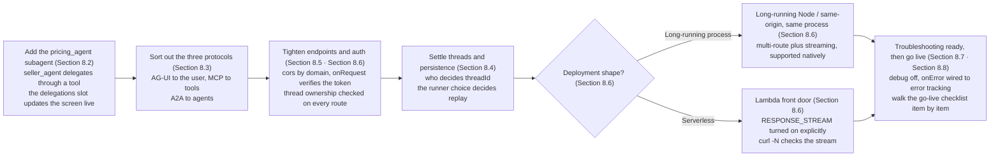
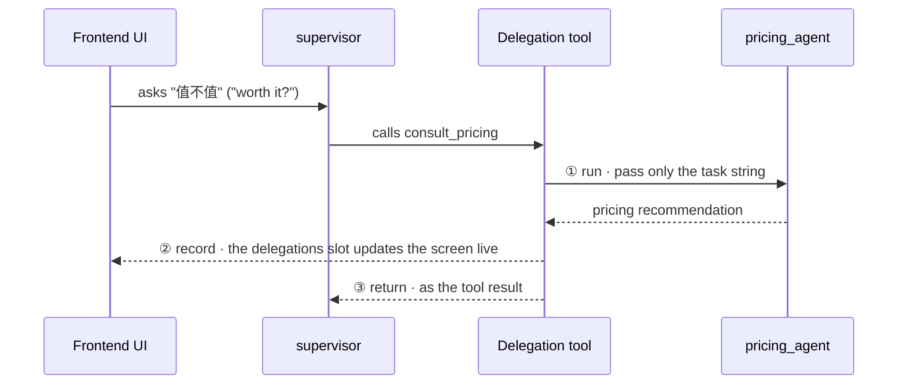
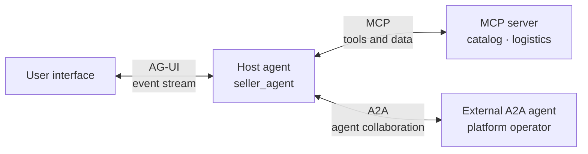
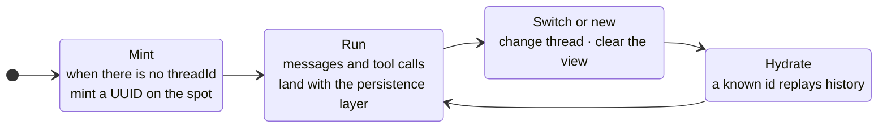
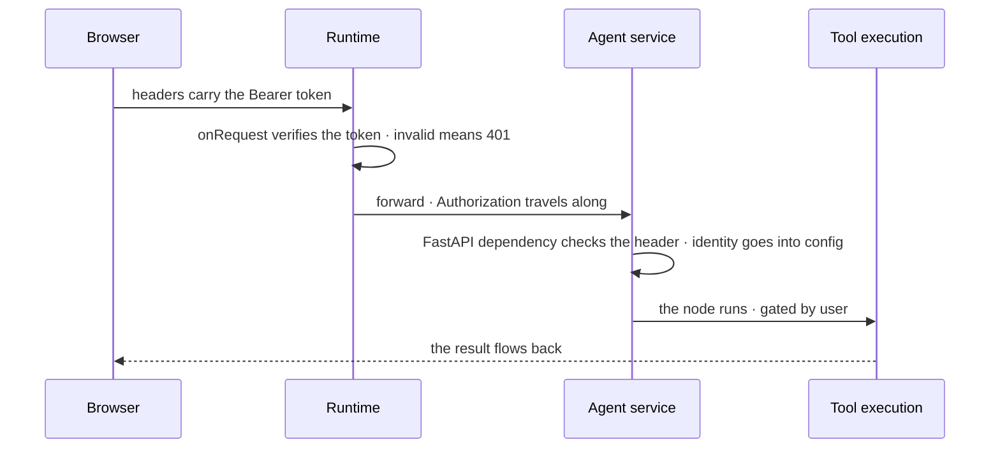
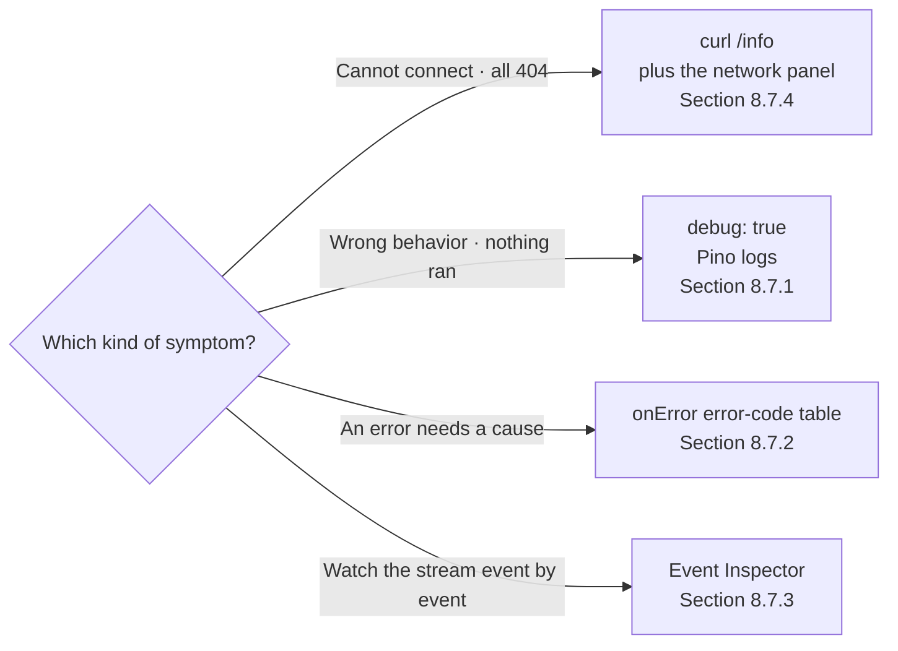

# Chapter 8 Multi-agent, protocols, and production

> Chapter guide: At the end of Chapter 7, the copilot in Starfish Console (星帆工作台) is already a decent assistant. `seller_agent` can look up orders, `get_orders` and `update_price` can operate the UI, and an approval card stands guard on dangerous actions. It is still one person doing every job. Specialist judgment such as pricing gets handled in passing, no external data source is connected, and the whole thing lives only on your development machine. Restart the in-memory runner and the history is gone. CORS is open to every origin, so anyone who has the address can call it. This chapter does two things. First it adds a dedicated pricing subagent, `pricing_agent`, and gets multi-agent collaboration running. Then it pushes the copilot into production: sort out what AG-UI, MCP, and A2A each own, tighten the endpoints and authentication, settle a persistence plan for threads, pick the right deployment shape, and leave a troubleshooting toolbox ready. The capabilities from the first seven chapters are assembled for shipping in this chapter. After this chapter, you can: add a subagent in the supervisor pattern and make the delegation visible as it happens; pick the right protocol for an external requirement; close the three gates of authentication, thread ownership, and CORS to a production standard; and take Starfish Console live against the checklist.



*Flowchart for this chapter*

## When you need it

Three typical situations, matching the three main lines of this chapter.

**One agent is no longer enough.** Pricing needs a specialist, assortment needs data, customer service needs the right wording, and stuffing all of it into the system prompt of `seller_agent` makes the agent start dropping one job to catch another. See the subagent pattern in Section 8.2: the supervisor keeps the conversation and the global view, specialist judgment is delegated to each narrow agent, and the delegation can be drawn on the UI as it happens.

**You need to open a door to an external agent or an external tool.** Product data lives on the platform's MCP server, or a partner's agent speaks only A2A. See the protocol map in Section 8.3: AG-UI covers the agent and the user interface, MCP covers the agent and tool data, and A2A covers agent to agent. The three jobs can be connected at the same time.

**You are ready to go live.** The move is from "it runs on my machine" to "every seller at the company can use it". See Section 8.4 through Section 8.8: thread history must survive a restart, the endpoint must stay closed to the open internet, authentication has to recognize the person, the deployment shape has to match what the team can operate, and a failure needs a tool you can look it up with.

Prerequisite: the three-process architecture from Chapter 5 (the frontend, Copilot Runtime, and the `seller_agent` service) and the AgentRunner concept; the tool-rendering hooks from Chapter 6; the approval mechanism from Chapter 7 (this chapter does not repeat it; governance under multiple agents is closed in Section 8.8).

## 8.1 Overview: four gaps on the way to production

The Starfish Console of the first seven chapters is an application that **runs**. Four gaps sit between "it runs" and "it can go to production". Every section of this chapter closes one of them:

| Gap | How it shows up | Where it is closed |
|------|------|--------|
| **Scale of capability** | Every specialist judgment is crammed into one agent, and a longer prompt loses focus | Section 8.2 (subagent routing) |
| **Interoperability** | External tools and external agents each speak their own protocol, so every connection means another glue layer | Section 8.3 (protocol map) |
| **Boundary security** | CORS is wide open, there is no user identity, and anyone who has a thread id can read the history | Section 8.5 and Section 8.6 (authentication and endpoint tightening) |
| **Operability** | History lives in memory, errors leave no logs, and the deployment shape has not been thought through | Section 8.4 (thread persistence), Section 8.6 (deployment), Section 8.7 (troubleshooting) |

Two judgments apply across the chapter. **First, open source and the commercial service are layers you combine.** The open-source SDK and the TypeScript runtime (MIT license) already cover chat, frontend tools, shared state, generative UI, any AG-UI integration, and the local Inspector. CopilotKit Intelligence is an extra commercial service layer. It adds AG-UI Streams (saving a session and resuming it across devices), User Memories, Automatic Learning, product analytics, and channel connections. Starfish Console stays on the self-hosted open-source path for the whole book. It can go to production in full, and the cost is that you own persistence and per-user isolation. When you want the platform to host thread storage and live sync, add Intelligence as needed. **Second, deployment shape has no default answer.** The same Copilot Runtime can be a Next.js route in the same process, a standalone Node process, a Lambda function, or a host on AWS AgentCore. Section 8.6 lays the four paths side by side for the choice.

This chapter is also the last time the book introduces a new mechanism. Section 8.8 lists the capabilities accumulated over the first seven chapters. That list is the configuration Starfish Console ships with.

## 8.2 Multi-agent and subagent routing: adding pricing_agent

### 8.2.1 The supervisor pattern: treat a subagent as a tool

The official docs call a subagent "the canonical multi-agent pattern": a top-level **supervisor** LLM orchestrates one or more specialist **subagents**, by exposing each subagent as a tool. The supervisor decides when to delegate and what to delegate. The subagent finishes the narrow job, and the result streams back into the supervisor's next step.

The shape is the same structure as tool calling in Chapter 6. **Each "tool" is itself a complete agent**, with its own system prompt, its own tools (usually), its own memory, and its own model. When is the split worth it? The official docs give three kinds:

| Scenario | Shape | Where Starfish Console lands |
|------|------|-----------------|
| Pipeline | Research, then writing, then critique, and each stage wants a different prompt and temperature | Not needed yet |
| Routing plus specialists | One agent classifies the request and dispatches it to the right specialist | **The main line of this chapter: pricing delegation** |
| Divide and conquer | The problem splits cleanly into parallel or serial subproblems | Batch evaluation for a promotional assortment (further out) |

The official reminder about subagent boundaries is worth pinning above the desk: **each subagent is an isolated agent call, with its own model, system prompt, and optional tools; it does not share memory or tools with the supervisor, and the supervisor can see only what the subagent returns.** Read it the other way: if a subagent must know the full user context to do its job, the split was drawn in the wrong place. The input to `pricing_agent` is therefore a single `task` string: "评估 SKU-1001 是否值得降到 $24.99，考虑当前库存 340 与美线时效" ("Evaluate whether SKU-1001 is worth dropping to $24.99, considering the current stock of 340 and US-lane transit time"). It does not need `dashboard` or the chat history, and it should stay away from both.

### 8.2.2 The delegation tool: three jobs, and none of them is optional

The supervisor delegates by calling a tool. The official docs require each delegation tool to be a thin wrapper that does three things: **run, record, and return**. The full chain of one delegation looks like this:



*Figure 8-1: The chain of one pricing delegation. Run, record, and return each take one hop, and context isolation sits at "pass only the task"*

The official docs give the pattern and the responsibilities. The concrete implementation varies by framework. Below is Starfish Console's version of this pattern. **Example.** Our recommendation: written from the official pattern and the `seller_agent` project in Chapter 5. Not confirmed in testing. Check it against the review list before publication.

```python
# seller-agent/pricing.py — pricing_agent: the subagent that only handles pricing
from dotenv import load_dotenv
from langchain_core.messages import SystemMessage
from langchain_openai import ChatOpenAI
from langgraph.checkpoint.memory import MemorySaver
from langgraph.graph import END, START, MessagesState, StateGraph

load_dotenv()


async def recommend(state: MessagesState):
    # Pricing node: advise only from what is in the task. It cannot see the main conversation.
    """定价节点：只依据 task 里的信息给建议，看不到主对话。"""
    model = ChatOpenAI(model="gpt-4.1-mini")
    # "你是星帆工作台的定价专员 pricing_agent。" ("You are pricing_agent, the pricing specialist for Starfish Console.")
    # Advise, with reasons, only from the product, price, and stock in the task. Stay off anything that is not pricing.
    system_message = SystemMessage(
        content=(
            "你是星帆工作台的定价专员 pricing_agent。"
            "只依据任务描述里的商品、价格与库存信息给出定价建议与理由，"
            "不讨论定价以外的事。"
        )
    )
    response = await model.ainvoke([system_message, *state["messages"]])
    return {"messages": response}


pricing_graph = (
    StateGraph(MessagesState)
    .add_node("recommend", recommend)
    .add_edge(START, "recommend")
    .add_edge("recommend", END)
    .compile(checkpointer=MemorySaver())
)
```

```python
# seller-agent/main.py — the supervisor's delegation tool (registered inside the seller_agent graph)
import uuid

from langchain_core.messages import HumanMessage
from pricing import pricing_graph


def record_delegation(state: dict, task: str, summary: str) -> dict:
    # Per the official requirement, write the delegation into the delegations slot: each entry has a stable id, and entries merge by id.
    """按官方要求把委托写进 delegations 槽：每条带稳定 id，按 id 合并。"""
    entry = {
        "id": f"dlg-{uuid.uuid4().hex[:8]}",
        "sub_agent": "pricing_agent",
        "task": task,
        "summary": summary,
        "status": "done",
    }
    merged = {d["id"]: d for d in state.get("delegations", [])}
    merged[entry["id"]] = entry
    return {"delegations": sorted(merged.values(), key=lambda d: d["id"])}


async def consult_pricing(state: MessagesState):
    # The delegation tool itself: run, record, and return, one job on each line.
    """委托工具本体：运行、记录、返回，三件事各一行。"""
    task = state["messages"][-1].content  # the task description the supervisor wrote

    # ① Run: the subagent receives only the task string
    result = await pricing_graph.ainvoke(
        {"messages": [HumanMessage(content=task)]}
    )
    summary = result["messages"][-1].content

    # ② Record: it enters the delegations slot, and the UI renders the live log from it
    # ③ Return: handed back to the supervisor as the tool result
    return {
        **record_delegation(state, task=task, summary=summary),
        # "[pricing_agent 建议]" ("pricing_agent recommendation")
        "messages": [HumanMessage(content=f"[pricing_agent 建议] {summary}")],
    }
```

Next to this pattern the official docs place a warning set in bold, worth quoting and spelling out: **give every delegation a stable `id`, and merge new entries by `id`.** The reason sits in the direction state flows. Each turn, the client sends back the shared-state copy it holds, as the run input (the two-way sync covered in Chapter 4). If a slot unconditionally appends the entries it receives (for example the LangGraph `Annotated[list, operator.add]` reducer), the entries the client just echoed get concatenated with the ones the agent already has, and **resuming a thread doubles the log on the spot**. Deduplicating and merging by `id` is the only fix. All of the logic in `record_delegation` exists to carry that rule out.

### 8.2.3 The frontend: a live delegation log

Why is the `delegations` slot worth writing? Because the shared-state channel from Chapter 4 pushes every change to the browser as it happens. When the supervisor dispatches work to a subagent, the log grows entry by entry. What the user sees is a visible process, in place of a spinner that never finishes. The frontend subscription from the official docs:

```tsx
// src/components/DelegationLog.tsx — following the official subagents docs pattern
import { UseAgentUpdate, useAgent } from "@copilotkit/react-core/v2";

type DelegationEntry = {
  id: string;
  sub_agent: string;
  task: string;
  summary: string;
  status: string;
};

export function DelegationLog() {
  // Subscribe at both update points: a state change renders a new entry,
  // and a run-status change is how you notice "delegation in progress"
  const { agent } = useAgent({
    agentId: "seller_agent",
    updates: [
      UseAgentUpdate.OnStateChanged,
      UseAgentUpdate.OnRunStatusChanged,
    ],
  });

  const delegations =
    (agent.state as { delegations?: DelegationEntry[] }).delegations ?? [];

  if (delegations.length === 0) {
    return null;
  }

  return (
    <section className="delegation-log">
      {/* "定价委托记录" ("Pricing delegation log") */}
      <h3>定价委托记录</h3>
      {delegations.map((d) => (
        <article key={d.id}>
          <header>
            {d.sub_agent} · {d.status}
          </header>
          <p>{d.task}</p>
          <footer>{d.summary}</footer>
        </article>
      ))}
    </section>
  );
}
```

To go further, the official docs point at a ready-made path: use state streaming from Chapter 4 to stream **one subagent's output** token by token into the matching log entry. Each delegation card grows its own answer, in place of waiting until the job is done for one summary line to appear.

A loose end left in Chapter 7 is tied off here: **governance discipline still holds across subagents.** If `pricing_agent` is actually going to execute a price change, its output should also pass through the approval card from Chapter 7. Approval is attached to the frontend tool `update_price`, whether the proposal came from the supervisor itself or from a subagent's suggestion. **Delegation changes who proposes. Who approves stays the same.**

**Verification point**: Tell `seller_agent` "评估一下 SKU-1001 降到 $24.99 值不值" ("See whether dropping SKU-1001 to $24.99 is worth it"). The chat should show a delegation-log entry, and the `pricing_agent` recommendation should come back into the conversation with the `[pricing_agent 建议]` prefix ("pricing_agent recommendation"). After two delegations in a row, resume the thread for one more turn. The number of log entries should not double (the id merge from Section 8.2.2 is in effect). Ask something unrelated to pricing inside the delegation card. The subagent should refuse. Context isolation is doing its job.

## 8.3 The protocol map: what AG-UI, MCP, and A2A each own

### 8.3.1 Three maps, read as one

The positioning sentence in the official docs: CopilotKit is fully compatible with three major agent protocols, AG-UI, MCP, and A2A. Each one owns a different stretch of the connection:

| Dimension | AG-UI | MCP | A2A |
|------|-------|-----|-----|
| Full name | Agent User Interaction | Model Context Protocol | Agent2Agent |
| Connects | **Agent ↔ user interface** | **Agent ↔ tools and data** | **Agent ↔ agent** |
| Origin | An open standard built by the CopilotKit team together with several framework partners | Open standard | Proposed by Google |
| Shape | Lightweight, event-based | The agent connects securely to external systems (tools, workflows, data sources) | Framework-agnostic distributed collaboration |
| How CopilotKit connects | The native protocol. Components and Copilot Runtime both speak AG-UI | Configure `mcpServers` on the agent side | `A2AMiddlewareAgent` exposes an A2A agent to an AG-UI orchestrator |
| How Starfish Console uses it | The main line of the book | Connect a catalog, logistics, and other external tools to `seller_agent` | A later connection to a platform or partner agent |

The official docs also list a set of declarative specs for "agent ↔ generative UI": A2UI (Google), MCP Apps (the MCP ecosystem), and Open-JSON-UI (OpenAI). Chapter 6 already showed them on the spectrum diagram. This chapter leaves them there.

One official conclusion matters: **these protocols can be mixed, and AG-UI itself contains the handshake with MCP and A2A.** When all three connections exist at once, a subagent's UI properties propagate along AG-UI all the way to the user interface, and the controls for security, policy, and observability stay in place. This is where Chapter 1's "protocol first" shows up. The topology when the three connections coexist:



*Figure 8-2: Each protocol owns one stretch of the connection, and they can coexist. AG-UI faces the user, MCP faces tools, A2A faces agents*

### 8.3.2 MCP: connect external tools to seller_agent

The frontend tools in Chapter 6 live in the browser. MCP tools live on an MCP server, and the agent calls them through the protocol. On a self-hosted runtime, attach the server to the agent (the built-in agent is the example; the equivalent configuration for the framework that hosts `seller_agent` is in that framework's docs):

```ts
// Self-hosted config from the official mcp docs. Mount mcpServers on the agent.
import { BuiltInAgent } from "@copilotkit/runtime/v2";
import {
  CopilotRuntime,
  createCopilotRuntimeHandler,
} from "@copilotkit/runtime/v2";

const runtime = new CopilotRuntime({
  agents: {
    default: new BuiltInAgent({
      model: "openai/gpt-4o",
      mcpServers: [
        {
          type: "sse",
          url: "https://my-mcp-server.example.com/sse",
          headers: { Authorization: `Bearer ${process.env.MCP_API_KEY}` },
        },
      ],
    }),
  },
});
```

Two runtime details are worth remembering, both from the official docs. **At the start of every run the agent opens a client for each server, and it closes them when the run ends. Nothing is cached between requests.** Credentials (`MCP_API_KEY`) come from server-side environment variables, the same line of discipline as "keys stay on the server" since Chapter 2.

Once MCP tools are connected, how does the UI present them? The official mcp docs split servers into three kinds, and each kind owes the UI something different:

| Your server... | What the user should see | What to do |
|--------------|----------------|----------|
| Read-only data, and it returns a result | Nothing, or one status line. The result belongs in the agent's answer | A plain MCP tool. No renderer |
| Changes something (write, send, delete) | What is about to happen, plus a way to stop it | A plain MCP tool plus a renderer. Add approval when the change is irreversible |
| Brings its own UI (a form, a picker, a chart) | The UI itself | An MCP App (UI resources shipped with the server, rendered in a sandboxed iframe) |

The official line that separates the second row from the third is exact: **if the only reason you reach for an MCP App is to render a confirm button, what you want is human in the loop (HITL), covered in Chapter 7.** Approval is CopilotKit's concern. A UI supplied by the server is a different job. Give every tool call that has no dedicated renderer a fallback status card. The wildcard renderer from Chapter 6 does it in one call:

```tsx
import { useDefaultRenderTool } from "@copilotkit/react-core/v2";

useDefaultRenderTool({
  render: ({ name, status, parameters, result }) => (
    <McpToolCall status={status} name={name} args={parameters} result={result} />
  ),
});
```

### 8.3.3 A2A: connect an external agent through middleware

A2A agents collaborate among themselves, and speaking to the frontend still needs a stretch of translation. The official approach is **A2A middleware**: wrap an AG-UI orchestrator in `A2AMiddlewareAgent`. The middleware injects a `send_message_to_a2a_agent` tool automatically, and the orchestrator can talk to A2A agents without the caller seeing the translation. The structure below is copied from the example in the official a2a docs. **Example.** The research and analysis A2A agents in it belong to the official demo. Starfish Console does not use those two agents.

```ts
// Example from the official a2a docs (Next.js App Router form)
import {
  CopilotRuntime,
  createCopilotRuntimeHandler,
  InMemoryAgentRunner,
} from "@copilotkit/runtime/v2";
import { HttpAgent } from "@ag-ui/client";
import { A2AMiddlewareAgent } from "@ag-ui/a2a-middleware";

const researchAgentUrl = process.env.RESEARCH_AGENT_URL || "http://localhost:9001";
const analysisAgentUrl = process.env.ANALYSIS_AGENT_URL || "http://localhost:9002";
const orchestratorUrl = process.env.ORCHESTRATOR_URL || "http://localhost:9000";

// The orchestrator passed to the middleware must be an instance of the AG-UI AbstractAgent.
// If what you have is a URL, use HttpAgent to get that instance.
const orchestrationAgent = new HttpAgent({ url: orchestratorUrl });

const a2aMiddlewareAgent = new A2AMiddlewareAgent({
  description: "Research assistant with 2 specialized agents: Research (LangGraph) and Analysis (ADK)",
  agentUrls: [researchAgentUrl, analysisAgentUrl],
  orchestrationAgent,
  // Domain instructions. The middleware generates the generic "how to reach an A2A agent" instructions on its own.
  // The instructions here are the domain-specific part appended after those.
  instructions: `You are a research assistant that orchestrates between 2 specialized agents.`,
});

const runtime = new CopilotRuntime({
  agents: {
    a2a_chat: a2aMiddlewareAgent, // the frontend points at it with this id
  },
  runner: new InMemoryAgentRunner(),
});
```

The frontend presentation reuses the toolkit from Chapter 6. Register a renderer for `send_message_to_a2a_agent` with `useFrontendTool`. The parameters are `agentName` and `task`. While the status is `executing`, draw "who it was sent to, and what was sent". On `complete`, add "reply received". Every hop between the orchestrator and the A2A agent stays visible. **A2A agents speak A2A to each other. The stretch that reaches the frontend is still AG-UI, and that stretch is what the middleware fills in.**

### 8.3.4 AG-UI middleware: the universal socket on the trusted side

The log in Section 8.2 and the protocol translation in Section 8.3 both point at the same mechanism: **AG-UI middleware**. It is a concept the AG-UI protocol defines upstream in `@ag-ui/client`. Every agent exposes `agent.use(middleware)`. Middleware extends the `Middleware` base class and implements `run(input, next)`. It can log, apply guardrails, rewrite the request, and rewrite the event stream. The official positioning that matters most for CopilotKit: **middleware runs on the server inside Copilot Runtime, in a trusted environment the client cannot tamper with.** That is the mechanism under message trimming in Chapter 5 (`TrimHistoryMiddleware`) and under every "the server decides" requirement in this chapter:

```ts
// my-middleware.ts — example from the official ag-ui-middleware docs
import {
  Middleware,
  RunAgentInput,
  AbstractAgent,
  BaseEvent,
} from "@ag-ui/client";
import { Observable } from "rxjs";

export class LoggingMiddleware extends Middleware {
  run(input: RunAgentInput, next: AbstractAgent): Observable<BaseEvent> {
    return new Observable<BaseEvent>((subscriber) => {
      const sub = this.runNextWithState(input, next).subscribe({
        next: ({ event }) => {
          console.log("[agent event]", event.type);
          subscriber.next(event);
        },
        error: (err) => subscriber.error(err),
        complete: () => subscriber.complete(),
      });
      return () => sub.unsubscribe();
    });
  }
}
```

The mount point is before registration (the rule in Section 5.6): `agent.use(new LoggingMiddleware())`, and only then does it enter the `agents` registry. Copilot Runtime clones the registered agent on every run, and the clone carries the middleware with it. Copilot Runtime also ships two first-class middleware switches, turned on directly on `CopilotRuntime`, with no per-agent `.use()`: `a2ui` (apply `A2UIMiddleware` to every registered agent, or to some of them) and `mcpApps` (configure MCP servers for every agent from one place).

**Verification point**: You should be able to say three sentences without looking anything up. AG-UI owns "agent to interface". MCP owns "agent to tools and data". A2A owns "agent to agent". Then one more sentence: AG-UI has a handshake with the other two, and the three connections can exist at the same time. When you add a "商品库查询" ("catalog lookup") MCP server to Starfish Console, use the three-kind table in Section 8.3.2 to decide which kind it is, and then decide whether it needs a renderer.

## 8.4 Thread lifecycle and persistence: history must not vanish on a restart

### 8.4.1 The life of a conversation: four acts

Every CopilotKit session is scoped to one **thread**, identified by `threadId`. The official docs tell the full client-side lifecycle as four acts: mint, run, hydrate, and switch or new. On a state machine it is one horizontal loop. **A runtime with no persistence layer keeps nothing on the server.** Whether the run act can leave history behind depends on the choice in Section 8.4.3:



*Figure 8-3: The life of a thread. Mint leads into run. After a switch, hydrate restores the history*

`<CopilotThreadsDrawer>` and `startNewThread()` from Chapter 3 are the built-in implementation of act 4. This section fills in the rules behind the drawer.

### 8.4.2 Who decides threadId: priority and the remint pitfall

When you omit `threadId`, the client resolves it by the priority below. The higher entry wins:

1. An explicit `threadId` prop on `<CopilotChat>` or `<CopilotChatConfigurationProvider>`. **The authoritative value.** It drives history replay and closes the welcome screen.
2. A runtime override: `setActiveThreadId(...)`, selecting a row in the thread list, or `startNewThread()`.
3. A `threadId` inherited from a parent configuration provider.
4. A non-authoritative `threadId` seed.
5. Otherwise, mint a `randomUUID()` on the spot.

When you hold the persistence plan yourself, the official recommendation is to pass the prop explicitly:

```tsx
import { CopilotChat } from "@copilotkit/react-core/v2";

// An id you control: history replays for it, and it stays stable across component remounts
<CopilotChat agentId="seller_agent" threadId={myThreadId} />
```

The official docs call out the pitfall of automatic minting in a warning box, and the whole paragraph is worth remembering: **an automatically minted id is stable across re-renders, and a remount mints it again.** The fallback id is computed with `useMemo`. A component remount (the React `key` changed, a parent unmounted and mounted again, the double mount of StrictMode during development) produces a **new id and quietly starts a new conversation**. An id that has to survive a remount should be minted by you and passed as a prop, or persisted and restored through `setActiveThreadId`. **Leave continuity to an id you minted yourself.**

### 8.4.3 Two layers of persistence: CopilotKit threads and the framework checkpoint

This is the most important conceptual split in the section. **A CopilotKit thread and the persistence your agent framework keeps for itself are two different layers, related only by the shared `threadId`** (transcribed from the official comparison table):

| Layer | What it stores | Who owns it |
|----|--------|------|
| CopilotKit thread | The session list, plus the full AG-UI event history (messages, tool calls, state), with live sync | CopilotKit Intelligence, through `useThreads` |
| Framework-native persistence | The framework's internal state and checkpoints | Your agent, for example LangGraph's `AsyncPostgresSaver` |

Both directions are easy to get backwards. **Attaching a checkpointer to LangGraph does not make a thread list appear in CopilotKit.** What it builds is LangGraph's own checkpoint tables. The other direction is the same kind of miss: rename, archive, and delete on `useThreads` act only on platform threads. They do not reach into the storage of LangGraph, ADK, or anything similar, unless your backend builds the bridge on purpose. The bridge is `threadId`. A `threadId` passed explicitly to CopilotKit is forwarded to the backend as the AG-UI `threadId`, and the framework can use it directly as its own checkpoint id, or map it onto one.

The production choice for Starfish Console. Our recommendation: combine Section 5.4.3 with the official facts in this section.

| Plan | Where thread history lives | What you get | The cost |
|------|-------------|---------|------|
| `SqliteAgentRunner` (Chapter 5) | A SQLite file local to Copilot Runtime | History survives a single-instance restart, and it works out of the box | No sharing across instances. The thread-read route answers `422` (it does not store a local list) |
| A runner you build, plus your own store | Your database | Full control. Thread ownership is yours to implement (Section 8.5.4) | You implement the runner's four methods |
| CopilotKit Intelligence (cloud-hosted or self-hosted) | On the platform side | A thread list, resume across devices, live sync, and `<CopilotThreadsDrawer>` available | Needs a commercial license and `identifyUser` (Section 8.5.4) |

Whichever you pick, the backend half still has to be done. The `seller_agent` graph in Chapter 5 is attached to `MemorySaver()`. The official wording is that production should switch to a persistent saver (Postgres, for example). Each layer persists on its own, and `threadId` lines them up. For existing sessions whose history already lives on the framework side, the official docs provide a separate import path. Rehearse first with `npx copilotkit@latest import --source langgraph --dry-run`. It copies supported messages, tool calls, and timestamps into Intelligence. **An import copies the content. It does not set up ongoing replication.** Keep the mapping between `threadId` and the native session id stable.

### 8.4.4 Switching, starting new, and a thread API you own

The programmatic interface for switching and starting new. The drawer in Chapter 3 uses these internally:

```tsx
import { useCopilotChatConfiguration } from "@copilotkit/react-core/v2";

function ThreadControls() {
  const config = useCopilotChatConfiguration();

  return (
    <>
      {/* Restore a known conversation (explicit defaults to true, and history replays). "打开会话" ("Open conversation") */}
      <button onClick={() => config?.setActiveThreadId(existingId, { explicit: true })}>
        打开会话
      </button>
      {/* Start a brand-new conversation (mint a new non-explicit id). "新会话" ("New conversation") */}
      <button onClick={() => config?.startNewThread()}>新会话</button>
    </>
  );
}
```

`explicit: false` means "treat it as an unknown thread", and the UI returns to the welcome screen. The two setters share a pitfall: **when `threadId` is controlled by a prop, they no-op and warn.** Pick one source of truth, the prop's authoritative value or the imperative setter.

There is another kind of requirement. When the user sends the first message, create the thread through your own backend first (insert a database row and take its id, for example), then start the conversation. The limit the official docs point out is worth remembering: **the submit handler of the built-in `<CopilotChat>` is set internally, and an `onSubmitMessage` you pass is discarded.** The recommended posture is to mint ahead of time. Inside the "new conversation" action, call your own API to create the thread, then hand the id to CopilotKit with `setActiveThreadId(id, { explicit: true })` or by rendering `<CopilotChat threadId={id} />`. If you really have to intercept at the moment of submit, the path is a headless composition (`CopilotChatInput` plus your own submit handler), and **write the id directly onto the agent** (`agent.threadId = id`). `setActiveThreadId` goes through React state and reaches the agent on the next render, so a run started immediately afterward still uses the old thread. v2 has no `initialMessages` prop and no `useCopilotChat`. Read messages through `useAgent()` as `agent.messages`, and change them with `agent.setMessages(...)` or `agent.addMessage(...)`. The same-named capability in v1 exists only in the migration comparison. It stays off the main line.

**Verification point**: Pass a fixed `threadId` to the chat by hand and refresh the page. History should replay, provided Section 8.4.3 picked a plan that persists. With no store configured, `connectAgent()` returns an empty stream and the conversation starts blank. That blank start comes from the missing store. The client code is following its contract. Then remove the prop, drive the chat with `startNewThread()`, and force one remount with a React `key`. The conversation quietly takes a new id. That is the pitfall from Section 8.4.2 itself.

## 8.5 Authentication: pin "who is using this" into every hop

### 8.5.1 User identity travels in headers, and `properties` is a different channel

The first question in production: on every agent run, how do you know who is asking? The official auth docs open with what identity is for. **Multi-tenant data, tool gating, audit and billing, and an experience that changes by role: every one of these four needs identity.** If you need none of them, a TypeScript runtime with Intelligence left off can run anonymously.

The frontend does one thing. Put the token in the Provider's `headers` prop, and every request CopilotKit forwards carries it:

```tsx
import { CopilotKitProvider } from "@copilotkit/react-core/v2";

<CopilotKitProvider
  runtimeUrl="http://localhost:8200/api/copilotkit"
  agentId="seller_agent"
  headers={{
    Authorization: `Bearer ${userToken}`,
  }}
>
```

The official docs set a rule here that is easy to get wrong. The original sense, transcribed: **`properties` is not an authentication channel.** By the time `properties` reach the agent they are AG-UI `forwardedProps`, payload data for the run. They are not request headers, and nothing turns them into a Bearer credential. Authentication uses `headers`. One useful consequence comes with the rule: server request headers configured on the agent itself win on a conflict, so a service-to-service credential stays put when the browser sends its own.

### 8.5.2 Server-side verification: onRequest and a FastAPI dependency

The verification hook on the Copilot Runtime side is `onRequest`. It runs **before any agent code**, and it is the right place for a 401 short circuit (hop 2 in Figure 8-4):

```ts
import {
  CopilotRuntime,
  createCopilotRuntimeHandler,
} from "@copilotkit/runtime/v2";

const runtime = new CopilotRuntime({ agents: { default: myAgent } });

const handler = createCopilotRuntimeHandler({
  runtime,
  basePath: "/api/copilotkit",
  hooks: {
    onRequest: ({ request }) => {
      const authHeader = request.headers.get("authorization");
      if (!authHeader?.startsWith("Bearer ")) {
        throw new Response(
          JSON.stringify({ error: "unauthorized" }),
          { status: 401, headers: { "content-type": "application/json" } },
        );
      }
      const token = authHeader.slice("Bearer ".length);
      verifyJwt(token); // your verification logic
    },
  },
});
```

The `seller_agent` hop (Copilot Runtime to the agent) has to verify as well. The `Authorization` header is forwarded to the agent. Self-hosted FastAPI has no managed authentication to plug in. The official approach replaces `add_langgraph_fastapi_endpoint` with an equivalent route you own: a FastAPI dependency checks the header, and the verified user is baked into the agent config constructed for that request:

```python
# seller-agent/main.py — self-hosted form from the official auth docs (excerpt, adapted)
from typing import Optional

from ag_ui.core.types import RunAgentInput
from ag_ui.encoder import EventEncoder
from copilotkit import LangGraphAGUIAgent
from fastapi import Depends, FastAPI, Header, HTTPException, Request
from fastapi.responses import StreamingResponse

from src.agent import graph
from src.auth import validate_your_token

app = FastAPI()


def current_user(authorization: Optional[str] = Header(default=None)) -> dict:
    if not authorization or not authorization.startswith("Bearer "):
        raise HTTPException(status_code=401, detail="Missing bearer token")
    return validate_your_token(authorization.removeprefix("Bearer ").strip())


@app.post("/")
async def run_agent(
    input_data: RunAgentInput,
    request: Request,
    user: dict = Depends(current_user),
):
    encoder = EventEncoder(accept=request.headers.get("accept"))

    # One agent per request: the verified identity rides only this trip, and streaming state stays isolated per request
    agent = LangGraphAGUIAgent(
        name="seller_agent",
        graph=graph,
        config={"configurable": {"auth_user": user}},
    )

    async def event_generator():
        async for event in agent.run(input_data):
            yield encoder.encode(event)

    return StreamingResponse(event_generator(), media_type=encoder.get_content_type())
```

The node reads identity from `config["configurable"]["auth_user"]` and does not verify the token a second time. If all you need is a 401 gate and the nodes never look at identity, the official docs leave a shortcut: keep `add_langgraph_fastapi_endpoint` and hang the dependency on the application, `FastAPI(dependencies=[Depends(current_user)])`.

### 8.5.3 Tool gating: where identity first pays off

The most common use of authentication is to make a single tool refuse the wrong person. The official example checks the role in one condition:

```python
def delete_record(record_id: str, *, user: User):
    if "admin" not in user.permissions:
        raise PermissionError("admin role required")
    # perform the deletion
```

This check and HITL from Chapter 7 run in series. Gate by identity first, then show the confirmation card, then execute. Connect the three hops from Section 8.5.1 through Section 8.5.3, and one credential's path from the browser to tool execution looks like this. The full defense for `update_price` in Starfish Console is therefore three layers: the logged-in user is the seller (this section), the seller approves on the approval card (Chapter 7), and the execution side validates the payload (Section 7.6.2).



*Figure 8-4: How a user credential travels. The token goes in headers, the 401 is issued by onRequest, and identity is parsed only on the trusted side*

### 8.5.4 Thread ownership: threadId is not a secret

Authentication answers who you are. It leaves open whether you may read someone else's conversation. The official docs put it in one sentence: **`threadId` is a public identifier, like a database primary key in a URL.** It travels through the browser, it lands in logs, and a sequential id can even be enumerated. A UUID makes guessing impractical, and the string "UUID" is still only an identifier. Authorization has to be an explicit ownership check. Knowing the id must never count as owning the thread.

Two paths:

| Runtime | Who binds a thread to a user |
|---------|------------------------|
| A `CopilotRuntime` configured with `intelligence` | Mostly the runtime, through `identifyUser`. Three routes you still guard yourself |
| Everything else (an SSE runtime, custom storage, a local in-memory runner) | **You** |

Three official rules for `identifyUser`. **Derive the id from a credential the server has already verified.** Reading a user id straight out of a request header or body lets every caller announce themselves. **The id has to be stable.** It is the key threads hang on. Change it, from an email to a subject claim for example, and every existing thread for that user goes dark. **Issue 401 from `onRequest`.** `identifyUser` is a naming step, and it is not the gate that stops a caller. Some routes never call it, and an error it throws still shows up as a 500. Even on Intelligence, `threads/events` and `threads/state` (the two routes behind the Inspector) are **read straight by id, with no user scope**. Check ownership yourself in `onBeforeHandler` against `route.threadId`. With no ownership record, reject the whole request.

The path off the platform, which is the default shape for Starfish Console, builds an ownership table and enforces it on every route:

```sql
-- Minimal ownership table: write one row the first time a conversation is created
create table thread_owners (
  thread_id text primary key,
  user_id   text not null
);
create index on thread_owners (user_id);
```

```ts
// Handler hooks: onRequest identifies the person, onBeforeHandler identifies the thread
createCopilotRuntimeHandler({
  runtime,
  basePath: "/api/copilotkit",
  hooks: {
    onRequest: async ({ request }) => {
      const user = await verifyRequest(request);
      if (!user) throw new Response("Unauthorized", { status: 401 });
    },
    onBeforeHandler: async ({ request, route }) => {
      const user = await verifyRequest(request);

      // Routes that carry a thread directly: agent/stop, threads/update, threads/archive,
      // threads/messages, threads/events, threads/state
      if ("threadId" in route) {
        if (!(await userOwnsThread(user.id, route.threadId))) {
          throw new Response("Forbidden", { status: 403 });
        }
        return;
      }

      // For agent/run and agent/connect, the thread is in the request body
      if (route.method === "agent/run" || route.method === "agent/connect") {
        // Clone: the handler still has to read the original body afterward
        const { threadId } = await request.clone().json();
        if (threadId && !(await userOwnsThread(user.id, threadId))) {
          throw new Response("Forbidden", { status: 403 });
        }
      }
    },
  },
});
```

Face what the default `InMemoryAgentRunner` actually does. It stores by `threadId` in a process-level map, and the record has no ownership field. `GET /threads` lists **every** thread in the process, and `POST /threads/clear` wipes them all in one shot (the fixed response is `204`). Once more than one person uses it, both of those routes have to be managed. Filter the thread list on the server with the ownership table. Hiding a row in the UI leaves the underlying route open.

The official security checklist closes the section. Check yourself, item by item. The backend always verifies the token, and a self-report from the frontend is not evidence. Every read and write filters by the user already resolved. Authentication sits on `onRequest`, the only hook that runs on every route. Threads are bound to users: on the platform that is `identifyUser` plus a self-check on the two routes, and off the platform it is an ownership check on every route. Raw tokens stay out of logs. Record the user id, or `anonymous`. Use HTTPS in production. Token expiry is the frontend's job: rotate the token before it reaches the agent. CopilotKit does not refresh it for you.

**Verification point**: Open a thread under each of two accounts. Take A's `threadId` and request `threads/:threadId/messages` while presenting yourself as B. You should get 403, which means `onBeforeHandler` is in effect. Drop the `Authorization` header and send one conversation. You should get 401, and the Copilot Runtime logs should show no trace of any agent execution. Then confirm the logs contain the user id and no raw token.

## 8.6 Tightening endpoints and deployment: from the development shape to the production shape

### 8.6.1 The endpoint list and tightening CORS

A self-hosted Copilot Runtime exposes a set of HTTP routes under `basePath` (Starfish Console uses `/api/copilotkit`). The full set in multi-route mode, which is the default:

| Method and path | Purpose |
|------------|------|
| `GET /info` | Runtime information. The frontend discovers agents from it at startup |
| `GET /inspector-metadata` | Trusted project context for the Inspector (meaningful only on an Intelligence runtime) |
| `POST /agent/:agentId/run` | Start a run. The response is an SSE stream of AG-UI events |
| `POST /agent/:agentId/connect` | Reconnect an existing thread (a page refresh, or a reconnect after a drop). Also an SSE stream |
| `POST /agent/:agentId/stop/:threadId` | Stop an in-progress run on a given thread |
| `POST /transcribe` | Transcription for voice input |
| `GET /threads`, `GET /threads/:threadId/messages`, `GET /threads/:threadId/events`, `GET /threads/:threadId/state` | Thread list and history (the ownership-check targets in Section 8.5.4) |
| `POST /threads/clear` | Clear in-memory thread history (the dangerous route called out in Section 8.5.4) |

The `cors: true` written through the earlier chapters is a **development configuration**. The default CORS of the Express and Hono adapters is wide open (`origin: "*"`, every standard method and header), so a local setup needs no extra configuration. Production switches to a per-domain allowlist. The form the official docs give:

```ts
createCopilotExpressHandler({
  runtime,
  basePath: "/api/copilotkit",
  cors: {
    origin: "https://console.starfish.example.com",
    methods: ["GET", "POST", "OPTIONS"],
  },
});
```

(`createCopilotNodeListener` accepts the same configuration object. To own CORS completely, pass `cors: false` and write the middleware yourself.) One more check before production: the transport mode of the Provider and the handler has to be a pair. When `useSingleEndpoint` is omitted, the client probes the mode the runtime actually serves. **A mismatched pair shows up as every call returning 404 while `/info` still returns 200.** The connection looks up, and every real call is broken. If you are unsure, omit the property and let the client probe.

### 8.6.2 Four deployment shapes

The same Copilot Runtime code, placed four ways. This book compiles the comparison from the official deployment pages and the runtime-endpoints docs.

| | Same-origin Next.js | Split SPA plus long-running Node (Starfish Console's development shape) | Serverless (AWS Lambda) | Hosted AgentCore |
|----|--------------|-----------------------------------|--------------------------|----------------|
| Topology | Frontend and Copilot Runtime in the same process. `runtimeUrl` is a relative path | Frontend, Copilot Runtime, and the agent as three processes, with an absolute `runtimeUrl` | Copilot Runtime packaged as a Lambda function. The frontend points at a Function URL or API Gateway | Browser, then Copilot Runtime, then AgentCore, then your agent |
| CORS | No cross-origin problem | Required. `cors: true` in development, tightened by domain in production | The handler's `cors`, by domain. The front door can be configured too | Configure by domain on the Copilot Runtime side |
| Streaming | Supported natively | Supported natively | **The front door has to turn streaming on explicitly** (Section 8.6.3) | Carried by the single Copilot Runtime hop |
| Auth hooks | `onRequest` / `onBeforeHandler` | Same as the column to the left | Same as the column to the left (each front door behaves the same) | For production, carry a user JWT (Cognito, for example) end to end |
| A fit for | The official quick-start shape, with the least to operate | The direct extension of an existing Vite or CRA project | No servers to operate, and traffic that scales | You want the agent's runtime environment hosted for you (SigV4 and OAuth2 mean the browser cannot connect directly) |

### 8.6.3 Lambda: streaming is explicit, and the default is buffered

Copilot Runtime is a Fetch handler, so putting it on Lambda needs no server of your own. The one thing to be careful about is **streaming**. Chat responses travel as SSE. A front door that buffers turns a live conversation into a long silence followed by the whole reply landing at once. The official front-door table:

| Front door | Streaming SSE? | When to use it |
|------|-----------|-----------|
| Lambda Function URL (`InvokeMode: RESPONSE_STREAM`) | Yes | **The default choice.** Nothing sits between the browser and the function |
| API Gateway REST API (`responseTransferMode: STREAM`) | Yes | You need the REST ecosystem: WAF, usage plans, a custom authorizer |
| API Gateway HTTP API | No | Buffered: a 10 MB response cap, and a 29-second integration timeout |
| Application Load Balancer (ALB) | No | No streaming path to a Lambda target |

The official warning decides whether chat works: **both streaming front doors are buffered by default.** A Function URL defaults to `BUFFERED`, and a REST integration defaults to `responseTransferMode: BUFFERED`. Leave the switch alone and chat shows up as a long stall, then the whole package landing at once. The core skeleton of the handler (the full version includes the `awslambda` global type declaration; see the official page):

```ts
// src/handler.ts — from the official aws-lambda docs (Function URL path, excerpt)
import { Readable } from "node:stream";
import { pipeline } from "node:stream/promises";
import {
  CopilotRuntime,
  createCopilotRuntimeHandler,
  BuiltInAgent,
} from "@copilotkit/runtime/v2";

// Constructed at module scope, so warm invocations reuse it
const runtime = new CopilotRuntime({
  agents: {
    default: new BuiltInAgent({ model: "openai/gpt-4o-mini" }),
  },
});

const copilotHandler = createCopilotRuntimeHandler({
  runtime,
  basePath: "/api/copilotkit",
  cors: true,
});

export const handler = awslambda.streamifyResponse(
  async (event, responseStream) => {
    const response = await copilotHandler(toFetchRequest(event));

    // Status and headers must be written before the first byte
    const stream = awslambda.HttpResponseStream.from(responseStream, {
      statusCode: response.status,
      headers: Object.fromEntries(response.headers),
    });

    if (!response.body) {
      stream.end();
      return;
    }

    // Readable.fromWeb bridges the Fetch stream onto a Node stream, so SSE chunks arrive as they are produced
    await pipeline(Readable.fromWeb(response.body as any), stream);
  },
);
```

The operations points, packed into one table. All of them come from the official page.

| Item | The point |
|------|------|
| Node version | Response streaming needs the managed runtime Node 20 or newer (`@copilotkit/runtime` requires Node 20) |
| Timeout | Cover the full agent run. Lambda's default of 3 seconds kills almost every run. The ceiling is 15 minutes |
| Dependency packaging | `@copilotkit/runtime` is absent from every AWS managed layer. Use `NodejsFunction`, esbuild, or your own bundler |
| Cold start | Visible in the chat itself. If time to first token matters, turn on provisioned concurrency |
| Streaming limits | The first segment (Lambda 6 MB / gateway 10 MB) is not rate-limited. After that, 2 MB/s. Streaming is billed for the whole time the function runs, and a client disconnect does not stop it |
| Acceptance | `curl -N` against the run endpoint should print SSE piece by piece. A whole package arriving at once means streaming is off, or a buffering layer sits in front |

### 8.6.4 AgentCore and the LangSmith platform: two hosted paths

If you would rather not run Lambda yourself, the official docs give two hosted paths. **AWS Bedrock AgentCore** is a serverless runtime for an AG-UI agent, with authentication, session isolation, and the infrastructure included. The chain is fixed: browser, then CopilotKit Runtime, then AgentCore, then your agent. SigV4 and OAuth2 keep the browser from connecting to AgentCore directly, so the Copilot Runtime hop stays in the path. Wiring: point `HttpAgent` at AgentCore's `/invocations` endpoint, and put a token the server holds in the `Authorization` header. Replace the runner with the `AgentCoreRunner` from the official example (it extends `InMemoryAgentRunner`), and fill two holes the official docs call out. **Unknown threads**: on page load, `connect()` happens before any `run()`, and the runner should return an empty `RUN_STARTED` / `MESSAGES_SNAPSHOT` / `RUN_FINISHED` sequence instead of raising. **Missing tool results**: history replayed by AgentCore has the tool calls and none of the results, and the runner should synthesize an empty result for each historical call. **The LangSmith platform**: after a LangGraph or ADK agent is deployed there, connect it back with `LangGraphAgent` along route B from Chapter 5, and leave the deployment shape to the platform.

**Verification point**: With the production configuration in effect, open the frontend from a domain outside the allowlist and send a message. The browser console should show a CORS block, which is the proof that the tightening took effect. On a Lambda deployment, `curl -N` should show events arriving piece by piece. `curl -s {runtimeUrl}/info` succeeds, and an anonymous run is stopped with 401. That is the point at which the endpoints are closed tight.

## 8.7 The troubleshooting toolbox: which tool to reach for first

Triage before you touch anything. Pick the tool by the symptom. Each of the four tools covers a stretch it is good at:



*Figure 8-5: Troubleshooting triage. The symptom sets the class, the class sets the tool, and the section number is the entry*

### 8.7.1 Debug mode: watch the event pipeline

The behavior is wrong: an event was dropped, state did not update, a tool did not run. The first tool is Copilot Runtime's debug mode, `new CopilotRuntime({ agents: {...}, debug: true })`. It produces structured Pino logs under the `copilotkit-debug` label: who started each run, when the SSE stream opened and closed, and every event recorded one by one (type, `messageId`, `toolCallId`, content length). For a finer grain, pass an object, `debug: { events, lifecycle, verbose }`. `verbose` is off by default, so logs do not leak PII. Turn it on explicitly when you want the full payloads. The frontend's `debug={true}` is an independent switch, and it rides the AG-UI transport. **The richest logs are always on the server.** The official usage warning: debug mode produces a huge volume of logs. Use it for development and for troubleshooting. **Leave it out of production.**

### 8.7.2 onError and the dev console: someone catches the errors

During development, turn `showDevConsole={true}` on. Error banners float directly on the UI. Production has to turn it off, because it shows internal error detail to the end user. Production relies on a programmatic callback. A Provider-level `onError` catches errors across the application. `event.code` gives the type, `event.error` gives the object, and `event.context` gives context such as `agentId` and `toolName`. Forward that into a tracker such as Sentry or Datadog. A chat-level `onError` can also raise a toast for that conversation. The two fire together. Seven error codes:

| Error code | Meaning |
|--------|------|
| `runtime_info_fetch_failed` | Copilot Runtime's `/info` cannot be reached |
| `agent_connect_failed` | The agent connection (thread initialization) failed |
| `agent_run_failed` | The run was rejected (a network error, for example) |
| `agent_run_failed_event` | The agent's `onRunFailed` subscriber was triggered |
| `agent_run_error_event` | The agent emitted a `RUN_ERROR` event |
| `tool_argument_parse_failed` | The tool-call arguments are not valid JSON |
| `tool_handler_failed` | The frontend tool handler threw |

Three lines on the production checklist. `onError` is wired and forwards to a tracker. `showDevConsole` is `false` in the production build. Critical codes such as `agent_run_failed` and `tool_handler_failed` have alerts, and a log line is not the whole of it.

### 8.7.3 AG-UI Event Inspector: watch the stream event by event

The VS Code extension "AG-UI Event Inspector" shows every event between Copilot Runtime and the client as it happens, on a panel you can filter, search, and color by category. It beats sprinkling `console.log` through the agent code. It consumes Copilot Runtime's `GET {runtimeUrl}/cpk-debug-events` endpoint. That endpoint **exists only when `NODE_ENV=development`, or when `debug: true` is set explicitly. Every other case is 404.** A bare `node server.js` with `NODE_ENV` unset leaves it off, and that default is intentional. What it streams is **every event on every thread, including the full message content.** Turn it on only in a development environment. A runtime configured with Intelligence does not emit these SSE events. Follow those runs with the in-app Inspector. A shorthand for the event categories: lifecycle (`RUN_STARTED` / `RUN_FINISHED`), errors (`RUN_ERROR`), the text-message set of four, the tool-call set of five, the reasoning set of five, state (`STATE_SNAPSHOT` / `STATE_DELTA`), and activity UI (`ACTIVITY_SNAPSHOT` / `ACTIVITY_DELTA`).

### 8.7.4 A quick table of common problems

High-frequency entries from the official common-issues page, rearranged as symptom, cause, and fix. It sits beside the troubleshooting table in Chapter 2 and the first-run table in Section 5.3.5.

| Symptom | Cause | Fix |
|------|------|------|
| The chat renders, and a sent message never gets a reply | The cross-origin request dies at preflight. CORS is off (local) | `cors: true` in development. Configure by domain in production (Section 8.6.1) |
| `runtime_info_fetch_failed` | `runtimeUrl` is missing a slash, the path is wrong, or the handler is not mounted | Hit `/info` directly with `curl` and check `basePath` |
| `Agent not found` (404) | The `agentId` in the URL is absent from the registry | `curl /info` and read the key names. Built-in components look for `"default"` when none is set |
| `connect` returns 404 on a brand-new thread | The agentId is not registered, or a custom runner does not recognize a thread that has never been run | Register it. The runner returns an empty three-event sequence for an unknown thread (Section 8.6.4) |
| Single-route and multi-route are mismatched: every call is 404, and `/info` is 200 | The Provider and the handler are paired on the wrong transport mode | Omit `useSingleEndpoint` and let the client probe |
| The built-in agent returns an empty message | The model string is unsupported, `prompt` is empty, or a frontend tool handler threw | Check each one. The error code for the third is `tool_handler_failed` |
| A registered tool the agent never calls | The component is not mounted, or `description` has no trigger phrase | Check the Inspector panel at Agents, then Frontend Tools. Write the trigger words into `description` |
| Copilot Runtime memory keeps growing | `InMemoryAgentRunner` is bounded, and the bound is heavy (1000 threads by default, 100 runs per thread, about 512 MiB) | Lower the bounds: `new InMemoryAgentRunner({ maxThreads: 200, maxBytes: 64 * 1024 ** 2 })`. If the logs show eviction warnings and the history has to be kept, switch to a persistent runner |

**Verification point**: Manufacture two failures by hand, and use the matching tool for each. Pin `useSingleEndpoint={true}` onto a multi-route handler and reproduce "404, while `/info` is 200", so you can see why a pairing problem needs `/info` plus the network panel. Then turn `debug: true` on, reproduce one `tool_handler_failed`, and find the matching event sequence in the Pino logs.

## 8.8 Starfish Console goes to production: a go-live walkthrough

The closing point of the book. String the decisions from the earlier sections into one walkthrough, in deployment order. This checklist can go straight into the Starfish Console team's go-live review.

**Step 1: settle the capability surface (Section 8.2).** `seller_agent` is promoted to supervisor, and `pricing_agent` is attached as a delegation tool. The `delegations` slot merges by a stable id, and the delegation-log component `<DelegationLog />` lands in the order-page sidebar. The governance invariant still applies as the agent set grows: **every action with write semantics has to pass the approval from Chapter 7, whichever agent proposed it.**

**Step 2: bound the external connections (Section 8.3).** AG-UI stays the only frontend protocol. Catalog lookup goes through MCP, as the read-only kind, with the wildcard renderer as the fallback. A2A is reserved for a later connection to a platform agent. The three protocols coexist, and the frontend stays as it is.

**Step 3: pick persistence (Section 8.4).** Replace the `MemorySaver()` on `seller_agent` with a persistent checkpointer (Postgres, and stores like it). On the CopilotKit side, start with `SqliteAgentRunner`: one instance, and a restart keeps the history. When the user count grows, look at Intelligence again for resume across devices and a ready-made thread drawer. Map `threadId` onto the checkpointer's thread id. Each layer persists, and one key lines them up.

**Step 4: the three security gates (Section 8.5 and Section 8.6.1).** The Provider carries the user token in `headers`, and `properties` stays out of that job. `onRequest` verifies the token and issues 401. The agent service verifies a second time with a FastAPI dependency. An ownership table plus `onBeforeHandler` binds every thread route to a user. `threads/clear` is open only to operations. CORS changes from `cors: true` to `origin: "https://console.starfish.example.com"`.

**Step 5: shape and deployment (Section 8.6.2).** Starfish Console is a Vite SPA, so the smoothest production shape is a split SPA plus long-running Node. The three-process structure from development moves onto the server as it is, with a reverse proxy in front that terminates TLS. If operations prefer a serverless shape, turn `RESPONSE_STREAM` on at the Lambda front door and accept the result with `curl -N`.

**Step 6: close out observability (Section 8.7).** The production build has `debug` off and `showDevConsole` off. The Provider `onError` is wired to the company's error tracking, and `agent_run_failed` and `tool_handler_failed` page someone. The troubleshooting trio (debug logs, the Event Inspector, and the common-issues quick table) goes into the on-call handbook, and those tools are turned on only in development and in staging.

At this point, lay out the capability list for the whole book. This is the configuration Starfish Console ships with:

| Capability | Source chapter | Shipped state |
|------|--------|---------|
| Conversation UI and the thread drawer | Chapter 3 | A sidebar, aligned with the design spec. The thread drawer waits for an Intelligence license before it is enabled |
| Shared state and two-way sync | Chapter 4 | `dashboard` is published as agent context, and the inventory page updates as soon as the agent changes it |
| Backend agent | Chapter 5 | LangGraph `seller_agent`, a persistent checkpointer, and trimming already configured for history stored on our side |
| Frontend tools and generative UI | Chapter 6 | `get_orders` / `update_price` / `toggle_listing`, plus order-card rendering |
| Human in the loop | Chapter 7 | An approval card on `update_price`. The interrupt-and-resume loop is closed. A headless approval panel |
| Multi-agent | Chapter 8 | The `pricing_agent` subagent, plus a live delegation log |
| Protocol surface | Chapter 8 | AG-UI as the main line, MCP connected to the catalog, A2A reserved |
| Production boundary | Chapter 8 | Authentication, thread ownership, CORS by domain, persistence, and the deployment shape are all in place |

## Chapter summary

1. **Production closes four gaps**: scale of capability (subagents), interoperability (protocols), boundary security (authentication and endpoints), and operability (persistence, deployment, troubleshooting). Each section of this chapter matches one.
2. **A subagent is a tool.** The supervisor exposes a specialist agent as a tool. The delegation tool does three things: run, record, and return. The `delegations` slot has to carry a stable id and merge by that id, or the log doubles when a thread is resumed. A subagent receives only a `task` string. Context isolation is a property of the split.
3. **Three protocols, three stretches of connection.** AG-UI connects the user, MCP connects tool data, and A2A connects agents. They can be mixed, and AG-UI contains the handshake. AG-UI middleware runs on the trusted side of Copilot Runtime. It is the mechanism under every "the server decides".
4. **Four acts of a thread, plus two layers of persistence.** Mint, run, hydrate, and switch. An automatically minted id is minted again across a remount. A CopilotKit thread and the framework checkpointer are two layers, and `threadId` is the only bridge.
5. **Three authentication gates.** The token travels in `headers`, and `properties` is a different channel. The 401 is issued by `onRequest` (`identifyUser` names the user, and the block stays on `onRequest`). Thread ownership is an explicit check on every route. `threadId` is a public identifier, and it is not a credential.
6. **Deployment is settled by shape.** A long-running process streams natively. Lambda has to turn `RESPONSE_STREAM` on explicitly, and `curl -N` is the acceptance check. AgentCore's authentication means traffic is relayed through Copilot Runtime.
7. **The book closes here.** In Chapter 2, Starfish Console's copilot had just reached "it can chat". `CopilotChat` sat in a corner, unable to see the page and unable to reach a backend. In Chapter 8 it can go to production. It can see `dashboard`, look up orders, change a price, ask a person to decide, and call a subagent, and the history stays, the identity can be recognized, and the endpoints are closed tight. The path from one `runtimeUrl` on `CopilotKitProvider` to a go-live review checklist is this book.

## Checklist

By the time you have read this far, you should be able to:

- ☐ Add a subagent for a specialist task: the delegation tool completes the three jobs "run, record, and return", the `delegations` slot merges by a stable id, and you can explain why a blind append doubles the log.
- ☐ Say, without looking anything up, what AG-UI, MCP, and A2A each connect, and pick the right protocol for "connect a catalog" and for "connect a partner agent".
- ☐ State the resolution priority of `threadId` and the remint-on-remount pitfall, and answer, for the persistence plan you picked, where the history comes back from after a restart.
- ☐ Stand up the authentication chain: the frontend passes the token in `headers`, `onRequest` issues 401, and an ownership table plus `onBeforeHandler` scopes each thread. Explain why `properties` is not the authentication channel, and why `identifyUser` is not the gate that stops a caller.
- ☐ Configure CORS and streaming for your deployment shape: state what a Lambda front door does while it is still on the default buffer, and name the acceptance command.
- ☐ Walk the six steps in Section 8.8, item by item, against a copilot application that is waiting to go live, and point out which gates it is missing.

## Further reading

- **Chapter 5 (Connecting a backend agent: Runtime and framework integration).** The foundation for threads and deployment in this chapter. The two-hop addresses, the AgentRunner choice, and the message-trimming middleware were all established there. The runner choice in Section 8.4 continues Section 5.4.3.
- **Chapter 3 (Built-in components and a custom chat UI).** The backend story of `<CopilotThreadsDrawer>`. The thread lifecycle in Section 8.4, together with the Intelligence license, is why it is "zero wiring, with a prerequisite".
- **Chapter 6 (Frontend tools and generative UI).** The wildcard renderer for MCP tools and the UI for A2A messages both use that chapter's `useRenderTool` toolkit. After `pricing_agent` is added, the four-route inventory that chapter promised shows up in Section 8.2.
- **Official docs, the Agentic Protocols series (`agentic-protocols/` and its subpages).** The source material for Section 8.3. The sites of the three protocols, AG-UI (ag-ui.com), A2A (a2a-protocol.org), and MCP (modelcontextprotocol.io), each carry a deeper specification.
- **(→ the agentscope-java book).** If Starfish Console's next agent (the customer-service side, for example) grows on a Java stack, the method for building the agent itself is in that book. The integration layer still follows the AG-UI protocol laid out in this chapter: wrap an endpoint, then use `HttpAgent`.

## Review list (before publication)

- [ ] Confirm the `consult_pricing` delegation implementation in Section 8.2 hands-on on the Chapter 5 `seller_agent` project (the official docs give the pattern, and the complete code is ours). Focus on the log not doubling when a thread is resumed
- [ ] Check the Section 8.3.3 A2A example against the parameter table in the official a2a.mdx, item by item (`description`, `agentUrls`, `orchestrationAgent`, `instructions`)
- [ ] Review the thread API in Section 8.4 (the `explicit` semantics of `setActiveThreadId`, and when to write `agent.threadId` directly) against the actual text of threads-lifecycle
- [ ] Check the route list for `onBeforeHandler` in Section 8.5.4 against the `route.threadId` list in the runtime-endpoints docs
- [ ] Check the Lambda operations numbers in Section 8.6.3 (Node 20, 6 MB / 10 MB, 2 MB/s, 15 minutes) against the original text of the official aws-lambda.mdx
- [ ] Check the wording of the Section 8.7.4 quick table against the original text of common-issues.mdx, item by item
