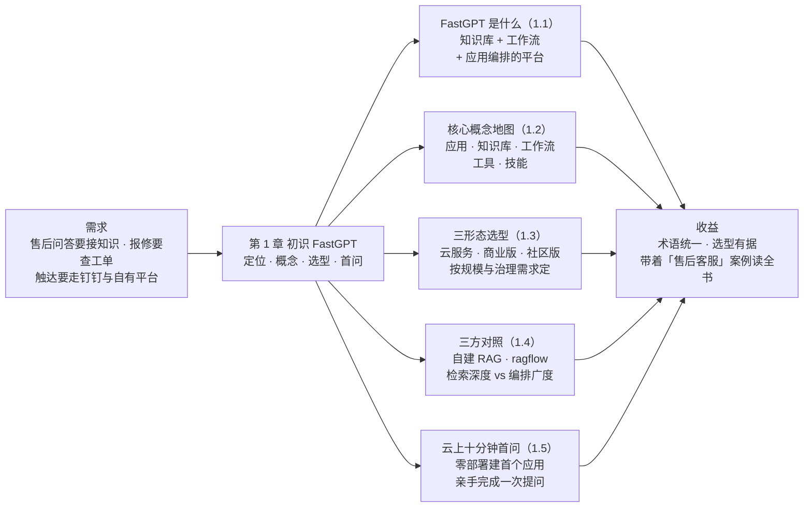
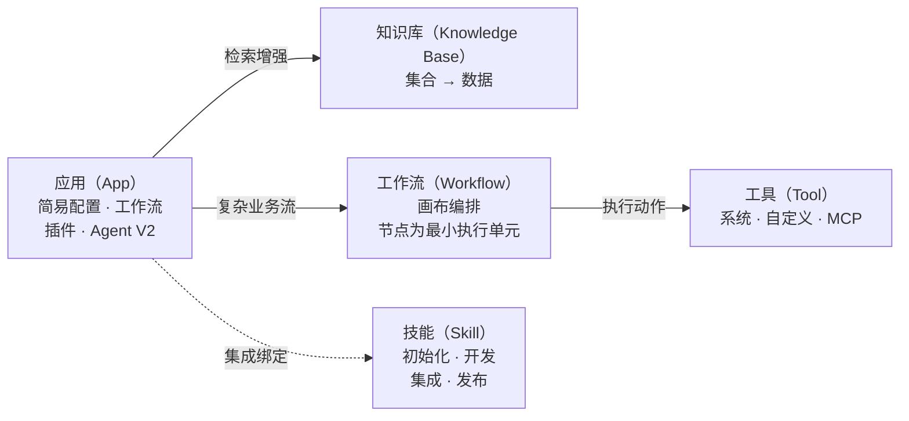
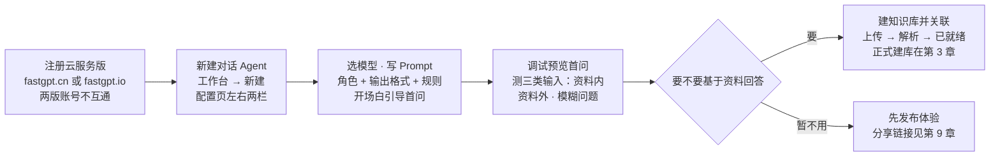

# 第 1 章 初识 FastGPT

> 本章导读：跨境电商客服团队想要一个能答售后问题的机器人——依据政策手册与 FAQ 作答，报修时查工单，还要嵌进钉钉与自有平台。自建要拼向量库、编排框架、渠道接入三摊工程；FastGPT 把整条链路装进一个开箱即用的平台。本章是认知地基：FastGPT 的定位与能力版图；应用、知识库、工作流、工具、技能的概念地图；三形态选型；与自建 RAG、ragflow 的三方对照；最后云上十分钟完成首问。读完本章，你能：讲清 FastGPT 是什么、不是什么；为案例「售后客服」选定形态并给出理由；带着统一术语圈出路线。



*本章导览图*

## 你什么时候需要它

三种典型处境，对应本章三种用法。

**老板问「我们要不要用 FastGPT」，你需要在会上给出理由**——读 1.1 与 1.4。先看它的能力版图，再看它与自建、与 ragflow 的三方对照：大部分「要不要」的答案都在那张表里。

**项目定了用 FastGPT，但不知道选云服务、商业版还是社区版**——直接看 1.3 的对比表与选型立场。功能差异、价格形态、适合团队各有一行，十分钟内可以拍板。

**想先亲手点一遍再决定读不读这本书**——跳到 1.5，注册云服务版，十分钟完成首次提问；觉得顺手，再回到 1.2 的概念地图规划阅读。

本章无前置：1.5 的路线只需要一个浏览器（云服务版开箱即用，自托管的部署与模型通道见第 2 章）。

## 1.1 FastGPT 是什么：把知识库、工作流与应用编排装进一个平台

官方定义一句话（v4.17.3 使用指南「快速了解 FastGPT」，核实日期 2026-11-01）：FastGPT 是一个**基于大语言模型（Large Language Model，LLM）的 AI Agent 应用开发平台，集知识库问答、可视化工作流、Agent 编排、工具调用和技能扩展于一体**，让开发者和业务人员都能快速构建专属 AI 应用。

把定义拆开，就是一张能力版图：

| 能力块 | 官方一句话 | 直白理解 | 展开章节 |
|--------|-----------|---------|---------|
| 知识库问答 | 全能知识库：导入各式文档自动做知识结构化，支持多轮上下文的智能问答 | 文档进去，带依据的答案出来 | 第 3-5 章 |
| 可视化工作流 | 拖拽式界面零代码搭建复杂业务流程，功能节点组件丰富 | 业务流程画在画布上 | 第 7 章 |
| 应用编排 | Agent 编排：对话 Agent、工作流、插件、Agent V2 四种形态 | 不同复杂度的任务用不同形态承载 | 第 6 章 |
| 工具调用 | 系统工具、自定义工具与 MCP 工具 | 让应用不止会答，还能「动手」 | 第 8 章 |
| 技能扩展 | 可版本化的「文档 + 代码」能力包，绑定智能体与沙盒执行 | 把调好的做事章法固化为团队能力资产 | 第 8 章 |
| 发布与集成 | 完全对齐 OpenAI 官方接口，一键接入企业微信、公众号、飞书、钉钉 | 编排好的能力一键交付出去 | 第 9-10 章 |

### 对贯穿案例最要紧的一条：数据智能解析

官方对知识库的数据处理有一段专门描述：智能处理 PDF 的复杂结构，保留图片、表格和 LaTeX 公式，自动识别扫描文件，将内容结构化为清晰的 Markdown；同时支持图片自动标注和索引，让视觉内容可被理解和检索。这正是《售后政策手册》（`after-sales-policy.pdf`，50 页含表格）最吃的能力——赔偿标准表能否保住行列结构，第 3 章入库时见分晓；《物流时效公告》的 HTML 形态与《商品 FAQ》（`product-faq.xlsx`）的表格形态也都在「各式各样的文档」范围内。

### 长处在链路，不在单点

单看每一块——向量检索、工作流引擎、渠道接入——市面上都有单独的开源件。**FastGPT 的长处不在某个单点技术，而在「建知识库、编排流程、发布应用」整条链路装进同一个产品**：开发者和业务人员在同一个界面上协作，配置页即调试页，这是自建路线最难补的一块（1.4 展开）。官方归纳的三条优势也指向这里：像搭积木一样简单灵活（拖拽即可实现复杂业务流程）、让数据更智能（导入、预处理、知识匹配、问答全流程自动化）、开源开放易于集成（标准 API 接入无需改源码，支持 ChatGPT、Claude、DeepSeek 和文心一言等主流模型）。

## 1.2 核心概念地图：应用、知识库、工作流、工具、技能

后续十二章反复出现的就是五个概念。这张表同时给出每个概念在贯穿案例里对应的对象——先混个脸熟，各章展开：

| 概念 | 英文 | 一句话定义 | 贯穿案例中的对象 | 展开章节 |
|------|------|-----------|----------------|---------|
| 应用 | App | 面向用户的对话与流程载体，四形态：简易配置、工作流、插件、Agent V2 | 「售后客服」应用：第 6 章简易配置版入门，第 7 章工作流版为主线 | 第 6、7 章 |
| 知识库 | Knowledge Base | RAG 载体，层次为 知识库 → 集合（Collection） → 数据（Chunk） | `after-sales-kb`：承载三类售后文档 | 第 3-5 章 |
| 工作流 | Workflow | 画布式节点编排，节点（Node）是最小执行单元 | 问题分类 → 知识库搜索 → 查工单 → 答复的主线 | 第 7 章 |
| 工具 | Tool | 模型可调用的外部能力封装：系统工具、自定义工具、MCP 工具 | HTTP 工具节点对接中台工单查询接口 `GET /api/after-sale/tickets?phone={phone}` | 第 7、8 章 |
| 技能 | Skill | 可版本化的「文档 + 代码」能力包，绑定智能体与沙盒执行，可初始化、开发、集成、发布 | 把售后客服的做事章法固化为团队可复用能力包 | 第 8 章 |

概念之间怎么连，一张图说清：



*核心概念的引用关系：应用消费知识库与工作流，工作流驱动工具，应用可集成绑定技能*

### 周边概念速查

主线五概念之外，后续章节还会遇到一批「子概念」。不必现在记住，但提前知道归属，读后续章节不迷路：

| 周边概念 | 归属 | 一句话说明 | 展开章节 |
|----------|------|-----------|---------|
| 集合（Collection） | 知识库 | 知识库下的组织层，通常对应一个文件或一个来源 | 第 3 章 |
| 数据（Chunk） | 知识库 | 最小知识单元，检索与引用的直接对象 | 第 3、4 章 |
| 节点（Node） | 工作流 | 画布上的最小执行单元，连线决定执行顺序 | 第 7 章 |
| MCP 工具 | 工具 | 经模型上下文协议（Model Context Protocol，MCP）接入的外部工具集 | 第 8 章 |
| 渠道 | 发布 | 应用触达终端用户的通道：分享链接、钉钉、飞书、企微、公众号 | 第 9 章 |
| OpenAPI | 发布 | 平台对外接口：应用、对话、知识库均可经 API 消费 | 第 10 章 |
| SignOz / 调用日志 | 运维 | 生产环境的可观测入口 | 第 11 章 |

### 应用四形态：从对话到自主规划

官方快速上手用四个案例展示了应用能力的递进——企业邮件撰写助手（对话 Agent）、民法典问答助手（知识库 + 对话 Agent）、内容审核与自动改写（工作流）、智能数据分析（Agent V2），并给出一张选型回顾表：

| 应用类型（快速上手） | 适合场景 | 核心能力 |
|---------------------|---------|---------|
| 对话 Agent | 轻量问答、文案生成、标准化输出 | Prompt、模型配置、工具调用 |
| 知识库 + 对话 Agent | 基于资料、制度、法条、产品手册的问答 | 文件导入、知识库检索、引用原文 |
| 工作流 | 固定步骤、条件分支、审核流、自动化处理 | 节点编排、判断器、人工确认 |
| Agent V2 | 数据分析、复杂任务、多步推理、动态规划 | 自主规划、工具调用、虚拟机执行 |

（转录自 v4.17.3 快速上手「四种类型选型回顾」，核实日期 2026-11-01。）

按任务复杂度选型的四句话（同出官方）：只做轻量对话或标准化文案生成，优先对话 Agent；回答必须基于已有资料，选知识库 + 对话 Agent；流程固定且需要分支、人工确认或自动化，选工作流；任务开放、步骤不固定、需要自主分析或代码执行，选 Agent V2。官方还特别强调**能力可以组合**——客服助手用知识库回答产品问题，再通过工具查询订单。贯穿案例「售后客服」正是这个组合的完整版：知识库 + 工作流 + 工具查工单，第 7 章落地。

两个补充判断，第 6、7 章会反复用到：一个任务适不适合工作流，看它是否具备「步骤稳定、规则明确、可重复执行」三个特征（快速上手原文）；Agent V2 的代码执行发生在虚拟机里，与本地环境隔离。

## 1.3 三形态对比与选型：云服务、商业版、社区版

同一个 FastGPT，三种取用形态。先看速览：

| 形态 | 定位（官方） | 适合谁 | 上手方式 |
|------|-------------|--------|---------|
| 云服务版 | 官方托管，注册即用 | 快速体验与轻量使用；不想运维的中小团队 | 注册大陆版 fastgpt.cn 或国际版 fastgpt.io（两版账号不互通） |
| 商业版 | 基于社区版的增强版本，增加独有功能 | 对外提供商业服务、需要企业级治理的团队 | 社区版镜像 + 商业版镜像（License 启动）；Sealos 全托管或自有服务器部署 |
| 社区版 | 免费版本，包含所有核心功能（Agent 构建、工作流、知识库） | 个人开发者或小型交付团队 | 自行部署（第 2 章），遵守官方开源协议 |

### 功能差异：社区版缺什么

社区版与付费形态的能力边界，官方有一张完整的功能差异表，本书摘出与本书后续章节相关的行（转录自商业版文档，核实日期 2026-11-01）：

| 能力 | 社区版 | 商业版 / 云服务版 |
|------|--------|------------------|
| 工作流编排、分享链接和 API、知识库、多模型配置、模型日志看板 | ✅ | ✅ |
| 应用发布安全配置、第三方应用发布（飞书、公众号） | ❌ | ✅ |
| 运行日志看板、应用评测、工作流/Agent/Skill 辅助生成 | ❌ | ✅ |
| Web 站点同步、第三方知识库定时同步、知识库文件级权限、图片知识库、索引增强 | ❌ | ✅ |
| 团队空间与权限、多租户与支付、SSO 登录、管理后台 | ❌ | ✅ |

云服务版与商业版在企业级功能上有细节差异：自定义版权与 SSO 登录为「设计中」，管理后台「不需要」——完整矩阵以官方商业版文档为准。这张表预告了本书两处章节的形态前提：应用评测（第 13 章）与 Web 站点同步、文件级权限（第 5 章）都在付费形态一侧；社区版读者读到对应小节时，请先对照此表确认自己的形态是否覆盖。

### 价格与交付形态

价格信息一并转录（据官方商业版文档，核实日期 2026-11-01，发布前需重对）：Sealos 全托管 10000 元起/月（8C32G 资源，3 个月起）或 120000 元起/年，多节点 22000 元起/月（32C128G）；自有服务器部署 14 天内上线，价格联系咨询；技术服务费（定开、维护、迁移、三方接入）2000～3000 元/人/天。官方对部署形态的提示：全托管适合技术人力紧缺、只需关注业务的团队；自有服务器部署可完全落在自己服务器中；单机版适合中小团队对内服务；高可用版面向对外在线服务（可视化监控、多副本、负载均衡、数据库自动备份）。

二次开发的边界也值得知道：可以修改社区版部分代码，不支持修改商业版镜像；二次开发后，后续版本升级需要自己做代码合并（官方 QA 原文）。

### 三个常见误读

- **「商业版是另一个产品」**——不是。官方 QA 写得很直白：完整版应用 = 社区版镜像 + 商业版镜像，商业版只是在社区版之上叠加一个带 License 的镜像并填写内网地址，升级与数据都是延续的；
- **「社区版是试用版」**——不是。官方表述是「包含 FastGPT 所有核心功能：Agent 构建、工作流、知识库」；它缺的是发布安全、评测、站点同步、权限治理这类增强与企业级能力，主线建库与编排不受影响；
- **「云服务与自托管是两个产品」**——概念与主线操作相同，第 3、4、6、7 章的内容两种形态通用；差异在治理与集成能力（本节差异表），以及数据落在谁手里。

### 售后客服的选型与一条挂账

**本书立场：贯穿案例「售后客服」从社区版起步**——知识库、工作流、分享链接与 API 都在社区版核心功能清单内，第 2 章的部署与第 3 章的建库不被形态卡住。但两处例外要提前记账：发布到公众号/飞书渠道、使用应用评测与运行日志看板，需要商业版或云服务版；**钉钉渠道在官方功能差异表中未随「第三方应用发布（飞书、公众号）」单列，社区版可用性待第 9 章落地时实测确认**（已挂本章复核清单）。

**业务上推荐：个人学习与小团队内部使用，从社区版起步，部署见第 2 章；要对外提供多租户服务、需要 SSO/团队权限治理/评测看板，再评估商业版与云服务；只想先体验，直接注册云服务版，按 1.5 十分钟完成首问。**

## 1.4 三方对照：自建 RAG、ragflow 与 FastGPT

售后客服的需求本质上是三段事：文档变知识、知识变流程、流程变服务。三种路线的差异，在于各自在哪一段下功夫：

| 维度 | 自建（向量库 + 编排框架 + 胶水代码） | ragflow | FastGPT |
|------|--------------------------------------|---------|---------|
| 主攻 | 全链路自研，每一环可替换 | 文档解析与检索工程：深度文档理解、混合检索、切片治理 | 应用编排与开箱即用：工作流、应用四形态、渠道与 API |
| 起步方式 | 代码起步，从向量库与检索脚本写起 | 数据集起步，从解析与切片调起 | 应用起步，从配置页与画布点起 |
| 业务协作 | 全靠研发排期 | 运营界面较全，编排在画布 | 开发者与业务人员同平台，配置页即调试页 |
| 对外交付 | 自研接口与渠道 | API 与 MCP Server | 分享链接、IM 渠道、OpenAPI、可发布为 MCP Server |
| 适合当 | 深度定制检索链路、已有平台基建、强合规自持 | 主要矛盾是「复杂文档变成可靠答案」 | 主要矛盾是「把知识、流程、渠道快速串成可上线的应用」 |

**业务上推荐：主要矛盾在检索与解析质量，选 ragflow；主要矛盾在应用编排与交付速度，选 FastGPT；检索要深度定制或基建必须完全自持，走自建。** 三者不互斥——同一售后域，知识底座与应用层可以分别取用；切片治理与质量巡检的方法论在两本书之间互通（见第 13 章）（→ ragflow 书）。

### 何时 FastGPT 更快

本书立场，三条占其一就该认真考虑 FastGPT：**业务与开发要在一个平台上协作建应用**（客服运营能自己改 Prompt 与开场白，不必每次提研发需求）；**流程要接业务系统**（售后客服要在答复前查工单——HTTP 工具节点对接中台的工单查询接口）；**要多渠道交付**（免登录分享链接给客服团队、钉钉触达用户、OpenAPI 供平台侧消费、第 9 章发布为 MCP Server）。反过来，若主要矛盾只是检索质量本身，先看（→ ragflow 书）；若每个环节都要完全自持，走自建——自建路线的工程细节（向量库选型、检索链路组装、Agent 侧消费）不在本书展开（→ agentscope-java 书）。

### 同域不同名：一张术语对照

FastGPT 与 ragflow 同为知识库平台，概念同域但命名不同——两本书对照读时别被名字绊住（对照为本书整理，术语以各自官方文档为准）：

| 概念域 | FastGPT 叫法 | ragflow 叫法 |
|--------|-------------|-------------|
| 知识载体 | 知识库（Knowledge Base） | 数据集（Dataset） |
| 知识单元 | 数据（Chunk） | 切片（Chunk） |
| 编排载体 | 应用 / 工作流（Workflow） | 聊天助手 / 画布 Agent / 摄取管线（Pipeline） |
| 对外暴露 | OpenAPI / MCP Server | API / MCP Server |

### 一条链路看三方分工

```text
用户提问「运输破损怎么赔」
  → 问题分类为售后咨询
  → 知识库检索 after-sales-kb（政策手册 + 商品 FAQ）
  → HTTP 工具查询该用户工单状态
  → AI 对话汇总政策条款与工单状态作答
  → 发布为免登录分享链接与钉钉渠道
```

这条链在 FastGPT 里是「一个知识库 + 一个工作流应用 + 两个渠道」；自建要串起向量库、编排框架、接口服务与渠道 SDK；ragflow 能高质量完成检索段，但渠道与业务流编排不是它的主场。**选型的判断句：看你的主要矛盾落在链路的哪一段。**

## 1.5 快速上手：云上十分钟完成首问

前置：一个浏览器与一个邮箱即可——云服务版开箱自带模型配置，无需自备模型通道（自托管部署的模型通道见第 2 章）。全程在浏览器里完成：



*云上十分钟主线：从注册到首问，可选分支为关联知识库*

### 从注册到首问的六个动作

1. **注册**：打开 fastgpt.cn（中国大陆版）或 fastgpt.io（国际版）注册。两个版本账号不互通（云服务官方文档），团队务必在同一地域注册同一版；
2. **新建应用**：工作台点「新建」，选择对话 Agent。名称按测试目的填写即可——贯穿案例的正式应用「售后客服」到第 6 章才创建，这里不必占用这个名字；
3. **认识配置页**：页面左右两栏，左侧 AI 配置，右侧调试预览——改完即测，这是 FastGPT 应用开发的基本节奏；
4. **选模型**：官方案例提示关注两点——模型是否擅长中文表达、输出是否稳定遵守格式；邮件撰写这类低风险任务不必追求最强模型（官方快速上手案例一）；
5. **写 Prompt**：按「角色定义 + 输出格式 + 规则」三段式组织——角色稳定身份，格式约束结构，规则控制风险边界；这个三段式在本书所有 Prompt 里都会复用；
6. **写开场白并首问**：开场白告诉用户这个应用能做什么；在开场白里写入 `[问题内容]`，用户可以点击一键提问（官方技巧）。然后在调试预览里提出第一个问题。

首问的验证不要只看「答得像不像」——官方对知识库问答的建议同样适用于无知识库的试玩：同时测三类输入，**资料内问题**应给出有据回答、**资料外问题**应如实说明无法确认、**模糊问题**应主动追问补充事实。一个只会「顺着说」的应用不值得上线。

### 首问之后：关联一个知识库

想让回答「有据可查」，走官方快速上手案例二的路径：主页左侧进知识库 → 新建 → 选择文本数据集 → 上传本地文件 → 设置解析参数（处理方式选分块存储，分块条件控制每个分块的 Token 量，快速测试用默认值；索引增强纯文本勾前两项）→ 数据预览检查分块质量 → 状态变为「已就绪」→ 回到应用配置页关联知识库。关联后，应用的回答链路从单纯对话变为**「用户问题 → 知识库检索 → 模型总结回答」**——第 1 章到这里就摸到了 RAG 的门。

测试文件建议用《售后政策手册》截取的一两页：先感受解析与引用的效果就好。分块预览重点看三点——段落是否被异常截断、标题与正文是否在同一语义范围内、表格与条款是否仍然可读（快速上手原文）。正式的 `after-sales-kb` 建设与三类文档各自的更新节奏在第 3 章，解析参数与检索调优在第 4 章。

两种配置的效果差异，正是官方案例一与案例二的关键分野（对照为本书整理）：

| 维度 | 不关联知识库（案例一路线） | 关联知识库（案例二路线） |
|------|--------------------------|--------------------------|
| 回答依据 | 模型自身记忆 | 知识库检索结果 |
| 擅长 | 内容生成、格式化输出 | 制度、手册、法条类问答 |
| 关键配置 | Prompt 三段式 + 工具 | 解析参数 + 引用与免责约束 |
| 主要风险 | 私域事实编造 | 分块质量决定依据质量 |

### 边界与坑

- **对话 Agent 不等于知识库问答**：不关联知识库时，应用凭模型记忆作答——涉私域事实必错，先关联再谈效果；
- **分块过大答案冗长、过小依据破碎**：快速上手阶段用默认配置，正式接入企业资料后再按问答效果调（第 4 章给参数）；
- **高风险场景要在 Prompt 里写边界**：赔偿、法务类问题应仿照官方民法典案例，在规则段写明「基于资料回答、不确定要说明、提示咨询专业人士」；
- **涉及外部凭据的工具先想权限**：官方案例测试 Email 工具时使用邮箱 SMTP 授权码——测试期用最小权限账号，别拿生产凭据做实验。

## 本章小结

1. **FastGPT 是基于 LLM 的 AI Agent 应用开发平台**：知识库问答、可视化工作流、Agent 编排、工具调用、技能扩展集于一体；长处在整条链路装进同一个产品，不在单点技术。
2. **五个核心概念**（应用、知识库、工作流、工具、技能）与**应用四形态递进**（对话 Agent → 知识库 + 对话 Agent → 工作流 → Agent V2），按任务复杂度选型，能力可组合。
3. **三形态**：云服务注册即用；商业版 = 社区版镜像 + 商业版镜像，补齐企业级能力；社区版免费含全部核心功能、自行部署。贯穿案例从社区版起步，钉钉渠道可用性待第 9 章实测。
4. **三方对照**：检索与解析是主要矛盾选 ragflow；应用编排与交付速度选 FastGPT；深度定制或强合规自持走自建——判断句是主要矛盾落在链路哪一段。
5. **下一步**：先按 1.5 在云上完成首问找手感；走自托管路线则进第 2 章部署社区版并打通模型通道，第 3 章正式建设 `after-sales-kb`。

## 验收清单

读到这里，你应该能：

- ☐ 用一句话向同事讲清 FastGPT 的定位，并说出能力版图中每一块对应本书哪几章；
- ☐ 说出应用、知识库、工作流、工具、技能五个概念的职责，并指出贯穿案例中各自的对象；
- ☐ 用官方四形态递进表为三个需求各选一种应用：政策问答、查工单后答复、开放式数据分析；
- ☐ 为售后客服项目写出形态选择（云服务/商业版/社区版）与至少两条依据；
- ☐ 用一句立场句回答「FastGPT 还是 ragflow」，并说出主要矛盾落在链路的哪一段；
- ☐ 在云服务版完成一次首问：配置模型与开场白，提出一个资料内问题并看到带依据的回答。

### 复核清单（发布前）

- [ ] 1.5 云上十分钟路线未实测：注册、新建对话 Agent、Prompt 与开场白配置、知识库关联各步，待环境就绪后按 v4.17.3 界面逐项核验
- [ ] 1.3 功能差异表与价格为官方商业版文档转录（核实日期 2026-11-01）：Sealos 托管价格、自定义版权与 SSO 的「设计中」状态，发布前重对官方文档
- [ ] 钉钉渠道的社区版可用性：官方差异表仅列「第三方应用发布（飞书、公众号）」未单列钉钉，第 9 章落地前实测
- [ ] 应用四形态（简易配置/工作流/插件/Agent V2）与快速上手四案例（对话 Agent/知识库 + 对话 Agent/工作流/Agent V2）的对应关系为本书梳理，待第 6 章素材核对
- [ ] 章首导览图与两张文内 mermaid 图为本书绘制，非官方原图；官方使用指南的截图未引入
- [ ] 快速上手四案例的细节（Email 工具 SMTP 配置、Agent V2 虚拟机开关）未复现，第 6-8 章对应素材到位后核对

## 延伸阅读

- **第 2 章（部署与模型通道）**——选定社区版后的第一个动作：Docker 部署、环境变量与模型通道打通，售后客服的自托管底座。
- **第 3 章（知识库：从文档到知识）**——1.5 里「关联知识库」的完整版：三类售后文档怎么入库、各自的更新节奏怎么定。
- **第 6、7 章（应用与工作流）**——1.2 四形态递进的两端：简易配置版与工作流版「售后客服」的正式落地。
- **（→ ragflow 书）**——检索与解析工程的对侧：1.4 选型看完，去对面看「主要矛盾在检索」时该深读什么。
- **官方文档「快速了解 FastGPT」与「快速上手」**——本章素材原文（guide/getting-started）；能力表述与界面细节以 v4.17.3 官方文档为准。
