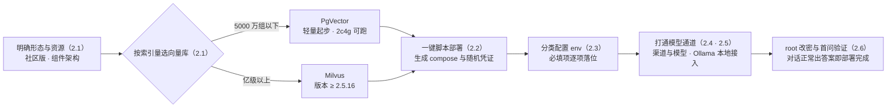
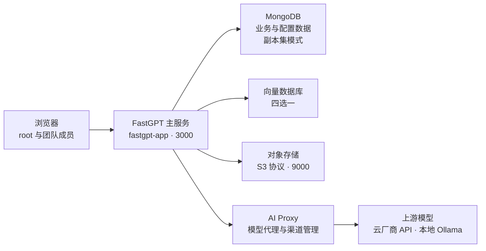
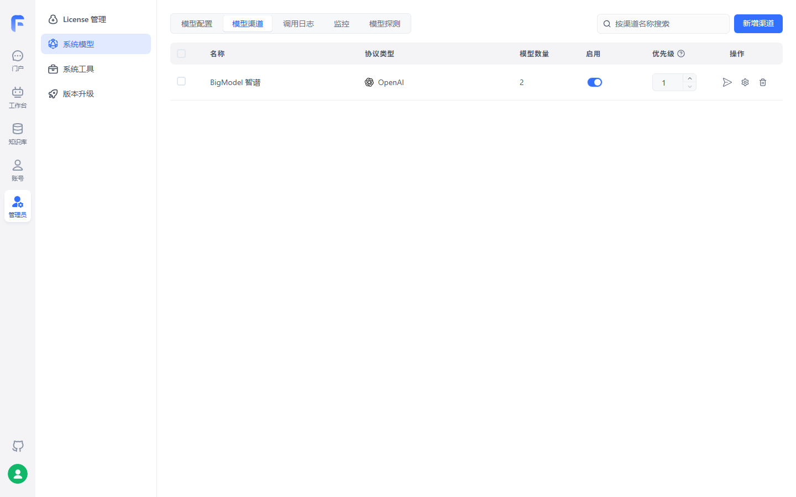
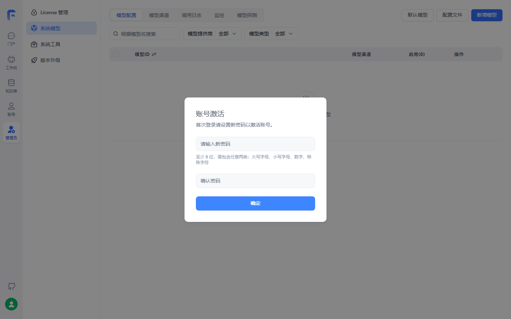
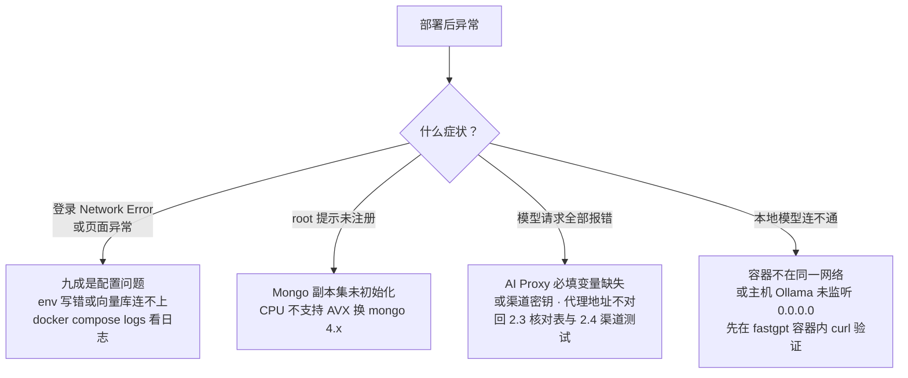

# 第 2 章 部署与模型通道

> 本章导读：第 1 章选定了社区版——现在把「售后客服」的底座真正立起来。本章沿一条操作主线走完全程：先按知识库索引量选向量库与机器配置，再用官方一键脚本完成 Docker Compose 部署；然后进入配置体系——环境变量按类各就各位，模型通道经 AI Proxy 打通，要求数据不出内网时再接一条 Ollama 本地通道；最后激活 root 账号、改掉初始密码，用一次真实问答验证部署成色。部署的难点从来不在「跑起来」，而在配置各归各位、模型通道一次打通、坑在遇到之前就认得。读完本章，你能：为售后客服团队部署一套社区版 FastGPT，配好至少一个语言模型与一个索引模型，完成 root 密码激活，并以一次首问宣布「底座可用」——把知识库的活儿交给第 3 章。



*本章操作流程图*

## 你什么时候需要它

三种典型处境，对应本章三种用法。

**团队要一套私有化部署的 FastGPT，数据不出内网**——按 2.1 到 2.2 的顺序走：选型、部署、改配置一气呵成。售后客服的底座就是这么立的：政策手册与商品 FAQ 都是企业内部语料，社区版自部署是它们进得来的前提。

**部署已经完成，但模型配不平、对话报错**——直接看 2.4（渠道与模型配置）与 2.6 的排障决策树。大多数故障集中在两处：AI Proxy 的两个必填环境变量，以及渠道的代理地址与密钥。

**想在正式采购算力前先接本地模型试试效果**——看 2.5（Ollama）。语言模型与索引模型都可以走本地；2.1 的资源表帮你判断这台机器扛不扛得住。

前置：一台 Linux 服务器（或 WSL2），装有 Docker 与 Docker Compose（版本建议 2.17 以上）；测试档资源 2c4g 起步（依据 v4.17.3 官方部署文档，核实日期 2026-11-01）。

## 2.1 部署形态与资源：先定向量库，再定机器

### 社区版里有什么

官方 Docker Compose 部署由一条主服务加四个配套组件构成（依据 v4.17.3 部署文档）。先看全景，再逐个说清职责：



| 组件 | 职责 | 本章相关事实 |
|------|------|-------------|
| FastGPT 主服务 | 应用本体：页面、API、工作流、知识库 | 容器 `fastgpt-app`，默认端口 3000 |
| MongoDB | 存储除向量外的各类数据——用户、应用、对话、配置 | 模板以副本集（Replica Set）模式运行并自动初始化 |
| 向量数据库 | 存储向量数据 | 四选一：PostgreSQL（pgvector）、Milvus、OceanBase、SeekDB；Zilliz Cloud 为 Milvus 的云上托管形态 |
| AI Proxy | 必需的模型服务：模型请求代理与管理员渠道管理 | V4.17.0 起为必需依赖，缺失则启动校验失败 |
| 对象存储 | 文件与图片类资产 | S3 协议，默认 MinIO，端口 9000 |

### 向量库怎么选：索引量是唯一主变量

官方按知识库索引量给出一句话结论：**PgVector 非常轻量，适合索引量在 5000 万组以下；Milvus 对亿级以上向量性能更优秀**。四个方案的选型表：

| 方案 | 适合 | 关键事实 |
|------|------|---------|
| PgVector | 绝大多数起步团队 | 测试档 2c4g 单节点即可跑；亿级以下够用 |
| Milvus | 亿级以上向量 | **版本必须 ≥ 2.5.16，低于此版本 FastGPT 启动直接报错退出**；测试档 2c8g 起步 |
| Zilliz Cloud | 不想自管向量库 | Milvus 原厂全托管 SaaS，向量在云上，本机几乎不占资源 |
| OceanBase / SeekDB | 已有 OceanBase 生态 | SeekDB 基于 MySQL 协议、与 OceanBase 完全兼容，资源档位与 PgVector 相同 |

PgVector 版的官方资源档位（单节点）：

| 环境 | 最低配置 | 推荐配置 |
|------|---------|---------|
| 测试 | 2c4g | 2c8g |
| 100w 组向量 | 4c8g 50GB | 4c16g 50GB |
| 500w 组向量 | 8c32g 200GB | 16c64g 200GB |

还有一个现在看不出后果、到第 4 章会兑现的差异：**只有 Milvus 方案自带 BM25 全文检索**（走 `modeldata_v2` 单表），其他向量库的全文检索走 MongoDB `$text`。第 4 章选检索方案时，这条会重新浮出水面。

### 「售后客服」底座的选型

贯穿案例 `after-sales-kb` 的三类文档——50 页政策手册、约 200 行商品 FAQ、若干物流公告——索引量离 5000 万组差着几个数量级。**业务上推荐从 PgVector 起步**：轻、稳、够用，测试档 2c4g 就能把本章走完；真到亿级或需要 BM25 混合检索，再迁 Milvus（向量库迁移属于数据迁移话题，见第 11 章）。

### 边界与坑

- Milvus 版本低于 2.5.16 不是降级运行，而是**启动报错退出**——部署前先确认版本；
- 老旧 CPU 可能不支持 AVX 指令集，Mongo 5.x 起不来，需要换 4.x 镜像（排障见 2.6 决策树）；
- 交互式脚本随机生成的密码与密钥都写在 `docker-compose.yml` 里——**这个文件就是你的凭证库，升级时基于它调整，不要弄丢**。

## 2.2 Docker Compose 部署：一键脚本与四个步骤

### 三条部署路线

官方给三条路线，按「谁来做配置决策」分：

| 路线 | 做法 | 适合 |
|------|------|------|
| AI Agent 代部署 | 把官方 `SKILL.md` 交给 Coding Agent 代办 | 想让代理跑完全流程 |
| **交互式脚本（本章主线）** | 一条命令启动引导，脚本代写配置 | 常规服务器部署 |
| 手动下载 + 本地 compose 模式 | 先下 compose 与 `install.sh`，再以 `FASTGPT_LOCAL_COMPOSE_PATH` 生效 | 固定 compose 文件、完全离线、自定义镜像源（Harbor） |

交互式脚本在 Linux、MacOS 与 Windows WSL 下执行：

```bash
FASTGPT_DEPLOY_BASE_URL=https://doc.fastgpt.cn bash <(curl -fsSL https://doc.fastgpt.cn/deploy/install.sh)
```

脚本会自动完成四件事：下载 `docker-compose.yml`；引导选择 S3 与 MCP 的外部访问地址并写入配置；随机生成 root 登录密码、服务间 Token、应用密钥与组件密码并写入 compose；检测宿主机 Docker socket 路径并替换挂载。一句话：**该随机的地方它都替你随机了**。执行完成后终端输出本次的 root 密码，妥善保存；非交互模式还必须用 `FASTGPT_FE_DOMAIN` 指定访问地址。

### 从部署到打开页面：四个步骤

| 步骤 | 操作 | 要点 |
|------|------|------|
| 1 修改环境变量 | 编辑 `docker-compose.yml` 中 `fastgpt-app` 的 `environment` | `FE_DOMAIN` 必填，其余必填项脚本已生成（2.3 逐项核对） |
| 2 开放端口 | 防火墙或安全组放行下表端口 | 反向代理场景由代理负责公网端口 |
| 3 启动容器 | 先预拉取、再启动 | compose 版本建议 2.17 以上 |
| 4 访问 | 浏览器打开 `FE_DOMAIN` 地址 | 用户名 `root`，首登流程见 2.6 |

必填的 `FE_DOMAIN` 是用户实际访问 FastGPT 的完整地址（协议 + 主机 + 可选端口，如 `https://fastgpt.example.com`），用于补全文件、图片等资源路径——不能留空，也不要填容器内部地址。启用 Agent/Skill 沙盒时还需追加沙盒的 WebSocket 与预览地址两项；售后客服底座暂不启用沙盒，先留空（生产配置见第 11 章）。

需要放行的端口：

| 端口 | 服务 | 说明 |
|------|------|------|
| 3000 | FastGPT 主服务 | 宿主机端口可用 `FASTGPT_PORT` 修改 |
| 9000 | S3 对象存储 | 文件服务 |
| 3006 | Agent Sandbox Proxy | 启用沙盒才需要 |
| 3003 | SSE MCP Server | 对外发布 SSE MCP 应用才需要，可以不开（见第 9 章） |

启动命令：

```bash
# 预拉取所有服务及沙盒运行时镜像
docker compose --profile prepull pull
# 启动
docker compose up -d
```

### 边界与坑

- **登录后整个浏览器 tab 无响应**是已知问题：删掉该 tab 重新打开一次即可；
- 系统插件从 V4.14.0 起不再预装，`fastgpt-plugin` 镜像只提供运行环境，需从插件市场或 `.pkg` 文件手动安装（见第 8 章）；
- 升级不要跨版本：先看更新文档，改镜像 tag 后 `docker compose up -d`，如有初始化脚本则执行（完整升级与迁移见第 11 章）；
- 容器间互访走 compose 的桥接网络（默认网络名 `fastgpt`）——外部容器想访问 FastGPT 侧的服务，必须加入同一网络，这是 2.5 接 Ollama 的前置知识。

## 2.3 环境变量：唯一的配置入口

### 配置体系的一件事变迁

从 4.15.0 起，开源版不再读取 `config.json`——历史上写在配置文件里的可选项（自定义 PDF 解析、检索参数等）全部改为环境变量。今天的规则很简单：**改配置就是改 `docker-compose.yml` 里 `fastgpt-app` 的 `environment`，改完 `docker compose up -d` 重启生效**。布尔变量有约定写法：`true`、`1`、`yes`、`y` 都算开启，其余值视为关闭。

### env 分类表

环境变量数量庞大，官方按消费方与职责分组。按类记忆，按类排查：

| 分类 | 代表变量 | 管什么 |
|------|---------|--------|
| 必填密钥 | `AIPROXY_API_ENDPOINT`、`AIPROXY_API_TOKEN`、`FILE_TOKEN_KEY`、`AES256_SECRET_KEY`、`INVOKE_TOKEN_SECRET` | 模型通道与文件鉴权、加解密、反向调用凭证——缺一则启动校验失败 |
| 站点与前端 | `FE_DOMAIN`、`FILE_DOMAIN`、`SYSTEM_NAME` | 对外访问地址、文件域名、站点名称 |
| 数据库与向量库 | `MONGODB_URI`、`PG_URL`、`MILVUS_ADDRESS`、`REDIS_URL` | 主库与缓存固定填；向量库地址按 2.1 所选方案二选一 |
| 服务集成 | `PLUGIN_BASE_URL`、`CODE_SANDBOX_URL`、`MARKETPLACE_URL` | 插件服务、代码沙箱、插件市场地址 |
| 对象存储 | `STORAGE_VENDOR`、`STORAGE_EXTERNAL_ENDPOINT` | 存储类型（minio、aws-s3、r2、cos、oss）与外部可访问地址 |
| 安全 | `AUTH_COOKIE_SECURE`、`ALLOWED_ORIGINS`、`CHECK_INTERNAL_IP` | HTTPS Cookie、跨域白名单、SSRF 内网检查 |
| 功能限额 | `WORKFLOW_MAX_RUN_TIMES`、`CHAT_MAX_QPM`、`UPLOAD_FILE_MAX_SIZE` | 工作流运行次数（默认 500）、聊天 QPM、上传大小（MB） |
| 可观测 | `LOG_ENABLE_OTEL`、`CHAT_LOG_URL` | 日志、指标、链路上报与对话日志推送（第 11 章，→ langfuse 书） |

商业版另有 Admin 侧变量（计费、爬虫、短信代理等），社区版用不到；代码沙箱与 Volume Manager 各有独立变量组，均只在启用对应功能时配置（见第 11 章）。

### 必填项核对表

交互式脚本已把密钥类随机生成，你真正要过目的是六项：

| 变量 | 约束 | 脚本部署时的来源 |
|------|------|-----------------|
| `FE_DOMAIN` | 完整访问地址，不能是容器内部地址 | 需要你手动填写 |
| `AIPROXY_API_ENDPOINT` | AI Proxy 根地址（如 `http://aiproxy:3000`），不要附加 `/v1` | 模板预置 |
| `AIPROXY_API_TOKEN` | 与 AI Proxy 管理凭证一致，不能为空 | 模板预置 |
| `FILE_TOKEN_KEY` | 长度至少 6 位 | 脚本随机生成 |
| `AES256_SECRET_KEY` | 长度至少 6 位 | 脚本随机生成 |
| `INVOKE_TOKEN_SECRET` | 长度至少 32 位 | 脚本随机生成 |

### 验证加载与两个高频坑

验证环境变量是否生效，进容器直接看：

```bash
docker exec -it fastgpt sh
env
```

两个官方 FAQ 里反复出现的坑：

1. **S3 连不上、签名报 403**——`STORAGE_EXTERNAL_ENDPOINT` 填了 `127.0.0.1` 或 `localhost`。该地址用于签发对象存储的访问 URL，回环地址会让签发与上传的 URL 不一致；应填宿主机静态 IP 或固定域名；
2. **改了 env 没生效**——环境变量在容器启动时注入，改完必须 `docker compose up -d` 重建容器，刷新页面是没有用的。

顺带埋一个伏笔：开源版支持接入 PDF 增强解析服务（自定义解析服务、SoMark、TextIn、Doc2x 四选一，优先级自左向右）。50 页含表格的《售后政策手册》若内置解析吃力，这里的 `CUSTOM_PDF_PARSE_URL` 等变量就是增强入口——第 3 章导入时再决定要不要用。

## 2.4 模型通道：渠道与模型

### AI Proxy：唯一的模型入口

V4.17.0 起，FastGPT 的所有模型请求统一经 AI Proxy 代理——它同时提供负载均衡（Load Balancing）、模型日志与数据看板。旧的 `OPENAI_BASE_URL`、`CHAT_API_KEY` 变量替代不了它；即使某个模型单独配置了自定义请求地址，AI Proxy 也省不掉。模型侧的一切配置，入口都在**「管理员 → 模型提供商」**页面。

### 五类模型：两类必需，三类按需

| 模型类型 | 干什么 | 售后客服需要吗 |
|---------|--------|---------------|
| 语言模型 | 文本对话，多模态模型支持图片识别 | **必需，至少一个** |
| 索引模型 | 对文本块做索引，用于相关文本检索 | **必需，至少一个** |
| 重排模型 | 对检索结果重排，优化排名 | 可选（第 4 章调优时引入） |
| 语音合成 | 文本转语音 | 可选 |
| 语音识别 | 语音转文本 | 可选，同时只生效一个，配一个即可 |

### 渠道与模型：两个对象，四个步骤

先分清两个对象：**模型渠道**是一个提供商协议下的接入点（OpenAI、Anthropic、Google 等，多数厂商兼容 OpenAI 协议）；**模型**是能力声明本身。同一模型可配置进多个渠道实现负载均衡；渠道还有 1～100 的优先级，数值越大越优先。请求里的 `model` 字段值叫**模型 ID**（全局唯一），页面上展示的名字叫**模型名**（可自定义）。官方不建议绕过渠道直连（自定义请求地址/Key），不方便统一管理。

把模型接进系统的标准四步：

| 步骤 | 入口与操作 | 要点 |
|------|-----------|------|
| 1 创建渠道 | 「模型渠道」标签页 → 新增渠道 | 渠道名仅作标识；协议类型按厂商选；代理地址填 BaseUrl 并注意是否要加 `/v1`；API 密钥从厂商获取，部分厂商需多个密钥组合 |
| 2 渠道测试 | 渠道列表 → 模型测试 → 开始测试 | 输出每个模型的测试结果与请求时长，不通先修渠道 |
| 3 启用模型 | 「模型配置」→ 模型右侧点启用 | 系统内置主流厂商模型，不熟悉配置可直接启用；**模型 ID 须与渠道中的模型一致** |
| 4 模型测试 | 模型右侧测试入口 | 按模板实发一个请求，初步验证可用性 |

本书底座的渠道就是这么建的。实测中，智谱的 OpenAI 兼容端点接入后，「模型渠道」列表里就是这一行记录：



一行渠道承载了本章要求的最低配置：语言模型 glm-5.3-flash 与索引模型 embedding-3 经同一 OpenAI 协议渠道接入（模型数量 2），启用开关打开即对外服务；真实调用打通后，2.6 的首问验证才有话可答。

渠道里有一个实用机制——**模型映射**：FastGPT 与 AI Proxy 之间用你定义的模型 ID，AI Proxy 向上游发送映射后的真实模型：

```json
{
  "gpt-4o-test": "gpt-4o"
}
```

适合对内统一命名、对上屏蔽真实模型名，或做灰度切换。

### 模型配置结构：字段即能力声明

新增自定义模型有两条路：页面表单，或配置文件（便于把一个系统的配置复制到另一个系统）。若新模型的模型 ID 与内置模型重复，系统视为修改内置模型而非新增。语言模型的核心字段（依据 v4.17.3 模型配置文档）：

| 字段 | 示例值 | 含义 |
|------|--------|------|
| `model` | `gpt-5` | 模型 ID，与渠道中的模型名一致 |
| `name` | `gpt-5` | 展示别名，应用列表里看到的是它 |
| `maxContext` / `maxResponse` | 125000 / 16000 | 最大上下文 / 最大回复 |
| `quoteMaxToken` | 120000 | 最大引用内容——知识库引用上限，第 4 章调参会遇到 |
| `maxTemperature` | 1.2 | 温度上限 |
| `vision` | `true` | 是否支持图片输入 |
| `toolChoice` / `functionCall` | `true` / `false` | 工具选择与函数调用能力；均不支持时走提示词模式（第 7 章工具调用的依赖项） |
| `defaultSystemChatPrompt` | —— | 对话默认携带的系统提示词 |
| `defaultConfig` / `fieldMap` | `{}` | 请求默认参数 / 字段映射（如 o1 需把 `max_tokens` 映射为 `max_completion_tokens`） |
| `pricing` | `{"tiers": [...]}` | 计价（商业版积分）：语言模型用 `tiers` 阶梯（`inputPrice`、`outputPrice`、可选 `maxInputTokens`），单位为 M Tokens |

索引模型字段少而关键：`defaultToken`（默认 512，文本分割的默认粒度）与 `maxToken`（默认 3000，模型上限）——这两个数字会直接进入第 3 章的切片行为；计价用 `pricing.unitPrice`（每百万 Tokens）。重排模型额外支持 `requestUrl` 与 `requestAuth` 自定义请求地址与认证。计费仅作用于系统模型，团队内自定义模型免费。

### 渠道健康：探测与调用日志

管理员可开启**模型状态探测**：系统按设定间隔（5～60 分钟）周期探测所有已启用模型，生成 48 小时稳定性图，并在状态边沿变化时经 Webhook 推送告警。三种健康状态：

| 状态 | 判定 |
|------|------|
| 正常 | 测试成功且响应延迟 ≤ 30 秒 |
| 高延迟 | 成功但延迟 > 30 秒 |
| 异常 | 单轮 4 次尝试（首次失败自动重试，最多 3 次）全部失败 |

调用日志页能看到每个请求的输入输出 tokens、耗时与错误入参——排模型问题的第一现场；默认仅保留 1 小时（可用环境变量调整）。告警与日志的体系化用法在第 11 章（→ langfuse 书）。

### 边界与坑

- **渠道挂模型有前置依赖**：模型渠道里只能增加「模型配置」中已有的模型——系统仅内置主流模型，要接渠道里没有的模型（如 2.5 的 Ollama 模型），须先在「模型配置」中新增（依据 v4.17.3 官方「模型提供商」文档）；
- **模型 ID 对不上是头号错误源**：启用模型的 ID 必须与渠道里的模型一致，否则调用直接报「模型不存在」——渠道测试与模型探测都会把这类错误暴露出来；
- 语音识别模型同时只生效一个，配多个没有意义；
- 渠道可以随时启用/禁用，禁用的渠道不再提供模型服务——换密钥、换厂商时用禁用做切换开关。

## 2.5 本地模型：接入 Ollama

### 什么时候需要本地模型

**本书立场：先用云上 API 把链路跑通，再决定要不要本地化。**本地模型省下的是调用费用与数据出域顾虑，付出的是机器、显存与运维。对售后客服场景，政策语料敏感度高，常见起点是让**索引模型**先走本地——它只做向量化，对机器的要求远低于语言模型（这是本书的工程判断，最终以第 4 章检索测试的召回质量为准）。

[Ollama](https://ollama.com/) 是开源的大模型部署工具，一键下载运行各种模型。官方推荐 Docker 方式安装——装在宿主机上还得解决容器访问宿主机的问题，徒增麻烦。

### 安装：优先 Docker，且与 FastGPT 同网络

```bash
docker pull ollama/ollama
# 关键：加入 FastGPT 所在网络（compose 默认网络名为 fastgpt）
docker run --rm -d --name ollama --network fastgpt -p 11434:11434 ollama/ollama
```

坚持主机安装时，必须让 Ollama 监听 `0.0.0.0`，容器才能访问到它：

| 系统 | 安装 | 监听 0.0.0.0 的设置 |
|------|------|--------------------|
| Linux | 官网安装脚本，`ollama serve` 启动 | `systemctl edit ollama.service`，在 `[Service]` 加 `Environment="OLLAMA_HOST=0.0.0.0"` 后重启服务 |
| MacOS | `brew install ollama` | `launchctl setenv ollama_host "0.0.0.0"` 后重启应用 |
| Windows | 官网安装程序 | 新建系统环境变量 `OLLAMA_HOST=0.0.0.0` 后从开始菜单重启应用 |

### 拉模型与连通性验证

```bash
# Docker 部署先进容器再拉模型
docker exec -it ollama /bin/sh
ollama pull [模型名]
ollama ls
```

接着做**最容易被跳过、又最能省半小时排障的一步**——进 FastGPT 容器验证两边通不通：

```bash
docker exec -it fastgpt sh
# 容器部署的 Ollama 用容器名；主机部署用主机 IP，唯独不能用 localhost
curl http://ollama:11434
```

能看到 Ollama 服务信息即通信正常。不通就回头查两件事：容器是否在同一网络、主机安装是否监听了 `0.0.0.0`。

### 接入渠道与启用

验证通过后，回到 2.4 的同一套流程，只有两处取值不同：

1. 「模型配置 → 新增模型」：**模型 ID 必须与 `ollama ls` 看到的模型名完全一致**；
2. 「模型渠道 → 新增渠道」：协议选 Ollama（或 OpenAI 兼容），代理地址——容器部署为 `http://[容器名]:[端口]`，主机部署为 `http://[主机 IP]:[端口]`；OpenAI 兼容直连时地址为 `http://地址:端口/v1`。Ollama 默认不需要鉴权，开启了鉴权才填密钥。

之后在工作台创建应用即可选到该模型——列表里显示的是你在模型配置里设置的别名。两个细节：**同一个模型无法多次添加**，重复添加时系统采用最新一次设置的别名；老用户若沿用 OneAPI，可将其作为一个 OpenAI 协议渠道接入（地址为 OneAPI 开放地址加 `/v1`，密钥填 OneAPI 令牌），官方亦提供从 OneAPI 迁移渠道配置的脚本。

### 边界与坑

- **先 curl 后配渠道**——顺序反过来，渠道报错时你分不清是配置错还是网络不通；
- 主机部署的 Ollama 地址不能用 `localhost`：FastGPT 容器里的 localhost 是容器自己；
- `docker-compose.yml` 用桥接网络 `fastgpt` 隔离，外部镜像不加入该网络就无法通过容器名互访。

## 2.6 root 密码与首问验证

### root：从 123456 到你自己的密码

从 v4.17.3 起，FastGPT 引入账号激活机制与内置密码重置命令行工具，移除了「每次重启容器按 `DEFAULT_ROOT_PSW` 重写密码」的旧逻辑。四种场景一张表：

| 场景 | 操作 |
|------|------|
| 首次部署登录 | 初始密码固定为 `123456`，账号处于待激活状态；登录后弹出**不可关闭**的「激活账号」窗口，设置新密码后方可使用系统 |
| 日常修改 | 右上角头像 → 「个人信息」→ 安全设置 → 修改密码，保存后立即生效 |
| 忘记密码 | 在部署目录执行容器内重置脚本，无需重启服务，旧登录会话全部失效 |
| v4.17.2 及更早 | 修改 compose 中的 `DEFAULT_ROOT_PSW`（或 YAML 锚点）后 `down`/`up` 重启生效——历史版本行为 |

忘记密码的重置命令：

```bash
docker compose exec fastgpt-app node /app/scripts/reset-root-password.cjs '你的新密码'
# 执行成功输出：root 密码已重置
```

新密码含 `$`、`!`、`#` 等特殊字符时，**务必用单引号包裹**，避免被宿主机 Shell 提前解析转义。首次登录时系统会提示未配置语言模型与索引模型，并自动跳转模型配置页——正好顺势进 2.4；若整个页面无响应，删掉 tab 重开即可。

表中的「不可关闭」在实测里得到了验证——以下界面截图来自本地部署的 FastGPT 社区版 v4.17.3（2026-11-03 实测，模型 glm-5.3-flash + embedding-3）：



初始密码登录后，系统立即弹出「账号激活」窗口——没有关闭入口，不设新密码寸步难行，与表中「不可关闭」的描述一致；密码规则（至少 8 位、至少两类字符组合）就标在输入框下方，图中背景正是激活前打开的系统模型配置页。

### 首问验证：部署完成的标志

底座可用与否，不看容器起没起，看问答通不通。五步验证：

1. 浏览器打开 `FE_DOMAIN` 地址，`root` 加新密码登录成功；
2. 「管理员 → 模型提供商」：至少一个语言模型与一个索引模型处于已启用状态，且模型测试通过；
3. 工作台新建一个简易配置应用（应用形态见第 6 章），语言模型选刚启用的那个；
4. 在对话里发一条真实问题，流式回答正常返回；
5. 此刻验证的是**模型通道**，不是知识库——问售后政策它还答不上来，那要等 `after-sales-kb` 建好并完成检索（第 3 章、第 4 章）。

### 部署排障决策树

首问不通过时，按症状分流。官方 FAQ 里的高频故障收敛成四个方向：



两个补充事实：Mongo 副本集自动初始化在主流环境均已全自动，仍失败时可按官方 FAQ 手动生成密钥并执行 `rs.initiate` 初始化；未配置 SSL 证书时，知识库导出与语音输入/播报功能不可用（浏览器安全策略限制）。

### 边界与坑

- 部署完成的判定标准只有一条：**root 改过密、两类模型在线、首问有答案**——三条缺一不可；
- 遇到 `relation "modeldata" does not exist` 是 PG 向量库没连上或初始化失败，看 PG 容器与 fastgpt 日志；
- 排障先分层（页面 → 登录 → 模型 → 本地模型），不要一上来就重建容器——绝大多数故障在配置层就能定位。

## 本章小结

1. **社区版是五个组件的组合**：主服务、MongoDB（副本集模式）、向量库（四选一）、AI Proxy（V4.17.0 起必需）、对象存储；索引量决定向量库——**起步推荐 PgVector**，亿级或需要 BM25 全文检索再上 Milvus（≥ 2.5.16）。
2. **部署主线是交互式脚本**：下载 compose、写入 S3/MCP 地址、随机生成全部凭证四件事自动完成；生成的 `docker-compose.yml` 与输出的 root 密码要妥善保管。
3. **环境变量是唯一配置入口**（4.15.0 起 `config.json` 退出）；按八类就位，`FE_DOMAIN` 与 AI Proxy 两项必填；改完 `up -d` 重建容器，进容器用 `env` 验证。
4. **模型通道两层结构**：渠道连接厂商，模型声明能力；创建渠道 → 渠道测试 → 启用模型 → 模型测试四步走完，语言模型与索引模型至少各一；模型 ID 全局一致是铁律。
5. **Ollama 接入三要素**：同网络、监听 `0.0.0.0`、FastGPT 容器内 curl 验证通过；本地化前先算机器与运维的账。
6. **v4.17.3 的 root 密码机制**：首登 `123456` 强制激活，忘记密码一条 CLI 命令重置且不重启服务；部署完成的标志是首问验证通过。

下一步：底座已立，「售后客服」还差知识。第 3 章为 `after-sales-kb` 建库——50 页《售后政策手册》、约 200 行《商品 FAQ》与《物流时效公告》三类文档怎么进来、怎么切块，索引模型的 `defaultToken` 与 `maxToken` 将在那里变成切片参数。

## 验收清单

读到这里，你应该能：

- ☐ 画出社区版部署的组件图，说出五个组件各自的职责，并解释向量库四选一的依据；
- ☐ 完成交互式脚本部署，并指出脚本自动生成的 `docker-compose.yml` 里随机出了哪些凭证；
- ☐ 说出 `FE_DOMAIN` 的取值要求，并解释为什么不能填容器内部地址；
- ☐ 进容器用 `env` 验证配置加载，并演示修改一个环境变量后的正确生效方式；
- ☐ 走通一条完整模型通道：创建渠道、渠道测试、启用模型、模型测试四步全部通过；
- ☐ 接入一个 Ollama 本地模型，并在 FastGPT 容器内 curl 验证连通之后再配渠道；
- ☐ 完成 root 密码激活与一次 CLI 重置，并用新密码登录完成首问验证。

### 复核清单（发布前）

已实测项已勾销并注明环境，其余各项发布前逐条补验：

- [ ] 全章命令与行为对照官方文档 v4.17.3（self-host/deploy/docker、self-host/config/env、self-host/config/model/intro、self-host/custom-models/ollama、self-host/config/root-password），核实日期 2026-11-01；
- [ ] 交互式脚本全流程实测：凭证随机生成、S3/MCP 地址写入、非交互模式 `FASTGPT_FE_DOMAIN` 必填校验；
- [x] 首登激活弹窗已实测（2026-11-03，社区版 v4.17.3 本地部署）——初始密码登录后弹出不可关闭的「账号激活」窗口，改密后进入系统（见 2.6 插图）；
- [ ] PgVector 与 Milvus 两套 compose 各启动一次，核对端口表与「tab 无响应删掉重开」的已知问题（首登激活部分已实测并配图）；
- [ ] AI Proxy 启动校验实测：去掉 `AIPROXY_API_TOKEN` 验证启动失败提示；
- [x] 模型渠道配置与真实调用已实测（2026-11-03，社区版 v4.17.3 本地部署）——智谱 OpenAI 兼容端点接入 glm-5.3-flash 与 embedding-3，渠道启用并真实调用成功（见 2.4 插图）；
- [ ] 渠道测试按钮、模型测试与模型状态探测三处实测：核对 48 小时稳定性图、三状态判定与 Webhook 报文；
- [ ] Ollama 三种连通场景实测：同网络容器互访、主机监听 `0.0.0.0`、localhost 不可用；
- [ ] `reset-root-password.cjs` 实测：普通密码与含特殊字符密码（单引号包裹）各一次，验证旧会话失效；
- [ ] 章首操作流程图与 2.6 排障决策树的 GitHub 网页端渲染检查。

## 延伸阅读

- **第 3 章（知识库：从文档到知识）**——首问之后的正事：`after-sales-kb` 建库与三类售后文档入库；索引模型的 `defaultToken`/`maxToken` 在那里变成切片参数。
- **第 4 章（检索方案与调优）**——向量库选型的后效：只有 Milvus 自带 BM25 全文检索；重排模型与 `quoteMaxToken` 引用上限都会在那里登场。
- **第 6 章（应用与对话 Agent）**——首问验证里那个简易配置应用的完整形态：AI 参数、开场白与对话输入引导。
- **第 11 章（生产运维）**——env 的分层治理、对象存储选型、模型探测告警与升级迁移的完整方法论；本章的端口、密钥与凭证文件是它的地基。
- **（→ ragflow 书）第 2 章**——同为「部署与模型通道」，RAGFlow 的部署形态与模型配置对照阅读，选型期把两边的资源账一起算。
