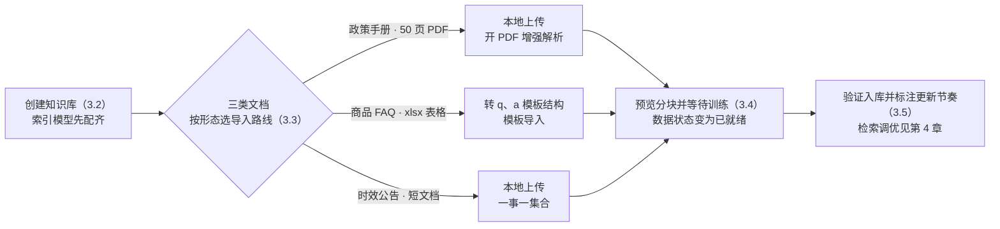

# 第 3 章 知识库：从文档到知识

> 本章导读：第 2 章部署完成、模型通道已通——售后域的知识怎么进来？本章为贯穿案例创建知识库 `after-sales-kb`：《售后政策手册》（季度级改版）、《商品 FAQ》（每周更新）、《物流时效公告》（时效敏感）。本章依次解决：RAG 原理与「库 → 集合 → 数据」结构；索引模型与文件处理模型；导入路线与格式；数据（Chunk）训练与管理；三类文档入库与更新节奏标注。读完本章，你能：建一个配置有据的知识库，为每类文档选对导入路线，走通「上传 → 解析 → 已就绪」链路，说清三类文档的更新节奏。



*本章操作流程图*

## 你什么时候需要它

三种典型处境，对应本章三种用法。

**手里一批文档要变成能问答的知识库，不知从哪下手**——按 3.2 → 3.3 → 3.4 的顺序走：先建库并确认索引模型可用，再按文档形态选导入路线，最后等训练完成。任何一步跳过，都会在「搜不到」时绕远路。

**文档格式五花八门，哪些能传、怎么传**——直接看 3.3 的格式表与模板导入小节；「文件格式异常」「中文乱码」「解析失败」三个高频坑也都在那一节。

**文档已经入库，应用里却搜不到或答不对**——先查 3.4 的训练状态：数据没到「已就绪」，检索无从谈起；状态就绪后仍不准，那是检索方案的问题，去第 4 章。

前置：第 2 章完成部署，且至少一个索引模型可用（模型从哪来见第 2 章）。

## 3.1 概述：从文档到知识要过几道关

FastGPT 知识库的原理基座是检索增强生成（Retrieval-Augmented Generation，RAG）——一种把信息检索与生成模型结合的混合架构：先由检索器从外部知识库取回与问题相关的内容片段，再由生成器基于这些片段组织答案。官方文档对其价值的概括是：实时从外部知识库获取相关信息并融入生成任务，让输出既保持上下文连贯，又包含准确的知识。与 ragflow 书的「数据集（Dataset）」相比，这是同一个技术域在两个平台上的不同叫法——本书以 FastGPT 官方用词为准。

两个模块的分工，对应 FastGPT 里两类对象：

| 模块 | 职责（依据官方文档） | 在 FastGPT 中的落点 |
|------|---------------------|---------------------|
| 检索器（Retriever） | 从外部知识库或文档集中获取与查询最相关的内容片段，常用向量检索与传统检索算法（如 BM25） | 知识库与知识库搜索（方案与参数见第 4 章） |
| 生成器（Generator） | 以检索到的片段为上下文，结合输入问题生成自然语言回答 | 应用与工作流中的 AI 对话（第 6、7 章） |

一次完整问答走四步：输入查询 → 文档检索 → 生成答案 → 输出结果。本章修的是「文档检索」得以发生的前提——让文档变成可检索的数据；生成侧的链路从第 6 章展开。

官方文档同时把「知识库的更新与维护」列为 RAG 的主要局限之一：知识库内容随时间过时，会直接动摇回答的可信度，而手动更新既耗时又易错。这句话是本章结尾「更新节奏标注」与第 5 章「同步路线」的伏笔——进得来只是开始，跟得上才是运营。

### 知识库的三层结构：库、集合、数据

FastGPT 的知识库由三部分组成，官方文档的定义是：一个「库」中可以包含多个「集合」，一个「集合」中可以包含多组「数据」；集合可以简单理解为一个「文件」；**最小的搜索单位是「库」**——知识库搜索时对整个库进行，集合只负责对数据做分类管理，与搜索效果无关。


*知识库 → 集合 → 数据（Chunk）→ 索引的层次关系*

把层次落到贯穿案例上：

| 层 | 官方含义 | `after-sales-kb` 的实例 |
|----|---------|------------------------|
| 知识库（Knowledge Base） | 最小搜索单位，搜索对整个库进行 | `after-sales-kb`，售后域唯一知识库 |
| 集合（Collection） | 数据的分类管理单位，约等于一个文件 | 售后政策手册 / 商品 FAQ / 物流时效公告 三个集合 |
| 数据（Data · Chunk） | 库内最小内容单元，一组数据可对应多组索引 | 政策条款段落 / FAQ 问答对 / 单条公告 |

既然搜索单位是库，为什么还要拆三个集合？——为了管理而不是检索：按集合查看数据、控制更新边界（改版重导只动一个集合）、承载标签与权限（第 5 章），都依赖这层分类。「时效公告下架」这类操作之所以能做得干净，正是因为公告自成集合。

### 共同的地基：索引模型

三层结构之下还有一条隐含前提：数据必须经过向量化（Embedding）才能参与语义检索。做向量化的是**索引模型**——它把文本转成向量，检索时用户查询与库内数据在同一个向量空间里算距离。官方文档对向量搜索的定位值得记住：在知识库问答中，向量搜索的环节最为重要；影响其精度的因素包括向量模型的质量、数据的质量（长度、完整性、多样性）与检索器的精度——数据质量这一项，正是本章 3.3 与 3.4 要经营的对象（检索器与检索词质量见第 4 章）。

## 3.2 创建知识库：先配齐索引模型

### 创建入口与通用配置

按官方快速上手的路径：主页左侧进入「知识库」，点击「新建」并填写名称完成建库；库内再点「新建」选择「文本数据集」，用于导入本地文档。案例阶段除名称外其余配置保持默认即可，本书的 `after-sales-kb` 就是这样建的——先跑通链路，再回头精调。

### 两类模型：索引模型与文件处理模型

知识库相关配置里最容易混淆的是两类模型，官方 FAQ 给了明确分工：

| 模型 | 官方定义 | 什么时候用到 | 缺配的信号 |
|------|---------|-------------|-----------|
| 索引模型 | 用于向量化——对文本数据进行处理和组织，构建能够快速查询的数据结构 | 所有进入知识库的数据都要经它向量化 | 知识库页面闪烁——官方 FAQ 的处置就是补齐索引模型配置 |
| 文件处理模型 | 用于数据处理的「增强处理」与「问答拆分」：前者生成相关问题与摘要，后者执行问答对生成 | 仅在导入时选择了增强处理或问答拆分 | 不影响普通分块导入 |

**索引模型是必配项——建库前先到第 2 章的模型通道里确认它可用；文件处理模型按需配，只有用了增强处理或问答拆分才消耗它。**

选型上还有一条计量口径要提前知道：FastGPT 的 Tokens 统一按 gpt3.5 标准计算。3.3 配「分块条件」、第 4 章看「引用上限」时，都按这个口径估算，不要拿别的模型的分词器心算。

### 边界与坑

索引模型决定向量空间——模型不同，空间就不同。**本书立场：把索引模型当作建库时的一次性选型对待，换模型意味着全库数据重新向量化**；素材里没有「带检查的热切换」机制，不要拿别的平台的经验套用（ragflow 书第 3 章的兼容性检查是 RAGFlow 的行为，两者不可混谈）。另一个坑是顺序：先配模型、再建库导数据——页面闪烁往往就是顺序反了的信号。

## 3.3 文件导入：路线、格式与解析参数

### 四条导入路线

| 路线 | 入口 | 适合什么 | `after-sales-kb` 的落点 |
|------|------|---------|------------------------|
| 本地上传 | 库内新建文本数据集 → 上传本地文件（可多选） | 成型文档、低频更新 | 政策手册 PDF、时效公告 |
| 模板导入 | 导入菜单选「模板导入」 | 已整理成表的内容或问答对批量写入 | 商品 FAQ xlsx |
| Web 同步 | 网页同步配置 | 站点内容持续更新 | 见第 5 章 |
| API 写入 | 知识库 API | 程序化批量写入、系统集成 | 见第 10 章 |

本章走前两条；后两条分别在网站同步与对外集成时展开。

### 支持格式与入库要点

| 格式 | 素材依据 | 入库要点 |
|------|---------|---------|
| PDF | 快速上手：上传 PDF 建议开启解析增强 | 增强解析需在 Admin 后台正确配置 OCR 模块，否则解析失败（官方 FAQ） |
| Word、Markdown、TXT | 快速上手：使用默认配置即可 | 中文乱码先另存为 UTF-8 编码（官方 FAQ） |
| xlsx | 官方 FAQ：不止支持 CSV，xlsx 等都可以上传 | 扩展名必须是 `.xlsx`（不支持 `.xls`）、只能一个工作表、不能有合并单元格 |
| csv | 模板导入文档 | UTF-8 编码；逗号、换行、双引号按 CSV 规则转义 |
| html、eml | 素材未确认 | 本书案例按本地上传处理，支持情况待实测（见复核清单） |

### 解析参数：四项设置

上传后进入参数设置页，官方对四项配置给出建议：

| 参数 | 官方建议 | `after-sales-kb` 的取值 |
|------|---------|------------------------|
| 文件解析设置 | 上传 PDF 时建议开启；普通 Word、Markdown、TXT 用默认 | 政策手册开启，其余默认 |
| 处理方式 | 大多数场景选「分块存储」，成本较低、检索速度更快 | 全部走分块存储 |
| 分块条件 | 控制每个分块包含多少 Token；快速测试用默认值 | 默认起步，按 3.4 的预览结果调整 |
| 索引增强 | 纯文本通常勾选前两个选项；文档含图片可勾选图片相关增强 | 政策手册含表格，按预览效果决定 |

处理方式的另一条岔路是**问答拆分**——由文件处理模型把文档加工成问答对（见 3.2）。**本书立场：FAQ 本身已经是结构化表格时，直接走模板导入比问答拆分更可控，也不消耗文件处理模型的调用**；问答拆分留给「非结构化长文、又想要问答形态数据」的场景。

### 模板导入：q、a、index、metadata

模板导入适合把整理好的内容或问答对批量写入知识库，支持 `.csv` 与 `.xlsx`。第一行必须是表头，支持的列：

| 表头 | 必需 | 数量 | 说明 |
|------|------|------|------|
| `q` | 是 | 1 列 | 内容或问题 |
| `a` | 是 | 1 列 | 答案；导入普通内容时可以留空 |
| `index` | 否 | 可重复 | 自定义索引，同一行可填多个 |
| `metadata` | 否 | 最多 1 列 | JSON 对象，保存来源、分类等自定义信息 |

规则：表头顺序不受限制，但不要使用模板之外的表头；每一行代表一条数据，`q` 与 `a` 不应同时为空。官方 CSV 示例：

```csv
q,a,index,index,metadata
"FastGPT 是什么？","FastGPT 是一个 AI Agent 构建平台。","FastGPT 简介","AI Agent 平台","{""source"":""product-doc"",""category"":""overview""}"
"如何导入知识库数据？","可以使用 CSV 或 Excel 模板导入。","知识库导入","模板导入","{""source"":""help-center""}"
```

`metadata` 单元格必须是有效的 JSON 对象，不要填数组、纯文本或语法错误的 JSON——它是第 4 章检索过滤与第 5 章标签体系的地基，值得在导入时就写规范。

导入步骤与格式异常排查：

| 步骤 | 操作 |
|------|------|
| 1 | 打开目标知识库，在导入菜单选择「模板导入」 |
| 2 | 点「下载 CSV 模板」取示例文件，或按相同结构准备 `.xlsx` |
| 3 | 填写数据，检查表头、单元格内容与文件格式 |
| 4 | 选择文件并确认导入——每次只能导入一个文件 |
| 5 | 导入完成后，回集合页检查数据与训练状态 |

出现「文件格式异常」提示时依次检查：文件是否为 `.csv` 或 `.xlsx`；表头是否仅含支持的列；`q`、`a` 是否各一列且 `metadata` 不超过一列；CSV 转义是否正确；Excel 是否单工作表且无合并单元格。官方建议先用少量数据测试，确认格式正确后再分批导入大量数据。

### 边界与坑

三个高频坑都来自官方 FAQ：中文乱码——另存为 UTF-8；PDF 解析失败——未开增强解析时需在 Admin 后台配置 OCR 模块；一次只导一个文件——批量需求靠多行数据而不是多个文件解决。

## 3.4 数据（Chunk）管理与训练状态

### 训练：从导入到「已就绪」

导入不是终点。数据要经过训练（向量化）才能被检索：快速上手明确写道——当数据状态变为「已就绪」后，知识库即可被应用引用；检索调参文档也把「确认数据是否已完成训练」列为「搜不到内容」的第一排查项。两句话拼出一个朴素结论：**刚导完就问、答不上来，多半不是检索的问题，是训练还没完成。**

从导入到「已就绪」之间还有哪些中间状态（排队中、训练中、失败等），本章素材未逐一记载，待实测后补全（见复核清单）——但「未就绪不参与检索」这条可以先当作运维常识用。

### 分块质量：预览三查

进入数据预览步骤后，官方建议重点看三点：段落是否被异常截断；标题与正文是否保留在同一语义范围内；表格、条款、编号是否仍然可读。对 50 页含表格的《售后政策手册》，第三点是命门——赔偿标准表若被切散，「运输破损赔多少」就再也拼不出完整依据。分块过大，检索结果混入太多无关内容，回答冗长；分块过小，关键上下文被拆散，回答缺少依据——预览不满意就返回调「分块条件」再来一遍。

### 一组数据，多组索引

官方文档对存储结构的说明值得一读：数据表中一组数据带有 `indexes` 字段，记录其对应的向量 ID，这是一个数组——**一组数据可以对应多个向量**。FastGPT 用这种多向量映射解决一个固有矛盾：一段内容里，长度与语义丰富度不可兼得。为一组较长的文本添加多组索引后，检索时只要其中一组被命中，该数据即被召回；官方还建议通过标注数据块的方式持续提高精度。除默认文本索引外，模型能力支持时图片内容也可生成图片描述索引或图片向量索引（售后域公告配图时用得上）。

「精简 index 提精度」与「丰富 index 扩范围」是一对取舍，怎么拿捏属于检索调优——第 4 章的主题。

## 3.5 实操：三类售后文档入库

### 集合规划

三类文档、三个集合——依据 3.1 的结论，拆集合不为检索，为管理：

| 集合 | 内容 | 为什么单独成集合 |
|------|------|-----------------|
| 售后政策手册 | `after-sales-policy.pdf` 全量分块 | 季度改版等于整册重导，边界必须清晰 |
| 商品 FAQ | `product-faq.xlsx` 全部问答对 | 每周更新，增删都在集合内一目了然 |
| 物流时效公告 | 逐条公告 | 时效敏感，下架过期公告时操作粒度最小 |

### 逐类入库

**《售后政策手册》——本地上传**。进入 `after-sales-kb` 新建文本数据集，上传 `after-sales-policy.pdf`；解析设置开启 PDF 增强（确认 Admin 后台已配 OCR 模块）；处理方式选分块存储；预览时重点检查赔偿标准等表格是否仍然可读、条款编号有没有被截断；确认后等待数据「已就绪」。手册是客服答复的依据来源，改版必须先评审再入库——错误的政策进了库，客服会照着错的答案回复用户。

**《商品 FAQ》——模板导入**。`product-faq.xlsx` 的四列不是模板表头，先做一次列映射：

| xlsx 原列 | 模板表头 | 处理方式 |
|----------|---------|---------|
| Title | `q` | 问题列 |
| Content | `a` | 答案列 |
| Category | `metadata` 内的 JSON 字段 | 合入 `{"category":"…"}` |
| Year | `metadata` 内的 JSON 字段 | 合入 `{"year":2026}` |

`metadata` 最多一列，所以 Category 与 Year 合并成一个 JSON 对象写入。这样导进来的每条 FAQ 自带分类与年份，第 4 章的检索过滤、第 5 章的集合标签都会用到这两个维度。约 200 行数据先取 10 行试导，确认格式无误再全量——官方的原话是：先少量测试，再分批导入。

**《物流时效公告》——本地上传**。单条公告就是一条数据，一事一集合；公告短，默认分块即可。时效敏感意味着每个入库动作都要配对一个出库动作：新版公告导入后，旧版数据及时停用或删除，否则客服会拿到两条互相矛盾的时效说明。`shipping-notice.eml` 邮件原文能否直接上传素材未载——不支持就先转 PDF 或 TXT 再传（挂复核清单）。

### 更新节奏与同步路线

入库完成，立刻把三类文档的更新节奏标注在案——这是第 5 章同步路线的输入：

| 文档 | 更新节奏 | 本章入库路线 | 同步路线（第 5 章展开） |
|------|---------|-------------|------------------------|
| 《售后政策手册》 | 季度级改版 | 本地上传，改版先评审再整册重导 | 低频——手动维护，把人留在流程里 |
| 《商品 FAQ》 | 每周更新 | 模板导入起步 | 高频——第三方知识库或 API 同步自动化 |
| 《物流时效公告》 | 物流商调整时，时效敏感 | 本地上传，新版进旧版出 | 中频——手动为主，必要时 API 推送 |

3.1 提过官方把「知识库的更新与维护」列为 RAG 的主要局限：手动更新耗时易错。本章刻意没有解决它——三类节奏里只有 FAQ 的高频更新值得机械化，这个判断本身比工具更重要。同步能力（Web 同步、第三方知识库、API）在第 5 章展开，「何时更新、谁来审」的治理在第 13 章。

## 本章小结

1. **RAG 是两模块四步**：检索器取片段、生成器组织答案；输入查询 → 文档检索 → 生成答案 → 输出结果。本章修的是检索器的路——文档变成可检索数据。
2. **知识库三层**：库 → 集合 → 数据（Chunk），数据之下还挂多组索引；最小搜索单位是库，集合只管分类——拆集合为管理，不为检索。
3. **两类模型分清**：索引模型必配（页面闪烁是缺配信号），文件处理模型只在增强处理与问答拆分时需要；Tokens 统一按 gpt3.5 口径估算。
4. **导入四条路，本章走两条**：本地上传与模板导入；模板表头 `q`、`a`、`index`、`metadata` 是硬约束，`metadata` 写规范 JSON，为过滤与标签打底。
5. **导入不等于可检索**：数据训练到「已就绪」才被应用引用；预览三查（截断、语义完整、表格可读）保分块质量；一组数据可挂多组索引。
6. **三类文档三种节奏**：政策手册季度改版、商品 FAQ 每周更新、物流公告时效敏感——入库完成即刻标注节奏，同步路线第 5 章逐一落地。

下一步：知识进了库，「答得好不好」取决于检索。第 4 章打开知识库搜索方案与参数——语义、全文、混合检索与重排、引用上限与相似度阈值——拿已就绪的 `after-sales-kb` 做调优实战：政策手册和 FAQ 该用不一样的参数。

## 验收清单

读到这里，你应该能：

- ☐ 用自己的话讲清知识库三层结构，并指出最小搜索单位是哪一层；
- ☐ 独立创建一个知识库与文本数据集，确认索引模型可用后完成一次本地上传；
- ☐ 解释索引模型与文件处理模型的分工，并说出「知识库页面闪烁」的可能原因；
- ☐ 把一份四列表格（问题 / 答案 / 分类 / 年份）映射成 `q`、`a`、`index`、`metadata` 模板结构并完成一次模板导入；
- ☐ 在集合页指认「已就绪」状态，并解释未就绪的数据为什么搜不到；
- ☐ 完成 `after-sales-kb` 三类文档入库，为每类标注更新节奏与第 5 章同步路线；
- ☐ 说出「文件格式异常」时至少三条排查项，以及「先少量测试再分批导入」的理由。

### 复核清单（发布前）

- [ ] 界面项与行为对照官方文档 v4.17.3（guide/dataset、guide/getting-started/quick-start），核实日期 2026-11-01；
- [ ] 建库与「文本数据集」入口实测——quick-start 的两步建库路径是否与当前界面一致；
- [ ] 本地上传 PDF 并开启增强解析实测，含 Admin 后台 OCR 模块的配置路径；
- [ ] 模板导入实测——CSV 与 xlsx 各一次，验证「文件格式异常」的触发条件与提示文案；
- [ ] 训练状态完整状态机实测——排队中、训练中、失败等中间状态名称素材未载；
- [ ] `shipping-notice.html` 与 `shipping-notice.eml` 直接上传的支持情况实测；
- [ ] `metadata` JSON 在第 4 章检索过滤中的实际生效方式联动验证；
- [ ] 章首操作流程图与 3.1 结构图在 GitHub 网页端的渲染检查。

## 延伸阅读

- **第 2 章（部署与模型通道）**——索引模型与文件处理模型从哪来：模型通道的渠道与模型配置，是本章「先配齐索引模型」的前置。
- **第 4 章（检索方案与调优）**——数据「已就绪」之后的事：语义 / 全文 / 混合检索、重排、引用上限，拿 `after-sales-kb` 做政策手册与 FAQ 的差异化调参实战。
- **第 5 章（知识库进阶：同步、标签与权限）**——本章更新节奏标注的机械化落地：Web 同步、集合标签、文件级权限与第三方同步路线。
- **第 6 章（应用与对话 Agent）**——知识库怎么被应用引用：对话链路「检索 → 生成」的应用侧实现，本章 3.1 两模块分工的下半场。
- **（→ ragflow 书）第 3 章**——同域平台对照：ragflow 叫「数据集（Dataset）」、FastGPT 叫「知识库」，切片治理的方法论在两本书之间通用。
