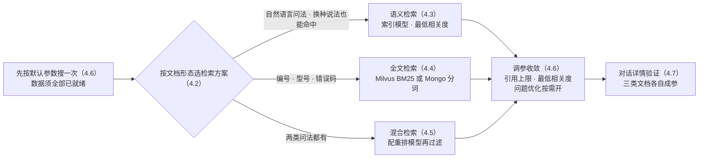
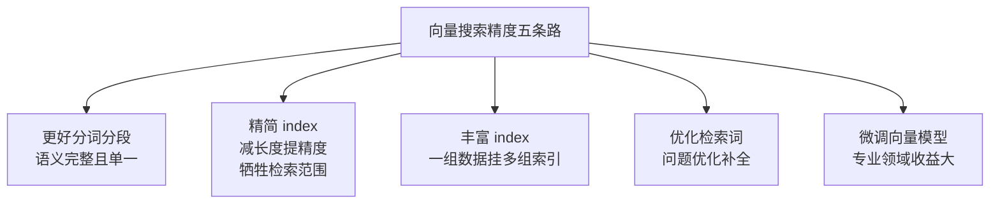

# 第 4 章 检索方案与调优

> 本章导读：第 3 章三类文档全部「已就绪」——但「搜得到」和「答得准」是两回事。本章为 `after-sales-kb` 选定检索方案并完成调优：先看懂一次检索的完整链路；再按文档形态在语义、全文、混合之间做决定——全文检索的后端跟随向量库，Milvus 用户还多一步 BM25 迁移；混合检索通常要配重排模型；最后用引用上限、最低相关度与问题优化把参数收敛，政策手册与商品 FAQ 各有一套参数。读完本章，你能：为三类文档各选对检索方案，把参数调到引用内容可复现，并用对话详情验证调参效果。



*本章操作流程图*

## 你什么时候需要它

三种典型处境，对应本章三种用法。

**数据已就绪，应用里却答非所问**——先按 4.6 的调参路线定位现象（搜不到、太泛还是排序不对），再回到 4.2 换方案。本章素材给出的第一原则是：先根据现象定位问题，不建议一次性调整所有参数。

**用户拿着工单号、错误码、商品型号来问，语义检索总漏**——直接看 4.4：全文检索靠关键词命中，天生适合这类精确查询；它的后端跟向量库走，Milvus 用户还多一步 BM25 迁移。

**库里混着问答对和长文档，一会儿搜不到一会儿太泛**——这是 4.5 与 4.6 的组合题：混合检索加结果重排负责「准」，按 tokens 计的引用上限负责「稳」——官方不用 topk 控引用，正是因为混合知识库里不同数据块的长度差距太大。

前置：第 3 章的三类文档已入库且状态「已就绪」，索引模型可用（未就绪的数据不参与检索，先回 3.4 排查）。

## 4.1 概述：一次检索的六步链路

一次知识库检索不是简单的「用户问题 → 向量库 → 返回结果」。官方文档对整体检索方案的描述是：FastGPT 会根据输入内容和搜索参数，将文本、图片、语义召回、全文召回、问题优化和重排等能力组合起来，最后把多路结果融合成引用内容。拆开是六步：


*一次知识库检索的六步链路（依据官方「整体检索方案」；重排为可选步骤，输入含图片且模型能力支持时，召回阶段会追加图片描述检索或图片向量检索）*

售后域是纯文本域，图片检索链路本章不展开——它能否生效取决于视觉模型、支持图片的向量模型以及入库时是否生成了图片索引（官方对四类能力组合各有什么效果给了一张矩阵表，需要时查素材原文）。

### 精度由什么决定

官方对向量搜索的定位，第 3 章引过半句：在知识库问答中，向量搜索的环节最为重要。完整的说法是，影响向量搜索精度的因素非常多，主要包括三类——**向量模型的质量、数据的质量（长度、完整性、多样性）、检索器的精度（速度与精度之间的取舍）**；与数据质量对应的，还有检索词的质量。三类的归属：向量模型在第 2 章选型时已定，数据质量是第 3 章 3.3 与 3.4 经营的对象，检索器与检索词的质量——正是本章 4.3 到 4.6 的全部内容。

### 存储与合并：为什么多路命中会排在前面

存储侧，官方文档以 PostgreSQL 的 PG Vector 插件为例描述向量检索器（索引为 HNSW，并注明该引擎可替换成其它数据库，即第 2 章的四选一）；MongoDB 负责其余数据的存取。`dataset.datas` 表存向量原数据，`indexes` 字段记录对应的向量 ID——这是一个数组，一组数据可以对应多个向量。

召回侧的机制值得记住：先召回向量，再按向量 ID 回 MongoDB 找原数据；如果多路结果对应同一组原数据，则合并，**向量得分取最高得分**。这解释了 4.5 的一个现象：某条内容同时被多路召回命中，通常更容易排在前面。

## 4.2 检索方案全景：语义、全文、混合

三种搜索模式加一个结果重排开关，构成 FastGPT 检索方案的全部选项。三方案对比：

| 方案 | 原理 | 适合 | 短板 | 依赖 |
|------|------|------|------|------|
| 语义检索（Semantic Search） | 计算问题与内容的向量距离，得出数学上的相似度 | 自然语言问题、语义相近内容、跨语言匹配 | 依赖模型训练效果，精度不稳定，受关键词与句子完整度影响 | 索引模型（第 2 章已配） |
| 全文检索（Full-Text Search） | 传统全文检索，关键词命中 | 编号、型号、专有名词、错误码等精确查询，以及关键的主谓语 | 问法换了词就命中不了 | 向量库决定后端（见 4.4） |
| 混合检索（Hybrid Search） | 同时用向量与全文两路，经 RRF 合并 | 两类问法并存的知识库；一般情况下结果更丰富准确 | 查找范围大，无法直接做相似度过滤——通常要配重排 | 全文后端 + 推荐重排模型 |

RRF（Reciprocal Rank Fusion，倒数排序融合）是官方写明的合并方式：把不同召回路径的结果融合，而不是简单采用某一路。因此最终引用内容**不一定严格按照单一向量相似度排序**——某条内容若同时被多路召回命中，通常会更容易排在前面。

### 按文档形态选方案

选择依据官方写得直白：语义检索适合自然语言问题和语义相近内容，全文检索适合编号、型号、专有名词、错误码等精确查询，两者都要就上混合检索。落到贯穿案例：政策手册以「运输破损怎么赔」这类自然语言条款问答为主，但也常被按「第几条」「赔偿标准」点名检索；商品 FAQ 是问答对，问法天然接近自然语言。**本书立场：`after-sales-kb` 日常默认混合检索——客服问法一半口语一半带编号，混合是唯一不用赌问法的选项；语义检索留给纯 FAQ 类的轻量库。**

## 4.3 语义检索：向量模型与相似度过滤

### 原理与优缺点

语义检索通过向量距离计算用户问题与知识库内容的距离，从而得出「相似度」——注意这是数学上的相似度，不是语文上的。检索仍采用 topk（TopK）召回：查前 k 个最相似的内容，丢给大模型做进一步的语义判断、逻辑推理和归纳总结。

| 优点 | 缺点 |
|------|------|
| 相近语义理解 | 依赖模型训练效果 |
| 跨多语言理解（中文问题匹配英文知识点） | 精度不稳定 |
| 多模态理解（取决于模型能力） | 受关键词和句子完整度影响 |

### 相似度过滤：最低相关度

按相似度对结果做过滤的阈值，在 FastGPT 里叫**最低相关度**——一个 0-1 的数值，过滤掉低相关度的搜索结果。两条使用约束都来自官方原文：**该值仅在语义检索或使用结果重排时生效**；它只是过滤阈值，不是最终排序规则——开启问题优化、混合检索、图片检索或结果重排后，结果会经多路融合，不一定严格按单一向量相似度排序。

### 提高语义检索精度的五条路

官方列了五种提高向量搜索精度的方法，其中两条方向相反、最值得展开：



*提高向量搜索精度的五种方法（依据官方文档；M4 即 4.6 的问题优化，M1 是第 3 章分块条件的检索侧回响）*

第 3 章埋的取舍在这里揭晓：**精简 index**——index 内容更少更准时检索精度提高，但牺牲检索范围，适合答案较为严格的场景；**丰富 index**——为同一组数据增加多组索引，其中一组被命中该数据即被召回，官方还建议通过标注数据块的方式持续提高精度。一对反向操作，选哪条取决于你缺精度还是缺召回。

### 边界与坑

- 语义检索受关键词与句子完整度影响：问题缺主语、指代不明，精度立刻下降——这是引入问题优化（4.6）的直接理由。
- 微调向量模型收益大但成本高，官方将其列为提高精度的方法之一——本书案例不走到这一步，先用数据与参数把免费的部分吃干净。

## 4.4 全文检索与 BM25：后端跟随向量库

### 全文检索解决什么

全文检索采用传统方式，适合查找关键的主谓语；对编号、型号、专有名词、错误码这类查询，它是比语义检索更可靠的路径——客服拿「工单号」「错误码」提问时，关键词命中比语义相近更对症。

第 2 章埋的伏笔在此兑现：**全文检索的后端跟随实际向量库，无需独立开关**。

| 向量库 | 全文后端 | 说明 |
|--------|---------|------|
| Milvus（≥ 2.5.16） | Milvus BM25 | 向量与全文同存于 `modeldata_v2` 单表，不再写 MongoDB 全文表；语言识别默认 `lingua`，可用 `MILVUS_LANGUAGE_IDENTIFIER=whatlang` 切换——`lingua` 识别更准，`whatlang` 速度更快 |
| PG / OceanBase / SeekDB / openGauss | MongoDB `$text` + jieba 分词 | 默认路径，无需额外配置（openGauss 官方素材另列；第 2 章部署主线的四选一不含它） |

贯穿案例按第 2 章选型跑在 PgVector 上，全文检索走的就是 MongoDB `$text` + jieba——本节后续的 BM25 迁移流程，是为索引量上了量级、或全文质量需要更强的读者准备的。

### Milvus BM25：升级与迁移流程

使用 Milvus 且从旧版本升级时，全文检索要迁到 BM25，前提是 Milvus 版本不低于 2.5.16——**低于此版本 FastGPT 启动直接报错退出，不会降级运行**。官方给出的八步流程：

| 步骤 | 操作 | 要点 |
|------|------|------|
| 1 备份 | 备份 Milvus 数据卷、配套 etcd 与 MinIO 数据卷、MongoDB 业务数据 | 便于回滚 |
| 2 停写 | 低写入时段执行，或先停应用写入 | 迁移期间不要同时写数据集数据 |
| 3 升级 Milvus | 替换镜像 tag 为 `milvusdb/milvus:v2.5.16` 后重启 | 必须保留原数据卷与旧集合 `modeldata`——它是迁移的数据源，缺失或为空就停止迁移 |
| 4 验证版本 | FastGPT 启动时自动 `getVersion()` 校验；也可用 milvus-cli、attu 或 SDK 手动确认 | 版本不符会终止启动 |
| 5 迁移 | 先 dry-run 看统计，再正式迁移 | 纯拷贝、不重嵌入；支持断点续跑、失败行自愈重试、幂等 upsert，可安全重复执行 |
| 6 验证结果 | 接口返回 `status: done` 且 `targetCount >= processedCount`；再做一次全文或混合检索冒烟 | `modeldata_v2` 为空时全文无命中 |
| 7 删旧表 | 确认无误后 `removeOld=1` 显式删除，或用 milvus-cli、SDK 手动 drop `modeldata` | 旧表不会自动删除；删除后重启也不会重建 |
| 8 回滚预案 | 未删旧表——降级镜像并恢复备份即可；已删旧表——须从备份恢复 Milvus 数据卷后再降级 | 所以第 7 步别急 |

迁移接口的调用形态（`rootkey` 用你的 ROOT_KEY）：

```bash
# 1. dry-run 先看统计
curl 'http://host/api/admin/4162/milvus?dryRun=1' \
  -H 'rootkey: 你的ROOT_KEY'

# 2. 正式迁移
curl 'http://host/api/admin/4162/milvus?batchSize=500' \
  -H 'rootkey: 你的ROOT_KEY'

# 3. 请求被网关超时中断时，用返回的 migrationId 续跑
curl 'http://host/api/admin/4162/milvus?resumeMigrationId=<uuid>' \
  -H 'rootkey: 你的ROOT_KEY'
```

迁移过程遍历旧 `modeldata` 向量行、反查 MongoDB `dataset_datas.indexes` 原文、写入 `modeldata_v2`；`imageEmbedding` 索引只拷贝向量，BM25 文本置空；完成时会实际校验目标表行数。

### 边界与坑

- 启动报 `Milvus version ... is not supported`——版本低于 2.5.16，先升级 Milvus，没有绕行选项。
- 迁移报旧 `modeldata` 缺失或为空——多半连错了 Milvus 实例或数据卷挂载不对；确认数据丢失就从备份恢复。
- 迁移一直 `failed` 且 `targetCount < processedCount`——检查 Milvus 状态（是否 OOM、集合是否被释放），用 `resumeMigrationId` 续跑。
- 迁移后全文检索为空——先确认迁移真的跑完（`status: done`），再查 `modeldata_v2` 是否有数据。

## 4.5 混合检索与结果重排

### 混合检索：两路并用，RRF 合并

混合检索同时使用向量检索和全文检索，并通过 RRF 公式合并两路结果——一般情况下搜索结果会更加丰富准确。代价写在同一段官方文字里：混合检索后的查找范围很大，并且无法直接进行相似度过滤，**通常需要利用重排模型进行一次结果重新排序，并利用重排的得分进行过滤**。

### 结果重排：一个更可信的分数

结果重排（ReRank）用重排模型对搜索结果二次排序——绝大多数情况下可以有效提高准确率。三个使用要点：

| 要点 | 官方依据 |
|------|---------|
| 重排得分比向量得分更精确 | 重排后得到 0-1 的相关度得分，可根据得分过滤 |
| 与问题完整度相关 | 通常先走问题优化再搜索——重排 |
| 多路结果最终仍由 RRF 合并 | FastGPT 用 RRF 对重排结果、向量结果、全文结果合并 |

重排模型的接入在第 2 章模型通道里：它是五类模型中的可选一类，额外支持 `requestUrl` 与 `requestAuth` 自定义请求地址与认证。官方 FAQ 对「重排模型无法勾选」的处置是「配置文件里配置后即可勾选」——这一写法对应旧的配置体系，4.15.0 起系统配置改走环境变量（见 2.3），当前版本的实际勾选路径以模型通道实测为准（挂复核清单）。

### 边界与坑

- 重排增加一次模型调用，耗时随之上来——候选结果少、问题简单的库，语义检索加最低相关度可能就够了。
- 重排不是万能药：调参建议表里专门有一条「Rerank 后仍然排序不准」——先确认用户问题是否完整、召回候选是否足够，再动参数。

## 4.6 搜索参数调优：引用上限、最低相关度与问题优化

### 两个过滤参数与一个开关

搜索参数一共有两层：模式选择（4.2 至 4.5）与过滤参数。过滤侧两个参数、优化侧一个开关：

| 参数 | 机制 | 使用约束 |
|------|------|---------|
| 引用上限 | 每次搜索最多引用 n 个 tokens 的内容 | 官方特意不用 topk——混合知识库里不同数据块长度差距大，topk 的结果不稳定；按 tokens 控制更稳 |
| 最低相关度 | 0-1 的数值，过滤低相关度结果 | 仅在语义检索或使用结果重排时生效；是过滤阈值，不是排序规则 |
| 问题优化 | 检索前先做指代消除与问题扩展 | 多一次模型调用，提升连续对话检索效果但增加耗时；问题明确或追求响应速度时按实际效果决定是否开启 |

「引用上限」这个词在 FastGPT 里有两层，别混：搜索侧的引用上限管每次搜索最多带回多少 tokens 的内容；模型侧的 `quoteMaxToken`（第 2 章模型配置字段，最大引用内容）管喂给语言模型的引用总量。前者是检索参数，后者是模型配置——调参时先分清你要拧的是哪一层。

### 问题优化：给连续对话补全问题

知识库搜索只会用「当前」的问题去执行。官方给的例子：连续对话里用户问「第二点是什么」，检索就拿这六个字进库，自然查不到——实际要查的是「QA 结构是什么」。问题优化在数据检索前先做指代消除与问题扩展，一方面解决指代对象不明确，一方面扩展问题的语义丰富度。

两个实操细节：补全结果可以在每次对话后的**对话详情**里查看——这是本章验证调参效果的主要窗口；问题优化会增加一次模型调用，官方的建议是按实际效果取舍——对精确编号类问题，调参建议表甚至提示避免过度使用问题优化。

### 调参路线：先定位现象，再动参数

官方开篇第一条就是纪律：如果搜索结果不符合预期，先根据现象定位问题，**不建议一次性调整所有参数**。现象到动作的对照表（后两行属图片检索域，本书案例用不上，一并收录备查）：

| 现象 | 优先检查和调整 |
|------|---------------|
| 搜不到内容 | 确认数据已完成训练；适当降低最低相关度；提高引用上限；检查问题是否过短或缺少主体 |
| 结果太泛、答非所问 | 提高最低相关度；减少引用上限；优化数据分块；检查召回内容是否混入无关片段 |
| 编号、型号、专有名词搜不准 | 使用全文检索或混合检索；降低语义检索权重；避免对精确编号类问题过度使用问题优化 |
| 自然语言问法搜不准 | 使用语义检索或混合检索；开启问题优化；补充更准确的数据索引 |
| 开启问题优化后变慢 | 问题优化额外调用模型——换更快的优化模型，或只在多轮追问、短问题场景开启 |
| Rerank 后仍然排序不准 | 确认用户问题是否完整；检查召回候选是否足够；适当调整最低相关度和引用上限 |
| 图搜图效果弱 | 确认向量模型支持图片输入；确认入库时生成了图片向量索引；检查图片清晰度与主体 |
| 图文混合结果不稳定 | 明确文字与图片哪个更重要；只想找视觉相似图片就减少额外文字约束 |

这张表是本章的「方向盘」：每一行的第一格是现象，第二格的第一项就是该先动的那个参数。验证闭环走对话详情——改一个参数、问一遍原问题、看引用内容与问题优化补全有没有按预期变化，再决定下一个动作。

### 边界与坑

- 官方素材记载的检索过滤参数只有最低相关度与引用上限两项；第 3 章导入时写入的 `metadata` JSON 如何参与检索侧过滤，素材未载——本章不作断言，实测项挂复核清单，与第 3 章复核项联动。
- 专用的搜索测试入口及其行为，本章素材未记载——调参验证以应用对话加对话详情为准，搜索测试的入口与能力待实测补全（挂复核清单）。

## 4.7 实战：三类文档的差异化调参

参数没有万能默认值，本章的收束方式是：按文档形态给三类文档各定一套方案与参数取向。下表是**本书立场**——依据前六节的官方结论推演，具体数值以你库上的搜索验证为准（挂复核清单）：

| 文档 | 主导问法 | 方案 | 参数取向 | 推演依据 |
|------|---------|------|---------|---------|
| 《售后政策手册》 | 自然语言条款问答为主，夹杂「第几条」「赔偿标准」式点名 | 混合检索 + 结果重排 | 最低相关度从严——宁缺毋滥，政策答复错一句就是事故；问题优化开，条款追问多靠指代补全 | 官方：混合结果更丰富准确；重排绝大多数情况提高准确率 |
| 《商品 FAQ》 | 口语化自然语言，问法接近问答对原文 | 语义检索起步 | 问题优化按需——问答对与问法本就贴近；引用上限影响小，单条 FAQ 短 | 官方：语义检索适合自然语言问题与语义相近内容 |
| 《物流时效公告》 | 承运商名、时效天数等精确信息 | 混合检索，侧重全文路 | 最低相关度放宽——公告短，别把短结果滤掉；新旧公告并存期靠引用上限压总量 | 官方：全文适合编号、专有名词等精确查询 |

三条共性纪律，全部来自官方调参建议表：

1. **一次只动一个参数**——不建议一次性调整所有参数，改完用同一问题复测；
2. **搜不到先查训练状态**——「确认数据是否已完成训练」永远是第一排查项（3.4 的「已就绪」）；
3. **参数随数据走**——第 3 章精简或丰富 index 的取舍、分块质量的预览三查，决定的是参数调不动的上限。

`after-sales-kb` 的调参顺序：先按上表把三套方案与参数取向配好，再用三组固定测试问题（每类文档两三条典型问法）逐库验证——引用内容对不对，对话详情里一眼可见。第 7 章把这套参数搬进工作流的知识库搜索节点，「售后客服」应用才能真正开答。

## 本章小结

1. **一次检索是六步链路**：问题优化 → 多路召回 → RRF 融合 → 重排（可选）→ 过滤与裁剪 → 引用内容；最终排序是多路融合的结果，不保证严格按单一向量相似度。
2. **按文档形态选方案**：语义检索对自然语言、全文检索对编号与专有名词、混合检索两者兼顾——**业务上推荐混合检索做 `after-sales-kb` 的默认方案**。
3. **全文后端跟随向量库**：Milvus（≥ 2.5.16）走 BM25 单表，其他向量库走 MongoDB `$text` + jieba；BM25 迁移八步走，旧表不自动删，回滚窗口在 removeOld 之前。
4. **最低相关度是过滤不是排序**：仅语义检索或结果重排时生效；重排得分（0-1）通常比向量得分更精确，可作过滤依据。
5. **引用上限按 tokens 不按 topk**：混合知识库里数据块长度差距大，tokens 口径更稳；它与模型侧 `quoteMaxToken` 是两层，别拧错。
6. **调参先定位现象再动参数**：八行现象对照表是方向盘；问题优化补全指代但多一次模型调用，按场景取舍；每次改参用对话详情验证。

下一步：知识库的「建」与「搜」都齐了，剩下的运营问题是「跟得上」——第 5 章处理同步、标签与权限：Web 站点同步、集合标签、文件级权限，以及第 3 章预告的三类文档同步路线逐一落地。

## 验收清单

读到这里，你应该能：

- ☐ 画出一次检索的六步链路，并指出哪两步是可选的、哪一步依赖模型能力；
- ☐ 说出三种搜索模式各自适合的问法，为一份新文档选定方案并说明理由；
- ☐ 向同事解释全文检索后端为什么取决于向量库，以及 Milvus 用户迁移 BM25 的关键前提（版本、备份、旧表去向）；
- ☐ 解释最低相关度的两条生效约束（何时生效、是过滤不是排序）；
- ☐ 区分搜索侧引用上限与模型侧 `quoteMaxToken`，并说出官方弃用 topk 的原因；
- ☐ 拿「搜不到内容」「结果太泛」两种现象各说出至少两条优先调整项；
- ☐ 为 `after-sales-kb` 三类文档各写出一套方案与参数取向，并用对话详情完成一轮验证。

### 复核清单（发布前）

- [ ] 界面项与行为对照官方文档 v4.17.3（guide/dataset/dataset_engine、self-host/milvus-bm25、guide/dataset/faq），核实日期 2026-11-01；
- [ ] 搜索参数界面逐项实测——搜索模式、结果重排、引用上限、最低相关度、问题优化的入口名称与取值范围；
- [ ] 搜索测试入口与行为实测——素材未载，入口位置、参数是否独立保存待补；
- [ ] 重排模型勾选路径实测——官方 FAQ 的 config.json 写法与 4.15.0 起 env 体系的差异，当前版本实际操作路径；
- [ ] `metadata` JSON 在检索过滤中的实际生效方式实测——与第 3 章复核项联动验证；
- [ ] 三类文档差异化参数实测——4.7 表中的参数取向逐条验证并记录可用数值；
- [ ] Milvus BM25 迁移流程实测——dry-run、batchSize、resumeMigrationId、removeOld 四步各过一遍（PgVector 环境不触发，需另备 Milvus 环境）；
- [ ] `MILVUS_LANGUAGE_IDENTIFIER` 切换 `lingua` 与 `whatlang` 的效果对比实测；
- [ ] 章首操作流程图与 4.1、4.3 两张文内图在 GitHub 网页端的渲染检查。

## 延伸阅读

- **第 3 章（知识库：从文档到知识）**——检索上限的一半在入库时决定：分块质量、精简与丰富 index 的取舍、metadata 字段规范，都是本章调参调不动的地基。
- **第 5 章（知识库进阶：同步、标签与权限）**——检索之外的知识库运营：三类文档的同步路线落地，集合标签承接 FAQ 的分类维度。
- **第 7 章（工作流编排）**——本章参数的应用侧落点：知识库搜索节点把搜索模式与过滤参数搬进画布，「售后客服」的检索质量在这里兑现。
- **第 11 章（生产运维）**——向量库迁移与故障排查的完整方法论：本章 BM25 迁移只是其中一条迁移路径。
- **（→ ragflow 书）第 7 章（检索测试与调优）**——同域平台对照：RAGFlow 的检索测试与参数体系与本章一一可对，调优方法论在两本书之间通用。
