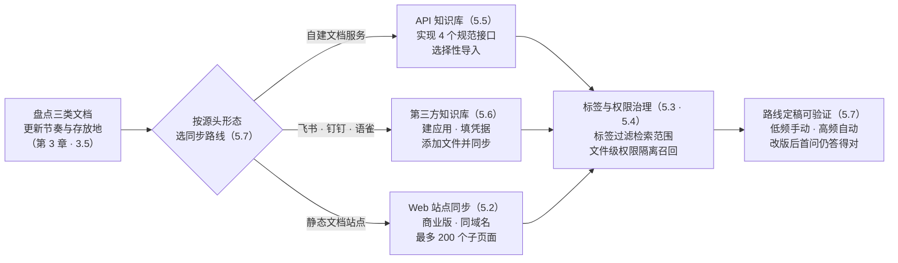
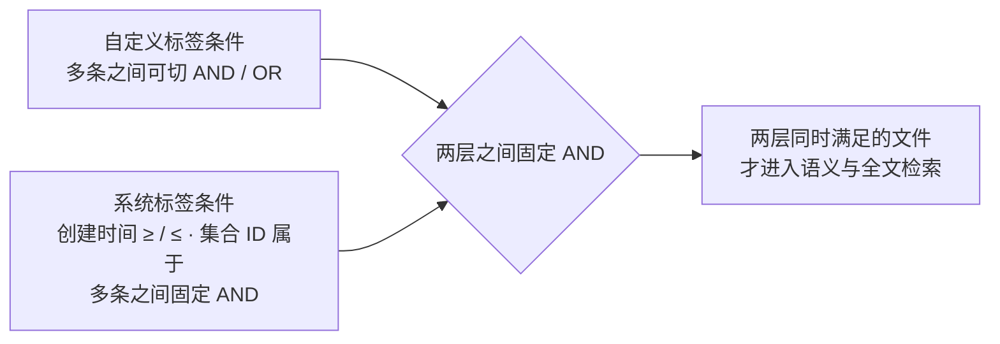

# 第 5 章 知识库进阶：同步、标签与权限

> 本章导读：第 3 章末尾把三类售后文档的更新节奏标注在案——本章兑现它：让 `after-sales-kb` 跟上文档的更新。三条同步路线依次上手：Web 站点同步用一个入口网址抓起静态文档站点；API 知识库按接口规范对接自建文档服务；第三方知识库直连飞书、钉钉、语雀。配套两件治理工具：集合标签在检索前圈定文件范围，文件级权限把越权文件挡在召回之外。最后用一张决策表为三类文档各定一条最佳同步路线——低频走手动，高频走第三方同步。读完本章，你能：为售后域三类文档各选定并落地一条同步路线，用标签过滤圈定检索范围，说清文件级权限的生效条件与边界。



*本章操作流程图*

## 你什么时候需要它

三种典型处境，对应本章三种用法。

**文档维护在飞书、钉钉、语雀里，每周都在变，不想再手动搬运**——直接看 5.6（第三方知识库）。三家各有一份参数获取路径与权限清单，照着开权限、填凭据、添加文件；谁自动同步、谁手动同步的差异也在那一节。

**公司已有自建文档系统或文档站，不想二次存储**——自建文档服务按接口规范对接，看 5.5（API 知识库）；整个站点是静态文档站，看 5.2（Web 站点同步），一个入口网址抓起同域名下最多 200 个子页面。

**检索结果混进了过期制度，或不该让当前用户看到的内容也召回了**——先看 5.3（集合标签）：在检索前按标签圈定文件范围；再按需开 5.4（文件级权限）：按成员身份过滤召回。范围治理（标签）与身份隔离（权限）经常一起上。

前置：第 3 章完成建库且数据「已就绪」；本章 Web 站点同步、集合标签、文件级权限为商业版能力（形态对照见第 1 章差异表），社区版读者先对表再动手。

## 5.1 概述：入库只是开始，跟得上才是运营

第 3 章借官方文档埋过一句伏笔：知识库的更新与维护是 RAG 的主要局限之一——内容随时间过时直接动摇回答的可信度，而手动更新既耗时又易错。本章的任务就是把「更新」里可以机械化的部分机械化，把必须由人守住的边界画清楚。五块能力，各管一段：

| 能力 | 解决什么问题 | 形态前提（依据官方文档，核实日期 2026-11-01） |
|------|-------------|---------------------------------------------|
| Web 站点同步 | 文档站点整体进库，不用逐页搬运 | 仅向商业版用户开放 |
| 集合标签 | 检索前圈定文件范围，压制过期与越权内容 | 商业版功能；多维度类型化标签自 v4.17.1 起正式支持 |
| 文件级权限 | 单个文件/文件夹单独配协作者，越权文件不进召回 | 商业版特有功能 |
| API 知识库 | 对接已有文档库，避免二次存储 | 素材未标注形态前提（挂复核清单） |
| 第三方知识库 | 直连飞书、钉钉、语雀等协同平台 | 飞书/语雀为 v4.8.16 起商业版用户支持；钉钉素材未标注（挂复核清单） |

第 1 章的功能差异表把「Web 站点同步、第三方知识库定时同步、知识库文件级权限」整体划在商业版一侧，本章是全书里形态前提最重的一章。**本书立场：能力清单决定形态选型的时刻比想象中早——第 1 章从社区版起步的决策依然成立（主线建库、编排、发布不受影响），但当同步与治理需求出现时，先回那张差异表对一遍再排期。**

与第 3 章的衔接只有一句话：三类文档的更新节奏（政策手册季度级、商品 FAQ 每周、物流公告时效敏感）是本章所有选型的输入，节奏标注还躺在 3.5 的表格里，本章末尾的决策表把它变成落地方案。

## 5.2 Web 站点同步：静态文档站点的整体进库

### 是什么，边界在哪

Web 站点同步利用爬虫技术，通过一个入口网站自动捕获**同域名**下的所有网站，目前最多支持 **200** 个子页面；主要用于各类文档站点快速构建知识库。两条硬边界来自官方原文：出于合规与安全角度，仅支持**静态站点**的爬取；国内的媒体站点基本不可用——公众号、CSDN、知乎等。

动手前先验一个站点是否静态，官方给的办法是终端发一条 `curl` 请求，看返回的是不是完整 HTML：

```bash
curl https://doc.fastgpt.io/guide/getting-started
```

### 三步接入

| 步骤 | 操作 |
|------|------|
| 1 | 新建知识库，选择「Web 站点同步」类型 |
| 2 | 点击「配置站点信息」 |
| 3 | 填写网址和选择器，点击开始同步，等待系统自动抓取 |

同步完成后创建应用、绑定知识库即可问答（应用侧见第 6 章）。注意一个素材空白：**同步的触发方式与频率配置，官方文档未记载**——原文只写到「点击开始同步，静等系统自动抓取」，是否支持定时刷新以当前界面实测为准（挂本章复核清单）。

### 选择器：只抓正文，不抓导航

选择器（Selector）是 HTML 与 CSS 的产物，用来定位要抓取的具体内容，而不是整个站点。用法：打开浏览器调试面板（通常是 F12 或右键检查），选中目标区域，取它的属性、类名或 ID 构造选择器。三类常见写法（示例来自官方文档）：

| 写法 | 示例 | 含义 |
|------|------|------|
| 属性选择器 | `div[data-prismjs-copy]` | 含 `data-prismjs-copy` 属性的 `div` 元素 |
| 类选择器 | `.docs-content` | class 含 `docs-content` 的元素；多个类名空格隔开，选一个即可 |
| 多选择器 | `.docs-content .mb-0.d-flex, .docs-content div[data-prismjs-copy]` | 逗号隔开两组，命中任一即抓取 |

多选择器的价值在「一个页面要抓两种区域」的场景：官方对自家文档站就用了两组选择器，一组抓标题区，一组抓代码块区。

### 边界与坑

三个坑都在动手前就能避开：媒体站点与公众号内容基本抓不了，别浪费配置；子页面超过 200 个的站点要拆入口，超出部分不会被抓到；选择器写宽了会把导航、页脚一起入库，检索时全成噪音——先用少量页面验证抓取范围，再放开全站。

## 5.3 集合标签：检索范围的元数据闸门

### 为什么需要它

集合标签是 FastGPT 商业版功能：为知识库中的集合（文件/文档）添加多维度的结构化标签，既能在知识库内快速筛选和批量管理文档，还能在应用与工作流的「知识库搜索」阶段，通过**手动输入**或**变量引用**精准过滤检索范围。官方列了三个不带标签时的高频问题：

| 问题 | 表现 |
|------|------|
| 跨部门干扰 | 研发部员工问「项目评审流程」，召回了市场部的活动评审制度 |
| 过期文档干扰 | 新旧制度并存，检索召回了旧版条款 |
| 密级与范围控制 | 不同职级或外部客户共用同一个助手，需要按用户身份隔离可检索范围 |

机制一句话：先通过标签**元数据过滤**圈定目标文件集合，再在这些文件内部执行语义与全文检索。支持范围也记一下：除「Web 站点同步」知识库外，通用知识库、第三方知识库（飞书、语雀、API 文件库等）均支持集合标签。

### 第一步：规划标签

进入知识库详情页，在集合列表右上角点击「标签管理」（需具备该知识库的写权限）。三种标签属性：

| 标签属性 | 适用场景 | 赋值限制 |
|---------|---------|---------|
| 选项 | 固定分类或一对多归属（最常用） | 单文件最多勾 64 个选项，单选项最长 256 字符 |
| 数字 | 按大小或数值区间比较的量化指标 | 单文件 1 个值，整数或小数 |
| 日期 | 明确时效性的时间节点 | 单文件 1 个值，精确到 `YYYY-MM-DD HH:mm` |

三条管理规则值得写进团队规范：标签名最长 20 字符；**标签创建后属性不可修改**（名称可随时重命名）；删除标签会同步移除该库所有文件已绑定的该标签数据。选项属性的标签支持「选项管理」——预先录入标准分类词统一打标口径；重命名选项后，所有已绑定文件自动同步更新；删除选项则自动从文件上移除该值。

### 第二步：打标

| 途径 | 操作 | 要点 |
|------|------|------|
| 单个文件 | 打开文件的「标签设置」弹窗，按属性赋值 | 下拉里没有的选项可直接输入回车快速新建 |
| 批量 | 集合列表勾选多个文件，底部浮窗「批量修改标签」 | 选项属性支持「追加/覆盖」二选；数字与日期只有单值，批量添加直接覆盖 |
| API | OpenAPI 创建或更新集合时传入 `tags` 字段 | 标签不存在时按值格式自动创建：字符串数组建为选项，数值建为数字 |

API 传标的请求体结构（转录自官方文档示例）：

```json
{
  "datasetId": "69ddb01e2d241386ca47adbe",
  "name": "员工考勤与休假管理制度（2026版）.pdf",
  "tags": [
    { "tag": "适用部门", "value": ["全员", "人力资源部"] },
    { "tag": "保密等级", "value": 1 },
    { "tag": "生效日期", "value": 1767229200000 }
  ]
}
```

批量移除也有讲究：弹窗自动汇总所选文件已绑定的全部标签，选项属性既可以整标签移除，也可以展开后只勾选移除某几个选项值、保留其余——清理过期部门归属时用得上后者。

### 第三步与第四步：从列表筛选到检索过滤

日常维护用列表筛选：集合列表表头上方点「标签 | 全部」，左列选标签、右列勾值，组合规则是**同一标签内多值或（OR）、不同标签之间且（AND）**。

真正的价值在检索侧。两处入口：

| 应用形态 | 标签过滤入口 |
|---------|-------------|
| 工作流 | 画布中「知识库搜索」节点 →「标签过滤」区域右上角开启 |
| 对话 Agent / 简易应用 | 应用配置页「知识库」区域 →「参数」→「知识库搜索配置」→「标签过滤」标签页 |

条件分两层，组合逻辑固定：



*标签过滤的两层条件结构（自绘，规则转录自官方文档）*

自定义标签按属性支持的操作符：选项为等于/不等于、包含/不包含、属于/不属于、为空/不为空；数字为等于/不等于、大于/小于、大于等于/小于等于、为空/不为空；日期为等于/不等于、晚于/早于、为空/不为空。系统标签两条：创建时间支持大于等于与小于等于；集合 ID 操作符固定为「属于」，传入文件夹 ID 时系统会自动递归包含其下所有子文件。

空值行为官方有明确规则，直接决定打标纪律：过滤条件用**正向匹配**（等于、包含、属于、大于、晚于、不为空等）时，未绑定该标签的文件一律判定不满足、不被召回；用**排除或空值判断**（为空、不等于、不包含、不属于）时，未绑定文件判定满足、正常参与检索。**本书立场：正向匹配是标签过滤的主要用法——这等于要求「没打标的文件默认搜不到」，所以新文件入库即打标要成为纪律，否则标签过滤器会悄悄把漏标的文件排除出回答依据。**

### 高级用法：变量引用传 JSON

可视化条件器不够用时（例如上游「代码运行」节点按业务规则动态拼装条件），把「标签过滤」的输入方式从「手动输入」切为「变量引用」，直接传 JSON 对象或字符串：

```json
{
  "tags": {
    "$and": [
      { "适用部门": { "$in": ["全员", "研发部"] } },
      { "保密等级": { "$lte": 2 } },
      { "生效日期": { "$gt": "2026-01-01 00:00" } }
    ]
  },
  "createTime": {
    "$gte": "2026-01-01 00:00",
    "$lte": "2026-12-31 23:59"
  },
  "collectionIds": ["6593e137231a2be9c5603ba9"]
}
```

顶层 `tags`、`createTime`、`collectionIds` 三个字段之间固定 AND；`tags` 内支持 `$and`/`$or` 数组；常用操作符对照：

| 属性 | 操作符 | 含义 |
|------|--------|------|
| 选项 | `$is` / `$isNot` · `$contains` / `$notContains` · `$in` / `$notIn` · `$empty` / `$notEmpty` | 等于/不等于 · 包含/不包含 · 属于/不属于 · 为空/不为空 |
| 数字 / 日期 | `$eq` / `$ne` · `$gt` / `$lt` · `$empty` / `$notEmpty` | 等于/不等于 · 大于（晚于）/小于（早于）· 为空/不为空 |
| 数字 | `$gte` / `$lte` | 大于等于 / 小于等于 |

### 常见问题与边界

| 问题 | 官方答案 |
|------|---------|
| 标签过滤下拉里找不到某个标签 | 应用同时关联多个知识库时，只显示在所有已选知识库中**名称与属性均一致**的共有标签（选项值为各库并集） |
| 旧版本的字符串标签去哪了 | 升级时自动无损迁移为名为 `default_tag` 的选项标签，可在标签管理中重命名 |
| 改了标签或选项名，过滤条件会跟着变吗 | 不会——过滤条件按**名称与选项值文本**匹配，重命名后须同步更新已配置的过滤条件 |

第三条是埋雷型坑：标签改名一时爽，引用它的应用与工作流全部失配——改名前先全局搜一遍引用点。

## 5.4 文件级权限：越权文件不出现在召回里

### 术语先对齐

文件级权限是 FastGPT 商业版特有功能。默认情况下，一个知识库内的所有文件与文件夹共用知识库自身的权限；开启后，可为单个文件或文件夹单独配置协作者，实现更细粒度的数据管控。中文界面同一概念多处不同名，官方专门给了对照（转录自官方文档）：

| 概念 | 界面/文档用词 | 说明 |
|------|--------------|------|
| dataset | 知识库 | 权限体系中的资源类型为 `dataset` |
| collection | 文件 / 文件夹 / 集合 | 权限体系中的资源类型为 `collection` |
| 文件级权限 | 界面文案作「数据集权限配置」「数据集权限」 | 即本节的集合级权限 |

读界面文案时别被「数据集」三个字带偏——这里的「数据集」是历史文案，指当前这一个文件或文件夹，不是 ragflow 书里那个 Dataset 概念（→ ragflow 书）。

### 开启与关闭：一个不可逆的开关

**开启**入口：知识库详情页 → 文件列表 → 目标文件/文件夹行的 `···` 菜单 → `权限`；需知识库管理员（「可管理」）。确认后系统先在请求内**同步物化**全部文件/文件夹的权限快照，再打开配置弹窗——文件多时耗时较长；物化失败则开关保持关闭，重新执行即可（操作幂等）。开启后权限相关操作会变慢（需要额外维护快照）。

**关闭**入口：知识库详情页文件列表右侧信息栏底部的「点击关闭」。后果要记牢：**删除该库全部文件/文件夹的协作者配置**，全部恢复为继承知识库权限，**不可回退**，界面要求二次确认。关闭后再开启等价于首次开启，一切从继承态重新派生。

### 角色、继承与覆盖语义

配置弹窗中可选成员、成员组或组织，分配四种角色：

| 角色 | 说明 |
|------|------|
| 读权限 | 可查看数据集（该文件/文件夹）内容 |
| 写权限 | 可变更内容（更新/同步/调整训练参数） |
| 管理员 | 可管理该文件/文件夹、分配权限 |
| 创建者 | 每个文件/文件夹唯一，由创建或所有权转移产生 |

三条语义规则：

1. **知识库权限始终是门槛**——集合权限无法绕过知识库权限，单独授权了文件，用户仍需具备知识库读权限才能访问；
2. **创建者不能通过协作者配置授予或修改**——提交的协作者列表必须包含当前创建者，否则整次提交被拒绝；
3. **协作者配置是全量覆盖语义**——提交的列表即最终结果，一次「增量式」的覆盖提交就可能把创建者记录删掉（所以上一条才设了硬校验）。

继承态与独立态：

| 状态/行为 | 规则 |
|----------|------|
| 继承态（默认） | 文件/文件夹权限由父级（上级文件夹，根目录时为知识库）派生，自动跟随父级变化 |
| 独立态 | 单独配置后不再被父级变化覆盖，其下子树也停止从该节点传播 |
| 自动独立化 | 继承态下修改或删除来自父级的协作者时提示冲突，确认后该节点自动转独立态，不静默改写父级权限 |
| 恢复继承 | 独立态节点可在权限弹窗恢复继承，保留该节点相对父级独有的权限，并同步其子树 |

### 权限对各类操作的影响

| 操作 | 要求 |
|------|------|
| 查看文件列表 / 详情 | 知识库读权限 + 该文件读权限；列表按当前成员逐条过滤，不可读的文件不占位 |
| 修改文件信息 | 该文件写权限 |
| 移动文件 / 文件夹 | 源位置与目标位置均需管理员；根目录与文件夹之间移动还需团队知识库创建权限 |
| 配置协作者 / 恢复继承 | 该文件管理员，且知识库已开启文件级权限 |
| 删除文件 / 文件夹 | **仅创建者**——管理员或写权限协作者都不能删；批量删除时非创建者项会被过滤并提示 |
| 所有权转移 | 仅创建者，可转移给同团队其他成员，同时转移其下子文件夹所有权 |
| 知识库所有权转移 | 级联转移该库下、原创建者持有的文件/文件夹所有权 |

「删除仅创建者」是最反直觉的一行：给协作者配了管理员，也删不掉文件——清理文件要么找创建者，要么先做所有权转移。

### 检索召回与特殊身份

开启后，知识库检索按当前成员可读的文件过滤，越权文件不会被召回，覆盖两个入口：工作流/Agent 的知识库搜索节点、知识库搜索测试。**但有一个关键限定：仅在按当前成员身份鉴权时生效**——工作流中预选知识库且未按成员身份鉴权的场景不做文件级过滤，仍按知识库权限召回。把权限过滤寄望于检索层的读者，务必确认自己的调用链路走的是成员鉴权。

三类特殊身份的边界同样要背下来：系统 root 跳过文件级解析，视为全量权限；团队所有者拥有团队内全部资源，视为全量权限；**团队管理员不绕过文件级权限**——团队级管理权限只覆盖成员组、组织等团队自身资源。

### 对贯穿案例的落点

`after-sales-kb` 当前面向客服团队全量开放，暂不开文件级权限——开启有物化与运维成本，关闭有清空配置的代价，没有真实隔离需求前不值得付。当库内出现「仅资深客服可见」的内容（例如内部赔付授权额度）时再开启，并同步检查调用链路是否按成员身份鉴权；团队空间、角色与库级协作者的完整体系在第 12 章。

## 5.5 API 知识库：把已有文档库接进来，不二次存储

### 解决什么问题

官方对动机的表述很直白：用户往往已有一套文档库，把文件重复导入 FastGPT 会造成二次存储且不便管理。API 知识库（官方文档称「API 文件库」）的方案是：按 FastGPT 的接口规范提供文件接口，把服务接口的 `baseURL` 和鉴权 token 填入知识库创建参数，即可在页面上拿到文件库内容并**选择性导入**。

创建知识库时选择 API 文件库类型，配置三个参数：

| 参数 | 说明 |
|------|------|
| `baseURL` | 文件服务接口的 baseURL |
| `authorization` | 身份验证请求头，实际请求格式为 `Authorization: Bearer <token>` |
| `basePath` | 可选，根目录路径，指定文件树的起始位置 |

### 四个接口的规范

接口统一响应 `{ success, message, data }`。四个接口的分工：

| 接口 | 方法与路径 | 作用 | 关键约定 |
|------|-----------|------|---------|
| 获取文件树 | `POST {{baseURL}}/v1/file/list` | 返回文件/文件夹列表 | 请求体 `parentId`（不传或传 `null` 则用 `basePath` 为根）、`searchKey` 可选 |
| 获取文件内容 | `GET {{baseURL}}/v1/file/content?id=xx` | 返回标题与正文 | `content` 与 `previewUrl` **二选一必返**；同时返回时 `content` 优先 |
| 获取阅读链接 | `GET {{baseURL}}/v1/file/read?id=xx` | 返回 `url`，用于查看原文 | 页面上点开即访问 |
| 获取文件详情 | `GET {{baseURL}}/v1/file/detail?id=xx` | 返回 id、名称、父级、类型与时间戳 | —— |

文件列表单项的数据结构：

```ts
type FileListItem = {
  id: string;
  parentId: string | null;
  name: string;
  type: 'file' | 'folder';
  updateTime: Date;
  createTime: Date;
  hasChild?: boolean; // 可选，是否有子节点，默认 folder 类型为 true
}
```

`content` 与 `previewUrl` 的取舍值得细读官方说明：返回 `content` 时系统直接用该文本做索引与检索；返回 `previewUrl` 时系统会访问该链接下载文件并解析内容（支持 PDF、Word、Markdown 等格式），**并缓存解析结果以提高性能**。已有文档库能吐纯文本就返 `content`，只有原始文件就返 `previewUrl` 让 FastGPT 解析。

### 与知识库 API 的方向之辨

两个「API」方向相反，别混：本节是 **FastGPT 拉**——你的文档服务实现规范接口，FastGPT 来取数；第 10 章的知识库 API 是**平台侧推**——经 OpenAPI 管理集合与数据，把内容写进 FastGPT（集合 `tags` 字段也走那条路，见 5.3）。贯穿案例里《商品 FAQ》若源头是自建系统，两条路线都通：源头能按规范出接口就走本节的拉，平台侧有定时任务要灌库就走第 10 章的推。

### 扩展自己的第三方文档库

官方把飞书、语雀等内置文档库全部基于标准 API 文件库规范扩展而成（钉钉亦以内置第三方知识库形式提供）。想接入其他文档库，官方开发者文档（标注 DEV）给出的路径是：实现 `listFiles`、`getFileContent`、`getFileDetail`、`getFilePreviewUrl`、`getFileId` 五个 Hook 函数，再注册类型、图标与 I18n，参考代码位于 `packages/service/core/dataset/apiDataset/yuqueDataset/api.ts`。这条路线面向源码级二次开发，本书不展开，读者有需要时以官方开发者文档为准（挂复核清单）。

## 5.6 第三方知识库：飞书、钉钉、语雀直连

### 三家对比

| 维度 | 钉钉知识库 | 飞书知识库 | 语雀文件库 |
|------|-----------|-----------|-----------|
| 版本/形态前提 | 素材未标注（挂复核清单） | v4.8.16 起，商业版用户 | v4.8.16 起，商业版用户 |
| 鉴权凭据 | `App Key` + `App Secret` + `User ID` | `appId` + `appSecret` + Folder Token | `token` + `uid` |
| 可接入范围 | 操作人可访问的钉钉知识库、在线文档、文件夹（文件夹递归导入） | **仅共享空间**下文件目录；个人空间与知识库内容不可得 | 语雀文档库 |
| 内容类型限制 | 仅钉钉在线文档文本；不支持 PDF、Word、Excel、PPT 等二进制文件 | 仅云文档类型 | 素材未限制（挂复核清单） |
| 同步方式 | 手动：已导入文件「更多」菜单点「同步」，重读正文更新索引 | 素材未载（挂复核清单） | 定时同步：每天不定时扫描一次，有更新即同步；也可手动同步 |
| 成熟度 | —— | 测试阶段，部分交互有待优化 | 测试阶段，部分交互有待优化 |

三家共同的接入节奏：平台侧创建应用/取凭据 → 配权限 → FastGPT 新建知识库选对应类型填参数 → 详情页「添加文件」选择范围导入。下面按官方文档补齐各家的关键细节。

### 钉钉：权限清单与同步账号

钉钉走企业内部应用。三个参数的获取路径：`App Key` 取应用详情「凭证与基础信息」页的 Client ID；`App Secret` 取同页 Client Secret；`User ID` 由企业通讯录管理员在钉钉管理后台「通讯录 → 成员管理 → 成员详情」复制——官方特别提醒 `User ID` 不是手机号、姓名，也不是 `unionId`，成员详情不展示时可通过导出成员列表获取。

应用侧需开通四项权限：

| 权限标识 | 用途 |
|---------|------|
| `qyapi_get_member` | 通过 `User ID` 获取接口需要的操作人 ID |
| `Wiki.Workspace.Read` | 获取当前操作人可访问的钉钉知识库列表 |
| `Wiki.Node.Read` | 获取知识库下的文件夹和文档列表 |
| `Storage.File.Read` | 读取钉钉在线文档正文 |

权限配置后保存并发布应用配置；接口报错出现 `requiredScopes` 时按提示补开。官方的安全建议直接采纳为团队规范：**用一个专门的钉钉成员作为 FastGPT 同步账号，只授予目标知识库的只读权限**——该成员无权访问的知识库不会出现在添加文件列表里，这本身就是一道范围闸门。

### 飞书：共享空间与 Folder Token

飞书自建应用需加三项权限：获取云空间文件夹下的云文档清单、查看新版文档、查看/评论/编辑/管理云空间中所有文件。授权给目录的官方做法是把应用拉入一个群、再给群配置目录权限（目录已对全员组授权可跳过）；Folder Token 从页面路径上获取，注意不要把问号带进去。两条范围限制选库前先确认：仅共享空间目录可得，个人空间与知识库内容拿不到；仅支持云文档类型。《物流时效公告》这类 HTML/EML 文件若要经飞书路线同步，先确认它在飞书侧的存放形态是否符合上述限制（挂复核清单）。

### 语雀：token + uid，每日定时扫描

语雀参数最轻：个人版在「头像 → 设置」取 Token（记得赋权）与 User ID，企业版同路径。创建知识库选语雀文件库类型填入 `token` 与 `uid`，点「添加文件」跟随引导导入。它也是三家素材中唯一明确写了**定时同步**的：每天不定时扫描一次，文档有更新即同步，另可手动同步——对每周更新的《商品 FAQ》，这是三条路线里自动化程度最高的一条。

### 边界与坑

凭据纪律放第一条：`App Secret` 与语雀 Token 都是密钥，官方原文明确「不要公开发送」——落配置、进 Git、贴工单前都过一遍。范围纪律放第二条：钉钉同步账号与飞书目录授权都决定了「能看见什么才能导什么」，导出来的内容比预期少时，先查平台侧权限，再查 FastGPT 配置。成熟度放第三条：飞书与语雀均为测试阶段，交互有待优化，重要知识域的接入先小范围试跑。

## 5.7 售后域选型：三类文档各自的最佳同步路线

第 3 章 3.5 把三类文档的更新节奏标注在案，本章五块能力备齐，现在合成决策表。判断顺序固定两问：**先问更新频率**（低频不值得机械化，高频必须机械化），**再问源头形态**（源头在哪，决定走哪条技术路线）。

| 文档 | 更新节奏（第 3 章标注） | 源头形态 | 最佳同步路线 | 理由与边界 |
|------|------------------------|---------|-------------|-----------|
| 《售后政策手册》 | 季度级改版（低频） | 50 页 PDF 文件 | **手动**：改版先评审，再整册重导 | 低频走手动，把人留在流程里；政策入库前的人工评审不可省——错误政策进库，客服会照着错的答案回复用户 |
| 《商品 FAQ》 | 每周更新（高频） | xlsx 表格，约 200 行 | **高频走第三方同步**：源头迁到语雀等支持定时同步的协同平台，接第三方知识库；源头在自建系统则接 API 知识库 | 钉钉路线仅支持在线文档文本，xlsx 文件形态不适用；平台侧程序化灌库的另一半在第 10 章 |
| 《物流时效公告》 | 物流商调整时（中频，时效敏感） | HTML + 邮件原文 | **手动为主**：新版导入与旧版停用必须配对；公告量大或时效要求提高时，再评估经 API 推送（第 10 章） | 中频介于两档之间，机械化的收益还盖不过配置与维护成本；时效敏感要求出入库成对执行 |

三条辅助判断，补齐表格没覆盖的分支：帮助中心、产品文档站这类**站点形态**的知识源，走 Web 站点同步（商业版），与三类文档并行不悖；知识库出现跨部门、新旧版本并存问题时，用 5.3 的标签过滤圈范围，它对任何同步路线导入的文件都生效（Web 站点同步知识库除外）；需要按人隔离内容时才开 5.4 的文件级权限，并确认调用链路按成员身份鉴权。

> **本书立场**：同步解决的是更新里「搬运」这个机械化部分；「何时更新、谁来审、更新前要不要评审」是流程治理，机械化替代不了。决策表定稿后，给每类文档补上责任人与触发约定，才算闭环——完整的更新流程 SOP 与质量巡检在第 13 章。

## 本章小结

1. **本章五块能力，形态前提先行**：Web 站点同步、集合标签、文件级权限为商业版能力，飞书/语雀第三方知识库为 v4.8.16 起商业版支持——动起手前先对第 1 章差异表确认形态。
2. **三条同步路线按源头形态分流**：静态文档站点走 Web 站点同步（同域名、最多 200 个子页面、选择器圈正文）；自建文档服务走 API 知识库（四个规范接口，`content` 与 `previewUrl` 二选一必返且 `content` 优先）；协同平台走第三方知识库（钉钉手动同步、语雀每日定时扫描、飞书范围受限）。
3. **集合标签是检索前的范围闸门**：选项/数字/日期三属性，单文件打标、批量打标、API 传 `tags` 三途径；过滤条件自定义标签与系统标签两层之间固定 AND；正向匹配下未打标文件不召回——**入库即打标要成为纪律**。
4. **文件级权限把越权文件挡在召回外**：默认关闭、开启物化快照、关闭清空配置不可回退；删除仅限创建者；过滤仅在按成员身份鉴权时生效，团队管理员也不绕过。
5. **决策表两问定路线**：先问更新频率（低频手动、高频第三方同步），再问源头形态；政策手册手动加评审、商品 FAQ 走定时同步或 API、物流公告手动配对出入库。
6. **同步之后是治理**：标签圈范围、权限隔身份解决「检索给谁看什么」；「何时更新、谁来审」的流程治理与质量巡检在第 13 章，标签过滤的编排侧用法在第 7 章工作流展开。

下一步：知识库跟得上更新了，该让应用用上它。第 6 章进入应用四形态，先用简易配置版搭一版「售后客服」作入门对照——知识库关联、开场白与限定词，都落在应用配置页上。

## 验收清单

读到这里，你应该能：

- ☐ 说出三条同步路线（Web 站点同步、API 知识库、第三方知识库）各自匹配的源头形态，并按「先频率后形态」的顺序为任意一份新文档选路线；
- ☐ 用 `curl` 判断一个站点是否具备 Web 站点同步接入前提，说出同域名与 200 子页面两条限制；
- ☐ 为一个知识库创建选项、数字、日期三种属性的标签各一个，完成单文件打标与一次批量打标；
- ☐ 在对话 Agent 或工作流「知识库搜索」节点开启标签过滤，用一条自定义标签条件缩小检索范围，并解释「未打标文件默认搜不到」的空值规则；
- ☐ 开启文件级权限并演示继承态与独立态的差异，说出为什么管理员协作者也删除不了文件；
- ☐ 说出 API 知识库的三个接入参数与四个接口分工，指出 `content` 与 `previewUrl` 的优先级与缓存行为；
- ☐ 完成 `after-sales-kb` 三类文档的同步路线定稿：每类写出路线、触发方式、责任人三项约定。

### 复核清单（发布前）

- [ ] 界面项与行为对照官方文档 v4.17.3（guide/dataset/websync、collection_tags、collection_permission、third-party 五篇），核实日期 2026-11-01；
- [ ] Web 站点同步实测：新建入口、站点信息配置、选择器填写与抓取范围——**同步触发方式与频率配置素材未载**，以当前界面实测为准；
- [ ] API 知识库的形态前提（社区版可用性）素材未标注，实测确认；
- [ ] 钉钉知识库的形态前提素材未标注（第 1 章差异表仅将「第三方知识库定时同步」列为商业版），实测确认；同步按钮位置与行为一并验证；
- [ ] 飞书知识库的同步方式素材未载（手动或定时），实测确认；HTML/EML 形态内容经飞书路线的可行性一并验证；
- [ ] 语雀每日定时同步的扫描时机与手动同步入口实测；语雀内容类型限制素材未载，实测确认；
- [ ] 集合标签实测：三种属性打标、批量追加/覆盖语义、空值匹配的正反两向行为、多知识库共有标签显示规则、`default_tag` 迁移；
- [ ] 文件级权限实测：开启物化耗时与失败重试、关闭清空配置的二次确认、「删除仅创建者」与批量删除过滤、检索召回按成员过滤的两条鉴权分支；
- [ ] API 知识库实测：按接口规范起一个最小文件服务，验证 list/content/read/detail 四接口、`content` 优先级与 `previewUrl` 缓存；
- [ ] 章首操作流程图与 5.3 条件结构图在 GitHub 网页端的渲染检查。

## 延伸阅读

- **第 4 章（检索方案与调优）**——标签过滤圈定范围之后，语义/全文/混合检索与相似度阈值决定范围内谁被召回：先圈范围再调参数，两章合起来才是完整的检索治理。
- **第 7 章（工作流编排）**——「知识库搜索」节点是标签过滤的编排侧入口；售后客服工作流把「只检索政策类文件」这类范围控制写进流程，而不是靠使用者自觉。
- **第 10 章（对外集成：OpenAPI）**——集合 `tags` 字段与知识库 API 的平台侧写入；与本章 API 知识库的「拉取」方向相反，两条路线在第 10 章会合。
- **第 12 章（团队协作与权限治理）**——文件级权限的库级前提：知识库协作者、成员角色与团队空间的完整体系，客服/运营/开发分权的实例在那一章。
- **（→ ragflow 书）第 3 章**——同域对照：ragflow 用「数据源 + 刷新间隔」的连接器模式做同步，FastGPT 用「第三方知识库 + 手动/定时同步」；源选择型的方法论在两本书之间通用。
