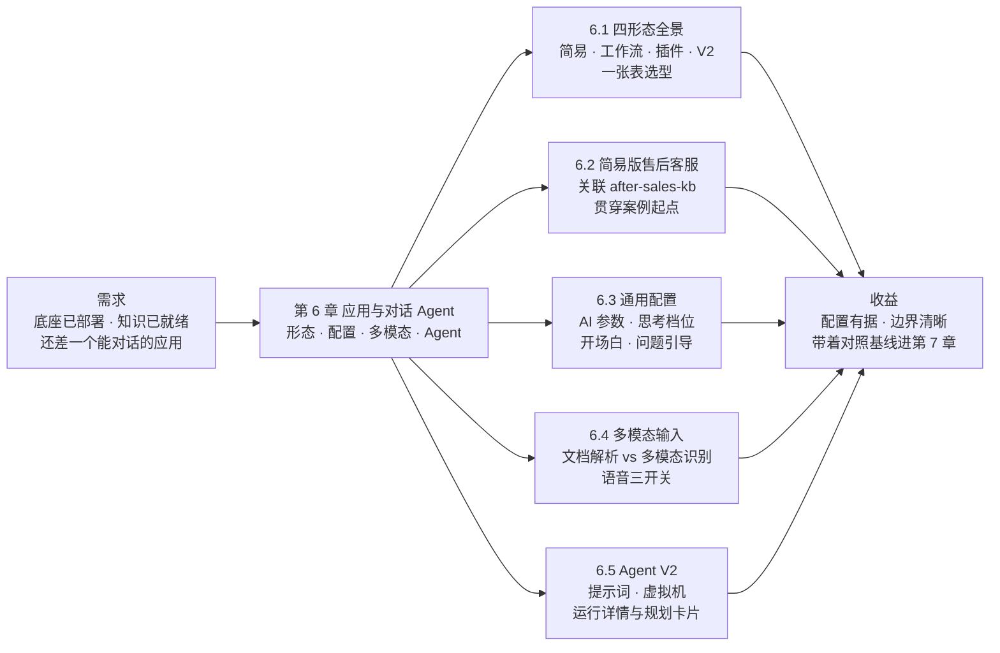

# 第 6 章 应用与对话 Agent

> 本章导读：第 2 章底座已立，第 3 章让 `after-sales-kb` 三类文档「已就绪」——知识怎么变成能对话的应用？本章先给四形态全景与选型表，再把「售后客服」以简易配置版落地：关联知识库、三段式提示词、快捷问题开场白、三类输入验证；然后过通用配置（AI 参数、思考档位、问题引导）与多模态输入，最后到 Agent V2 的虚拟机与调试。简易版是第 7 章工作流版的对照基线——能答什么、答不了什么，本章画清。读完本章，你能：选对应用形态，配出有据可查的客服应用，用运行详情看懂一次回答。



*本章导览图*

## 你什么时候需要它

三种典型处境，对应本章三种用法。

**需求在手，不知道该建哪种应用**——读 6.1。四形态对照表给出适用场景、编排方式与复杂度三列，加一条选型立场句；大部分「选哪种」的犹豫，根源是把形态高低当成了优劣，这张表把它们放回「按任务选」的位置。

**形态已定（简易配置），要把应用配得能用、好用**——按 6.2 → 6.3 → 6.4 的顺序走：先落一个关联 `after-sales-kb` 的「售后客服」，再逐项过 AI 参数与思考档位，最后按需打开文件上传与语音输入。

**任务开放、步骤不固定，简易配置和固定流程都不趁手**——直接看 6.5。Agent V2 用自主规划加虚拟机执行承接这类任务；启用虚拟机前有一个部署侧前提，本节开头会指回第 2 章留空的那两项地址。

前置：第 2 章部署完成且至少一个语言模型可用；`after-sales-kb` 数据「已就绪」（第 3 章）；Agent V2 的虚拟机另需沙盒服务就绪（见 6.5）。

## 6.1 概述：应用四形态全景

### 四形态一张表

第 1 章的概念地图把应用（App）列为四形态：简易配置、工作流、插件、Agent V2。本章把它们放到同一张表里正面比较——三列分别回答「什么活儿该给它」「怎么配置它」「上手与维护有多重」：

| 形态 | 适用场景 | 编排方式 | 复杂度 | 本书展开 |
|------|---------|---------|--------|---------|
| 简易配置（对话 Agent） | 轻量问答、内容生成、标准化输出；关联知识库后做基于资料的问答 | 表单式配置：配置页左侧 AI 配置、右侧调试预览，改完即测 | 低 | 本章 6.2-6.4 |
| 工作流 | 步骤固定、条件分支、审核流、自动化处理 | 画布节点编排，节点（Node）为最小执行单元 | 中到高 | 第 7 章 |
| 插件 | 可复用的能力单元：单独运行，或被工作流调用 | 输入输出声明的封装（编排界面细节本次素材未载） | 中 | 第 8 章 |
| Agent V2 | 开放式任务、多步推理、动态规划、代码执行 | 配置面板定人设与能力，模型自主规划，虚拟机执行 | 高 | 本章 6.5 |

复杂度一列不是能力评分，而是维护成本的预告：简易配置的维护面是一页表单，工作流是一张画布，Agent V2 还要多管一个沙盒运行时。**选型看任务，不看形态高低——先问「流程是否固定」：固定选工作流；再问「是否需要自主规划与代码执行」：需要选 Agent V2；两者皆否，简易配置起步。**

### 与快速上手四案例的对应

官方快速上手用四个案例演示了应用能力递进，第 1 章曾把「四案例」与「四形态」的对应挂账待核。本章据素材核销这条挂账——对应关系为本书梳理，立案依据随后一句：

| 快速上手案例 | 形态归属（本书梳理） | 立案依据 |
|-------------|---------------------|---------|
| 案例一：对话 Agent——邮件撰写助手 | 简易配置 | 新建入口为「对话 Agent」，配置形态即 6.2 的表单页 |
| 案例二：知识库 + 对话 Agent——民法典问答 | 简易配置 + 知识库关联 | 同一形态叠加知识库能力，不是独立形态 |
| 案例三：工作流——内容审核与自动改写 | 工作流 | 新建工作流，画布编排 |
| 案例四：Agent V2——智能数据分析 | Agent V2 | 新建「对话 Agent V2」，开启虚拟机 |

第四形态「插件」未出现在快速上手案例中——它是被复用的能力单元而非面向用户的应用入口，第 8 章随工具与插件体系一并展开。官方还特别强调能力可以组合：客服助手用知识库回答产品问题，再通过工具查询订单——贯穿案例正是这个组合的完整版，第 7 章落地。

### 「售后客服」的形态路线

**业务上推荐：客服类应用一律从简易配置版起步——一天内可上线试运行，同时暴露流程缺口，为是否升级工作流提供真实依据。**据此，本章把「售后客服」以简易配置版正式创建（第 1 章预留的名字在这里启用）；第 7 章的工作流版不是推倒重来，而是把同一份提示词、同一个知识库拆进节点里重新编排。

## 6.2 简易配置版「售后客服」：贯穿案例的起点

### 六步建应用

官方快速上手案例二给出「知识库 + 对话 Agent」的完整路径，案例落地为六步：

| 步骤 | 操作 | 要点 |
|------|------|------|
| 1 创建应用 | 工作台 → 新建 → 对话 Agent，命名「售后客服」 | 配置页左右两栏：左侧 AI 配置、右侧调试预览 |
| 2 关联知识库 | 在应用配置中关联 `after-sales-kb` | 第 3 章数据已「已就绪」；关联后回答链路变为「用户问题 → 知识库检索 → 模型总结回答」 |
| 3 写提示词 | 按「角色定义 + 输出格式 + 规则」三段式 | 规则段承担约束边界，写法见下与 6.3 |
| 4 配开场白 | 欢迎词加 `[快捷问题]` | 点击按钮即发送预设问题，降低首问门槛 |
| 5 选模型 | 关注中文表达与指令遵循 | 官方案例提示：低风险任务不必追求最强模型；温度调低（6.3） |
| 6 验证 | 调试预览发真实问题 | 三类输入都要测，见本节末尾 |

### 提示词：三段式落到售后域

角色稳定身份，格式约束结构，规则控制风险边界——这个三段式在第 1 章立起，这里是它在贯穿案例里的第一次完整落地：

```md
你是跨境电商平台的售后客服，基于售后知识库回答用户问题。

输出格式：
- 先给结论，再给依据，依据注明来源（售后政策 / 商品 FAQ / 物流公告）
- 涉及操作步骤时用编号列表

规则：
- 严格基于知识库检索结果回答，不臆造政策条款与时限
- 赔偿标准、退换货时限类问题逐条引用依据；知识库没有的，如实说明并建议提交工单
- 物流时效以最新公告为准，注意公告的发布时间
- 与售后无关的问题礼貌说明范围后拒答
```

三条规则各有出处：前两条仿照官方民法典案例的「基于资料回答、没有就如实说明」；第三条对应第 3 章的更新节奏标注——公告时效敏感，模型不该拿旧公告答新问题；第四条是范围护栏。提示词是简易配置里最重要的一份配置，值得像代码一样评审后入库。

### 开场白：欢迎词与快捷问题

对话开场白是每次新对话开始前由系统自动发送的欢迎词，支持标准 Markdown；`[快捷问题]` 格式会被界面渲染为可点击按钮，点击即以该问题作为用户输入发送：

```md
你好，我是售后客服，可以解答退换货、赔偿标准与物流时效问题。

[运输破损怎么赔偿？]
[退换货的时限是多久？]
[我的包裹多久能到？]
```

三个快捷问题正好对应 `after-sales-kb` 的三个集合——用户的第一问落在知识最全的地方，第一印象就立住了。开场白的使用建议（官方原文归纳）：简短明确，优先说明应用能解决什么；快捷问题覆盖高频场景，一次别配太多；依赖固定格式输入的应用，在开场白里给出示例。

### 验证：三类输入

配置完成先别急着发布——官方对知识库问答的验证要求是三类输入都要测：

| 输入类型 | 售后域测试例 | 预期行为 |
|---------|-------------|---------|
| 资料内问题 | 「运输破损怎么赔偿？」 | 给出有据回答，引用政策条款 |
| 资料外问题 | 「你们公司的 CEO 是谁？」 | 如实说明无法确认，不编造 |
| 模糊问题 | 「我的件有问题」 | 主动追问：什么问题、哪一单、什么时候发的 |

一个只会「顺着说」的应用不值得上线——这句第 1 章的判断，在有了知识库之后依然成立：检索没命中的资料外问题若被模型用通用知识补齐，比不答更危险。

### 边界与坑

- 不关联知识库时应用凭模型记忆作答，涉私域事实必错——先关联 `after-sales-kb` 再谈效果（第 1 章 1.5 的坑在正式应用上重申一遍）；
- 知识库数据未「已就绪」就关联，检索无料可用——状态自查见第 3 章；
- 提示词里的规则不是越多越好：规则之间互相冲突时模型行为不稳定，先保三条以内的硬约束。

**这个简易版就是第 7 章的对照基线：它能答「政策怎么说」，答不了「我的工单到哪一步了」——查工单需要工具与流程编排；第 7 章的工作流版要在这三类测试例上不退步，再把查工单这个简易版做不到的动作补上。**

## 6.3 通用配置：AI 参数、开场白与问题引导

### 配置入口：按模型能力显示

AI 配置用于调整应用或工作流中 AI 对话节点的模型、回复长度、多模态识别、回复格式和思考展示等行为。入口有两处，弹窗是同一个：应用编辑页「AI 配置」区域选好模型后，点模型选择框右侧的设置按钮；工作流中则点「AI 对话」节点的同一按钮（第 7 章会重逢）。弹窗内容按当前模型的能力动态显示——模型不支持多模态识别就不显示该项，不支持思考配置同样不显示。官方的基线建议值得先记住：**没有特殊要求时，只需选合适的模型，其余参数保持默认。**

### 基础参数：一张表

| 参数 | 管什么 | 官方建议与「售后客服」取值 |
|------|--------|--------------------------|
| AI 模型 | 选择基础模型；模型下方显示积分价格、最大上下文、工具调用与多模态能力 | 中文表达稳、格式遵循好即可 |
| 记忆轮数 | 回答时最多参考前面多少轮聊天 | 默认起步；客服、知识库问答类保留少量历史轮数即可 |
| 回复上限 | 一次最多回答多长（开关加滑块） | 要简短答复就调低；过低会截断回复 |
| 温度（Temperature） | 回答的稳定程度 | 客服、知识库问答建议偏低 |
| Top_p | 与温度同为随机性参数，作用重叠 | 不建议与温度同时调；温度够用就保持默认 |
| 停止序列 | 回复出现指定内容即停止输出，多个用 `\|` 分隔 | 普通对话不设 |
| 回复格式 | 默认即可；`json_schema` 需填格式要求，适合下游要读固定结构的场景 | 客服问答保持默认 |
| 多模态识别 | 是否读取用户输入中的图片、音频、视频（详见 6.4） | 按模型能力与业务需要开启 |
| 隐藏 AI 输出 | 生成内容不直接展示给用户，仍可交给后续节点处理 | 多节点衔接时用（第 7 章） |
| 隐藏 AI 思考 | 用户只看最终回答；调试时可临时关闭观察中间思考 | 调试期可关，上线前开 |

### 思考配置：七档思考强度

部分模型支持先生成思考过程再输出最终回答，选择这类模型时弹窗出现思考配置。档位对齐 OpenAI 规范的 `reasoning_effort`，经 ai-proxy 适配不同模型平台的参数格式：

| FastGPT 档位 | OpenAI 兼容值 | 默认 budget |
|-------------|--------------|-------------|
| 默认 | 不显式传递 `reasoning_effort` | 用模型默认值 |
| 不思考 | `none` | `0` |
| 极简思考 | `minimal` | `1024` |
| 轻量思考 | `low` | `2048` |
| 标准思考 | `medium` | `8192` |
| 深度思考 | `high` | `16384` |
| 极致思考 | `xhigh` | `32768` |

两条使用规则：上游平台只支持 token budget 不支持离散档位时，ai-proxy 按上表把档位转成 budget，反向归一化也按同一套区间（如 `1025~4096` 归为 `low`）；部分模型不全部支持各档位，切换报错就改回默认。对售后客服，日常问答用默认或不思考即可——思考档位是成本与延迟的放大器，留给真正难的输入。

### 对话开场白

6.2 已配好案例的开场白，这里补齐通用规则。开场白是每次新对话开始前系统自动发送的欢迎词：支持标题、列表、链接、加粗等标准 Markdown，让用户进门就知道应用能处理什么；`[快捷问题]` 渲染为按钮，点击即发送。配置入口在应用编辑页的「对话开场白」配置项，右侧设置按钮进入编辑。

### 问题引导：词库与自定义接口

开场白解决「第一问」，问题引导（Question Guide）解决「每一问」：为应用预设问题词库，用户输入时按内容动态搜索词库作为提示，引导用户更快完成提问。词库有两个来源：直接在 FastGPT 中配置，或提供自定义词库接口。接口要求能被用户浏览器直接访问，并注意允许跨域：

```bash
curl --location --request GET 'http://localhost:3000/api/core/chat/inputGuide/query?appId=663c75302caf8315b1c00194&searchKey=你'
```

响应的 `data` 是搜到的问题数组，最多只需返回 5 个：

```json
{
  "code": 200,
  "statusText": "",
  "message": "",
  "data": ["你是谁", "你是谁呀", "你好呀", "运输破损怎么赔偿", "退换货时限"]
}
```

| 参数 | 说明 |
|------|------|
| `appId` | 应用 ID |
| `searchKey` | 搜索关键字，最多 50 个字符 |

售后域的用法：把《商品 FAQ》里约 200 个问题的高频子集喂给词库，用户打出「运输」就看到「运输破损怎么赔偿」——引导词即检索词，顺手替第 4 章的检索质量做了前置优化。

### 约束写法：「限定词」的去向

不少 FastGPT 教程会提到一个叫「限定词」的配置。本书按素材说话：本次 v4.17.3 文档中没有记载这个字段的名称与行为，约束类要求一律落在提示词的规则段（6.2 的四条规则即标准写法），配合温度调低与回复格式共同收窄输出。「旧教程的限定词对应今天界面的哪一项」属未核实项，挂本章复核清单——素材里没有的参数，本书不猜。

## 6.4 多模态输入：文件与语音

### 先分清两条处理线

「让应用读文件」在 FastGPT 里是两条完全不同的处理线，混为一谈是新手最常见的配置事故：

| 处理线 | 对象文件 | 工作原理 | 能力开关 |
|--------|---------|---------|---------|
| 文档解析（Document Parsing） | PDF、Word、Excel、Markdown、HTML 等文档 | 文档转文字后拼接进提示词——LLM 目前没有直接解析普通文档的能力 | 文件上传配置（4.8.9 版本起支持） |
| 多模态识别 | 图片、音频、视频 | 转换为模型可识别的输入，由具备对应能力的模型读取 | AI 配置弹窗，依赖模型多模态能力 |

### 简易模式中的文件上传

简易配置（素材中称「简易模式」）打开文件上传后，调试对话框出现文件选择图标。工作模式有一处版本变迁要记住：4.8.9 起采用工具调用模式，由模型自行决定是否读取文件；4.8.13 起**强制解析文件并放入 system 提示词**，避免连续对话时模型偶尔不主动调用读取工具——每次都能参考文档。

上传的文件如何存储？官方给出的对话记录结构显示，用户消息里的文件以 URL 形式入库，并不存储解析后的文档内容：

```ts
type UserChatItemValueItemType = {
  type: 'text' | 'file';
  text?: { content: string };
  file?: {
    type: 'image' | 'audio' | 'video' | 'file';
    name?: string;
    key?: string;
    url: string;
  };
};
```

解析发生在请求时而不是存储时——按 4.8.13 口径分两类：文档解析节点只处理本轮文件，工具调用与 AI 对话的显式文档引用才会解析历史文件。

### 工作流侧的文档解析（预告）

工作流中处理文件的完整玩法属于第 7 章，这里只立三个事实备查：文档解析节点接收 `array<string>` 类型的文件 URL、输出解析后的 `string`；它按 URL 后缀判断文档类型，只解析文档，混选的多模态文件会被忽略；4.8.13 起**只解析本轮工作流接收的文件，不解析历史记录中的文件**。多个文档按「文件名 + 内容」模板拼为一个字符串，文档间以 `\n******\n` 分隔；AI 对话节点也可直接引用文档链接，解析内容会拼进 `role=system` 的提示词中。

### 4.8.13 起的七条变更

文件上传行为在 4.8.13 有一次集中调整，官方做了向下兼容但提醒尽快按新规则调整工作流、后续将移除兼容代码。七条变更收进一张表：

| 条目 | 变更内容 | 影响 |
|------|---------|------|
| 1 | 简易模式强制文件解析，不再由模型决策 | 每次对话都能参考文档 |
| 2 | 文档解析不再解析历史记录中的文件 | 只处理本轮文件 |
| 3 | 工具调用支持直接选择文档引用，自动解析历史文件 | 无需再挂文档解析工具 |
| 4 | AI 对话支持直接选择文档引用 | 无需经过文档解析节点 |
| 5 | 插件单独运行不再支持全局文件；插件输入可配置文件类型 | 取代全局文件上传 |
| 6 | 工作流调用插件不再自动传递文件，需手动给插件输入指定变量 | 显式传参 |
| 7 | 工作流调用工作流不再自动传递文件，可手动选择传递的文件链接 | 显式传参 |

对简易配置用户，只需要记住第 1、2 条；第 5-7 条是第 7、8 章编排时的传参纪律——文件不再隐式穿透节点边界。

### 语音输入：三个开关

语音输入支持用户在前台对话中录音并自动识别为文字，适合移动端、客服、现场记录等不便打字的场景。配置入口在应用编辑页「语音输入」配置项，三个开关各管一段：

| 开关 | 行为 | 使用建议 |
|------|------|---------|
| 语音输入 | 输入框出现语音录入入口，录音完成自动转文字；浏览器不支持时给出提示 | 移动端或现场场景开启 |
| 自动发送 | 识别为文字后自动发送，无需再点发送 | 识别准确性要求高的场景关闭，让用户先核对文本 |
| 自动语音回复 | 语音输入发出的问题，回复自动以语音播放 | 需同时开启语音播报；未开启时仍生成文字回复，只是不播放 |

依赖两条，都接第 2 章的账：语音识别走模型通道里的语音识别模型（五类模型中可选的那一类）；未配置 SSL 证书时，语音输入与播报因浏览器安全策略不可用——本地 HTTP 环境测不了语音，不是配置错了。

### 边界与坑

- 文档与图片混传时，文档解析线只处理文档、忽略多模态文件——想让模型看图，去 AI 配置开多模态识别并确认模型支持；
- 多模态识别开启后，请求发送前还会按模型能力二次过滤，不支持的类型不会发给模型；问题中的媒体链接需开启「提取链接中的多模态文件」才会解析，且仅在问题少于 500 字时尝试、一次最多处理 4 个链接；
- 普通文档永远不会作为多模态输入直发模型——文档必须走解析转文字这条线；
- 4.8.13 后历史文件不被文档解析线处理，也不自动穿透插件与子工作流边界——需要就用文档引用显式传。

## 6.5 Agent V2：专项配置、虚拟机与调试

### 专项配置三块

新建应用选「对话 Agent V2」即进入 Agent V2 形态——适用场景回顾 6.1：开放式、多步推理、动态规划。它的配置面板在通用配置之外多一组专项配置，共三块：

| 配置块 | 内容 | 要点 |
|--------|------|------|
| 提示词 | 定义核心人设、工作目标与具体规则 | 编辑器支持富文本，`@` 可快速唤起并绑定工具等上下文能力 |
| 虚拟机 | 为每个独立会话分配专属 Linux 沙盒 | 支持执行代码、读写文件、配置启动脚本 |
| 技能 | 选择已发布的技能正式版本 | 技能入口脚本随虚拟机拉起自动执行；未开虚拟机却关联技能会提示「虚拟机未就绪」 |

模型参数（对话模型、回复长度、推理展示）仍走 6.3 的 AI 配置弹窗，两处不重复。技能的开发与版本管理是第 8 章的主线，本节只接虚拟机这条线。

### 虚拟机：会话级沙盒

虚拟机（Virtual Machine）是专为每个会话分配的、物理隔离的轻量级 Linux 运行沙盒（Sandbox）。启用前有一处部署侧前提：回到第 2 章部署时留空的两项沙盒地址（WebSocket 与预览地址）补齐配置，并放行 3006 端口的 Agent Sandbox Proxy——沙盒服务未就绪，本节功能不可用（生产配置见第 11 章）。开启后，Agent 的能力从「会想」扩展到「会做」：经代码执行器运行 Python、Node.js 与 Shell 脚本，做复杂计算与数据处理；在独立 `/workspace` 目录读写文件，生成图表、处理上传的表格；经技能包或启动脚本定制环境。底层设计四条：

| 设计 | 内容 |
|------|------|
| 会话级隔离与生命周期 | 虚拟机与会话强绑定，不同用户、不同会话完全物理隔离；心跳（Keepalive）维持存活，闲置数分钟自动回收销毁（官方注明未来版本将改至用户级隔离） |
| 状态存续（Session Persistence） | 同一会话内，上一轮装的依赖、写的临时文件、配的环境变量下一轮依然有效 |
| 安全防逃逸 | 资源配额（CPU、内存、磁盘 IO）加网络防火墙策略；命令经 base64 编码在容器内解码执行，规避 Shell 拼接注入 |
| 一键快速重建 | 「重开对话」即销毁旧实例，下次请求分配全新容器，环境不被历史污染 |

### 启动脚本与状态去重

虚拟机拉起后、AI 正式开始前，系统按序执行两类脚本：先执行配置面板里的**应用启动脚本**（在工作目录 `/workspace` 下运行，用于装依赖、换软件源），再执行已关联技能包自带的**技能入口脚本**（在各技能包部署目录下运行）。技能包解压部署带原子性保障：先解压到 `.tmp-<versionId>-<random>` 临时目录，完全成功后整体替换正式目录，不会留下半截版本。

热启动的场景下，重复执行脚本只会白白拉长等待，系统因此设计了状态去重——运行状态记录在虚拟机内的 `~/.fastgpt/agent-skill-entrypoints/state.json`：


应用启动脚本按内容 SHA-256 哈希与 `state.json` 比对，脚本未修改则自动跳过；技能入口脚本按版本 ID 去重——发布的技能版本不可变，版本不变就只在冷启动执行一次。虚拟机重建（重开对话或闲置回收）后分配全新环境，所有脚本在首次冷启动重新执行。

### 执行限制：一张表

启动脚本的运行受四条系统规则约束，每条都有排查价值：

| 限制 | 数值 | 超限行为 |
|------|------|---------|
| 脚本长度 | 最大 16384 个字符（约 16KB） | 保存时自动截断——复杂初始化写进技能入口脚本，或拉取远程脚本执行 |
| 执行超时 | 环境变量 `AGENT_SANDBOX_ENTRYPOINT_TIMEOUT_SECONDS` 控制，默认 30 秒（限 1～600 秒） | 强制终止进程 |
| 失败影响 | 非阻塞主流程 | 脚本报错、超时或状态异常都不阻断对话，但缺依赖的代码会在运行时报错——去调试日志与文件管理器排查 |
| 日志容量 | 标准输出与标准错误合计约 8KB，记录时截断至 4000 字符 | 超出部分丢弃 |

使用侧还有四个顺手的设计：调试窗口的虚拟机文件管理器可实时浏览、编辑、上传、下载容器内文件；对话输入框上传的测试文件在对话开始前自动注入 `user_files/` 目录，AI 可按本地路径直接处理；代码因缺依赖或语法错误失败时，报错实时回传给模型，Agent 会在多步规划中自我修正重跑；气泡上方流式展示虚拟机创建与启动状态，启动耗时可见。

### 调试预览：气泡操作栏与规划卡片

调试预览是实时的对话测试环境，发布前像真实用户一样验证。通用调试能力：右上角「重开对话」一键清空历史从头测；每条 AI 回复下方有一排操作栏：

| 按钮 | 作用 |
|------|------|
| 复制 | 一键复制该条回复文本 |
| 朗读 | 回复文本转语音播放 |
| 标注 | 把该条问答标注保存到指定知识库，设定预期回答纠错（第 13 章质量巡检的地基） |
| 重试 | 对上一条用户输入重新生成回复 |
| 运行详情 | 展开树状决策链路：思考历程、内部参数动作、工具调用日志，附请求 Id、模型型号与积分消耗 |
| 响应耗时 | 该次交互从发送到完全响应的秒数 |

Agent 面对复杂任务启动规划时，对话中会流式渲染步骤规划卡片（Plan Card），以颜色区分进行中、已完成、待处理、已阻塞四种状态；遇到阻塞，按卡片上的阻塞原因回头优化提示词或排查工具配置。运行详情是本章给读者的「透视镜」——一次回答为什么这么答、调了什么工具、花了多少积分，都在这棵树上；第 13 章的对话运营与评测把它从调试工具变成巡检工具。

### 辅助生成：商业版专属

「辅助生成」选项卡内置面向 Agent V2 的 AI 协作助手：读取当前配置的模型、知识库与候选工具，按自然语言期望自动润色生成结构化提示词、推荐工具与知识库、同步填充配置面板。素材明确标注**仅商业版开放**——与第 1 章功能差异表中「工作流/Agent/Skill 辅助生成」一行互为印证，社区版读者跳过本小节即可，不影响主线。

## 本章小结

1. **应用四形态按任务选**：简易配置管表单式对话（关联知识库即基于资料问答），工作流管固定流程，插件是可复用能力单元，Agent V2 管开放任务；复杂度列是维护成本的预告，不是能力评分。
2. **简易配置版「售后客服」已落地**：六步走完——建应用、关联 `after-sales-kb`、三段式提示词、快捷问题开场白、选模型、三类输入验证；它同时是第 7 章工作流版的对照基线。
3. **AI 配置弹窗一处配置、两处复用**：应用与工作流 AI 对话节点共用；没有特殊要求保持默认；温度客服场景偏低；思考档位对齐 `reasoning_effort`，是成本与延迟的放大器。
4. **约束写在提示词规则段**：素材未见「限定词」字段，不猜；开场白管第一问，问题引导词库管每一问。
5. **多模态输入分两条线**：文档解析转文字拼提示词，多模态识别交给多模态模型；4.8.13 起强制解析本轮文件、文件不再隐式穿透节点边界；语音三开关依赖语音识别模型与 SSL 证书。
6. **Agent V2 的三件套**：专项配置（提示词 `@` 绑定、虚拟机、技能）、会话级沙盒（状态存续加状态去重加非阻塞超时）、调试预览（运行详情透视每次回答）。

下一步：简易版答「政策怎么说」已经够用，但「先分类、再检索、再查工单、最后作答」这条业务链需要节点级的编排。第 7 章把本章的黑盒拆开——同一个「售后客服」名字、同一份 `after-sales-kb`、同一份提示词，在工作流画布上重走一遍，并用第 6 章这三条例子验收效果。

## 验收清单

读到这里，你应该能：

- ☐ 用 6.1 的表格向团队讲清四形态的适用场景、编排方式与复杂度，并为一个新需求当场说出选型与理由；
- ☐ 从零创建简易配置版「售后客服」：关联 `after-sales-kb`、写出三段式提示词、配好带 `[快捷问题]` 的开场白；
- ☐ 用资料内、资料外、模糊三类输入验证应用，并说出三类各自的预期行为；
- ☐ 打开 AI 配置弹窗，说出温度、记忆轮数、回复上限各管什么，并给客服场景定一组有依据的参数；
- ☐ 为应用开启文件上传，并用一句话分清文档解析与多模态识别的处理线；
- ☐ 说出虚拟机的会话级隔离、状态去重与 30 秒超时限制，并解释「重开对话」为什么能保证环境干净；
- ☐ 在调试预览展开一次回答的运行详情，指认其中的工具调用与积分消耗。

### 复核清单（发布前）

以下各项均未实测，发布前逐条补验：

- [ ] 全章界面项与行为对照官方文档 v4.17.3（guide/build/general 与 guide/build/agentv2 各篇，另据 guide/getting-started/quick-start 交叉核验），核实日期 2026-11-01；
- [ ] 简易配置版「售后客服」全流程实测：创建、关联知识库、提示词与开场白配置、三类输入验证；
- [ ] 应用四形态与新建菜单命名的界面对照——「简易配置」与「对话 Agent」「简易模式」三种叫法在当前界面的落点；
- [ ] 第 1 章挂账的「四案例 ↔ 四形态」对应关系，按本章 6.1 表格在界面上二次确认；
- [ ] AI 配置弹窗按模型能力的显示差异实测：多模态识别与思考配置的出现条件；
- [ ] 思考档位与 budget 映射在自有渠道模型上实测，含 ai-proxy 反向归一化区间的实际行为；
- [ ] 「限定词」字段在 v4.17.3 界面的对应项核实——本次素材未见记载，本书未下结论；
- [ ] 文件上传 4.8.13 行为实测：强制解析入 system 提示词、历史文件不解析、混选多模态文件被忽略；
- [ ] 语音输入三开关实测，含无 SSL 证书环境下的不可用提示；
- [ ] Agent V2 虚拟机实测：启动脚本 30 秒超时与 16384 字符截断、`user_files/` 注入、重开对话重建、`state.json` 去重跳过；
- [ ] 辅助生成的社区版入口形态核实（素材标注仅商业版开放）；
- [ ] 章首导览图与 6.5 去重流程图在 GitHub 网页端的渲染检查。

## 延伸阅读

- **第 7 章（工作流编排）**——本章对照基线的升级路线：同一个「售后客服」拆成问题分类、知识库搜索、HTTP 查工单、AI 答复的节点链，黑盒变画布。
- **第 4 章（检索方案与调优）**——简易版检索不满意时的调参入口：语义、全文、混合检索与引用上限，拿 `after-sales-kb` 实战。
- **第 8 章（工具与技能）**——6.1 表格里插件形态的展开，以及 Agent V2 技能块的开发、打包与版本管理。
- **第 13 章（对话运营与评测）**——调试预览「标注」按钮的制度化：标注沉淀进知识库，运行详情变成质量巡检的证据链。
- **第 2 章（部署与模型通道）**——本章两处依赖的出处：语音识别模型与 SSL 证书、虚拟机启用前第 2 章留空的沙盒地址与 3006 端口。
