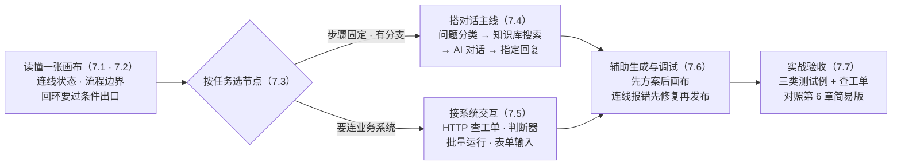
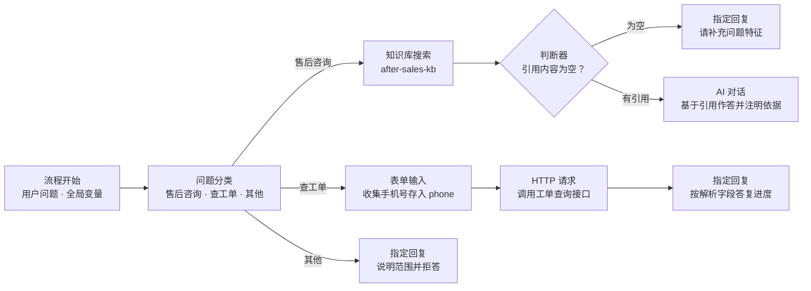

# 第 7 章 工作流编排

> 本章导读：第 6 章的简易配置版「售后客服」能答「政策怎么说」，答不了「我的工单到哪一步了」——问答之外一旦出现流程，表单式配置就到了头。本章拆开这个黑盒：先讲画布的执行模型与连线规则，再给节点族全景，随后讲透六个主干节点；最后实战把简易版升级为工作流版——问题分类 → 知识库搜索 → HTTP 查工单 → 指定回复，并对照第 6 章三类测试例验收。读完本章，你能：读懂任何一张工作流画布，独立编排售后客服工作流，并说清工作流版比简易版多解决了什么。



*本章操作流程图*

## 你什么时候需要它

三种典型处境，对应本章三种用法。

**应用要按固定步骤走，还要分情况处理**——先分类再检索、检索为空给兜底、不同类问题走不同答复，这些在简易配置里只能写进提示词赌模型自觉，在工作流里是显式的节点与连线。按 7.4 搭对话主线，7.7 落到贯穿案例。

**答复之前要查业务系统**——工单进度、订单状态、物流轨迹，知识库里没有，得现场去问中台接口。7.5 的 HTTP 请求节点就是工作流的出口，7.7 对接售后域的工单查询接口（→ mcp 书工具层）。

**接手一张别人搭的画布，或拖线时目标入口不出现**——先读 7.1 的执行模型，再看 7.2 的连线规则：不可连接的目标在拖线时直接隐藏，不会「先连上、再报错」；商业版用户还可以用 7.6 的辅助生成改画布。

前置：第 2 章部署完成且至少一个语言模型可用；`after-sales-kb` 数据已就绪并完成检索调优（第 3、4 章）；第 6 章的简易配置版「售后客服」已建——它是本章升级的对照基线。

## 7.1 概述：画布、节点与执行模型

官方的起点描述是（v4.17.3 文档「工作流&插件」，核实日期 2026-11-01）：FastGPT 从 V4.0 版本开始采用新的交互方式构建 AI 应用，用 Flow 节点编排——即工作流（Workflow）——的方式实现复杂流程，可玩性与扩展性更高，但上手门槛也随之提高，有一定开发背景的用户使用起来会比较容易。

画布上的最小单元是节点（Node）：官方把它类比作程序中的一个个 Function 或接口，理解为一个**步骤**；把多个节点拼接起来，一步步实现最终的 AI 输出。最简单的 AI 对话工作流只有两个节点——流程开始与 AI 对话：用户输入问题后，流程开始节点执行并保存用户问题；AI 对话节点拿到两个必填参数作答，一个是聊天记录（默认输入 6 条，代表此模块的上下文长度），一个是用户问题（引用流程开始节点保存的值）。

### 节点两分法与三要素

从功能上，官方把节点分为两类：**系统节点**（用户引导——配置对话框信息；用户问题——流程入口）与**功能节点**（知识库搜索、AI 对话等其余节点——都有输入和输出，可以自由组合）。

每个节点包含三个核心部分：

| 要素 | 内容 | 要点 |
|------|------|------|
| 输入 | AI 模型、提示词、聊天记录、用户问题、知识库引用等 | 可手动输入，也可变量引用；引用范围包括全局变量与之前任意一个节点的输出 |
| 输出 | 新的上下文、AI 回复内容等 | 可被之后任意节点变量引用 |
| 触发器 | 节点上下左右四个连接点 | 被连接的节点按顺序决定是否执行；左和上是前置线连接点，右和下是后置线连接点 |

### 没有固定出口的执行模型

官方把这标记为「重点」：工作流从流程开始节点执行（可理解为从用户输入问题开始），**没有固定的出口，以节点运行结束作为出口**——如果在一轮调用中所有节点都不再运行，工作流结束。推动执行的是连线状态：

| 连线状态 | 含义 |
|---------|------|
| `waiting` | 被连接的节点等待执行 |
| `active` | 被连接的节点可以执行 |
| `skip` | 被连接的节点不需要执行，跳过 |

节点执行四原则（官方原文归纳）：

1. 前置线中有状态为 `waiting` 的，等待；
2. 前置线中有状态为 `active` 的，执行；
3. 前置线中既没有 `waiting` 也没有 `active` 的，跳过；
4. 节点执行完毕后，按实际情况把后置线改为 `active` 或 `skip`，并把前置线改回 `waiting`，等待下一轮执行。

以最简三节点链路（流程开始 → 知识库搜索 → AI 对话）为例：流程开始执行完毕，后置线转 `active`；知识库搜索节点见前置线为 `active`，开始执行，完毕后同样把后置线转为 `active`；AI 对话节点触发执行，流程结束。

### 怎么读一张画布

官方建议三条：从左往右阅读；从用户问题（流程开始）节点读起——它代表用户发送了一段文本，触发任务开始；重点关注 AI 对话与指定回复——这两个节点是输出答案的地方。

一个高频问题官方放在 FAQ 里：多个输出结果怎么合并？三条路——用文本加工（文本拼接节点）合并字符串；用知识库搜索自身的合并能力合并多路搜索结果；其余结果无法直接合并，传入 HTTP 节点，在你的业务服务里合并。

## 7.2 编排规则：连线、流程边界与回环

编排工作流时，系统会检查节点之间能否连接。本节把规则压成四组：连线类型、基本限制、流程边界、回环控制——判不准一次连接时，回来查这四组就够了。

### 两类连线

连接点（Handle）是连线两端的接口，画布中有两类连线：

| 类型 | 连接方式 | 用途 |
|------|---------|------|
| 普通连线 | 节点的普通出口、分支出口或报错捕获出口 → 另一节点的普通入口 | 连接工作流的执行步骤 |
| 工具连线 | 工具调用节点底部的菱形出口 → 工具节点顶部的菱形入口 | 将节点挂载为工具调用的入口 |

普通出口通常位于节点右侧，普通入口通常位于左侧，两类连接点不能混用：普通出口不能连接工具入口，工具出口也不能连接普通入口；只有支持作为工具使用的节点才具有工具入口。删除连线可点击连线中间的 x，或左键选中后删除。

### 基本限制

- 节点不能连接自身；
- 起点节点、起点连接点、终点节点、终点连接点均相同的连线不能重复创建；
- 分支连线必须使用当前配置中存在的分支或选项；输出字段的连线必须使用当前存在且有效的出口；报错捕获连线要求节点已开启报错捕获；
- 满足其他规则的前提下，一个出口可以连接多个不同节点，多个节点也可以连接同一个普通入口；同一节点的不同分支出口可以连接同一个后续节点。

### 主流程与工具流程的边界

工具调用节点本身属于它所在的外层流程；经菱形工具连线挂载的节点是**工具入口**，从工具入口沿普通连线向后延伸的节点属于这个入口的**工具流程**。每个工具入口对应独立的工具流程——即使两个工具入口挂在同一个工具调用节点下，它们的工具流程也不能通过普通连线互相连接：

| 连线方向 | 是否允许 |
|---------|---------|
| 主流程节点 → 同一主流程内的其他节点 | 允许 |
| 工具流程内节点 → 同一工具流程内的其他节点 | 允许（仍需满足回环规则，且不能连回工具入口） |
| 主流程 ↔ 工具流程（任一方向） | 不允许 |
| 一个工具流程 → 另一个工具流程 | 不允许，同一工具调用下的不同工具流程也不行 |
| 工具流程内节点 → 调用它的工具调用节点或更外层 | 不允许 |

挂载规则三条：一个工具调用节点可以挂载多个不同的工具入口；一个工具入口只能挂载在一个工具调用节点下，不能共用；已有普通入线的节点要先删除入线才能挂载，挂载后也不能再接收普通入线。更换工具入口归属时手动删旧线、连新线，系统不会自动替换。

容器边界：循环节点与并行执行节点内部的节点还要遵守容器边界——同一容器内可按规则互连，容器内部节点不能直连容器外节点或另一容器内部节点；外部流程应连接容器节点自身的外部连接点，由容器执行内部流程。

### 回环：禁止纯串行，允许条件回流

**禁止纯串行回环，允许经过条件出口控制的回流。**系统检查的是连线实际使用的出口以及加入连线后形成的每一条回路，不是一刀切禁止连接所有上游节点。可以控制回流的出口：

| 出口 | 规则 |
|------|------|
| 判断器的 IF、ELSE IF、ELSE 分支 | 当前配置中存在的分支可控制回流 |
| 问题分类的分类出口 | 当前配置中存在的分类可控制回流 |
| 用户选择的手动选项出口与动态选项出口 | 配置中存在的选项可控制回流 |
| 已开启报错捕获的节点 | 成功出口与报错捕获出口都可控制回流，成功与失败走不同出口 |

官方示例中挑四组代表记牢：

| 已有结构与候选连线 | 是否允许 | 原因 |
|-------------------|---------|------|
| `A → B`，再连接 `B → A` | 不允许 | 纯串行回环 |
| `A → 判断器 B → C`，再连接 `C → A` | 允许 | 回路经过 B 的有效分支出口 |
| `A → B → D`，另有 `A → C`，再连接 `D → C` | 允许 | 这是分支汇合，没有形成回环 |
| `A → B → C` 为串行路径，环外另有条件分支，再连 `C → A` | 不允许 | 环外的条件分支控制不了这条纯串行回路 |

两条工程纪律：搭建回流时保留合理的退出条件——持续回流的流程仍受运行时执行次数上限约束；回环许可不放宽其他限制——不能连自身、不能跨流程边界，变量引用不是执行连线，不参与回环判断。

### 校验时机与连线删除

| 操作 | 连线校验的影响 |
|------|---------------|
| 打开、编辑流程 | 显示已有问题；新建连线时只显示可连接的目标入口 |
| 保存草稿 | 可保留尚未修复的连线问题，不因这些问题阻止保存 |
| 在编辑页运行、调试或测试对话 | 检查当前工作流，存在连线错误时需要先修复 |
| 保存并发布 | 检查当前工作流，存在连线错误时需要先修复 |

已发布版本通过正式聊天、分享链接或 API 运行时，仍由后端按其执行逻辑运行——客户端的编排校验不会修改已发布版本的执行图。

删除连线的四种情况：手动删除连线；删除连线所连接的节点；删除分支、选项或带有连线出口的输出字段（连接点随之删除）；关闭报错捕获（报错捕获出口随之删除）。注意两组「不会删」：连接点暂时隐藏、节点折叠只是显示变化，不会删除已有连线；关闭报错捕获只删报错出口的线，若保留的连线因此构成纯串行回环，系统会提示调整。

## 7.3 节点族全景

官方节点数量众多，本书的策略：讲透对话主线与系统交互的六个主干节点（7.4、7.5），其余按族分类概括。先看各节点官方文档里的公共标签——「可重复添加」（复杂编排时防止线太乱，重复添加更美观）、「有外部输入」、「触发执行」、「需要手动配置」；个别节点还有专属标记：问题分类是「function_call 模块」，HTTP 请求被称为「核中核模块」，知识库搜索与 AI 对话是「核心模块」。

| 节点族 | 节点 | 定位（素材原文） | 本书展开 |
|--------|------|-----------------|---------|
| 对话生成 | AI 对话 | 核心模块，输出答案的地方 | 7.4 |
| 知识检索 | 知识库搜索 | 核心模块，可关联多个知识库 | 7.4 |
| 分类与分支 | 问题分类、判断器 | function_call 模块；IF/ELSE 判断 | 7.4 · 7.5 |
| 回复输出 | 指定回复 | 会输出结果给客户端 | 7.4 |
| 系统交互 | HTTP 请求、批量运行、表单输入、变量更新 | 核中核；V4.8.11 新增；用户交互 | 7.5 |
| 文本加工 | 文本拼接 | 对输入文本做固定加工 | 7.5 |
| 工具与容器 | 工具调用（及工具调用终止）、循环节点、并行执行、用户选择 | 本次素材仅载其边界与连线规则 | 7.2 · 第 8 章 |

此外，批量运行的官方示例里出现了代码运行与搜索词库两个节点（作为示例引用，本次未拉取其专页素材，不展开）。

**本书立场：先搭对话主线，再按需加系统交互——画布不是越复杂越好，多一个节点就多一分连线与排障成本；一个任务该不该上工作流，判断标准仍是第 1 章那三个特征——步骤稳定、规则明确、可重复执行。**

## 7.4 对话主线：四个核心节点

### 7.4.1 问题分类：给流程装上路由

特点：可重复添加、有外部输入、需要手动配置、触发执行、function_call（函数调用）模块。

功能一句话：把用户的问题分类，分类后执行不同操作。参数四项：

| 参数 | 说明 | 「售后客服」的取值 |
|------|------|-------------------|
| 系统提示词 | 放置在对话最前面，补充说明分类内容的定义 | 重点给「查工单」下定义：询问已提交工单的处理进度或结果时归类；仅描述商品问题不归此类 |
| 聊天记录 | 适当增加一些聊天记录，可联系上下文进行分类 | 以节点默认值起步（默认条数官方素材未载）——「那我的呢」这类指代靠它 |
| 用户问题 | 用户输入的内容 | 引用流程开始节点保存的用户问题 |
| 分类内容 | 每个分类一条出口 | 售后咨询 / 查工单 / 其他 |

原理：分类内容最终组成一个 function call，其返回值由系统随机生成枚举字段，模型必然返回其中一个值，从而实现分类判断。官方计费示例的系统提示词值得照抄格式：

```
计费常见问题包括套餐价格、余额、积分消耗、续费、发票、退款等问题
当用户询问为什么扣费、如何充值、如何查看账单时，应归类为计费常见问题
当用户只是在询问产品功能或打招呼时，不应归类为计费常见问题
```

边界写在素材功能段的第一句之后：在一些较模糊的场景中，分类效果不是很明显——高风险动作不要挂在单一分类出口上（7.7 的拒答分支因此只做「说明范围」，不做破坏性操作）。

### 7.4.2 知识库搜索：引用从哪来

特点：可重复添加（复杂编排时防止线太乱）、有外部输入、有静态配置、触发执行、核心模块。

| 输入 / 输出 | 内容 | 要点 |
|------------|------|------|
| 输入 · 关联的知识库 | 一个或多个知识库 | 只能选**相同向量模型**的知识库——第 3 章建库时定下的索引模型，在这里变成硬约束 |
| 输入 · 搜索参数 | 检索方案与参数 | 与第 4 章检索方案同源：语义 / 全文 / 混合、引用上限、最低相关度都在那里调 |
| 输出 · 引用内容 | 数组格式 | **长度可以为 0**——即使没有搜索到内容，这条输出链路也会走通 |

「长度可以为 0」是双刃剑：链路不会断，但不接判断器做空引用判断，空引用也会照样进入 AI 对话——模型拿不到依据还硬答，正是第 6 章要防的事故。`after-sales-kb` 的搜索参数直接沿用第 4 章的调优结果，不在节点里另起炉灶。

### 7.4.3 AI 对话：生成答案的地方

特点：可重复添加、触发执行、核心模块。两个必填输入——聊天记录（默认 6 条）与用户问题（引用流程开始节点的输出）。AI 模型在「模型配置」页配置（模型通道见第 2 章；官方工作流文档此处仍写 config.json，4.15.0 起配置体系已改走环境变量，见 2.3）；点击模型右侧设置按钮打开的弹窗，正是第 6 章 6.3 讲透的 AI 配置弹窗——一处配置、两处复用，温度、记忆轮数、回复上限、思考档位的建议全部沿用，此处不重复。

一个多节点衔接的专用开关：隐藏 AI 输出（第 6 章 6.3 的参数表里标注「多节点衔接时用」的那一项）——生成内容不直接展示给用户，仍可交给后续节点处理。7.7 的售后客服画布用不上它：政策答复由 AI 对话直接输出给用户；只有要把 AI 产出先加工再出画布时才需要这个开关。

### 7.4.4 指定回复：把结果交回用户

特点：可重复添加（防止复杂编排时线太乱）、可手动输入、可外部输入、会输出结果给客户端。回复内容两种来源：手动输入固定内容，或通过变量引用。它通常用于特殊状态回复——拒答说明、兜底提示、把 HTTP 解析出的工单状态组织成一段话，都从这里出画布。

### 边界与坑

- 分类节点在模糊问法上不可靠——「我的件有问题」可能被分进售后咨询，也可能掉进其他，7.7 用表单输入补确定性收集；
- 知识库搜索空引用不断链——空判断必须显式做，别指望节点替你停；
- AI 对话的聊天记录默认 6 条，不是越大越好——上下文越长成本与跑偏风险越高，第 6 章 6.3 对记忆轮数的建议同样适用于节点。

## 7.5 系统交互：HTTP、判断器与批量处理

### 7.5.1 HTTP 请求：工作流的出口

特点：可重复添加、手动配置、触发执行、核中核模块。HTTP 模块向对应地址发送一个请求，实际操作与 Postman、ApiFox 这类调试工具差不多：

| 配置块 | 用途 | 要点 |
|--------|------|------|
| Params | 路径请求参数 | GET 请求中用的居多 |
| Body | 请求体 | POST/PUT 请求中用的居多；仅特定请求类型下生效 |
| Headers | 请求头 | 传递鉴权等特殊信息 |
| 自定义变量 | 接收前方节点的输出作为变量 | 供上方三块引用 |

变量引用是它的核心玩法：`{{}}` 语法在 Params、Body、Headers 与 URL 中都可用；变量来自三类——全局变量、系统变量、前方节点输出。官方示例：Headers 里 `Authorization` 填 `Bearer {{token}}`，Params 里 `appId` 填 `{{appId}}`。Body 中引用字符串变量要加双引号写成 `"{{string}}"`，数字与布尔不加——JSON 的类型语义由你保证：

```json
{
  "string": "{{string}}",
  "number": {{number}},
  "boolean": {{boolean}}
}
```

系统变量一张表（鼠标悬停「请求参数」旁的问号可见同一份提示）：

| 变量 | 含义 |
|------|------|
| `appId` | 应用的 ID |
| `chatId` | 当前对话的 ID；测试模式下不存在 |
| `responseChatItemId` | 当前对话中响应的消息 ID；测试模式下不存在 |
| `variables` | 当前对话的全局变量 |
| `cTime` | 当前时间 |
| `histories` | 历史记录，默认最多取 10 条，无法修改长度 |

返回值解析是最容易误解的一段：节点里添加的「返回值」并不代表接口的返回值，而是代表**如何解析接口返回值**——用 JSON path 语法提取接口响应中的值，取值 key 遵守 JS 的对象取值规则，可以配置多个。以如下响应为例：

```json
{
  "message": "测试",
  "data": {
    "user": { "name": "xxx" },
    "list": [[{ "test": 22 }]]
  }
}
```

提取示例（取值 key 与得到的内容）：

| 解析 key | 得到 |
|---------|------|
| `message` | `测试` |
| `data.user.name` | `xxx` |
| `data.list[0][0].test` | `22`（嵌套数组同样可取） |

自动格式化输出（v4.6.8 起）：输出类型选择字符串时，会把对应 key 的值转成 json 字符串输出——官方给出的用法正是把 HTTP 输出接进文本加工，拼接适当提示词后输入给 AI 对话。

作用边界：官方用「无限扩展」形容这个模块——操作数据库、调用外部数据源、执行联网搜索、发送邮箱；7.7 的查工单就是其中「调用外部数据源」的最小实例。

### 7.5.2 判断器：确定性分支

特点：可重复添加、有外部输入、触发执行。功能：对任意变量做 IF 判断，满足条件执行 IF 分支，不满足执行 ELSE 分支；支持增加更多判断条件与分支，同编程语言中的 IF 语句逻辑相同。官方示例判断的正是知识库引用——「知识库引用」变量的长度等于 0 则走 IF 分支，否则走 ELSE 分支；这正是 7.4.2 空引用问题的标准答案。适用场景（素材原文）：让大模型做判断后输出固定内容；根据大模型回复内容判断是否触发后续模块。

**与问题分类的分工（本书立场）：分类靠模型判断，结果带不确定性；判断器靠确定性条件，同样的输入永远走同一分支——能用判断器表达的，不要让模型再判断一次。**

### 7.5.3 批量运行：数组的循环

批量运行节点为 V4.8.11 版本新增，让工作流对数组类型的输入数据迭代处理：每次处理数组中的一个元素，自动执行后续节点，直到完成整个数组。两个必填输入：**数组**（字符串、数字、布尔、对象数组皆可）与**循环体**（循环体开始 + 循环体结束）。循环体内部可添加 AI 对话、HTTP 请求、内容提取、文本加工等任意类型节点；循环体结束节点通过下拉菜单选择要输出的变量，所有循环的结果组成一个新的数组作为最终输出。特性：保持处理顺序、支持并行处理（性能优化）、支持条件终止与循环计数。

场景（素材归纳三类）：批量数据处理——批量翻译、批量总结、批量生成；数据流水线——对搜索结果、知识库检索结果、HTTP 请求返回的数组逐条处理；递归或迭代任务——长文本分段处理、多轮优化内容。7.7 留了一个口子：工单接口若一次返回多张工单，可在批量运行里逐条摘要后再合并答复（设计预留，未实测）。

### 7.5.4 表单输入、变量更新与文本拼接

| 节点 | 触发后行为 | 典型用途 |
|------|-----------|---------|
| 表单输入 | 用户交互节点：对话进入「交互」状态并记录工作流状态，等用户填完必填信息提交后，收集的表单信息传入后续节点 | 精准收集需要的用户信息——手机号、订单号，替代「靠模型追问」 |
| 变量更新 | 更新指定节点的输出值，或更新全局变量 | 给「自定义变量」类型的全局变量赋值，使其无需用户输入；更新前方节点输出，后续节点用到的就是新值 |
| 文本拼接 | 对输入文本进行固定加工处理；入参仅支持字符串和数字格式，以变量形式用于文本编辑区域 | 给任意模块输入自定格式文本；处理 AI 模块的系统提示词 |

## 7.6 辅助生成与画布调试

### 辅助生成：商业版与云服务版专属

工作流辅助生成可以根据自然语言描述创建工作流，也可以在现有工作流基础上调整节点、连线和配置，减少手动编排的工作量。前提三件：具有应用编辑权限；管理员已启用工作流辅助生成与虚拟机（沙盒）能力；社区版点击入口后会显示商业版功能介绍——与第 1 章功能差异表中「工作流/Agent/Skill 辅助生成」一行互为印证。

入口在工作流编排页的工具栏「AI 生成工作流」，流程四步：

| 步骤 | 动作 | 要点 |
|------|------|------|
| 1 描述需求 | 说明工作流的目标、输入、处理步骤和预期输出 | 需求越具体，AI 越容易生成符合预期的方案；要用特定知识库或工具，建议在需求中说明 |
| 2 确认方案 | AI 给出流程图和方案说明 | 可检查处理步骤、分支条件与输出，提出修改意见，调整后再确认 |
| 3 生成版本 | AI 搭建工作流并进行配置校验 | 生成结果尚未写入画布，先查看再决定 |
| 4 应用到画布 | 用生成版本替换当前画布内容，并自动排版节点 | 应用后仍可继续手动编辑；**应用不代表已保存，更不代表已发布** |

两个坑：生成版本显示「已过期」时，重新生成后再应用；应用后仍需检查模型、知识库、工具等配置并调试，确认效果后再保存和发布。

### 画布调试：校验时机

工作流的调试规则在 7.2 的校验时机表里已经列全：编辑页运行、调试或测试对话之前，系统检查当前工作流，存在连线错误必须先修复；保存草稿则宽松得多。补两条画布交互的事实：拖动连线时，画布只显示当前起点可以连接的目标连接点，不符合规则的目标直接隐藏——官方原话是「不能连接的目标不会通过先连上、再报错的方式提示」；打开旧流程时系统保留已有连线并显示不符合当前规则的问题，旧流程并不豁免新规则，重新调试或发布时需要调整。

挂账一句：工作流专属的 Debug 能力（如单节点试运行、断点调试）在本次拉取的素材中没有记载，本书不展开；第 6 章 Agent V2 的调试预览描述的是那一种形态，不能外推到工作流画布——已列入复核清单。

## 7.7 实战：售后客服工作流

### 从表单到画布

升级原则沿用第 6 章立下的约定：同一个应用名「售后客服」、同一份 `after-sales-kb`、同一份三段式提示词——从配置表单搬进画布重新编排，并补上简易版做不到的动作：查工单。画布结构：



其中「表单输入收集手机号 → HTTP 查工单」这一组合是本书的编排设计，非官方模板——各节点行为均有素材依据，整条链路未实测（复核清单挂账）。

### 节点配置清单

| 节点 | 关键配置 | 依据 |
|------|---------|------|
| 问题分类 | 系统提示词给出三分支定义，重点定义「查工单」：询问已提交工单的处理进度或结果；分类内容三条，各接一条出口 | 7.4.1 |
| 知识库搜索 | 关联 `after-sales-kb`；搜索参数沿用第 4 章调优结果（检索方案、引用上限、最低相关度） | 7.4.2 · 第 4 章 |
| 判断器 | 判断变量选知识库搜索的引用内容，条件为长度等于 0；IF 接兜底回复，ELSE 接 AI 对话 | 7.5.2 |
| AI 对话 | 聊天记录默认 6 条，用户问题引用流程开始；系统提示词即第 6 章三段式，保留「依据注明来源」；不开隐藏 AI 输出——政策答复由本节点直接输出，不经指定回复 | 7.4.3 |
| 表单输入 | 必填项手机号，提交后作为 phone 变量传给 HTTP 节点 | 7.5.4 |
| HTTP 请求 | GET 方法，URL 按下例引用 `{{phone}}`；返回值按 JSON path 配解析 key，以变量引用进指定回复 | 7.5.1 |
| 指定回复 ×3 | 拒答文案与兜底文案（手动输入）、工单答复（引用 HTTP 解析字段）；政策答复不经它——由 AI 对话直接输出 | 7.4.4 |

HTTP 节点的 URL 按贯穿案例约定的工单查询接口配置（中台售后域，→ mcp 书工具层）：

```
GET https://{mid-platform-host}/api/after-sale/tickets?phone={{phone}}
```

素材口径：URL 可用 `{{}}` 引用变量，故路径参数 phone 直接引用表单输入收集的值；URL 中的域名为占位符，以实际部署为准；响应的解析 key 要按中台实际返回结构用 JSON path 配置——本次素材不含该接口的响应定义，本书不臆造字段名，对接时以实际响应为准（挂复核清单）。

### 与第 6 章简易版逐条对比

| 测试例 | 简易配置版（第 6 章） | 工作流版（本章） |
|--------|---------------------|-----------------|
| 「运输破损怎么赔偿？」 | 有据回答，引用政策条款 | 不退步：分类进售后咨询 → 检索 → AI 对话，依据要求写在提示词里 |
| 「你们公司的 CEO 是谁？」 | 靠提示词规则拒答，模型可能被绕过 | 分类进「其他」直接走拒答分支，不进生成模型；但分类本身仍是模型判断，模糊问法可能误入售后分支 |
| 「我的件有问题」 | 靠模型自行追问，追问质量不稳定 | 若走查工单分支，表单输入强制收集手机号，不靠追问 |
| 「我的工单到哪一步了？」 | **答不了**——黑盒没有工具 | 表单收集手机号 → HTTP 查询 → 指定回复给出进度 |

成本的一边也要看全：简易版的维护面是一页表单，工作流版是一张画布——七个节点、三处回复文案、一条外部接口依赖，任何一处改动都要过画布与调试。**业务上推荐：对话主线能覆盖的需求留在简易配置；出现「按类别走不同流程」或「答复前调外部系统」时再升级工作流——升级的理由是流程与集成，不是话术。**

### 验收路径

按第 6 章的三条例子加查工单共四条，在工作流编辑页的测试对话里逐条跑：前两条对照第 6 章预期不退步；第三条观察分类落点与表单收集；第四条确认 HTTP 解析出的工单状态出现在指定回复里。任何一条不达预期，先沿运行链路定位到节点，再回对应小节修配置——这套「从答案回溯到节点」的路径，就是工作流版相对黑盒最大的运维红利。

## 本章小结

1. **执行模型**：工作流从流程开始节点执行，没有固定出口，以节点运行结束作为出口；连线以 `waiting` / `active` / `skip` 三态推进，前置线无 `active` 且无 `waiting` 即跳过。
2. **编排规则**：普通连线与工具连线不能混用；主流程与工具流程、容器内外的边界不可穿越；纯串行回环禁止，经判断器、问题分类、用户选择、报错捕获的条件出口可回流——回流要留退出条件。
3. **节点族**：六个主干讲透（AI 对话、知识库搜索、问题分类、判断器、HTTP 请求、指定回复），其余按族分类概括；先搭对话主线，再按需加系统交互。
4. **四个核心节点的关键事实**：问题分类是 function_call 路由且模糊场景不可靠；知识库搜索只能选相同向量模型的库、引用长度可为 0；AI 对话聊天记录默认 6 条、参数弹窗与第 6 章同源、政策答复可直接输出；指定回复负责固定文案与工单结果出画布。
5. **系统交互三件**：HTTP 用 `{{}}` 引用变量、用 JSON path 解析响应；判断器管确定性分支；批量运行管数组迭代。
6. **辅助生成**：商业版与云服务版专属；先方案后画布，应用到画布不等于保存发布。
7. **实战对照**：工作流版补上了简易版答不了的「查工单」，把「按类别分流」从提示词赌注变成显式节点；代价是维护面从表单变画布。

下一步：HTTP 节点里的查工单还是「一次性接线」。第 8 章把它封装为可复用的工具——同一个能力可以在工作流里换用工具节点、也能被 Agent 调用（→ mcp 书工具层），画布主线不变。

## 验收清单

读到这里，你应该能：

- ☐ 在画布上指出节点的输入、输出、触发器与四向连接点，并解释工作流为什么没有固定出口；
- ☐ 说出「流程开始 → 知识库搜索 → AI 对话」一次执行中三根连线的状态流转；
- ☐ 用判断器实现「引用内容为空则兜底回复」，并解释知识库搜索空输出不断链的原因；
- ☐ 配一个 HTTP 节点：URL 引用 `{{phone}}`、至少一个 JSON path 解析 key，并说出三类变量来源与两个「测试模式下不存在」的系统变量；
- ☐ 完成「售后客服」工作流版：三分支分类、检索、空引用兜底、查工单、三处指定回复；
- ☐ 用第 6 章三条例子加查工单共四条验收，并说出工作流版相对简易版各多解决了什么、多付出了什么。

### 复核清单（发布前）

以下各项均未实测，发布前逐条补验：

- [ ] 全章界面项与行为对照官方文档 v4.17.3（guide/build/workflow 各篇），核实日期 2026-11-01；
- [ ] 「售后客服」工作流版画布全流程实测：创建工作流应用、七类节点配置、编辑页测试对话跑四条例子；
- [ ] HTTP 节点对接 `GET /api/after-sale/tickets` 实测：中台鉴权方式与响应结构以实际服务为准，JSON path 解析 key 按真实响应配置（→ mcp 书工具层）；
- [ ] 问题分类在四条例子上的落点实测——素材明言模糊场景分类效果不明显，「我的件有问题」的归类需重点观察；
- [ ] 表单输入「交互」状态实测：对话框隐藏、必填校验、提交后 phone 变量传入 HTTP 节点；
- [ ] 批量运行实测：数组输入与循环体结束的输出变量，以及多工单逐条摘要的预留设计；
- [ ] 辅助生成实测（商业版 / 云服务版）：四步流程、生成版本「已过期」提示、应用到画布后的自动排版；社区版入口显示商业版功能介绍的形态核实；
- [ ] 工作流专属 Debug 能力在 v4.17.3 界面的实际形态核实（本次素材未载，本书未展开）；
- [ ] 章首操作流程图与 7.7 画布结构图在 GitHub 网页端的渲染检查。

## 延伸阅读

- **第 6 章（应用与对话 Agent）**——对照基线的来处：三段式提示词、三类测试例与 AI 配置弹窗（与本章 AI 对话节点同源）。
- **第 4 章（检索方案与调优）**——知识库搜索节点的搜索参数就来自那里；检索调不动，画布搭得再好也答不准。
- **第 8 章（工具与技能）**——把 7.7 的 HTTP 接线封装为可复用工具，画布换用工具节点，同一能力供工作流与 Agent 复用。
- **第 9 章（应用发布与渠道）**——工作流调好后的出口：免登录分享链接给客服团队、钉钉渠道触达用户。
- **第 13 章（对话运营与评测）**——分类准不准、兜底触不触发、工单答复对不对，都会成为日常巡检的检查项。
