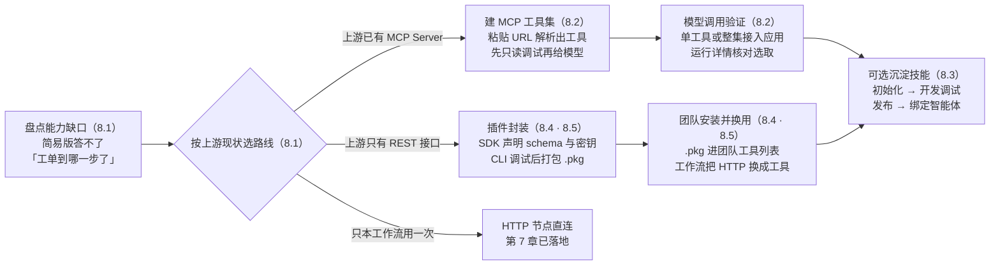
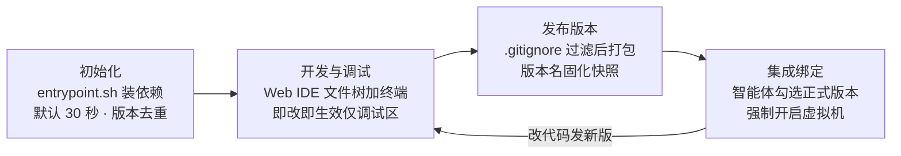
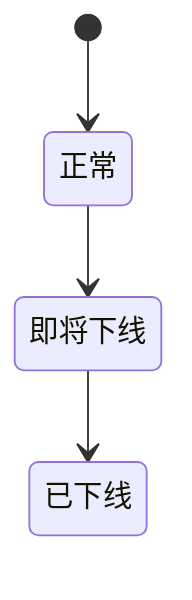
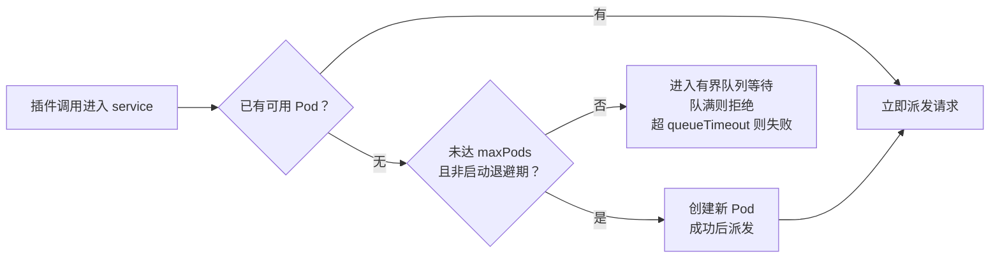

# 第 8 章 工具与技能

> 本章导读：第 7 章把查工单做成了工作流画布上的 HTTP 节点——能用，但这份配置只属于那一张画布：第二个应用要查工单，得再配一遍。本章解决「能力复用」：工具体系三分法与选型立场；MCP 工具集的 URL 接入；技能（Skill）的四生命周期；插件体系与团队安装。最后实战：把工单查询接口封装为可复用工具，第 7 章工作流直接换用。读完本章，你能：为一次外部调用选定工具形态；独立走通 MCP 接入与插件封装两条路；开发并发布一个技能；说出删除插件后已有工作流会发生什么。



*本章操作流程图*

## 你什么时候需要它

三种典型处境，对应本章三种用法。

**应用答得好，但「动不了手」**——知识库能答「政策怎么说」，工单状态这类「要查业务系统」的动作它做不了。先读 8.1 定形态：上游已有 MCP 服务走 8.2，只有 REST 接口走 8.5 封装，只此一次的调用留在第 7 章的 HTTP 节点里就好。

**同一个接口要用第二次**——HTTP 节点是单画布方案；工作流之外智能体也要查工单时，按 8.4 的安装体系加 8.5 的封装实操，把配置从「每画布一份」收敛为「全团队一份」。

**智能体每次都要重新教**——按固定章法核算、按固定模板出报告这类专业动作，提示词写不全、每次手把手教。按 8.3 做成技能：一次开发、版本化发布、绑定即用。

前置：第 7 章工作流已落地（HTTP 节点直连工单查询接口）；插件开发需要 Node.js 与 pnpm 环境；技能运行依赖沙盒（Sandbox）服务就绪（第 2 章的部署前提与第 6 章 6.5 的虚拟机，生产配置见第 11 章）。

## 8.1 概述：工具体系三分法

第 1 章把工具（Tool）注为「模型可调用的外部能力封装」。落到 v4.17.3 的文档，这把工具箱由三条生产线供货，供应方式与复用面各不相同（本章官方事实均出自拉取素材，核实日期 2026-11-01）：

| 形态 | 一句话定义 | 从哪来 | 复用面 | 本章哪节 |
|------|-----------|--------|--------|---------|
| 系统工具 | 官方或社区维护、以插件形态分发的通用能力 | 插件市场安装，或 root 上传 `.pkg`（系统级安装，全系统可见） | 全系统 | 8.4 |
| 自定义工具 | 团队为自己的业务接口开发的插件工具 | 与系统工具同一条生产线（CLI 加 SDK 开发，`.pkg` 交付），装到团队或自有部署 | 本团队（或全系统） | 8.4 · 8.5 |
| MCP 工具 | 远程 MCP Server 暴露的工具，填 URL 批量接入 | 新建 MCP 工具集（MCP Tool Set），粘贴 URL 一键解析 | 接入它的应用与工作流 | 8.2 |

两个「近邻」要划清边界，避免用错地方。**工作流 HTTP 节点不是工具资产**——它是画布内的一次性直连动作（第 7 章），配置留在节点里，不进团队工具列表，判断标准就一条：这个调用会不会被第二个应用用到。**技能也不是工具**——工具提供「动作接口」（发一次请求、执行一段代码），技能提供「做事章法」（说明文档加逻辑代码的完整能力包），8.3 展开。

MCP 接入还有「双向」一说：本章 8.2 讲「接入」——FastGPT 作为客户端消费别人的 MCP 服务；「发布」——把 FastGPT 应用变成 MCP Server 供平台侧 Agent 消费——见第 9 章（→ mcp 书第 8 章）。

**业务上推荐：同一外部接口只封装一次——只在本工作流用一次的，HTTP 节点直连（第 7 章）；会被第二个应用用到的，封装成插件工具（8.5）；上游已经建了 MCP 生态的，优先 MCP 工具集（8.2），把维护成本留给服务提供方。**

## 8.2 MCP 工具：一次 URL 接入一批能力

MCP（模型上下文协议，Model Context Protocol，见第 1 章）把「工具怎么暴露、怎么被发现」标准化了。对 FastGPT 侧，这意味着接入一批外部能力不必逐个开发——v4.9.6 起，FastGPT 新增了「MCP 工具集」这种新的应用类型（素材原文），允许传入远程 MCP URL 批量创建可被模型调用的 MCP 工具。这类应用不面向终端对话，只承载能力，本书把它与插件同归「可复用能力资产」（本书立场；第 1 章四形态按「面向用户的对话与流程载体」划分，两者不冲突）。

### 创建一个 MCP 工具集

素材以高德地图 MCP Server 为例，四步：

| 步骤 | 操作 | 要点 |
|------|------|------|
| 1 获取地址 | 从服务方取得 MCP 地址 | 高德例：`https://mcp.amap.com/sse?key=xxx`（SSE 形态） |
| 2 新建 | 选择「新建 MCP 工具集」 | 弹窗中填入 MCP 地址 |
| 3 解析 | 点击地址后的「解析」 | 解析出该服务暴露的一系列工具 |
| 4 创建 | 点击「创建」 | MCP 工具与 MCP 工具集一次生成 |

### 鉴权：Bearer 与自定义请求头二选一

接入需要鉴权的服务时，客户端同样支持 Streamable HTTP 形态。素材以百智云浏览器为例给出标准填法：

| 配置项 | 填写内容 |
|--------|---------|
| MCP URL | 服务方的 MCP 地址 |
| 请求头鉴权类型 | `Bearer` |
| 鉴权值 | 原始 API Key，不加 `Bearer ` 前缀 |

三条规则：Bearer 模式自动生成 `Authorization: Bearer <API_KEY>`；若改用自定义请求头，名称填 `Authorization`、值填完整的 `Bearer <API_KEY>`——两种方式选一种，避免重复前缀；Key 只放在鉴权配置里，不要写进 URL、聊天消息或公开的工作流。

### 先做只读验证，再交给模型

工具集创建完不等于可以直接上生产，素材给的接入纪律值得照抄成团队规范：**只读先行**——进入工具集调试页，先只运行只读查询类工具核对身份与可用性（素材例：凭据校验工具入参传空对象，检查返回的 `isError` 与 `content` 文本是否符合预期），只读调试成功仅证明该工具可用，不代表完整业务任务已通过；**警惕写工具**——解析会发现带生命周期写操作的工具，应用中有权调用这些工具的人可能消耗所配 Key 的资源权限，不要把整套工具集分享给不受信任的应用或用户，创建资源前确认任务、价格与权限；**确认机制自己建**——素材明说示例「不提供自动逐次确认机制」，高风险写操作要在应用层用提示词规则或流程判断节点兜底（第 7 章）。

### 测试与模型调用

工具集内部可对每个单独的 MCP 工具调试（素材例：运行天气查询工具 `maps_weather`，直接看到某城市的实时天气）。交给模型时有两种粒度：

| 粒度 | 操作 | 模型行为 |
|------|------|---------|
| 调用单个工具 | 在应用中勾选需要的具体工具（素材例：天气查询与地点搜索两个工具，分别提问） | 按用户问题智能选取对应工具，取回信息后作答 |
| 调用整个工具集 | 点击 MCP 工具集，添加工具集类型的节点，用工具调用节点连接 | 自动从工具集中选取需要的工具执行 |

### 边界与坑

- 接入前提是**上游已有 MCP Server**——贯穿案例的中台只提供 REST 接口，工单查询走不了这条路，实战在 8.5；若中台侧日后提供 MCP 服务（→ mcp 书），同一能力可改由 MCP 工具集接入，维护成本转移到服务提供方；
- SSE 与 Streamable HTTP 两种形态都支持，按服务方提供的地址形态填；
- 鉴权前缀二选一是最容易出的错——报 401 时先检查 `Bearer ` 前缀是不是写重了；
- 粒度选择：工具多且只有少数常用，勾单个工具，缩小模型选择面；工具彼此配套，整集接入。

## 8.3 技能：把专业章法做成可版本化的能力包

### 什么是技能

官方对技能（Skill）的定义：一种**可持久保存、可复用的模块化专业流程与能力包**。官方用三层划分给出它在智能体（Agent）生态中的位置：

| 层 | 职责 | 素材的比喻 |
|----|------|-----------|
| 大脑（Brain） | 规划与推理，即大模型本身 | —— |
| 工具（Tools） | 单纯的「动作接口」：发一次网络请求、跑一行临时代码 | AI 的「手和脚」，工具箱里的「螺丝刀」 |
| 技能（Skills） | 完整的「做事章法与专业逻辑」（Know-how） | 一张「家具组装手册」 |

一个技能 = **说明文档（指明怎么做）+ 逻辑代码（真正去执行）**封装成的模块化包：AI 根据当前对话任务自动从技能库取手册，在后台沙盒中运行代码完成装配。术语口径全书统一：技能是可版本化的「文档 + 代码」能力包，绑定智能体、沙盒执行、版本化发布——第 1 章概念地图与书目 README 已按本口径统一（2026-11-02 回收，原立项素材「应用模板资产」注法不再使用）。

FastGPT 为技能提供「专属的独立代码空间」，四条设计：

| 设计 | 内容 |
|------|------|
| 独立的安全运行沙盒 | 每个技能在编辑时拥有完全隔离的沙盒（后台基于 Sealos Devbox、OpenSandbox 等沙盒服务运行） |
| 即改即生效的调试环境 | 文件管理、代码编辑器与交互式终端集成为一个在线调试环境，左侧配智能体调试面板，支持热重载 |
| 生产与调试环境隔离 | 编辑区改动只在「调试区」生效，点「发布」生成正式版本后才应用到生产环境的智能体与工作流 |
| 自动休眠与无感唤醒 | 长期闲置的技能自动从沙盒清理并冷归档；再次编辑或被调用时后台自动拉起复原；休眠期间不产生运行计费 |

四个生命周期连起来是一条流水线：



*技能四生命周期：开发与版本形成回路，生产环境只在「发布」时更新*

### 初始化：entrypoint.sh 与版本去重

技能初始化脚本是开发者提供的前置脚本：应用成功部署并解压技能后，系统在实际执行 AI 任务前，会在独立虚拟机环境中自动运行它——用途是安装技能特有的第三方依赖，或做配置预处理。规则五条：

- **放置位置**：技能压缩包根目录下名为 `entrypoint.sh` 的 Shell 脚本；
- **执行时机**：先随技能包部署解压到虚拟机的 `./projects/<versionId>/` 目录，再执行该脚本（执行顺序与虚拟机侧机制见第 6 章 6.5）；
- **版本去重**：状态记录在虚拟机内 `~/.fastgpt/agent-skill-entrypoints/state.json`——同一技能版本（`versionId`）发布后代码不可变，系统记录已成功运行过的版本 ID；同一虚拟机实例被后续对话复用时，对应版本已执行过就直接跳过，实现秒级热启动；发布新版本后，下一次对话触发会重新部署并自动执行新版本脚本；
- **执行约束**：默认 30 秒超时、非阻断（报错或超时不阻断主流程）、约 8KB 日志输出截断——均与应用启动脚本一致（详见第 6 章 6.5 的执行限制表）；
- **调试预览限制**：技能编辑模式下虚拟机不会自动执行 `entrypoint.sh`，要验证脚本效果，在侧边栏调试区的控制台终端（Workspace Terminal）手动执行。

### 开发与调试：Web IDE 三件套

新建技能两条路：点击「新建」卡片设置名称、图标、介绍与**需求描述**——保留默认的「目标/流程/要求」模板，系统用内置基础结构与样例代码生成工作区（不调用模型、不产生积分消耗）；填入具体功能需求（素材例：「帮我编写一个从文本中提取所有邮箱地址的技能」），则走 **AI 辅助生成**，系统调用系统配置的默认大语言模型自动生成技能方案 `SKILL.md` 并完成代码初始化（产生积分消耗）。手头有备份或他人分享的技能，点右上角「导入技能」上传 ZIP 压缩包即可还原继续开发。

打开技能详情页，系统在沙盒容器中拉起独立运行空间，右侧文件树加载项目。三件套各有分工：

| 部件 | 能力 | 要点 |
|------|------|------|
| 文件树 | 新建、删除、重命名、移动 | 编辑保存、装依赖、后台进程产出文件都会实时刷新 |
| 代码编辑器 | 在线编辑，自动保存写入后台沙盒 | **变更隔离**：所有修改仅在调试区生效，不影响线上已发布的应用 |
| 终端 | 连接后台沙盒的命令行 | 在线装依赖、跑自定义测试脚本；报错信息就地定位 |

左侧智能体调试面板负责对话验证，三个能力：**即改即生效**——保存代码后无需编译打包部署，下一条消息自动运行最新代码；**对话式工作区修改**——直接让智能体帮你创建、删除、修改文件，文件树与编辑器实时同步；**实时文件导出**——「导出配置」把当前工作区代码与配置打包成 ZIP 下载，便于本地备份或分享。

### 版本与发布：调试区之外皆版本

为什么要发布：编辑器里改的代码只在调试区生效，要在工作流或智能体中正式应用，必须点「发布」生成正式部署版本——调试与生产环境隔离，改代码不影响线上正在运行的智能体与工作流。操作三步：调试确认后点编辑器右上角「发布」；输入版本名称（默认自动填当前时间，可自定义如 `v1.0.0`）；确认后当前代码状态固化为正式版本上线。

`.gitignore` 规则要记住：发布时自动应用项目根目录 `.gitignore`（不存在则自动创建，默认含 `node_modules`、`.venv`、`dist` 等忽略项）；只有未忽略的文件才打包，**打包文件总体积超限可能导致发布失败**。回滚：点「版本历史」（时钟）图标查看全部历史快照，悬停目标版本点「切换」，工作区文件与线上运行版本**同时**切回；注意回滚不携带被 `.gitignore` 忽略的文件（依赖包、虚拟环境等需重装）。

### 集成绑定：只认智能体应用

发布好的技能这样绑定（素材明确的边界：**目前仅智能体应用支持直接绑定技能，简易应用及工作流暂不支持**）：

1. 进入要集成的智能体（Agent）应用编辑页面；
2. 在左侧配置面板找到「关联 Skill」配置项；
3. 点击「选择」，勾选已发布的正式版本技能。

三条行为规则：关联技能时系统**自动开启虚拟机**，且已关联状态下无法关闭（技能代码必须在安全隔离环境中运行）；一个智能体支持绑定**多个技能**，沙盒启动时全部注入部署，各技能彼此独立互不冲突；**智能自动调用**的前提是模型足够智能——无需手动命令，AI 根据输入自动判断是否调用并在后台虚拟机中安全执行。调试时可点聊天气泡底部的「虚拟机」按钮，查看沙盒内最新的文件与代码状态。

### 边界与坑

- 技能执行依赖沙盒服务：本地环境没部署沙盒（第 2 章留空的两项地址），技能与虚拟机相关功能不可用——不是技能配置问题，先查底座；
- 「智能自动调用」对模型能力有要求：模型选弱了技能就是摆设，验证时先确认模型会主动调；
- 依赖要在 `entrypoint.sh` 里装、不要只装在调试终端：终端里装的依赖属于当前调试沙盒，新版本部署到新虚拟机后不会自带；
- 休眠是成本特性也是延迟特性：冷归档的技能被再次调用时有沙盒拉起等待，对延迟敏感的场景保持活跃或预热。

## 8.4 插件体系：让工具成为团队资产

### 为什么有插件系统

原先 FastGPT 的各项能力都在主服务内以 Monorepo 方式维护，系统插件作为子仓库存在。旧结构有四个问题：系统插件必须随主服务一起发版，迭代受限；社区贡献要跑完整主应用并向主仓库提 PR；用自定义插件得维护 FastGPT fork 手动合并升级；Next.js/webpack 构建模型不适合运行时挂载新插件。因此插件被拆分到独立仓库 FastGPT Plugin（`labring/fastgpt-plugin`），v1.0.0 起对安装、版本管理、运行隔离与运维配置做了系统化重构。第 2 章那条「系统插件从 V4.14.0 起不再预装」的注记，根子就在这次拆分——`fastgpt-plugin` 镜像只提供运行环境，工具要自己装。

### 核心概念一张表

| 名称 | 说明 |
|------|------|
| 插件（Plugin） | 独立、可复用的功能模块，类型可以是工具、模型预设、知识库来源等 |
| 插件包（`.pkg`） | 插件打包后的交付文件，安装、更新、分发与版本管理都经它完成 |
| 工具（Tool） | 一类插件，封装第三方服务、内部接口或本地计算逻辑，可被工作流和 Agent 调用 |
| 工具集（Tool Suite） | 一个插件暴露多个相关子工具，共享插件元信息与密钥配置 |
| 插件市场（Marketplace） | 集中展示与分发官方及社区插件的平台 |
| 运行时（Runtime） | 执行插件代码的后端实现，当前默认 `local-pool` |
| Pod | 本地进程池中的单个插件子进程，一个插件 service 可拥有多个 |

注意「工具集」一词两用：MCP 语境的工具集（8.2）是一种应用类型，插件语境的工具集（tool-suite）是一个插件暴露多个子工具——读文档时按上下文分辨。插件源码按生态分布在三个仓库：官方维护或审核通过的进 `fastgpt-official-plugins`，社区第三方的进 `fastgpt-community-plugins`，私有定制的进 `fastgpt-business-plugins`；`fastgpt-plugin` 仓库本身只提供开发、构建、检查、打包与服务端运行能力。

### 安装两级与插件状态

| 层级 | 谁来装 | 可见范围 | 独立性 |
|------|--------|---------|--------|
| 系统级 | root 用户上传 `.pkg` 或从市场安装 | 全系统 | 可配置「系统密钥」：由插件服务托管，调用方经插件配置引用，不接触明文密钥 |
| 团队级 | 团队管理员 | 仅本团队 | 不继承同 ID 系统插件的密钥、费用、状态、版本，需单独配置 |

插件有三种状态：



| 状态 | 行为 |
|------|------|
| 正常 | 正常使用 |
| 即将下线 | 不影响已有工作流运行，但无法再被新增到工作流 |
| 已下线 | 插件无法正常使用 |

一处差异素材明载：**团队插件支持更新和删除，没有「即将下线」状态**——三种状态描述的是系统插件侧的生命周期。

### 团队安装与管理

前置四件事：当前账号是团队管理员或所有者（普通成员只能用、不能装）；系统管理员已开启「团队上传插件」功能——该开关关闭时，Marketplace 安装、本地上传与安装确认接口**全部被拒绝**；用 Marketplace 时部署环境需能访问它（Marketplace 是 SaaS 分发服务，**不提供私有化部署版本**，内网自托管环境走 `.pkg` 上传）；本地安装备好符合规范的 `.pkg` 文件，或含多个 `.pkg` 的 `.zip`。

| 操作 | 入口与要点 |
|------|-----------|
| 从市场安装 | 工作台「工具」页 →「添加插件」→「从插件市场安装」→ 按名称/来源/分类查找（可筛「只看未安装」）→ 查看说明、版本与所需权限 → 选版本安装 |
| 上传本地包 | 「添加插件」→「上传插件」→ 选 `.pkg` 或 `.zip` → 系统上传解析 → 检查名称、版本、权限与解析结果（失败项单独报错，可修复重试）→ 确认安装 |
| 更新 | 市场有新版本时卡片显示更新入口 → 看新版本说明与权限变化 → 选目标版本更新 → **重新测试引用该插件的工作流与 Agent** |
| 删除 | 工具卡片或插件详情中删除，需输入插件名称确认 |

**删除的语义是本章最要紧的坑**：删除会删除当前团队的安装、撤销后续运行权限、从新的工具选择入口移除——但**已有工作流和 Agent 节点不会被自动改写，它们再次运行时会因插件已删除而失败**，恢复需重新安装。删除团队插件不影响同 ID 系统插件，也不影响其他团队。同一插件系统与团队都装时，工具列表显示两条记录（团队插件排前、系统插件带「系统」标识），工作流按来源分别引用与配置——团队内应约定插件用途，避免同名插件混用。升级纪律（素材原文归纳）：插件升级可能改变输入输出结构、密钥要求或行为，**生产工作流升级前，先在测试应用中验证兼容性**。

### 运行时与并发：local-pool

默认运行时 `local-pool` 按单插件 service 维度管理 Pod 与请求队列，一次调度的完整路径：



*local-pool 调度顺序：优先复用，再扩容，最后排队（据插件系统文档）*

每个工具插件可单独配四个运行参数：

| 参数 | 默认值 | 说明 |
|------|--------|------|
| 最小工作节点数 | `0` | 大于 `0` 时预热 Pod，并尽量维持不少于该数量 |
| 最大工作节点数 | `5` | 无可用 Pod 时的扩容上限 |
| 节点超时时间 | `120000ms` | 单次插件调用在 Pod 内执行的超时 |
| 每节点最大并发数 | `10` | 单个 Pod 同时处理的最大并发请求数 |

全局限制由 `POOL_*` 系列环境变量提供（Pod 总量、队列容量、空闲回收、启动退避等，完整清单见插件系统文档）。两个保护机制：连续非超时的启动失败达到阈值会触发**启动熔断**，阻止继续创建 Pod；启动超时按资源繁忙处理，指数退避后重试。

## 8.5 工单查询工具实战：从 HTTP 节点到可复用工具

### 需求与封装动机

第 7 章的工作流里，查工单是画布上的 HTTP 节点，直连中台的工单查询接口（`GET /api/after-sale/tickets`，带 `phone` 查询参数）。当时它工作得很好——直到出现第二个消费方：智能体形态的助手也要查工单，将来第 9 章发布出去的应用同样要查。HTTP 节点的配置是「每画布一份」：超时改一次、错误处理补一条，都要逐画布重配。封装成插件工具后，同一接口在团队内只有一份实现：改一处、处处生效；密钥托管、配置面收敛；工作流与智能体都能用。

### 开发前准备

按官方开发指南，编码前先明确这些信息。本例取值中，接口路径来自贯穿案例约定；中台的鉴权方式素材未载，本例按 `apiKey` 加 `baseUrl` 走密钥声明，**以中台实际约定为准**——这是本章的案例假设，挂复核清单：

| 信息 | 本例取值 |
|------|---------|
| 插件类型 | `tool`（单一能力用 `tool`；多个共享鉴权、业务强相关的能力才用 `tool-suite`） |
| 插件 ID | `after-sale-ticket-query`（全局稳定唯一，发布后不变） |
| 名称与描述 | 中英文各一份（`name` 与 `description` 的 `en`、`zh-CN`） |
| 输入 | `phone`：手机号，字符串，必填 |
| 输出 | `result`：工单列表的文本摘要，供模型作答引用 |
| 密钥 | `apiKey` 与 `baseUrl`，经 `secretSchema` 声明 |
| 外部 API | `GET /api/after-sale/tickets?phone={phone}`，超时、限流与错误响应按中台约定 |
| 测试样例 | 成功路径、参数错误、鉴权失败、上游失败四类 |

### 骨架与实现

```bash
pnpx @fastgpt-plugin/cli create ticket-query --type tool --cwd packages/tools
```

CLI 生成插件目录与常见文件：入口 `index.ts`（默认导出 `defineTool()`）、`package.json`（含 `build`、`pack`、`test` 脚本）、`tsconfig.json`、`vitest.config.ts`、`README.md` 与 `logo.svg`。实现代码依官方 SDK 模式改写为工单查询（**未实测**）：

```ts
import {
  createToolHandler,
  defineTool,
  type InputSchemaMetaType,
  type OutputSchemaMetaType,
  type SecretSchemaMetaType
} from '@fastgpt-plugin/sdk-factory';
import z from 'zod';

const handler = createToolHandler({
  inputSchema: z.object({
    phone: z.string().min(1).meta({
      title: '手机号',
      description: '用户注册手机号，用于查询名下售后工单'
    } satisfies InputSchemaMetaType)
  }),
  outputSchema: z.object({
    result: z.string().meta({
      title: '查询结果',
      description: '工单列表文本摘要，供模型引用作答'
    } satisfies OutputSchemaMetaType)
  }),
  secretSchema: z.object({
    apiKey: z.string().min(1).meta({
      title: '中台 API Key',
      isSecret: true
    } satisfies SecretSchemaMetaType),
    baseUrl: z.string().min(1).meta({
      title: '中台地址'
    } satisfies SecretSchemaMetaType)
  }),
  handler: async (input, ctx) => {
    const { apiKey, baseUrl } = ctx.secrets;
    const url =
      `${baseUrl}/api/after-sale/tickets?phone=${encodeURIComponent(input.phone)}`;
    const resp = await fetch(url, {
      headers: { Authorization: `Bearer ${apiKey}` }
    });
    if (!resp.ok) {
      // 外部错误转成可定位的信息，不透出密钥与完整响应
      throw new Error(`工单查询失败：HTTP ${resp.status}`);
    }
    const data = await resp.json();
    // 响应结构按中台实际约定解析，此处示意
    return { result: JSON.stringify(data) };
  }
});

export default defineTool({
  manifest: {
    pluginId: 'after-sale-ticket-query',
    version: '1.0.0',
    name: { en: 'After-sale Ticket Query', 'zh-CN': '售后工单查询' },
    description: {
      en: 'Query after-sale tickets by phone number',
      'zh-CN': '按手机号查询名下售后工单'
    },
    versionDescription: { en: 'Initial version', 'zh-CN': '初始版本' },
    tags: ['tools']
  },
  handler
});
```

六条核心规则（官方原文归纳）：`pluginId`、子工具 `id`、输入输出字段名发布后保持稳定；名称与描述用 `{ en, 'zh-CN' }` 双语；输入、输出、密钥都用 Zod schema 描述并补对应 meta 类型；密钥敏感字段设 `isSecret: true`，代码、测试快照、错误日志与 README 中不出现真实密钥；handler 返回值必须匹配 `outputSchema`；外部 API 错误转成可定位的错误信息。

### 调试、打包与安装

本地快速验证逻辑与 schema：

```bash
cd packages/tools/ticket-query
pnpm install
pnpx @fastgpt-plugin/cli debug . --run \
  --input '{"phone":"13800000000"}' \
  --secrets '{"apiKey":"test","baseUrl":"https://mid.example.com"}'
```

本地 debug 的边界要清楚：它不模拟生产子进程池、真实网络环境、服务端超时与队列调度，文件上传等宿主能力也是本地虚拟实现——**本地通过不等于生产可用**。接测试环境用远程调试：FastGPT 页面「系统工具」→「本地调试」生成调试链接，本地运行 `fastgpt-plugin dev` 粘贴链接建立 WSS 通道，即可在测试环境的应用与工作流中真实调用该工具（调试插件仅对当前调试者本人可见）。验证通过后构建打包：

```bash
pnpm run test
pnpm run build
pnpx @fastgpt-plugin/cli check --entry . --output ./dist
pnpm run pack
```

产物为 `.pkg` 文件（内含 `dist/index.js`、`dist/manifest.json`、图标，可选 `README.md` 与 `assets/**`）。按 8.4 的团队安装路径上传：工作台「工具」页 →「添加插件」→「上传插件」→ 选中 `.pkg` → 解析确认后进入团队工具列表。

### 在工作流中换用

回到第 7 章的画布：在工具选择器中添加「售后工单查询」，把原 HTTP 节点的入参改为引用同一个手机号变量，接口地址、鉴权与错误处理全部交给插件——**第 7 章的节点连线结构不变，换的只是执行动作的载体**。智能体侧则按第 6 章 6.5 的方式，在提示词中用 `@` 唤起并绑定该工具。一次封装，两类应用同享——这就是第 1 章能力版图「工具调用」一行的完整闭环：让应用不止会答，还能动手，且动手能力可积累、可治理。

| 维度 | HTTP 节点（第 7 章） | 插件工具（本节） |
|------|---------------------|-----------------|
| 配置位置 | 每张画布各配一份 | 开发一次，安装即用 |
| 复用面 | 单个工作流 | 团队内所有工作流与智能体 |
| 密钥与配置 | 节点参数逐节点配置 | `secretSchema` 声明、插件服务托管，调用方不接触明文 |
| 升级行为 | 随画布修改即时生效 | 版本化升级，先在测试应用验证兼容 |
| 适用 | 一次性、单画布直连 | 跨应用复用的业务能力 |

### 边界与坑

- **版本号语义化**：修复兼容问题升 patch，新增兼容功能升 minor，**修改输入输出字段、子工具 ID 或用户配置方式必须升 major**，并提前评估已有工作流的兼容性——工单查询哪天加了必填入参，第 7 章的工作流就是第一个受影响的；
- **删除即断链**：删除这个团队插件后，第 7 章工作流与绑定它的智能体再运行就会失败——删除前先查引用（8.4）；
- 错误信息卫生：handler 抛错时不要把中台的完整响应或密钥带出去，可定位即可。

## 本章小结

1. **工具体系三分法**：系统工具（市场与 `.pkg` 分发）、自定义工具（同一生产线、团队自用）、MCP 工具（URL 接入）；工作流 HTTP 节点是一次性直连，不进工具资产——判断标准是「会不会被第二个应用用到」。
2. **MCP 工具集四步接入**：取地址、新建、解析、创建；鉴权 Bearer 与自定义请求头二选一防重复前缀；上生产前先只读验证，警惕写工具的权限面。
3. **技能是「文档 + 代码」的能力包**，跑在隔离沙盒里：`entrypoint.sh` 初始化（版本去重、30 秒超时、非阻断）、Web IDE 开发即改即生效、发布版本化可回滚（`.gitignore` 过滤打包）、仅智能体应用可绑定（强制开虚拟机）。
4. **插件体系让工具成为资产**：系统级与团队级两级安装、三种状态、`local-pool` 运行时按 Pod 池调度；删除插件不改写已有工作流节点——再运行即失败，这是最要紧的坑。
5. **工单查询已完成封装闭环**：从第 7 章的画布 HTTP 节点到团队可复用的插件工具，同一接口改一处、处处生效。

下一步：工具与技能就位，应用该出门了。第 9 章把「售后客服」发布为免登录分享链接与钉钉渠道触达客服团队，并把应用发布为 MCP Server——工具「双向」的另一半，也是（→ mcp 书第 8 章）的会合点。

## 验收清单

读到这里，你应该能：

- ☐ 用三分法为三个需求当场选型：查天气（上游已有 MCP 服务）、查工单（自研 REST 接口）、一次性回调（单画布用一次）；
- ☐ 建一个 MCP 工具集：粘贴 URL 解析出工具，单工具调试后挂上应用，说出单工具与整集两种接入粒度的差别；
- ☐ 走通技能四生命周期：新建（说清默认模板与 AI 辅助生成的积分差别）、改代码即改即生效、发布 `v1.0.0`、绑定智能体并确认虚拟机已强制开启；
- ☐ 解释 `entrypoint.sh` 的执行时机与 `versionId` 去重机制，说出热启动为什么是秒级；
- ☐ 完成 8.5 的封装链路：CLI 骨架、三 schema 声明、本地 debug、构建打包为 `.pkg`、团队安装进工具列表；
- ☐ 在第 7 章工作流中把 HTTP 节点换用为「售后工单查询」工具，并跑通一次真实查询；
- ☐ 说出删除团队插件后已有工作流会发生什么，以及升级插件前的标准动作。

### 复核清单（发布前）

以下各项均未实测，发布前逐条补验：

- [ ] 全章界面项与行为对照官方文档 v4.17.3（guide/build/tools、guide/build/skill 各篇、plugin 各篇），核实日期 2026-11-01；
- [ ] MCP 工具集实测：新建、URL 解析、单工具调试、单工具与整集两种粒度的模型调用（高德地图服务可作验证对象），含 Bearer 与自定义请求头两种鉴权方式及重复前缀的实际报错形态；
- [ ] 技能实测：新建（默认模板与 AI 辅助生成的积分提示）、`entrypoint.sh` 执行与版本去重、发布与回滚（`.gitignore` 默认项、体积超限报错、回滚不恢复依赖）、绑定边界核实（仅智能体应用有「关联 Skill」入口，简易应用与工作流确无入口）；
- [x] 术语对齐：已裁决统一（2026-11-02），改动落第 1 章概念地图与书目 README——技能口径为「可版本化的『文档 + 代码』能力包，绑定智能体、沙盒执行、版本化发布」，原「应用模板资产」注法作废；
- [ ] 插件三状态（正常/即将下线/已下线）的界面入口、迁移触发方与可逆性核实，含团队插件无「即将下线」状态的差异；
- [ ] 8.5 全链路实测：CLI 骨架创建、`debug --run`、远程调试、构建打包、团队上传安装、工作流与智能体换用；中台地址、鉴权方式（`apiKey` 加 `baseUrl` 为案例假设）与响应结构以中台实际约定为准；
- [ ] 插件工具在工作流画布中的节点形态与连线方式实测（素材仅载「工具选择器中添加」，未载画布呈现细节）；
- [ ] `local-pool` 四参数与 `POOL_*` 环境变量在自有部署中的行为抽查，及 Marketplace 可访问性核实（SaaS 分发无私有化部署版，内网环境仅 `.pkg` 上传可用）；
- [ ] 章首操作流程图与文内三张 mermaid 图在 GitHub 网页端的渲染检查。

## 延伸阅读

- **第 7 章（工作流编排）**——本章实战的「前身与归宿」：HTTP 节点怎么配，换用工具节点后画布长什么样。
- **第 9 章（应用发布与渠道）**——把「售后客服」发布为 MCP Server：工具「双向」的另一半，平台侧 Agent 经此消费工单查询（→ mcp 书第 8 章）。
- **第 6 章（应用与对话 Agent）**——技能运行的沙盒底座：虚拟机的启动脚本、执行限制与状态去重。
- **第 11 章（生产运维）**——插件运行参数与沙盒服务的生产配置、可观测接入。
- **（→ mcp 书）**——同一售后域的工具层对侧：中台如何把众多接口收敛为少数工具，本章封装的正是其中之一。

