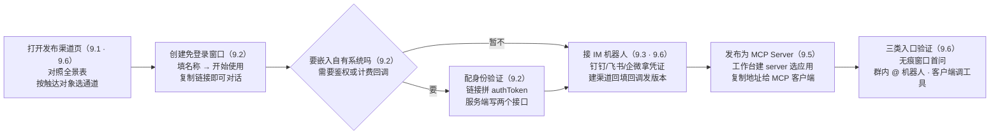
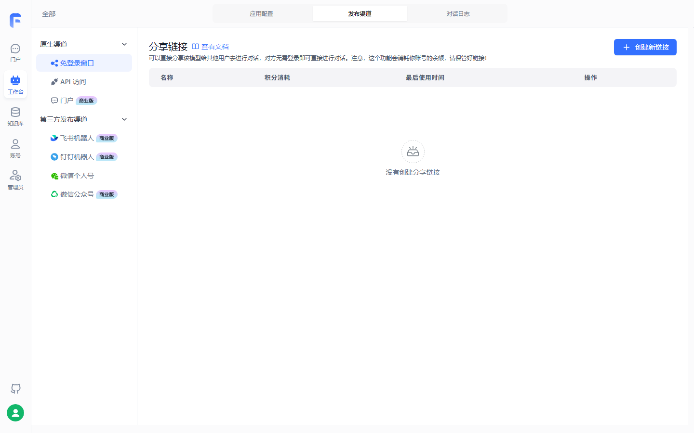
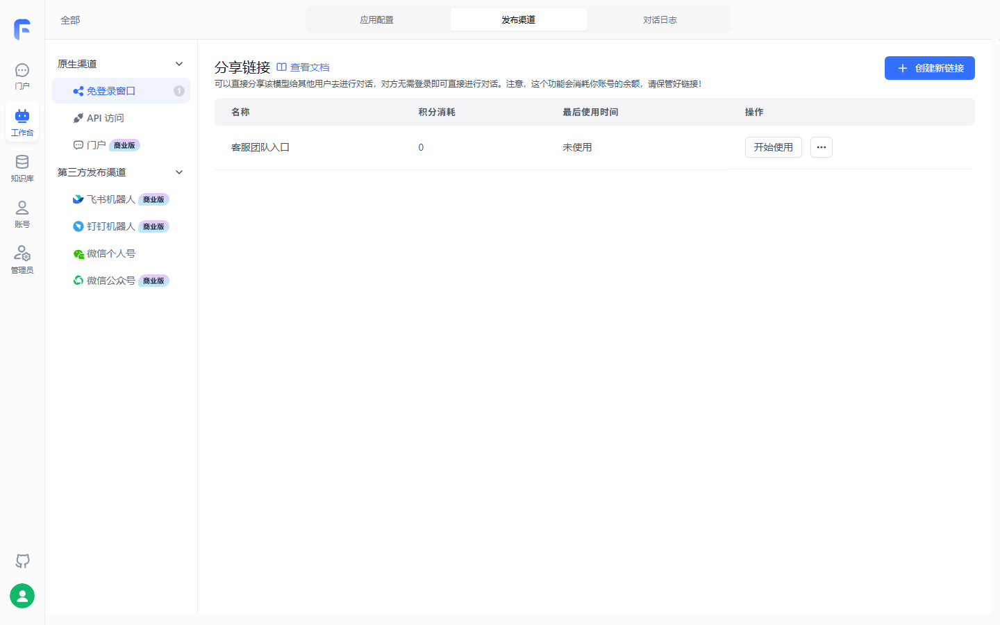
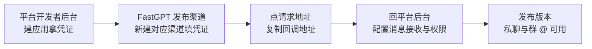

# 第 9 章 应用发布与渠道

> 本章导读：第 7 章的工作流版「售后客服」已在调试预览里跑通分类、检索、查工单、答复整条链——但这份能力还锁在登录 FastGPT 的团队手里。本章解决「怎么交付到用户手里」：先用一张全景表把发布通道选清楚；再逐条走通免登录分享链接（含 iframe 嵌入与商业版身份验证）、钉钉/飞书/企微机器人的共同接入模式、公众号与微信个人号，以及发布为 MCP Server 供平台侧 Agent 调用（→ mcp 书第 8 章）；最后把「售后客服」以分享链接交付客服团队、以钉钉渠道触达企业内部，并回收第 1 章关于钉钉渠道形态前提的挂账。读完本章，你能：为三类触达对象各选对通道，完成发布并独立验证。



*本章操作流程图*

## 你什么时候需要它

三种典型处境，对应本章三种用法。

**应用调好了，先让外部的人用起来**——直接看 9.2。免登录窗口三步拿到一个网址，社区版即可完成；要把它嵌进自有系统、加身份校验与计费回调，再读 9.2 的身份验证小节（商业版）。

**用户不在 FastGPT 里，而在钉钉、飞书、企微或公众号里**——先看 9.3 开头的形态前提表：这批 IM 渠道均为商业版能力，社区版读者需要先升级形态；然后按对应小节走，三个渠道共用同一套接入模式。

**消费方不是人，而是平台侧 Agent 或程序**——9.5 把一个或多个应用打包为 MCP Server 对外提供调用（→ mcp 书第 8 章）；需要更细的对话控制与流式输出，走 OpenAPI（见第 10 章）。

前置：第 6 章或第 7 章的应用已通过三类输入验证（资料内、资料外、模糊）；IM 渠道需商业版或云服务形态；私有化部署使用 MCP Server 需 v4.9.6 及以上版本。

## 9.1 概述：发布通道全景

同一个应用，多个出口。FastGPT 的发布入口分两类：**面向人的通道集中在应用详情页顶部的「发布渠道」tab**，按应用逐一新建；**面向机器的 MCP Server 在「工作台」里按应用组创建**，一个 server 可打包多个应用；OpenAPI 则是平台级的程序接口（见第 10 章）。全景如下：

| 通道 | 配置入口 | 终端用户看到什么 | 形态前提（官方口径） | 本书展开 |
|------|---------|----------------|--------------------|---------|
| 免登录窗口 | 应用详情 → 发布渠道 | 一个网址，打开即对话 | 社区版可用；身份验证等部分参数仅商业版 | 9.2 |
| 钉钉机器人 | 发布渠道 | 企业内私聊、群 @ 触发 | 商业版，4.8.16 起 | 9.3 |
| 飞书机器人 | 发布渠道 | 私聊、群 @、话题群 | 商业版，4.8.10 起 | 9.3 |
| 企微机器人 | 发布渠道 | 企业微信通讯录里的机器人 | 商业版 4.12.4 起；云服务版 4.14.4 起需自定义域名 | 9.3 |
| 微信公众号 | 发布渠道 | 公众号对话 | 商业版，4.8.10 起；仅通过验证的公众号 | 9.4 |
| 微信个人号 | 发布渠道 | 好友列表里的「微信 ClawBot」 | 素材未标注形态要求；仅 iOS 最新版微信 | 9.4 |
| MCP Server | 工作台 → MCP server | MCP 客户端里的工具 | 私有化部署需 v4.9.6 及以上 | 9.5 |
| OpenAPI | ——（见第 10 章） | 程序接口 | 社区版可用（第 1 章差异表「分享链接和 API」） | 第 10 章 |

这张表的「形态前提」一列，实测界面直接给出了佐证——以下界面截图来自本地部署的 FastGPT 社区版 v4.17.3（2026-11-03 实测，模型 glm-5.3-flash + embedding-3）：



社区版的渠道列表与全景表逐行对得上：免登录窗口与 API 访问不带形态标签（社区版可用），飞书、钉钉、公众号带「商业版」标识，门户同样标商业版；微信个人号未带标签，与表中「素材未标注」的留白一致。

两点读表提示。其一，社区版边界与第 1 章差异表一致：分享链接和 API 在社区版清单内，第三方应用发布（飞书、公众号）与应用发布安全配置在商业版一侧；**钉钉、企微未在差异表中单列，本章按各渠道官方文档逐一给出形态前提**——钉钉的结论在 9.3 正式回收第 1 章的挂账。其二，素材未标注形态要求的通道（微信个人号），表中如实写「素材未标注」，不做推断。

**业务上推荐：人不在平台里，先用免登录窗口起步——三步出链接、社区版可用；用户聚在哪个 IM 就接哪个机器人，先对齐形态前提再动手；消费方是程序或平台侧 Agent，走 MCP Server 或 OpenAPI。**

## 9.2 免登录分享链接与 iframe 嵌入

### 三步拿到链接

免登录窗口（分享链接的渠道名）可以创建一个临时可访问的地址，任何互联网上的用户都能通过它使用应用。操作三步：

1. 应用详情 → 发布渠道 → 免登录窗口，创建新链接；
2. 填写名称——仅用于记录展示；
3. 点击「开始使用」打开使用链接，复制后即可分发。

三步走完，链接列表里就是一行记录。实测创建的分享链接如下：



名称只作记录之用（图中「客服团队入口」即实测命名），真正分发的是「开始使用」里复制出的地址；「最后使用时间」一列天然是链接是否被外流的监视哨。

### 九个参数

| 参数 | 作用 | 发布前的检查建议（本书立场） |
|------|------|------------------------------|
| 名称 | 仅用于记录该链接的名称 | 能认出渠道用途即可 |
| 过期时间 | 超过该时间后链接无法使用 | 对外分发必设，防链接长期外流 |
| QPM | 每个用户每分钟最大访问次数 | 限流防滥用 |
| 积分上限 | 该链接产生的最大计费数据 | 兜底——链接费用归属应用所在团队 |
| 身份验证 | 接入第三方系统做身份认证与对话回调 | 商业版功能，见下文 |
| 实时运行状态 | 是否展示当前运行的节点 | 内部排障可开，对外关闭 |
| 查看引用片段 | 控制用户能否看到回答的引用片段 | 售后场景建议开——答案可溯源 |
| 查看引用全文 | 控制用户能否看到引用全文 | 同上 |
| 下载/打开来源原文 | 控制用户能否取得来源原文 | 依业务对外程度决定 |

官方注明「部分参数仅商业版支持配置」，并仅对身份验证明示「目前只在商业版中提供」；其余参数的形态限制素材未逐项标注，以界面为准（挂本章复核清单）。

### 记录机制与边界：localId

系统为每个用户生成一个 localId 用于标识用户、从云端拉取对话记录。三个边界要向使用者交代清楚：**记录只在你当前设备与浏览器中延续**，切换设备或清空浏览器缓存即丢失；官方因此仅允许拉取近 30 天的 20 条记录；**链接产生的费用记在应用归属团队名下**——不要随意分享，这不是一句客气话，是成本防线。

### 身份验证：把链接嵌进已有系统（商业版）

身份验证的目的，官方一句话：将 FastGPT 的对话框快速、安全地接入现有系统，仅需两个接口即可实现（另有第三个可选的上报接口）。该功能目前只在商业版中提供。配置三步：

1. 在免登录链接配置的「身份验证」栏填一个 `POST` 根地址——只需根地址，无需完整路径；
2. 在分享链接后追加 `authToken` 参数，通常是你系统里的用户凭证；
3. 在服务端实现校验接口。

链接形态（素材示例的参数结构）：

```text
原始链接：https://share.fastgpt.io/chat/share?shareId=<shareId>
完整链接：https://share.fastgpt.io/chat/share?shareId=<shareId>&authToken=userid12345
```

FastGPT 会在三个时机向该根地址的特定接口发请求——初始化（`/shareAuth/init`）、每轮对话前（`/shareAuth/start`）、对话结束上报（`/shareAuth/finish`，可选）。以初始化为例：

```bash
curl --location --request POST '{{host}}/shareAuth/init' \
  --header 'Content-Type: application/json' \
  --data-raw '{
      "token": "[authToken]"
  }'
```

接口统一响应格式——服务端只须返回校验是否成功与用户唯一凭证 `uid`：

```jsonc
// 鉴权成功：系统将拉取该分享链接下 uid 对应用户的对话记录
{ "success": true, "data": { "uid": "user1" } }
// 鉴权失败：success 不为 true 时，message 会提示给用户
{ "success": false, "message": "身份错误" }
```

`uid` 的约束写死在协议里：不包含 `|`、`/`、`\` 字符、长度不超过 255 **字节**的字符串，否则返回 `Invalid UID`；它既用于拉取对话记录，也用于保存对话记录。对话前校验接口 `/shareAuth/start` 的请求体多一个 `question` 字段——可以在这里做内容拦截，官方实践案例就用「问题含『你』字即报错」模拟敏感词校验。可选的 `/shareAuth/finish` 上报对话结果，响应格式与 chat 接口相同、多一个 `token` 字段，重点关注 `totalPoints`（总消耗 AI 积分）与 `token`（Token 消耗总数）。

两个典型用法：把分享链接嵌入自有应用，打开前先拼好 `authToken`；对接余额体系——用 `/shareAuth/start` 检查用户余额，用 `/shareAuth/finish` 扣减。

### iframe 嵌入

分享链接是一个普通网页地址，因此可以放进自有系统的页面里——官方对身份验证的定位正是「帮助你直接嵌入分享链接到你的应用中」。最小嵌法（标准 HTML 机制，本书示例、未实测）：

```html
<iframe
  src="https://<你的域名>/chat/share?shareId=<shareId>&authToken=<token>"
  width="100%"
  height="640"
  frameborder="0">
</iframe>
```

### 边界与坑

- 免登录意味着半径之外的人也能打开——过期时间、QPM、积分上限三道闸在对外分发前设齐；
- 身份验证仅商业版提供，社区版嵌入自有系统时只能靠链接自身的访问控制；
- 对话记录跟随 localId 而不是账号——给客服团队内部用没问题，别承诺用户「换设备也能看到历史」。

## 9.3 钉钉、飞书、企微机器人接入

### 形态前提：先对齐再动手

| 渠道 | 支持起点 | 形态要求 | 需要的凭证 |
|------|---------|---------|-----------|
| 钉钉机器人 | 4.8.16 起 | 商业版 | Client ID + Client Secret |
| 飞书机器人 | 4.8.10 起 | 商业版 | App ID + App Secret（可选 Encrypt Key） |
| 企微机器人 | 4.12.4 起 | 商业版；云服务版 4.14.4 起经自定义域名接入 | Token + Encoding-AESKey |

**第 1 章挂账在此回收**：官方钉钉接入文档明文「从 4.8.16 版本起，FastGPT 商业版支持直接接入钉钉机器人，无需额外的 API」——钉钉渠道为商业版功能，社区版不可用。第 1 章功能差异表未单列钉钉造成的悬案，以渠道级文档为准结案；界面与版本说明的实测复核仍保留在本章复核清单。

### 共同接入模式：五步

三个渠道的流程骨架完全一致，差别只在凭证形态与回调配置位置：



### 钉钉机器人

1. 在钉钉开发者后台（open-dev.dingtalk.com/fe/app）创建企业内部应用，获取 **Client ID** 与 **Client Secret**；
2. 在 FastGPT 选中应用 → 发布渠道 → 新建钉钉机器人渠道，填入两个凭证；创建完成后点击「请求地址」按钮，复制回调地址；
3. 回钉钉开发者后台，点左侧「添加应用能力」，为该应用添加 **机器人** 能力；
4. 进入机器人配置：**消息接受模式**设为 **HTTP 模式**，消息接收地址填入刚复制的 FastGPT 回调地址；调试完成后点击发布；
5. 在「版本管理与发布」页面创建新版本，填版本号与描述后保存发布。

发布后，企业内可对机器人私聊，或在群组添加机器人后 `@机器人` 触发对话。想重开会话，给机器人发 `Reset` 消息（注意大小写）。

### 飞书机器人

1. 在飞书开放平台（open.feishu.cn/app）申请企业自建应用并添加机器人能力——官方建议先开一个免费测试企业，调试更方便；
2. 在 FastGPT 新建飞书机器人渠道，填入 **App ID** 与 **App Secret**；
3. （可选）在飞书「事件与回调 → 加密策略」获取 **Encrypt Key** 填入——HTTPS 通信可不配，HTTP 建议配；Verification Token 可忽略，官方采用了另一种更安全的校验方式；
4. 复制 FastGPT 渠道的「请求地址」，到飞书控制台「事件与回调 → 配置订阅方式」粘贴；
5. 添加「接收消息」事件（搜索 `im.message.receive_v1`，选接收消息 v2.0），随事件开通两个提示的权限——不推荐启用历史版本权限；
6. 在「权限管理」开通「以应用的身份发消息」与「获取单聊、群组消息」两类权限；
7. 「版本管理与发布」发布机器人，之后在工作台即可找到，拉进群组或单独对话。

三个消息权限的效果边界：

| 权限 | 效果 |
|------|------|
| 读取用户发给机器人的单聊消息 | 单聊消息进入 FastGPT |
| 接收群聊中@机器人消息事件 | 群 @ 消息进入 FastGPT |
| 获取群组中所有消息 | 群内所有消息都进入 FastGPT（不推荐开启） |

发送了消息没响应，官方给了四步排查：查回调地址与权限；查 FastGPT 对话日志有无提问记录；有记录而飞书没回应，是没给机器人开权限；没记录，则可能是应用运行报错——先用最简单的应用试。一条硬限制要记住：**飞书机器人无法输入全局变量、文件、图片内容**。重开会话同样是发 `Reset`；飞书的聊天记录按 chatId 区分，来源有三种——私聊聊天框、话题群中单个话题、群聊中由群 id 与个人 ID 组成。

### 企微机器人

1. （云服务版必须）先配置自定义域名——企微要求智能机器人消息推送地址必须使用企业主体域名；商业版用户直接使用企业自己的域名；
2. 企业微信管理后台（work.weixin.qq.com）以超级管理员登录，在「安全与管理 → 管理工具」打开「智能机器人」——只有企业创建者或超级管理员能看到该入口；
3. 选择「API 模式创建」，随机生成或手动输入 **Token** 与 **Encoding-AESKey** 并记录；
4. 在 FastGPT 发布渠道选择「企业微信机器人」创建，填入上一步的 Token 与 AESKey；
5. 确认后选择配置的自定义域名，复制回调地址，填回企微智能机器人配置页。

之后在企业微信「通讯录」里即可找到机器人并发消息。没响应的排查与飞书同构：可信域名、Token 与 Encoding-AESKey、FastGPT 对话日志、换最简应用。

### 边界与坑

- 三个渠道都是商业版能力——社区版读者到本节为止，9.6 的实战会给出社区版内的替代路线；
- 回调地址要填回平台侧，前提是平台服务器访问得到你的 FastGPT 地址——自托管部署的域名与端口规划见第 2 章，生产配置见第 11 章；
- 钉钉与飞书都是「改完配置还要发版本」——「配了没反应」先查版本发布这一步做没做。

## 9.4 公众号与微信个人号

### 微信公众号

前提：4.8.10 起、商业版支持；**只支持通过验证的公众号**（服务号和订阅号都可以）。官方提供了公众号测试号的申请入口，测试号可正常使用，但不能配置 AES Key。流程六步：

1. 在 FastGPT 发布渠道新建微信公众号渠道；
2. 登录微信公众平台（mp.weixin.qq.com），取 **AppID、Secret、Token** 三个参数填入 FastGPT 配置弹窗；
3. 在公众号的 IP 白名单中加入 FastGPT 的 IP——私有部署自行查阅自己的 IP；云服务用户官方文档按站点给出清单（国际版 20 个、大陆版 28 个，以最新文档为准）；
4. 随机生成 AES Key 填入 FastGPT，加密方式选择「安全模式」；
5. 在 FastGPT 确认创建并获取 URL，填入公众平台的 URL 配置处提交保存；
6. 启用服务器配置（如已自动启用则忽略）。

之后用户向公众号发消息，消息转发到 FastGPT，再经公众号返回对话结果；发 `Reset` 可重开聊天记录。

### 微信个人号

素材未标注这项能力的版本与形态要求——本书如实标注，不做推断。流程：发布渠道选择「微信个人号」新建（表单内容随意填写）→ 确认创建后点「扫码登录」→ 扫码连接后好友列表多出一个「微信 ClawBot」机器人 → 点击进入即可聊天。两条使用边界：目前仅支持 iOS 系统，且需升级到最新版本微信；输入 `Reset` 或 `/reset` 重置聊天记录。

**本书立场：素材未说明该通道的实现机制与稳定性保障，把它当体验通道可以，不要承载正式业务。**

## 9.5 发布为 MCP Server

### MCP Server 是什么

模型上下文协议（Model Context Protocol，MCP）由 Anthropic 于 2024 年 11 月初发布，目的在于统一 AI 模型与外部系统之间的通信方式。协议分两部分：Client 是使用 AI 模型的一方，经 MCP Client 给模型提供调用外部系统的能力；Server 是提供外部系统调用的一方。FastGPT 的 MCP Server 功能允许你选择**多个**已构建好的应用，以 MCP 协议对外提供调用能力；协议上支持 Streamable HTTP，私有化部署还可以通过独立的 MCP Server 服务提供兼容的 SSE。

与第 8 章的关系正好是双向的两极：第 8 章讲 FastGPT 作为 MCP 客户端接入外部 MCP 工具，本节讲 FastGPT 作为 Server 被外部消费（→ mcp 书第 8 章）。

### 三步发布

1. 登录后打开工作台 → `MCP server` 进入管理页，这里能看到你创建的所有 MCP server 及各自管理的应用数量；
2. 自定义 MCP server 名称并选择关联的应用（可多个）；
3. 创建好后点击「开始使用」，即可获取 MCP server 访问地址与接入脚本。

地址形如 `https://<你的域名>/api/mcp/app/<MCP_KEY>/mcp`——注意发布地址中的 key 是执行凭证，不要写入公开代码或发给无关人员。

### 在 MCP 客户端里调用

官方以 Cursor 为例（Cherry Studio 等支持 MCP 的客户端同理）：

```json
{
  "mcpServers": {
    "fastgpt": {
      "url": "https://fastgpt.example.com/api/mcp/app/<MCP_KEY>/mcp"
    }
  }
}
```

1. 打开 Cursor 配置页进入 MCP，新建 MCP server，把接入脚本粘贴进 JSON 配置文件保存；
2. 回到 Cursor 的 MCP 管理页，确认 server 出现并设为 `enabled`；
3. 对话框切换成 Agent 模式——官方强调只有这个模式才会调用 MCP server；
4. 提一个相关问题验证：能看到 Cursor 调用一个 MCP 工具（描述为「查询 fastgpt 知识库」），即调用了 FastGPT 应用处理并返回结果。

### 身份代理：以谁的身份执行

身份代理解决「统一 MCP 客户端代表不同团队成员调用」的记账与权限问题：调用方指定团队成员来执行 MCP 工具，执行时校验该成员对目标应用的读取权限，对话记录和运行记录也归属该成员。未携带代理请求头时，工具仍以 MCP server 发布者的身份执行。

前提三条：只有团队所有者可以为 MCP server 开启身份代理；被代理用户必须是当前团队内未离开的成员、并拥有目标应用的读取权限；发布地址中的 key 是执行凭证，须防泄露。开启方式：创建或编辑 MCP server，在发布配置中打开「身份代理」保存。

代理身份放在 MCP transport 请求头中——不要放工具参数，两个请求头任选其一，同时提供时必须指向同一成员：

| 请求头 | 值 | 说明 |
|--------|-----|------|
| `x-fastgpt-auth-proxy-username` | 团队成员的登录用户名 | 推荐使用，通常为成员的登录邮箱 |
| `x-fastgpt-auth-proxy-tmb-id` | FastGPT 团队成员 ID | 适合已保存团队成员 ID 的系统 |

一个协议差异要记住：SSE 服务在建立连接时保存代理身份，修改请求头后必须断开重连；Streamable HTTP 会逐次读取请求头。校验时机上，工具列表只公开名称与参数等元数据，FastGPT 在**每次工具执行时**重新校验成员状态与应用权限。工具列表能显示、执行却提示无权限时，按五项排查：MCP server 是否开启身份代理；请求头中的用户名或成员 ID 是否正确；两个请求头是否指向同一成员；该成员是否仍在发布团队中；该成员是否拥有目标应用的读取权限。

### 私有化部署的 MCP Server

私有化部署需升级到 v4.9.6 及以上版本，并增加一个独立服务。在 `docker-compose.yml` 中加入 `fastgpt-mcp-server`：

```yml
fastgpt-mcp-server:
  container_name: fastgpt-mcp-server
  image: ghcr.io/labring/fastgpt-mcp_server:latest
  ports:
    - 3005:3000
  networks:
    - fastgpt
  restart: always
  environment:
    - FASTGPT_ENDPOINT=http://fastgpt:3000
```

再在 FastGPT 容器中配置 `SSE_MCP_SERVER_PROXY_ENDPOINT`，值为客户端可访问的 `fastgpt-mcp-server` 地址（如 `https://mcp.fastgpt.cn`），末尾不要携带 `/`；然后 `docker-compose down` 再 `docker-compose up -d` 重启，启动后工作台即出现 MCP server 选项。部署与 env 体系的底子在，第 2 章；生产环境的配置分层见第 11 章。

## 9.6 售后客服发布实战：分享链接给客服团队 + 钉钉渠道

前提：第 7 章工作流版「售后客服」已通过三类输入验证。本节两条通道形态不同——分享链接社区版即可完成，钉钉渠道需要商业版或云服务形态；这也是第 1 章「社区版起步」立场遇到的第一个真实升级点。

### 第一步：免登录窗口交付客服团队（社区版）

按 9.2 三步创建链接，参数取值如下（案例取值，非官方建议）：

| 参数 | 案例取值 | 理由 |
|------|---------|------|
| 名称 | 售后客服-客服团队 | 多渠道并行时一眼认出 |
| 过期时间 | 随政策季度评审节奏设置 | 政策改版时旧链接一并失效，强制重新评审再分发 |
| QPM | 按团队规模适度收紧 | 防脚本滥用挤占额度 |
| 积分上限 | 设兜底值 | 费用归属团队，超限即停 |
| 实时运行状态 | 开启 | 客服反馈问题时能对齐「当时哪个节点在跑」 |
| 查看引用片段/全文 | 开启 | 回答可溯源到《售后政策手册》或《商品 FAQ》 |

验证三动作：无痕窗口打开链接完成首问（不带任何历史）；按第 6 章标准过三类输入——资料内问题有据、资料外问题如实、模糊问题追问；把链接发进客服群，并交代「换设备或清缓存历史不跟随」。

### 第二步：钉钉渠道触达企业内部（商业版）

按 9.3 的五步模式落到钉钉：

| 步骤 | 在哪操作 | 动作 |
|------|---------|------|
| 1 | 钉钉开发者后台 | 创建企业内部应用，取 Client ID 与 Client Secret |
| 2 | FastGPT 发布渠道 | 新建钉钉机器人渠道，填入两个凭证 |
| 3 | FastGPT 发布渠道 | 点「请求地址」复制回调地址 |
| 4 | 钉钉开发者后台 | 添加机器人能力，消息接受模式设 HTTP 模式并填回调地址，调试后发布 |
| 5 | 钉钉版本管理与发布 | 创建新版本并发布 |

验证：私聊机器人问「运输破损怎么赔偿」，答案应引用政策条款；把机器人拉进售后群 `@机器人` 提问；发一条 `Reset` 确认能新开会话。

### 第三步（可选）：发布 MCP Server 供平台侧消费

在工作台创建 MCP server 并关联「售后客服」，把地址与接入脚本交给平台侧 Agent 团队（消费侧的完整链路 → mcp 书第 8 章）；若平台以统一网关代客服成员调用，开身份代理并按成员记账。上线后的对账与排障入口是调用日志（见第 11 章），更细的程序化集成走 OpenAPI（见第 10 章）。

### 边界与坑

- 链接外流等于陌生人替你消耗团队积分——三道闸没设齐之前不外发；
- 钉钉渠道配置完必须发版本才生效，「配了没反应」先查这一步；
- 群里用户发图片或文件，IM 机器人侧吃不到（飞书为素材明示，其余渠道不要假设支持）——多模态诉求引导用户回 FastGPT 端使用；
- 渠道放开后对话量上来，质量巡检与标注的制度在第 13 章接住。

## 本章小结

1. **发布通道按触达对象选**：面向人的通道在应用详情的「发布渠道」tab 按应用建，MCP Server 在工作台按应用组建，程序消费走 OpenAPI；全景表是本章的选型地图。
2. **免登录窗口是社区版内的最快交付**：三步出链接；九个参数里过期时间、QPM、积分上限是三道成本闸；localId 决定了记录只跟随设备与浏览器、仅近 30 天 20 条；身份验证（商业版）以 init/start 两个必选接口加可选 finish 把链接嵌进已有系统。
3. **IM 机器人共用五步模式**：平台建应用拿凭证 → FastGPT 建渠道 → 复制回调地址 → 回填平台配置与权限 → 发布版本；钉钉 4.8.16 起、飞书 4.8.10 起、企微 4.12.4 起（云服务 4.14.4 起需自定义域名），三者均为商业版能力。
4. **公众号只认通过验证的号**，配 IP 白名单与安全模式；微信个人号素材未标形态要求、仅 iOS，按体验通道对待。
5. **MCP Server 把应用变成工具**：多应用打包、Streamable HTTP（私有化加独立服务支持 SSE，需 v4.9.6+）、身份代理按成员执行与记账（→ mcp 书第 8 章）。
6. **第 1 章钉钉挂账回收**：官方渠道文档明示钉钉机器人为商业版功能，社区版不可用；贯穿案例的落地形态因此是「分享链接（社区版）+ 钉钉（商业版）」的组合。

下一步：渠道解决「人怎么用」，第 10 章解决「程序怎么调」——OpenAPI 的 API Key 体系、对话 API 与流式输出，是平台侧消费的另一半；MCP 消费的完整展开在（→ mcp 书第 8 章）。

## 验收清单

读到这里，你应该能：

- ☐ 用 9.1 全景表为三个需求各选一条通道：客服团队内部使用、钉钉企业用户、平台侧 Agent 消费，并说出各自的形态前提；
- ☐ 三步创建免登录窗口并完成无痕窗口首问，说出 localId、30 天、20 条三个记录边界；
- ☐ 为一次对外分发设齐过期时间、QPM 与积分上限，并说出这三个参数各防什么；
- ☐ 画出 IM 机器人接入的五步共同模式，说出钉钉、飞书、企微各自的凭证与形态起点版本；
- ☐ 发布一个 MCP Server 并在 MCP 客户端里调通一次工具，说出身份代理改变了「以谁的身份执行与记账」；
- ☐ 向团队讲清钉钉渠道为什么需要商业版，并指出第 1 章挂账的回收依据是渠道级官方文档；
- ☐ 说出飞书机器人「无法输入全局变量、文件、图片内容」的限制，并给出多模态诉求的替代路径。

### 复核清单（发布前）

已实测项已勾销并注明环境，其余各项发布前逐条补验：

- [ ] 全章界面项与行为对照官方文档 v4.17.3（guide/build/publish 下 link、dingtalk、feishu、wecom、wechat、official_account、mcp_server 七篇），核实日期 2026-11-01；
- [x] 免登录窗口链接创建已实测（2026-11-03，社区版 v4.17.3 本地部署）——已创建分享链接（见 9.2 插图）；
- [ ] 无痕窗口首问、localId 换浏览器后历史丢失、30 天 20 条上限实测；
- [ ] 免登录窗口九个参数的社区版/商业版逐项核实——素材仅明示身份验证为商业版，其余参数以界面实际为准；
- [ ] 身份验证三接口实测：authToken 拼接、init/start 校验、finish 上报与 totalPoints、非法 uid 触发 Invalid UID；
- [ ] iframe 嵌入片段为本书示例（标准 HTML 机制），按素材使用场景表述整理，未实测；
- [ ] 钉钉机器人五步实测（商业版环境）：凭证获取、渠道创建、回调回填、HTTP 模式、版本发布、群 @ 与 Reset；
- [ ] 飞书/企微/公众号流程实测（商业版环境），含 Encrypt Key 可选性、公众号 IP 白名单与安全模式、测试号不能配 AES Key；
- [ ] 微信个人号的版本与形态要求核实——素材未标注，本书未下结论；iOS 限制为素材原文；
- [ ] MCP Server 实测：创建与多应用关联、Cursor 调用（Agent 模式前提）、身份代理两请求头与 SSE 重连行为、私有化 v4.9.6 独立服务部署；
- [x] 界面渠道列表的商业版标签已实测核对（2026-11-03，社区版 v4.17.3 本地部署）——飞书机器人、钉钉机器人、微信公众号在发布渠道页带商业版标识（见 9.1 插图）；
- [ ] 第 1 章钉钉挂账的版本说明侧二次确认（渠道列表侧已完成）；
- [ ] 章首操作流程图与 9.3 共同模式图在 GitHub 网页端的渲染检查。

## 延伸阅读

- **第 8 章（工具与技能）**——MCP 的另一向：FastGPT 作为客户端接入外部 MCP 工具，与本章的 Server 端合成双向闭环。
- **第 10 章（对外集成：OpenAPI）**——程序化消费的另一半：API Key 体系、对话 API 与流式输出，渠道之外的集成主路。
- **第 12 章（团队协作与权限治理）**——身份代理的权限底座：团队成员、角色与应用读取权限在这里定义。
- **第 13 章（对话运营与评测）**——渠道把流量放进来之后，对话记录查阅、标注与质量巡检接住质量关。
- **（→ mcp 书第 8 章）**——FastGPT 应用作为 MCP Server 被平台侧 Agent 消费的完整链路，在中台售后域会合。
