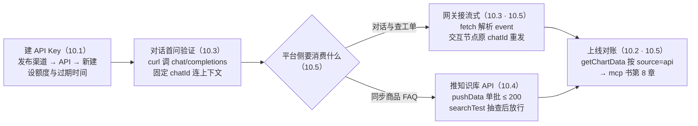
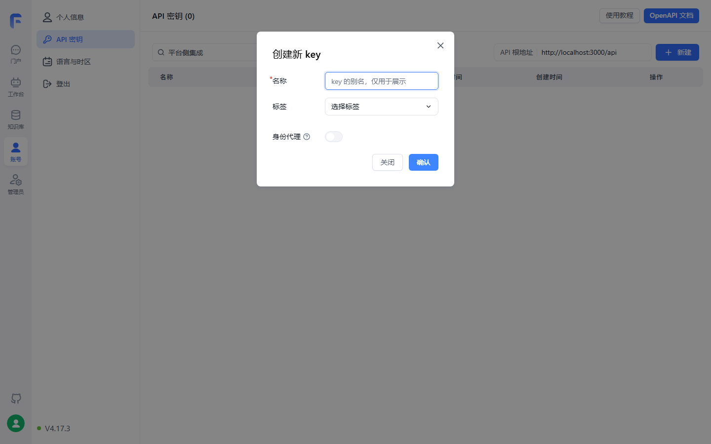
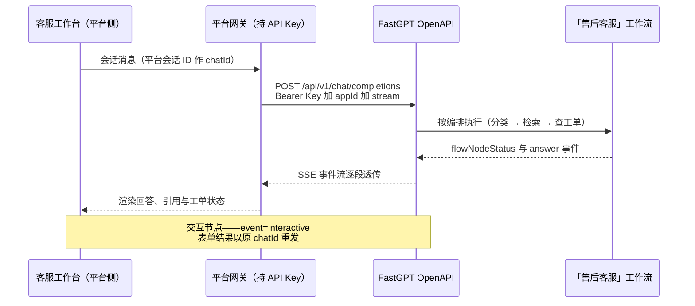

# 第 10 章 对外集成：OpenAPI

> 本章导读：第 9 章把「售后客服」交到了人手里——客服团队用免登录链接，企业内部走钉钉机器人；还差最后一类消费方：程序。平台侧的自有客服工作台要在同一个应用上发起对话、拿到流式回答与引用溯源；《商品 FAQ》若源头是自建系统而非钉钉表格，也需要程序化写进 `after-sales-kb`。本章先讲清 API 体系与鉴权——两套文档的分工、API 密钥（API Key）的成员级边界；再依次走三类接口：对话 API（OpenAI 兼容格式、流式事件、交互节点）、应用日志 API、知识库 API（集合与数据管理）；最后把平台侧消费链路拼成可运行代码——curl 与 fetch 双形态。读完本章，你能：用一个 API Key 对「售后客服」发起带上下文的流式对话，并接住一次表单交互。



*本章操作流程图*

## 你什么时候需要它

三种典型处境，对应本章三种用法。

**平台侧系统要把「售后客服」接进自有产品**——客服工作台、工单系统、移动 App 想直接复用第 7 章的工作流能力，而不想让人登录 FastGPT 界面——走 10.1 拿密钥，10.3 发起对话，10.5 有完整链路。这是本章的主线。

**外部系统的内容要程序化写进知识库**——第 5 章的 API 知识库是「FastGPT 拉」，前提是你的系统能按规范出接口；源头出不了接口时，反过来由你的定时任务把内容推进来——10.4 的集合与数据 API 就是这条「推」的路。

**要算账、看量、查错误**——渠道与 API 都放开后，平台侧调用了多少、错了多少、积分花了多少——10.2 的两个日志接口按来源（source）拆开给你；单条对话出问题，10.3 的记录接口能下钻到节点级明细。

前置：第 7 章工作流版「售后客服」已发布（发布动作本身见第 9 章）；你的账号在该团队下对目标应用与知识库有权限——API Key 即成员凭证，不按应用单独发密钥（见 10.1）。

## 10.1 API 体系与鉴权

### 两套文档：Dev API 与 System OpenAPI

从 v4.15.0 起，官方 API 文档改用 zod-openapi 自动生成，旧文档里左侧手动编辑的接口说明不再更新——查最新接口以自动生成的文档为准。文档分两套：

| 文档 | 覆盖范围 | 能否用 API Key 调用 | 地址 |
|------|---------|--------------------|------|
| Dev API | 全部开发中的接口 | 不一定 | `{endpoint}/apidoc/devapi` |
| System OpenAPI | 系统开放的全部接口 | 可以 | `{endpoint}/apidoc/systemopenapi` |

云服务用户把 `{endpoint}` 换成 `https://cloud.fastgpt.cn`（大陆版）或 `https://cloud.fastgpt.io`（国际版）；自托管就是第 2 章部署出的那个地址。本章全部端点出自 System OpenAPI 侧素材，对接前先确认目标接口在这套文档里。

### 获取 API Key：两个入口与成员级边界

两个入口都能看到 API 密钥：账号 →「API 密钥」；应用 →「发布渠道」→「API 访问」。在后者的入口点「新建」即可创建。

关键的一条变化（素材原文）：发布渠道 API 入口展示的是当前登录成员可用的 **API 密钥（API Key）**——它是**团队成员的开放接口调用凭证，不再按应用创建专属密钥**。边界随之而来：密钥等价于「当前账号在当前团队下」的访问凭证，团队内有权限的资源（应用、知识库）都能用它操作——**把 Key 给谁，等于把你的团队身份给谁**。官方 Tips 给的缓解手段是设置额度或过期时间，防止 Key 被滥用；创建后如需再次复制，在 API 列表点复制按钮。

账号侧入口的实测形态如下——以下界面截图来自本地部署的 FastGPT 社区版 v4.17.3（2026-11-03 实测，模型 glm-5.3-flash + embedding-3）：



API 根地址就标在密钥列表上方（自托管即第 2 章部署出的地址）；创建密钥时除别名与标签外还有一个「身份代理」开关——本节末尾「以谁的身份执行」的代理配置，落点就在这里。

### 鉴权配置与 appId 三级优先级

OpenAPI 全部接口经 `Header.Authorization` 鉴权，基础配置两行（素材原文）：

```bash
baseUrl: "http://localhost:3000/api"
headers: {
    Authorization: "Bearer {{apikey}}"
}
```

调用 `chat/completions` 时推荐在请求体传 `appId`；为兼容 OpenAI 生态，也支持把 appId 拼进密钥本身：`Authorization: Bearer <apiKey>-<appId>`。三个来源的优先级：

| 优先级 | appId 来源 | 说明 |
|--------|-----------|------|
| 1 | 请求体 `body.appId` | 显式传入，推荐 |
| 2 | `<apiKey>-<appId>` 拼接格式 | 给只能配置一个密钥串的第三方应用用 |
| 3 | API Key 关联的 appId | 旧版兼容 |

三个 ID 从界面拿：appId 在应用详情的浏览器地址栏 URL 里；datasetId 与 collectionId 在知识库与集合的详情页（素材以截图示意位置）。

平台侧还有一条：如需经 `authProxy` 代理团队成员身份——统一网关代表不同成员调用——须由团队所有者在创建或编辑密钥时开启；代理身份仍需具备目标应用与会话的访问权限（FastGPT v4.15.0 起）。这与第 9 章 MCP Server 的身份代理同构，都是「以谁的身份执行与记账」的问题。

### 边界与坑

- SDK（软件开发工具包，Software Development Kit）报 404 先补 `/v1`：部分 SDK 需要在 BaseURL 后拼 `v1` 路径，素材原话「可补充 v1 后重试」；
- 密钥是成员级凭证，只放服务端配置——进前端代码、进 Git 仓库都等于交出团队身份（本书立场）；
- Dev API 文档里的接口不一定能用 API Key 调——对接前先确认它在 System OpenAPI 文档中。

## 10.2 应用管理 API：两个日志接口

前置两样：API Key 与 appId（可直接用全局密钥）。素材给出两个接口，都在应用日志域：

| 接口 | 方法与路径 | 入参 | 出参 |
|------|-----------|------|------|
| 应用总体数据统计 | GET `/api/proApi/core/app/logs/getTotalData` | `appId` | totalUsers 累积使用用户数；totalChats 累积对话数；totalPoints 累积积分消耗 |
| 应用图表数据 | POST `/api/proApi/core/app/logs/getChartData` | `appId`；`dateStart`/`dateEnd`；`source` 数组；`offset`（留存偏移）；`userTimespan`/`chatTimespan`/`appTimespan` | userData（活跃/新增/留存用户、积分、各来源用户数）；chatData（对话次数、会话次数、错误次数、积分）；appData（好评/差评数、对话次数、总响应时间） |

三个时间跨度取值为 day|week|month|quarter；`source` 可选十种：test、online、share、api、cronJob、team、feishu、official_account、wecom、mcp——第 9 章的分享链接与各 IM 渠道、本章的 OpenAPI、MCP Server 在这个枚举里会师，对账时按来源拆分靠的就是它。

边界：两个接口路径带 `/proApi/` 前缀，素材未标注其形态（社区版/商业版）要求——本书不下结论，以你的部署实测为准（挂本章复核清单）。

## 10.3 对话 API：一个接口，四种响应

### 请求参数：五个扩展字段

`POST /api/v1/chat/completions` 是整个 OpenAPI 的主角。请求结构与 OpenAI 的 chat 模式一致（messages 字段，素材原文），FastGPT 在其之上扩展了五个参数——下表把原生与扩展一并列出：

| 参数 | 说明 |
|------|------|
| `appId` | 应用 ID，推荐请求体传入（优先级见 10.1） |
| `chatId` | 会话 ID。不传：不使用平台上下文，完全由传入的 messages 构建对话；传非空字符串：使用该会话的历史，messages 只取最后一条作为用户问题，其余忽略。须自行确保唯一、长度小于 250，通常用自有系统的对话框 ID |
| `messages` | 与 OpenAI chat 格式一致 |
| `responseChatItemId` | 可选。指定本次响应消息的 ID，平台会存库；须在同一 chatId 下唯一 |
| `detail` | 是否返回中间值（节点状态、完整结果）；stream 模式经 event 区分，非 stream 模式保存在 responseData |
| `variables` | 模块变量对象，替换编排中输入框内容里的 `[key]` |

### 四象限：detail 与 stream 的组合

两个布尔参数组合出四种响应形态：

| 组合 | 响应形态 | 典型用途 |
|------|---------|---------|
| detail=false 且 stream=false | OpenAI 格式 JSON：choices[0].message.content 加 usage | 后端一次性取整段回答 |
| detail=false 且 stream=true | SSE 文本流：data 行里 choices[0].delta.content 逐段追加 | 前台打字机效果 |
| detail=true 且 stream=false | 上者加 responseData 数组：各节点的模型、tokens、quoteList 引用、completeMessages | 服务端质检与溯源 |
| detail=true 且 stream=true | event 分类事件流：节点状态、回答、节点明细分开传 | 实时进度、引用与埋点 |

curl 基础请求（参数结构按素材示例，内容取贯穿案例）：

```bash
curl --location --request POST 'http://localhost:3000/api/v1/chat/completions' \
  --header 'Authorization: Bearer fastgpt-xxxxxx' \
  --header 'Content-Type: application/json' \
  --data-raw '{
    "appId": "your_app_id",
    "chatId": "support-20261102-0001",
    "stream": false,
    "detail": false,
    "variables": { "uid": "u_10086" },
    "messages": [
      { "role": "user", "content": "运输破损怎么赔偿？" }
    ]
  }'
```

响应里 `choices[0].message.content` 是给用户的最终回答，`usage` 给出 prompt_tokens、completion_tokens、total_tokens 三项计数。

### 流式事件：event 全集

stream=true 时返回服务器发送事件（Server-Sent Events，SSE）格式文本流，每条事件由 event 行与 data 行组成，`[DONE]` 标记收尾；detail=true 时事件类型（event）把进度、正文与明细拆开。event 全集以素材为准：

| event | 含义 |
|-------|------|
| answer | 返回给客户端的文本（计入回答） |
| fastAnswer | 指定回复节点返回的文本（计入回答） |
| flowNodeStatus | 当前运行到的节点状态 |
| flowResponses | 节点完整响应，含引用列表 |
| chatTitle | 依本轮用户问题生成的对话标题 |
| toolCall / toolParams / toolResponse | 工具执行三段：调用、参数、返回 |
| updateVariables | 变量更新 |
| interactive | 交互节点配置（见下文） |
| error | 报错 |

素材示例（detail=true 且 stream=true）的事件顺序：flowNodeStatus（知识库搜索）→ flowNodeStatus（AI 对话）→ answer 逐段 → `[DONE]` → flowResponses。对第 7 章的工作流版「售后客服」，这意味着平台侧能实时展示「正在检索知识库……正在查工单……」，toolResponse 事件对应 HTTP 节点拿回的工单数据；引用溯源（第 13 章引用分块阅读器的数据源）在 answer 完成后的 flowResponses 里。

### OpenAI 兼容的三条边界

- 传入的 `model`、`temperature` 等参数**均无效**——这些由编排决定，不随 API 参数改变；要改提示词与模型，回画布改（第 7 章）；
- 响应**不返回实际消耗的 Token 值**；需要时设 detail=true，从 responseData 里手动累加各节点的 tokens；
- 「OpenAI 兼容」指请求与响应结构兼容，SDK 报 404 先补 `/v1`（见 10.1）。

**本书立场：把 chat/completions 当成「触发一次编排」而不是「调用一个模型」——你在 OpenAI SDK 里习惯的采样参数在这里全部失效，行为调优发生在应用编排层，不在调用方。**

### 交互节点：一次暂停与再次请求

第 7 章用来收集手机号的表单输入，就是交互节点（Interactive Node）。工作流跑到交互节点会直接返回，前提是 detail=true：stream=true 时从 `event=interactive` 的 `data.interactive` 取；stream=false 时从 `choices[].message.content` 中取含 interactive 字段的元素。返回给外部调用方的是展示配置，只含 `type` 与 `params` 两类——用户选择（userSelect，含选项数组）与表单输入（userInput，含 inputForm 字段定义）；children、loop、tool 内部包装的交互，返回的是最深层面向用户的那个节点。

继续运行仍是同一个接口，规则两条：用户选择，把选择结果直接作为 messages 传回；表单输入，把「表单 key → 用户输入」对象序列化成字符串作为 messages 传回。`chatId` 必须与暂停那次一致——平台靠它找到工作流的现场。

### 会话与对话记录：CRUD 速查

三个 ID 分三层（素材「重要字段」）：appId 定应用，chatId 定应用下的会话，dataId 定会话下的一次对话记录。

| 接口 | 方法与路径 | 用途与要点 |
|------|-----------|-----------|
| 获取会话列表 | POST `/api/core/chat/history/getHistories` | appId、offset、pageSize；`source` 传 api 表示只取经 API 创建的会话，页面会话不混入 |
| 改标题或置顶 | PUT `/api/core/chat/history/updateHistory` | 传 customTitle 或 top |
| 删除单个会话 | DELETE `/api/core/chat/history/delHistory` | query 传 chatId 与 appId |
| 清空应用会话 | DELETE `/api/core/chat/history/clearHistories` | **只清 API Key 创建的会话**，不动在线使用、分享链接等来源 |
| 获取对话列表 | POST `/api/core/chat/record/getPaginationRecords` | 会话内逐条对话；loadCustomFeedbacks 可读自定义反馈 |
| 单条对话运行详情 | GET `/api/core/chat/record/getResData` | dataId 定位，返回节点级运行明细 |
| 删除对话 | DELETE `/api/core/chat/record/delete` | contentId、chatId、appId |
| 点赞或点踩 | POST `/api/core/chat/feedback/updateUserFeedback` | userGoodFeedback 或 userBadFeedback；取消则不传该参数 |
| 猜你想问（Question Guide） | POST `/api/core/ai/agent/v2/createQuestionGuide` | 4.8.16 起新版；必传 appId 与 chatId，依最近 6 轮对话生成建议问题 |

clearHistories 的作用域值得单独一句：平台侧做「注销即删除数据」类功能时，它只覆盖 API 来源的会话——用户在分享链接里的对话不在此列（记录机制见第 9 章 localId 一节）。

### 插件应用的调用差异

调用插件（Plugin）类型应用时，同一接口另有四条规则（素材原文归纳）：接口默认 detail 模式；无需 chatId——插件只能运行一轮；无需 messages——`variables` 即插件输入；输出从 responseData 中 `moduleType=pluginOutput` 元素的 `pluginOutput` 字段取，流式则在 `event=flowResponses` 的数据反序列化后同样找该元素。贯穿案例的工作流应用不涉及此差异，列出备查。

### 边界与坑

- detail=false 时拿不到引用与节点明细——平台侧要做溯源，必须 detail=true；
- 交互节点忘记带 detail=true，interactive 就不会出现；继续运行不带原 chatId，就是开了新会话；
- 长度超过 250 的 chatId 与不唯一的 responseChatItemId 都是素材明示的约束，生成规则在建会话时就定好。

## 10.4 知识库 API：集合与数据管理

### 三层对象速览

第 3 章的层次在 API 侧一一对应：知识库（Knowledge Base）→ 集合（Collection）→ 数据（Data，即 Chunk），外加搜索测试直连第 4 章的调优：

| 层 | 操作 | 端点前缀 |
|----|------|---------|
| 知识库 | create、list、detail、delete | `/api/core/dataset` |
| 集合 | create（六种）、listV2、detail、update、delete | `/api/core/dataset/collection` |
| 数据 | pushData、list（v2）、detail、update、delete | `/api/core/dataset/data` |
| 搜索测试 | searchTest | `/api/core/dataset/searchTest` |

### 集合创建：六种入口与通用参数

| 创建方式 | 端点（均为 POST） | 输入 | 说明 |
|---------|-----------------|------|------|
| 空集合或目录 | `…/collection/create` | name；type 取 folder 或 virtual | 虚拟集合用于手动挂数据 |
| 纯文本 | `…/collection/create/text` | text | 按传入文本分割 |
| 网页链接 | `…/collection/create/link` | link；可选 metadata.webPageSelector 指定抓取元素 | 先抓取再分割 |
| 本地文件 | `…/collection/create/localFile` | form-data 的 file 与 data（JSON 字符串） | 支持 pdf、docx、md、txt、html、csv；中文文件名需 encode |
| API 文件 | `…/collection/create/apiCollection` | apiFileId | 从 API 文件库取文件 |
| 外部文件 | `…/collection/create/externalFileUrl` | externalFileUrl 等 | 商业版 |

通用创建参数（节选，全表见素材）：

| 参数 | 说明 |
|------|------|
| `datasetId` | 知识库 ID，必填 |
| `trainingType` | chunk（按文本长度分割）或 qa（问答对提取），必填 |
| `chunkSettingMode` | auto 系统默认参数；custom 手动指定 |
| `chunkSize` | 分块大小，默认 1500（auto 模式不生效） |
| `indexSize` | 索引大小，默认 512，必须小于索引模型最大 token |
| `chunkSplitter` | 自定义最高优先分割符号 |
| `qaPrompt` | QA 拆分提示词 |
| `tags` | 集合标签（商业版）：结构化标签数组，兼容旧版字符串数组（见第 5 章） |
| `customPdfParse` | PDF 增强解析，默认 false |

响应返回 collectionId 与 insertLen（插入的块数量）——分割与训练在服务端的训练队列里异步完成，insertLen 是入队量。检索参数的完整语义（chunkSize 与 indexSize 的关系、QA 拆分的适用场景）见第 3、4 章，API 侧只是同一批旋钮。

### 数据推送与差量更新

推送端点为 POST `/api/core/dataset/data/pushData`，素材给了三条硬规则：每次最多推送 200 组数据；训练账单在调用时自动创建，无需传 billId；data 数组每条 q 必填、a 选填、indexes 选填——不传索引时默认用 q 与 a 组成一个索引。

Data 与 Index 的关键字段（节选）：

| 字段 | 说明 |
|------|------|
| q / a | 主要数据 / 辅助数据，q 必填 |
| indexes | 向量索引（Index）数组，每组数据的自定义索引最多 5 个 |
| indexes[].type | default、custom、summary、question、image；不填默认 custom |
| indexes[].dataId | 关联的向量 ID——更新时传入即**差量更新**，不做全量重建 |
| indexes[].text | 索引文本，必填 |

```bash
curl --location --request POST 'http://localhost:3000/api/core/dataset/data/pushData' \
  --header 'Authorization: Bearer fastgpt-xxxxxx' \
  --header 'Content-Type: application/json' \
  --data-raw '{
    "collectionId": "your_collection_id",
    "trainingType": "chunk",
    "data": [
      { "q": "问题主体文本", "a": "答案补充文本（可省略）" },
      { "q": "第二条数据", "indexes": [ { "text": "自定义索引文本" } ] }
    ]
  }'
```

数据维护四件：list（offset、pageSize 最大 30、collectionId、searchText）、detail、update（传 dataId 与新的 q、a、indexes；indexes 里带 dataId 的项做差量更新，不带的新建）、delete（按数据 ID）。第 4 章讲过检索靠索引而不是原文——update 时索引要不要跟着 q 一起改，素材未载明默认行为，先实测再定（挂复核清单）。

### 搜索测试：把第 4 章搬进程序

POST `/api/core/dataset/searchTest` 是第 4 章界面「搜索测试」的 API 等价物：

| 参数 | 说明 |
|------|------|
| datasetId 与 text | 知识库与待测文本 |
| limit | 最大 tokens 数量，结果最多 20000 tokens |
| similarity | 最低相关度，取值 0~1，可选 |
| searchMode | embedding、fullTextRecall、mixedRecall——语义、全文、混合（第 4 章） |
| usingReRank | 是否使用重排 |
| datasetSearchUsingExtensionQuery 等三项 | 问题优化开关、优化模型与背景描述 |

响应为 top k 结果列表，每条含 q、a、datasetId、collectionId、sourceName、sourceId 与 score。**本书立场：调优在界面做（第 4 章），回归在程序做——把调定的一组参数原样搬进 searchTest，每次知识库变更后断言「目标 chunk 是否仍在 top k」，这是第 13 章评测的原料。**

### 边界与坑

- 集合创建参数相互制约：chunkSettingMode=auto 时 chunkSize、indexSize、chunkSplitter、qaPrompt 均不生效——素材逐项标注了，别白调；
- pushData 单次 200 组是硬上限——《商品 FAQ》约 200 行，全量一批正好贴线，分两批更稳；
- 删除接口（知识库、collectionIds 数组、单条数据）素材均无二次确认的描述——程序侧自加一层「先停用、后删除」的缓冲；
- tags 的结构化数组与 listV2 的 tagFilters 筛选均为商业版能力，社区版按旧版字符串数组对待（第 5 章）。

## 10.5 实战：售后客服的平台侧消费链路

### 链路总览：网关持 Key

平台侧消费链路的组件分工与数据流：



分工一句话：**API Key 只放平台网关**，工作台前端永远不直接持有密钥——10.1 的成员级边界落到拓扑上的样子。工作流的 HTTP 节点在服务端调用中台工单接口 `GET /api/after-sale/tickets?phone={phone}`（第 7 章），平台侧经 toolResponse 事件看到它的返回。

### 对话调用：curl 与 fetch 双形态

curl 形态即 10.3 的基础请求；网关侧的 fetch 形态（Node.js，本书示例——素材无 JS 代码，标准 SSE 解析写法，未实测）：

```js
// 平台网关侧 —— POST /api/v1/chat/completions（Node 18+）
const res = await fetch("http://localhost:3000/api/v1/chat/completions", {
  method: "POST",
  headers: {
    Authorization: `Bearer ${process.env.FASTGPT_API_KEY}`,
    "Content-Type": "application/json"
  },
  body: JSON.stringify({
    appId: process.env.FASTGPT_APP_ID,      // 「售后客服」应用
    chatId: platformSessionId,              // 平台会话 ID 直接复用
    stream: true,
    detail: true,
    variables: { uid: platformUserId },
    messages: [{ role: "user", content: userText }]
  })
});

const reader = res.body.getReader(), decoder = new TextDecoder();
let buffer = "";
for (;;) {
  const { done, value } = await reader.read();
  if (done) break;
  buffer += decoder.decode(value, { stream: true });
  const lines = buffer.split("\n");
  buffer = lines.pop();
  for (const line of lines) {
    if (!line.startsWith("data:")) continue;   // event 行另行分派
    const payload = line.slice(5).trim();
    if (payload === "[DONE]") continue;
    const text = JSON.parse(payload).choices?.[0]?.delta?.content;
    if (text) pushToWorkbench(platformSessionId, text);   // 逐段透传
  }
}
```

三个实现要点。其一，按行缓冲——TCP 分包不保证 event 与 data 成对到达，半行数据必须留到下一轮；其二，event 行单独分派：flowNodeStatus 用来更新工作台进度，interactive 触发表单渲染，flowResponses 取引用列表；其三，收到 interactive 后暂停透传，用户提交表单后以**原 chatId** 重发——表单内容序列化成字符串（案例取值：第 7 章表单的 key 为 phone）：

```bash
curl --location --request POST 'http://localhost:3000/api/v1/chat/completions' \
  --header 'Authorization: Bearer fastgpt-xxxxxx' \
  --header 'Content-Type: application/json' \
  --data-raw '{
    "appId": "your_app_id",
    "chatId": "support-20261102-0001",
    "stream": true,
    "detail": true,
    "messages": [
      { "role": "user", "content": "{\"phone\":\"13800000000\"}" }
    ]
  }'
```

### 《商品 FAQ》每周推库

第 5 章留下的另一条路在此接通：API 知识库是「FastGPT 拉」，本节是「平台侧推」——FAQ 源头是自建系统、出不了规范接口时的替代路线。每周定时任务三步：

| 步骤 | 动作 | 依据 |
|------|------|------|
| 1 取数 | 从商品系统拉本周 FAQ（约 200 行） | 案例约定 |
| 2 写库 | 变更条目 PUT data/update 带 dataId 差量更新；新增走 pushData（单批 ≤ 200）；下架条目 DELETE data/delete | 10.4 |
| 3 放行 | searchTest 抽查三条代表问题，确认新数据可召回 | 10.4 与第 4 章 |

这套推库流程是本书设计的示例流程（素材只给端点，不给编排），未实测，挂复核清单；FAQ 源头在钉钉 AI 表格时，第 5 章的第三方同步仍是首选——推库是兜底，不是默认。

### 上线后的对账

- 量与错误：getChartData 过滤 `source: ["api"]`，看 chatCount 与 errorCount，points 对积分账（10.2）；
- 明细下钻：出问题的会话按 chatId 与 dataId 用 getResData 拉节点级运行详情，定位到具体节点（10.3）；
- 更重的可观测——SignOz 与调用日志——在第 11 章（→ langfuse 书）。

### OpenAPI 与 MCP Server 的分工

| 路线 | 交互形态 | 适合 |
|------|---------|------|
| OpenAPI（本章） | 对话即服务：平台侧自管会话、UI 与体验 | 自有工作台嵌入、多轮上下文自持、流式 UI |
| MCP Server（第 9 章） | 应用即工具：平台 Agent 按工具协议调用 | 平台侧 Agent 把「售后客服」当作编排里的一个工具 |

同一应用可以双路并行：工作台走 OpenAPI 拿对话体验，平台 Agent 走 MCP Server 拿工具调用——消费侧的完整链路（→ mcp 书第 8 章），在中台售后域会合。

### 边界与坑

- variables 里的 uid 等是业务变量，不是鉴权——鉴权只认 Bearer Key 与（开启后的）authProxy；
- 素材示例里 flowResponses 在 `data: [DONE]` 之后才到达——解析器别在 `[DONE]` 处提前退出，以连接关闭为准；
- 交互节点的表单 key 以 interactive 返回的 inputForm 为准，别按记忆硬编码——编排改了 key，程序就断；
- 清空与删除接口的作用域只到 API 来源——别拿它们清用户的分享链接对话。

## 本章小结

1. **API Key 是成员级凭证，不是应用密钥**：两个入口可建，团队内有权限的资源都能用它操作；额度与过期时间是官方给出的防滥用闸；appId 有三级优先级，SDK 报 404 先补 `/v1`。
2. **chat/completions 一个接口四种响应**：detail 与 stream 的组合分别覆盖「取整段、打字机、质检溯源、实时进度」；chatId 决定上下文策略——传则平台管历史，不传则你自己拼 messages。
3. **OpenAI 兼容有三条边界**：model 与 temperature 无效、Token 消耗不回传、兼容的是结构不是参数——行为调优回编排层。
4. **流式协议的主干是 event 全集**：answer 与 flowNodeStatus 管正文与进度，toolResponse 对应查工单，interactive 驱动「暂停—渲染—原 chatId 重发」的交互循环。
5. **知识库 API 是三层 CRUD 加一个 searchTest**：集合六种创建入口共享一组分块参数；pushData 单批 200 组，dataId 让更新走差量；searchTest 把第 4 章的调优参数搬进程序化回归。
6. **平台侧链路三件套**：网关持 Key、fetch 按行缓冲解析 SSE、《商品 FAQ》每周推库三步走；对账按 source=api 拆分，与 MCP Server 的「对话即服务、应用即工具」双路分工（→ mcp 书第 8 章）。

下一步：程序消费跑通，流量与账单都开始涨——第 11 章接住生产配置、对象存储、沙箱、SignOz 可观测与升级迁移；对话质量侧的标注与巡检在第 13 章。

## 验收清单

读到这里，你应该能：

- ☐ 在发布渠道新建一个 API Key 并设额度与过期时间，用 curl 对「售后客服」完成一次首问；
- ☐ 说出 appId 的三级优先级，并用 `<apiKey>-<appId>` 拼接格式在一个 OpenAI SDK 风格的客户端里调通；
- ☐ 用固定 chatId 连续两轮对话验证上下文生效，再换一个 chatId 验证两次会话互不串话；
- ☐ 以 detail=true 且 stream=true 发起请求，把一次回答的 event 按 flowNodeStatus、answer、flowResponses 的顺序数出来；
- ☐ 接住一次交互节点：从 event=interactive 读出 inputForm，把表单结果序列化成字符串以原 chatId 重发，拿到最终答复；
- ☐ 用 pushData 向集合推送两条数据（其中一条带自定义索引），在页面数据列表确认可见；
- ☐ 用 getChartData 按 source=api 拉出最近一天的对话量、错误数与积分消耗。

### 复核清单（发布前）

以下各项均未实测，发布前逐条补验：

- [ ] 全章端点与参数对照官方文档 v4.17.3（openapi 下 intro、app、chat、dataset 四篇与 guide/build/publish/openapi），核实日期 2026-11-01；
- [ ] 对话 API 四象限逐一实测，event 全集以实际返回为准（素材注明「不同版本具体值可能有差异」）；fetch 流式解析代码为本书示例（素材无 JS 示例），实测按行缓冲与 [DONE] 处理；
- [ ] 交互节点实测：interactive 的 type 与 params 结构、原 chatId 重发、最深层交互节点的返回规则；
- [ ] pushData 单次 200 组上限、insertLen 语义、dataId 差量更新与 data/update 时默认索引是否随 q 自动重建（素材未载明）实测，并按 10.5 三步流程完整跑一轮《商品 FAQ》推库（本书设计，含下架条目的删除）；
- [ ] 集合 tags 结构化数组与 listV2 的 tagFilters（商业版）实测，社区版行为单独确认；
- [ ] 应用日志两接口（`/proApi/` 路径）的可用性与形态要求核实——素材未标注，本书未下结论；
- [ ] searchTest 实测：limit 上限 20000 tokens、三种 searchMode 与第 4 章界面参数的对应关系；
- [ ] 章首操作流程图与 10.5 时序图在 GitHub 网页端的渲染检查。

## 延伸阅读

- **（→ mcp 书第 8 章）**——平台侧 Agent 经 MCP 消费 FastGPT 应用的完整链路，与本章 OpenAPI 的「对话即服务」在中台售后域会合，分工表见 10.5。
- **第 9 章（应用发布与渠道）**——MCP Server 的发布侧：同一应用「工具化」消费的另一半；分享链接的 localId 机制解释了清空接口的作用域。
- **第 4 章（检索方案与调优）**——searchTest 三个 searchMode 与重排参数的调优语境；先在界面调好，再搬进程序做回归。
- **第 5 章（知识库进阶）**——API 知识库的「拉」与本章 pushData 的「推」合成两条同步路线；集合 tags 字段的商业版细节在那一章展开。
